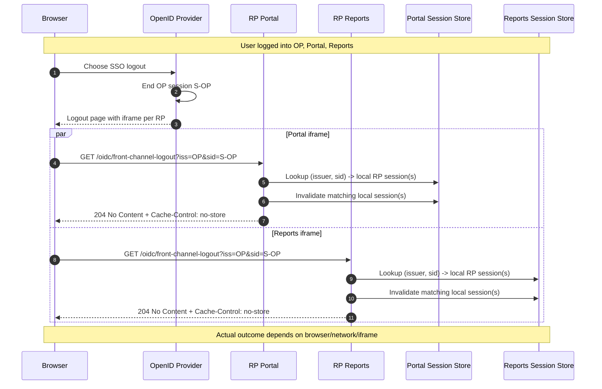

# 24.9. Front-Channel Logout, Session Management, and Compatibility Limits

In **Spring Security OAuth 2.0/OIDC Client**, users can sign in once at an **OpenID Provider (OP)** and open multiple different applications, each acting as a **Relying Party (RP)**. A tough question arises when they log out at the OP or in one of the applications:

> How do the other RPs learn that the shared login session ended so they can clear their own local sessions?

**OpenID Connect Front-Channel Logout 1.0** partially solves this by having the **OP send logout notifications to RPs through the user's browser itself**. Typically, the OP returns a page containing multiple `<iframe>` elements, each loading the registered `frontchannel_logout_uri` of an RP.

```text
User logs out at OP
        |
        v
OP returns logout page
  +-- iframe -> RP A /frontchannel/logout
  +-- iframe -> RP B /frontchannel/logout
  +-- iframe -> RP C /frontchannel/logout
        |
        v
Each RP attempts to clear its corresponding local session
```

This mechanism has the advantage of not necessarily requiring the OP to call server-to-server APIs on every RP. In return, however, it depends on the **user agent**, **third-party cookies**, **iframe embedding policies**, keeping the logout tab open, **session correlation**, and each RP's state. Therefore, front-channel logout **must not be understood as guaranteeing that all sessions, tokens, and access rights are immediately revoked**.

This lesson walks through:

- How front-channel logout works per the OIDC specification.
- Distinguishing **local logout**, **RP-Initiated Logout**, **Front-Channel Logout**, **Back-Channel Logout**, and **OIDC Session Management**.
- Format of `frontchannel_logout_uri`, `iss`, `sid`, and discovery/registration metadata.
- How to safely correlate **OP sessions** with **Spring Security sessions**.
- Obstacles caused by `SameSite`, third-party cookie blocking, CSP, and `X-Frame-Options`.
- What Spring Security supports out of the box, and what requires custom integration.
- Fallback options, combining with back-channel, timeouts, logout propagation, and cross-browser testing.

## 1. Why Is OIDC Logout More Complex Than Single-App Logout?

Suppose a user signed in via SSO at:

```text
OpenID Provider:
  https://login.example.org
```

and opened:

```text
RP A: https://portal.example.org
RP B: https://reports.example.net
RP C: https://support.example.com
```

After successful login, each RP may hold:

1. Its own **local session**, typically using a session cookie and session store.
2. **`SecurityContext`/Authentication** created from OIDC Login.
3. **`OAuth2AuthorizedClient`** holding an access token and optional refresh token.
4. Caches for user profiles, business permissions, or UI state.
5. A relationship to the **OP session**, identifiable via the `sid` claim in the ID Token when provided by the OP.

If the user clears only RP A's session, the following can remain:

```text
OP SSO session        : active
RP A local session    : terminated
RP B local session    : active
RP C local session    : active
Access tokens         : may still be valid
Refresh tokens        : may still be valid
```

Conversely, if the OP deletes the SSO session, **there is no default rule that makes every RP immediately clear its local session**. That is the problem OIDC Logout mechanisms are designed to address.

### 1.1. RP Sessions Differ from OP Sessions

| Component | Who Manages It? | Example |
|---|---|---|
| **OP SSO session** | OpenID Provider | Cookie/session on `login.example.org` |
| **RP local web session** | RP's Spring Security application | `JSESSIONID` or another session cookie |
| **OIDC `sid`** | Issued by OP and optionally stored by RP for correlation | Opaque identifier in ID Token |
| **OAuth authorized client** | RP, via repository/service | Access token and refresh token |
| **Access token lifetime** | Authorization Server/Resource Server | `exp` or introspection status |
| **Refresh token lifecycle** | Authorization Server and client storage | Rotation, revocation, expiry |

These lifecycles are **related yet not identical**.

### 1.2. Logout Does Not Automatically Mean Token Revocation

An RP deleting `HttpSession` does not mean the AS invalidated the access token. An OP ending its SSO session does not guarantee refresh tokens were revoked, depending on provider policy. An API may continue accepting unexpired access tokens.

Thus, to describe safe behavior accurately, distinguish:

- **Local session invalidation**: clears application authentication/session.
- **OP logout**: ends the session at the provider.
- **Federated logout notification**: asks other RPs to clear their sessions.
- **Token revocation**: revokes tokens at the AS if supported/required by policy.
- **Resource authorization**: APIs continue evaluating tokens and data permissions.

Do not collapse these five responsibilities into the single word "logout."

## 2. Five Easily Confused Mechanisms in OIDC

| Mechanism | Who Initiates? | Transport Path | Primary Target | Depends on Browser? |
|---|---|---|---|---|
| **Local Logout** | User/RP | Request to RP | Clears local session | Usually browser |
| **RP-Initiated Logout** | RP | Browser redirect to OP `end_session_endpoint` | Asks OP to end SSO session | **Yes** |
| **Front-Channel Logout** | OP | Browser loads iframe URLs of RPs | Notifies RPs of logout | **Yes, directly** |
| **Back-Channel Logout** | OP | Server-to-server POST Logout Token | Notifies RPs via backend | **No browser needed** |
| **OIDC Session Management** | RP/Browser | OP iframe + `postMessage`/`session_state` | Detects changes in OP login state | **Yes** |

### 2.1. Local Logout

When a user calls Spring Security's logout endpoint, the framework can clear `SecurityContext` and invalidate the local session as configured.

Spring MVC example:

```java
http.logout(logout -> logout
    .logoutSuccessUrl("/"));
```

This is **local logout**. Without adding an OIDC mechanism, the RP does not force the OP to log out.

### 2.2. RP-Initiated Logout

The RP redirects the browser to the OP's logout endpoint:

```text
https://login.example.org/logout
  ?id_token_hint=...
  &post_logout_redirect_uri=...
  &state=...
```

Parameters and endpoint acceptance depend on the spec and OP. Spring Security provides integration for RP-Initiated Logout, covered later.

### 2.3. Front-Channel Logout

The OP returns a page with iframes pointing to the RPs. Each RP receives a GET to its registered URL and clears the appropriate login state.

**There is no signed Logout Token in standard front-channel requests.** The `iss`/`sid` parameters identify/match sessions; they do not provide cryptographic proof that the request definitely came from the OP.

### 2.4. Back-Channel Logout

The OP sends a direct request to the RP server, usually an HTTP POST carrying a **Logout Token** (JWT) whose signature and claims the RP validates.

This mechanism can work even when the browser is closed, though it requires OP and RP support and imposes its own requirements for sessions, routing, validation, and token lifecycles.

### 2.5. OIDC Session Management

Another mechanism uses `check_session_iframe` and `session_state`; the RP queries the OP's iframe to ask whether the SSO state has changed.

It is **not** the same mechanism as front-channel logout, even though both use iframes and are affected by third-party content restrictions.

## 3. Front-Channel Logout Per Specification

OpenID Connect Front-Channel Logout 1.0 defines how an OP delivers logout notifications through the user agent.

### 3.1. RP Registers a Logout URI

Example:

```text
frontchannel_logout_uri =
  https://portal.example.org/oidc/front-channel-logout
```

The RP registers this URI with the OP via admin settings or Dynamic Client Registration if supported.

Per specification, a front-channel logout URI:

- Must be an **absolute URI**.
- Must share **scheme, host, and port** with one of the RP's registered redirect URIs per spec rules.
- May include a registered query string.
- Must **not contain a URI fragment**.
- Should use **HTTPS** in real deployments.
- Must be handled by the RP when loaded inside an iframe.

Example:

```text
Authorization redirect URI:
  https://portal.example.org/login/oauth2/code/company

Front-channel logout URI:
  https://portal.example.org/oidc/front-channel-logout
```

Both URLs share an origin in the example yet serve **different functions**. The login callback is not the logout endpoint.

### 3.2. OP Embeds Logout URLs in Iframes

After deciding to terminate an SSO session, the OP can render a page:

```html
<!doctype html>
<html lang="en">
<head>
  <meta charset="utf-8">
  <title>Signing out</title>
</head>
<body>
  <p>Terminating linked sessions...</p>

  <iframe
    src="https://portal.example.org/oidc/front-channel-logout"
    hidden
    title="Portal logout">
  </iframe>

  <iframe
    src="https://reports.example.net/oidc/front-channel-logout"
    hidden
    title="Reports logout">
  </iframe>
</body>
</html>
```

This HTML **illustrates the OP-side page**, not a page the Spring RP renders merely to receive logout.

The OP may load iframes in parallel. Browsers may block or skip loading content per privacy/security settings.

### 3.3. RP Reacts When the Iframe GET Loads

The RP receives:

```http
GET /oidc/front-channel-logout HTTP/1.1
Host: portal.example.org
```

and attempts to identify the matching local session and clear session/authentication state per policy.

The spec allows an already-logged-out RP to treat the request as successful; the endpoint should be **idempotent**, not requiring an active session or returning an error when absent.

### 3.4. Never Assume the OP Always Fires the Iframe

Front-channel logout is only sent if:

- The OP supports the mechanism.
- The RP registered the exact front-channel logout URI.
- The OP knows which RPs participated in the session.
- The OP actually triggers logout notifications for those RPs.
- The browser can issue the request.
- Iframe/cookie/network policies do not block any required step.

Even when an OP advertises support, real-world compatibility depends on browsers and the RP's correlation strategy.

## 4. `iss` and `sid` Parameters in Front-Channel Logout

To pinpoint the right session at the RP, the OP **may** append two query parameters.

```http
GET /oidc/front-channel-logout
    ?iss=https%3A%2F%2Flogin.example.org
    &sid=op-session-08a5019c HTTP/1.1
Host: portal.example.org
```

In actual requests, the URL sits on a single line; it is wrapped here for readability.

### 4.1. What Is `iss`?

`iss` is the **OP's issuer identifier** issuing the logout notification.

Example:

```text
iss = https://login.example.org
```

The RP must match it against an issuer the RP trusts via OIDC client registration. Never pick a new issuer simply because a query parameter claims it.

### 4.2. What Is `sid`?

`sid` is the **session identifier** used by the OP to identify the session between OP and RP.

Example post-login ID Token containing the claim:

```json
{
  "iss": "https://login.example.org",
  "sub": "employee-725",
  "aud": "portal-web-prod",
  "sid": "op-session-08a5019c",
  "exp": 1794803600,
  "iat": 1794800000
}
```

When the OP sends front-channel logout:

```text
iss=https://login.example.org
sid=op-session-08a5019c
```

The RP can look up local sessions associated with this `(iss, sid)` pair.

**Important:** `sid` does not equal `JSESSIONID`. One value is the OP-side session; the other is the RP-side session identifier.

### 4.3. What If One Parameter Appears?

Per Front-Channel Logout 1.0:

- The OP **may** send `iss` and `sid`.
- If it sends **one** of them, it **must send both**.
- The RP can compare these values against claims in the current/recent session's ID Token to detect mismatches.

High-security applications should generally require both to target sessions accurately rather than relying solely on third-party cookies.

### 4.4. `iss` and `sid` Are Not a Signature

Front-channel logout GETs normally carry no signed JWT. The query string:

```text
?iss=https://login.example.org&sid=op-session-08a5019c
```

**does not by itself prove** the request was created by the OP. Another party could call the same URL if it knows or guesses those values.

Verifying `iss` matches a trusted issuer and `sid` exists in the session index helps the RP **target the right session**, yet provides no cryptographic origin proof like a Back-Channel Logout Token.

Consequences:

- Never use front-channel GET as sufficient proof to revoke all sensitive tokens across multiple users without a dedicated policy.
- Never accept an arbitrary `sid` and delete every session of the same `sub`.
- Account for **logout CSRF / forced logout** risks.
- Do not log raw `sid` widely or treat it as a secret authenticating the request.

## 5. Discovery Metadata and Client Registration Metadata

OIDC defines metadata to determine whether OP and RP support front-channel logout.

### 5.1. OP Discovery Metadata

Example from OP:

```json
{
  "issuer": "https://login.example.org",
  "authorization_endpoint": "https://login.example.org/authorize",
  "token_endpoint": "https://login.example.org/token",
  "jwks_uri": "https://login.example.org/jwks",
  "frontchannel_logout_supported": true,
  "frontchannel_logout_session_supported": true
}
```

Relevant fields:

| Metadata | Where It Appears | Meaning |
|---|---|---|
| `frontchannel_logout_supported` | OP Discovery | OP supports the front-channel logout mechanism |
| `frontchannel_logout_session_supported` | OP Discovery | OP can send `iss` and `sid` to identify the session |
| `frontchannel_logout_uri` | RP client registration | RP URL loaded by OP inside an iframe |
| `frontchannel_logout_session_required` | RP client registration | RP requires `iss` and `sid` with the logout URI |

If the OP does not advertise support, do not infer it from `end_session_endpoint` or from the OP having a logout page.

### 5.2. RP-Side Registration Metadata

Example registration payload on the OP side showing spec semantics:

```json
{
  "client_id": "portal-web-prod",
  "redirect_uris": [
    "https://portal.example.org/login/oauth2/code/company"
  ],
  "frontchannel_logout_uri":
    "https://portal.example.org/oidc/front-channel-logout",
  "frontchannel_logout_session_required": true
}
```

This payload **illustrates OIDC RP metadata**, not automatic Spring Boot `application.yml` syntax.

If `frontchannel_logout_session_required` is omitted, the spec default is `false`. When set to `true`, the OP must support passing `iss`/`sid`; if the provider cannot, session-targeted logout will not work.

### 5.3. Do Not Confuse Discovery Support with Framework Support

`spring.security.oauth2.client.provider.company.issuer-uri` lets Spring Boot fetch OIDC metadata for supported OAuth2/OIDC Client features.

However, the OP returning:

```json
"frontchannel_logout_supported": true
```

**does not automatically create** a Spring `/oidc/front-channel-logout` endpoint, store `sid ↔ HttpSession` mappings, or configure iframe headers for that endpoint.

Distinguish **OP supporting the protocol** from **RP framework having built-in inbound front-channel integration**.

## 6. Front-Channel Logout Flow with `iss` and `sid`



Steps:

1. The user has an SSO session at the OP.
2. The OP knows which RPs were used in that session.
3. User/logout action triggers OP notifications.
4. The OP renders an iframe for each `frontchannel_logout_uri`.
5. The browser sends GET requests to the RPs.
6. Each RP finds its matching local sessions from mappings recorded at login.
7. Each RP invalidates local sessions and cleans up state per policy.
8. Open RP tabs may not immediately refresh UI; on the next request, the session is gone so re-login is required.

**There is no guarantee every iframe completes.** A browser may block requests or the user may close the page early.

## 7. Session Management 1.0 Differs from Front-Channel Logout

### 7.1. OIDC Session Management Uses `check_session_iframe`

In **OIDC Session Management 1.0**, the RP can embed an OP iframe and exchange `postMessage` calls to ask whether the OP session state has changed.

OP discovery may include:

```json
{
  "check_session_iframe":
    "https://login.example.org/connect/check_session"
}
```

The Authentication Response may include:

```text
session_state=<opaque-state-value>
```

An RP-side script can send `client_id` and `session_state` via `postMessage` to the OP iframe and receive a status such as `unchanged`, `changed`, or `error` per spec.

### 7.2. Change Detection Does Not Automatically Delete All Sessions

If the OP iframe reports `changed`, the RP typically needs to verify login state and handle the session appropriately.

`changed` does not necessarily guarantee the user logged out; it can reflect other session changes. Therefore, do not translate every `changed` directly into "revoke all tokens."

### 7.3. Opposite Data Flow Directions

**OIDC Session Management:**

```text
RP page
  -> embeds OP check_session_iframe
  -> postMessage status check
  -> detects possible OP state change
```

**Front-Channel Logout:**

```text
OP logout page
  -> embeds RP frontchannel_logout_uri in iframe
  -> RP receives logout GET
  -> RP clears local session
```

### 7.4. Both Depend on Browser State

If third-party cookies/storage are blocked, an OP iframe inside an RP page cannot see the OP session the way a top-level OP visit can. Likewise, an RP iframe inside an OP page may not see RP session cookies.

Thus browser privacy protections impact **both**, though in opposite directions.

## 8. Cookie `SameSite` and Third-Party Cookie Blocking

This is the single most impactful compatibility constraint in real-world deployments.

### 8.1. Iframes Place the RP in a Third-Party Context

Suppose the active tab is:

```text
https://login.example.org/logout
```

The OP page embeds:

```html
<iframe
  src="https://portal.example.org/oidc/front-channel-logout">
</iframe>
```

Inside this tab, `portal.example.org` may be a **third-party site** relative to the top-level OP site. The browser decides whether to send Portal's cookies on the iframe request.

### 8.2. `SameSite=Strict` / `Lax`

If the RP session cookie has:

```http
Set-Cookie: JSESSIONID=...; Secure; HttpOnly; SameSite=Lax
```

then on a **cross-site iframe subrequest**, the browser normally **withholds the cookie** under `SameSite=Lax`.

With `SameSite=Strict`, restrictions are even tighter. If the RP endpoint relies solely on `JSESSIONID` from the request, it may fail to find the session to log out.

### 8.3. Is `SameSite=None; Secure` Enough?

You can configure:

```http
Set-Cookie: JSESSIONID=...; Secure; HttpOnly; SameSite=None
```

so the cookie is eligible to be sent in cross-site contexts when allowed by the browser.

**However, this does not guarantee third-party cookies are sent.** Many browsers enforce privacy controls, tracking prevention, cookie partitioning, or third-party storage blocking regardless of `SameSite`.

Switching `SameSite=Lax` to `None` may improve compatibility in some cases, yet carries security trade-offs and **is not a universal fix**.

### 8.4. Do Not Lower Cookie Security App-Wide Just for Front-Channel

Session cookies must be configured according to the RP's overall threat model:

- `Secure` and HTTPS.
- `HttpOnly` where appropriate.
- `SameSite` balanced across login redirects, CSRF, and browser requirements.
- Narrowly scoped path/domain.
- CSRF controls on state-changing endpoints.

Never switch all session cookies to `SameSite=None` just to make iframe logout work and forget to audit CSRF/CORS/session security.

### 8.5. Server-Side Session Index Reduces Cookie Reliance

If the front-channel request includes `iss` and `sid`, the RP can look up session IDs in a **server-side index** without needing a session cookie in the iframe.

```text
(issuer, providerSid, registrationId)
                |
                v
Server-side Session Correlation Index
                |
                v
RP session ID(s)
                |
                v
Distributed Session Store / Invalidation
```

This is a stronger design against third-party cookie restrictions, though a security limit remains: `iss`/`sid` on GET **are unsigned**. Validating the session mapping prevents deleting the wrong session; it does not cryptographically authenticate the request origin.

## 9. Browsers Can Block Iframes or Storage

### 9.1. Common Blocking Mechanisms

| Environment | What Can Happen |
|---|---|
| Browser blocks third-party cookies | RP iframe receives no RP session cookie |
| Cookie partitioning | RP cookie inside OP iframe differs from top-level RP cookie |
| Tracking protection | Browser skips or restricts iframe/cookies/storage |
| Ad/privacy extensions | Block certain requests/iframes by rule |
| CSP `frame-ancestors` | Prevents OP page from embedding RP logout document |
| `X-Frame-Options` | Legacy frame policy blocks iframe |
| Network timeout | One of the RP endpoints fails to respond |
| User closes logout tab early | Iframe requests never finish executing |
| Browser backgrounded/closed | Execution/networking delayed or aborted |
| JavaScript blocked | Breaks JS/session-management-based solutions |
| Client-side route rendering JS only | GET iframe may fail to run needed server-side logout |

### 9.2. `Cache-Control: no-store`

The spec recommends RP front-channel logout responses include:

```http
Cache-Control: no-store
```

Purpose: prevent browsers/caches from serving a cached response instead of sending a fresh logout request.

The endpoint should return a minimal response, such as:

```http
HTTP/1.1 204 No Content
Cache-Control: no-store
```

Never include access tokens, ID tokens, session identifiers, or PII in the body.

### 9.3. Do Not Treat a Loaded Iframe as Proof That All Logouts Succeeded

The OP may know the browser loaded an iframe, yet:

- A 200/204 response does not prove all server-side sessions were invalidated.
- An RP might return HTTP success and process logout asynchronously, then fail.
- Another RP might never receive the request.
- An open web tab might keep displaying cached data until the next interaction.

Each RP needs explicit session invalidation policies and proper observability.

## 10. CSP `frame-ancestors` and `X-Frame-Options`

A Spring Security web app commonly sets anti-clickjacking headers:

```http
X-Frame-Options: DENY
```

or:

```http
Content-Security-Policy: frame-ancestors 'none'
```

Meanwhile, front-channel logout requires the OP to **embed the RP's logout endpoint in an iframe**.

### 10.1. Tension Between Clickjacking Protection and Front-Channel Logout

If the RP logout document carries:

```http
Content-Security-Policy: frame-ancestors 'none'
```

the browser may refuse to embed the page. If the endpoint needs JavaScript/cookie operations inside the iframe, that flow may fail to finish.

### 10.2. Never Disable Frame Protection App-Wide

A dangerous fix:

```java
// Anti-pattern: allows framing on every page of the application.
http.headers(headers -> headers
    .frameOptions(frame -> frame.disable()));
```

This exposes pages containing sensitive data to unauthorized embedding and increases clickjacking risk.

Instead, configure a policy **specifically** on the logout endpoint allowing only trusted OP origins:

```http
Content-Security-Policy: default-src 'none'; frame-ancestors https://login.example.org
Cache-Control: no-store
```

Ensure other headers like `X-Frame-Options` do not conflict in supported browsers. Some older browsers handle CSP/`X-Frame-Options` differently.

### 10.3. Do Not Use Wildcard `frame-ancestors`

Avoid:

```http
Content-Security-Policy: frame-ancestors *
```

to "allow all OPs." Instead, allowlist only genuinely registered and controlled OP origins, e.g.:

```text
https://login.example.org
https://sso.partner.example
```

In a multi-provider RP, add only necessary origins; never let arbitrary request query parameters alter the CSP response.

### 10.4. Verify with Network Traces and Console

A request may still reach the server even when the browser refuses to render the document. Conversely, some browsers/security extensions block the request outright.

Do not assume "CSP blocked the iframe" always means the server missed the GET, or that "server received GET" means all JS cookie cleanup ran. Test in the actual browsers you support.

## 11. Session Correlation: Linking OP `sid` to RP Sessions

In practice, a user may hold multiple sessions:

```text
OP issuer: https://login.example.org
OP sid:    op-session-abc
RP:        portal.example.org

Local RP sessions:
  sess-rp-001  (Chrome)
  sess-rp-002  (Chrome tab/session restore?)
  sess-rp-778  (another browser/device)
```

Do not assume one OP `sid` always maps to **exactly one** RP `JSESSIONID`. The relationship depends on how the OP manages SSO sessions and how the RP creates sessions.

### 11.1. Mapping Built After Successful Login

Once Spring Security verifies the ID Token and builds the OIDC principal, the RP can store:

```text
Key:
  registrationId = company
  issuer = https://login.example.org
  providerSid = op-session-abc

Value:
  one or more localSessionIds
```

Mappings must only be created from **verified ID Tokens** or equivalent trusted sources. Never build session indexes from unverified `iss`/`sid` client inputs.

### 11.2. Why Is `registrationId` Needed?

In a multi-provider app:

```text
registrationId = company
issuer         = https://login.company.example
sid            = 123
```

differs from:

```text
registrationId = partner
issuer         = https://login.partner.example
sid            = 123
```

Using `sid` alone as a key risks collisions across providers. Even if two registrations share an issuer with different client policies, `registrationId` remains helpful to scope logout.

### 11.3. Store Timestamps and Correlation Lifetimes

A session index may need:

```text
registrationId
issuer
providerSid
rpSessionId
subject (optional metadata)
createdAt
lastSeenAt
expiresAt
```

When an RP session expires, logs out, or rotates its ID, clean up the matching entry. Never keep mappings indefinitely or allow an old `sid` to control sessions created later.

### 11.4. When the ID Token Lacks `sid`

`sid` supports session correlation when provided by the OP, yet not every OIDC login implementation/provider emits it in every flow.

If the RP requires session-based front-channel logout while the OP omits `sid`:

- You cannot fully identify sessions via `(iss, sid)`.
- You may try cookie-based front-channel when browsers permit it.
- Or choose **back-channel logout**, RP-Initiated Logout paired with short timeouts/reauth, or another provider-specific mechanism.
- Never synthesize `sid` from `sub` or username and treat it as an OP session identifier.

## 12. Designing a Servlet Front-Channel Logout Endpoint

Spring Security supports OAuth2/OIDC Login and several logout integrations, yet **do not assume `oauth2Login()` alone provides a spec-compliant inbound front-channel endpoint out of the box**.

A custom solution might comprise:

```text
Verified OIDC Login
  -> OIDC session indexing
      (registrationId, issuer, sid) -> RP session IDs

OP front-channel iframe GET
  -> endpoint /oidc/front-channel-logout
  -> validate params + lookup trusted issuer/session index
  -> invalidate only matching RP sessions
  -> cleanup token/session indexes per policy
  -> 204 / Cache-Control: no-store
```

### 12.1. Explicit Contract Interface for the Session Index

```java
import java.util.Set;

public interface OidcSessionCorrelationStore {

    void register(
        String registrationId,
        String issuer,
        String providerSid,
        String rpSessionId
    );

    Set<String> findRpSessionIds(
        String registrationId,
        String issuer,
        String providerSid
    );

    void removeRpSession(
        String rpSessionId
    );
}
```

This is an **application-defined interface**, not a built-in Spring Security API. Implementations must handle TTL, index uniqueness, concurrency, and persistence appropriate to the project's session store.

### 12.2. RP Session Invalidation Interface

```java
public interface LocalRpSessionInvalidator {

    void invalidate(String rpSessionId);
}
```

The implementation must use real session infrastructure (e.g., Spring Session repository or supported session manager), rather than deleting only a mapping key while leaving the session/authentication alive in the store.

If the app uses plain container `HttpSession`, the Servlet API **offers no generic "load arbitrary session by ID" operation**; invalidating a session by ID from a different request requires architectural support, usually a shared session repository or registry.

### 12.3. Front-Channel Logout Service

```java
import java.util.Set;

public final class FrontChannelLogoutService {

    private final OidcSessionCorrelationStore correlations;
    private final LocalRpSessionInvalidator sessionInvalidator;

    public FrontChannelLogoutService(
            OidcSessionCorrelationStore correlations,
            LocalRpSessionInvalidator sessionInvalidator) {
        this.correlations = correlations;
        this.sessionInvalidator = sessionInvalidator;
    }

    public void logoutMatchingSessions(
            String registrationId,
            String trustedIssuer,
            String providerSid) {

        Set<String> localSessionIds =
            correlations.findRpSessionIds(
                registrationId, trustedIssuer, providerSid);

        for (String rpSessionId : localSessionIds) {
            sessionInvalidator.invalidate(rpSessionId);
            correlations.removeRpSession(rpSessionId);
        }
    }
}
```

This example illustrates coordinating local session cleanup. In production, design idempotency, transactional/atomic state updates, distributed concurrency, and per-session error policies. Do not delete correlations before the session store confirms invalidation if doing so breaks retryability.

### 12.4. Controller Receiving `iss` and `sid`

Example **supporting only the case where both `iss` and `sid` are present**:

```java
import org.springframework.http.CacheControl;
import org.springframework.http.HttpStatus;
import org.springframework.http.ResponseEntity;
import org.springframework.web.bind.annotation.GetMapping;
import org.springframework.web.bind.annotation.RequestParam;
import org.springframework.web.bind.annotation.RestController;

@RestController
public class FrontChannelLogoutController {

    private static final String REGISTRATION_ID = "company";
    private static final String TRUSTED_ISSUER =
        "https://login.example.org";

    private final FrontChannelLogoutService service;

    public FrontChannelLogoutController(
            FrontChannelLogoutService service) {
        this.service = service;
    }

    @GetMapping("/oidc/front-channel-logout")
    public ResponseEntity<Void> logout(
            @RequestParam(name = "iss", required = false)
            String issuer,
            @RequestParam(name = "sid", required = false)
            String providerSid) {

        if (!TRUSTED_ISSUER.equals(issuer)
                || providerSid == null
                || providerSid.isBlank()) {

            return ResponseEntity
                .status(HttpStatus.BAD_REQUEST)
                .cacheControl(CacheControl.noStore())
                .build();
        }

        service.logoutMatchingSessions(
            REGISTRATION_ID,
            TRUSTED_ISSUER,
            providerSid
        );

        return ResponseEntity
            .noContent()
            .cacheControl(CacheControl.noStore())
            .build();
    }
}
```

**Critical security limitation:** this code **cannot authenticate the iframe request's origin** from `iss`/`sid` alone. It relies on the session index built from verified logins and clears only matching sessions. If `sid` leaks, an attacker can trigger **forced logout**. You need a threat model, rate limiting, monitoring, and should consider Back-Channel Logout when stronger notification proof is required.

This code also **does not include** the session invalidator implementation, login-time correlation indexing, filter-chain policy, CSP, auditing, or transactions. Never copy this controller alone and consider SLO production-ready.

### 12.5. Why Does the Iframe Endpoint Not Require `@AuthenticationPrincipal`?

If the browser withholds the RP session cookie in a cross-site iframe, the endpoint will see no active authenticated principal.

Thus the front-channel endpoint must usually **accept unauthenticated GETs** and locate sessions via `iss/sid` or a dedicated correlation mechanism. Because the request is unauthenticated, however, it **cannot be treated as a signed command from the OP**.

Avoid letting `.anyRequest().authenticated()` redirect the iframe back to the OP. Permit only the logout endpoint itself, never administrative/bulk-session-deletion endpoints.

## 13. Configuring `SecurityFilterChain` for the Iframe Endpoint

Servlet example:

```java
import org.springframework.context.annotation.Bean;
import org.springframework.context.annotation.Configuration;
import org.springframework.security.config.Customizer;
import org.springframework.security.config.annotation.web.builders.HttpSecurity;
import org.springframework.security.web.SecurityFilterChain;

@Configuration
public class SecurityConfig {

    @Bean
    SecurityFilterChain webSecurity(HttpSecurity http) throws Exception {
        http
            .authorizeHttpRequests(auth -> auth
                .requestMatchers(
                    "/",
                    "/login",
                    "/error",
                    "/oidc/front-channel-logout")
                    .permitAll()
                .anyRequest().authenticated())
            .oauth2Login(Customizer.withDefaults());

        return http.build();
    }
}
```

`GET /oidc/front-channel-logout` is permitted without an active principal. This is only appropriate under an idempotent/targeted logout threat model; the endpoint must perform no other destructive actions and never accept an arbitrary `userId` to log out accounts.

### 13.1. CSRF Is Not Authorization

Spring Security normally protects state-changing HTTP methods with CSRF, while GET typically needs no CSRF token. Front-channel logout uses GET, so be aware that **this GET intentionally causes a side effect** per the OIDC protocol.

Precisely because there is no CSRF token and no signed message, front-channel logout carries **logout CSRF** risk: another party can trigger logout if it knows how to target a session.

Do not apply the rule "GET is always safe and side-effect-free" to skip security analysis; this is a protocol exception requiring clear bounds.

### 13.2. Never Delete All Sessions When the Endpoint Is Called

Wrong:

```java
@GetMapping("/oidc/front-channel-logout")
public void logoutEveryone() {
    sessionRepository.deleteAll();
}
```

This is an availability vulnerability/mass logout hazard. You need registration + issuer + provider session ID mapping, or only the caller's local session if cookie context is valid and policy permits it.

### 13.3. Handling Iframe Security Headers Separately

Frame policy configuration for the **logout endpoint** should be scoped at the proper security filter chain/response header layer.

You can use a dedicated filter chain for the endpoint with clear matcher and order, or a path-scoped response header policy. Never disable `X-Frame-Options` across the entire RP and forget CSP `frame-ancestors`.

With multiple chains:

```text
@Order(1): /oidc/front-channel-logout -> permit, scoped iframe headers
@Order(2): web UI paths              -> oauth2Login + strict frame policy
```

Chain ordering and matcher scope must be verified in implementation; this is a suggested architecture, not guaranteed merely by placing `@Order`.

## 14. Recording `sid ↔ session` Mapping After OIDC Login

### 14.1. Extracting `sid` from the Verified ID Token

In Spring Security Servlet, after successful OIDC Login, the principal is typically `OidcUser`.

```java
import org.springframework.security.oauth2.core.oidc.user.OidcUser;

public void captureLoginMetadata(
        OidcUser oidcUser,
        String registrationId,
        String rpSessionId,
        OidcSessionCorrelationStore store) {

    String issuer = oidcUser.getIdToken()
        .getIssuer().toString();

    String providerSid = oidcUser.getIdToken()
        .getClaimAsString("sid");

    if (providerSid != null && !providerSid.isBlank()) {
        store.register(
            registrationId,
            issuer,
            providerSid,
            rpSessionId
        );
    }
}
```

This is an **illustrative helper**, assuming `OidcUser` was verified by Spring Security and `rpSessionId` comes from the real local session. It is not automatically called merely by declaring `oauth2Login()`.

To integrate into login success, choose an extension point matching your Spring Security version, such as a success handler delegating to standard success handling, a session authentication strategy, or an appropriate listener.

### 14.2. Do Not Replace the Success Handler and Lose Default Behavior

A naive custom success handler:

```java
.oauth2Login(oauth2 -> oauth2
    .successHandler((request, response, auth) -> {
        // only records mapping without continuing login success workflow
    }))
```

can break saved-request redirects or other duties if not fully implemented.

When customizing, ensure:

- The ID Token is already verified before saving mappings.
- The session already exists with its corresponding stable ID.
- The authorized client is saved in the right repository/service.
- Success redirects and `SecurityContext` persistence continue working.
- Mappings are cleaned up on session rotation/expiry/logout.

Do not treat the `captureLoginMetadata(...)` function above as a complete success handler.

### 14.3. Multi-Session Mapping

If the OP issues the same `sid` across multiple local RP sessions, the store may need:

```text
(issuer, sid, registration) -> Set<RP session ID>
```

On logout, invalidate the local sessions sharing that provider session per policy. Do not store only one `rpSessionId` and overwrite it when the user opens another session.

### 14.4. Cleaning Up Mappings When Sessions End

When an RP session expires or is invalidated:

```text
RP session expired
  -> remove related correlation index entry
```

Use event listeners/session lifecycle hooks appropriate to your Servlet container or Spring Session. Without cleanup, the index accumulates dead IDs over time.

## 15. Spring Session and Multiple Instances

If the app runs multiple Spring Boot replicas behind a load balancer:

```text
Browser
   |
Load Balancer
  /       \
RP Node A  RP Node B
   \       /
   Shared Session Store
        |
   Session Correlation Index
```

A front-channel iframe request may land on **Node B**, while the user originally logged in on **Node A**.

### 15.1. Why Is an In-Memory Map Not Enough?

For example:

```java
static Map<String, String> providerSidToRpSession;
```

is unsuitable for multi-node production:

- Each JVM holds different data.
- Restarts wipe mappings.
- No unified TTL/cleanup.
- Hard to guarantee thread safety.
- Risk of exposing PII and session IDs.
- Insufficient to invalidate sessions stored on other nodes.

### 15.2. Shared Store

One option is **Spring Session** with Redis/JDBC or another session management infrastructure, paired with a centrally managed correlation index.

However, **having Spring Session does not automatically create a `sid ↔ session` index**. You must add correlation data, listen to lifecycle events, or rely on a framework feature verified in your version's docs.

### 15.3. Do Not Delete Only the Index

If code runs:

```text
DELETE index[issuer, sid]
```

without invalidating the real session in the session store, `SecurityContext` can still be restored on subsequent requests.

Delete the **actual session** and related metadata per policy, not just the correlation row.

### 15.4. Concurrency and Idempotency

Two iframe requests may arrive concurrently or retry:

```text
GET /frontchannel?sid=S
GET /frontchannel?sid=S
```

The implementation must be idempotent:

- Do not crash if the session was already deleted.
- Never turn a duplicate logout into deleting another user's session.
- Never let stale mappings invalidate a new session after re-login.
- Use generation/versioning or TTL if needed to prevent races.

## 16. User May Re-Login While a Logout Iframe Arrives Late

Example:

```text
T0: User logs in with OP session S1, RP session R1.
T1: OP starts logout for S1; iframe request is delayed.
T2: User logs in again, creating OP session S2, RP session R2.
T3: Delayed iframe logout for S1 reaches RP.
```

If the RP implementation uses `sub=employee-725` to delete **all** of the user's sessions, it could wipe the newly created **R2**.

If the RP uses `(iss, sid=S1, registration)` recorded from the old ID Token, it can delete only sessions belonging to S1.

### 16.1. Do Not Use Email/`sub` Instead of `sid` When Session Precision Is Needed

- `email` is an unstable attribute and can be recycled.
- `sub` is a subject identity, not a session instance.
- `sid` identifies the OP-side session per contract.
- `JSESSIONID` is the local RP session.

When `sid` is absent, knowing only `sub` makes targeted front-channel logout harder to trust. Define an explicit fallback policy rather than silently wiping all sessions.

### 16.2. Re-Login in Another Tab

The user may still have stale UI/cached data in a tab. After local session invalidation, new requests must re-check authentication. If tabs need instant updates, use an **RP-owned** frontend state sync mechanism (BroadcastChannel, storage events, SSE/WebSocket), never treating it as an authorization boundary.

**Server-side session validation remains the authority on access.**

## 17. Front-Channel Logout Has No Signed Logout Token

Back-Channel Logout uses a **Logout Token** with dedicated OIDC formatting and validation. Front-channel passes `iss`/`sid` over browser GET.

### 17.1. Comparing Notification Reliability

| Aspect | Front-Channel | Back-Channel |
|---|---|---|
| Transport | Browser iframe GET | OP server-to-RP server POST |
| Notification has JWT signature? | **No in standard protocol** | **Yes, Logout Token** |
| RP needs browser cookie? | Possibly, if no session index | No browser cookie needed for OP send |
| Works when browser is closed? | Usually **no** | **Yes** while backend runs |
| Affected by third-party cookie blocking? | **Yes** | No |
| Requires OP direct connection to RP backend? | Not in the same way | Yes |
| Replay validation via JWT `jti`? | No standard signed logout token | Possible/recommended per Back-Channel spec |
| Session identification | `iss`/`sid` or cookie | Logout Token `iss`, `aud`, and `sid`/`sub` |
| Delivery certainty | Best effort via browser | Can retry/monitor server-to-server |
| Risk of forged logout requests | Higher due to unsigned URL | Reduced via signature/claims validation |

### 17.2. Back-Channel Also Has Limitations

Back-channel does not depend on third-party cookies, yet can still fail due to:

- RP backend unreachable from OP.
- TLS/mTLS/certificate/DNS issues.
- Invalid Logout Token issuer/audience/signature.
- Session registry unaware of the matching OP `sid`/`sub`.
- Overload or network timeouts.
- Multiple instances failing to share the session registry.
- Non-spec provider behavior.
- RP failing to clean up refresh tokens or domain sessions as expected.

Thus back-channel is generally a stronger notification mechanism, yet still demands thorough testing and operations.

## 18. RP-Initiated Logout in Spring Security

When the **RP asks the OP to log the user out**, Spring Security integrates RP-Initiated Logout. This is a **different** mechanism from inbound front-channel.

### 18.1. Servlet: `OidcClientInitiatedLogoutSuccessHandler`

Illustrative example:

```java
import org.springframework.context.annotation.Bean;
import org.springframework.context.annotation.Configuration;
import org.springframework.security.config.Customizer;
import org.springframework.security.config.annotation.web.builders.HttpSecurity;
import org.springframework.security.oauth2.client.registration.ClientRegistrationRepository;
import org.springframework.security.oauth2.client.oidc.web.logout.OidcClientInitiatedLogoutSuccessHandler;
import org.springframework.security.web.SecurityFilterChain;

@Configuration
public class OidcRpLogoutConfig {

    @Bean
    SecurityFilterChain filterChain(
            HttpSecurity http,
            ClientRegistrationRepository registrations
    ) throws Exception {

        var logoutSuccessHandler =
            new OidcClientInitiatedLogoutSuccessHandler(registrations);

        logoutSuccessHandler.setPostLogoutRedirectUri(
            "{baseUrl}/logged-out"
        );

        http
            .authorizeHttpRequests(auth -> auth
                .requestMatchers("/", "/logged-out", "/error")
                    .permitAll()
                .anyRequest().authenticated())
            .oauth2Login(Customizer.withDefaults())
            .logout(logout -> logout
                .logoutSuccessHandler(logoutSuccessHandler));

        return http.build();
    }
}
```

This configuration assumes the OP supports the logout endpoint provided via metadata, permits the post-logout redirect URI, and has matching client registration.

Spring runs local logout and then redirects the browser via the RP-Initiated Logout handler to the OP per capability/config. **Do not infer that front-channel for other RPs is configured** simply because this RP redirects to OP logout.

### 18.2. Depends on OP `end_session_endpoint`

An OP may advertise:

```json
{
  "end_session_endpoint": "https://login.example.org/connect/logout"
}
```

This is the **OP endpoint for the RP to request OP logout**, not the RP's `frontchannel_logout_uri`.

### 18.3. Post-Logout Redirect URI

After logout, the OP may redirect the user back to:

```text
https://portal.example.org/logged-out
```

This is the RP's logout notice page. It is not a front-channel callback and does not replace other RPs receiving logout notifications.

## 19. Spring Security Back-Channel Logout Support

Spring Security docs cover OIDC Back-Channel Logout configuration in supported versions:

```java
http
    .oauth2Login(Customizer.withDefaults())
    .oidcLogout(oidc -> oidc
        .backChannel(Customizer.withDefaults()));
```

Typically, the endpoint is documented as:

```text
/logout/connect/back-channel/{registrationId}
```

The provider sends a **Logout Token** to this endpoint; Spring provides token verification and session correlation per version/config.

**Do not confuse this endpoint with `frontchannel_logout_uri`.** An OP expecting a front-channel iframe GET is not automatically compatible with a back-channel POST Logout Token endpoint.

### 19.1. Depends on Spring Security Version

Class names, DSL options, session registries, custom handlers, and cookie/session requirements can differ between Spring Security 6.x and 7.x. When implementing, verify the docs for the **exact running version**.

For instance, docs mention components such as:

- `OidcBackChannelLogoutHandler` in Servlet.
- `OidcSessionRegistry` or provider session correlation mechanisms.
- `OidcBackChannelServerLogoutHandler` and reactive session registries in WebFlux.
- Session cookie name configuration when session infrastructure uses a non-default name.

Never copy code verbatim from another Spring Security branch without verifying class signatures.

### 19.2. Spring Back-Channel Support Does Not Mean Automatic Front-Channel Support

For **front-channel**, verify whether your framework/version provides matching inbound support. Spring Security docs focus on **local logout**, **RP-Initiated Logout**, and **Back-Channel Logout**; do not assume `oauth2Login()` creates a front-channel iframe endpoint automatically.

If an app must receive front-channel, you usually have to:

- Register the URI with the OP.
- Write/wire an appropriate extension endpoint.
- Manage OP `sid` ↔ local session correlation.
- Design security headers/cookies.
- Handle invalidation and concurrent sessions.
- Test browser compatibility.

## 20. Front-Channel and OIDC Logout in WebFlux

In WebFlux, Spring Security uses:

| Servlet | Reactive / WebFlux |
|---|---|
| `HttpSecurity` | `ServerHttpSecurity` |
| `SecurityFilterChain` | `SecurityWebFilterChain` |
| `HttpServletRequest` | `ServerWebExchange` |
| `HttpSession` | `WebSession` |
| `ClientRegistrationRepository` | `ReactiveClientRegistrationRepository` |
| `OAuth2AuthorizedClientRepository` | `ServerOAuth2AuthorizedClientRepository` |
| `OidcClientInitiatedLogoutSuccessHandler` | `OidcClientInitiatedServerLogoutSuccessHandler` |

### 20.1. WebFlux RP-Initiated Logout

Guiding example:

```java
import org.springframework.context.annotation.Bean;
import org.springframework.context.annotation.Configuration;
import org.springframework.security.config.Customizer;
import org.springframework.security.config.web.server.ServerHttpSecurity;
import org.springframework.security.oauth2.client.registration.ReactiveClientRegistrationRepository;
import org.springframework.security.oauth2.client.oidc.web.server.logout.OidcClientInitiatedServerLogoutSuccessHandler;
import org.springframework.security.web.server.SecurityWebFilterChain;

@Configuration
public class ReactiveOidcLogoutConfig {

    @Bean
    SecurityWebFilterChain webSecurity(
            ServerHttpSecurity http,
            ReactiveClientRegistrationRepository registrations
    ) {

        var logoutSuccessHandler =
            new OidcClientInitiatedServerLogoutSuccessHandler(
                registrations);

        logoutSuccessHandler.setPostLogoutRedirectUri(
            "{baseUrl}/logged-out"
        );

        return http
            .authorizeExchange(exchanges -> exchanges
                .pathMatchers("/", "/logged-out", "/error")
                    .permitAll()
                .anyExchange().authenticated())
            .oauth2Login(Customizer.withDefaults())
            .logout(logout -> logout
                .logoutSuccessHandler(logoutSuccessHandler))
            .build();
    }
}
```

Verify package names/signatures against your Spring Security version. The core point is that **WebFlux has no `HttpSession` and must never use Servlet logout handlers**.

### 20.2. Reactive Front-Channel Handler

If building front-channel yourself in WebFlux:

```text
GET /oidc/front-channel-logout?iss=...&sid=...
   -> validate registration/issuer/parameters
   -> reactive session correlation lookup
   -> reactive session invalidation
   -> HTTP 204 no-store
```

Never call blocking JDBC/Redis clients or `block()` on the Reactor Netty event loop. Use a reactive session store, reactive repository, or offload legacy blocking parts in a controlled way.

### 20.3. Do Not Equate `WebSession` with OP `sid`

`WebSession.getId()` is the local WebFlux session ID, not the OP's `sid`. A custom correlation index still needs the right identity key to invalidate sessions via cookieless iframe GETs.

## 21. Compatibility Limits Across OpenID Providers

Even when an OP advertises `frontchannel_logout_supported=true`, real capabilities can vary.

### 21.1. Metadata May Be Missing or Differ

OP A:

```json
{
  "frontchannel_logout_supported": true,
  "frontchannel_logout_session_supported": true
}
```

OP B:

```json
{
  "frontchannel_logout_supported": true,
  "frontchannel_logout_session_supported": false
}
```

OP C might not advertise front-channel logout or might support only a provider-specific mechanism.

Never assume every provider sends `iss/sid`.

### 21.2. Differences Between OP Sessions and Client Sessions

Some OPs rotate session IDs when:

- The user logs in again.
- The user switches accounts in the same browser.
- The OP rotates sessions.
- The OP updates policies or MFA state.
- Account linking or multi-device behavior occurs.

The RP must log out only local sessions correlated with the requested OP session—never take one session's `sid` and generalize across all users of that issuer.

### 21.3. Provider-Specific Behavior

Some providers may:

- Support front-channel only when callbacks are registered in the admin UI.
- Send iframes without `iss/sid`.
- Allow only one logout URL per client.
- Trigger front-channel only on full SSO logout, not local RP logout.
- Send notifications once while the browser keeps the logout page open.
- Combine back-channel and front-channel in a different order.
- Omit session claims from ID Tokens in certain flows.

Test the contract with your specific provider rather than relying on generic feature names.

### 21.4. Across Multiple Domains

`portal.example.org` and `login.example.org` may be same-site under browser policies, whereas `reports.example.net` is cross-site. RPs on different domains exhibit different cookie behavior.

**Same-origin** and **same-site** are not identical. Browser cookie policies may rely on schemeful site, while CSP `frame-ancestors` relies on origin. Never apply one heuristic to both.

## 22. When Front-Channel Logout Has No `sid`

Simple case:

```html
<iframe
  src="https://portal.example.org/oidc/front-channel-logout">
</iframe>
```

The RP receives a GET **without `iss/sid`**.

### 22.1. If the Browser Sends the Session Cookie

The RP can read the local RP session from the cookie and invalidate the request's session.

```text
iframe GET
  -> Cookie: JSESSIONID=<current-rp-session>
  -> RP invalidates this local session
```

However, if the cookie is withheld due to third-party cookie policies, the RP will not know which session to delete.

### 22.2. If the Browser Withholds the Session Cookie

The RP cannot infer the right session from a GET with no params and no cookie. Never turn that into:

```text
"Don't know which session"
  -> "Delete all sessions of every user"
```

Instead, record an **unresolvable front-channel notification** and apply alternative mechanisms/timeout policies.

### 22.3. Should You Switch to `SameSite=None`?

Only if security review approves and your browser support matrix proves it helps. Even `SameSite=None; Secure` does not bypass all third-party cookie blocking.

### 22.4. Alternatives

- OP/RP supporting `iss/sid` and a session index.
- Back-Channel Logout with verified Logout Tokens.
- Shorter RP session lifetimes and appropriate re-authentication policies.
- Session Management checks if browser/provider support them, though still browser-dependent.
- Application-specific notifications over a first-party channel.
- Token/consent cleanup per separate policy.

## 23. Idempotency and Response Latency

Front-channel logout may be invoked multiple times:

```text
GET ...?iss=OP&sid=S1
GET ...?iss=OP&sid=S1
```

The RP should treat a request targeting an already-ended session as a success or no-op.

### 23.1. Never Redirect to Login from the Logout Endpoint

If the logout endpoint returns:

```http
HTTP/1.1 302 Found
Location: /login
```

the iframe may follow multiple redirects, trigger unnecessary work, or even cause an RP/OP redirect loop.

For server-side invalidation, a `204` / `no-store` response is simple and clean. There is no need to render a login HTML page inside the iframe.

### 23.2. Timeouts and Network Failures

If the session store is slow, the endpoint needs clear timeouts and error handling. Do not return `204` success before durable session invalidation finishes if the app must guarantee at least local logout of matched sessions.

If hundreds of sessions map to one OP `sid`, design batch/concurrency limits. Never let a single frontend iframe hold DB connections indefinitely.

### 23.3. Never Keep Secrets in URLs

`iss`/`sid` are session correlation metadata, not raw access tokens. Never append:

```text
?access_token=...
?refresh_token=...
?id_token=...
```

to the front-channel logout URI. URLs can be recorded in access logs, browser history, or tracing. If logging `sid`, apply privacy policies and redaction.

## 24. Logout Across Multiple RPs and Cascading Effects

Suppose the OP logout page notifies three RPs:

```text
OP -> iframe RP A
OP -> iframe RP B
OP -> iframe RP C
```

RP A is an intermediate SSO system that also acts as an **OP for downstream apps**. When RP A receives logout, it may need to notify dependent apps onward.

### 24.1. Nested Iframes Per Spec

The spec describes how an RP that is also an OP may render downstream iframes to propagate logout.

However, deeper nested iframes increasingly run into:

- Third-party cookie blocking.
- Frame embedding policies.
- Browser timeouts and throttling.
- Cross-site storage partitioning.
- UI/navigation restrictions.
- Difficulty identifying which request failed.

Multi-tier architectures should consider back-channel/server-to-server notifications or an identity broker with clear policies rather than expecting nested iframe propagation to be reliable.

### 24.2. Avoiding Logout Loops

If RP A receives logout from OP B and calls logout back on B, a loop can occur.

Distinguish:

- **Receiving an upstream logout notification.**
- **Initiating an upstream logout.**
- **Notifying downstream sessions.**

Idempotency and correlation IDs/issuer/session states help prevent uncontrolled recursion.

## 25. Session Invalidation Does Not Clear All Authorized Clients by Default

In Spring Security, login sessions and `OAuth2AuthorizedClient` are separate concepts.

### 25.1. HTTP Session Storage

If authorized clients reside in the session repository, invalidating the session typically removes session-bound token state per implementation.

Still, check:

- Is there an external/distributed session store?
- Are tokens duplicated in caches?
- Do session replication and backups retain data?
- Does cleanup finish across all nodes?

### 25.2. Persistent `OAuth2AuthorizedClientService`

If tokens are stored via `JdbcOAuth2AuthorizedClientService` or a custom persistent service, invalidating `HttpSession` **does not necessarily delete token records** in the DB.

A user may log out of SSO while refresh tokens remain in backend storage if the app lacks a cleanup policy.

### 25.3. Consent and Offline Access

Some apps receive user consent for offline access. When the user logs out in the browser, business policy may:

- **Delete** the authorized client and revoke tokens immediately.
- **Keep the delegated offline grant** under separate consent/retention rules.
- Block only the UI session while continuing user-authorized background tasks.

Never make an implicit choice. Whether logout deletes offline access is a product/security decision that users should understand.

### 25.4. Refresh Token Rotation

If a refresh token rotated, local cleanup must use the latest token state. Never overwrite/revive a logged-out authorized client because an in-flight refresh request completed late.

Version/generation/tombstone controls or coordination may be needed in high-concurrency systems.

## 26. Logout, CSRF, and Forced Logout

### 26.1. Why Does GET Logout Differ from Ordinary GETs?

HTTP GET should in principle be designed without side effects per web semantics. Yet OIDC Front-Channel Logout deliberately uses GET iframes to ask RPs to delete sessions.

This is an exception that must be viewed from the security model: the endpoint accepts **requests triggered by a third-party browser context**.

### 26.2. Forced Logout Is an Availability Risk

If an attacker learns a valid `sid`, they can attempt to call:

```text
https://portal.example.org/oidc/front-channel-logout
  ?iss=https%3A%2F%2Flogin.example.org
  &sid=<known-provider-session-id>
```

and force the RP to log out an unintended session if the endpoint performs no further checks.

Consequences include session disruption, lost unsaved work, or forcing repeated re-logins. This is typically a **forced logout / availability risk**, not automatic account takeover.

### 26.3. Do Not Rely Solely on `Referer` or `Origin`

In GET iframes, `Origin`/`Referer` headers may be absent or altered by privacy policies. `Referer` is also not cryptographic proof that a request came from the OP.

Header checks can act as an extra signal, yet **cannot replace** Back-Channel's signed notifications.

### 26.4. Never Put Long-Lived Secrets in the Logout URI

Some systems consider adding `?secret=...` to the registered logout URI for authentication. Be extremely careful:

- URLs can be logged across OP, browser, and RP infrastructure.
- Query secrets can leak via referrers/tracing.
- There is no default replay protection.
- A shared secret exposes all sessions if leaked.

If reliable origin proof is needed, prefer a protocol with signed Logout Tokens like back-channel rather than inventing shared secrets in GET queries.

## 27. Compatibility with CSP and Clickjacking

An iframe logout endpoint usually must permit one OP origin to embed it, while other UI pages must not.

### 27.1. Per-Route Policies

```text
/oidc/front-channel-logout
  CSP: frame-ancestors https://login.example.org
  Cache-Control: no-store

/account
  CSP: frame-ancestors 'none'

/admin
  CSP: frame-ancestors 'none'
```

On routes with sensitive data, maintain strict anti-clickjacking policies. Never disable headers app-wide.

### 27.2. Never Render Sensitive Information Inside the Iframe

The front-channel endpoint only needs to handle invalidation and return a minimal response. Never render user profiles, token metadata, account IDs, or session details.

### 27.3. Nested Iframes Require Extra Conditions

If an RP also acts as an OP for downstream apps, nested iframes require policies at every layer. Never grant unbounded wildcard origins just to make an iframe chain work.

### 27.4. Check `frame-src` and `frame-ancestors` on the Right Sides

- `frame-ancestors` on the **RP response** governs who may embed the RP logout page.
- `frame-src` (or `child-src` in relevant policies) on the **OP page** governs which origins the OP page may load in iframes.

Fixing only one side may not suffice. Browser consoles usually show which policy blocked it.

## 28. Pre-Production Compatibility Matrix

Test thoroughly rather than claiming front-channel works in every browser.

| Scenario | `iss/sid` Present? | RP Cookie in Iframe? | Expectation |
|---|---|---|---|
| Browser allows third-party cookies, OP sends `sid` | Yes | Yes | RP can identify session both ways |
| Browser blocks third-party cookies, OP sends `sid` | Yes | No | RP needs **server-side `sid` index** |
| Browser allows cookies, OP omits `sid` | No | Yes | Can only target local session via cookie if policy permits |
| Browser blocks cookies, OP omits `sid` | No | No | **Cannot identify exact local session** from plain GET |
| CSP blocks embedding | Any | Any | Must check whether request reached server and logic ran |
| Logout tab closed early | Any | Any | Notification may be missed |
| OP sends wrong `sid` | Present but unmatched | Any | Do not delete unmatched sessions |
| OP sends unknown issuer | Yes | Any | Reject per trusted issuer policy |
| Logout resent | Yes | Any | Idempotent, no crash |
| User re-logs in before stale iframe | Old `sid` | Any | Delete only sessions bound to old `sid` |
| Multiple RP replicas | Yes | Any | Index and session store must be shared |
| Authorized client stored in DB outside session | Yes | Any | Needs separate token cleanup policy |

### 28.1. Do Not Measure Success by HTTP 204 Alone

An endpoint returning 204 proves the handler completed its logic, yet does not guarantee all browser tabs/UI caches/tokens are clean. Verify:

1. Local session is genuinely no longer authenticated.
2. New requests to protected routes require re-authentication.
3. No old session mappings remain.
4. Token storage cleanup matches policy.
5. Other RPs received/missed notifications as expected.
6. Cookie-blocking browsers still work when `sid` indexing is present.

### 28.2. Measure in Real Environments

Test browsers in your product's support matrix across different privacy configurations. Do not test only in one Chrome profile allowing third-party cookies.

## 29. When the OP Does Not Support Front-Channel Logout

If the OP does not advertise `frontchannel_logout_supported` or the admin console disallows registering the URI, do not build an endpoint expecting the OP to call it.

Options:

- **Local Logout:** always ensure the RP ends sessions when users explicitly log out at the RP.
- **RP-Initiated Logout:** ask the OP to log out via `end_session_endpoint` if supported.
- **Back-Channel Logout:** prefer if OP/RP support it and more reliable SLO than browser iframes is required.
- **Short session lifetimes:** prevent local sessions from far outliving OP sessions.
- **Reauthentication policies:** use `max_age`, `prompt`, or equivalent rules to re-verify user sessions for sensitive actions.
- **Provider-specific hooks:** only with an explicit contract and dedicated tests.
- **Domain authorization:** check active permissions at the API, not solely the RP login session.

Never build a "fake front-channel" from arbitrary API polling or homemade iframes and treat it as equivalent to OIDC Front-Channel Logout 1.0.

## 30. Multi-Device Logout

Front-channel flows through **the browser currently displaying the logout page**. If a user is signed into the same account on:

```text
Laptop Chrome
Phone Safari
Tablet browser
```

a logout page on the laptop will not automatically traverse the other browsers.

If the OP wants "global logout all devices," it needs appropriate server-side session registry/notification mechanisms. Front-channel through one browser cannot guarantee reaching every session on other devices.

### 30.1. `sid` vs `sub`

- `sid`: identifies a specific OP session, useful for targeted logout.
- `sub`: user identity, which may span multiple sessions.

Back-channel Logout Tokens can express `sid` or `sub` per spec and provider policy. Front-channel relies by default on iframes and optional `iss/sid`, with no signed `sub` logout claim.

### 30.2. Never Advertise "Logout Everywhere" with Only Iframes

UI copy should accurately reflect what the system guarantees. If the product promises logging out all devices, implement server/AS-level mechanisms strong enough to fulfill that promise—not just an iframe in one browser tab.

## 31. Frontend Data Can Persist After Session Invalidation

An SPA served by an RP may hold:

- In-memory user profile.
- Cached API data.
- `localStorage`/`sessionStorage` app state.
- Offline service worker caches.
- Open WebSocket/SSE connections.
- Rendered data in un-reloaded tabs.

Even after the RP session is invalidated on the server, the UI may continue showing stale data until the app reacts.

### 31.1. Server-Side Authorization Remains the Source of Truth

If a user calls an API after logout:

```http
GET /api/orders HTTP/1.1
Cookie: JSESSIONID=<old-session-id>
```

the server must reject authentication using the invalidated session, regardless of whether the UI looks logged in.

Never just hide buttons or flip a JS variable and treat the server session as ended.

### 31.2. Syncing Same-Origin Tabs

The RP can use:

- `BroadcastChannel`.
- Storage events.
- SSE/WebSocket notifications.
- Session checks on tab focus.
- Session expiry responses and UI redirects.

These are supportive UX measures—not replacements for OIDC protocols—and do not let an OP iframe read data from a cross-origin RP.

### 31.3. Clearing Client-Side Storage

The Front-Channel Logout spec mentions RPs clearing session-related state, including cookies and HTML5 local storage where possible. However:

- `HttpOnly` cookies cannot be deleted directly by JS.
- Third-party iframes may see partitioned storage distinct from the top-level RP.
- Browsers may block iframe access to cookies/storage.
- Frontend code may not execute under CSP/frame blocking.

Therefore, make **server-side session invalidation** the security priority; client-side cleanup is a compatibility-bounded supplement.

## 32. Multi-Provider and Issuer Confusion

If an RP supports multiple OIDC providers:

```yaml
spring:
  security:
    oauth2:
      client:
        registration:
          company:
            provider: company
            client-id: ${COMPANY_CLIENT_ID}
            client-secret: ${COMPANY_CLIENT_SECRET}
            authorization-grant-type: authorization_code
            redirect-uri: "{baseUrl}/login/oauth2/code/{registrationId}"
            scope: openid,profile

          partner:
            provider: partner
            client-id: ${PARTNER_CLIENT_ID}
            client-secret: ${PARTNER_CLIENT_SECRET}
            authorization-grant-type: authorization_code
            redirect-uri: "{baseUrl}/login/oauth2/code/{registrationId}"
            scope: openid,profile

        provider:
          company:
            issuer-uri: https://login.company.example
          partner:
            issuer-uri: https://login.partner.example
```

never accept query `iss` and dynamically treat it as a trusted provider.

### 32.1. Trusted Issuer Allowlist

```text
company -> https://login.company.example
partner -> https://login.partner.example
```

A front-channel endpoint for `company` must accept only the matching issuer and query the correlation index in the exact namespace.

### 32.2. Never Use `sid` Alone

Two providers might accidentally generate the same `sid` string. If the index uses `sid` alone, logout from Provider A could wipe Provider B's session.

### 32.3. Never Pick Sessions by Login Email

One user might use the same email at two different OPs. Never assume two sessions share the same external identity solely by email. In OIDC, stable external identity relies on `(iss, sub)`; targeted session correlation uses `(iss, sid)` with registration context.

### 32.4. Never Call Back to an Input-Supplied Issuer URL

Never take `iss` from a front-channel GET and fetch discovery/JWKS from that URL to "check if the provider is real." That introduces SSRF/issuer trust bypass risks. Look up trusted registrations from server-side configuration.

## 33. Session Expiry and Late Logout Notifications

An OP may send front-channel logout after the RP session already expired:

```text
T0: RP session R1 created
T1: RP session R1 expired
T2: OP sends logout for sid=S1
```

This should be an **idempotent no-op** if the mapping was already cleaned up. Never return a server error simply because the session is gone.

### 33.1. Do Not Invalidate a Newly Re-Created Session Due to Stale Mappings

If the user logs back in under the same local cookie name with a new session ID, ensure old mappings cannot hit the new session.

### 33.2. Correlation Index TTL

The TTL should match the RP session lifecycle and provider policy. Do not extend it indefinitely just because the OP might notify late.

### 33.3. Manually Revoked Sessions

An admin may revoke a local session before OP logout. When a front-channel notification arrives later, the handler must handle it safely without resurrecting the session.

### 33.4. Races with Refresh Tokens

If an API request is refreshing a token while front-channel logout deletes the session, define a policy preventing **reinserting the authorized client** after logout. Generation/version/tombstone checks in persistent storage may be needed under high concurrency.

## 34. Logging and Observability for Front-Channel

Events to observe:

```text
event=oidc_front_channel_logout_received
registrationId=company
issuerAlias=company-sso
sidPresent=true
sessionMatches=1
invalidatedSessions=1
outcome=success
correlationId=<non-secret-id>
```

Never log raw `sid`/session IDs, access tokens, refresh tokens, or ID Tokens indiscriminately.

### 34.1. Useful Metrics

```text
oidc_frontchannel_requests_total{
  registration_id="company",
  outcome="matched"
}

oidc_frontchannel_requests_total{
  registration_id="company",
  outcome="no_matching_session"
}

oidc_frontchannel_requests_total{
  registration_id="company",
  outcome="invalid_issuer"
}

oidc_frontchannel_invalidation_duration_seconds{
  registration_id="company"
}
```

Metric names are illustrative only. Avoid putting `sid`, user IDs, or raw session IDs in metric labels as that balloons cardinality and leaks metadata.

### 34.2. Do Not Assume Browser Blocking Solely from Server Logs

If the server never receives a GET, it may be because:

- The OP did not render an iframe.
- The browser blocked the request.
- CSP/frame policy blocked it.
- The user closed the tab.
- DNS/network failed.
- Wrong registered URI.
- OP session did not track the RP.

Combine OP logs, browser Network/Console, and RP access logs to pinpoint the cause.

### 34.3. Measure Logout Consistency on Real Sessions

A real-world test should confirm after OP logout:

1. Protected RP requests cannot reuse the old session.
2. Authorized client cleanup follows policy.
3. Open browser tabs cannot continue calling APIs with the invalidated cookie.
4. Re-logged-in user sessions are not wiped by late notifications.
5. Other RPs reflect expected session state.
6. When browsers block iframes, fallback policies still mitigate risk.

## 35. Integration Testing OIDC Front-Channel Logout

### 35.1. Testing Session Mapping

Simulate:

```text
Registration company
Issuer https://login.example.org
sid S1 -> localSession R1, R2
sid S2 -> localSession R3
```

Send:

```http
GET /oidc/front-channel-logout?iss=https%3A%2F%2Flogin.example.org&sid=S1
```

Expectations:

- R1 and R2 are invalidated.
- R3 remains intact.
- Response is `no-store`.
- No token/session info leaked.

### 35.2. Testing Wrong Issuer

```http
GET /oidc/front-channel-logout?iss=https%3A%2F%2Funknown.example&sid=S1
```

Expectation: does not invalidate sessions of the trusted issuer.

### 35.3. Testing Missing `iss`/`sid`

If the RP sets `frontchannel_logout_session_required=true`, requests missing either parameter must be handled per policy—**never deleting all sessions**.

### 35.4. Testing Replay

Send the same GET twice. The second call must not delete other sessions or raise a server error.

### 35.5. Testing Multi-Node

Log in on Node A, send the logout iframe to Node B. Shared correlation index and session store must invalidate across nodes.

### 35.6. Testing Blocked Third-Party Cookies

No `Cookie` header on the iframe GET, yet `iss/sid` present. With indexed logout, the RP can still identify the session.

Without indexed logout, document the limitation rather than assuming logout succeeded.

### 35.7. Testing CSP/`X-Frame-Options`

- OP origin is allowed to embed the **logout endpoint**.
- Account/admin pages still block framing.
- Browser console shows no unexpected CSP violations.
- Endpoint needs no JS for critical server-side work.

### 35.8. Testing Re-Login Races

Session S1 receives late logout after S2 was created. Verify S2 is not deleted.

### 35.9. Testing When OP Does Not Notify

If a user logs out at the OP yet the browser never loads the iframe, verify RP session timeout/re-auth policies. Do not test only the happy path.

### 35.10. Testing Same Account Across Multiple Devices

Logout on a laptop does not automatically invalidate the RP session on a phone when only browser front-channel exists. Verify exact alignment with your product logout policy.

## 36. Anti-Patterns to Avoid

### 36.1. Assuming `oauth2Login` Automatically Enables Front-Channel

`oauth2Login()` handles OIDC authentication; it does not mean inbound front-channel logout is registered and fully implemented.

### 36.2. Treating `sid` as `JSESSIONID`

OP's `sid` is not the local RP session cookie ID; a correlation index is needed.

### 36.3. Relying Solely on Iframe Cookies

Third-party cookie blocking can strip session cookies from the request.

### 36.4. Using `sub`/Email to Delete All Sessions

That can accidentally wipe brand-new sessions or devices outside the OP session logging out.

### 36.5. Treating `iss`/`sid` as Signed Proof

Front-channel GET parameters are not signed like Back-Channel Logout Tokens.

### 36.6. Disabling `X-Frame-Options` App-Wide

Opening framing on sensitive pages raises clickjacking risk.

### 36.7. Ignoring CSRF / Forced Logout Risks

An unauthenticated GET endpoint with side effects needs strict scoping and abuse controls.

### 36.8. Using an In-Memory Map on a Cluster

Other nodes or restarts will lose mappings.

### 36.9. Deleting Only the Mapping Without Invalidating the Real Session

`SecurityContext` and local authentication can still survive.

### 36.10. Treating Session Deletion as Revoking Access/Refresh Tokens

Token lifecycles live in AS/authorized-client storage and need separate policies.

### 36.11. Treating `204` as Logout Everywhere

One successful iframe does not prove all RPs/devices/tokens have ended.

### 36.12. Disabling `SameSite` Protections App-Wide

Using `SameSite=None` without CSRF/browser policy analysis increases risk and still fails against third-party cookie blocking.

### 36.13. Accepting Any Issuer

Issuer/query inputs must never create dynamic trusted providers or fetch arbitrary JWKS.

### 36.14. Storing `sid` Without TTL

Stale indexes can hit new sessions and increase privacy risk.

### 36.15. Client-Side Logout Using Only JavaScript

If iframes are blocked or storage access is denied, scripts will not run; protect sessions server-side.

## 37. Choosing a Mechanism Based on System Needs

| Requirement | Mechanism to Consider |
|---|---|
| User explicitly logs out at RP | Spring local logout + RP-Initiated Logout if OP logout is needed |
| OP wants to notify RPs via browser | Front-Channel Logout when OP/RP and browsers support it |
| Want to avoid third-party cookie dependency | Front-channel with server-side `iss/sid` index, or back-channel |
| Want signed server-to-server notifications | **Back-Channel Logout** |
| RP must detect OP session changes while open | OIDC Session Management, if browser/provider allow |
| Need multi-device logout | OP/server-side session registry + back-channel/global revoke policy |
| Need to revoke access/refresh tokens | Token Revocation/AS policy, not just iframes |
| RP runs multiple instances | Shared session store and correlation registry |
| Browser SPA/BFF wants instant UI updates | Complementary app-specific tab/channel sync |
| Provider lacks front-channel support | Local/RP-initiated/back-channel/reauth fallback per capabilities |

### 37.1. When Both Front-Channel and Back-Channel Exist

A system may use:

```text
OP logout
   |
   +-- Back-channel JWT notification -> RP server invalidates sessions
   |
   +-- Front-channel iframe          -> Browser/RP best-effort cleanup
```

Back-channel avoids browser reliance; front-channel can assist with client-side cleanup where possible.

Both notifications can arrive **out of order**, so the RP needs idempotency, version/session correlation, and protection against double-delete side effects. Never design each notification to trigger cascading revocations that error out on already-processed tokens.

### 37.2. If Choosing Only One Mechanism

For reliable cross-service session invalidation when the OP supports it, **Back-Channel Logout** is usually preferable because it uses signed Logout Tokens and does not depend on iframes/cookies. Still verify provider, framework version, and infrastructure. When back-channel is unavailable, front-channel can serve as a best-effort mechanism within the limits described above.

## 38. Front-Channel Logout Implementation Checklist

1. **Does the OP genuinely support front-channel?** Check metadata and admin console.
2. **Did the RP register the exact `frontchannel_logout_uri`?** HTTPS, origin matching redirect URIs, no fragment.
3. **Does the OP support `iss/sid`?** Check `frontchannel_logout_session_supported`.
4. **Does the RP need `frontchannel_logout_session_required=true`?** Decide based on session targeting.
5. **Does the RP store `sid` from verified ID Tokens?** Never trust unverified claims.
6. **Does the session index include registration + issuer + `sid`?** Prevent cross-provider mix-ups.
7. **Does the index have a shared store and TTL?** Especially with multiple nodes.
8. **Does the iframe endpoint allow unauthenticated GET?** Without opening other endpoints.
9. **Does CSP/frame policy allowlist the exact OP?** Never disable clickjacking protection system-wide.
10. **Do browsers send third-party cookies?** Never make assumptions based on a single browser profile.
11. **Can the RP invalidate sessions by ID?** Servlet `HttpSession` API does not provide cross-request lookups on its own.
12. **Is the logout endpoint idempotent with `Cache-Control: no-store`?**
13. **Are stale/mis-targeted logouts prevented?** Re-login races, `sid` collisions, and wrong issuers.
14. **Is the forced-logout threat analyzed?** Query `iss`/`sid` are not signed authentication.
15. **Do authorized clients/refresh tokens have a cleanup policy?** Session invalidation does not auto-revoke tokens.
16. **Is there a fallback if the browser misses the iframe?** Timeouts/re-auth/back-channel.
17. **Are multi-tab/multi-device/multi-provider scenarios tested?**
18. **Are metrics and audits free of raw `sid`/tokens?**
19. **Are RP-Initiated Logout and Back-Channel Logout kept distinct?** Never mix up endpoints.
20. **Were Spring Security APIs checked for your exact version?** Built-in features are not identical across versions.

## 39. Knowledge Summary

**OpenID Connect Front-Channel Logout 1.0** lets an OP notify RPs to end sessions by having the **browser load `frontchannel_logout_uri` via iframes**. Each RP receives an HTTP GET, may use `iss` and `sid` to identify sessions, and invalidates local login state.

To make the mechanism safer in Spring Security applications:

- Clearly separate **OP session**, **RP session**, **`sid`**, **access token**, and **refresh token**.
- Register the exact logout URI and inspect OP metadata.
- When targeted session logout is needed, maintain a **server-side mapping** from verified issuer/session IDs to local RP sessions.
- Do not rely solely on iframe cookies because browsers may block third-party storage.
- Configure **per-endpoint CSP/`frame-ancestors`**, never opening framing across the whole app.
- Treat front-channel as **best-effort notification without a signed Logout Token**, carrying forced-logout risks and no all-device guarantee.
- Control session invalidation, token cleanup, retries/idempotency, concurrency, and late logouts.
- When more reliable server-to-server delivery is needed, consider **Back-Channel Logout** combined with RP-Initiated Logout and session policies.

A system whose front-channel logout "works in a test browser" is not automatically ready for Single Logout in production. **Browser/provider compatibility, session identification capability, and the boundaries of each logout type determine your actual guarantees.**

## 40. References

- [OpenID Connect Front-Channel Logout 1.0 — Final](https://openid.net/specs/openid-connect-frontchannel-1_0.html): `frontchannel_logout_uri`, iframes, `iss/sid`, OP/RP metadata, and browser constraints.
- [OpenID Connect RP-Initiated Logout 1.0](https://openid.net/specs/openid-connect-rpinitiated-1_0.html): RP-initiated logout via OP `end_session_endpoint`.
- [OpenID Connect Back-Channel Logout 1.0](https://openid.net/specs/openid-connect-backchannel-1_0.html): Logout Token JWT and server-to-server notifications.
- [OpenID Connect Session Management 1.0](https://openid.net/specs/openid-connect-session-1_0.html): `session_state`, `check_session_iframe`, and `postMessage`.
- [OpenID Connect Core 1.0](https://openid.net/specs/openid-connect-core-1_0.html): ID Token, issuer/subject, and login verification.
- [Spring Security — Servlet OIDC Logout](https://docs.spring.io/spring-security/reference/servlet/oauth2/login/logout.html): local logout, RP-Initiated, and Back-Channel Logout.
- [Spring Security — Reactive OIDC Logout](https://docs.spring.io/spring-security/reference/reactive/oauth2/login/logout.html): WebFlux logout and reactive session management integration.
- [Spring Security — Servlet Logout](https://docs.spring.io/spring-security/reference/servlet/authentication/logout.html): `LogoutHandler`, `SecurityContext`/session invalidation.
- [Spring Security — OIDC Login](https://docs.spring.io/spring-security/reference/servlet/oauth2/login/index.html): OIDC principal, client registration, and session lifecycle.
- [Spring Session — Reference](https://docs.spring.io/spring-session/reference/): distributed sessions, repositories, session lifecycle events.
- [RFC 7009 — OAuth 2.0 Token Revocation](https://www.rfc-editor.org/rfc/rfc7009): revoking access/refresh tokens at the Authorization Server.
- [RFC 9700 — Best Current Practice for OAuth 2.0 Security](https://www.rfc-editor.org/rfc/rfc9700): OAuth threats, refresh token security, and client risks.
- [MDN — Set-Cookie / SameSite](https://developer.mozilla.org/en-US/docs/Web/HTTP/Headers/Set-Cookie): `SameSite`/`Secure`/`HttpOnly` cookies.
- [MDN — Content-Security-Policy: frame-ancestors](https://developer.mozilla.org/en-US/docs/Web/HTTP/Headers/Content-Security-Policy/frame-ancestors): restricting which origins may embed a page.
