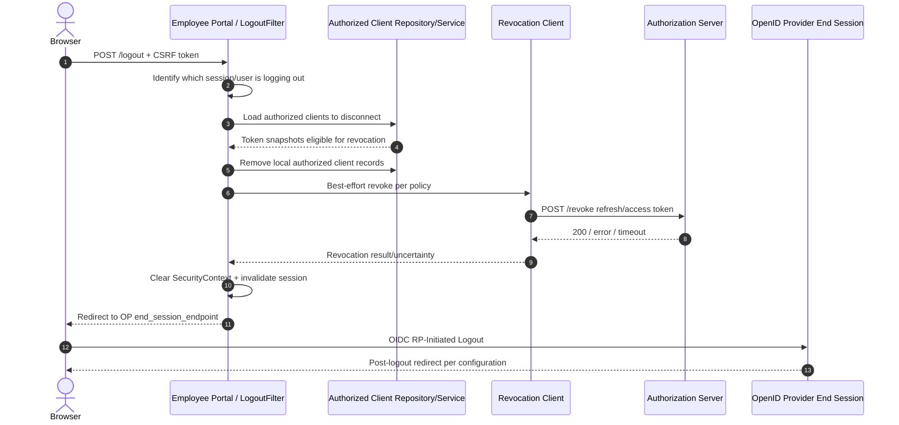

# 24.10. Token Revocation and Removing the Authorized Client After Logout

## 1. Context: Logout Succeeds, Yet the Access Token May Still Be Valid

Suppose **Employee Portal** uses **Spring Security OAuth 2.0 / OIDC Client** so employees log in via an OpenID Provider (OP). After login, the backend uses the access token issued for registration `company-oidc` to call the Employee API. The application may store an `OAuth2AuthorizedClient` containing an access token and refresh token in a repository/service.

An employee clicks **Log Out**. The browser is sent to `/signed-out`. Yet an administrator notices that an access token issued to that session is still accepted by the Employee API until it expires. This is not necessarily a Spring Security bug: **logging out of the application, deleting local token data, and revoking tokens at the Authorization Server are operations with distinct purposes**.

An implementation might complete:

```text
Browser POST /logout
      |
      v
Spring Security clears Authentication / SecurityContext
      |
      v
HTTP session is invalidated per configuration
      |
      v
Browser receives redirect /signed-out
```

without performing:

```text
DELETE local OAuth2AuthorizedClient record
POST Authorization Server revocation endpoint
Invalidate all other user sessions / revoke OP tokens
```

Therefore, the question to solve is:

> **After OIDC logout, how do you eliminate the ability to reuse the authorized client on the backend, and when policy requires, revoke access/refresh tokens at the Authorization Server in a protocol-compliant, secure, and fault-tolerant way?**

This lesson belongs to chapter **24. OIDC Logout** of the **Spring Security OAuth 2.0 OIDC Client** module. Main examples use **Spring Boot 3.x, Spring Security 6.x, Java 17+, Servlet/MVC**; the final part compares with Reactive WebFlux. Spring Security versions and OP/Authorization Server capabilities vary; every revocation policy must be verified against the real server.

### Learning Objectives

After this lesson, you will be able to:

1. Distinguish **local logout**, **OIDC RP-Initiated Logout**, **authorized client removal**, and **RFC 7009 Token Revocation**.
2. Identify whether tokens reside in `OAuth2AuthorizedClientRepository`, `OAuth2AuthorizedClientService`, or the HTTP session.
3. Understand the token storage key `(clientRegistrationId, principalName)` and risks of deleting the wrong principal/registration.
4. Design a logout flow that captures tokens to revoke **before the required state disappears**.
5. Call the revocation endpoint with the right client authentication method without leaking client secrets/tokens.
6. Distinguish handling of access tokens, refresh tokens, and ID Tokens.
7. Handle unsupported revocation endpoints, timeouts, concurrent sessions/registrations, and multi-node deployments.
8. Test local cleanup and revocation with mocks/fakes without sending production credentials outward.
9. Know when **not** to revoke a token shared with other sessions or workloads.

## 2. State Types in an OIDC Client

### 2.1. Not Everything Related to OAuth Is a "Session"

| Object | Purpose | Who Manages It? | Does Local Logout Handle It Fully? |
| --- | --- | --- | --- |
| **`Authentication` / `SecurityContext`** | Authenticated identity inside the application | Spring Security | Typically cleared on valid logout |
| **`HttpSession`** | Maintains browser/server state | Servlet container, or Spring Session if used | Can be invalidated per config |
| **OIDC OP session** | Login session at the identity provider | OpenID Provider | Not necessarily; needs appropriate OIDC logout |
| **`OAuth2AuthorizedClient`** | Registration, principal name, access token, refresh token if present | OAuth2 Client | Not deleted by default in all storage types |
| **Access token** | Credential to access a Resource Server | Issued by Authorization Server, verified by Resource Server | Not auto-revoked solely by browser logout |
| **Refresh token** | Credential to obtain a new access token | Authorization Server and OAuth2 Client | May stay valid unless revoked per policy |
| **ID Token** | Asserts end-user authentication to the OIDC Client | Issued by OpenID Provider | Not a typical RFC 7009 revocation target |
| **Authorization request + `state`** | CSRF/correlation protection in login callback | Authorization request repository | Separate from authorized-client store |
| **Client secret/private key** | Authenticates OAuth2 Client at Token/Revocation Endpoint | App runtime/secret manager | Must not be rotated/deleted per user logout |

**`SecurityContext` and `OAuth2AuthorizedClient` are two distinct states.** An access token stored in a database may persist after `SecurityContext` is cleared, though that **does not allow anonymous requests to use it** when application authorization is designed properly.

### 2.2. What Fields Does `OAuth2AuthorizedClient` Hold?

```text
OAuth2AuthorizedClient
├── ClientRegistration
│   ├── registrationId = company-oidc
│   ├── clientId
│   ├── authorizationGrantType = authorization_code
│   └── providerDetails / tokenUri
├── principalName = employee-4821
├── OAuth2AccessToken
│   ├── tokenValue           [SECRET]
│   ├── issuedAt
│   ├── expiresAt
│   └── scopes
└── OAuth2RefreshToken      [MAY BE NULL]
    └── tokenValue          [SECRET]
```

For OIDC login via Authorization Code, whether a refresh token is issued depends on scopes, consent, and OP policy; **never assume every login yields a refresh token**.

### 2.3. Authorized Client Storage Key

With `OAuth2AuthorizedClientService`, applications typically look up, save, and remove authorized clients by:

```text
(clientRegistrationId, principalName)
```

Examples:

| Registration ID | Principal Name | Whose Token Data? |
| --- | --- | --- |
| `company-oidc` | `employee-4821` | User 4821 who authorized this client |
| `company-oidc` | `employee-9274` | User 9274 |
| `partner-oidc` | `employee-4821` | Same user, different registration |
| `reports-api` | `reports-batch` | Client Credentials workload, not a user session |

**`employee-4821`'s logout must not delete the `reports-batch` Client Credentials token.** Conversely, if a user holds tokens across multiple registrations, deleting only the login registration may be **insufficient** to enforce a "disconnect all user accounts" policy.

## 3. Four Operations Commonly Lumped Together as "Logout"

### 3.1. Local Logout

Local logout handles the **session at the Relying Party (RP)**—the Employee Portal app itself:

- Clears `Authentication` and `SecurityContext`.
- Invalidates `HttpSession` if configured.
- Clears browser session cookies via the appropriate mechanism.
- Redirects to a signed-out notice page.

In Servlet Spring Security, `LogoutFilter` and `LogoutHandler` run the configured steps, and then `LogoutSuccessHandler` decides the response.

**Local logout does not by default call an RFC 7009 revocation endpoint**, nor does it guarantee ending the OP session.

### 3.2. OIDC RP-Initiated Logout

OIDC RP-Initiated Logout lets the application steer the browser to the logout endpoint provided by the OpenID Provider, commonly passing `id_token_hint` so the OP identifies the relevant session.

In Spring Security Servlet, a commonly used class is:

```java
OidcClientInitiatedLogoutSuccessHandler
```

The handler can generate a redirect to the OP's end-session endpoint when the provider supplies matching metadata and Authentication is an eligible OIDC user.

This means:

- The browser is directed to the OP's logout flow.
- The OP may end its Single Sign-On session per policy.
- The app may receive a callback/redirect to `post_logout_redirect_uri`.

**However, OIDC RP-Initiated Logout is not equivalent to RFC 7009 revocation.** OP policy decides whether issued tokens are revoked.

### 3.3. Removing the Local Authorized Client

Removing an authorized client deletes the token copy **stored in the application** so subsequent authorize/load operations **cannot reuse that local record**.

This can be done via:

```java
authorizedClientService.removeAuthorizedClient(
        registrationId, principalName);
```

or in a Servlet request context:

```java
authorizedClientRepository.removeAuthorizedClient(
        registrationId, authentication, request, response);
```

**Deleting the local record sends no revocation signal to the Authorization Server.** If a copy of the access token exists elsewhere, it may continue being accepted by Resource Servers until expiration.

### 3.4. OAuth 2.0 Token Revocation

**RFC 7009** defines the Authorization Server's revocation endpoint. The OAuth client sends a token to revoke along with client authentication per the method required by the OP.

Conceptual example:

```http
POST /oauth2/revoke HTTP/1.1
Host: auth.example.com
Content-Type: application/x-www-form-urlencoded
Authorization: Basic <redacted-client-credentials>

token=<url-encoded-token>
&token_type_hint=refresh_token
```

The Authorization Server processes the request and revokes the token if it exists, belongs to the client, and policy allows it. This is a **remote operation**; it can suffer network errors, lack support, or incur latency.

### 3.5. Comparison Table

| Action | Target | Primary Object | Deletes Local Token? | Revokes Access/Refresh Token at AS? |
| --- | --- | --- | --- | --- |
| Local logout | Employee Portal | `SecurityContext`/`HttpSession` | Not guaranteed | No |
| OIDC RP-Initiated Logout | OP end-session endpoint | OP login session | Not guaranteed | Depends on OP policy; not RFC 7009 |
| Authorized client removal | Portal token store | `OAuth2AuthorizedClient` | **Yes, exact specified record** | **No** |
| RFC 7009 Revocation | AS revocation endpoint | Access/refresh token per contract | **Not automatic** | **Yes if AS succeeds** |
| Disable client credentials | OP client administration | OAuth client/workload identity | Not automatic | Broad impact, not for user logout |
| OIDC Back-Channel Logout | RP session endpoint | RP session notified by OP | Depends on RP implementation/policy | Not automatically RFC 7009 |

**Never delete client secrets on every user logout.** A client secret belongs to the application's registration and may serve many users or workloads.

## 4. Why Does Logout Not Automatically Revoke All Tokens?

### 4.1. OAuth2 Gives Access Tokens Their Own Lifetime

An access token may be issued with a 5–60 minute lifetime (or per OP). A Resource Server may validate JWT signature/issuer/audience/expiry **without calling the Authorization Server on every request**.

If the app only destroys the HTTP session, the Resource Server has no automatic knowledge that the browser logged out. An issued JWT access token can remain accepted until `exp`, or be rejected earlier if the system supports revocation/revocation lists/short TTLs and enforces that policy.

### 4.2. Local Deletion Cannot Erase Already-Issued Copies

Example:

```text
10:00 Employee Portal receives Access Token A and stores it in JDBC.
10:05 Portal calls Employee API with A.
10:10 User logs out; Portal deletes the JDBC row.
10:11 A request in another system still holds A.
10:12 Resource Server validates A and may still accept it.
```

Deleting from JDBC only stops Portal from reloading A under that key. It **does not eliminate A's replayability** elsewhere.

### 4.3. OIDC End-Session and Token Revocation Have Different Contracts

An OP may:

- End the browser session while keeping tokens valid.
- Revoke refresh tokens as part of its logout policy.
- Revoke access tokens directly or under a separate policy.
- Lack a revocation endpoint for this client type.
- Have propagation delay before Resource Servers observe revocation.

Therefore, **never infer from "Logout successful" in the UI that every token at every Resource Server is immediately dead**.

## 5. RFC 7009 Token Revocation: Endpoint and Semantics

### 5.1. HTTP Request Format

RFC 7009 uses `application/x-www-form-urlencoded` over HTTPS:

```http
POST /oauth2/revoke HTTP/1.1
Host: auth.example.com
Content-Type: application/x-www-form-urlencoded
Authorization: Basic <client-authentication-redacted>

token=<sensitive-value>
&token_type_hint=refresh_token
```

Key fields:

| Field | Required? | Meaning |
| --- | --- | --- |
| `token` | **Yes** | Token to revoke |
| `token_type_hint` | No | Hint to server about token type, usually `access_token` or `refresh_token` |
| Client authentication | Per AS registration/policy | Authenticates OAuth client authorized to revoke the token |
| Extra parameters | Per server extension | Do not add arbitrarily without a contract |

`token_type_hint` is strictly a **hint**, not a way for clients to force the server to treat an access token as a refresh token or vice versa.

### 5.2. Revoke the Refresh Token or Access Token First?

This is a policy decision with no universal answer across providers:

- **Refresh token** is usually high priority to prevent the client from minting new access tokens after logout.
- **Access token** should also be considered for revocation to shrink the remaining window where issued credentials work.
- Revoking a refresh token **may** affect linked access tokens depending on server policy/capability.
- Revoking an access token **does not necessarily** revoke the linked refresh token.
- Not every provider supports immediate revocation of JWT access tokens across all Resource Servers.
- Some OPs manage entire grants/token families; revoking one token can affect other tokens, so verify beforehand.

A practical policy is usually: **stop refresh capability and reduce replay risk of the current access token**, while avoiding accidentally breaking other sessions or integrations when a provider revokes whole grants.

### 5.3. HTTP 200 Does Not Prove the Token Previously Existed

Per RFC 7009, the revocation endpoint may return **200 OK** even if the token was already revoked, invalid, or unrecognized—to avoid leaking information about token existence.

Consequently:

```text
HTTP 200 from revocation endpoint
  = server processed request per endpoint semantics

DOES NOT guarantee:
  - Resource Servers stopped accepting every copy of the token.
  - The token existed at the server before the request.
  - All access tokens of the same user/client were revoked.
  - The OP login session ended.
```

### 5.4. Common Revocation Errors

| Result | Interpretation |
| --- | --- |
| 200 OK | Request processed per RFC 7009 semantics |
| `unsupported_token_type` | AS does not support revoking the requested token type |
| 400/401 | Invalid request/authentication/parameters per provider |
| 429 | Rate-limited by provider |
| 5xx/timeout | AS/network error; outcome cannot be confirmed |
| Redirect to another host | Never auto-forward tokens/client secrets to a new endpoint |

**Do not retry every 4xx.** In particular, bad client auth or unsupported token types cannot be fixed by resending identically. On timeouts, the server may have processed the request even though the response was lost; use bounded retries recognizing revocation's idempotent semantics per spec.

### 5.5. Do Not Send an ID Token to RFC 7009 Like an Access Token

An **ID Token** is an OIDC authentication assertion, typically used as `id_token_hint` in RP-Initiated Logout. It is **not** an OAuth2 access/refresh token to send automatically to `/revoke`.

If an OP has a proprietary ID Token/session invalidation mechanism, follow OP documentation; do not assume `token_type_hint=id_token` is supported by RFC 7009.

### 5.6. How Do You Locate the Revocation Endpoint?

Depends on the provider:

- OAuth2 Authorization Server metadata (RFC 8414) may advertise `revocation_endpoint`.
- Some OP OIDC discovery metadata also publishes it.
- Many systems require explicit per-environment URI configuration.
- Some providers **do not support** the endpoint or support only certain token/client types.

Spring Boot's `spring.security.oauth2.client.registration.*` and `provider.*` must not be assumed to auto-configure a complete revocation client. `ClientRegistration.ProviderDetails.getTokenUri()` is the **Token Endpoint**, not the Revocation Endpoint. Never POST revocations to the Token Endpoint unless the provider documents such an extension.

The revocation URI must come from **trusted configuration or metadata**, validated for HTTPS/origin, and never supplied by the browser.

## 6. Authorized-Client Storage in Spring Security Servlet

### 6.1. `OAuth2AuthorizedClientService`

Application-level interface with key methods:

```java
<T extends OAuth2AuthorizedClient> T loadAuthorizedClient(
        String clientRegistrationId, String principalName);

void saveAuthorizedClient(
        OAuth2AuthorizedClient authorizedClient,
        Authentication principal);

void removeAuthorizedClient(
        String clientRegistrationId, String principalName);
```

Common implementations:

- `InMemoryOAuth2AuthorizedClientService`.
- `JdbcOAuth2AuthorizedClientService`.

When using the service, **deleting the exact `(registrationId, principalName)` pair** removes the matching authorized client.

```java
authorizedClientService.removeAuthorizedClient(
        "company-oidc", "employee-4821");
```

The call above **makes no network request**, revokes no tokens remotely, and does not touch `employee-9274`'s records.

### 6.2. `OAuth2AuthorizedClientRepository`

In Servlet HTTP requests, the repository contract is:

```java
<T extends OAuth2AuthorizedClient> T loadAuthorizedClient(
        String clientRegistrationId,
        Authentication principal,
        HttpServletRequest request);

void saveAuthorizedClient(
        OAuth2AuthorizedClient authorizedClient,
        Authentication principal,
        HttpServletRequest request,
        HttpServletResponse response);

void removeAuthorizedClient(
        String clientRegistrationId,
        Authentication principal,
        HttpServletRequest request,
        HttpServletResponse response);
```

Notable implementations:

- **`HttpSessionOAuth2AuthorizedClientRepository`**: stores authorized clients in the HTTP session.
- **`AuthenticatedPrincipalOAuth2AuthorizedClientRepository`**: for authenticated principals, can delegate to `OAuth2AuthorizedClientService`; the anonymous branch can use the session repository.

If the application uses a repository yet you only delete from a service **that is not the actual backing store used by the repository**, authorized clients may survive in another session/store. **Target the exact abstraction configured by your login and OAuth2 Client flows**.

### 6.3. Session Invalidation Is Not Database Deletion

| Where Tokens Are Stored | When `HttpSession` Is Invalidated | Explicit Removal Needed? |
| --- | --- | --- |
| `HttpSessionOAuth2AuthorizedClientRepository` | Session data usually disappears | May not be needed for session-local deletion; remote revocation still separate |
| `InMemoryOAuth2AuthorizedClientService` | Record may remain in JVM | **Yes if policy requires deletion** |
| `JdbcOAuth2AuthorizedClientService` | Record may remain in database | **Yes if policy requires deletion** |
| Custom distributed token store | Depends on custom implementation | Must check store's cleanup policy |
| Client Credentials `reports-batch` | Unrelated to user HTTP session | **Do not delete solely on user logout** |

Therefore, merely adding:

```java
.logout(logout -> logout.invalidateHttpSession(true))
```

does not mean `JdbcOAuth2AuthorizedClientService` deleted all of the user's tokens.

### 6.4. There Is No Standard "Delete All User Tokens" API Across Every Service

`OAuth2AuthorizedClientService` primarily loads/removes by **one registration ID and one principal name**. The contract offers no portable operation like:

```java
// This is NOT a standard API:
authorizedClientService.removeAllForUser(userId);
```

If a user holds multiple registrations, you need to know which registrations were authorized, for example via:

- An allowlist of registrations managed by the application.
- A dedicated per-user/registration index maintained whenever authorized clients are saved.
- A custom repository/service with appropriate queries/indexes.
- A policy specifying which registrations to disconnect at logout.

Never scan an untrusted token store and delete every record sharing an email, especially in multi-issuer/tenant systems.

### 6.5. Registration ID and Principal Name Must Be Consistent

Suppose the authorized client was saved under:

```text
(company-oidc, employee-4821)
```

yet the logout handler calls:

```java
authorizedClientService.removeAuthorizedClient(
        "company-oidc",
        "employee@example.com");
```

Because the stored key was not the email, the call may **delete nothing**. Do not assume logout cleared tokens simply because the method threw no exception.

The principal name must come from the **verified Authentication or a trusted token-ownership record** matching the exact naming strategy used at login/authorize.

## 7. Designing a Safe Logout Sequence

### 7.1. Logically Recommended Flow

A complete sequence may require multiple steps:



This is a **target ordering for a controlled design**, not a guarantee that default Spring Security executes identically. In particular, **snapshotting tokens before session invalidation** and the ordering of custom `LogoutHandler`s relative to default handlers must be configured and tested in your application.

### 7.2. What Does "Snapshot First, Remove Locally, Revoke Remotely" Mean?

A safe mental model:

1. Identify the **trusted Authentication** and authorized clients to disconnect.
2. **Read/capture token values to revoke** before session-local storage disappears.
3. Delete local authorized clients using the exact keys/stores.
4. Send revocation requests per each registration/token's policy.
5. Regardless of whether remote revocation succeeds, **never keep the browser authenticated due to network errors**.
6. End the local session and proceed with OIDC logout if applicable.
7. Record the remote outcome with recovery/monitoring when strict security requires it.

**Never destroy the HTTP session before reading tokens from `HttpSessionOAuth2AuthorizedClientRepository` and expect to still read them afterward.**

### 7.3. Prioritize Completing Local Logout When the AS Has Issues

The revocation endpoint may time out or return 503. If code **throws an exception out to `LogoutFilter`** before Spring Security clears the session, the user may remain authenticated despite clicking Log Out.

A generally sound policy for browser logout:

- **Local logout is mandatory**.
- **Remote revocation is best-effort or backed by a retryable workflow per enterprise requirements**.
- Never leave user sessions open due to transient AS/network errors.
- Never claim "all tokens were revoked" when only local cleanup succeeded.

If the threat model demands confirmed revocation before allowing another sensitive action, design a dedicated state machine/failure policy rather than throwing exceptions from a logout handler.

### 7.4. Revoke Before or After Local Deletion?

Two strategies with trade-offs:

| Approach | Pros | Risks |
| --- | --- | --- |
| Revoke remotely **before** local removal | Knows outcome before deletion | AS timeouts slow logout; if handler throws, local state stays uncleaned |
| Remove locally **before** remote revoke | Reduces risk of app reusing token after logout | Without snapshot, loses token to revoke; remote failures must be tracked |
| Snapshot → remove locally → best-effort revoke | Balances logout UX and cleanup | Must hold token snapshot safely for a very short time; retries need design |
| Enqueue revocation event to queue/outbox | Fast logout, supports retries | Event holds sensitive credentials; needs encryption, TTL, ACLs, delivery semantics |
| Remove locally only, no revoke | Simple, avoids affecting other tokens/sessions | Remote tokens stay valid; valid only when policy accepts it |

No single pattern fits every system. However, **never merge "local removal" and "remote revocation" into one boolean status**, as that produces misleading security reporting.

## 8. Basic Spring Boot OIDC Login and Logout Configuration

### 8.1. Dependencies

Maven example for Servlet/MVC:

```xml
<dependencies>
    <dependency>
        <groupId>org.springframework.boot</groupId>
        <artifactId>spring-boot-starter-web</artifactId>
    </dependency>
    <dependency>
        <groupId>org.springframework.boot</groupId>
        <artifactId>spring-boot-starter-security</artifactId>
    </dependency>
    <dependency>
        <groupId>org.springframework.boot</groupId>
        <artifactId>spring-boot-starter-oauth2-client</artifactId>
    </dependency>
</dependencies>
```

Gradle Kotlin DSL:

```kotlin
dependencies {
    implementation("org.springframework.boot:spring-boot-starter-web")
    implementation("org.springframework.boot:spring-boot-starter-security")
    implementation("org.springframework.boot:spring-boot-starter-oauth2-client")
}
```

Examples use `RestClient` when performing direct HTTP revocation; `RestClient` is available in Spring Framework 6.1+ (typically Boot 3.2+). On older versions, use a compatible HTTP client or upgrade dependencies per BOM.

### 8.2. `application.yml`

```yaml
spring:
  security:
    oauth2:
      client:
        registration:
          company-oidc:
            provider: company
            client-id: ${OIDC_WEB_CLIENT_ID}
            client-secret: ${OIDC_WEB_CLIENT_SECRET}
            client-authentication-method: client_secret_basic
            authorization-grant-type: authorization_code
            redirect-uri: "{baseUrl}/login/oauth2/code/{registrationId}"
            scope:
              - openid
              - profile
              - employee.read

        provider:
          company:
            issuer-uri: https://identity.example.com/realms/employees

integrations:
  company:
    revocation-uri: https://identity.example.com/realms/employees/protocol/openid-connect/revoke
```

**All URLs are illustrative only**; real revocation paths depend on the OP/AS. Never infer the endpoint by appending `/revoke` to `issuer-uri` or `token-uri`. Check discovery/documentation and register clients accordingly. `client-secret` must come from a secret manager/runtime environment, never committed to source.

In the config above, `client-authentication-method: client_secret_basic` is used for authorization code/token requests. Later revocation transport examples also discuss a **`client_secret_post` variant** to illustrate form encoding clearly; when applying in practice, **the registration's client authentication method must match the implemented transport**. Do not copy both pieces into one program while ignoring authentication method differences.

### 8.3. OIDC Client-Initiated Logout Handler

```java
package com.example.portal.security;

import org.springframework.context.annotation.Bean;
import org.springframework.context.annotation.Configuration;
import org.springframework.security.config.Customizer;
import org.springframework.security.config.annotation.web.builders.HttpSecurity;
import org.springframework.security.oauth2.client.registration.ClientRegistrationRepository;
import org.springframework.security.oauth2.client.oidc.web.logout.OidcClientInitiatedLogoutSuccessHandler;
import org.springframework.security.web.SecurityFilterChain;

@Configuration
public class OidcWebSecurityConfig {

    @Bean
    SecurityFilterChain securityFilterChain(
            HttpSecurity http,
            ClientRegistrationRepository registrations) throws Exception {

        var oidcLogout =
                new OidcClientInitiatedLogoutSuccessHandler(registrations);

        oidcLogout.setPostLogoutRedirectUri("{baseUrl}/signed-out");

        return http
                .authorizeHttpRequests(authorize -> authorize
                        .requestMatchers("/", "/signed-out", "/error").permitAll()
                        .anyRequest().authenticated())
                .oauth2Login(Customizer.withDefaults())
                .logout(logout -> logout
                        .logoutUrl("/logout")
                        .invalidateHttpSession(true)
                        .clearAuthentication(true)
                        .logoutSuccessHandler(oidcLogout))
                .build();
    }
}
```

This is a **basic OIDC logout configuration** without custom cleanup/revocation yet. `OidcClientInitiatedLogoutSuccessHandler` uses OIDC Authentication and OP metadata like `end_session_endpoint` to initiate OP logout when supported. `setPostLogoutRedirectUri` must match a post-logout URI permitted by the OP.

Conditions to note:

- `/signed-out` must be a public endpoint or static page.
- Only use the OIDC handler when authentication/provider supports the flow; provide an appropriate fallback for non-OIDC logins.
- If the OP lacks an end-session endpoint, do not assume remote logout occurred.
- If the user logs right back in and SSO persists, the OP session may still be active; it does not necessarily mean the local session was not cleared.
- This configuration **does not automatically call RFC 7009 revocation**.

### 8.4. Using POST `/logout` and CSRF

In Spring Security apps with CSRF enabled, **POST `/logout`** with a CSRF token is the common safe choice. Never turn logout into GET merely for the convenience of a hyperlink.

Simple form example in a template with CSRF integration:

```html
<form action="/logout" method="post">
    <input type="hidden" name="_csrf" value="${_csrf.token}">
    <button type="submit">Log out</button>
</form>
```

Expression syntax in `value` depends on the template engine (Thymeleaf, JSP, etc.). This HTML only illustrates sending the token; never hardcode a static CSRF token.

## 9. Removing Only the Local Authorized Client via `OAuth2AuthorizedClientService`

### 9.1. `LogoutHandler` for the Login Registration

To remove the OIDC login's local record from a configured **service**, you can write:

```java
package com.example.portal.security;

import jakarta.servlet.http.HttpServletRequest;
import jakarta.servlet.http.HttpServletResponse;

import org.springframework.security.core.Authentication;
import org.springframework.security.oauth2.client.OAuth2AuthorizedClientService;
import org.springframework.security.oauth2.client.authentication.OAuth2AuthenticationToken;
import org.springframework.security.web.authentication.logout.LogoutHandler;

public final class AuthorizedClientServiceCleanupLogoutHandler
        implements LogoutHandler {

    private final OAuth2AuthorizedClientService authorizedClientService;

    public AuthorizedClientServiceCleanupLogoutHandler(
            OAuth2AuthorizedClientService authorizedClientService) {

        this.authorizedClientService = authorizedClientService;
    }

    @Override
    public void logout(
            HttpServletRequest request,
            HttpServletResponse response,
            Authentication authentication) {

        if (!(authentication instanceof OAuth2AuthenticationToken oauth2)) {
            return;
        }

        String registrationId =
                oauth2.getAuthorizedClientRegistrationId();

        String principalName = oauth2.getName();

        // Remove only the authorized client for the login session's registration.
        authorizedClientService.removeAuthorizedClient(
                registrationId, principalName);
    }
}
```

Notes:

- `OAuth2AuthenticationToken` is the typical Authentication in `oauth2Login` apps, including OIDC Login.
- `getAuthorizedClientRegistrationId()` returns the login session's **registration ID**; do not confuse it with the OP's `clientId`.
- `getName()` must match the principal name used when the authorized client was saved.
- This handler **deletes only the single registration tied to the current Authentication**. If the user holds authorized clients for other registrations, implement a dedicated list/cleanup policy.
- Never accept arbitrary registrations/principals from query/body parameters.
- This is **local removal only**: it sends no `POST /revoke`.

### 9.2. Attaching the Handler to Spring Security Logout

In `SecurityFilterChain` config, inject the dependency:

```java
@Bean
SecurityFilterChain securityFilterChain(
        HttpSecurity http,
        ClientRegistrationRepository registrations,
        OAuth2AuthorizedClientService authorizedClients) throws Exception {

    var oidcLogout =
            new OidcClientInitiatedLogoutSuccessHandler(registrations);

    oidcLogout.setPostLogoutRedirectUri("{baseUrl}/signed-out");

    LogoutHandler cleanup =
            new AuthorizedClientServiceCleanupLogoutHandler(
                    authorizedClients);

    return http
            .authorizeHttpRequests(authorize -> authorize
                    .requestMatchers("/", "/signed-out", "/error").permitAll()
                    .anyRequest().authenticated())
            .oauth2Login(Customizer.withDefaults())
            .logout(logout -> logout
                    .addLogoutHandler(cleanup)
                    .invalidateHttpSession(true)
                    .clearAuthentication(true)
                    .logoutSuccessHandler(oidcLogout))
            .build();
}
```

This **replaces** the bean method in Section 8.3; do not declare two `SecurityFilterChain` beans with overlapping matchers in the same app without reason. In this fragment, import `OAuth2AuthorizedClientService` and `LogoutHandler`.

With `JdbcOAuth2AuthorizedClientService` or `InMemoryOAuth2AuthorizedClientService` actively used by the OAuth2 Client flow, removal deletes the corresponding record. If your repository **stores only in `HttpSession`**, the service may have nothing to delete; use the mechanism in the next section.

**Never design a `LogoutHandler` that throws unchecked exceptions preventing the user from logging out when the database token store is down.** In production, log cleanup failures, fail-safe the local session, and provide recovery per threat model.

### 9.3. Why Use `OAuth2AuthenticationToken` Instead of `OidcUser` to Pick the Registration?

`OidcUser` provides the ID Token, claims, and OIDC user info, yet **cannot uniquely determine the registration ID** when an app defines multiple client registrations for the same issuer. `OAuth2AuthenticationToken` carries `authorizedClientRegistrationId` from the login flow's Authentication.

Example:

```java
if (authentication instanceof OAuth2AuthenticationToken oauth2) {
    String registrationId = oauth2.getAuthorizedClientRegistrationId();
    String principalName = oauth2.getName();
}
```

Never read email from the ID Token and guess the registration:

```java
// ANTI-PATTERN: email can change, collide, or be unverified.
String principalName = oidcUser.getEmail();
```

### 9.4. Logout Does Not Always Have an `OAuth2AuthenticationToken`

An application may mix form login, Bearer Resource Server APIs, SAML, OIDC OAuth2 Login, remember-me, or custom Authentication. When it is not an `OAuth2AuthenticationToken`, the example handler skips registration-based OAuth2 Login cleanup. This is intentional, avoiding mistakenly deleting another client's tokens for an unrelated Authentication.

## 10. When Tokens Are Stored in `HttpSessionOAuth2AuthorizedClientRepository`

### 10.1. Use the Right Repository, Not Only the Service

For authorized clients stored in the HTTP session, direct removal is:

```java
authorizedClientRepository.removeAuthorizedClient(
        registrationId,
        authentication,
        request,
        response);
```

Example `LogoutHandler`:

```java
package com.example.portal.security;

import jakarta.servlet.http.HttpServletRequest;
import jakarta.servlet.http.HttpServletResponse;

import org.springframework.security.core.Authentication;
import org.springframework.security.oauth2.client.authentication.OAuth2AuthenticationToken;
import org.springframework.security.oauth2.client.web.OAuth2AuthorizedClientRepository;
import org.springframework.security.web.authentication.logout.LogoutHandler;

public final class AuthorizedClientRepositoryCleanupLogoutHandler
        implements LogoutHandler {

    private final OAuth2AuthorizedClientRepository repository;

    public AuthorizedClientRepositoryCleanupLogoutHandler(
            OAuth2AuthorizedClientRepository repository) {
        this.repository = repository;
    }

    @Override
    public void logout(
            HttpServletRequest request,
            HttpServletResponse response,
            Authentication authentication) {

        if (authentication instanceof OAuth2AuthenticationToken oauth2) {
            repository.removeAuthorizedClient(
                    oauth2.getAuthorizedClientRegistrationId(),
                    authentication,
                    request,
                    response);
        }
    }
}
```

**Important:** If the repository relies on `HttpSession`, calling it after the session has already been invalidated may **no longer operate on the data as intended**. Control handler ordering or run a separate disconnect step **while the request is still authenticated and the session exists**.

If all authorized clients live strictly in `HttpSession` and the session is actually invalidated, destroying the session can suffice to wipe session-local records; yet you still must **snapshot tokens beforehand** if remote revocation is needed.

### 10.2. `AuthenticatedPrincipalOAuth2AuthorizedClientRepository` Is an Adapter

The default repository often acts as:

```text
AuthenticatedPrincipalOAuth2AuthorizedClientRepository
     |
     +-- Authenticated Authentication
     |       -> OAuth2AuthorizedClientService
     |
     +-- Anonymous / unauthenticated
             -> HttpSessionOAuth2AuthorizedClientRepository
```

Thus you must know the **exact bean used by `SecurityFilterChain` and `OAuth2AuthorizedClientManager`**. Deleting from a service bean backed by a different store than the login flow may miss the target.

### 10.3. Distinguishing Two Kinds of "Disconnect"

A product may offer:

1. **Website logout:** invalidates session; optionally cleans up the login registration's tokens.
2. **Disconnect a separate OAuth integration:** deletes/revokes the authorized client for that registration **while the user stays logged into** the website.

In case 2, use a separate authenticated operation:

```text
POST /account/connections/partner/disconnect
        |
        v
Verify Authentication and CSRF
        |
        v
Confirm user owns the partner registration
        |
        v
Load/snapshot authorized client
        |
        v
Remove locally + revoke remotely per policy
        |
        v
Return disconnect result (or pending status)
```

This is **not** OIDC browser logout. A user may want to disconnect Partner API while continuing to use Employee Portal.

### 10.4. Helper for Disconnecting While the Session Is Alive

```java
package com.example.portal.security;

import jakarta.servlet.http.HttpServletRequest;
import jakarta.servlet.http.HttpServletResponse;

import org.springframework.security.core.Authentication;
import org.springframework.security.oauth2.client.OAuth2AuthorizedClient;
import org.springframework.security.oauth2.client.web.OAuth2AuthorizedClientRepository;

public final class AuthorizedClientDisconnectService {

    private final OAuth2AuthorizedClientRepository repository;

    public AuthorizedClientDisconnectService(
            OAuth2AuthorizedClientRepository repository) {
        this.repository = repository;
    }

    public OAuth2AuthorizedClient disconnectLocal(
            String allowedRegistrationId,
            Authentication authenticatedPrincipal,
            HttpServletRequest request,
            HttpServletResponse response) {

        // allowedRegistrationId MUST already be authorized/allowlisted.
        OAuth2AuthorizedClient snapshot = repository.loadAuthorizedClient(
                allowedRegistrationId,
                authenticatedPrincipal,
                request);

        repository.removeAuthorizedClient(
                allowedRegistrationId,
                authenticatedPrincipal,
                request,
                response);

        // Return snapshot only for backend revocation workflow;
        // NEVER serialize or return this object to the browser.
        return snapshot;
    }
}
```

This is a helper for a **step inside a live-session disconnect flow**, not a public controller. `allowedRegistrationId` must be mapped per application policy; `authenticatedPrincipal` must be a verified `Authentication`.

Returning `OAuth2AuthorizedClient` lets the backend workflow hold an **in-memory temporary snapshot** to revoke tokens right after local deletion. **Never log/serialize the full snapshot**, never cache it indefinitely, and never return it in an HTTP response.

## 11. Combining OIDC `LogoutSuccessHandler` and Authorized-Client Cleanup

### 11.1. Do Not Confuse `LogoutHandler` with `LogoutSuccessHandler`

| Hook | Timing / Role | Example |
| --- | --- | --- |
| **`LogoutHandler`** | Performs cleanup/logout actions inside `LogoutFilter` | `SecurityContext` cleanup, custom token cleanup |
| **`SecurityContextLogoutHandler`** | Clears `SecurityContext`, optionally invalidates `HttpSession` | Local logout |
| **`LogoutSuccessHandler`** | Picks the HTTP response after logout actions | Redirect to OP end-session endpoint |
| **`OidcClientInitiatedLogoutSuccessHandler`** | OIDC logout success handler | RP-Initiated Logout redirect |
| **`OAuth2AuthorizedClientRepository.removeAuthorizedClient`** | Removes local authorized client | Token store cleanup |
| **RFC 7009 revocation client** | HTTP call to Authorization Server | Remote token invalidation |

Spring Security can pass the original `Authentication` to `LogoutSuccessHandler` even after `SecurityContext` is cleared; **however, the success handler does not keep `HttpSession` alive**. Do not try to load session-local authorized clients inside the success handler if the session was already invalidated.

### 11.2. Avoid Relying on Implicit Handler Ordering

If cleanup depends on **reading tokens from the session before invalidation**, verify handler ordering via explicit config and tests. Merely adding:

```java
.logout(logout -> logout.addLogoutHandler(myLogoutHandler))
```

without checking its order relative to `SecurityContextLogoutHandler` in your Spring Security version is insufficient proof that tokens are snapshotted before session invalidation.

A clearer design when reliable remote revocation is required:

- Create an **authenticated disconnect operation** to read tokens and perform revocation first.
- Then run **POST /logout** via the standard flow.
- Or build an explicitly ordered logout orchestration tested to verify snapshot, local cleanup, session invalidation, and redirect match the contract.

Never read `SecurityContextHolder` inside a post-logout async task expecting to detect the user, as Authentication/session may already be cleared.

### 11.3. Should You Revoke Directly Inside `LogoutSuccessHandler`?

Only when a **reliable snapshot** was prepared before the token store/session disappeared and performance policies permit it. If the success handler receives only `Authentication`, there is no guarantee it can still read refresh/access tokens from a destroyed `HttpSession`.

For database-backed `OAuth2AuthorizedClientService`, a success handler could query the service by registration/principal, yet **do not assume** post-logout redirects and remote revocations complete in clean order if the network fails.

### 11.4. Avoid Making OIDC Logout Depend on Revocation Endpoint Availability

`OidcClientInitiatedLogoutSuccessHandler` must produce an HTTP redirect for the browser. If a custom handler calls the revocation network and lets an exception escape, the redirect to the OP may never happen.

Better practice: ensure local logout cannot block indefinitely; use timeouts and bounded retries; record uncertain outcomes; track OP session logout independently; and use only post-logout URIs permitted by the OP.

## 12. Calling the RFC 7009 Revocation Endpoint from Spring Boot

### 12.1. Prerequisites Before Implementation

A real revocation client must know:

- **The exact AS Revocation URI**, from trusted metadata/configuration.
- **The `ClientRegistration`** owning the token and the client authentication method required by the server.
- The token to revoke and hint type (`access_token` or `refresh_token`).
- Policies for timeouts, retries, redirects, TLS, and logging.
- Fallback behavior when the server lacks access-token revocation support or cannot confirm the outcome.

Spring Security OAuth2 Client manages obtaining/refreshing authorized clients, yet **never assume the framework automatically calls RFC 7009 revocation when you enable `oauth2Login()` or `logout()`**.

### 12.2. HTTP Request Example Using `RestClient` and `client_secret_basic`

To stay consistent with `application.yml` in Section 8.2, the example below uses `ClientAuthenticationMethod.CLIENT_SECRET_BASIC`.

RFC 6749 `2.3.1` requires form-URL-encoding the client ID and client password before placing them in HTTP Basic. This is especially important if credentials contain non-ASCII characters, spaces, or colons `:`.

```java
package com.example.portal.security;

import java.net.URI;
import java.net.URLEncoder;
import java.nio.charset.StandardCharsets;
import java.util.Set;

import org.springframework.http.MediaType;
import org.springframework.security.oauth2.client.registration.ClientRegistration;
import org.springframework.security.oauth2.core.ClientAuthenticationMethod;
import org.springframework.util.Assert;
import org.springframework.util.LinkedMultiValueMap;
import org.springframework.util.MultiValueMap;
import org.springframework.web.client.RestClient;

public final class Rfc7009RevocationClient {

    private static final Set<String> TOKEN_HINTS =
            Set.of("refresh_token", "access_token");

    private final RestClient restClient;
    private final URI revocationUri;

    public Rfc7009RevocationClient(
            RestClient restClient,
            URI revocationUri) {

        Assert.notNull(restClient, "restClient is required");
        Assert.notNull(revocationUri, "revocationUri is required");
        Assert.isTrue(
                "https".equalsIgnoreCase(revocationUri.getScheme()),
                "Revocation endpoint must use HTTPS");
        Assert.notNull(revocationUri.getHost(), "Revocation host is missing");
        Assert.isNull(
                revocationUri.getRawUserInfo(),
                "Revocation endpoint must not contain user info");
        Assert.isNull(
                revocationUri.getRawFragment(),
                "Revocation endpoint must not have a fragment");

        this.restClient = restClient;
        this.revocationUri = revocationUri;
    }

    public void revoke(
            String tokenValue,
            String tokenTypeHint,
            ClientRegistration registration) {

        Assert.hasText(tokenValue, "tokenValue is required");
        Assert.isTrue(
                TOKEN_HINTS.contains(tokenTypeHint),
                "Unsupported token_type_hint");

        if (!ClientAuthenticationMethod.CLIENT_SECRET_BASIC.equals(
                registration.getClientAuthenticationMethod())) {
            throw new IllegalStateException(
                    "Revocation client requires client_secret_basic");
        }

        // RFC 6749 2.3.1: form-encode each component before HTTP Basic.
        String encodedClientId = URLEncoder.encode(
                registration.getClientId(), StandardCharsets.UTF_8);

        String encodedClientSecret = URLEncoder.encode(
                registration.getClientSecret(), StandardCharsets.UTF_8);

        MultiValueMap<String, String> form = new LinkedMultiValueMap<>();
        form.add("token", tokenValue);
        form.add("token_type_hint", tokenTypeHint);

        restClient.post()
                .uri(revocationUri)
                .headers(headers ->
                        headers.setBasicAuth(
                                encodedClientId, encodedClientSecret))
                .contentType(MediaType.APPLICATION_FORM_URLENCODED)
                .body(form)
                .retrieve()
                .toBodilessEntity();
    }
}
```

**This is a transport sample for one specific policy**, not a general-purpose revocation SDK. It:

- Sends one token per request.
- Keeps client credentials in the Basic `Authorization` header and the token in the form body.
- Lets `RestClient` throw on 4xx/5xx HTTP statuses per default behavior.
- Never prints tokens/client secrets or returns response bodies to browsers.
- Enforces HTTPS and a backend-configured endpoint.

### 12.3. Important Limitations of the Sample Code

The class above is **not production-ready** without these additional controls:

1. **Endpoint allowlist and network egress:** URI must never come from user requests; host must match configured registration/AS.
2. **HTTP redirect policy:** never follow redirects to another host carrying `Authorization` or `token` form fields.
3. **Connection/read timeouts:** avoid stalling logout requests.
4. **Other client authentication methods:** `client_secret_post`, `private_key_jwt`, mTLS, and public-client policies need dedicated implementations—never reuse Basic blindly across registrations.
5. **HTTP error mapping:** classify 200, 4xx, 429, timeouts/5xx, and handle `unsupported_token_type` per provider.
6. **Concurrency/rate limiting:** prevent hundreds of logouts or workers from flooding the revocation endpoint.
7. **Log masking:** ensure frameworks/proxies/tracing never record form bodies or Basic headers.
8. **Reliable retries:** when remote revocation must be guaranteed, build a safe persisted-state workflow per policy.

**Never disable TLS certificate validation to "fix" failing revocations.** And never use a default `RestClient` against arbitrary URLs when it might send client secrets to a revocation endpoint.

### 12.4. Explicit URI Configuration Bean

```java
package com.example.portal.security;

import java.net.URI;

import org.springframework.beans.factory.annotation.Value;
import org.springframework.context.annotation.Bean;
import org.springframework.context.annotation.Configuration;
import org.springframework.web.client.RestClient;

@Configuration
public class RevocationClientConfig {

    @Bean
    Rfc7009RevocationClient companyRevocationClient(
            RestClient.Builder builder,
            @Value("${integrations.company.revocation-uri}")
            URI revocationUri) {

        // Configure HTTP request factory with appropriate timeout/redirect
        // policies before using in production.
        return new Rfc7009RevocationClient(
                builder.clone().build(),
                revocationUri);
    }
}
```

This example intentionally binds **one revocation endpoint for one known OP**. With multiple providers, build an allowlist map `registrationId → revocationEndpoint` and look up by trusted registration. Never pass URIs from browser queries/bodies into `Rfc7009RevocationClient`.

### 12.5. If the Provider Requires `client_secret_post`

For clients registered with `client_secret_post`, credentials are sent in the **form body**:

```http
POST /oauth2/revoke
Content-Type: application/x-www-form-urlencoded

token=<sensitive-value>
&token_type_hint=refresh_token
&client_id=<registered-client-id>
&client_secret=<registered-client-secret>
```

Never send both Basic and POST secrets simultaneously unless the contract permits it. With `private_key_jwt` or mTLS, use the matching signing/client certificate mechanism; **never fall back casually to a static `client_secret`**.

### 12.6. When the Revocation Endpoint Only Supports Refresh Tokens

Some providers revoke refresh tokens while not handling access tokens the way an application expects.

In this situation:

- Prioritize revoking refresh tokens when policy allows.
- Never treat lack of access-token revocation support as an excuse to skip local cleanup.
- Cap access token TTLs and protect Resource Servers per contract.
- Evaluate back-channel introspection/denylists/short-lived tokens when early invalidation is required.
- Document that already-issued access tokens **may remain valid until expiry**.

Never claim all access tokens are dead if only the refresh token was revoked.

## 13. Combining Snapshot, Local Removal, and Remote Revocation in a Service Store

### 13.1. Goal of a Policy-Explicit `LogoutHandler`

When tokens reside in `OAuth2AuthorizedClientService`, a handler can use Authentication's registration/principal to:

1. Load the authorized client and **snapshot token values** in memory.
2. Delete the local record.
3. Attempt to revoke the refresh token.
4. Attempt to revoke the access token per provider policy.
5. Record failures with safe metadata without **throwing exceptions that leave the user session logged in**.

The example below assumes **only registration `company-oidc`** uses the configured revocation endpoint. With multiple registrations, each registration must resolve its own revocation endpoint and client auth policy—never send a partner's token to Company OP.

### 13.2. Combined Implementation

```java
package com.example.portal.security;

import jakarta.servlet.http.HttpServletRequest;
import jakarta.servlet.http.HttpServletResponse;

import org.slf4j.Logger;
import org.slf4j.LoggerFactory;
import org.springframework.security.core.Authentication;
import org.springframework.security.oauth2.client.OAuth2AuthorizedClient;
import org.springframework.security.oauth2.client.OAuth2AuthorizedClientService;
import org.springframework.security.oauth2.client.authentication.OAuth2AuthenticationToken;
import org.springframework.security.oauth2.client.registration.ClientRegistration;
import org.springframework.security.oauth2.core.OAuth2AccessToken;
import org.springframework.security.oauth2.core.OAuth2RefreshToken;
import org.springframework.security.web.authentication.logout.LogoutHandler;

public final class CompanyTokenCleanupLogoutHandler implements LogoutHandler {

    private static final Logger log =
            LoggerFactory.getLogger(CompanyTokenCleanupLogoutHandler.class);

    private static final String COMPANY_REGISTRATION = "company-oidc";

    private final OAuth2AuthorizedClientService store;
    private final Rfc7009RevocationClient revocationClient;

    public CompanyTokenCleanupLogoutHandler(
            OAuth2AuthorizedClientService store,
            Rfc7009RevocationClient revocationClient) {

        this.store = store;
        this.revocationClient = revocationClient;
    }

    @Override
    public void logout(
            HttpServletRequest request,
            HttpServletResponse response,
            Authentication authentication) {

        if (!(authentication instanceof OAuth2AuthenticationToken oauth2)) {
            return;
        }

        if (!COMPANY_REGISTRATION.equals(
                oauth2.getAuthorizedClientRegistrationId())) {
            return;
        }

        String principalName = oauth2.getName();
        OAuth2AuthorizedClient snapshot = null;

        // A. Load token before removing the local authorized client.
        try {
            snapshot = store.loadAuthorizedClient(
                    COMPANY_REGISTRATION, principalName);
        } catch (RuntimeException ex) {
            recordFailure("load", ex);
        }

        // B. Always attempt local removal even if loading failed.
        try {
            store.removeAuthorizedClient(
                    COMPANY_REGISTRATION, principalName);
        } catch (RuntimeException ex) {
            recordFailure("local_remove", ex);
        }

        // C. If there is no snapshot, the remote request is not possible.
        if (snapshot == null) {
            return;
        }

        ClientRegistration registration = snapshot.getClientRegistration();

        // D. Revoke refresh token first, if one was issued.
        OAuth2RefreshToken refreshToken = snapshot.getRefreshToken();
        if (refreshToken != null) {
            revokeSafely(refreshToken.getTokenValue(),
                    "refresh_token", registration);
        }

        // E. Revoke current access token if policy/AS supports it.
        OAuth2AccessToken accessToken = snapshot.getAccessToken();
        if (accessToken != null) {
            revokeSafely(accessToken.getTokenValue(),
                    "access_token", registration);
        }
    }

    private void revokeSafely(
            String tokenValue,
            String hint,
            ClientRegistration registration) {

        try {
            revocationClient.revoke(tokenValue, hint, registration);
        } catch (RuntimeException ex) {
            recordFailure("remote_revoke_" + hint, ex);
        }
    }

    private void recordFailure(String phase, RuntimeException ex) {
        // Metrics/structured logs in production should correlate the
        // attempt without logging client secret or token.
        log.warn("OIDC logout token cleanup failed phase={} type={}",
                phase, ex.getClass().getSimpleName());
    }
}
```

### 13.3. Meaning and Limits of This Example

This is a **synchronous best-effort example**, not a guarantee that revocation succeeded:

- If `loadAuthorizedClient` fails, local removal is still attempted; no snapshot exists to revoke remotely.
- If local removal fails, remote revocation is still attempted; the **local row may remain** and require recovery.
- If remote revocation fails/times out, local logout proceeds; never report "remote revoke succeeded."
- If no refresh token exists, no empty `token=` form is sent.
- If the AS does not support revoking access tokens, classify/measure that error rather than treating HTTP 400 as proof local logout failed.
- Total latency can equal the sum of two revocation HTTP calls. Enforce strict timeouts or use an out-of-band workflow.
- If revoking a refresh token revokes the whole grant, the subsequent access token revocation may still return 200 per RFC semantics; do not infer the token existed in step two.
- If the client auth method is not `client_secret_basic`, the transport example from Section 12 throws, and you must implement the matching method.

**Never use this code to revoke another user's tokens by taking `principalName` from a query string.** It reads tokens strictly from the logout request's verified Authentication.

### 13.4. Wiring the Handler with OIDC Logout

Instead of the local-only handler in Section 9, create:

```java
LogoutHandler cleanupAndRevoke =
        new CompanyTokenCleanupLogoutHandler(
                authorizedClientService, companyRevocationClient);

var oidcLogout =
        new OidcClientInitiatedLogoutSuccessHandler(registrations);

oidcLogout.setPostLogoutRedirectUri("{baseUrl}/signed-out");

http.logout(logout -> logout
        .addLogoutHandler(cleanupAndRevoke)
        .invalidateHttpSession(true)
        .clearAuthentication(true)
        .logoutSuccessHandler(oidcLogout));
```

This is a **fragment** inside a `SecurityFilterChain` bean with injected dependencies, not a standalone Java snippet. **Never register both the Section 9 handler and this handler simultaneously** if both delete the same record unintentionally, as that creates double cleanup and confusing telemetry.

Verify handler order/config on your exact Spring Security version; the service-based example does not depend on HTTP session so it does not need a session snapshot after `SecurityContext` is cleared. For `HttpSession`-backed repositories, follow Section 10's strategy and snapshot before session invalidation.

### 13.5. Failure Semantics Must Be Recorded Honestly

Classify states separately:

```text
LOCAL_LOGOUT_DONE
LOCAL_AUTHORIZED_CLIENT_REMOVED
REMOTE_REFRESH_TOKEN_REVOKE_CONFIRMED
REMOTE_ACCESS_TOKEN_REVOKE_CONFIRMED
REMOTE_REVOKE_NOT_SUPPORTED
REMOTE_REVOKE_UNKNOWN
LOCAL_REMOVE_FAILED
```

Never collapse everything into a single `logoutSuccess=true` boolean implying local session, OP session, and all tokens were revoked. The UI can display **"You have signed out of the application"** once the local session ends, while operations track revocation failures separately.

## 14. Synchronous vs Asynchronous Token Revocation?

### 14.1. Synchronous Revocation During HTTP Logout

Pros:

- Easy to implement and reason about ordering.
- Can observe HTTP 200 from the revocation endpoint before issuing the redirect.
- No need to persist tokens in a queue.

Cons:

- Slower browser logout when the OP/network is slow.
- Two tokens × timeout can make users wait noticeably.
- Server can be overloaded during mass concurrent logouts.
- If the session is invalidated and remote revoke fails, no local token remains for retries unless snapshotted elsewhere.

Suitable for smaller systems with stable OPs, short timeouts, and an accepted best-effort policy.

### 14.2. Revocation via Background Job / Outbox

You can design a workflow:

```text
Authenticated logout request
     |
     v
Snapshot authorized client
     |
     v
Create revocation task with TTL and encryption
     |
     v
Remove local authorized client
     |
     v
Invalidate RP session / OIDC logout redirect
     |
     v
Background worker
     |
     +-- Call revocation endpoint
     +-- Bounded retries by error category
     +-- Mark CONFIRMED / UNSUPPORTED / UNKNOWN
     +-- Delete token snapshot from task store
```

This is an **architectural choice**, not automatic Spring Security behavior. Implement it only if operations can protect credentials in the task/outbox:

- **Encrypt** token snapshots with KMS-managed keys.
- Least-privilege ACLs on queues, workers, databases, and logs.
- Never place raw tokens in messages visible in dashboards/support consoles.
- Tasks must carry a TTL/retention limit; delete credentials promptly once processed.
- Idempotency so no token loops indefinitely.
- Never let a worker use another registration's credentials.
- Revoke before token expiration while still meaningful.
- Never store access/refresh tokens as plain JSON in a queue for "easier retries."

**Never promise guaranteed remote revocation unless the system has delivery guarantees, alerts, and recovery runbooks.** Background workers can also stall or tokens can expire before retries run.

### 14.3. Policy Comparison

| Criterion | Sync Best-Effort | Async Retryable |
| --- | --- | --- |
| Browser logout latency | Can increase | Usually lower |
| Needs token in queue/store? | Not necessarily | Yes, unless alternative architecture |
| Credential protection | Short-lived in-memory snapshot | Strict encryption/TTL/ACLs |
| Survives restarts for retries | Hard without persisted task | Possible with durable outbox |
| Window where token stays valid | Duration of HTTP call | Until worker executes |
| Operations | Fewer moving parts | Requires metrics/alerts/recovery |
| Best fit | Simpler use cases, predictable latency | Strict revocation policy / multiple providers |

## 15. Multiple `ClientRegistration`s: How to Remove the Right Ones?

### 15.1. One User May Hold Multiple OAuth Connections

For instance, Employee Portal supports:

```text
Registration: company-oidc
  -> Employee Portal login

Registration: calendar
  -> user consented to Calendar API

Registration: drive
  -> user consented to Document API

Registration: reports-api
  -> backend Client Credentials (not user-owned)
```

If the login session's `OAuth2AuthenticationToken` identifies only `company-oidc`, the handler in Sections 9/13 **does not automatically know** the user also connected `calendar` and `drive`.

Thus the product must choose one of two explicit policies:

1. **Logout ends only the RP session** and optionally removes/revokes `company-oidc` tokens; `calendar`/`drive` integrations are managed under "Connected accounts."
2. **Logout disconnects all user connections**: look up registrations belonging to that exact user and remove/revoke each corresponding authorized client.

Never delete the service-wide `reports-api` token simply because one user logged out.

### 15.2. Per-Registration Decision Table

| Registration | Owner | When User Logs Out of Portal |
| --- | --- | --- |
| `company-oidc` | Logged-in user | May remove/revoke per logout policy |
| `calendar` | User with separate consent | Disconnect only if policy requires; may survive logout |
| `drive` | User with separate consent | Same |
| `reports-api` | Workload/backend | **Do not revoke/delete on user logout** |
| `payment-service` | Workload/backend | Unaffected by user sessions |
| Another user's registration | Another principal | Must never be accessed/deleted |

### 15.3. Do Not Enumerate Blindly by Client ID

`ClientRegistrationRepository` can look up a `ClientRegistration` by `registrationId`. However, it is not a token store and **does not track which registrations a user actually authorized**. A list of configured client registrations is not a user's token inventory.

Use a trusted token-ownership index or an explicit policy-governed list:

```text
principalName = employee-4821
authorized registrations:
  company-oidc
  calendar
  drive
```

For each registration, call the service/repository using the same principal naming strategy and matching revocation endpoint. Never expose a "logout user X" API accepting arbitrary user strings from non-admin clients.

### 15.4. Changing Principal Names Causes Cleanup to Miss Tokens

Before migration:

```text
(company-oidc, employee@example.com)
```

After migration:

```text
(company-oidc, employee-4821)
```

A handler deleting by the new key will miss old rows. Systems need a migration/cleanup strategy grounded in verified identity mappings rather than probing tokens by random emails.

In multi-issuer OIDC, `sub` is unique within an issuer, **not globally**. With shared registrations or multi-tenant token stores, namespace keys properly by issuer/tenant.

## 16. Multiple Login Sessions for the Same User: Which Tokens to Delete?

### 16.1. The `(registrationId, principalName)` Key May Be Shared Across Sessions

Suppose `employee-4821` is logged into Employee Portal on both laptop and phone:

```text
Laptop:
  HTTP session = S1
  Authentication.getName() = employee-4821

Mobile:
  HTTP session = S2
  Authentication.getName() = employee-4821

Authorized client service:
  key (company-oidc, employee-4821)
  -> OAuth2AuthorizedClient X
```

If the application-level `OAuth2AuthorizedClientService` holds only **one row** per registration/principal pair, both sessions share that row. When laptop logs out and removes the row, mobile can no longer load the old authorized client. If token X is revoked remotely, mobile's active access/refresh tokens may be rejected by APIs.

This can be:

- **Expected policy**, if the product wants "log out across all devices."
- **Policy violation**, if the user chose "log out this device only."

### 16.2. Per-Device Isolation Cannot Be Inferred from Principal Name Alone

To support independent per-device logout, evaluate:

- Does token ownership need a Session ID dimension?
- Does each OIDC Login receive its own token family?
- Does the authorized-client store key **per-session/per-consent** instead of one row per principal?
- Does refresh token rotation overwrite another session's token?
- Does the provider manage grants per user/client or per individual session?
- Does the revocation endpoint revoke one token or the entire token family/grant?
- Can the app identify the logging-out session before calling the OP?

Never change `principalName` to `employee-4821:S1` inside a logout handler while the login callback still saves under `employee-4821`. Design **storage keys, token lifecycles, and authentication/sessions** consistently from the start.

### 16.3. Example of Two Product Policies

| Policy | Local HTTP Session | Authorized Client Store | Remote Revocation |
| --- | --- | --- | --- |
| **Log out current device** | Delete S1 | Must not accidentally delete shared token needed by S2; requires per-session design | Avoid revoking shared token if it breaks S2 |
| **Log out all devices** | Invalidate S1/S2 and linked sessions | Delete user's tokens across trusted registration/key list | Revoke all tokens/grants per OP capability and security requirements |

A "Log Out" button does not by itself define single-device vs all-device semantics. Decide this explicitly in your product security policy.

## 17. Refresh Token Rotation and Race Conditions with Logout

### 17.1. A Request Refreshes Just as the User Logs Out

Suppose two concurrent flows:

```text
T0  Request A loads authorized client:
    refresh token = R1

T1  User POST /logout:
    logout handler loads token R1

T2  Request A sends refresh_token R1 to Token Endpoint

T3  Authorization Server issues access token A2, refresh token R2

T4  Logout handler revokes R1 and removes local row

T5  Request A saves authorized client A2/R2 back to store
```

If logout deletes the row once at T4, Request A can **re-save a brand-new authorized client after the user logged out**. With rotation, revoking R1 may or may not revoke R2 depending on token-family policies.

### 17.2. Need an "Authorization Epoch" or Revocation Barrier Under Strict Policies

To enforce "after logout, no token for that session/user may be re-persisted," you may need:

- A **logout/revocation marker** per session, user-grant, or token family.
- Transactions/optimistic versioning between authorized-client saves and cleanup.
- Checking the marker before and after refresh, rejecting saves if the grant was disconnected.
- A custom `OAuth2AuthorizationSuccessHandler` or persistence layer verifying the epoch.
- Distributed locking on the token ownership key across multiple nodes.
- API authorization rejecting tokens when the linked session logged out.
- OP-level revocation/token-family termination, not merely local DB deletion.

Using `ConcurrentHashMap` or a plain JDBC token store alone does not prevent these races. **The Authorization Server and local database are also not inside a single ACID transaction.**

### 17.3. Race When the Same User Logs Back In

Example:

```text
T0  User logs out S1, handler prepares to delete
T1  User completes fresh OIDC login S2
T2  S2 saves authorized client Y under the same key (company-oidc, employee-4821)
T3  S1 handler calls removeAuthorizedClient(company-oidc, employee-4821)
```

If the store holds one row per key, S1's logout can **delete the new session's Y**. This underscores why **full-user logout** must be separated from **single-session logout** with appropriate token/version keys.

In a custom JDBC store, you may need compare-and-delete by stored version/token fingerprint (never logging raw tokens) or per-grant/session keys. The standard `removeAuthorizedClient(registrationId, principalName)` API takes no version, so it cannot solve compare-and-delete on its own.

### 17.4. Refresh Token Rotation Makes Retries Extra Sensitive

Once refresh token R1 is spent and the OP issues R2:

- Retrying R1 may return `invalid_grant`.
- Some OPs enforce reuse detection and revoke the entire token family.
- Clients must re-read the store/detect concurrent refreshes rather than retrying blindly.
- Logout must know the new token R2 if policy requires revoking the family.
- When R2 cannot be known, dedicated OP-level logout/revocation APIs may be needed.

**An `invalid_grant` error during concurrent logout and refresh does not prove bad user credentials; it can be a lifecycle/concurrency race.**

## 18. OIDC Back-Channel Logout, Front-Channel Logout, and Token Revocation

### 18.1. OP Can Proactively Notify the RP of Logout

In OIDC Single Sign-On, logout does not originate solely from Employee Portal's Log Out button:

- User logs out from another RP application.
- OP ends the session due to time limits or password change.
- Administrator forces user logout.
- OP sends a **Back-Channel Logout Token** to RPs registered for support.
- Browser may participate in Front-Channel Logout depending on profile.

Spring Security supports OIDC logout mechanisms depending on version/configuration, such as back-channel logout support in Spring Security Servlet. However, **OP notifications target RP session state**—they do not automatically carry access/refresh tokens for RFC 7009 revocation.

### 18.2. Back-Channel Logout Has No Active Browser `HttpSession` on the Request

OIDC back-channel logout is a **server-to-server POST** carrying a Logout Token. Never assume an active user HTTP session is attached to that incoming request.

An RP implementation must:

- Validate the Logout Token JWT per issuer, audience, signature, and profile.
- Use verified `sid`/`sub` to locate target sessions.
- Invalidate the right sessions without touching other users' sessions.
- If policy requires removing/revoking authorized clients, resolve token ownership via a trusted store/index.
- Never read `principalName` from an unverified body and delete tokens.
- Handle replays, duplicate events, and races with login/refresh.

### 18.3. A Logout Token Is Not an Access Token to Revoke

An OIDC Back-Channel Logout Token is a logout notification JWT per profile. It is **not** an access/refresh token to pass into an RFC 7009 revocation endpoint.

```text
Back-Channel Logout Token
   -> RP verifies logout event and locates session(s)

Access/Refresh Token
   -> RFC 7009 revocation if RP holds token
      and AS supports / policy requires it
```

Never swap the two JWT/token types simply because both contain `iss` or `sub`.

### 18.4. OP Logout Scope Can Exceed a Single RP Local Session

When an OP terminates an SSO session linking multiple RPs, other apps may receive logout notifications or force re-authentication per policy. Yet **that does not automatically mean tokens across different OAuth client registrations were revoked**.

Conversely, an RP can revoke its own client's refresh token without ending the OP browser session; the user can log right back in via SSO. Define each operation's exact scope clearly.

## 19. Does User Logout Affect Client Credentials?

### 19.1. M2M Tokens Have Technical Principals

Within the same application, the backend may use:

```text
Registration: reports-api
Grant: client_credentials
Principal: reports-batch
```

This token represents the **application/workload**. It has no browser session or OIDC end-user consent under standard Client Credentials flows.

When `employee-4821` logs out:

```text
REMOVE (company-oidc, employee-4821)    <- per logout policy

DO NOT REMOVE (reports-api, reports-batch) just because a user logged out
```

If a handler accidentally calls `removeAuthorizedClient("reports-api", "reports-batch")`, scheduled jobs will have to re-acquire tokens; if it also calls RFC 7009 to revoke the service token, system-wide workflows can break.

### 19.2. User-Triggered Service Token Usage Must Still Check Permissions

For example, frontend calls `/reports/export` and backend uses the `reports-api` Client Credentials token. The backend must still verify the user has export authorization, even if the service token holds broad scopes.

User logout must block subsequent requests lacking a valid `Authentication`—**never rely on revoking a shared service token** to protect web routes.

### 19.3. Workload Revocation Follows a Separate Process

Client Credentials tokens/credentials should be revoked when:

- The workload is decommissioned.
- A client secret/private key leaks.
- The OAuth client registration is disabled.
- Service scopes/audiences change by policy.
- Incident response targets the service identity.

That is **workload lifecycle operations**, not a routine side effect of individual user logouts.

## 20. What If the Resource Server Still Accepts a "Revoked" Token?

### 20.1. Difference Between Opaque Tokens and Offline JWT Validation

| Access Token Type | How Might Resource Server Verify? | What Can Delay Early Revocation? |
| --- | --- | --- |
| Opaque/reference token | AS introspection or introspection cache | Cache TTL/replication lag before revocation is visible |
| Self-contained JWT | Local signature/issuer/audience/expiry validation | Does not query AS on revocation status |
| Sender-constrained token | Validates token + proof-of-possession key per profile | Still must handle token revocation/expiry |
| Custom token | Provider contract | Depends on token validation infrastructure |

If an API validates JWT `exp` locally without a revocation list, introspection, or short TTL policy, hitting the revocation endpoint will not make every request reject the token immediately.

### 20.2. Early Invalidation Models

Depending on requirements:

- Short-lived access tokens paired with revoking refresh tokens.
- On-demand introspection or short cache TTLs.
- Revocation lists/denylists or event propagation to Resource Servers.
- Token version/epoch checks in the authorization layer.
- Sender-constrained tokens like mTLS/DPoP when profiles fit.
- Re-authentication for sensitive operations.

Each option trades off latency, availability, complexity, and load. Never write "RFC 7009 guarantees JWTs stop working within 1 ms" if your APIs validate tokens offline without receiving revocation state.

### 20.3. Investigation Sequence

If API calls still succeed with an old token after logout, verify step by step:

1. Did the RP actually remove the local authorized client?
2. Was an RFC 7009 revocation request sent?
3. Did the request use the right token value, client registration, and revocation endpoint?
4. What did the AS return? Does it support revoking that token type?
5. Does the access token have the expected audience/expiry?
6. Does the Resource Server validate via introspection, offline JWT, or a hybrid?
7. Is there cache/introspection/revocation propagation lag?
8. Did a concurrent refresh request re-mint/re-save a token?
9. Does the token in use belong to a different session/grant?
10. Was the logout policy "this device" or "all devices"?

Avoid jumping to "Spring Security logout failed" solely because an API still accepts an access token.

## 21. Securing Logout and Revocation

### 21.1. CSRF, Redirects, and Session Fixation

A logout endpoint with side effects requires proper CSRF protection, especially when cookie/session-based. Never turn state-changing logout/disconnect APIs into GETs, since browsers attach cookies automatically in several contexts.

For OIDC RP-Initiated Logout:

- `post_logout_redirect_uri` must be permitted by the OP.
- Never read an arbitrary redirect URL from a query param and put it in `Location`.
- `id_token_hint` must come from a verified OIDC Authentication, never arbitrary input.
- Control `Secure`, `HttpOnly`, and `SameSite` cookie attributes to match OIDC redirect behavior.
- Avoid recording ID Tokens/`id_token_hint` in access/proxy logs whenever possible; where redirect flows use query params, mask appropriately.

### 21.2. Never Build an Arbitrary Token-Deletion Endpoint

Anti-pattern:

```java
// ANTI-PATTERN: browser picks principal and registration.
@PostMapping("/admin/delete-authorized-client")
void delete(@RequestParam String registration,
            @RequestParam String principalName) {
    service.removeAuthorizedClient(registration, principalName);
}
```

Even without returning tokens, it lets callers **break other users' integrations** if authorization checks are missing. In normal endpoints, obtain the principal from verified Authentication and registrations from a user-authorized allowlist.

For administrative operations, enforce auditing, privileged authorization, scope/tenant isolation, and strict target selection criteria.

### 21.3. Never Log Secrets on Revocation Errors

Avoid:

```java
// ANTI-PATTERN: token written to logs.
log.info("Revoking token {}", refreshToken.getTokenValue());
```

Also never log raw:

- Form body `token=...`.
- HTTP Basic `Authorization` headers.
- Client secrets/private keys.
- Raw refresh/access/ID tokens.
- Full serialized `OAuth2AuthorizedClient` or `HttpSession` state.
- Full exception/HTTP request dumps that could include headers/bodies with tokens.
- Full redirect URLs containing `id_token_hint` or `state`.

Log `registrationId`, token hint category, phase, response class, correlation ID, and elapsed time; include principal identifiers only when privacy/audit policy allows.

### 21.4. Revocation Endpoints Need Egress/TLS Policies

A revocation request carries the **token to revoke** and usually **client authentication**. If an arbitrary URL receives that request, app credentials leak even though the code intended to "improve security via revocation."

Requirements:

- HTTPS + hostname/certificate validation.
- Exact trusted revocation endpoint/host.
- Never auto-follow cross-origin redirects with credentials.
- Controlled network egress allowlist/proxy.
- Connection/read timeouts.
- Log/trace masking.
- Never put secrets in query strings.
- Secret managers and rotation.
- Never fall back to sending tokens to unapproved "test" endpoints.

### 21.5. Privacy, Deletion, and Retention

A user may request data deletion or account disconnection. Removing the authorized client is part of the data lifecycle, yet remnants may persist in:

- Token backups.
- In-memory caches.
- Async revocation tasks.
- Logs containing metadata/tokens (if mislogged).
- Unrevoked tokens at the OP.
- Sessions on other devices or other RPs.

Establish retention/backup/crypto-erasure and incident response policies. Never claim all data vanished simply because `removeAuthorizedClient` threw no exception.

## 22. What If the Application Uses Reactive WebFlux?

### 22.1. Servlet and WebFlux Use Different Abstractions

This lesson focuses on Servlet, yet the principle **local cleanup differs from remote revocation** applies equally to WebFlux.

| Servlet/MVC | WebFlux/Reactive |
| --- | --- |
| `SecurityFilterChain` | `SecurityWebFilterChain` |
| `HttpSecurity` | `ServerHttpSecurity` |
| `HttpServletRequest` / `HttpSession` | `ServerWebExchange` / `WebSession` |
| `SecurityContextLogoutHandler` | `SecurityContextServerLogoutHandler` |
| `LogoutHandler` | `ServerLogoutHandler` |
| `LogoutSuccessHandler` | `ServerLogoutSuccessHandler` |
| `OidcClientInitiatedLogoutSuccessHandler` | `OidcClientInitiatedServerLogoutSuccessHandler` |
| `OAuth2AuthorizedClientService` | `ReactiveOAuth2AuthorizedClientService` |
| `OAuth2AuthorizedClientRepository` | `ServerOAuth2AuthorizedClientRepository` |
| `HttpSessionOAuth2AuthorizedClientRepository` | `WebSessionServerOAuth2AuthorizedClientRepository` |

**Never copy Servlet `LogoutHandler` and `OAuth2AuthorizedClientService` code into a WebFlux reactive chain and call `block()`**. In WebFlux, compose token storage/removal using Reactor `Mono`.

### 22.2. Removing a Reactive Authorized Client

The reactive service contract is:

```java
Mono<Void> removeAuthorizedClient(
        String clientRegistrationId,
        String principalName);
```

Example:

```java
public Mono<Void> removeCompanyToken(
        ReactiveOAuth2AuthorizedClientService service,
        Authentication authentication) {

    return service.removeAuthorizedClient(
            "company-oidc", authentication.getName());
}
```

Requirements remain a trusted Authentication and a principal name matching the stored key.

If tokens live in the WebFlux request repository, use:

```java
return repository.removeAuthorizedClient(
        "company-oidc", authentication, serverWebExchange);
```

where `repository` is `ServerOAuth2AuthorizedClientRepository` and `serverWebExchange` is the current request. With `WebSessionServerOAuth2AuthorizedClientRepository`, snapshot **before `WebSession` is invalidated** if revocation is needed.

### 22.3. Reactive Snapshot and Cleanup in the Right Order

When both loading and removing an authorized client are required, compose:

```java
public Mono<Void> disconnectReactive(
        ServerOAuth2AuthorizedClientRepository repository,
        Authentication authentication,
        ServerWebExchange exchange,
        ReactiveTokenRevocationService revocationService) {

    String registrationId = "company-oidc";

    return repository
            .<OAuth2AuthorizedClient>loadAuthorizedClient(
                    registrationId, authentication, exchange)
            .map(java.util.Optional::of)
            .defaultIfEmpty(java.util.Optional.empty())
            .flatMap(snapshot ->
                    repository.removeAuthorizedClient(
                                    registrationId, authentication, exchange)
                            .then(snapshot
                                    .map(revocationService::revokeIfSupported)
                                    .orElseGet(Mono::empty)));
}
```

Here `ReactiveTokenRevocationService` is an **application-defined interface** with a hypothetical method:

```java
public interface ReactiveTokenRevocationService {
    Mono<Void> revokeIfSupported(OAuth2AuthorizedClient client);
}
```

This code is an **illustrative helper**, not a bean that runs automatically on OIDC logout. Import `ServerOAuth2AuthorizedClientRepository`, `OAuth2AuthorizedClient`, `ServerWebExchange`, `Authentication`, and `Mono`; authorize principal and registration beforehand.

It intentionally:

- Loads `OAuth2AuthorizedClient` before removing it.
- Uses `Optional` to distinguish **no authorized client found** from a `Mono<Void>` completing with no items.
- Chains `removeAuthorizedClient` before revocation.
- Avoids manual `block()` or `subscribe()`.

In production, add **error handling so remote revocation failures do not block cleanup/logout**, along with timeouts, retries, and metrics. Do not attach this helper to `ServerLogoutHandler` without designing ordering around session invalidation.

### 22.4. Reactive OIDC Logout Success Handler

Spring Security WebFlux provides:

```java
OidcClientInitiatedServerLogoutSuccessHandler
```

It handles RP-Initiated Logout similarly to the Servlet handler. This remains an OP/browser logout flow—**it does not replace a reactive RFC 7009 revocation client**.

In WebFlux, HTTP revocation can use `WebClient` with matching client authentication/TLS. Avoid calling blocking `RestClient` on the Reactor event loop unless explicitly offloaded onto a blocking boundary.

## 23. Testing Logout Cleanup and Token Revocation

### 23.1. Test Types to Keep Separate

| Test Type | Objective | Appropriate Tools |
| --- | --- | --- |
| `LogoutHandler` unit test | Removes exact registration/principal | JUnit 5 + Mockito |
| Cleanup orchestration unit test | Snapshots before delete; remote failure does not break local logout | Fake repository/service/revoker |
| Revocation HTTP contract test | POSTs right endpoint, method, form fields, client auth | `MockRestServiceServer` / WireMock / `MockWebServer` |
| MockMvc logout test | `POST /logout` with CSRF, `SecurityContext`/session cleared | Spring Security Test + MockMvc |
| OIDC RP-Initiated Logout test | Redirects to OP end-session endpoint when metadata valid | Mock OIDC provider metadata + MVC test |
| Token store integration test | JDBC/InMemory removal by exact key, untouched other users | Suitable database test |
| Multi-session/concurrency test | Does not delete a new session's row against policy | Coordinated threads / versioned store test |
| Resource Server integration | After revocation, is token rejected per policy? | Mock/staging AS + compatible Resource Server |

Never put production access/refresh tokens into test fixtures or HTTP logs.

### 23.2. Unit Testing the Local Handler

JUnit 5 + Mockito example requiring no real OP:

```java
package com.example.portal.security;

import static org.mockito.Mockito.*;

import org.junit.jupiter.api.Test;
import org.springframework.mock.web.MockHttpServletRequest;
import org.springframework.mock.web.MockHttpServletResponse;
import org.springframework.security.oauth2.client.OAuth2AuthorizedClientService;
import org.springframework.security.oauth2.client.authentication.OAuth2AuthenticationToken;

class AuthorizedClientServiceCleanupLogoutHandlerTest {

    @Test
    void removesOnlyAuthorizedClientOfCurrentLogin() {
        OAuth2AuthorizedClientService store =
                mock(OAuth2AuthorizedClientService.class);

        OAuth2AuthenticationToken authentication =
                mock(OAuth2AuthenticationToken.class);

        when(authentication.getAuthorizedClientRegistrationId())
                .thenReturn("company-oidc");
        when(authentication.getName()).thenReturn("employee-4821");

        var handler =
                new AuthorizedClientServiceCleanupLogoutHandler(store);

        handler.logout(
                new MockHttpServletRequest(),
                new MockHttpServletResponse(),
                authentication);

        verify(store).removeAuthorizedClient(
                "company-oidc", "employee-4821");
        verifyNoMoreInteractions(store);
    }
}
```

This is a **sample test**, not an executed result. `MockHttpServletRequest`/`Response` come from Spring Test; projects typically include `spring-boot-starter-test` and `spring-security-test`.

Tests should also verify the handler skips removal for:

- Anonymous Authentication.
- Non-OAuth2 form logins.
- Authentications outside policy registrations.
- Another user.
- Service principal `reports-batch`.

### 23.3. HTTP Contract Test for the Revocation Client

With Spring Test, attach `MockRestServiceServer` to a `RestClient.Builder` and verify the request to the configured URI:

```java
RestClient.Builder builder = RestClient.builder();

MockRestServiceServer server =
        MockRestServiceServer.bindTo(builder).build();

server.expect(requestTo(
                "https://identity.example.test/oauth2/revoke"))
        .andExpect(method(HttpMethod.POST))
        .andRespond(withSuccess());

RestClient http = builder.build();

var revoker = new Rfc7009RevocationClient(
        http,
        URI.create("https://identity.example.test/oauth2/revoke"));

// Use a synthetic ClientRegistration with client_secret_basic.
// Use a fake token, never a production credential.
revoker.revoke("unit-test-token", "refresh_token", testRegistration);

server.verify();
```

This is a **test fragment**; import `RestClient`, `MockRestServiceServer`, `URI`, `HttpMethod`, and static matchers `requestTo`, `method`, `withSuccess`. `testRegistration` is a **mock** registration configured with `CLIENT_SECRET_BASIC`.

Add assertions verifying:

- `Content-Type` is `application/x-www-form-urlencoded`.
- Form carries matching `token` and `token_type_hint`.
- Basic client authentication matches the method.
- No token appears in URL/query string.
- Wrong revocation endpoints or client auth methods are rejected.
- HTTP 400/401/429/5xx responses follow policy.
- Redirects do not leak secrets/tokens to other hosts.
- Logs contain no tokens on success or error paths.

### 23.4. MockMvc Logout Test with CSRF

With Spring Security Test, logout requests typically need a CSRF token when CSRF is enabled:

```java
mockMvc.perform(post("/logout")
        .with(csrf()))
        .andExpect(status().is3xxRedirection());
```

When testing OIDC logout redirects, supply an appropriate `OidcUser` Authentication, client registration, and discovery metadata with `end_session_endpoint`. Never assume status 302 proves RFC 7009 revocation succeeded.

A strong end-to-end test checks **each outcome independently**:

```text
POST /logout
  -> SecurityContext/session cleared
  -> authorized client key removed per policy
  -> revocation client invoked with exact token/type/client
  -> OP end_session redirect correct when metadata present
  -> remote revocation errors do not leave session authenticated
```

### 23.5. Testing Revocation Timeouts

Simulate the revocation client timing out or returning HTTP 503:

```text
Input:
  Authorized client holds access/refresh tokens.
  Revocation endpoint unavailable.

Expected:
  Local session still terminates per policy.
  Local authorized client removed or cleanup failure recorded.
  No raw token/secret returned to browser.
  Metrics record remote revoke status UNKNOWN/FAILED.
```

Never write tests expecting "remote revoke always succeeds" when the implementation is best-effort.

### 23.6. Testing Races Between Logout and Login/Refresh

Concurrency tests should intentionally interleave:

1. Request A loads old authorized client.
2. Request B begins logout and snapshots token.
3. Request A refreshes token, preparing to save new row.
4. Request B removes or sends revoke.
5. Request A saves.
6. Verify policy: could the row reappear; does all-device logout genuinely prevent reuse?

If atomic behavior is required, use custom versioned storage/locks/barriers with corresponding tests. Never declare "no race conditions" just because sequential unit tests pass.

## 24. Practice Scenarios and Expected Behaviors

The scenarios below are **expected behavioral models**, not results verified against a live OP/Resource Server.

### 24.1. Case A — Local Logout Without Revocation

```text
Before:
  User logged in via OIDC.
  JDBC token store has (company-oidc, employee-4821).

Action:
  POST /logout, invalidates session only.

Expected:
  Browser session ends.
  JDBC authorized client may remain.
  Access/refresh tokens may still work at AS/API.
```

### 24.2. Case B — Removing Local Authorized Client

```text
Before:
  Store holds token under (company-oidc, employee-4821).

Action:
  removeAuthorizedClient("company-oidc", "employee-4821").

Expected:
  Store no longer loads that row.
  Does not automatically send RFC 7009 request.
  Copies of the token elsewhere may still work.
```

### 24.3. Case C — Revoking Refresh Token

```text
Input:
  Refresh token R1 belonging to company-oidc.

Action:
  POST /revoke token=R1, token_type_hint=refresh_token.

Expected:
  If AS supports and succeeds, R1 can no longer mint
  new access tokens per server semantics.
  Already-issued access tokens may still be accepted.
```

### 24.4. Case D — Revoking JWT Access Token

```text
Input:
  Issued JWT access token A1.

Action:
  POST /revoke token=A1.

Resource Server:
  Validates JWT offline without a revocation list.

Expected:
  Do not assume A1 is rejected immediately.
  Depends on system enforcement/propagation.
```

### 24.5. Case E — No Refresh Token

```text
Authorized client:
  getRefreshToken() == null.

Expected:
  Skip refresh token revocation.
  Consider access token revocation per provider support/policy.
  Do not send an empty token form field.
```

### 24.6. Case F — Revocation Endpoint Network Error

```text
Action:
  Browser clicks Log Out.
  AS revocation endpoint returns 503/timeout.

Expected:
  Local session still ends.
  Do not claim remote revoke confirmed.
  Record unknown/failure and apply recovery policy.
```

### 24.7. Case G — User Also Holds a Calendar Token

```text
Store:
  (company-oidc, employee-4821)
  (calendar, employee-4821)

Action:
  Logout policy deletes only company-oidc.

Expected:
  Calendar token may remain in store.
  If policy requires disconnect-all, implement separate cleanup
  by registration index/ownership and matching provider.
```

### 24.8. Case H — Single-Device Logout with Shared Token

```text
Laptop session S1 and mobile S2:
  Same principalName, same authorized client service key.

Action:
  Laptop logs out and revokes shared token.

Expected:
  Mobile may be affected.
  Per-device logout requires token/session isolation by design.
```

### 24.9. Case I — Concurrent Fresh Login and Stale Logout

```text
T0 S1 logout prepares to remove key.
T1 S2 logs in and saves token Y under the same key.
T2 S1 removes key.

Expected:
  May mistakenly delete Y if storage deletes solely by key.
  Needs versioned policy to avoid impacting S2.
```

### 24.10. Case J — Client Credentials Job Continues Running After User Logout

```text
User logs out:
  (company-oidc, employee-4821) cleaned up.

Scheduled job:
  (reports-api, reports-batch) retains M2M token.

Expected:
  Do not remove or revoke reports-api on user logout.
  Job runs under its own service identity and policy.
```

### 24.11. Case K — OP Logout via Back-Channel

```text
OP:
  Sends Logout Token JWT to RP.

Expected:
  RP validates Logout Token and locates matching sessions.
  If token revocation is needed, run separate workflow per policy.
  Never send Logout Token to RFC 7009 endpoint as an access token.
```

### 24.12. Case L — User Permissions Revoked at Resource Server

```text
Authorized client token:
  Not yet expired.

Business policy:
  User no longer permitted to view data.

Expected:
  Resource Server/application authorization can reject requests.
  Logout/revocation does not replace authorization checks.
```

### 24.13. Case M — OP Returns HTTP 200 for Nonexistent Token

```text
Revocation endpoint:
  HTTP 200 OK.

Expected:
  Per RFC 7009 semantics, token may already be revoked,
  nonexistent, or unrecognized.
  Do not infer the token previously existed.
```

### 24.14. Case N — User Logs Back In Without Password After Logout

```text
RP:
  Completed local logout.

OP:
  SSO session did not end or end_session flow did not run.

Expected:
  OP can re-authenticate user via SSO.
  This does not prove local authorized-client cleanup failed.
```

### 24.15. Case O — Token Store DB Fails During Cleanup

```text
Logout:
  Database removeAuthorizedClient throws exception.

Expected:
  Local session must still end per failure policy.
  Explicitly record local_remove_failed.
  Do not claim all records were deleted.
  Have a recovery/cleanup workflow for leftover tokens.
```

## 25. Troubleshooting Table

| Symptom | Possible Cause | Resolution |
| --- | --- | --- |
| User logs out yet access token still works | Local logout only, no revocation, or RS offline-validates JWT | Check RFC 7009, TTL, and RS revocation enforcement |
| Logout redirects to OP yet tokens stay valid | RP-Initiated Logout differs from Token Revocation | Add revocation/cleanup per policy |
| JDBC authorized client remains after logout | Session invalidation does not delete app-level service | Remove exact registration/principal |
| Handler fails to delete row | `principalName` or registration ID differs from save key | Compare naming strategies across OAuth2 login and service |
| Repo clears session, service keeps token | Deleted from wrong storage abstraction | Align with actual repository/service in use |
| Cannot load token to revoke after logout | Session already invalidated | Snapshot first, or use authenticated disconnect flow |
| Revocation endpoint 404 | Wrong URI or server lacks support | Check discovery/provider docs; never guess from token URI |
| `invalid_client` on revocation | Wrong client ID/secret/client auth method | Check registration and credential rotation |
| HTTP 400 `unsupported_token_type` | Server cannot revoke that token type | Evaluate refresh/access policy and RS enforcement |
| HTTP 200 yet API still accepts token | AS/RS revocation semantics, caching, or offline JWT | Check propagation/introspection/TTL |
| After OP logout user can still SSO back in | OP session did not fully end or different browser state | Check `end_session_endpoint` and cookies |
| 302 to unexpected URI | Uncontrolled post-logout redirect | Allowlist, OP registration, prevent open redirects |
| Logout takes several seconds | Sync revocation lacks timeout or slow server | Timeouts/best-effort/async workflow |
| Revocation error leaves user logged in | Handler throws exception blocking cleanup | Fail-safe local logout and classify errors |
| Another user's tokens deleted | Principal taken from input or key collision | Verified Authentication and tenant namespacing |
| New session's token deleted | Stale logout deleted shared key after fresh login | Versioned delete/per-session key/locks |
| Token reappears after logout | Concurrent refresh saved new token | Revoke barrier/epoch/concurrency policy |
| Mobile disrupted when laptop logs out | Shared user token store | Separate per-device vs all-devices logout |
| Background job loses tokens | Cleanup deleted Client Credentials registration | Exclude M2M tokens from user logout |
| API 403 after logout/re-login | Scopes/authorization policy changed | Check Resource Server and consent |
| Tokens still in logs/backups | Unintended credential logging/persistence | Redaction, retention, incident response |
| Back-channel event arrives yet tokens remain | Session invalidation does not auto-revoke tokens | Token ownership lookup + revocation workflow |
| Refresh token revoked yet access JWT works | RS validates JWT locally until expiry | TTL/denylist/introspection per threat model |
| Revoke request 429 | Rate-limited during many logouts | Rate limits, backoff, retry budget |
| Revoke request hits wrong host | Misconfigured endpoint, redirect, or SSRF | HTTPS origin allowlist and egress controls |

### 25.1. Diagnostic Flow

```text
Did browser POST /logout?
        |
        +-- No -> HTTP method/CSRF/LogoutFilter
        |
        v
Did Spring Security clear Authentication/session?
        |
        +-- No -> SecurityContextLogoutHandler/config
        |
        v
Does policy require deleting local authorized client?
        |
        +-- No -> Documented token retention policy
        |
        v
Where are tokens stored?
        |
        +-- HttpSession repository -> session invalidation / snapshot first
        |
        +-- InMemory/JDBC service -> remove exact registration + principalName
        |
        v
Did local removal succeed?
        |
        +-- No -> storage/key/concurrency/recovery
        |
        v
Does policy require RFC 7009 revocation?
        |
        +-- No -> remote token may survive until expiry
        |
        v
Is revocation endpoint configured/permitted?
        |
        +-- No -> provider docs/metadata
        |
        v
Was access/refresh token snapshotted before cleanup?
        |
        +-- No -> fix ordering; never guess tokens
        |
        v
POST /revoke with exact client auth and token hint
        |
        +-- 200 -> processed per RFC 7009 semantics
        +-- 4xx -> auth/unsupported/request policy
        +-- 429/5xx/timeout -> uncertain result/recovery
        |
        v
Does Resource Server still accept token?
        |
        +-- Yes -> cache, offline JWT, revoke propagation,
        |          wrong token, new login/refresh race
        |
        v
Did OIDC OP session end?
        |
        +-- No -> RP-Initiated Logout/end_session policy
        |
        v
Verify multi-session, tenant, logout-all, and audit
```

## 26. Frequently Asked Questions

### 26.1. Does calling `logout()` in Spring Security automatically revoke access tokens?

**Not by default.** Logout typically clears `SecurityContext`/session and runs configured logout handlers. RFC 7009 revocation requires a separate integration aligned with OP capabilities.

### 26.2. Does `OidcClientInitiatedLogoutSuccessHandler` send a POST revocation?

No, that is not its purpose. It handles **OIDC RP-Initiated Logout** by steering the browser to the OP logout endpoint when eligible, distinct from RFC 7009.

### 26.3. Does deleting `OAuth2AuthorizedClient` from JDBC invalidate the JWT?

**No.** It only deletes the application's stored copy. Resource Servers may continue accepting the token per TTL and revocation policy.

### 26.4. Is revoking the refresh token enough?

Depends on the goal. Revoking the refresh token blocks new tokens, yet already-issued access tokens may stay valid. Check OP/RS policies before claiming total token invalidation.

### 26.5. If I revoke the access token, is the refresh token also revoked?

No universal guarantee. Grant/token-family revocation depends on the Authorization Server. To block refreshes, handle refresh-token revocation explicitly.

### 26.6. Is `token_type_hint` mandatory?

No. It helps the Authorization Server locate the token type more efficiently; common values are `access_token` and `refresh_token`. It never replaces client authentication.

### 26.7. Does HTTP 200 from revocation mean the token was definitely valid?

No. RFC 7009 allows returning 200 even when the token does not exist or is already invalid to avoid leaking token existence.

### 26.8. Why is an OIDC ID Token not revoked like a refresh token?

An ID Token is an authentication assertion for the RP, not a bearer credential used to obtain access tokens like a refresh token. RFC 7009 standardizes access/refresh token revocation; OP sessions/logout have a separate contract.

### 26.9. Should user logout delete Client Credentials tokens?

**No**, unless an extraordinary operational policy demands it. Client Credentials tokens represent services/workloads, not user HTTP sessions.

### 26.10. Why does one user's logout break another session?

Two sessions may share an authorized client under the same `(registrationId, principalName)` pair, so cleanup/revocation affects the shared token. Explicitly separate per-device vs all-device logout.

### 26.11. Why did the right user's token reappear in the DB after deletion?

A concurrent request may have refreshed the token during logout and saved the new authorized client after cleanup. This is a race requiring versioning/locks/logout barriers when policy demands it.

### 26.12. Can all of a user's tokens be deleted via a `removeAllForUser` method?

That is not a portable method on standard `OAuth2AuthorizedClientService`. Removing multiple registrations requires tracking authorized registrations/ownership or a custom store/index.

### 26.13. If tokens reside in `HttpSession`, is invalidating the session enough?

It can suffice for **local session-stored authorized clients**, yet **does not revoke tokens at the OP**. If remote revocation is needed, snapshot tokens before session invalidation.

### 26.14. Should logout wait for the revocation endpoint to succeed before responding?

Depends on policy, yet never leave a user logged in just because the AS/network errored. Use timeouts/best-effort or safe retry workflows and classify remote outcomes clearly.

### 26.15. Can revocation be retried?

Yes, per RFC 7009 semantics and AS policy, with bounded retries, honoring `Retry-After`/rate limits, without leaking tokens or retaining snapshots longer than needed.

### 26.16. What if the OP has no `revocation_endpoint`?

You cannot assume a working URI exists. Apply local cleanup, short-lived access tokens, OP logout policies, or provider-documented admin/invalidation APIs. Document revocation limits clearly.

### 26.17. Is Spring Security WebFlux the same as Servlet?

Conceptually yes, yet APIs differ: `ReactiveOAuth2AuthorizedClientService`, `ServerOAuth2AuthorizedClientRepository`, `SecurityContextServerLogoutHandler`, and `OidcClientInitiatedServerLogoutSuccessHandler`. Never copy blocking Servlet code onto the reactive event loop.

### 26.18. Should tokens be persisted to retry revocation after logout?

Only with a clear requirement and strong security: encrypted outbox/queue, TTL, least privilege, auditing, and prompt deletion. Never put raw tokens into plain JSON queues or logs.

### 26.19. What if an API still accepts the token right after HTTP 200 revocation?

Check token type, token value, client registration, AS support, JWT validation/introspection caches, and Resource Server propagation lag. HTTP 200 does not guarantee every RS rejects immediately.

### 26.20. Is letting a user specify `principalName` in a disconnect request safe?

Not by default. Obtain the principal from a trusted Authentication or controlled admin policy. Never use query parameters as a key to delete/revoke another user's tokens.

### 26.21. Why is GET logout risky?

GET can be triggered by preloading, links, or cross-site requests, logging users out unexpectedly. With session/cookie authentication, prefer POST with CSRF protection per Spring Security defaults.

### 26.22. Can RFC 7009 be called with an ID Token?

Do not assume so. `id_token_hint` in OIDC logout differs from RFC 7009 `token`. Only use provider-documented extensions if one exists.

## 27. Summary

When implementing **OIDC logout in Spring Security OAuth 2.0 Client**, keep **three independent layers** clear:

1. **Terminating RP/OP sessions:** Spring Security clears `SecurityContext`/`HttpSession`, and when needed uses `OidcClientInitiatedLogoutSuccessHandler` to initiate RP-Initiated Logout at the OP.
2. **Removing the local authorized client:** use `OAuth2AuthorizedClientService.removeAuthorizedClient(registrationId, principalName)` or `OAuth2AuthorizedClientRepository.removeAuthorizedClient(...)` against the exact store and key; never assume all registrations are wiped.
3. **Revoking tokens at the Authorization Server:** if supported and required by policy, send **RFC 7009 POST** to the revocation endpoint with the access/refresh token and proper client authentication, tracking remote outcomes independently.

A production design additionally needs:

- Snapshotting tokens to revoke **before session-local state is invalidated**.
- Bounding revocation latency/errors so local logout still completes.
- Never revoking M2M tokens when a user logs out.
- Explicitly defining **single-device vs all-device logout**.
- Preventing races among logout, refresh, and fresh logins.
- Protecting tokens/client secrets across HTTP, storage, queues, and logs.
- Never claiming JWT access tokens are dead immediately unless Resource Servers enforce revocation state.
- Testing local cleanup, remote revocation, and OP session logout separately.

### Code Snippets to Remember

Removing local authorized client in Servlet service:

```java
authorizedClientService.removeAuthorizedClient(
        oauth2Authentication.getAuthorizedClientRegistrationId(),
        oauth2Authentication.getName());
```

When using an HTTP-request repository:

```java
authorizedClientRepository.removeAuthorizedClient(
        registrationId,
        authentication,
        request,
        response);
```

Remote token revocation (structural illustration; complete requests need exact client authentication, endpoint, and timeouts):

```http
POST /oauth2/revoke
Content-Type: application/x-www-form-urlencoded
Authorization: Basic <redacted>

token=<sensitive-token>&token_type_hint=refresh_token
```

**Conclusion:** **"Logout succeeded" does not mean "all tokens were revoked."** Safe design means knowing exactly **which session ended, which authorized client was deleted, and which tokens were actually accepted for revocation by the Authorization Server**, while managing the limits of each step.

### References

- [Spring Security — Servlet Logout](https://docs.spring.io/spring-security/reference/servlet/authentication/logout.html)
- [Spring Security — OAuth2 Login Servlet](https://docs.spring.io/spring-security/reference/servlet/oauth2/login/index.html)
- [Spring Security — OAuth2 Client Authorized Clients](https://docs.spring.io/spring-security/reference/servlet/oauth2/client/authorized-clients.html)
- [Spring Security — OAuth2 Client Core Interfaces](https://docs.spring.io/spring-security/reference/servlet/oauth2/client/core.html)
- [Spring Security — OIDC Logout](https://docs.spring.io/spring-security/reference/servlet/oauth2/login/logout.html)
- [Spring Security — Reactive OIDC Logout](https://docs.spring.io/spring-security/reference/reactive/oauth2/login/logout.html)
- [Spring Security API — OidcClientInitiatedLogoutSuccessHandler](https://docs.spring.io/spring-security/reference/api/java/org/springframework/security/oauth2/client/oidc/web/logout/OidcClientInitiatedLogoutSuccessHandler.html)
- [Spring Security API — OAuth2AuthorizedClientService](https://docs.spring.io/spring-security/reference/api/java/org/springframework/security/oauth2/client/OAuth2AuthorizedClientService.html)
- [Spring Security API — OAuth2AuthorizedClientRepository](https://docs.spring.io/spring-security/reference/api/java/org/springframework/security/oauth2/client/web/OAuth2AuthorizedClientRepository.html)
- [Spring Security API — OAuth2AuthenticationToken](https://docs.spring.io/spring-security/reference/api/java/org/springframework/security/oauth2/client/authentication/OAuth2AuthenticationToken.html)
- [RFC 7009 — OAuth 2.0 Token Revocation](https://www.rfc-editor.org/rfc/rfc7009)
- [RFC 6749 — OAuth 2.0 Authorization Framework](https://www.rfc-editor.org/rfc/rfc6749)
- [RFC 6750 — OAuth 2.0 Bearer Token Usage](https://www.rfc-editor.org/rfc/rfc6750)
- [RFC 8414 — OAuth 2.0 Authorization Server Metadata](https://www.rfc-editor.org/rfc/rfc8414)
- [RFC 9700 — OAuth 2.0 Security Best Current Practice](https://www.rfc-editor.org/rfc/rfc9700)
- [OpenID Connect RP-Initiated Logout 1.0](https://openid.net/specs/openid-connect-rpinitiated-1_0.html)
- [OpenID Connect Back-Channel Logout 1.0](https://openid.net/specs/openid-connect-backchannel-1_0.html)
