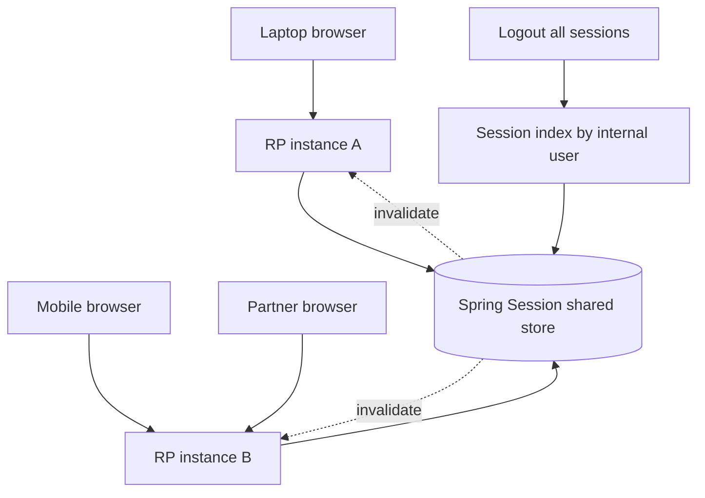
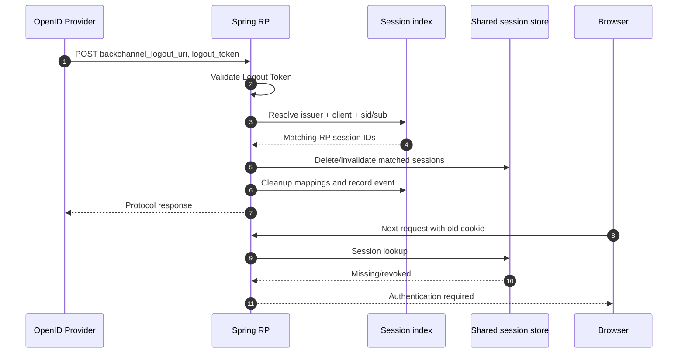

# 24.11. Logging Out Across Multiple Providers and Multiple User Sessions

> **Module:** Spring Security OAuth 2.0 OIDC Client  
> **Chapter:** 24. OIDC Logout  
> **Context:** A Spring Boot/Spring Security application acting as an OIDC Relying Party (RP), allowing login via multiple OpenID Providers (OPs) and supporting multiple HTTP sessions across different devices, browsers, or tenants.

A **Log Out** button looks simple when there is only one browser, one session, and one identity provider. Yet a real-world application may support Enterprise A's OP, Enterprise B's OP, an internal OP, and separate OAuth2 integrations for accessing APIs. The same user may log in on a laptop, a phone, and another browser profile. Each RP session may have been created by a different OP; some users even link multiple identities to the same internal account.

When Log Out is clicked, the application must define **what is being logged out of**:

- Only the HTTP session in the RP application on the current browser?
- Also the Single Sign-On (SSO) session at the OP used to log in?
- All RP sessions of the same user across devices?
- Other OPs to which the user linked their account?
- OAuth2 authorizations/refresh tokens used for external APIs?
- Sessions of an account that was just locked or had permissions revoked?

**No single call automatically guarantees all of those scopes.** Spring Security supports local logout and the relevant OIDC Logout protocols, yet combining multiple providers, multiple RP sessions, token revocation, and multi-tenant policies requires explicit design.

This lesson focuses on **targeting the exact logout scope**, avoiding deleting another person's session, avoiding sending users to the wrong OP, avoiding vulnerabilities via redirects/logout tokens, and communicating clearly what was completed.

---

## 1. Learning Objectives

After studying this lesson, you will be able to:

1. Distinguish RP sessions, OP SSO sessions, `OAuth2AuthorizedClient`, and access/refresh tokens.
2. Distinguish local logout, RP-Initiated Logout, Front-Channel Logout, Back-Channel Logout, and token revocation.
3. Select the OP of the **current Authentication** via `OAuth2AuthenticationToken.getAuthorizedClientRegistrationId()`.
4. Use `OidcClientInitiatedLogoutSuccessHandler` when the OP supports an end-session endpoint.
5. Explain why a single HTTP redirect cannot guarantee ending multiple OP sessions at once.
6. Design logout-all RP sessions with Spring Session/indexes by principal or internal user ID.
7. Design mappings by `issuer`, `sub`, `sid`, Client ID, and RP session ID.
8. Validate OIDC Back-Channel Logout Tokens before invalidating sessions.
9. Avoid deleting the wrong tenant when two OPs return the same `sub` or email.
10. Handle browser restrictions, late events, duplicate events, and multi-instance consistency.
11. Separate logout from token revocation and API authorization.
12. Plan tests across multiple providers, browsers, devices, and failing providers.

## 2. Data and Sessions Not to Conflate

| Component | Managed By | How Many Can One User Have? | Ended on Local Logout? |
|---|---|---|---|
| RP HTTP session | Servlet app/Spring Session | Multiple sessions across devices/profiles | Usually only current session |
| RP `SecurityContext` | Spring Security | Typically one Authentication per session | Cleared on logout |
| OP SSO session | Each OP | Multiple sessions/devices/providers | Not by default |
| OP `sid` | OP if supporting OIDC Session/Logout | Possibly multiple for one `sub` | Not automatically ended |
| OIDC ID Token | Issued by OP to RP | Multiple ID tokens across logins | Not an HTTP session credential |
| `OAuth2AuthorizedClient` | RP repository/service | Multiple registrations and principals | Depends on storage and cleanup |
| Access token | Issued by AS, consumed by RS | Multiple API tokens | Not auto-revoked |
| Refresh token | Issued by AS, stored by RP | Possibly multiple per grant | Not auto-revoked |
| Consent/grant | AS/OP | Per Client, user, scopes | Not auto-withdrawn |
| Session registry/index | RP | One or more records per session | Must be cleaned per policy |

**RP** is Relying Party (the Spring Security application receiving identity); **OP** is OpenID Provider; **AS** issues OAuth2 tokens; **RS** is Resource Server. One product may bundle several roles on one server, yet their meanings remain distinct.

### 2.1. Three-Device Example

```text
Laptop Chrome
  app.example.test        JSESSIONID = rp-A
  login.corporate.test    OP SSO session = op-101

Mobile Safari
  app.example.test        JSESSIONID = rp-B
  login.corporate.test    OP SSO session = op-202

Partner Browser
  app.example.test        JSESSIONID = rp-C
  login.partner.test      OP SSO session = op-303
```

Local logout on Chrome invalidates RP session `rp-A`. It **does not mean** RP sessions `rp-B`, `rp-C` or SSO sessions `op-202`, `op-303` were deleted.

## 3. Four Meanings of a Logout Button

A product should state its scope accurately:

| Option | Meaning | Primary Impact |
|---|---|---|
| **Log out of this device** | Ends the current RP session | Invalidates current session, clears `SecurityContext` |
| **Log out of current provider SSO** | Ends RP session and asks OP to end linked SSO session | Local logout + RP-Initiated Logout when OP supports it |
| **Log out of all devices** | Destroys all RP sessions of the same internal user | Shared session registry, multiple session invalidations |
| **Disconnect API integration** | App can no longer access API using delegated token | Disables/removes authorized client, revokes grant/token if required |

If the UI says **Log out everywhere** while code only calls `HttpSession.invalidate()`, the description overstates what is guaranteed.

### 3.1. "Global Logout" Has at Least Four Scopes

- All RP sessions of the user across all devices.
- All SSO sessions at **one OP**.
- All SSO sessions across **multiple OPs**.
- All OAuth2 grants and access/refresh tokens.

These are not four names for one feature. Each scope has its own protocol, authorization, and revocation capabilities.

## 4. Client Registration, Issuer, and OP Are Not Synonymous

Example configuration with multiple registrations:

```yaml
spring:
  security:
    oauth2:
      client:
        registration:
          corporate-web:
            provider: corporate-op
            client-id: corporate-portal
            client-secret: ${CORPORATE_CLIENT_SECRET}
            authorization-grant-type: authorization_code
            redirect-uri: "{baseUrl}/login/oauth2/code/{registrationId}"
            scope: [openid, profile, email]
          corporate-reports:
            provider: corporate-op
            client-id: corporate-reports-web
            client-secret: ${REPORTS_CLIENT_SECRET}
            authorization-grant-type: authorization_code
            redirect-uri: "{baseUrl}/login/oauth2/code/{registrationId}"
            scope: [openid, profile]
          partner-web:
            provider: partner-op
            client-id: partner-portal
            client-secret: ${PARTNER_CLIENT_SECRET}
            authorization-grant-type: authorization_code
            redirect-uri: "{baseUrl}/login/oauth2/code/{registrationId}"
            scope: [openid, profile]
        provider:
          corporate-op:
            issuer-uri: https://login.corporate.test/realms/company
          partner-op:
            issuer-uri: https://login.partner.test/oidc
```

There are **three registration IDs** yet only **two OP issuers**. Two Client registrations sharing an issuer do not necessarily share a Client ID or session/grant policies. URLs and identifiers in this lesson are illustrative test data; production must use real OP metadata and register exact redirect URIs.

| Term | Example | Meaning |
|---|---|---|
| Registration ID | `corporate-web` | Spring Security configuration key |
| Provider ID | `corporate-op` | Key for OP configuration block |
| Issuer `iss` | `https://login.corporate.test/realms/company` | OP identifier |
| Client ID | `corporate-portal` | RP Client registered at OP |
| Subject `sub` | `employee-734` | User identifier scoped to issuer |
| OP Session ID `sid` | `op-session-101` | OP session identifier when present |
| RP Session ID | `rp-A` | Application session key |
| Internal user ID | `usr-9001` | Account identifier managed by application |

Never use `sub` or email alone to identify users across OPs.

## 5. Selecting the Provider from Verified Authentication

When a user logs in via OIDC on the Servlet stack, Spring Security can create an `OAuth2AuthenticationToken`. That object carries the login's registration ID:

```java
import org.springframework.security.core.Authentication;
import org.springframework.security.oauth2.client.authentication.OAuth2AuthenticationToken;
import org.springframework.security.oauth2.core.oidc.user.OidcUser;

void inspectCurrentLogin(Authentication authentication) {
    if (authentication instanceof OAuth2AuthenticationToken oauth2) {
        String registrationId =
            oauth2.getAuthorizedClientRegistrationId();

        if (oauth2.getPrincipal() instanceof OidcUser oidc) {
            String issuer =
                oidc.getIdToken().getIssuer().toString();
            String subject = oidc.getSubject();
        }
    }
}
```

Meaning:

- `registrationId` identifies the registration of the **current Authentication**.
- `issuer`/`sub` identify the OIDC login's identity.
- They do not list every OAuth2 integration the user ever connected.
- If Authentication is form login or non-OIDC OAuth2, never assume `OidcUser` is present.

### 5.1. Do Not Select Provider from a Query Parameter

Anti-pattern:

```text
POST /logout?provider=partner-web
POST /logout?redirect=https://untrusted.example/
```

If the server trusts those two values to pick an end-session URL, a caller can steer redirects or confuse contexts. The provider must come from **verified Authentication + trusted `ClientRegistrationRepository`**.

A UI choice like "log out this device" or "log out all" may be a requested scope parameter, yet **must be authorized independently**—never treated as proof of identity or session ownership.

## 6. Local Logout in Spring Security Servlet

Basic configuration:

```java
import org.springframework.context.annotation.Bean;
import org.springframework.context.annotation.Configuration;
import org.springframework.security.config.Customizer;
import org.springframework.security.config.annotation.web.builders.HttpSecurity;
import org.springframework.security.web.SecurityFilterChain;

@Configuration
class WebSecurityConfiguration {

    @Bean
    SecurityFilterChain filterChain(HttpSecurity http) throws Exception {
        return http
            .authorizeHttpRequests(auth -> auth
                .requestMatchers("/", "/signed-out", "/error")
                    .permitAll()
                .anyRequest().authenticated()
            )
            .oauth2Login(Customizer.withDefaults())
            .logout(logout -> logout.logoutSuccessUrl("/signed-out"))
            .build();
    }
}
```

In a typical Spring Security config, local logout clears `SecurityContext` and invalidates the current session per logout handlers. The browser will no longer be able to reuse the old session to access endpoints requiring Authentication.

**Limits:** local logout does not automatically log out of the OP SSO session, does not delete sessions on other devices, and does not necessarily remove JDBC authorized clients or revoke tokens at the AS.

### 6.1. CSRF During Logout

Logout mutates security state. In Servlet apps using cookie-based sessions and CSRF protection, invoke logout via **POST with a valid CSRF token**. Never arbitrarily enable GET logout or disable CSRF app-wide just for a convenient link.

Logout-all and disconnect-integration actions have even broader impact, requiring proper Authentication, authorization, and intent confirmation.

## 7. RP-Initiated Logout: Ending SSO at One OP

**OIDC RP-Initiated Logout** lets the RP redirect the browser to the OP's end-session endpoint when supported by the OP.

Spring Security Servlet provides `OidcClientInitiatedLogoutSuccessHandler` to build the flow from the right Client registration/Authentication rather than hand-building logout URLs from input.

Complete example:

```java
package example.oidc;

import org.springframework.context.annotation.Bean;
import org.springframework.context.annotation.Configuration;
import org.springframework.security.config.Customizer;
import org.springframework.security.config.annotation.web.builders.HttpSecurity;
import org.springframework.security.oauth2.client.oidc.web.logout.OidcClientInitiatedLogoutSuccessHandler;
import org.springframework.security.oauth2.client.registration.ClientRegistrationRepository;
import org.springframework.security.web.SecurityFilterChain;
import org.springframework.security.web.authentication.logout.LogoutSuccessHandler;

@Configuration
public class OidcLogoutConfig {

    @Bean
    LogoutSuccessHandler oidcLogoutSuccessHandler(
            ClientRegistrationRepository registrations) {

        OidcClientInitiatedLogoutSuccessHandler handler =
            new OidcClientInitiatedLogoutSuccessHandler(registrations);

        handler.setPostLogoutRedirectUri("{baseUrl}/signed-out");
        return handler;
    }

    @Bean
    SecurityFilterChain securityFilterChain(
            HttpSecurity http,
            LogoutSuccessHandler oidcLogoutSuccessHandler)
            throws Exception {

        return http
            .authorizeHttpRequests(auth -> auth
                .requestMatchers("/", "/signed-out", "/error")
                    .permitAll()
                .anyRequest().authenticated()
            )
            .oauth2Login(Customizer.withDefaults())
            .logout(logout -> logout
                .logoutSuccessHandler(oidcLogoutSuccessHandler)
            )
            .build();
    }
}
```

### 7.1. Prerequisites for the Flow to Work

- The OP publishes or supports an end-session endpoint.
- The RP Client is permitted to use the post-logout redirect URI.
- The current user's OIDC login has the appropriate context.
- Your Spring Security version provides the matching API.
- The browser follows the redirect and the OP accepts the request.

If the OP lacks an endpoint/contract, provide a clear local fallback/UX. Never guess that every provider uses `/logout` or `/protocol/openid-connect/logout`.

### 7.2. Common Parameters

An RP-Initiated Logout request may use:

- `id_token_hint`: ID Token tied to the session logging out.
- `post_logout_redirect_uri`: RP URI to return to, permitted by the OP.
- `state`: value correlating the logout flow when used.
- `client_id` or `logout_hint` per OP capabilities/contracts.

Never pass browser-supplied tokens, callback URIs, or hostnames straight into an OP redirect request without verification.

## 8. A Single Redirect Cannot Automatically Log Out Every OP

An HTTP redirect response has one destination per hop:

```http
HTTP/1.1 302 Found
Location: https://login.corporate.test/realms/company/logout?...
```

No OIDC standard allows a single RP-Initiated Logout to Corporate to automatically terminate sessions at Partner or other independent OPs.

If a product wants multi-OP logout, define one of these models:

1. **Log out the active OP:** simplest, via the Authentication logging out.
2. **Sequential workflow across OPs:** only if every OP supports it, browser/redirects work, and the app implements per-step correlation, timeouts, and error handling. No universal guarantee exists.
3. **Provider admin/back-channel APIs:** only where each vendor offers privileged APIs; not generic OIDC RP-Initiated Logout.
4. **Log out RP sessions only:** if the product promises "log out of the application" rather than the entire SSO ecosystem.

### 8.1. Do Not Spawn Multiple Iframes to Force Global Logout

Some systems try loading end-session URLs inside iframes. This can fail due to:

- Browsers blocking third-party cookies.
- `SameSite` or `Secure` cookie policies.
- CSP and `X-Frame-Options`.
- Anti-tracking/partitioned storage.
- OPs requiring top-level navigation or user interaction.
- Browser/tab closing before steps finish.

Never treat iframe logout as proof that every session at every OP ended.

## 9. Non-OIDC OAuth2 Login Needs Its Own Logout Path

A provider may support OAuth2 Authorization Code and a UserInfo endpoint without providing an ID Token or OIDC logout protocol.

In that case:

- Local RP logout remains valid.
- `OidcClientInitiatedLogoutSuccessHandler` is not a universal logout protocol.
- Never fabricate `id_token_hint`.
- The provider may offer a proprietary logout endpoint; check its exact contract if integrating.
- RFC 7009 token revocation is a separate concern and does not replace OP SSO logout.

An app supporting form login, plain OAuth2 login, and OIDC login must fall back accurately based on **Authentication type**, not merely the OP's company name.

## 10. Multiple Identities from Multiple Issuers

An internal account may legitimately link:

```text
internalUserId = usr-9001
  -> (issuer=corporate, sub=employee-734)
  -> (issuer=partner, sub=partner-user-47)
  -> (issuer=another, sub=external-911)
```

This does not mean the three OPs know those identities belong to the same internal user. The RP itself manages account linking through a verified flow.

### 10.1. Subject Is Scoped to Issuer

Two OPs may both return:

```text
sub = "123"
```

yet not represent the same person. The safe key is the pair:

```text
(issuer, subject)
```

Then the app maps that pair to an internal account ID via a trusted data source.

### 10.2. Email Is Insufficient for Cross-Provider Logout

Emails can change, go unverified, or be reassigned. Never use `email` or `preferred_username` as the default key to choose sessions to delete across multiple tenants/issuers.

### 10.3. Account Linking Does Not Grant Authority to Log Out All OPs

The RP knowing two identities map to one internal user **does not grant** permission to end every SSO session at every OP. Doing so requires the corresponding protocol/capability and permissions at each OP.

## 11. What Can One RP Session Be Associated With?

Distinguish:

**Login provider:** the OP that authenticated the user and produced the `OAuth2AuthenticationToken` held in `SecurityContext`.

**API integration provider:** a provider where the user granted consent for the RP to store an `OAuth2AuthorizedClient` holding access/refresh tokens to call APIs.

Example:

```text
Current RP Authentication: corporate-web
Stored authorized clients:
  corporate-web -> login grant
  calendar-beta -> offline calendar access
  crm-gamma     -> offline CRM synchronization
```

When the user logs out of the RP via Corporate, you cannot assume `calendar-beta` and `crm-gamma` hold SSO sessions in the current browser, much less consider them logged out.

## 12. Multiple User Sessions on the Same Application

One user may hold:

- An RP session on a laptop.
- An RP session on a phone.
- An RP session in a private browser.
- An RP session in another browser via a different login provider.

**Local logout** normally invalidates only the current request's session. For logout-all, the RP must locate **all RP sessions of the same internal account** in a shared store.

### 12.1. Multiple Tabs vs Multiple Sessions

Multiple tabs within one browser profile normally share cookies/sessions; logging out in one tab strips authentication from other tabs on subsequent requests. Two browser profiles or private windows usually maintain separate cookies and sessions.

Closing a tab does not send a logout request; never rely on tab-close events as a security guarantee.

## 13. Using a Shared Session Store and Session Index

Example architecture:



If each RP instance keeps only in-memory sessions, a logout request hitting A will not delete sessions held on B.

Spring Session can use Redis/JDBC or a compatible backend to share sessions, yet indexing and identity mapping must still be configured properly.

## 14. `FindByIndexNameSessionRepository`

Spring Session provides `FindByIndexNameSessionRepository` to look up sessions by principal when the backend supports it and the principal index is maintained.

Example:

```java
import org.springframework.session.FindByIndexNameSessionRepository;
import org.springframework.session.Session;
import org.springframework.stereotype.Service;

@Service
class RpSessionRevoker {

    private final FindByIndexNameSessionRepository<? extends Session> sessions;

    RpSessionRevoker(
            FindByIndexNameSessionRepository<? extends Session> sessions) {
        this.sessions = sessions;
    }

    void revokeByPrincipal(String trustedPrincipalName) {
        sessions.findByPrincipalName(trustedPrincipalName)
            .keySet()
            .forEach(sessions::deleteById);
    }
}
```

Requirements:

- The store supports principal indexing.
- `trustedPrincipalName` comes from a verified Authentication or authorized admin event.
- Principal naming is stable and properly namespaced by tenant/issuer.
- The session index updates on login, logout, and session ID rotation.
- Understand that in-flight requests may continue running after the record is deleted.

### 14.1. Never Call `findByPrincipalName` with an Arbitrary Email

Anti-pattern:

```java
// Unsafe if the caller can choose who gets logged out.
String principal = request.getParameter("email");
sessionRevoker.revokeByPrincipal(principal);
```

Request inputs must be authorized and mapped to identities before deleting another user's sessions. For self-service logout-all, take the user ID from the verified Authentication.

### 14.2. Principal Index May Not Cover Multiple OPs

If Spring Security uses `OidcUser.getName()` as `sub`, the same internal user logging in via two OPs may have **two different principal names**. Calling `findByPrincipalName(...)` for one key will miss sessions belonging to the second issuer.

A multi-provider app should index by **internal user ID** mapping to RP session IDs; only use the principal repository directly when naming is unified and proven.

## 15. Session Registry for Account Linking

A dedicated registry can store:

```text
internalUserId       usr-9001
rpSessionId          rp-laptop-01
registrationId       corporate-web
issuer               https://login.corporate.test/realms/company
subject              employee-734
opSessionId          op-101       # if provided by ID Token/protocol
clientId             corporate-portal
createdAt            ...
expiresAt            ...
authorizationVersion ...
```

It must support two query patterns:

1. **Logout all RP sessions:** query by `internalUserId`.
2. **Back-channel logout from OP:** query by `issuer + clientId + sid/sub` per event scope.

### 15.1. Never Store Raw Tokens in the Session Index

The index needs only correlation metadata. Never put access tokens, refresh tokens, or session cookies into Redis key names, URLs, logs, or metric labels.

### 15.2. TTL and Index Cleanup

When a session expires or is invalidated, delete/expire its matching mapping. An index outliving its session causes confusion; an index expiring earlier than its session prevents OP logout events from finding the session.

TTL and cleanup must tie into the session store's lifecycle, handling session invalidation/expiration events per backend.

## 16. OP `sid` Differs from RP Session ID

OIDC Logout may use `sid` (*session identifier*) created by the OP to identify an OP session. The RP has its own `HttpSession.getId()`.

Example:

```text
OP Alpha:
  subject = employee-734
  sid = alpha-101 (laptop)
  sid = alpha-202 (mobile)

RP:
  session rp-A -> Alpha sid alpha-101
  session rp-B -> Alpha sid alpha-202
```

There is no mandatory 1-to-1 relationship. One OP session may span multiple RP sessions or applications; one subject may hold multiple OP sessions.

### 16.1. Proper Mapping Keys

A common index:

```text
(issuer, clientId/registration, opSid) -> RP session IDs
```

When an event carries only subject per spec:

```text
(issuer, clientId/registration, subject) -> RP session IDs
```

Never use `sid` or `sub` alone as a global key. Different issuers can collide on values.

## 17. OIDC Back-Channel Logout

**Back-Channel Logout** lets the OP send a server-to-server message to the RP asking to terminate matching sessions without needing an online browser.

Flow:



Spring Security supports OIDC logout variants depending on version. Configuring back-channel endpoints/session registries requires matching your version's APIs and active OP metadata—never hand-roll an HTTP endpoint accepting arbitrary JSON to delete sessions.

### 17.1. Back-Channel Differs from RP-Initiated

| | RP-Initiated | Back-Channel |
|---|---|---|
| Initiator | RP/browser | OP |
| Channel | Browser redirect | Server-to-server POST |
| Needs OP browser cookie? | May be involved | No |
| Purpose | Ask OP to end SSO session | OP tells RP to end RP sessions |
| Uses `sid`/`sub`? | May relate to ID Token/session context | Must match per Logout Token |
| Auto-revokes access tokens? | Not by default | Not by default |
| Primary risks | Redirects/OP support | JWT signature/claims, replay, session index |

## 18. Validating Logout Tokens

Logout Tokens follow a dedicated OIDC profile and are typically signed JWTs. Before deleting sessions, verify:

- Signature using trusted keys of the registered issuer.
- `iss` matches the exact OpenID Provider.
- `aud` contains the Client ID of the RP receiving the notification.
- `iat` and appropriate freshness/clock-skew policies.
- `jti` as identifier for replay/duplicate detection.
- `events` specifies the exact Back-Channel Logout event.
- `sub` and/or `sid` present per protocol rules.
- Other binding claims per profile; `exp` if present must be checked.
- Never treat a Logout Token as an ID Token or an API access token.
- Never trust `jku`/`kid` or arbitrary JWKS URIs from an unverified token to fetch keys.

**Unsigned** payload example:

```json
{
  "iss": "https://login.corporate.test/realms/company",
  "aud": "corporate-portal",
  "iat": 1893452400,
  "jti": "logout-evt-882",
  "events": {
    "http://schemas.openid.net/event/backchannel-logout": {}
  },
  "sid": "alpha-101"
}
```

**Never delete sessions based on this JSON** until fully verified by libraries and application policy.

### 18.1. Issuer Mismatch Is a Security Vulnerability

A Logout Token from Partner with `sid=alpha-101` must never delete an RP session belonging to Corporate OP even if the `sid` string matches. Keys must distinguish issuer/client/sid.

### 18.2. Duplicate Logout Tokens

An OP may resend a notification. Store a replay marker by `issuer + jti` with an appropriate TTL and handle idempotently; stale events must never reverse state or accidentally delete a newer session.

## 19. `sid`-Scoped vs `sub`-Scoped Logout

When a Logout Token includes an OP session's `sid`, the target is typically the RP sessions linked to that OP session.

When the token includes only `sub` per spec/provider, the scope can cover all sessions of that subject for the matching issuer/client.

Example:

```text
issuer = Corporate OP
sub = employee-734
sid = alpha-101 -> laptop
sid = alpha-202 -> mobile
```

An event specifying `sid=alpha-101` **should not** drop mobile's `alpha-202` session unless OP event semantics/policy demand a broader scope.

In all cases, never expand `issuer+sub` to **the entire internal account across every OP** when the event does not carry that meaning.

## 20. Front-Channel Logout and Browser Restrictions

**Front-Channel Logout** uses the browser to deliver logout notifications to RPs per OP capabilities, often via iframes/navigation.

Limitations exist:

- Third-party cookies may be blocked.
- `SameSite`/CSP/`X-Frame-Options` affect requests.
- Browsers/tabs may be closed or offline.
- RPs may not receive session cookies in third-party contexts.
- `iss`/`sid`/targets must be verified per protocol.
- Never strip CSRF protections or session routing indiscriminately.
- Never guarantee multi-device logout just because an iframe loaded.

If product requirements demand logout taking effect when browsers are closed, evaluate Back-Channel Logout or server-side session revocation instead of Front-Channel alone.

## 21. Multi-OP Logout via Sequential Workflow

Because a browser redirect goes to one target per hop, a product wanting to log out of both Corporate and Partner must build a workflow **if providers support it**, e.g.:

```text
RP local logout
    |
    v
Prepare correlation state
    |
    v
Redirect Corporate OP end-session
    |
    v
Trusted callback/landing
    |
    v
Redirect Partner OP end-session (if session exists and permitted)
    |
    v
Final signed-out page
```

Yet difficulties remain:

- Cannot be sure whether the browser holds an SSO session at each OP.
- One OP may not support post-logout redirects.
- The browser may close mid-chain.
- An OP may require interaction or reject the request.
- There is no remote logout result the RP can verify.
- Correlation state must be protected after local logout.
- Attackers must not be able to inject OP/redirect URLs into the chain.

Consequently, **a sequential workflow is not a global logout guarantee**. It is a bounded implementation option requiring transparent UX.

## 22. OP Logout Succeeds, Yet Other RP Sessions Remain?

Suppose a user logged into Corporate OP on two devices and the RP holds two sessions. The laptop browser sends RP-Initiated Logout to Corporate OP.

The OP may terminate the **laptop's** SSO session, while the phone's RP session stays active if the RP receives no back-channel/logout signal for that session or the user did not request logout-all.

**Do not infer** that OP logout from one browser invalidated all RP sessions of the same user.

For "log out all devices," the RP must actively remove all RP sessions by internal account ID, independently of OP logout results.

## 23. When Multiple OPs Link to One Internal User

A user might log into the RP with Corporate in the morning and Partner in the afternoon:

```text
Internal user usr-9001
  session rp-A (Corporate issuer, sub employee-734)
  session rp-B (Partner issuer, sub partner-47)
```

Logout-all RP means:

1. Verify the actor is authorized to log out account `usr-9001`.
2. Locate both `rp-A` and `rp-B` via the internal session index.
3. Delete both RP session records.
4. Increment session/account revocation version if designed.
5. Force subsequent browser requests through authentication.
6. Never promise Corporate or Partner OP sessions were logged out.

Only legitimately linked OP identities may resolve to the same internal user. Never wipe all sessions sharing an email without verified account linking.

## 24. Session Fixation and RP Session ID Rotation

When OIDC Login completes, Spring Security may apply session fixation protection that **rotates the session ID**.

A bug:

```text
Before login: pre-auth session ID=rp-old
OIDC callback succeeds
After login: session ID=rp-new
Registry mistakenly saved rp-old
Back-channel logout deletes rp-old, rp-new stays alive
```

The session index must point to the **session after Authentication is established** and the session strategy finishes. Test against the exact container/Spring Session version in use.

Never save a pre-login cookie ID and assume it will not change.

## 25. Delayed Logout Events

Consider this sequence:

```text
T0: Corporate sid=alpha-101 -> RP session R1
T1: User locally logs out R1
T2: User logs in again, sid=alpha-202 -> RP session R2
T3: Delayed back-channel logout for alpha-101 arrives
```

If the index queries only by `sub` and deletes all sessions, R2 is lost even though the event targeted only the old `sid`.

Prevention:

- Match issuer/client/`sid` before deleting.
- Keep session mappings accurate.
- Clean up records of dead sessions.
- Enforce `jti` replay protection.
- Never apply stale events beyond their scope.
- Use versions/epochs if driving logout-all via an event bus.

## 26. Session Invalidation Does Not Automatically Halt In-Flight Requests

A request may already have passed authentication before the session was deleted:

```text
10:00:00 Admin request passed SecurityFilterChain
10:00:01 Logout-all deletes session
10:00:02 Admin request still processing
10:00:03 Admin request commits data
```

Deleting session records stops **new requests** from having Authentication, yet does not roll back in-flight requests.

For sensitive operations:

- Re-check authorization/account state close to commit time;
- Use session/account revocation versions;
- Define policies for WebSocket/streaming sessions;
- Do not treat deleting a Redis key as stopping all running tasks;
- Monitor invalidation propagation lag across multiple instances.

## 27. Account Session Epoch for Logout-All

A higher-reliability model:

```text
Account:
  internalUserId = usr-9001
  sessionEpoch = 8

Session R1:
  internalUserId = usr-9001
  sessionEpoch = 7

Session R2:
  internalUserId = usr-9001
  sessionEpoch = 8
```

On logout-all, increment the epoch in a trusted data source and invalidate indexed sessions. Requests carrying an older epoch are rejected when security policy checks them.

This is **application design**, not a built-in OIDC Logout feature. It requires an authoritative epoch source, cache freshness, consistency, and testing. Never use client clocks as a security version.

## 28. Logout Does Not Equal Revoking API Tokens

A user may log out of the RP while `JdbcOAuth2AuthorizedClientService` still holds:

```text
(registrationId=calendar-beta, principalName=user-734)
  access token
  refresh token
```

If this is a consented offline calendar sync integration, the product may intentionally keep it after logout. If the product states logout cuts off all API access, implement explicit disconnect/revocation policies.

### 28.1. Local Removal Differs from Remote Revocation

```java
authorizedClientService.removeAuthorizedClient(
    "calendar-beta",
    "user-734"
);
```

deletes only the local authorized client in that service; it **does not automatically call RFC 7009** against the AS.

### 28.2. RFC 7009 Token Revocation

An AS may expose:

```http
POST /oauth2/revoke HTTP/1.1
Host: login.corporate.test
Authorization: Basic <redacted-client-credentials>
Content-Type: application/x-www-form-urlencoded

token=<redacted-refresh-token>&token_type_hint=refresh_token
```

Remote revocation and local session logout are two separate procedures. Even after revoking a refresh token, an unexpired JWT access token may still pass offline validation at an RS unaware of the revocation state.

### 28.3. Never Let Users Pick Another Principal for Token Deletion

`OAuth2AuthorizedClientService` deletes by registration/principal without checking whether the caller owns that token. Always derive identity from verified Authentication or authorized admin events; never accept arbitrary principal names from the browser.

## 29. Logging Out an Integration vs Logging Out the Browser

Two features to separate:

**Browser logout:** clears session/`SecurityContext`, optionally triggers OP logout.

**Disconnect Calendar:** marks the integration disabled, removes/revokes the Calendar authorized client, stops background jobs, and keeps the RP session alive if the user is still managing their account.

Example matrix:

| Action | RP Session | Calendar Authorized Client | Corporate SSO Session |
|---|---|---|---|
| Local logout | Destroys current session | Depends on policy | May remain |
| Corporate RP-Initiated Logout | Destroys RP + asks Corporate to log out | Depends on policy | OP handles per contract |
| Disconnect Calendar | May remain | Disabled/removed/revoked | Not directly involved |
| Logout-all RP devices | Destroys all indexed RP sessions | Depends on policy | Not auto-terminated |
| Account disabled | Blocks logins/sessions per policy | Review delegated tokens | Requires dedicated provider/AS integration |

Never use the OP end-session endpoint as a Token Revocation Endpoint.

## 30. Multi-Provider and Disabled Accounts

An internal user was locked yet previously logged in via both Corporate and Partner. If the RP checks account status only in Corporate's login handler, Partner can still mint a new Authentication.

You need to:

1. Map every `issuer/sub` to the internal account.
2. Enforce account-status checks on every OIDC login path.
3. Invalidate sessions of that internal account across all devices.
4. Block runtime authorization appropriately.
5. Disable/revoke delegated tokens per policy.
6. Halt background jobs once the user loses access.
7. Monitor propagation lag across RP/OP/RS.

**Never expect OP A to automatically know about Account B or an internal role lock.**

### 30.1. Revoking a Role Does Not Necessarily Mean Global Logout

If only `ROLE_ADMIN` was revoked, the user can keep using standard features. You need permission freshness / session authority updates rather than forcing every OP to log out. JWTs/Authentications may hold stale claims, so design authorization checks at access time.

## 31. Redirect Security and CSRF

Values requiring protection in multi-provider logout:

- OP end-session endpoint.
- `post_logout_redirect_uri`.
- `id_token_hint`.
- Logout transaction `state`.
- Selected client registration/issuer.
- Session identity and ownership.

Principles:

- Never take end-session hosts from request queries.
- Redirect URIs must be allowlisted and properly registered at the OP.
- Never send ID Tokens to untrusted hostnames.
- Use HTTP POST/CSRF protection on logout in session-cookie apps.
- Logout state must be short-lived, unpredictable, one-time-checked, and never substituted for Authentication.
- Never log tokens/cookies in access logs or error traces.
- Never let a redirect callback claim authority to "log out all users."

### 31.1. Logout CSRF Differs from Back-Channel Callbacks

Browser-initiated logout requests normally require CSRF protection. Back-Channel Logout is a server-to-server protocol endpoint with its own Logout Token verification, so configure request matching/CSRF policies accurately per version—**never** simply disable CSRF app-wide.

## 32. Providers Without End-Session Endpoint Support

Some OPs/versions lack RP-Initiated Logout or require custom contracts.

Applications should:

- Keep local logout working.
- Never guess logout URLs.
- Never place provider credentials in redirects.
- Render a landing page explaining "you signed out of the application; you may still be signed in at your identity provider."
- If needed, provide guidance on managing SSO sessions at the provider.
- Test OP discovery metadata and framework version behavior.

Never attempt to bypass browser protections by opening multiple hidden logout iframes.

## 33. Composite State for Multi-OP Logout

Instead of a single `loggedOut=true` boolean, a design can track:

```text
LOGOUT_REQUESTED
  +-> RP_SESSION_INVALIDATED
  +-> RP_ALL_SESSIONS_INVALIDATED       [if chosen]
  +-> CORPORATE_OP_REQUESTED
  |      +-> CONFIRMED / UNKNOWN / FAILED
  +-> PARTNER_OP_REQUESTED             [if genuinely applicable]
  |      +-> CONFIRMED / UNKNOWN / FAILED
  +-> API_GRANTS_REVOKED / PENDING / OUT_OF_SCOPE
  -> FINAL_USER_STATUS
```

Issuing a browser redirect **does not prove** remote OP logout succeeded. Without a trusted callback/acknowledgment, record uncertain states and communicate honestly.

### 33.1. Can Workflow State Persist After Local Logout?

You can use a short-lived correlation record protected in a dedicated server-side store/token without keeping the logged-out RP Authentication alive. The record needs tamper resistance, a TTL, and no unnecessary credentials.

## 34. Protecting the Session Index Across Multiple Instances

The session index is sensitive metadata:

- Issuer, subject, Client ID.
- OP `sid`.
- RP session ID.
- Internal user ID, tenant.
- Creation/expiration timestamps.

Enforce RBAC, TLS, encryption-at-rest per threat model, TTLs, and auditing. Never expose session IDs in public logs. Event bus consumers must verify event authenticity before deleting sessions.

### 34.1. Duplicate Events

An OP may resend Logout Tokens; backends may redeliver `LogoutAll(user)` events. Operations must be idempotent: deleting an expired session must not create a new session or delete the wrong person due to a stale event.

### 34.2. Out-of-Order Events

If an account is locked and then unlocked, a delayed lock event must not overwrite the newer state. With event buses, use versions/sequences and an authoritative source of truth rather than raw clocks from multiple machines.

## 35. Observability and Assurance Claims

Metrics to track:

| Metric/Event | Purpose |
|---|---|
| `logout.local.requests` | Count of RP logouts |
| `logout.rp.sessions_invalidated` | Count of RP sessions actually destroyed |
| `logout.rp.all_devices_latency` | Latency of logout-all |
| `logout.oidc.provider_redirects` | RP-Initiated Logout count by registration |
| `logout.oidc.backchannel.received` | Logout Token events received |
| `logout.oidc.backchannel.rejected` | Invalid signature/issuer/audience/events |
| `logout.oidc.backchannel.duplicates` | Replayed/duplicate events |
| `logout.session_index.misses` | Events finding no session mapping |
| `logout.oidc.provider_failures` | OP logout errors/unsupported |
| `logout.revocation.pending` | Incomplete remote revocations |

Names above are **suggested custom metrics**, not default Spring Security metrics.

Never log raw ID Tokens, access tokens, refresh tokens, session cookies, or Logout Tokens. Restrict user/tenant identifiers in labels to prevent high cardinality and PII exposure.

## 36. Lab A — Choosing OP Logout by Active Session

**Setup:** two independent test OPs and two registrations with `openid`.

Steps:

1. Log in with Corporate.
2. Send POST logout with valid CSRF.
3. Verify the RP local session is invalidated.
4. Verify the redirect is built from Corporate metadata.
5. Log back in with Partner in a new session.
6. Log out and verify the redirect goes to Partner.
7. Try `?provider=corporate-web` during the Partner session: it must not switch providers based on that query.
8. Disable end-session capability on one provider in tests; verify fallback follows policy.

**Expected outcome:** the verified login registration dictates the logout provider, never a browser query parameter.

## 37. Lab B — Local Logout vs Logout All Devices

**Setup:** Spring Session shared store, three browser profiles for the same internal user.

Steps:

1. Log in on laptop, mobile, and a private browser.
2. Verify three RP sessions are indexed.
3. Perform local logout on the laptop.
4. Confirm mobile/private still hold RP sessions per policy.
5. Log back in on the laptop.
6. Invoke authenticated, CSRF-protected logout-all.
7. Verify all three sessions are invalidated in the shared store.
8. Attempt new requests from all browsers: each must require Authentication.

**Expected outcome:** RP logout-all differs from single-session logout and does not automatically end OP SSO sessions.

## 38. Lab C — Two Issuers Sharing the Same `sub`

**Goal:** prevent cross-provider session deletion.

Steps:

1. Configure Corporate test issuer returning `sub=123`.
2. Configure Partner test issuer also returning `sub=123`.
3. Log in via Corporate in A, Partner in B.
4. Record session index entries with issuer, client, sub, sid, and RP session ID.
5. Send a valid Logout Token from Corporate for `sid` A.
6. Verify only Corporate's matching session is deleted.
7. Send a token from Partner carrying the same mock `sid` string; verify Corporate's session stays untouched.
8. Trigger logout-all via valid internal user mapping to clear both.

**Expected outcome:** issuer namespaces and account linking are handled cleanly and separately.

## 39. Lab D — Back-Channel Logout Validation

| Test | Input | Expectation |
|---|---|---|
| Valid | Properly signed Logout Token, matching iss/aud/events/sid | Deletes exact matching sessions |
| Bad signature | JWT fails trusted OP keys | Reject |
| Wrong issuer | Token from another issuer | Reject |
| Wrong `aud` | Token meant for another Client | Reject |
| Missing logout events | Payload is not a valid Logout Token | Reject |
| Missing both `sid`/`sub` | No session target | Reject |
| Reused `jti` | Replay of same event | Idempotent/reject replay |
| Different `sid` | Token targets another OP session | No unintended deletion |
| `sub`-only | Valid subject-scoped token | Deletes sessions within issuer/client scope |
| Late token | New session already created | Does not delete new session on old `sid` event |

Use a test OP or mock signer; never send production Logout Tokens to logs.

## 40. Lab E — Stale Logout Event After Fresh Login

Steps:

1. Log in creating RP session R1, OP `sid=S1`.
2. Log out R1.
3. Log in again creating R2, OP `sid=S2`.
4. Deliver Back-Channel Logout for S1.
5. Confirm R2 stays alive since the event targeted S1 only.
6. Resend the same `jti` and verify replay/idempotency handling.
7. Deliver valid S2 event and confirm R2 is invalidated.
8. Verify index cleanup.

**Expected outcome:** target-specific revocation never degenerates into "log out every session of `sub`."

## 41. Lab F — Non-Login OAuth2 Integration

Steps:

1. Log into RP via Corporate OP.
2. Connect Calendar API via a separate registration, persisting authorized client in JDBC.
3. Log out of RP via Corporate flow.
4. Observe the Calendar token record may persist per policy.
5. Execute "Disconnect Calendar" separately.
6. Disable/remove the Calendar authorized client.
7. Call RFC 7009 revocation if supported and required by product.
8. Verify background workers stop using the disconnected integration.

**Expected outcome:** browser logout, OP SSO logout, and token revocation follow distinct lifecycles.

## 42. Lab G — One Provider Fails in a Multi-OP Workflow

Steps:

1. User holds RP sessions across two providers.
2. Run RP logout-all and verify local sessions are invalidated.
3. Corporate OP handles its end-session request normally.
4. Partner OP times out or rejects the redirect.
5. UI confirms only what is certain: RP sessions were terminated.
6. Partner OP outcome is marked failed/unknown.
7. No redirect loop occurs.
8. No credentials or raw tokens are logged.

**Expected outcome:** remote OP failures never cause the RP to misreport logout scope.

## 43. Comprehensive Test Matrix

| Scenario | Expectation |
|---|---|
| Corporate OIDC login then logout | Corporate OP selected |
| Partner OIDC login then logout | Partner OP selected |
| Non-OIDC OAuth2 login | Local/provider-specific fallback, not fake OIDC |
| Form login then logout | Valid local logout |
| Provider query tampering | Does not alter logout target |
| Open redirect attempt | Rejects non-allowlisted URI |
| Missing CSRF on browser logout | Rejected per policy |
| Two tabs sharing cookie | Shared RP session invalidated |
| Two browser profiles | Local logout affects only target session |
| Logout-all in cluster | All RP sessions of internal user invalidated |
| Same `sub`, different issuer | No mistaken deletion |
| Same email, different issuer | No automatic identity linking |
| Back-channel bad signature | No sessions deleted |
| Back-channel wrong audience | No sessions deleted |
| Back-channel duplicate `jti` | Idempotent/replay handled |
| Back-channel `sid`-scoped | Only sessions mapped to that `sid` |
| Back-channel `sub`-scoped | Strictly matching issuer/client/subject |
| Session ID rotated at login | Index points to post-auth session |
| Stale session index | Safe cleanup |
| Old logout event after fresh login | Does not delete new session |
| Front-channel blocked cookies | Fallback/limits observed |
| OP end-session unavailable | Local logout still succeeds |
| OP redirect fails | Never claim remote logout succeeded |
| JDBC authorized client survives | Per separate token retention policy |
| Refresh token revoked | Old RS access tokens may need separate checks |
| Account disabled | Blocks logins from all linked OPs |
| In-flight request | Authorization freshness handled separately |

## 44. Common Misconceptions

| Misconception | Reality |
|---|---|
| "One `LogoutHandler` logs out every OP." | Local handlers typically handle only the RP session. |
| "RP-Initiated Logout means logging out all providers." | It talks to the active OP, not broadcasting to independent OPs. |
| "Every `ClientRegistration` is a separate OP." | Multiple registrations can share one issuer. |
| "Same `sub` across two OPs means same user." | `sub` is scoped to issuer. |
| "Matching emails prove sessions can be deleted together." | Requires verified account linking. |
| "OP `sid` equals RP `JSESSIONID`." | Two identifiers from two different systems. |
| "Logging out `sid` A means all of the user's sessions are deleted." | Must respect Logout Token scope. |
| "One 302 response ends three OP sessions." | The browser visits one target per hop; no universal guarantee. |
| "Front-channel via iframes always succeeds." | Cookies/CSP/anti-tracking can block it. |
| "Back-channel is server-to-server so JWT verification is unnecessary." | Logout Tokens must always be verified. |
| "Local logout revokes all API tokens." | Revocation/authorized-client cleanup are separate duties. |
| "RP logout-all deletes OP cookies on mobile." | RP manages only RP sessions; OP cookies belong to OP/browser. |
| "Session deleted means every running request stops." | In-flight requests may continue. |
| "Session index is non-sensitive because it holds no tokens." | It holds account/session metadata and requires protection. |

## 45. Self-Check Questions

**1.** Where does the registration ID of the current OIDC Authentication come from?  
*Hint:* `OAuth2AuthenticationToken.getAuthorizedClientRegistrationId()`.

**2.** Why not use query `provider=...` to pick the OP logout target?  
*Hint:* callers can tamper with it.

**3.** Are two registrations sharing an issuer two independent OPs?  
*Hint:* no; registration ID differs from issuer.

**4.** Does local logout on a laptop automatically delete a mobile RP session?  
*Hint:* not by default.

**5.** Why does Back-Channel Logout need `iss` alongside `sid`/`sub`?  
*Hint:* prevents cross-OP session mix-ups.

**6.** Should a Logout Token with only another `sid` delete all sessions of the same `sub`?  
*Hint:* no, if the event targets a single OP session.

**7.** Does `OidcClientInitiatedLogoutSuccessHandler` automatically revoke a Calendar refresh token?  
*Hint:* no.

**8.** If the RP runs logout-all while the OP SSO session remains, can re-login happen quickly?  
*Hint:* yes, via a fresh OIDC login.

**9.** Why must the session ID be indexed after session fixation protection?  
*Hint:* the ID can rotate upon login success.

**10.** Can an offline browser receive front-channel iframe logout?  
*Hint:* no; server-side RP invalidation works differently.

**11.** What is needed to log out all RP sessions across multiple instances?  
*Hint:* a shared store and an account-indexed mapping.

**12.** If one OP logout request stops responding, should the app report "logged out of all OPs"?  
*Hint:* no; confirm only what actually completed.

**13.** Why does revoking a refresh token not necessarily kill an old JWT access token immediately?  
*Hint:* an RS may validate JWTs offline until expiry.

**14.** If a locked user still logs in via another provider, what check is missing?  
*Hint:* internal account status must be enforced across every login path.

## 46. Pre-Production Checklist

- **Scope:** Does the UI accurately describe current device, all RP devices, OP SSO, and API disconnect?
- **OP capability:** Which issuers support end-session, front-channel, or back-channel?
- **Authentication:** Is registration picked from verified user Authentication?
- **Trusted metadata:** Are OP logout URIs never taken from browser input?
- **Identity:** Are `issuer`/`sub` + trusted internal account mappings used?
- **Sessions:** Are shared session stores and indexes by internal user and `issuer`/`sid`/`sub` in place?
- **Session rotation:** Are indexes recorded after session ID rotation?
- **Logout Tokens:** Are signature, `iss`, `aud`, `events`, `jti`, and `sid`/`sub` verified?
- **Replay:** Do duplicate/delayed events avoid deleting newer sessions?
- **CSRF:** Does browser logout require CSRF per security config?
- **Redirects:** Are post-logout URIs registered and allowlisted?
- **Multiple OPs:** Are fallback policies defined without overpromising guarantees?
- **Tokens:** Does session logout avoid accidentally dropping or missing API token revocation requirements?
- **Account lock:** Do all login paths check internal account status?
- **Multi-instance:** Are in-flight requests and eventual consistency handled?
- **Audit:** Are logs free of raw tokens, cookies, and session IDs?
- **Tests:** Covered two providers, three devices, wrong `iss`/`aud`, duplicate `jti`, and delayed events?

## 47. References

- [Spring Security — OAuth 2.0 Login](https://docs.spring.io/spring-security/reference/servlet/oauth2/login/index.html): OIDC authentication and `ClientRegistration`.
- [Spring Security — Logout](https://docs.spring.io/spring-security/reference/servlet/authentication/logout.html): local logout, `SecurityContext`, session invalidation, and CSRF.
- [Spring Security — OIDC Logout](https://docs.spring.io/spring-security/reference/servlet/oauth2/login/logout.html): OIDC logout protocols in Servlet.
- [Spring Security API — OidcClientInitiatedLogoutSuccessHandler](https://docs.spring.io/spring-security/reference/api/java/org/springframework/security/oauth2/client/oidc/web/logout/OidcClientInitiatedLogoutSuccessHandler.html): RP-Initiated Logout handler.
- [Spring Security API — OAuth2AuthenticationToken](https://docs.spring.io/spring-security/reference/api/java/org/springframework/security/oauth2/client/authentication/OAuth2AuthenticationToken.html): login registration ID.
- [Spring Security API — OAuth2AuthorizedClientService](https://docs.spring.io/spring-security/reference/api/java/org/springframework/security/oauth2/client/OAuth2AuthorizedClientService.html): token storage and removal.
- [Spring Session Reference](https://docs.spring.io/spring-session/reference/): shared sessions and session lifecycles.
- [FindByIndexNameSessionRepository API](https://docs.spring.io/spring-session/docs/current/api/org/springframework/session/FindByIndexNameSessionRepository.html): finding RP sessions by principal.
- [OpenID Connect Core 1.0](https://openid.net/specs/openid-connect-core-1_0.html): issuer, subject, and ID Token.
- [OIDC RP-Initiated Logout 1.0](https://openid.net/specs/openid-connect-rpinitiated-1_0.html): end-session and post-logout redirects.
- [OIDC Front-Channel Logout 1.0](https://openid.net/specs/openid-connect-frontchannel-1_0.html): browser-mediated logout.
- [OIDC Back-Channel Logout 1.0](https://openid.net/specs/openid-connect-backchannel-1_0.html): Logout Token, `sid`/`sub`, and event verification.
- [RFC 7009 — OAuth2 Token Revocation](https://www.rfc-editor.org/rfc/rfc7009): revoking OAuth2 tokens.
- [RFC 7662 — Token Introspection](https://www.rfc-editor.org/rfc/rfc7662): inspecting token status.
- [RFC 9700 — OAuth2 Security Best Current Practice](https://www.rfc-editor.org/rfc/rfc9700): modern OAuth2 security recommendations.

**Conclusion:** With multiple providers and multiple user sessions, **logout is a scoped policy**, not just a URL or method. Local logout handles the current RP session; RP-Initiated Logout asks the OP that authenticated the user to end its SSO session; Back-Channel Logout requires validating the Logout Token and accurately mapping `issuer`/Client/`sid`/`sub` to RP sessions; RP logout-all requires a shared session index. Never assume one OP can log out other OPs or wipe sessions on every device through a single redirect. Protect identity namespaces, CSRF, redirect URIs, event replays, and token lifecycles so every action clears the right session, for the right person, within the exact intended scope.
