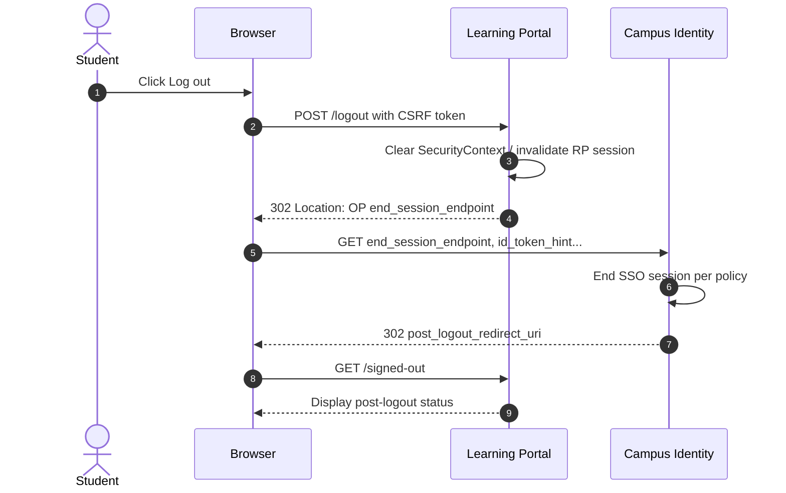
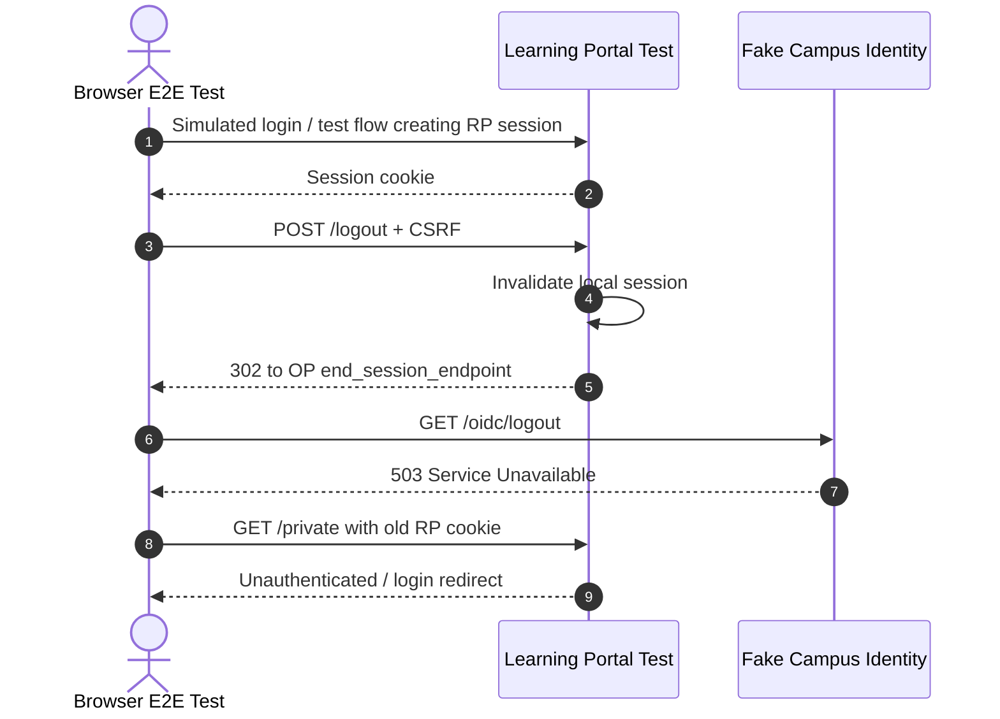

# 24.12. Testing Logout When the Provider Fails or the Application Session Has Expired

## Learning Objectives

After completing this lesson, you will be able to:

- Distinguish **local logout at the application (Relying Party/RP)** from **OpenID Connect RP-Initiated Logout** at the OpenID Provider (OP).
- Design tests for scenarios where the OP is unreachable, the OP returns an error, `end_session_endpoint` is missing, `post_logout_redirect_uri` is misconfigured, or the post-logout callback does not occur.
- Understand why **a successful logout at the application does not mean SSO logout succeeded at the provider**, and why redirecting to the OP does not prove the OP terminated the session.
- Test the case where the **HTTP session/WebSession has timed out or been invalidated** before the user clicks Log out; understand the consequences when `OidcUser` and the **ID Token hint** are no longer available.
- Configure and test `OidcClientInitiatedLogoutSuccessHandler` on **Servlet** and `OidcClientInitiatedServerLogoutSuccessHandler` on **Reactive/WebFlux**.
- Distinguish testing layers: unit tests for handlers, MockMvc/WebTestClient for Spring Security, HTTP stubs for the provider, and browser end-to-end tests for redirect/cookie chains.
- Design a safe fallback when OP logout cannot be performed: the local session must be handled properly, without promising that SSO has ended and without creating an automatic redirect loop.
- Verify CSRF, session fixation, cookies, authorized-client/token persistence, and the impact on Resource Servers when logout fails.
- Build a test matrix, metrics, and reproducible failure scenarios without logging `id_token`, access tokens, refresh tokens, or session cookies.

---

## 1. Real-World Problem: Clicking Log Out When the Provider Does Not Respond

Suppose **Learning Portal** is a Spring Boot application using **Campus Identity** as its OpenID Provider.

A student has logged in:

```text
Browser
   -> Learning Portal (RP): session S1
   -> Campus Identity (OP): SSO session P1
```

The user clicks the Log out button. The Portal wants to:

1. End session S1 at Learning Portal.
2. Redirect the browser to Campus Identity's logout endpoint to end SSO session P1.
3. Once the OP completes, redirect the browser back to the Portal's `/signed-out` page.

Desired flow:



However, in practice any of the following can happen:

- Campus Identity is under maintenance; the browser receives HTTP 503.
- DNS, TLS, or network issues make the OP unreachable.
- The OP is missing `end_session_endpoint` in its metadata.
- The OP does not accept the `post_logout_redirect_uri` that was sent.
- RP session S1 timed out before the user clicked Log out.
- The OP has another SSO session or asks the user to choose an account to log out.
- The user closes the tab immediately after the Portal returns the redirect.
- The browser blocks cookies/redirects, or a reverse proxy rewrites the URL incorrectly.
- The user returns to the Portal; the OP SSO session is still alive and can immediately log them back in.

This is why tests must cover **multiple system boundaries**, rather than only asserting that POST `/logout` returns HTTP 302.

> **Principle:** Completing local logout and completing OP logout are **two separate outcomes that must be observed independently**. Do not tell the user "You have been logged out of all applications" if you have only verified that the Portal's local session is gone.

## 2. Distinguishing Four Related Lifecycles

| Object | Where Managed | Consequence When Ended |
| --- | --- | --- |
| **RP session** | Learning Portal / Servlet HTTP session or WebFlux WebSession | Browser no longer has a local Authentication |
| **OP SSO session** | Campus Identity | May require re-authentication with the OP depending on applications and policy |
| **OAuth2AuthorizedClient** | RP repository/service | Access token/refresh token state is loaded or deleted per policy |
| **Access Token/Refresh Token on the AS** | Campus Identity/Authorization Server | May remain valid until expiry or token revocation |

For example:

```text
RP session S1 deleted             = TRUE
OP SSO session P1 still alive     = TRUE
Access Token AT1 still valid      = TRUE
Authorized Client record in DB    = TRUE
```

All four of these **can happen together** if the application does not apply an appropriate state cleanup or revocation policy.

### 2.1. Local Logout Differs from RP-Initiated Logout

**Local logout** is a Spring Security operation at the RP, for example:

```text
SecurityContextLogoutHandler
  -> clear SecurityContext
  -> invalidate HTTP session per configuration
```

**OIDC RP-Initiated Logout** is when the RP directs the browser to the **OP logout endpoint** to request ending the OP session. The OP may require `id_token_hint`, `client_id`, `post_logout_redirect_uri`, or other parameters depending on the specification and provider policy.

A logout success handler at the RP typically builds a **redirect URL**; it does not by itself confirm that the OP processed the request successfully.

### 2.2. Token Revocation Does Not Happen Automatically

`OidcClientInitiatedLogoutSuccessHandler` is **not** a Token Revocation Client. If you want to revoke access tokens or refresh tokens, you must additionally design a request to the AS **Token Revocation Endpoint** or a provider-supported mechanism.

Do not infer:

```text
POST /logout returns 302
   -> all old access tokens have been revoked
```

Especially with JWT Access Tokens validated offline by a Resource Server, the token may continue to be accepted until expiration if there is no mechanism to invalidate it.

### 2.3. Back-Channel Logout Is a Different Flow

**OIDC Back-Channel Logout** goes in the direction:

```text
OP -> sends Logout Token to RP
```

It differs from:

```text
RP -> returns redirect for browser to call OP logout endpoint
```

When the OP loses connectivity, Back-Channel Logout may be delayed or never reach the RP. Testing callbacks from the OP and testing RP-Initiated Logout must be **two separate test groups**, because their failure points and security constraints are different.

## 3. What Kinds of Provider Errors Exist?

To design accurate tests, identify **when** the error occurs.

| Stage | Example | Does RP Know Immediately? | What Type of Test Is Needed? |
| --- | --- | --- | --- |
| **Configuration/startup** | OIDC discovery fails | May be known immediately during registration initialization | Configuration/startup test |
| **Building logout URL at RP** | Metadata lacks `end_session_endpoint` | Yes, if the handler reads local metadata | Unit/MockMvc/WebTestClient |
| **Browser navigating to OP** | DNS fail, TLS fail, network timeout | **Not necessarily**; RP already returned 302 | Browser/E2E/network test |
| **OP processing logout** | HTTP 400/403/500/503 | Browser sees it; RP usually does not see it as POST `/logout` response | Stub OP + browser test |
| **OP redirecting back** | `post_logout_redirect_uri` not registered | Callback back to RP may never happen | E2E + provider configuration |
| **After logout** | Browser visits protected page and OP still has SSO | RP receives a new login flow | E2E, cookie/session test |
| **Local session already expired** | No Authentication/ID Token left | RP may see request as anonymous | MockMvc/WebTestClient/session test |

### 3.1. Common Misconception: "If Mock OP Returns 500, POST /logout at RP Must Also Return 500"

In redirect-based RP-Initiated Logout:

```text
POST https://portal.example.org/logout
    -> RP returns 302 Location: https://login.example.org/logout?...

GET https://login.example.org/logout?...
    -> OP returns 500
```

These are **two different HTTP requests**. The OP's 500 response typically appears **after** the browser has already left the RP. The RP cannot retroactively change the 302 status it previously sent into a 500.

Therefore, a test that only uses `MockMvc` to call POST `/logout` **cannot prove** that the OP is healthy; it only tests redirect URL construction and local session behavior.

### 3.2. Metadata Errors May Be Detected at a Different Stage

If you configure:

```yaml
provider:
  campus:
    issuer-uri: https://login.example.org/realms/campus
```

Spring may need to download OIDC Discovery Metadata to build `ClientRegistration`. When the OP is unreachable **at application startup**, registration creation may fail. That is a **startup/configuration failure**, which differs from the case where the OP goes down **after the user has logged in**, while the RP already has the loaded/configured metadata.

Do not write a test simulating an OP outage during logout and expect the application to call discovery inside the logout request itself if the implementation does not work that way.

## 4. The Baseline Success Scenario Needed Before Testing Failures

A good baseline test must confirm both local logout and the provider redirect.

```text
Given:
    User logged in via OIDC with registration campus
    RP session S1 active
    OP publishes end_session_endpoint
    ID Token is still stored in OidcUser

When:
    Browser sends POST /logout with CSRF token

Then:
    RP session S1 can no longer be used to access a protected page
    Location points to the trusted OP end_session_endpoint
    id_token_hint matches the ID Token of that login, when applicable
    post_logout_redirect_uri is a configured/allowed URL
    Browser is redirected back to RP by OP if OP succeeds
```

The final `Then` **cannot be verified by handler unit tests alone**. Handler tests and browser tests have different responsibilities.

### 4.1. Data in the Logout Flow

An illustrative RP-Initiated Logout URL:

```text
https://login.example.org/realms/campus/protocol/openid-connect/logout
    ?id_token_hint=<id-token>
    &post_logout_redirect_uri=https%3A%2F%2Fportal.example.org%2Fsigned-out
```

The parameters accepted by a provider may vary by OIDC implementation. For modern compliant providers, there may also be `client_id`, `state`, or `logout_hint` depending on the contract. Not every OP has the exact same query string.

**The ID Token is a credential containing claims; if used as `id_token_hint` in a redirect, avoid writing the full Location header to logs or tracing.**

## 5. Configuring Servlet OIDC Logout

Spring Security Servlet provides:

```java
OidcClientInitiatedLogoutSuccessHandler
```

to build the redirect to the OP end-session endpoint based on the ClientRegistration and the current Authentication.

### 5.1. Spring Boot ClientRegistration Configuration

Example:

```yaml
spring:
  security:
    oauth2:
      client:
        registration:
          campus:
            provider: campus
            client-id: ${CAMPUS_CLIENT_ID}
            client-secret: ${CAMPUS_CLIENT_SECRET}
            client-authentication-method: client_secret_basic
            authorization-grant-type: authorization_code
            redirect-uri: "{baseUrl}/login/oauth2/code/{registrationId}"
            scope:
              - openid
              - profile
              - email
        provider:
          campus:
            issuer-uri: https://login.example.org/realms/campus
```

These values are illustrative. `issuer-uri` supports discovery when the OP supports it and the provider is configured appropriately.

### 5.2. SecurityFilterChain with the Handler

```java
@Configuration
class OidcLogoutConfiguration {

    @Bean
    SecurityFilterChain securityFilterChain(
            HttpSecurity http,
            ClientRegistrationRepository registrations)
            throws Exception {

        OidcClientInitiatedLogoutSuccessHandler oidcLogout =
            new OidcClientInitiatedLogoutSuccessHandler(
                registrations
            );

        oidcLogout.setPostLogoutRedirectUri(
            "{baseUrl}/signed-out"
        );

        oidcLogout.setDefaultTargetUrl("/signed-out");

        http
            .authorizeHttpRequests(auth -> auth
                .requestMatchers(
                    "/", "/signed-out", "/error",
                    "/assets/**"
                ).permitAll()
                .anyRequest().authenticated()
            )
            .oauth2Login(Customizer.withDefaults())
            .logout(logout -> logout
                .logoutUrl("/logout")
                .logoutSuccessHandler(oidcLogout)
            );

        return http.build();
    }
}
```

Meaning:

- Spring Security's `LogoutFilter` handles a valid logout request and invokes the logout handlers to clean up local state.
- `OidcClientInitiatedLogoutSuccessHandler` determines the **destination after local logout**.
- `{baseUrl}/signed-out` is the RP callback that the OP can redirect back to when logout succeeds.
- `setDefaultTargetUrl("/signed-out")` provides a local target when the handler cannot build an OP logout redirect in the current context; verify the exact behavior in the version you are using.
- `/signed-out` must be accessible when **there is no Authentication**.

**Keep CSRF protection:** for a typical Spring Security browser session, `POST /logout` requires a CSRF token. A GET request to `/logout` may only show a confirmation page or be blocked depending on configuration.

### 5.3. Do Not Use the Login Callback as the Logout Callback

Semantically incorrect example:

```text
/login/oauth2/code/campus
```

is the endpoint that processes the **Authorization Code** after login, not the page the OP should return to after logout.

Reasonable example:

```text
/signed-out
```

Register this URL at the OP according to the `post_logout_redirect_uri` policy if required by the provider.

### 5.4. Do Not Confuse Localhost and Public Base URL

If the Portal sits behind a reverse proxy:

```text
Public:
https://portal.example.org

Internal:
http://portal-service:8080
```

`{baseUrl}` needs to be resolved accurately by Spring from forwarded headers **controlled by a trusted proxy**. If the OP registered a public HTTPS URI while the RP generates an internal HTTP URI, the OP may reject the logout redirect.

Do not trust arbitrary `X-Forwarded-Host` headers sent by public clients to construct `post_logout_redirect_uri`; configure proxy/forward headers securely.

## 6. Unit Tests for the Logout Success Handler

**Goal:** verify whether the handler builds the correct redirect URL when given an OIDC Authentication and appropriate provider metadata.

Handler-level tests do not need to launch a browser or call a real OP.

### 6.1. Creating a Test ClientRegistration with an End-Session Endpoint

JUnit 5 / Spring Security 6.x example (imports omitted):

```java
private ClientRegistration campusRegistration() {
    return ClientRegistration.withRegistrationId("campus")
        .clientId("portal-test-client")
        .clientSecret("test-secret-only")
        .clientAuthenticationMethod(
            ClientAuthenticationMethod.CLIENT_SECRET_BASIC
        )
        .authorizationGrantType(
            AuthorizationGrantType.AUTHORIZATION_CODE
        )
        .redirectUri(
            "{baseUrl}/login/oauth2/code/{registrationId}"
        )
        .scope("openid", "profile")
        .authorizationUri(
            "https://idp.test.example/authorize"
        )
        .tokenUri(
            "https://idp.test.example/token"
        )
        .jwkSetUri(
            "https://idp.test.example/jwks"
        )
        .issuerUri(
            "https://idp.test.example"
        )
        .providerConfigurationMetadata(
            Map.of(
                "end_session_endpoint",
                "https://idp.test.example/oidc/logout"
            )
        )
        .clientName("Campus Test")
        .build();
}
```

The test intentionally constructs `ClientRegistration` locally, **without using `ClientRegistrations.fromIssuerLocation(...)`**, to avoid network/discovery dependencies in unit tests.

Builder APIs may vary slightly across Spring Security lines. When applying this in a project, verify against your actual version and imports.

### 6.2. Creating an OIDC Authentication Using a Fake ID Token

```java
private Authentication oidcAuthentication() {
    Instant now = Instant.now();

    OidcIdToken idToken = new OidcIdToken(
        "header.payload.signature",
        now.minusSeconds(30),
        now.plusSeconds(300),
        Map.of(
            "iss", "https://idp.test.example",
            "sub", "student-123",
            "aud", List.of("portal-test-client")
        )
    );

    OidcUser user = new DefaultOidcUser(
        List.of(new SimpleGrantedAuthority("ROLE_USER")),
        idToken
    );

    return new OAuth2AuthenticationToken(
        user,
        user.getAuthorities(),
        "campus"
    );
}
```

This is a fixture for testing **logout redirect construction**; the fake raw token has no real signature and therefore **must not be used to test OIDC Login/JWS validation**.

### 6.3. Asserting That the Handler Builds the Expected Redirect

```java
@Test
void redirectsToOidcEndSessionEndpoint() throws Exception {
    ClientRegistration registration = campusRegistration();

    ClientRegistrationRepository registrations =
        new InMemoryClientRegistrationRepository(
            registration
        );

    OidcClientInitiatedLogoutSuccessHandler handler =
        new OidcClientInitiatedLogoutSuccessHandler(
            registrations
        );

    handler.setPostLogoutRedirectUri(
        "{baseUrl}/signed-out"
    );

    MockHttpServletRequest request =
        new MockHttpServletRequest("POST", "/logout");

    request.setScheme("https");
    request.setServerName("portal.test.example");
    request.setServerPort(443);

    MockHttpServletResponse response =
        new MockHttpServletResponse();

    handler.onLogoutSuccess(
        request,
        response,
        oidcAuthentication()
    );

    String location = response.getRedirectedUrl();

    assertThat(location)
        .startsWith("https://idp.test.example/oidc/logout?");

    assertThat(location)
        .contains("id_token_hint=");

    assertThat(location)
        .contains("post_logout_redirect_uri=");
}
```

**What this test proves:** The handler finds the OP metadata, uses the Authentication's registration, and generates a `Location` containing the logout URI.

**What this test does not prove:** That Campus Identity received the request, cleared the SSO cookie, returned a post-logout callback, or revoked any tokens.

### 6.4. Do Not Assert the Raw URL by Exact Parameter Order

Query parameter order is not a business requirement. In a more resilient test, parse the URI and assert:

```text
scheme == https
host == idp.test.example
path == /oidc/logout
id_token_hint == test token
post_logout_redirect_uri == https://portal.test.example/signed-out
```

If the callback URI is percent-encoded, use an appropriate URI parser before comparing. Do not compare literal strings containing real tokens, and avoid letting test failures dump an entire ID Token into CI logs.

## 7. Testing When the Provider Lacks `end_session_endpoint`

An OP may support OIDC Login without publishing a standard logout endpoint, or its metadata may be missing that configuration.

Create a test registration:

```java
ClientRegistration registration =
    ClientRegistration.withRegistrationId("campus")
        .clientId("portal-test-client")
        .clientSecret("test-secret-only")
        .authorizationGrantType(
            AuthorizationGrantType.AUTHORIZATION_CODE
        )
        .redirectUri(
            "{baseUrl}/login/oauth2/code/{registrationId}"
        )
        .authorizationUri(
            "https://idp.test.example/authorize"
        )
        .tokenUri(
            "https://idp.test.example/token"
        )
        .jwkSetUri(
            "https://idp.test.example/jwks"
        )
        .issuerUri(
            "https://idp.test.example"
        )
        .scope("openid")
        .build();
```

In this registration, there is no `end_session_endpoint` metadata.

### 7.1. Expectations

- **Local logout is not rolled back** merely because the OP does not provide a logout endpoint.
- Do not redirect to a guessed OP URL such as `issuer + "/logout"` if the provider did not advertise that endpoint.
- The handler should use an appropriate local fallback, or the application should have clear error handling if the version/implementation does not support the desired fallback.
- The browser must no longer treat itself as authenticated with the RP.
- The UI must not state with certainty that OP SSO has ended.

### 7.2. A Focused Test

```java
@Test
void missingEndSessionEndpointFallsBackLocally()
        throws Exception {

    OidcClientInitiatedLogoutSuccessHandler handler =
        new OidcClientInitiatedLogoutSuccessHandler(
            registrationsWithoutEndSessionEndpoint
        );

    handler.setDefaultTargetUrl("/signed-out");

    MockHttpServletRequest request =
        new MockHttpServletRequest("POST", "/logout");

    MockHttpServletResponse response =
        new MockHttpServletResponse();

    handler.onLogoutSuccess(
        request, response, oidcAuthentication()
    );

    assertThat(response.getRedirectedUrl())
        .isEqualTo("/signed-out");
}
```

This example assumes the repository is built from a registration missing the endpoint and the OIDC Authentication uses registration ID `campus`. Verify the exact behavior of the handler in your project's Spring Security version; if the provider has a custom logout policy, implement a dedicated fallback at the application layer instead of substituting a guessed URL into metadata.

## 8. Provider HTTP 500/503: Testing at the Right Boundary

Suppose the Portal returns:

```http
HTTP/1.1 302 Found
Location: https://idp.test.example/oidc/logout?...
```

The browser goes to the OP and the OP returns:

```http
HTTP/1.1 503 Service Unavailable
```

The Portal application **has usually already cleared the local session before redirecting**, but:

```text
OP SSO logout completed = UNKNOWN / FAILED
```

### 8.1. Handler Tests Do Not See HTTP 503

If you test:

```java
handler.onLogoutSuccess(request, response, auth);
```

there is no network call to the OP. Therefore, you cannot mock a 503 response with `MockRestServiceServer` attached to this handler and expect an error inside that method.

To test errors at the OP, you must **have a browser or HTTP test client follow the redirect** to a provider stub.

### 8.2. E2E Test Model Using an OP Stub



Expect **two independent assertions**:

1. The OP returns the injected error.
2. The RP session **has been invalidated** and cannot be used to access protected data.

Do not let local logout fail just because the OP cannot be reached over the network when the application policy is to terminate the local session first.

### 8.3. What Should the Stub Server Test?

A fake OP can:

- Return `302` back to `/signed-out`.
- Return `400` when the callback URI is unregistered.
- Return `401` or an additional authentication prompt page.
- Return `500`/`503` to simulate outages.
- Hold the connection without responding to simulate a timeout.
- Return a redirect to a wrong host to test policy.
- Simulate the OP SSO cookie remaining intact or being cleared.

**Warning:** if you only use a simple HTTP client that follows redirects, cookie/SSO and navigation behavior may differ from a real browser. For testing cookies, SameSite, CSRF, and URL navigation, use browser automation in a test environment.

## 9. When Provider DNS/TLS/Network Fails

Different failure scenarios:

```text
DNS NXDOMAIN
TLS certificate expired
TLS hostname mismatch
Connection refused
Connection timeout
Read timeout
Reverse proxy 502/504
```

In a browser redirect flow:

```text
Portal POST /logout -> 302 success
Browser GET OP logout URL -> browser network error
```

### 9.1. Expected Behavior

- The browser no longer has a valid local session at the Portal.
- The Portal cannot conclude that the OP SSO session has ended.
- The user can return to the Portal and read the guidance page.
- Do not automatically retry redirects infinitely.
- Do not downgrade TLS verification or switch to unencrypted HTTP.
- If retrying logout at the OP, design it appropriately for the provider; do not broadcast the ID Token across multiple domains.

### 9.2. Testing the Failure Modes

| Fault Injection | Expected Observation |
| --- | --- |
| OP DNS does not resolve | Browser reports network error; RP session is logged out |
| TCP connection refused | No access left to protected RP URLs |
| Invalid TLS certificate | Does not bypass TLS; does not skip certificate validation |
| OP 503 | No OP callback; local logout persists |
| OP returns HTML error | Not parsed as a successful OIDC callback |
| OP redirect loop | Browser test hits redirect limit; RP does not recreate session without OIDC Login |
| OP redirects to unknown domain | Not treated as a sign of successful logout; verify provider policy |
| Browser closes tab | Local session must still end if RP already processed POST logout |

A realistic provider outage test needs **two separate phases**:

1. **Log in while the OP is healthy** to create S1.
2. **Fail the OP afterward**, then perform logout.

If the OP is already dead before login and the RP lacks metadata, the test no longer accurately evaluates the "logout after login" scenario.

## 10. When the OP Returns a `post_logout_redirect_uri` Error

An OP may reject:

```text
post_logout_redirect_uri=https://portal.example.org/signed-out
```

if the URI is unregistered, mismatches scheme/host/path, or if the OP requires standard client identification.

Scenario:

```text
RP -> 302 end_session_endpoint?post_logout_redirect_uri=...
OP -> 400 invalid_redirect_uri
Browser does not return to /signed-out
```

Things to test:

- The RP generates the exact **public HTTPS URI**.
- The URI is in the OP's allowlist/registration.
- Scheme/hostname/path/port match the OP's policy strictly.
- Do not take the target URI from an arbitrary user-supplied query parameter.
- When the OP rejects the URI, the local RP session must still not be treated as logged in.
- The browser may receive an OP error page with no callback to the RP.

### 10.1. Why Not Read a Dynamic URI from `returnTo`?

A design to avoid:

```text
POST /logout?returnTo=https://untrusted.example/collect
```

and then passing `returnTo` directly as:

```text
post_logout_redirect_uri
```

Without an allowlist, the RP can create an open redirect or leak `id_token_hint` via URLs, Referer headers, or unintended logs.

It is safer to use a statically configured URL:

```java
oidcLogout.setPostLogoutRedirectUri(
    "{baseUrl}/signed-out"
);
```

and protect forwarded headers/reverse proxies. If multiple callbacks are needed, maintain a fixed mapping keyed by ClientRegistration and purpose, rather than trusting arbitrary URLs from the browser.

## 11. When the Application Session Has Timed Out Before the User Clicks Logout

This is the most important case in the problem statement.

The user logs in at 09:00:

```text
RP session S1 valid
SecurityContext contains OIDC Authentication
OidcUser contains ID Token
```

After 30 minutes of inactivity:

```text
09:30
RP session S1 expired
SecurityContext / OidcUser can no longer be retrieved
Browser may still hold the old JSESSIONID cookie
OP SSO session P1 may still be alive
```

At 09:40, the user clicks the Log out button:

```text
POST /logout with old S1 cookie
```

### 11.1. What Has Changed?

Once session S1 has timed out, the RP may treat the incoming request as **anonymous**. `OidcClientInitiatedLogoutSuccessHandler` no longer has an OIDC Authentication to read:

```text
registrationId
OidcUser
ID Token
id_token_hint
```

It **cannot recover** an already-deleted ID Token merely because the browser still sends the old Session ID.

### 11.2. Safe Expectations

1. Do not recreate session S1 just to "finish logging out."
2. Do not report local logout as failed if S1 had already expired.
3. Do not send the `id_token_hint` of **another user** or an access token from a global cache.
4. You may send the browser to an appropriate `/signed-out` or `/session-expired` page.
5. Clearly state that OP SSO may still exist if OP logout could not be performed.
6. Do not arbitrarily disable CSRF across the entire application to work around POST logout errors.
7. Do not trigger an automatic redirect loop between RP logout, OP SSO, and OIDC Login.

> **Conclusion:** When the RP session has expired, local logout can be treated as an **idempotent** operation regarding local state, but the RP **does not have enough data** to guarantee OP logout the same way it does while the OIDC Authentication is still alive.

## 12. CSRF When the Session Has Expired: Why Can POST /logout Return 403?

In the standard browser session model, the CSRF token may be stored in the session or bound to the current session.

After the session expires:

```text
Old JSESSIONID cookie
CSRF token in old HTML
Session no longer exists
```

The browser sends:

```http
POST /logout HTTP/1.1
Cookie: JSESSIONID=old-session
X-CSRF-TOKEN: old-csrf-token
```

Spring Security may reject the request **before LogoutFilter executes logout** if the CSRF token is no longer valid.

### 12.1. Why Is This Not an OP Error?

The OP has not been called yet. This is **inbound request validation at the RP**.

A proper test must distinguish:

```text
POST /logout -> 403 CSRF
```

from:

```text
POST /logout -> 302 OP
Browser -> OP -> 503
```

These two issues happen at different layers and require different messages and handling.

### 12.2. Should You Use `.csrf().disable()` Just to Allow Logout After Timeout?

No. Disabling CSRF across an entire browser-session application can expose many state-changing endpoints to risk.

A reasonable UX design:

- When the session expires, the UI receives HTTP 401/403/expired status.
- Allow the browser to **navigate to a public page** `/session-expired` or `/signed-out`.
- If the user wants to try logging out of the OP, provide guidance or an OP-compatible flow.
- There is no need to retry a local POST logout if the session is already gone.
- Do not expose sensitive security details in error messages.

### 12.3. Distinguishing CSRF Failure from an Expired Session

An HTTP 403 alone is not enough to prove the cause was an expired session. It could be due to:

```text
Invalid CSRF token
User lacks permission
Another security filter rejected the request
Reverse proxy stripped cookies/headers
```

Therefore, the endpoint/UI should receive policy-defined error codes, and server logs should only record safe metadata. Do not label every 403 as "logged out of your account."

## 13. Unit Testing When Authentication Is Gone

Test the handler directly with a `null` Authentication:

```java
@Test
void missingAuthenticationUsesLocalFallback()
        throws Exception {

    OidcClientInitiatedLogoutSuccessHandler handler =
        new OidcClientInitiatedLogoutSuccessHandler(
            registrations
        );

    handler.setDefaultTargetUrl("/signed-out");

    MockHttpServletRequest request =
        new MockHttpServletRequest("POST", "/logout");

    MockHttpServletResponse response =
        new MockHttpServletResponse();

    handler.onLogoutSuccess(
        request,
        response,
        null
    );

    assertThat(response.getRedirectedUrl())
        .isEqualTo("/signed-out");
}
```

**Purpose:** verify that the handler does not try to read `OidcUser.getIdToken()` when there is no OIDC principal and falls back locally.

If a particular Spring Security version handles anonymous users or exceptions differently, adjust the custom fallback in your application and test that policy; do not assume framework classes behave identically across every version.

### 13.1. A Non-OIDC Authentication

You should also test:

```java
Authentication nonOidc =
    new UsernamePasswordAuthenticationToken(
        "student",
        null,
        List.of(
            new SimpleGrantedAuthority("ROLE_USER")
        )
    );
```

The handler must not put an invented token into `id_token_hint` just because an Authentication is valid in Spring Security. OIDC RP-Initiated Logout requires a proper OIDC context.

### 13.2. OIDC Authentication Missing Its Registration

A misconfiguration can occur:

```text
Authentication is OAuth2AuthenticationToken
registrationId = campus-old
ClientRegistrationRepository only has campus
```

Tests must ensure the application:

- Does not randomly pick another registration.
- Does not redirect to an OP supplied by the request itself.
- Has clear error/fallback handling.
- Does not revive an already logged-out RP session.

In multi-provider systems, avoid logic like "if `campus-old` is not found, use the first provider"; that risks sending an ID Token or logout hint to the wrong OP.

## 14. Integration Testing: Session Expires Before POST Logout

A unit test with `Authentication=null` **does not prove** that the full Spring Security filter chain handles cookies and CSRF properly after a timeout.

Layered integration tests are needed:

```text
1. Log in to create RP session S1.
2. Verify S1 can access /private.
3. Expire S1 via session store/controllable clock or invalidate it.
4. Browser keeps the old cookie.
5. Send POST /logout or visit the logout page.
6. Check the response against policy.
7. Verify /private cannot be accessed with cookie S1.
8. Verify there is no OP redirect with another user's id_token_hint.
```

### 14.1. Simulating an Old Session in MockMvc

In Servlet unit/integration tests, you can create:

```java
MockHttpSession session = new MockHttpSession();
session.setAttribute("example", "test");
session.invalidate();
```

However, **do not pass an invalidated session** and expect every `MockHttpServletRequest` API to behave like a real container when reattached. `MockMvc` does not fully simulate Servlet container TTLs and browser cookies.

To test realistic timeouts, you can use:

- A real test HTTP server with a short session timeout in the test environment.
- Spring Session repository tests with a controllable clock/time.
- Container integration tests covering cookies and session lifecycles.
- A separate mock at the "Authentication no longer exists" boundary to test the handler independently.

### 14.2. Avoid `Thread.sleep(...)` to Wait for Session Expiration

Tests like:

```java
Thread.sleep(31_000);
```

are slow, flaky, and do not prove that the registry/session store runs properly under real clocks or clusters.

Better options:

```text
Fake/controllable clock
Test session repository with controllable expiration
Explicit session invalidation for lost-state test paths
Dedicated integration test for container TTL
```

When using Spring Session Redis/JDBC, understand that TTL index/cleanup events may **not happen at the exact millisecond**, so test policy correctness rather than asserting an exact timestamp.

### 14.3. Do Not Recover an OIDC ID Token from an Old Request

If the RP session is gone, do not inspect an old cookie and guess a principal name to load another user's ID Token, nor resend an old token from a global cache.

If you need to support SSO logout after a local-session timeout, it must have a dedicated design **with an authenticated basis and OP compatibility**. Do not turn "needs logout" into an excuse to let an unauthenticated caller pick someone else's subject/token.

## 15. Servlet Integration Tests with MockMvc: What to Verify

`MockMvc` is useful for testing the security filter chain **without a real browser**.

### 15.1. Testing a Valid POST Logout

With Spring Security Test:

```java
@Autowired
MockMvc mvc;

@Test
void logoutRequiresValidCsrfAndClearsLocalAuthentication()
        throws Exception {

    mvc.perform(
            post("/logout")
                .with(csrf())
                .with(oidcLogin())
        )
        .andExpect(status().is3xxRedirection());
}
```

This example **tests request and handler routing**. `oidcLogin()` simulates an authenticated principal; it **does not actually run** the OIDC Authorization Code callback or OP HTTP logout.

To verify that the session is actually cleared, use the session/security context from the first request or an integrated login fixture, then call a protected endpoint with **the same session cookie** and assert it is no longer authenticated.

### 15.2. Testing CSRF Failure

```java
@Test
void logoutWithoutCsrfIsRejected()
        throws Exception {

    mvc.perform(
            post("/logout")
                .with(oidcLogin())
        )
        .andExpect(status().isForbidden());
}
```

This test assumes CSRF is enabled with standard Spring Security browser session policy. If the application customizes the CSRF repository or exception handling, the status code may differ, but logout must never silently execute when the request violates CSRF policy.

### 15.3. Testing OP Unavailability Is Not Covered by MockMvc Alone

If a test only runs:

```java
mvc.perform(post("/logout").with(csrf()))
    .andExpect(status().is3xxRedirection());
```

it does not prove that the OP served the redirect. To test OP 503, there must be an **HTTP GET step to an OP stub** (or browser navigation) after the 302 response.

### 15.4. Testing the RP Cookie

Test a request with the old S1 cookie after logout:

```text
GET /private
Cookie: JSESSIONID=<old>

Expected:
  401 or login redirect depending on the application
  No protected body returned
```

The server does not always have to send `Set-Cookie: JSESSIONID=; Max-Age=0` in every configuration; local session invalidation and browser cookie deletion can be handled differently by the container or logout configuration. What matters is that **the old session ID no longer grants access**.

### 15.5. Testing `id_token_hint` Belongs to the Right User

When there are two OIDC identities:

```text
student A -> ID Token A
student B -> ID Token B
```

User A's logout request must never generate a redirect containing ID Token B. Tests should verify the source `OidcUser`/current Authentication rather than pulling the last token processed by a singleton service.

## 16. Browser and Fake OP Testing: The Full Chain

A Browser E2E test (Playwright, Selenium, or similar framework) can run alongside an OP stub serving these endpoints:

```text
/.well-known/openid-configuration
/authorize
/token
/jwks
/oidc/logout
```

This lets you control:

- OP SSO cookies.
- `state`, `nonce`, and the login callback.
- ID Token fixtures validly signed with a test key.
- Logout redirect behavior.
- OP 400/503/timeouts.
- Browser cookie cleanup and navigation.

### 16.1. Baseline Flow

```text
Login:
  browser -> /oauth2/authorization/campus
  fake OP -> authorization code
  RP -> token endpoint
  fake OP -> valid ID Token
  RP -> create S1

Logout:
  browser POST /logout + CSRF
  RP -> invalidate S1
  RP -> redirect OP end_session_endpoint
  OP -> clear SSO cookie and redirect /signed-out
```

### 16.2. Flow When OP Returns 503

```text
Login succeeds
    -> OP stub switches mode: end-session returns 503
    -> browser POST /logout
    -> RP returns redirect to OP
    -> browser receives OP 503
    -> browser returns to RP /private
    -> RP requires login
```

Do not assert that the OP deleted the SSO session after a 503. Some OPs might do partial work before sending the error; this is an **unknown** state and should be explained carefully.

### 16.3. Flow When OP Does Not Redirect Back to RP

An OP may complete logout yet **not redirect** to `post_logout_redirect_uri` due to policy or an error.

Result:

```text
RP local logout: success
OP logout: may be success or unknown
Return navigation: failed
```

Therefore, a test checking "browser did not reach `/signed-out`" is **not sufficient to conclude** that OP logout failed. You must observe the fake OP's session/cookies or use supported provider contracts.

### 16.4. Notes on Mock OP and Token Signing

If testing full OIDC Login instead of injecting `oidcLogin()`, the fake OP must issue ID Tokens meeting these conditions:

```text
iss = configured issuer
aud includes Client ID
exp/iat valid
JWS signature verified by fake JWKS
state/nonce match the authorization request
```

Do not disable ID Token signature/issuer/audience/nonce validation just to make logout tests convenient. If a test needs to bypass part of login, state explicitly that it uses **mock authentication** and do not treat it as a full OIDC test.

## 17. Spring Security WebFlux: Logout Handler and Expired Sessions

On WebFlux/Reactive, Spring Security uses:

```java
OidcClientInitiatedServerLogoutSuccessHandler
```

with:

```java
ReactiveClientRegistrationRepository
```

Do not use the Servlet class `OidcClientInitiatedLogoutSuccessHandler` inside a `SecurityWebFilterChain`.

### 17.1. Reactive Configuration

```java
@Configuration
@EnableWebFluxSecurity
class ReactiveOidcLogoutConfig {

    @Bean
    SecurityWebFilterChain securityWebFilterChain(
            ServerHttpSecurity http,
            ReactiveClientRegistrationRepository registrations) {

        OidcClientInitiatedServerLogoutSuccessHandler oidcLogout =
            new OidcClientInitiatedServerLogoutSuccessHandler(
                registrations
            );

        oidcLogout.setPostLogoutRedirectUri(
            "{baseUrl}/signed-out"
        );

        http
            .authorizeExchange(exchanges -> exchanges
                .pathMatchers(
                    "/", "/signed-out", "/error"
                ).permitAll()
                .anyExchange().authenticated()
            )
            .oauth2Login(Customizer.withDefaults())
            .logout(logout -> logout
                .logoutSuccessHandler(oidcLogout)
            );

        return http.build();
    }
}
```

Imports and dependencies must match WebFlux (`ServerHttpSecurity`, `SecurityWebFilterChain`, `ReactiveClientRegistrationRepository`). Spring Boot can auto-configure the necessary beans when the starter and properties are valid.

### 17.2. `Mono<Void>` and Logout

The reactive logout success handler operates on `WebFilterExchange` and `Authentication` following the reactive contract, returning a publisher representing the response/redirect work. Do not call `.block()` on the event loop, and do not manually `.subscribe()` and return success before session invalidation finishes.

### 17.3. WebSession Timeout

After a WebSession expires:

```text
Reactive SecurityContext is gone
OIDC Authentication may be null
IdTokenHint is unavailable from the old session
```

Therefore, the reactive handler also needs a proper fallback when the OIDC principal is absent. Avoid accessing:

```java
authentication.getPrincipal()
```

without accounting for anonymous/null cases in custom reactive logout logic.

### 17.4. WebTestClient Testing

At the WebFlux Security test level:

```java
WebTestClient client = webTestClient
    .mutateWith(
        SecurityMockServerConfigurers.mockOidcLogin()
    );

client.post()
    .uri("/logout")
    .exchange()
    .expectStatus()
    .is3xxRedirection();
```

This is a conceptual example when tests are bound to Spring Security WebFlux and CSRF is handled by the project's configurer/test fixture. If CSRF is enabled, attach a valid CSRF token to the logout request; do not treat a 403 status from a missing CSRF token as a provider failure.

`mockOidcLogin()` simulates OIDC Authentication **after login** and does not perform real Token Endpoint/JWKS validation. To test OP 503, follow up with a browser or HTTP client against a stub OP.

### 17.5. Testing the Reactive Session Store

An integration test should:

1. Create a WebSession via OIDC Login or a fixture.
2. Verify `/private` is accessible.
3. Invalidate/expire the WebSession in the store or via a test clock.
4. Send a request keeping the old `SESSION` cookie.
5. Confirm `/private` is no longer accessible.
6. Attempt logout and confirm the right fallback/status.
7. Ensure the old Authentication/ID Token is not recreated.

When using Spring Session Redis/R2DBC, test expiration propagation and record cleanup timing rather than relying on fixed sleeps.

## 18. Provider Has No End-Session Endpoint: What Should You Do?

An OP that does not expose `end_session_endpoint` may still have another logout mechanism, but **the client must not guess** a standard path on its own.

There are several options:

1. Perform local logout only and explain that OP SSO may still exist.
2. Use a logout mechanism **officially supported** by the provider and configured per its separate contract.
3. Provide a link/instructions guiding the user to log out directly at the OP when appropriate.
4. Combine with Token Revocation or Back-Channel Logout if the OP supports them and business requirements justify it.

Do not send the user to:

```text
https://login.example.org/unknown/logout
```

simply because a developer guessed the URL.

### 18.1. Fallback Strategy

A safe policy:

```text
If OIDC Authentication and OP end_session_endpoint exist:
    -> local logout
    -> redirect OP

If Authentication is gone or OP has no endpoint:
    -> local logout / ensure request is anonymous
    -> display informational page /signed-out
    -> explain that direct SSO logout may be needed
```

If using a custom handler, make sure that **an exception while building the OP redirect does not revive the just-logged-out security context or session**.

## 19. Designing Error Messages for Users

Do not show a single blanket message:

```text
Successfully logged out of all services.
```

for every case. Instead, use statuses reflecting what was actually verified:

| Observed State | Suggested Message |
| --- | --- |
| RP session cleared | "You have signed out of Learning Portal." |
| OP returned success redirect and tests confirm SSO cookie cleared | "Sign-out from Campus Identity is complete." |
| OP unreachable | "You have signed out of Learning Portal. Sign-out from Campus Identity could not be confirmed." |
| RP session had already expired | "Your Learning Portal session has expired. You may close this page." |
| Logout rejected by CSRF | "This request could not be processed. Please reload the page or sign in again." |
| OP has no logout endpoint | "You have signed out of Learning Portal; SSO sign-out may need to be done separately." |

### 19.1. Avoid Turning a Provider Error into a Redirect Loop

A dangerous pattern:

```text
OP returns 503
   -> frontend automatically navigates back to /logout
      -> RP redirects to OP
         -> OP returns 503
            -> ...
```

Protect UX by:

- Not auto-retrying logout continuously.
- Providing an explanatory public page.
- Letting the user decide whether to retry later.
- Enforcing a retry limit if integrating browser retry logic.
- Never keeping sensitive tokens in the URL of a public "retry service."

### 19.2. Do Not Ask Users to Send Tokens for Support

When users report "logout failed," never ask them to copy:

```text
id_token_hint
access_token
refresh_token
JSESSIONID / SESSION cookie
Authorization header
```

All of these are credentials or sensitive data. Logs and metrics should only use correlation IDs and error types.

## 20. When the Session Expires Mid-Logout

A rare race condition worth considering:

```text
T1: User POST /logout
T2: Session store expires S1
T3: LogoutFilter reads SecurityContext
T4: OP redirect is built or fallback runs
```

Possible issues:

- Authentication becomes null mid-flight.
- Repository/session store throws an exception if the session was already invalidated.
- Custom logout handler runs twice due to a retry.
- Redirect response is already committed and a callback can no longer modify it.
- User opens two tabs and submits two POST logouts nearly simultaneously.

### 20.1. Idempotency Goal

Local logout should embody the principle:

```text
logout(local state active) -> local state cleared
logout(local state absent) -> still no local state
```

There is no need to restore an old session just to perform a second logout.

However, distinguish:

```text
Local logout idempotence
```

from:

```text
OP logout protocol idempotence
```

The OP may return an error or prompt for information when no SSO session remains. Do not assume every OP accepts infinitely repeated end-session requests.

### 20.2. Testing Double Logout

```text
Given user logged in:
    1st POST /logout -> local session invalidated
    2nd POST /logout -> no Authentication left
Then:
    No new authenticated session is created
    No old ID Token of another user is sent
    No protected content is returned
    CSRF/anonymous/fallback behavior follows policy
```

The second request may return 403 because the old CSRF token is invalid; that does not mean the local session is still alive. Test the CSRF boundary and post-logout anonymous state separately.

## 21. Testing Concurrent Logout and Token Refresh

In an OAuth2 Client system, a background request may be refreshing an access token:

```text
Request A: user's POST /logout
Request B: calls Course API, needs to refresh AT
```

If the authorized-client store is separate from the session:

```text
Logout A clears RP session
Refresh B may have just saved AT2/RT2 to the database
```

### 21.1. Why Is This a Problem?

If the product requires "logout removes all of the user's authorized clients," a late-finishing refresh request could **write tokens back** after cleanup already ran.

Addressing this requires dedicated architecture:

- Session/grant version or generation numbers.
- Conditional saves and invalidation markers.
- Atomic state transitions or per-principal/registration locking.
- Deleting tokens after background operations when appropriate.
- Revoking grants at the OP when required by policy.
- Not assuming cookie deletion alone stops all background jobs.

### 21.2. Concurrency Test

```text
Given:
    Store A/campus -> AT1/RT1

When:
    Request B starts refreshing RT1, paused before save
    Request A logs out, cleans up state
    Request B resumes and attempts to save AT2/RT2

Then:
    Outcome follows policy:
        grant is not restored after logout
        or a safe re-invalidation/cleanup mechanism runs
```

Do not write tests that only assert the `/logout` response while ignoring the subsequent database state.

## 22. Authorized-Client Repository: Session vs. Database Differences

| Store | Typical Behavior When RP Session Is Deleted | What Must Be Tested |
| --- | --- | --- |
| `HttpSessionOAuth2AuthorizedClientRepository` | Session-bound authorized client may disappear with the session | Tokens can no longer be loaded using the old session ID |
| `AuthenticatedPrincipalOAuth2AuthorizedClientRepository` | May delegate to `OAuth2AuthorizedClientService` for authenticated users | Has an explicit cleanup policy on logout |
| `JdbcOAuth2AuthorizedClientService` | Records may outlive the HTTP session | Tokens are not retained indefinitely or loaded by another user |
| Custom Redis/cache | Depends on keys, TTL, eviction, and access controls | Principal/registration/tenant isolation and cleanup |
| Reactive `WebSession` | State may disappear when WebSession is invalidated | Old SESSION cookie does not remain authenticated |
| Reactive `ReactiveOAuth2AuthorizedClientService` | Service state does not depend directly on WebSession | Test retention/revocation separately |

### 22.1. Do Not Delete Every User's OAuth2AuthorizedClient

If the application shares an `OAuth2AuthorizedClientService`, a logout request by user A must not delete user B's tokens.

Identify the logical key:

```text
(registrationId, principalName)
```

and if multi-tenant:

```text
(tenant, registrationId, principalName)
```

according to the store design. Never accept a principal name from a query parameter supplied by an unauthenticated caller to purge tokens.

### 22.2. Logout Does Not Modify Already-Issued JWT Subjects

Access Tokens carry `sub`, `aud`, and `exp` claims inside the token itself; local RP logout cannot alter an already-issued token. Resource Servers must enforce expiration, introspection, or revocation according to the architecture.

If API access must stop immediately upon logout, the system needs an actual token invalidation mechanism rather than merely invalidating `HttpSession`.

## 23. If Token Revocation Fails, Is Logout Considered Successful?

Suppose the Portal includes a step calling the Token Revocation Endpoint on logout:

```text
1. User requests logout
2. RP cleans up local session
3. RP POST revocation endpoint
4. OP timeout / 503
```

There is no single answer for how the UX should respond; it depends on risk and product policy. However, you must distinguish:

```text
Local session invalidated = confirmed
Token revocation = failed/unknown
```

### 23.1. Fail-Safe Policy

At minimum:

- Do not restore the local session just because the revocation call failed.
- Do not claim the token has been revoked without confirmation.
- Do not log raw refresh tokens or Access Tokens for debugging.
- If retrying, protect credentials, idempotency, and retry budgets.
- Monitor errors so operations knows there is a window where tokens may remain valid.
- For especially sensitive workflows, consider a denylist, short-lived tokens, or central enforcement.

### 23.2. Test Revocation Separately

Do not bundle this with `OidcClientInitiatedLogoutSuccessHandler` tests because that handler primarily manages the OP redirect. If the application adds its own revocation client, mock the HTTP call to the revocation endpoint separately:

```text
Successful revoke: HTTP 200
Network timeout
HTTP 503
Invalid client credentials
Unknown token
Concurrent logout/revoke
```

Under RFC 7009, a server may return HTTP 200 for an already invalid or nonexistent token to avoid leaking state; do not assume a token was revoked only when a custom marker appears in the response body.

## 24. Back-Channel Logout When the OP Fails

In **OIDC Back-Channel Logout**, the OP proactively sends a **Logout Token** to the RP. The RP must verify the signature, issuer, audience, timestamps, and Logout Token-specific claims, then terminate the corresponding sessions.

Cases to test:

```text
OP sends valid Logout Token -> RP invalidates the right user's sessions
OP sends Logout Token with bad signature -> RP rejects
OP sends token with wrong issuer/aud -> RP rejects
OP sends token missing required back-channel events claim -> RP rejects
OP sends token with duplicate jti -> replay handled per policy
OP fails to send due to network -> RP still relies on timeout/local policy
```

Do not test by sending a regular ID Token or Access Token to the back-channel endpoint and accepting it as a Logout Token.

### 24.1. During OP Downtime

OP connectivity loss means the OP may not push logout notifications to every RP on time. Therefore, the RP still needs:

- Sensible session timeouts.
- Independent local logout.
- Reauthentication/reauthorization when sessions expire.
- Security policies protecting user sessions.
- Health metrics and alerts when back-channel requests fail.

### 24.2. Do Not Mix Up Callbacks

```text
RP-Initiated Logout:
  Browser -> OP logout endpoint -> RP post_logout_redirect_uri

Back-Channel Logout:
  OP server -> RP back-channel logout endpoint
```

These two flows have **different trust boundaries**. The post-logout redirect is not the endpoint for receiving Logout Tokens.

## 25. Designing a Complete Test Matrix

| # | Precondition | Fault/Case | Expected at RP | Expected at OP |
| --- | --- | --- | --- | --- |
| 1 | Valid OIDC login | OP logout succeeds | Local session cleared, correct redirect | SSO session ends per contract |
| 2 | Valid login | OP logout returns 503 | Local session cleared | SSO logout unconfirmed |
| 3 | Valid login | OP DNS failure | Local session cleared | Unconfirmed |
| 4 | Valid login | Invalid TLS certificate | No TLS downgrade, local session cleared | Unconfirmed |
| 5 | Valid login | Missing `end_session_endpoint` | Proper local fallback | No guessed URL called |
| 6 | Valid login | Wrong `post_logout_redirect_uri` | Local session cleared | OP may return 400 |
| 7 | Valid login | Browser closes tab before OP call | Local session cleared if RP processed POST | OP may keep SSO |
| 8 | Valid login | OP does not redirect back to RP | Local session cleared | May succeed or be unknown |
| 9 | RP session expired | POST logout with old cookie | Anonymous/fallback or clear CSRF error | No token sent for another user |
| 10 | RP session expired | GET protected URL | Data inaccessible | SSO may remain |
| 11 | RP session expired | Re-login | Starts new OIDC flow per policy | SSO may skip password |
| 12 | Users A and B | A logs out | B keeps session/tokens | B's grant unaffected |
| 13 | Two tabs same session | Log out one tab | Neither can use old session | OP follows policy |
| 14 | Local logout done | Repeated logout | Does not recreate Authentication | May reject/be unknown |
| 15 | WebFlux login | WebSession expires | Reactive SecurityContext gone | Separate SSO |
| 16 | DB sessions | Local logout | Authorized-client persistence handled per policy | Not implicitly revoked |
| 17 | Refresh in progress | Concurrent logout | Grant not resurrected after logout | Token revocation per policy |
| 18 | Revocation enabled | Revocation 503 | Local session still cleared | Token may remain valid |
| 19 | Back-channel enabled | Valid Logout Token | Matching session deleted | OP sent notification |
| 20 | Back-channel enabled | OP unreachable | Rely on local TTL/policy | Delivery unconfirmed |
| 21 | Multiple providers | Campus user logs out | Redirects to Campus OP | No hint sent to Partner |
| 22 | Reverse proxy | Public base URL | Correct HTTPS callback | URI accepted |
| 23 | API client | Missing CSRF | Request rejected per policy | No OP redirect |
| 24 | API token still valid | RP session logout | API enforces token validity separately | Do not assume revoked |

### 25.1. Test Levels to Apply

| Level | Suggested Tools | Responsibility |
| --- | --- | --- |
| Unit | JUnit 5 + Mockito/MockHttpServlet* | Verify logout success handler and fallback |
| Spring Security Servlet | MockMvc + spring-security-test | LogoutFilter, CSRF, Authentication, session behavior |
| Spring Security Reactive | WebTestClient + spring-security-test | WebSession, Reactive logout handler, CSRF |
| Integration OP | WireMock, MockWebServer, or provider fixture | OP discovery, end-session response, token/revocation |
| Browser E2E | Playwright/Selenium with test OP | Redirects, cookies, SameSite, callbacks, OP outage |
| Cluster/session | Spring Session + Redis/JDBC test environment | Multi-node session expiry and cleanup |
| Chaos/failure injection | Fault-injection proxy or test OP | DNS/timeout/503/TLS, retries, and UX |

Tests should prefer **stubs/fake credentials**. Never use production ID Tokens or refresh tokens as fixtures.

## 26. Key Assertions

### 26.1. Asserting Local Logout

```text
After logout:
    GET /private with old cookie
    -> 401 or login redirect
    -> contains no user content
```

For JSON APIs, you may require `401` instead of `302` so the frontend avoids automatically following a login redirect and receiving unexpected HTML.

### 26.2. Asserting the OP Redirect

```text
Location.scheme = https
Location.host = configured OP host
Location.path = configured end_session_endpoint path
id_token_hint matches the logging-out user's session (when present)
post_logout_redirect_uri belongs to allowlist
```

Never let caller-controlled URL query parameters change the logout host.

### 26.3. Asserting on Provider Failure

```text
RP logout state: completed
OP result: failed/unknown
No accidental local re-login
No token leak
No unbounded retry loop
```

### 26.4. Asserting When Session Has Expired

```text
No OidcUser left in RP SecurityContext
No authenticated access with old session
No other user's token used as id_token_hint
Fallback/CSRF behavior follows policy
Session not restored to process logout
```

### 26.5. Asserting Authorized-Client Store

```text
If token is in HTTP session:
    session invalidated => old session cannot load token

If token is in database:
    logout cleanup/revoke policy tested separately
    user A does not affect user B
```

## 27. Observability and Diagnostics Practices

### 27.1. Metadata Safe to Log

```text
event=logout_request
registrationId=campus
localSessionState=invalidated
oidcRedirectPrepared=true
providerResult=unknown
correlationId=afe3...
```

Or:

```text
event=logout_fallback
reason=missing_oidc_authentication
localSessionState=already_expired
```

Never log:

```text
id_token_hint
access_token
refresh_token
authorization code
client_secret
JSESSIONID / SESSION cookie
raw Logout Token
full Location header containing ID Token
```

An HTTP proxy logger can accidentally log the full redirect URL containing `id_token_hint`; redact **query parameters in `Location`** as well, not just the Authorization header.

### 27.2. Metrics Should Be Separated

```text
rp_logout_requests_total
rp_logout_local_completed_total
rp_logout_oidc_redirect_prepared_total
rp_logout_fallback_total
op_logout_e2e_completed_total (if reliably measurable)
op_logout_e2e_failed_total
session_expired_before_logout_total
logout_csrf_rejections_total
token_revocation_failures_total
```

Do not use a single `logout_success` metric to represent both the RP and the OP.

### 27.3. Do Not Judge OP Success From Redirect Location Alone

A log line like:

```text
HTTP 302 Location=https://login.example.org/oidc/logout
```

only proves **the RP created the redirect**. It does not prove the browser followed it, the OP processed it, or the OP cookie was cleared.

### 27.4. Does a Provider 503 After Redirect Appear in RP Server Logs?

Usually not. The browser communicates directly with the OP. To observe this failure, you need:

- Privacy-preserving browser-side telemetry.
- Synthetic monitoring/browser tests.
- Provider logs/metrics if accessible.
- Correlation/reconciliation per provider contract, without using the raw ID Token as a log key.

## 28. Common Pitfalls and How to Handle Them

| Symptom | Possible Cause | Remediation |
| --- | --- | --- |
| POST `/logout` returns 403 when session expired | Old session-bound CSRF token is gone | Test CSRF boundary; use public page/UX fallback |
| Logout goes to `/signed-out` but OP stays signed in | Local logout only, missing end-session or OP did not process | Check OP protocol/SSO session |
| OP returns 503 yet RP already logged out | Redirect flow already finished at RP | Communicate status accurately |
| MockMvc test passes but browser hits OP error | MockMvc does not follow OP redirect | Add browser E2E or OP stub |
| Logout handler does not redirect to OP | No OIDC Authentication/ID Token | Check current session and fallback |
| OIDC Login works but metadata lacks logout endpoint | OP does not publish RP-Initiated Logout | Do not guess URL; local fallback |
| OP returns invalid redirect_uri | Wrong/unregistered public callback | Verify OP allowlist, forwarded headers |
| Redirect uses internal HTTP hostname | Reverse proxy/base URL misconfigured | Configure trusted forwarded headers |
| Browser returns to login without password prompt | OP SSO session still alive | Design appropriate OP logout or reauth |
| Logging out one browser leaves another signed in | Different RP session or OP/session policy | Check session limits/back-channel |
| API still accepts JWT after RP logout | Access Token not revoked/expired | Separate Resource Server/token policy |
| Another user's authorized client deleted | Custom cleanup used wrong principal | Partition by registration + principal |
| Refresh token reappears after logout | Late concurrent refresh save | Locking/CAS/versioning and cleanup policy |
| Repeated logout throws exception | Custom handler cannot tolerate anonymous/null state | Make local cleanup idempotent |
| WebFlux test `.block()` causes error | Blocking on event loop | Use reactive pipeline/WebTestClient |
| Unit test mocks OP 503 without hitting handler | Handler does not make HTTP calls to OP | Test at redirect/browser layer |
| `id_token_hint` exposed in access logs | Unredacted Location query | Redact sensitive URLs/queries/headers |
| Provider callback never reaches RP | OP policy, user closed tab, or broken redirect | Never treat callback as sole proof |
| Back-channel Logout Token rejected | Bad signature/issuer/audience/events | Validate per OIDC Back-Channel spec |
| Logout hangs on OP timeout | App waits synchronously on provider before local invalidation | Use local-first/failure-isolation design |
| CSRF disabled to fix logout | Removes browser endpoint protection | Restore CSRF and design session-expired UX |

### 28.1. Boundary-by-Boundary Debugging Checklist

1. Did the `/logout` request reach the RP? Is the HTTP method right?
2. Are the CSRF token and cookie valid?
3. Is there an OIDC user `Authentication`? Has the session timed out?
4. Did local logout handlers clear the SecurityContext/session?
5. Does `ClientRegistration` have the right `registrationId` and OP metadata?
6. Did the handler find `end_session_endpoint`?
7. Does `Location` have a trusted HTTPS host and an allowlisted callback?
8. Did the browser follow the redirect to the OP?
9. Did the OP return HTTP 2xx/3xx/4xx/5xx or a network error?
10. Did the OP actually clear the SSO session per the test fixture?
11. Did the browser return to `/signed-out`?
12. Does the old session cookie still grant access to the RP?
13. Does the `OAuth2AuthorizedClient` store still hold tokens, and does that match policy?
14. Is the Access Token still accepted by Resource Servers after logout?
15. Do any logs or traces contain tokens, ID Token hints, or session cookies?

This sequence helps separate **RP inbound errors**, **redirect preparation errors**, **browser-side OP errors**, and **token lifecycle issues**.

## 29. Real-World Application Scenarios

### Scenario A — OP Crashes Right When User Clicks Logout

A student clicks Log out. The RP invalidates S1 and redirects. The OP returns 503.

**What to verify:** the browser cannot use S1 to enter Course Portal; SSO logout status is recorded as **unconfirmed**. Do not display a message claiming all applications were logged out.

### Scenario B — OP Supports Login Without a Logout Endpoint

The RP receives OIDC logins normally. Metadata has no `end_session_endpoint`.

**What to verify:** local logout still works; `/signed-out` fallback is clear; never guess an OP logout URL.

### Scenario C — User Leaves Tab Open Overnight

Session S1 times out at 02:00, and the user clicks Log out at 08:00. The old CSRF token may no longer be valid.

**What to verify:** the browser is not authenticated, policy handles 403/expired clearly, and no OIDC session is recreated or another user's token used.

### Scenario D — OP Keeps SSO and Logs Back In Immediately

The user logs out of the RP and clicks Login. The OP SSO cookie is still present, so it redirects straight back without a password.

**What to verify:** this is caused by the OP SSO session, not an old RP session staying alive. If the product requires fresh authentication, use appropriate OIDC mechanisms (`prompt=login`/`max_age`) per provider and policy.

### Scenario E — Logout During Token Refresh

Request A logs out while request B refreshes a token and writes new AT2/RT2 after A's cleanup finishes.

**What to verify:** the architecture does not keep tokens contrary to logout policy. Use conditional saves, versioning, or cleanup coordination.

### Scenario F — Multi-Provider OIDC

The Portal supports Campus Identity and Partner Identity. A user logged in with Campus; the handler must redirect to the Campus OP.

**What to verify:** never use Partner's `end_session_endpoint`, and never send a Campus ID Token to Partner.

### Scenario G — Spring Session Cluster

A user logs in on node A and logs out through node B. Tokens and SecurityContext are stored in a shared session store.

**What to verify:** S1 is no longer authenticated on both A and B; registry/expiration propagates properly. Do not test only a single node.

### Scenario H — Browser Reports Certificate Error Reaching OP

The RP returns an HTTPS redirect to the right host. The browser blocks TLS because the OP certificate is invalid.

**What to verify:** never fall back to HTTP, and never bypass trust. Local logout stays intact; the user sees a clear message and no tokens leak.

## 30. Practice Exercises

### Exercise 1 — Distinguishing Test Scope

**Problem:** `MockMvc` calls POST `/logout` and receives a 302 to the OP. Can you conclude that the OP SSO session has ended?

**Answer:** No. The test only proves the RP handled logout and built the redirect. Separate OP/browser tests are needed to verify OP logout.

### Exercise 2 — Expired Session

**Problem:** There is no `OidcUser` left in SecurityContext. Where can the handler read `id_token_hint` from?

**Answer:** Usually there is no trusted source left in the session. Never pull tokens from a global cache or another user; use a fallback or a specifically designed protocol/provider flow.

### Exercise 3 — Provider 503

**Problem:** The browser followed the 302 and the OP returned 503. Should the RP keep the old session so the user can retry logout?

**Answer:** You should not restore an already-invalidated RP session just because the OP failed. Local and OP state must be managed separately.

### Exercise 4 — Testing End-Session Endpoint

**Problem:** You want to verify that `OidcClientInitiatedLogoutSuccessHandler` selects the right OP URI.

**Answer:** Build a `ClientRegistrationRepository` whose `providerConfigurationMetadata` includes `end_session_endpoint`, pass an `OAuth2AuthenticationToken` containing a fake `OidcUser`, and assert Location/host/query parameters.

### Exercise 5 — OP Missing Metadata

**Problem:** `end_session_endpoint` does not exist.

**Answer:** Test the local fallback and verify no guessed URL is redirected to. Do not skip local logout.

### Exercise 6 — CSRF After Session Timeout

**Problem:** POST `/logout` from an old page returns 403.

**Answer:** The CSRF token may expire alongside the session. Distinguish this from an OP error and provide a public session-expired UX; do not disable CSRF app-wide.

### Exercise 7 — Callback Never Arrives

**Problem:** The OP returns 400 for `post_logout_redirect_uri`.

**Answer:** Check the OP registration allowlist, public HTTPS URI, and trusted forwarded headers. The local session must still be cleared after a valid POST logout.

### Exercise 8 — Access Token Still Usable

**Problem:** The user logged out of the RP, yet the JWT Access Token is still accepted by Course API.

**Answer:** Local logout does not automatically revoke JWTs. To block it immediately, use token revocation, introspection, a denylist, or an appropriate token architecture.

### Exercise 9 — Two OAuth2 Providers

**Problem:** The user came from Campus, yet the handler redirects to Partner.

**Answer:** Wrong registration mapping. Test issuer, registration ID, and end-session endpoint; never send an ID Token to a different OP.

### Exercise 10 — WebFlux Test

**Problem:** The project uses `SecurityWebFilterChain`. Can you use Servlet's `OidcClientInitiatedLogoutSuccessHandler`?

**Answer:** No. WebFlux uses `OidcClientInitiatedServerLogoutSuccessHandler` with `ReactiveClientRegistrationRepository`.

### Exercise 11 — Log Security

**Problem:** Access logs capture the entire `Location` containing `id_token_hint`.

**Answer:** Redact query parameters/response headers containing credentials, restrict log retention/access, and keep raw ID Tokens out of metrics.

### Exercise 12 — Repeated Logout

**Problem:** The browser sends two POST logouts close together.

**Answer:** Local logout must have a safe policy when state is already gone; the second request may be rejected by CSRF depending on configuration. Never restore the session or borrow another user's token.

## 31. Review Questions

**1. Does an OP logout failure roll back local logout?**

> It should not in a local-first architecture. Once the RP has invalidated the session, an OP error happens at a separate boundary.

**2. Does POST `/logout` returning 302 mean OP logout succeeded?**

> No. It usually only proves that the RP created the redirect.

**3. How should OP HTTP 503 be tested?**

> With HTTP stub/provider tests and browser/E2E navigation; standalone RP `MockMvc` does not call the OP logout endpoint.

**4. After a session timeout, is `OidcUser` still available?**

> You cannot assume it is. Spring Security may treat the request as anonymous, so `id_token_hint` is no longer available from the old session.

**5. Why can POST logout with an old cookie return 403?**

> The session's CSRF token is gone or invalid, failing before LogoutFilter executes logout.

**6. Should you disable CSRF app-wide to handle logout after timeout?**

> No. Provide clear UX/fallback and keep CSRF protection for browser sessions.

**7. Which stack does `OidcClientInitiatedLogoutSuccessHandler` belong to?**

> Servlet OAuth2/OIDC Client.

**8. Which handler does WebFlux use?**

> `OidcClientInitiatedServerLogoutSuccessHandler`.

**9. Is `post_logout_redirect_uri` the login callback?**

> No. The login callback receives the authorization code, whereas the post-logout redirect is where the OP sends the browser after logout.

**10. What should you do when `end_session_endpoint` is missing?**

> Use a local fallback or a provider-supported mechanism, without guessing a URL.

**11. Does invalidating the RP session automatically revoke access tokens?**

> No. Tokens at the Authorization Server/Resource Server have their own lifecycle.

**12. Can the RP immediately detect if the provider goes offline after the RP returns 302?**

> Usually not; the browser is the party contacting the OP, so browser-side testing/telemetry is needed.

**13. If a user clicks Login right after logout and enters no password, does that mean local logout is broken?**

> No. The OP SSO cookie may still be valid; the new login can occur via SSO.

**14. Is testing `Authentication` as null sufficient to test a real session timeout?**

> No. You must test the filter chain, cookies, CSRF, and session lifecycle at the integration level.

**15. What must be considered when handling logout across multiple nodes?**

> Shared session stores/registries, session invalidation propagation, token persistence, and concurrent refresh cleanup.

**16. Can you log the full logout Location URL?**

> You should not, because it may contain `id_token_hint`; credentials must be redacted.

**17. Is Back-Channel Logout an OP redirect back to the RP or the OP server sending a Logout Token?**

> It is the OP server sending a Logout Token to the RP via a registered back-channel endpoint.

**18. Why must revocation errors be tested separately?**

> Because Token Revocation is a separate protocol and is not automatically performed by `OidcClientInitiatedLogoutSuccessHandler`.

**19. Should OP logout be retried infinitely on network errors?**

> No. Enforce a retry budget and clear UX, avoid loops, and do not leak tokens through untrusted URLs.

**20. When a user's session has expired, what is the most important thing to prove?**

> That the old cookie/session cannot keep accessing protected resources, no other user's OIDC data is used, and the fallback/error message accurately reflects RP/OP status.

---

## Key Takeaways

**Testing OIDC Logout when the provider fails or the RP session has expired** requires separating **local logout**, **browser-based RP-Initiated Logout**, **OP SSO session**, **authorized-client persistence**, and **Token Revocation**. In Spring Security Servlet, `OidcClientInitiatedLogoutSuccessHandler` mainly builds the redirect to `end_session_endpoint`; WebFlux uses `OidcClientInitiatedServerLogoutSuccessHandler`. HTTP 302 at the RP **does not prove** OP logout succeeded, so OP 400/503 responses, DNS/TLS errors, and callback failures must be tested via **provider stubs and browser E2E**. When the RP session has timed out, `OidcUser`/`id_token_hint` may be gone, and POST `/logout` may be rejected by **CSRF** due to tokens bound to the old session. Ensure the old session no longer grants access, provide a public fallback that does not cause redirect loops, never borrow another user's token, never log credentials, and never promise tokens or SSO were revoked without verification. For logout concurrent with token refresh or multi-node deployments, add dedicated persistence, concurrency, and cleanup controls.

## References

- [Spring Security — Servlet OAuth2 Login Logout](https://docs.spring.io/spring-security/reference/servlet/oauth2/login/logout.html): RP-Initiated Logout and Back-Channel Logout.
- [Spring Security — Reactive OAuth2 Login Logout](https://docs.spring.io/spring-security/reference/reactive/oauth2/login/logout.html): WebFlux logout handler and reactive configuration.
- [Spring Security — Servlet Logout](https://docs.spring.io/spring-security/reference/servlet/authentication/logout.html): LogoutFilter, logout handlers, and CSRF.
- [Spring Security — Servlet Session Management](https://docs.spring.io/spring-security/reference/servlet/authentication/session-management.html): HTTP session, invalid session, concurrent sessions, and timeout behavior.
- [Spring Security — WebFlux Logout](https://docs.spring.io/spring-security/reference/reactive/authentication/logout.html): reactive logout flow and ServerLogoutSuccessHandler.
- [Spring Security API — OidcClientInitiatedLogoutSuccessHandler](https://docs.spring.io/spring-security/reference/api/java/org/springframework/security/oauth2/client/oidc/web/logout/OidcClientInitiatedLogoutSuccessHandler.html): Servlet end-session redirect builder.
- [Spring Security API — OidcClientInitiatedServerLogoutSuccessHandler](https://docs.spring.io/spring-security/reference/api/java/org/springframework/security/oauth2/client/oidc/web/server/logout/OidcClientInitiatedServerLogoutSuccessHandler.html): Reactive end-session redirect builder.
- [OpenID Connect RP-Initiated Logout 1.0](https://openid.net/specs/openid-connect-rpinitiated-1_0.html): end-session request, `id_token_hint`, `post_logout_redirect_uri`.
- [OpenID Connect Back-Channel Logout 1.0](https://openid.net/specs/openid-connect-backchannel-1_0.html): OP sends Logout Token to RP.
- [RFC 7009 — OAuth 2.0 Token Revocation](https://www.rfc-editor.org/rfc/rfc7009): Token Revocation Endpoint distinct from OIDC logout.
- [OWASP — Session Management Cheat Sheet](https://cheatsheetseries.owasp.org/cheatsheets/Session_Management_Cheat_Sheet.html): session lifecycle, cookies, and timeouts.
