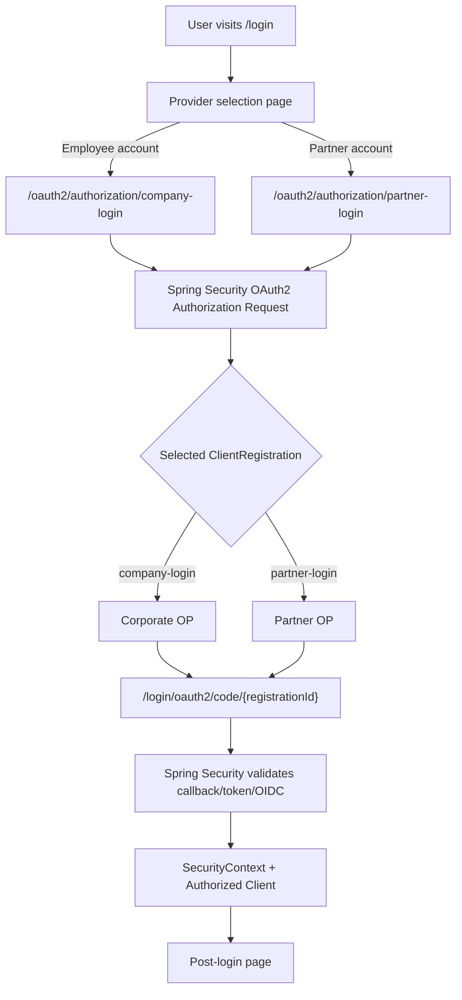
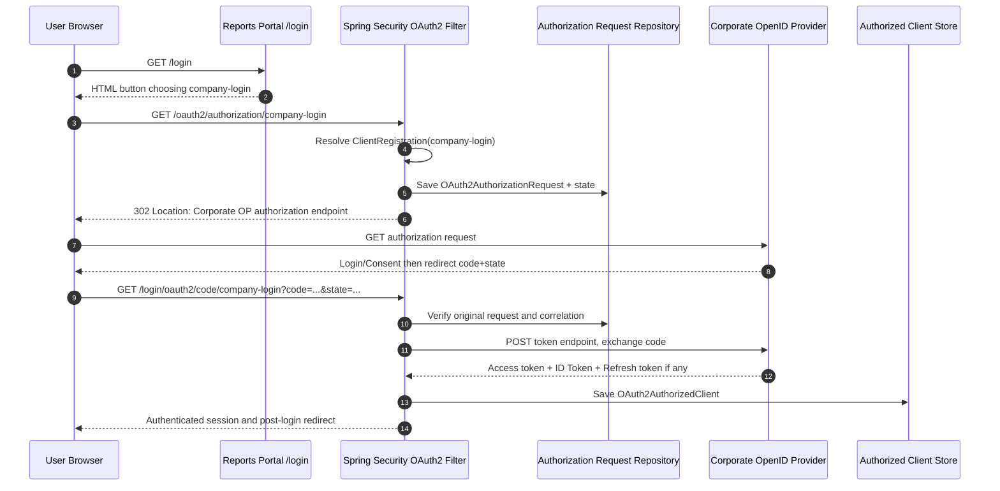
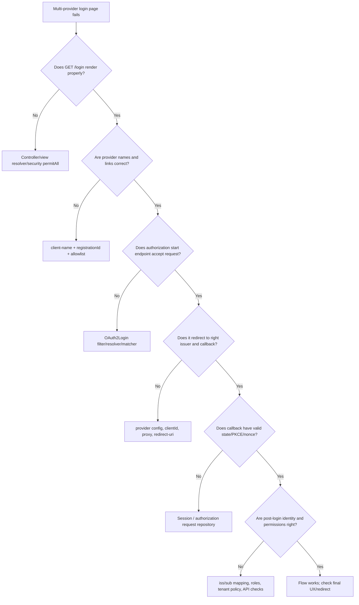

# 25.3. Provider Selection Page and Display Names for Each Client

A **Spring Security OAuth 2.0 / OpenID Connect (OIDC) Client** application can allow users to sign in with multiple identity providers: employee accounts, partner accounts, customer accounts, or OpenID Providers (OPs) belonging to different tenants. In that case, the login page does not just have a single "Login" button; users need a **provider selection page** with clear, business-appropriate labels that route to the right OAuth2 client registration.

In Spring Security, two concepts are easily confused:

- **`registrationId`**: the internal key Spring Security uses to look up a `ClientRegistration` and initiate the authorization flow. It typically appears in the `/oauth2/authorization/{registrationId}` path.
- **`clientName`**: a human-readable name retrieved from `ClientRegistration.getClientName()`; configurable via the Spring Boot `client-name` property. It is suited to serve as the label for a login button/link.

For example, users see **"Sign in with Company Account"**, while the actual path is `/oauth2/authorization/company-login`. The display name can change according to product copy without necessarily changing `registrationId` or the callback configuration.

This lesson builds a provider selection page **from server-side configuration**, distinguishes OIDC from OAuth2 Login, implements it on **Spring MVC Servlet** and extends it to **Spring WebFlux Reactive**, while explaining the security boundaries of letting users choose an identity source.

## 1. Learning Objectives

After this lesson, you will be able to:

1. Distinguish `registrationId`, `provider ID`, `clientId`, `clientName`, issuer, and UI display labels.
2. Define multiple registrations in `application.yml`, each with a user-friendly display name.
3. Explain how Spring Security's default login page can render OAuth2 links.
4. Build a custom `/login` page with Thymeleaf, pulling allowed providers from backend configuration.
5. Generate login links `/oauth2/authorization/{registrationId}` instead of manually concatenating the OP's authorization endpoint URL.
6. Configure `HttpSecurity.oauth2Login().loginPage(...)` and permit public static resources.
7. Know how to implement a similar provider selection page in WebFlux with `ReactiveClientRegistrationRepository`.
8. Handle multiple registrations belonging to the same OP, login failures, callback URIs, and post-login navigation.
9. Prevent open redirects, provider mix-up, user/tenant confusion, credential exposure, and unsafe account linking.
10. Test display labels, login paths, and requests that initiate the OAuth2 flow.

## 2. Context: A Portal with Multiple Login Methods

Suppose the **Reports Portal** application serves:

- Internal employees using the Corporate OP.
- Business partners using the Partner OP.
- A background job using `client_credentials` to call the Inventory API.

Users should see **two interactive choices**, not three:

```text
                  Sign in to Reports Portal
        ┌──────────────────────────────────────┐
        │                                      │
        │  [ Company Employee Account ]        │
        │                                      │
        │  [ Partner Account ]                 │
        │                                      │
        │  Need help? Contact administrator    │
        │                                      │
        └──────────────────────────────────────┘

Employee button -> GET /oauth2/authorization/company-login
Partner button  -> GET /oauth2/authorization/partner-login

inventory-service (client_credentials) -> NOT a user login button
```

The corresponding flow:



Importantly, the provider selection page **does not authenticate the user itself**. It only decides **which registration starts the flow**. The user is actually authenticated at the OP, and then Spring Security verifies the callback, tokens, and OIDC claims per configuration.

## 3. Six Names/IDs to Distinguish

In a multi-provider system, "provider name" can refer to one of several concepts:

| Term | Example | Who uses it? |
|---|---|---|
| `registrationId` | `company-login` | Spring Security locates a `ClientRegistration` |
| `provider ID` in config | `corporate-op` | Spring Boot links the registration to a set of provider endpoints |
| `clientId` | `reports-portal-web-prod` | OP identifies the registered OAuth2 client |
| `clientName` | `Company Employee Account` | UI displays a human-readable client/provider name |
| `issuer` | `https://idp.example.org/realms/company` | OP identifies its issuer, used for discovery/validation |
| `principal/sub` | `employee-42` | Resulting user identifier after login |

Example:

```yaml
spring:
  security:
    oauth2:
      client:
        registration:
          company-login:                               # registrationId
            provider: corporate-op                     # config provider ID
            client-id: "${CORPORATE_CLIENT_ID}"          # clientId at OP
            client-name: "Company Employee Account"      # clientName/UI
            client-secret: "${CORPORATE_CLIENT_SECRET}"
            authorization-grant-type: authorization_code
            client-authentication-method: client_secret_basic
            redirect-uri: "{baseUrl}/login/oauth2/code/{registrationId}"
            scope: [openid, profile, email]
        provider:
          corporate-op:
            issuer-uri: "https://idp.example.org/realms/company"
```

**`client-name` is a display label, not a parameter that determines which OP is selected.** Renaming "Company Employee Account" to "Internal SSO Login" does not automatically change the issuer, token endpoint, or registration ID.

### 3.1. Why shouldn't `registrationId` be changed arbitrarily?

`registrationId` is typically involved in:

- The initiation URL `/oauth2/authorization/{registrationId}`.
- The callback URI `/login/oauth2/code/{registrationId}`.
- The `OAuth2AuthorizedClient` storage key by `(registrationId, principalName)`.
- Client selection configuration in `WebClient`/authorized client manager.
- Logging, metrics, and operations documentation.

If you rename `company-login` to `company` just because you want shorter button text, you can break the redirect URI registered at the OP, lose existing authorized client lookups, or break links/callbacks. **When you want to change button text, prefer changing `client-name`**, not the technical key.

### 3.2. Provider ID is not necessarily a login button

One provider configuration can be reused by multiple registrations:

```text
provider: corporate-op
    ├── registration: company-login
    └── registration: company-admin-login
```

Two registrations can share the same issuer while having different client IDs, redirect URIs, scopes, or policies. In that case, the selection page might show **two options belonging to the same OP**, depending on business requirements. Conversely, a registration might be meant for `client_credentials` and not be a login button at all.

### 3.3. OIDC provider vs. OAuth2-only provider

For OIDC login, the registration must request the `openid` scope and have an OP contract supporting OIDC (ID Token, issuer, JWK Set, etc.). An OAuth2 provider that only returns an access token/userinfo via its own API can support `oauth2Login()` but **is not necessarily OpenID Connect**.

Do not label every login provider as OIDC if the provider does not issue OIDC ID Tokens. When integrating multiple provider types, identity/authority mapping and validation can differ.

## 4. Configuring Multiple ClientRegistrations in Spring Boot

Example `application.yml` with two OIDC providers:

```yaml
spring:
  security:
    oauth2:
      client:
        registration:
          company-login:
            provider: corporate
            client-id: "${COMPANY_CLIENT_ID}"
            client-secret: "${COMPANY_CLIENT_SECRET}"
            client-name: "Company Employee Account"
            client-authentication-method: client_secret_basic
            authorization-grant-type: authorization_code
            redirect-uri: "{baseUrl}/login/oauth2/code/{registrationId}"
            scope:
              - openid
              - profile
              - email

          partner-login:
            provider: partner
            client-id: "${PARTNER_CLIENT_ID}"
            client-secret: "${PARTNER_CLIENT_SECRET}"
            client-name: "Partner Account"
            client-authentication-method: client_secret_basic
            authorization-grant-type: authorization_code
            redirect-uri: "{baseUrl}/login/oauth2/code/{registrationId}"
            scope:
              - openid
              - profile
              - email

          inventory-service:
            provider: corporate
            client-id: "${INVENTORY_CLIENT_ID}"
            client-secret: "${INVENTORY_CLIENT_SECRET}"
            client-name: "Inventory Service (not for login)"
            client-authentication-method: client_secret_basic
            authorization-grant-type: client_credentials
            scope:
              - inventory.read

        provider:
          corporate:
            issuer-uri: "https://idp.example.org/realms/company"
          partner:
            issuer-uri: "https://login.partner.example.org/realms/partners"
```

This is an illustrative configuration. In a real system, both issuers must be provided by trusted OPs; secrets live in a secret manager/environment, never committed. `inventory.read` is a sample business scope that only has meaning when supported by the provider.

### 4.1. Meaning of `client-name`

Spring Boot provides the property:

```text
spring.security.oauth2.client.registration.<registration-id>.client-name
```

It binds to `ClientRegistration.clientName`. Example:

```java
ClientRegistration registration =
        clientRegistrationRepository.findByRegistrationId(
                "company-login");

String displayName = registration.getClientName();
```

`displayName` can be used as button/link content. If `client-name` is omitted, builders/auto-configuration have default naming behavior depending on the registration and version; **do not rely on the default name as a UX contract**. In a product with multiple providers, define clear display names explicitly.

### 4.2. What should a clear `client-name` look like?

Good examples:

- "Company Employee Account"
- "Partner Account"
- "Sign in with Google Workspace" (when matching the provider and permitted to use the branding)
- "Supplier Portal"

Confusing examples:

- `corp-oidc-prod-v2`: technical name that does not tell users which group it belongs to.
- `oauth2`: fails to distinguish options.
- "100% Secure Login": unverifiable security claim.
- "System Administration" for a client without matching authentication and admin authorization policies.

**Labels are user-guidance information**, not an authorization rule. Even if a button says "Admin", the backend and OP must still verify who is permitted to act as an admin.

### 4.3. Display name vs. localization

`client-name` is a registration property and is typically a single string. If the application supports Vietnamese/English, you can:

1. Store a default name in `client-name`.
2. Maintain a UI translation table keyed by fixed registration ID.
3. Load localization from message bundles instead of letting the browser freely modify provider names.
4. Keep internal IDs/callbacks unchanged when switching languages.

Example:

```properties
# messages_vi.properties
login.provider.company-login=Đăng nhập bằng tài khoản công ty
login.provider.partner-login=Đăng nhập bằng tài khoản đối tác

# messages_en.properties
login.provider.company-login=Sign in with your company account
login.provider.partner-login=Sign in with a partner account
```

When using message bundles, write safe fallback logic and clear key conventions; `ClientRegistration.getClientName()` remains useful as a fallback. Never alter `registrationId` just to support multiple languages.

## 5. Spring Security's Default Login Page

When configuring `oauth2Login()` **without specifying a custom login page**, Spring Security can generate a default login page and display links for registered OAuth2/OIDC clients. In Servlet, the related component is `DefaultLoginPageGeneratingFilter`.

When the repository supports iterating over registrations—such as `InMemoryClientRegistrationRepository`—the framework can use those registrations to build provider choices.

```text
GET /login
   |
   v
Default login page (when enabled/applicable)
   |
   +-- company-login -> /oauth2/authorization/company-login
   +-- partner-login -> /oauth2/authorization/partner-login
```

### 5.1. Important condition: iterating over registrations

`ClientRegistrationRepository` only requires the API:

```java
ClientRegistration findByRegistrationId(String registrationId);
```

It is **not required** to implement `Iterable<ClientRegistration>`. Only when the repository can enumerate registrations does the generated page have data to build links. A custom repository backed by remote config/database that only implements lookup by ID may cause the default page not to display the list as expected.

**Do not treat the default page as an automatic discovery API for every repository type.** If you want predictable UX, use a custom page with a server-managed list of allowed registrations.

### 5.2. Default page for learning, custom page for production

The default page is convenient for:

- Demos/OIDC proofs of concept.
- Quick testing of the authorization code flow.
- Verifying registration and callback configuration.

A production page usually also needs:

- Clearer, user-appropriate provider names.
- Descriptions such as "For employees/partners".
- Approved icons, accessibility, and mobile support.
- Policy ensuring only interactive choices are displayed.
- Safe login error messages.
- Localization, user help, and telemetry control.

Do not use the generated page as a place to expose all registrations in the system when `client_credentials`, internal service accounts, or non-user-facing configurations exist.

## 6. Custom Provider Selection Page in Spring MVC

We build a public `GET /login` page, pull metadata from backend-allowed registrations, and render links in the form:

```text
/oauth2/authorization/company-login
/oauth2/authorization/partner-login
```

The browser starts the flow with a **GET to the application's endpoint**, without submitting `client_id` or `client_secret` in a form.

### 6.1. Basic dependencies

Maven example:

```xml
<dependencies>
    <dependency>
        <groupId>org.springframework.boot</groupId>
        <artifactId>spring-boot-starter-web</artifactId>
    </dependency>
    <dependency>
        <groupId>org.springframework.boot</groupId>
        <artifactId>spring-boot-starter-security</artifactId>
    </dependency>
    <dependency>
        <groupId>org.springframework.boot</groupId>
        <artifactId>spring-boot-starter-oauth2-client</artifactId>
    </dependency>
    <dependency>
        <groupId>org.springframework.boot</groupId>
        <artifactId>spring-boot-starter-thymeleaf</artifactId>
    </dependency>
</dependencies>
```

Each dependency has a distinct role: Spring MVC serves the page, Spring Security manages authentication, OAuth2 Client handles the authorization flow, and Thymeleaf renders templates.

### 6.2. Configuring SecurityFilterChain

```java
import org.springframework.context.annotation.Bean;
import org.springframework.context.annotation.Configuration;
import org.springframework.security.config.annotation.web.builders.HttpSecurity;
import org.springframework.security.web.SecurityFilterChain;

@Configuration
class WebSecurityConfig {

    @Bean
    SecurityFilterChain securityFilterChain(HttpSecurity http)
            throws Exception {

        return http
                .authorizeHttpRequests(authorize -> authorize
                        .requestMatchers(
                                "/", "/login", "/error",
                                "/css/**", "/images/**")
                        .permitAll()
                        .anyRequest().authenticated())
                .oauth2Login(oauth2 ->
                        oauth2.loginPage("/login"))
                .build();
    }
}
```

Meaning:

- `loginPage("/login")` tells Spring Security the application provides its own login page.
- `GET /login` must be handled by the application's controller/template.
- CSS/image resources must be public if the login page uses them.
- `/oauth2/authorization/{registrationId}` remains the flow initiation endpoint handled by Spring Security per default configuration.
- `/login/oauth2/code/{registrationId}` remains the corresponding OAuth2 Client callback; it does not change automatically just because the UI changed.

**Do not call `oauth2Login().loginPage("/login")` and expect Spring Security to auto-generate a custom template.** Once a custom page is selected, the application must provide the route and HTML.

### 6.3. Creating a DTO for a login choice

```java
record ProviderChoice(
        String registrationId,
        String displayName) {}
```

Each choice holds the **internal registration ID** and **UI label**. Never put `clientSecret`, token URI, access token, or refresh token into a DTO sent to the browser.

If there is a help section, you can extend the DTO with server-supplied `description` and `supportText`. Avoid placing an arbitrary login URL from untrusted data into the DTO.

### 6.4. Controller listing allowed registrations

```java
import java.util.List;
import org.springframework.security.oauth2.client.registration
        .ClientRegistration;
import org.springframework.security.oauth2.client.registration
        .ClientRegistrationRepository;
import org.springframework.stereotype.Controller;
import org.springframework.ui.Model;
import org.springframework.web.bind.annotation.GetMapping;

@Controller
class LoginPageController {

    private static final List<String> USER_LOGIN_IDS =
            List.of("company-login", "partner-login");

    private final ClientRegistrationRepository registrations;

    LoginPageController(ClientRegistrationRepository registrations) {
        this.registrations = registrations;
    }

    @GetMapping("/login")
    String login(Model model) {
        List<ProviderChoice> choices = USER_LOGIN_IDS.stream()
                .map(this::toChoice)
                .toList();

        model.addAttribute("providers", choices);
        return "login";
    }

    private ProviderChoice toChoice(String registrationId) {
        ClientRegistration registration =
                registrations.findByRegistrationId(registrationId);

        if (registration == null) {
            throw new IllegalStateException(
                    "Missing configured login registration: "
                            + registrationId);
        }

        return new ProviderChoice(
                registration.getRegistrationId(),
                registration.getClientName());
    }
}
```

This snippet uses a fixed **server-side** `USER_LOGIN_IDS` allowlist. As a result:

- `inventory-service` (`client_credentials` grant) does not appear on the page.
- The selection page only contains registrations intended for interactive login.
- Adding a machine-to-machine OAuth2 registration does not automatically add a login button.
- Each button takes its name from the configured `ClientRegistration`.

**Boundary note:** not showing a registration in the UI **does not mean** `/oauth2/authorization/other-registration` is blocked. If a sensitive registration must not be initiated from a browser, protect it in routing/resolver, client registration/provider policy, or separate client design—do not rely on hiding the button.

### 6.5. Should we filter by grant type?

If a list is built from all registrations, only include clients meant for user interaction, typically `authorization_code`. A check could look like:

```java
import org.springframework.security.oauth2.core.AuthorizationGrantType;

boolean interactive =
        AuthorizationGrantType.AUTHORIZATION_CODE.equals(
                registration.getAuthorizationGrantType());
```

However, **grant type alone is not enough** to decide product UX. An authorization-code registration might be an internal integration that should not be publicly listed. A well-controlled approach is to use a **functional allowlist**, then validate grant type/metadata at startup or page construction to catch misconfiguration.

### 6.6. Thymeleaf template: templates/login.html

```html
<!DOCTYPE html>
<html lang="en" xmlns:th="http://www.thymeleaf.org">
<head>
  <meta charset="UTF-8" />
  <meta name="viewport" content="width=device-width, initial-scale=1" />
  <title>Sign in to Reports Portal</title>
  <link rel="stylesheet" th:href="@{/css/login.css}" />
</head>
<body>
  <main class="login-panel">
    <h1>Sign in to Reports Portal</h1>
    <p>Select the account type you are using.</p>

    <div class="login-options"
         aria-label="Supported sign-in methods">
      <a class="login-option"
         th:each="provider : ${providers}"
         th:href="@{/oauth2/authorization/{id}(id=${provider.registrationId})}"
         th:text="${provider.displayName}">
        Sign in with account
      </a>
    </div>

    <p th:if="${param.error}" role="alert">
      Sign-in was not completed. Please try again or contact support.
    </p>
    <p th:if="${param.logout}" role="status">
      You have been signed out of the application.
    </p>

    <p class="help">Not sure which account to use?
      Please contact support.</p>
  </main>
</body>
</html>
```

Note: the template uses Thymeleaf `th:each`/`th:text`/`th:href` syntax; `providers` values are passed by the controller, not browser query parameters.

The path:

```text
src/main/resources/templates/login.html
```

is the standard template location in Spring Boot with Thymeleaf. Optional CSS can live in `src/main/resources/static/css/login.css`.

### 6.7. Why use `th:text` instead of `th:utext`?

`th:text` performs proper escaping when rendering text. `th:utext` inserts unescaped HTML and can create XSS if a label comes from an untrusted source.

Provider names come from backend config, yet should still be rendered as **text**, not HTML. If icons/logos are needed, use static resource paths or allowlisted metadata; never embed external HTML/URLs supplied by query parameters.

### 6.8. Why not link directly to the OP's `authorization_uri`?

For example, **do not** construct manually:

```html
<a href="https://idp.example.org/authorize?client_id=...&state=fixed">
  Sign in
</a>
```

Manually constructing URLs easily omits `state`, `nonce`, PKCE, and proper `redirect_uri` building. Linking to `/oauth2/authorization/{registrationId}` lets Spring Security:

1. Select the right `ClientRegistration`.
2. Build the `OAuth2AuthorizationRequest`.
3. Generate `state` and anti-forgery request/callback context.
4. Apply PKCE/nonce per flow and configuration.
5. Temporarily store the authorization request for the callback.
6. Redirect to the proper provider authorization endpoint.

The login page only **selects** the registration; the framework executes the security-sensitive OAuth2/OIDC parts.

## 7. How Does a Login Request Work?

Suppose Alice clicks the **"Company Employee Account"** button.



The browser sees a button with `displayName`, while the significant OAuth2 event on the backend is identified by `registrationId` and `state`.

### 7.1. URLs in a flow

| URL | Location | Role |
|---|---|---|
| `/login` | Client application | UI page to select a provider |
| `/oauth2/authorization/company-login` | Client application | Starts the OAuth2 Authorization Code Flow |
| `https://idp.example.org/.../auth` | OP | Authorization endpoint where the user signs in/consents |
| `/login/oauth2/code/company-login` | Client application | Callback receiving authorization code/state |
| `/dashboard` | Client application | Post-login page (per success handler) |

Never confuse the **login page** with the **authorization endpoint** or **callback endpoint**. `loginPage("/login")` only changes where the application's login UI is displayed; it does not change the callback URI and does not update the redirect URI registered at the OP.

### 7.2. Is a POST needed when clicking a provider button?

Normally, `/oauth2/authorization/{registrationId}` is a **GET**, because it initiates a redirect. This differs from `POST /logout` in a CSRF-protected web app or a state-mutating business form.

Security-sensitive `state`/PKCE is managed by Spring Security when initiating the authorization request. Do not arbitrarily switch to POST and bypass the framework's filter matcher.

### 7.3. Do not send client secrets through the browser

The `/login` page only needs:

```text
registrationId
displayName
relative login URL
```

**Do not render**:

```text
client_secret
private_key
access_token / refresh_token
code_verifier
client assertion JWT
full authorization request attributes
```

An OAuth2 `client_id` may appear in the authorization request per protocol and is normally not a secret; however, `client_secret`/private keys must never be exposed to the browser. The browser can always inspect the login link, so the button is never a place to store secrets.

## 8. A Registration Can Have a Short Label and a Descriptive Label

`ClientRegistration.clientName` fits a basic label, but the UI often needs an added description:

```text
Company Employee Account
  For people currently working at the company

Partner Account
  For suppliers and collaborating businesses
```

You can use your application's own metadata:

```java
record LoginUiMetadata(
        String registrationId,
        String description,
        String iconKey,
        int order) {}

private static final List<LoginUiMetadata> LOGIN_UI = List.of(
        new LoginUiMetadata(
                "company-login",
                "For internal employees",
                "company",
                10),
        new LoginUiMetadata(
                "partner-login",
                "For partner accounts",
                "partner",
                20));
```

When building `ProviderChoice`, combine `registration.getClientName()` with allowlisted metadata. `iconKey` should be a static image key controlled by the application—for example mapping `company -> /images/company.svg`; **never use an icon URL sent by the browser**.

### 8.1. Ordering buttons consistently

If the list is built directly from a repository, registration order can depend on implementation or config. For stable UX and easier testing:

- Use an ordered list of IDs in server config.
- Or use an admin-managed `order` field.
- Check for duplicate `registrationId` entries.
- Do not let arbitrary database records appear on the login page without approval.

### 8.2. Accessibility

A provider selection page should provide:

- Buttons/links readable by screen readers with accurate descriptive text.
- Clear focus indicators and keyboard operability.
- Adequate contrast and sufficient hit target size.
- Text labels independent of logos (do not rely on icons alone).
- Error messages with `role="alert"`, not relying on color alone.
- Responsive layout for mobile and localization.

Having multiple providers should not force users to guess which icon corresponds to which account type.

## 9. Provider Names When One OP Has Multiple Clients

One OP can issue two client IDs:

```text
Corporate OpenID Provider
    ├── employee-web-client      -> registrationId: company-login
    └── admin-console-client     -> registrationId: admin-login
```

Naming:

```yaml
spring:
  security:
    oauth2:
      client:
        registration:
          company-login:
            provider: corporate
            client-name: "Employee Account"
            client-id: "${EMPLOYEE_CLIENT_ID}"
            client-secret: "${EMPLOYEE_CLIENT_SECRET}"
            authorization-grant-type: authorization_code
            redirect-uri: "{baseUrl}/login/oauth2/code/{registrationId}"
            scope: [openid, profile]
          admin-login:
            provider: corporate
            client-name: "Approved Admin Account"
            client-id: "${ADMIN_CLIENT_ID}"
            client-secret: "${ADMIN_CLIENT_SECRET}"
            authorization-grant-type: authorization_code
            redirect-uri: "{baseUrl}/login/oauth2/code/{registrationId}"
            scope: [openid, profile]
        provider:
          corporate:
            issuer-uri: "https://idp.example.org/realms/company"
```

Merely choosing `admin-login` **does not make Alice an admin**. You must verify the OP authentication policy/MFA and map authorities/permissions after login. Even if both clients share the same issuer and user subject, the backend must still enforce the granted permissions accurately.

### 9.1. Do not use `client-name` to determine permissions

Anti-pattern:

```java
// AVOID:
if (registration.getClientName().contains("admin")) {
    grantAdminRoleToCurrentUser();
}
```

`clientName` is presentation metadata. Permissions must be based on the verified `Authentication`, issuer/subject, claims per trust contract, authority mapping, and business authorization. Changing a display name for localization must never alter permissions.

### 9.2. Scopes/consent differ from UI labels

One registration might request scopes `openid profile`; another requests `openid reports.read`. Yet a button labeled "Admin" or "Read Reports" does not cause the authorization server to grant extra scopes.

Conversely, requesting a broad scope does not guarantee the user is granted access. Downstream APIs still check granted scopes, token audience, and object-level authorization.

## 10. Provider Selection Page and Multiple Issuers

In OIDC, the issuer is a core part of defining the trust boundary:

```text
Corporate OP:
    issuer = https://idp.example.org/realms/company

Partner OP:
    issuer = https://login.partner.example.org/realms/partners
```

After login:

```text
Corporate: iss=A, sub=12345
Partner:   iss=B, sub=12345
```

Two identical `sub` strings **do not mean the same person**. An OIDC identity only has meaning within the context of its issuer. The backend should map an external identity by **`(iss, sub)`** to a local user ID when policy allows.

### 10.1. Do not link accounts solely by email

A dangerous bug:

```text
Corporate OP returns email: alice@example.org
Partner OP returns email:   alice@example.org
    |
    v
Application merges both accounts into an admin user
```

Emails can change or may not be verified/guaranteed unique under the same contract across providers. Even `email_verified=true` does not replace an **approved account linking workflow** that proves ownership of the identities per policy.

The provider selection page helps users start the right flow, but **does not decide how accounts are merged or authorized**.

### 10.2. Provider mix-up

When there are multiple Authorization Servers, the application must bind the authorization response to the original request and matching issuer/provider. Spring Security uses the OAuth2 Authorization Request Repository/`state` and registration info to correlate flows.

Do not write a callback handler that guesses the OP from:

```text
email domain
login button label
clientName
user-supplied ?provider=...
```

Verification must rely on the trusted registration/authorization request, issuer/ID Token validation, and OAuth2/OIDC safeguards supported by the framework/provider.

### 10.3. One provider failing must not compromise another provider

If Partner OP is temporarily unavailable, the provider selection page can show "Partner sign-in is currently unavailable" based on reliable monitoring. However:

- Do not silently redirect users to Corporate OP to "borrow an identity".
- Do not send corporate tokens to a partner API.
- Do not disable issuer/signature validation because an OP is down.
- Do not label a button "Partner Sign-In" when the link actually points to the wrong issuer.

Availability and identity trust are separate concerns.

## 11. Customizing the Login Page for Multiple Tenants

A SaaS application may have provider names per tenant:

```text
tenant-north -> registrationId: north-oidc
tenant-south -> registrationId: south-oidc
```

There are two common UX patterns:

1. Show **all permitted choices** on one shared page.
2. Select the tenant first, then show only that tenant's providers, per backend policy.

With approach 2, the browser sending `tenant=north` **does not prove** the user belongs to North. Before selecting a sensitive client/issuer, the application must determine the verified tenant route/host/data and never grant permissions based purely on a query parameter.

### 11.1. Mapping table from tenant to registrations

```java
record TenantLoginOptions(
        String tenantId,
        List<String> allowedRegistrationIds) {}

Map<String, TenantLoginOptions> tenants = Map.of(
        "north", new TenantLoginOptions(
                "north", List.of("north-oidc")),
        "south", new TenantLoginOptions(
                "south", List.of("south-oidc")));
```

This is sample config data. Which tenant appears should be based on backend allowlists/host mappings and UX strategy, without turning a tenant selection route into proof of authorization to access that tenant's data.

### 11.2. Do not create dynamic ClientRegistrations from user-supplied URLs

Example to avoid:

```text
GET /login?issuer=https://untrusted.example
    -> auto-discover OP
    -> send user to new authorization URI
    -> accept tokens without allowlist check
```

This can create SSRF via discovery, provider impersonation, token/code exfiltration, or login confusion. Dynamic client onboarding requires a trusted workflow verifying the issuer, metadata, client credentials, redirect URI, trust policy, and ownership—not a free-form option on the login page.

## 12. Returning Users to Their Intended Page After Login

Common scenario:

```text
Alice requests GET /reports/summary
-> unauthenticated
-> sent to /login
-> chooses Corporate OP
-> completes login
-> redirected back to /reports/summary
```

Spring Security has a request cache / success handler mechanism that restores the saved request under appropriate configurations. With a custom page, you do not necessarily have to inject `returnUrl` into every provider link yourself.

### 12.1. Why not append arbitrary `returnUrl` to redirects?

Anti-pattern:

```text
/login?returnUrl=https://attacker.example/phishing
   -> after login:
      302 Location: https://attacker.example/phishing
```

That is an **open redirect**. If business requirements genuinely need a post-login target, prefer the saved request/relative path allowlist and validate host/scheme for approved external redirects.

Never use OAuth2 `state` as an arbitrary browser-controlled field. `state` must be generated and protected by Spring Security to bind the authorization request to the callback.

### 12.2. Default success URL or saved request?

In Servlet, you can configure a default landing page:

```java
.oauth2Login(oauth2 -> oauth2
        .loginPage("/login")
        .defaultSuccessUrl("/dashboard", false))
```

The `false` parameter lets the success handler prioritize the saved request when present, instead of always forcing users to `/dashboard`. Exact behavior also depends on any custom success handler/request cache if replaced by the application.

If `defaultSuccessUrl("/dashboard", true)` is chosen, the application may always navigate to that page, ignoring the saved request. This is a UX decision, not a requirement specific to multiple providers.

### 12.3. Choosing the wrong provider and wanting to switch

For instance, a user clicks the partner button even though they are a Corporate employee. The OP may reject them or sign in a different account. The application should:

- Show a generic message when the flow does not complete.
- Let the user return to the provider selection page and try again.
- Never auto-link emails across providers.
- Never reuse an old provider's authorized client/token to simulate logging into a new provider.
- Optionally provide clarifying copy such as "Are you an employee or a partner?" before starting the flow.

If already authenticated with one provider and the user actively chooses another, enforce clear account switching/reauthentication policies; never silently merge identities from two sources.

## 13. Customizing the Authorization Request Initiation URL

The default path in Servlet is normally:

```text
/oauth2/authorization/{registrationId}
```

However, an application can change the base URI using `DefaultOAuth2AuthorizationRequestResolver` and filter configuration per the corresponding Spring Security version's API.

Example representing a new path:

```text
/sso/start/{registrationId}
```

When customizing the resolver, keep in sync:

1. The resolver's request matcher.
2. The security filter chain handling authorization initiation.
3. Links in templates.
4. Documentation/support/monitoring.

**Do not change the callback URI simply by changing links on the login page.** The callback remains tied to `redirect-uri` in `ClientRegistration` and Spring Security's callback handler endpoint.

### 13.1. Warning: never hand-craft `state` or `nonce`

A custom link pointing to Spring Security's OAuth2 Authorization Request endpoint still lets the framework generate `state`. If replaced by a hand-built provider URL:

```text
https://op.example/authorize?client_id=portal&state=fixed
```

you risk losing critical protections. If you need `prompt`/`login_hint`/`max_age` for a provider, customize **`OAuth2AuthorizationRequestResolver`** via the supported API—never hardcode secrets or static state in HTML.

### 13.2. Provider-specific prompts are not display names

`clientName`/display labels on the login page are **UI metadata**. Parameters like `prompt=login`/`prompt=select_account` are **authorization request parameters** that the OP may support. They affect different parts:

| Need | Where to configure |
|---|---|
| Button labeled "Employee Login" | `client-name` or UI metadata/message bundle |
| Route button to Corporate OP | `registrationId` and `ClientRegistration.provider` |
| Ask OP to pick an account | Custom authorization request resolver, `prompt=select_account` if supported |
| Require recent authentication | OIDC `max_age`/`prompt` + result verification |
| Grant user permission to view reports | Authorization policy at backend/Resource Server |

Never treat a button label as proof that the OP performed a particular level of authentication.

## 14. Provider Selection Page in Spring WebFlux Reactive

For **Spring WebFlux** applications, the corresponding components use:

- `ServerHttpSecurity` and `SecurityWebFilterChain`.
- `ReactiveClientRegistrationRepository` instead of Servlet's `ClientRegistrationRepository`.
- `ServerOAuth2AuthorizationRequestResolver`/`DefaultServerOAuth2AuthorizationRequestResolver`.
- `WebSession`/Reactive `SecurityContext` instead of Servlet APIs.

### 14.1. Reactive OAuth2 Login configuration

```java
import org.springframework.context.annotation.Bean;
import org.springframework.context.annotation.Configuration;
import org.springframework.security.config.annotation.web.reactive
        .EnableWebFluxSecurity;
import org.springframework.security.config.web.server.ServerHttpSecurity;
import org.springframework.security.web.server.SecurityWebFilterChain;

@Configuration
@EnableWebFluxSecurity
class ReactiveSecurityConfig {

    @Bean
    SecurityWebFilterChain securityWebFilterChain(
            ServerHttpSecurity http) {

        return http
                .authorizeExchange(exchanges -> exchanges
                        .pathMatchers(
                                "/", "/login", "/error",
                                "/css/**", "/images/**")
                        .permitAll()
                        .anyExchange().authenticated())
                .oauth2Login(oauth2 ->
                        oauth2.loginPage("/login"))
                .build();
    }
}
```

This snippet is for a WebFlux server. Do not use `HttpSecurity` or `HttpServletRequest` in Reactive applications.

### 14.2. Reactive repository returns `Mono`

Interface:

```java
Mono<ClientRegistration> findByRegistrationId(
        String registrationId);
```

Therefore, the controller builds the provider list using `Flux`/`Mono` rather than synchronous calls or `block()`.

### 14.3. Reactive controller rendering the login page

```java
import java.util.List;
import org.springframework.security.oauth2.client.registration
        .ReactiveClientRegistrationRepository;
import org.springframework.security.oauth2.client.registration
        .ClientRegistration;
import org.springframework.stereotype.Controller;
import org.springframework.ui.Model;
import org.springframework.web.bind.annotation.GetMapping;
import reactor.core.publisher.Flux;
import reactor.core.publisher.Mono;

@Controller
class ReactiveLoginController {

    private static final List<String> LOGIN_IDS =
            List.of("company-login", "partner-login");

    private final ReactiveClientRegistrationRepository registrations;

    ReactiveLoginController(
            ReactiveClientRegistrationRepository registrations) {
        this.registrations = registrations;
    }

    @GetMapping("/login")
    Mono<String> login(Model model) {
        return Flux.fromIterable(LOGIN_IDS)
                .concatMap(this::loadChoice)
                .collectList()
                .doOnNext(choices ->
                        model.addAttribute("providers", choices))
                .thenReturn("login");
    }

    private Mono<ProviderChoice> loadChoice(String id) {
        return registrations.findByRegistrationId(id)
                .switchIfEmpty(Mono.error(
                        new IllegalStateException(
                                "Missing configured login registration: " + id)))
                .map(registration -> new ProviderChoice(
                        registration.getRegistrationId(),
                        registration.getClientName()));
    }

    record ProviderChoice(
            String registrationId,
            String displayName) {}
}
```

Key points:

- `Flux.fromIterable(LOGIN_IDS)` maintains the server-permitted allowlist.
- `concatMap` preserves the defined login order.
- `findByRegistrationId` is a Reactive query, without calling `block()` on the event loop.
- `Mono.error` on a missing registration catches misconfiguration instead of silently rendering a page missing buttons.
- The `login.html` template can use the same Thymeleaf structure when integrated with a suitable Reactive view resolver.

If a project uses Mustache/FreeMarker or a separate frontend, the renderer differs, but the principle of **trusted registration IDs and clear display labels** stays the same.

### 14.4. Do not use Servlet `OAuth2AuthorizationRequestResolver` in WebFlux

Servlet:

```text
DefaultOAuth2AuthorizationRequestResolver
ClientRegistrationRepository
HttpServletRequest
```

Reactive:

```text
DefaultServerOAuth2AuthorizationRequestResolver
ReactiveClientRegistrationRepository
ServerWebExchange
```

The initiation path may look the same in the UI, but the server-side filter/callback/state repository mechanics differ. Do not just rename a bean and copy Servlet code into WebFlux.

### 14.5. Do not let provider queries in the controller slow down login

If registrations live in a remote config service or database:

- Cache config metadata appropriately and control invalidation.
- Apply timeouts to network queries where needed.
- Define fallback UX when the list cannot be loaded.
- Avoid letting unauthenticated `/login` requests trigger unbounded queries to a remote store.
- Never put client credentials/private keys into the view model.

With a small allowlist, login choice metadata can be initialized at startup instead of querying every time; however, if providers can be disabled dynamically, a reliable refresh mechanism is needed.

## 15. Distinguishing the Login Page from Authorized Client Selection for API Calls

An application may have `company-login` and `partner-login` on the login page alongside `inventory-service` for API calls:

```text
GET /login:
    displays options for human login

GET /oauth2/authorization/company-login:
    initiates user authorization code flow

Backend InventoryJob:
    AuthorizedClientServiceOAuth2AuthorizedClientManager
    authorize(registrationId=inventory-service, principal=service:job)
    -> client_credentials access token
```

**The provider selection page is not `OAuth2AuthorizedClientManager`.** The UI does not fetch or refresh tokens; it only sends the user to the login flow.

### 15.1. Do not display `client_credentials` registrations in the UI

The `inventory-service` registration uses `client_credentials` and does not represent a human sign-in. A link:

```text
/oauth2/authorization/inventory-service
```

does not turn a service credential into an OIDC Login. Attempting to do so can cause request errors or mislead developers into handling the wrong grant.

### 15.2. Logging into provider A does not automatically create a token for provider B

If a user selects `company-login` and logs in successfully, Spring Security holds the authentication/authorized client for the company flow. It **does not automatically issue a token on the user's behalf at Partner OP**.

If the application needs to link two providers, it requires an explicit linking/consent flow and local identity policy. Never simply call `OAuth2AuthorizedClientService.loadAuthorizedClient("partner-login", authentication.getName())` and assume it exists.

### 15.3. The same user can have multiple authorized clients

The authorized client service normally uses the key:

```text
(clientRegistrationId, principalName)
```

Example:

```text
(company-login, employee-42) -> Corporate OP token
(partner-login, partner-user-7) -> Partner OP token
```

If a user switches providers, `Authentication.getName()` may change and the new `SecurityContext` replaces the previous authentication. Only a dedicated account linking mechanism can map to a stable local account; never merge tokens by email or display name.

## 16. Login Errors and Reporting to Users

Several errors can occur:

- User picks the wrong account type.
- User closes/cancels login/consent at the provider.
- Client registration is no longer valid.
- Callback `state` does not match or has expired.
- `redirect_uri` is not registered at the OP.
- Incorrect client secret/key.
- OP is unreachable.
- Invalid ID Token or wrong issuer/audience.
- User logs in successfully at the OP but is not allowed to use the Portal per business policy.

In such cases, the login page should display a **concise message without leaking secrets or sensitive provider details**:

```text
Sign-in was not completed.
Please select the correct account type and try again.
If the problem persists, contact support and provide the request ID.
```

### 16.1. Technical errors vs. user-facing messages

| Scenario | UI should display | Operations should log |
|---|---|---|
| User cancels consent | "You did not complete sign-in." | Provider, permitted error type, correlation ID |
| Unknown registration | "No matching sign-in method found." | Registration key, config/routing |
| `invalid_state` | "Sign-in session expired. Try again." | Correlation/state mismatch event, **never log raw sensitive state** |
| Token endpoint failure | "Unable to sign in right now." | Response/status type, provider registration, latency |
| Invalid OIDC signature/issuer | "Unable to verify sign-in." | Sanitized issuer/config/trust validation failure |
| User not permitted into Portal | "Account has not been granted access." | Controlled authorization policy result |

Never put `client_secret`, authorization codes, access tokens, ID Tokens, refresh tokens, full callback queries, or provider exception stack traces into HTML.

### 16.2. Do not infer the provider from free-form error parameters

A URL like:

```text
/login?provider=partner&error=...
```

can contain browser-modified data. If you need to display "Partner sign-in failed", derive provider identity from server-protected correlation or verified state; never blindly trust a `provider` query parameter to alter permissions or config.

### 16.3. Avoiding login loops

If `/login` requires authentication or failed logins redirect unconditionally to `/oauth2/authorization/{registrationId}`, the browser can loop:

```text
/login -> OP -> callback error -> /login -> OP -> ...
```

The provider selection page should be a public endpoint with error handling that lets users **stop, deliberately retry, or choose a different provider**. Never force continuous reauthentication.

## 17. Showing Buttons Only Does Not Lock Down Endpoints

Suppose an application has three registrations:

```text
company-login
partner-login
internal-admin-login
```

The controller only renders the first two options. Yet if `internal-admin-login` remains an `authorization_code` registration reachable via the default authorization-request redirect filter, a user can still try:

```http
GET /oauth2/authorization/internal-admin-login
```

**Hiding a link in the UI is not access control.** To restrict privileged registrations:

1. Consider separating security boundaries/apps/clients by purpose.
2. Only provision client registrations and grants actually needed in that application.
3. If needed, restrict which registrations are resolved in the authorization request resolver.
4. Enforce OP client policies and user eligibility.
5. After callback, verify identity/roles/tenant in the application.
6. Test direct access to unpermitted URLs.

Blocking flow initiation requests in filters does not replace post-login business authorization, but it is a necessary defense layer when sensitive registrations exist.

### 17.1. A registration ID is not a secret

`company-login` appears in public URLs and is often guessable. Never design security around "nobody knows the registration ID". Secrets are only stored and verified where the OAuth2 contract dictates.

### 17.2. An "Admin" button does not grant admin privileges

Even if `admin-login` is allowed to be shown, any user can click that button. After callback, the backend must verify authentication results and policies. Never assign roles based on the registration name or UI label.

## 18. Avoiding Callback and `redirect-uri` Mismatches

Each registration in the example has:

```yaml
redirect-uri: "{baseUrl}/login/oauth2/code/{registrationId}"
```

Therefore:

```text
company-login -> https://portal.example.org/login/oauth2/code/company-login
partner-login -> https://portal.example.org/login/oauth2/code/partner-login
```

These URIs must be registered at each corresponding OP per provider rules. An OP may accept multiple redirect URIs, but uncontrolled wildcards should not be used.

### 18.1. Login page and callback are distinct

```text
GET /login                                -> HTML provider selection
GET /oauth2/authorization/company-login  -> starts redirect
GET /login/oauth2/code/company-login     -> callback receiving code/state
```

Changing the selection page to `/signin` does not necessarily change `/login/oauth2/code/...`. If you change the callback, you must update `redirect-uri`, filter/handler config, and provider registration.

### 18.2. Reverse proxies can cause the wrong `baseUrl`

If users access:

```text
https://portal.example.org
```

but the container receives the request over:

```text
http://portal-service:8080
```

the application must process proxy/forwarded headers from a **trusted** source to construct the proper redirect URI. Never trust `X-Forwarded-Host` from arbitrary Internet clients, as host header injection can redirect to an unintended host.

## 19. Testing the Provider Selection Page with MockMvc

Testing goals go beyond verifying `/login` returns HTTP 200; tests must prove:

1. Only approved login choices are present.
2. Display labels come accurately from `clientName`/localization.
3. Links use **`registrationId`**, not `clientId` or an issuer string.
4. No secrets or tokens leak in HTML.
5. Following a link initiates an OAuth2 request to the right OP.
6. `state` is present and not hardcoded.
7. Unknown/hidden registrations are not automatically rendered by the UI.
8. The page is public and free of redirect loops.

### 19.1. Testing HTML contains both choices

```java
import org.junit.jupiter.api.Test;
import org.springframework.beans.factory.annotation.Autowired;
import org.springframework.boot.test.autoconfigure.web.servlet
        .AutoConfigureMockMvc;
import org.springframework.boot.test.context.SpringBootTest;
import org.springframework.test.web.servlet.MockMvc;

import static org.springframework.test.web.servlet.request
        .MockMvcRequestBuilders.get;
import static org.springframework.test.web.servlet.result
        .MockMvcResultMatchers.status;
import static org.springframework.test.web.servlet.result
        .MockMvcResultMatchers.content;

@SpringBootTest
@AutoConfigureMockMvc
class LoginPageIntegrationTest {

    @Autowired
    MockMvc mvc;

    @Test
    void loginPageShowsOnlyHumanProviders() throws Exception {
        mvc.perform(get("/login"))
                .andExpect(status().isOk())
                .andExpect(content().string(
                        org.hamcrest.Matchers.containsString(
                                "Company Employee Account")))
                .andExpect(content().string(
                        org.hamcrest.Matchers.containsString(
                                "/oauth2/authorization/company-login")))
                .andExpect(content().string(
                        org.hamcrest.Matchers.containsString(
                                "/oauth2/authorization/partner-login")))
                .andExpect(content().string(
                        org.hamcrest.Matchers.not(
                                org.hamcrest.Matchers.containsString(
                                        "/oauth2/authorization/inventory-service"))));
    }
}
```

This test assumes the application context has registrations and a template matching the example. Values may vary when localization is used. Do not assert arbitrary CSS snippets as an OAuth2 contract; focus on **provider choices and links**.

### 19.2. Testing redirect to the right Authorization Server

```java
import static org.springframework.test.web.servlet.request
        .MockMvcRequestBuilders.get;
import static org.springframework.test.web.servlet.result
        .MockMvcResultMatchers.status;

@Test
void companyLoginStartsAuthorizationCodeFlow() throws Exception {
    mvc.perform(get("/oauth2/authorization/company-login"))
            .andExpect(status().is3xxRedirection())
            .andExpect(result -> {
                String location = result.getResponse()
                        .getRedirectedUrl();
                org.assertj.core.api.Assertions.assertThat(location)
                        .startsWith("https://idp.example.org/");

                var uri = java.net.URI.create(location);
                var query = org.springframework.web.util.UriComponentsBuilder
                        .fromUri(uri)
                        .build()
                        .getQueryParams();

                org.assertj.core.api.Assertions
                        .assertThat(query.getFirst("response_type"))
                        .isEqualTo("code");
                org.assertj.core.api.Assertions
                        .assertThat(query.getFirst("client_id"))
                        .isEqualTo("test-company-client-id");
                org.assertj.core.api.Assertions
                        .assertThat(query.getFirst("state"))
                        .isNotBlank();
            });
}
```

This is an example test structure using a **dedicated test registration** with `clientId="test-company-client-id"`, not production credentials. Calling a real OP is not required because the test only verifies the HTTP redirect starting the flow.

For OIDC/PKCE, you can verify `nonce`/challenge where applicable and compare `state` across two login starts. **Never assert a fixed `state` value.**

### 19.3. Testing mapping between labels and registrations

| Label on page | Expected link |
|---|---|
| Company Employee Account | `/oauth2/authorization/company-login` |
| Partner Account | `/oauth2/authorization/partner-login` |
| Inventory Service | Do not display login link |

Test `label -> href` pairs rather than merely checking that two strings appear somewhere in the HTML. If there are multiple labels or localizations, test the mapping configuration explicitly.

### 19.4. Testing untrusted input

| Scenario | Expectation |
|---|---|
| `GET /login?registrationId=internal-admin-login` | UI does not add an admin button outside the allowlist |
| `GET /login?issuer=https://untrusted.example` | Does not dynamically configure/discover a new provider |
| `GET /login?returnTo=https://attacker.example` | Does not create an open redirect |
| `GET /oauth2/authorization/unknown` | Does not initiate a flow to any provider |
| Label containing `<`/`>` chars from test source | Rendered as escaped text, does not execute HTML/script |
| User attempts to call `client_credentials` registration via login URL | Not turned into a human login |
| Partner OP returns a subject matching Corporate OP | Does not auto-link accounts across different issuers |

Testing these boundaries catches design flaws that a login page screenshot would never reveal.

## 20. Reactive Testing with WebTestClient

In WebFlux, `WebTestClient` tests the `/login` HTTP route and authorization initiation endpoints.

Conceptual example:

```java
import org.junit.jupiter.api.Test;
import org.springframework.beans.factory.annotation.Autowired;
import org.springframework.test.web.reactive.server.WebTestClient;

class ReactiveLoginPageTest {

    @Autowired
    WebTestClient client;

    @Test
    void loginPageContainsCompanyChoice() {
        client.get()
                .uri("/login")
                .exchange()
                .expectStatus().isOk()
                .expectBody(String.class)
                .value(body -> org.assertj.core.api.Assertions
                        .assertThat(body)
                        .contains(
                                "/oauth2/authorization/company-login"));
    }
}
```

This test assumes `WebTestClient` is configured with the WebFlux application/security context and template renderer. To test the redirect, invoke:

```text
GET /oauth2/authorization/company-login
  -> HTTP 3xx
  -> Location host = idp.example.org
  -> response_type=code
  -> non-empty state
```

Do not call `block()` from reactive application code to "wait" on the repository; test tools handle async execution for you.

## 21. Monitoring and Operational Supportability

A multi-provider login page is typically the entry point for multiple user groups. Useful metrics:

```text
login_page_view_total
oauth2_login_started_total{registration="company-login"}
oauth2_login_started_total{registration="partner-login"}
oauth2_login_completed_total{registration="company-login",outcome="success"}
oauth2_login_completed_total{registration="partner-login",outcome="failure"}
oauth2_login_callback_error_total{registration="partner-login",error="state_mismatch"}
```

These are **application-designed** metric names, not built-in defaults guaranteed by Spring Security.

Points to note:

- `registrationId` is a useful low-cardinality label when the list is fixed.
- Never put emails, `sub`, session IDs, OAuth2 `state`, or authorization codes in metric labels.
- Never log access/refresh tokens, client secrets, or raw authorization/callback URLs when they contain sensitive data.
- Use application correlation IDs to aid investigation without exposing raw credentials.
- Track "wrong provider chosen" rates in a privacy-respecting way; do not infer identity from raw error data.

### 21.1. When changing a display name

If product renames "Company Account" to "Internal Staff":

1. Update `client-name` or the message bundle.
2. Keep `registrationId` unchanged so login URLs and authorized client keys stay intact.
3. Check templates/localization.
4. Update help text and telemetry labels if needed.
5. Do not change issuer/client ID or callbacks when only copy changes are requested.

This is a UX change, not an OAuth2 Client migration.

### 21.2. When a provider is decommissioned

If Partner OP is retired, decide how to:

- Hide the Partner Login button in the UI.
- Disable the actual registration/authorization route per policy.
- Handle previously issued authorized clients.
- Close or migrate associated local users where appropriate.
- Notify users and support controlled account migration.

Merely changing `client-name` to "Unsupported" does not actually disable the registration or revoke tokens.

## 22. Troubleshooting Table for Provider Selection Page Failures

| Symptom | Possible cause | Remediation |
|---|---|---|
| `GET /login` returns 404 | Missing controller/template or view resolver | Create route/template, verify view file |
| `GET /login` redirects to itself | Login page is not `permitAll` or chain mismatch | Check `SecurityFilterChain`/`SecurityWebFilterChain` |
| Default page shows no OAuth2 links | Custom repository is not iterable, no registrations, or incompatible login config | Check repository and use a custom page |
| Button shows `company-login` instead of user-friendly name | `client-name` unset or template uses `registrationId` | Read `ClientRegistration.getClientName()` |
| Clicking button returns 404 | Wrong `/oauth2/authorization/{registrationId}` URL or different custom matcher | Sync template/resolver and registration |
| Clicking button goes to wrong OP | Wrong registration `provider`/issuer mapping | Check `application.yml` and issuer metadata |
| Click Partner but callback hits company | Wrong template link/callback `registrationId` or `redirect-uri` config | Check link, registration, state, and callback |
| `redirect_uri_mismatch` | Callback URL not registered at OP or wrong proxy `baseUrl` | Update OP registration/forwarded headers |
| OP login succeeds then reports `invalid_state` | Missing authorization request, lost session, unshared state across pods | Check session/repository/CSRF/correlation |
| OIDC token validation error | Wrong issuer, signature, audience, or nonce | Check OIDC discovery/client configuration |
| Partner shown even when not meant for users | Pulling all registrations instead of login allowlist | Filter list to interactive clients |
| Hidden admin button still works via admin URL | Hiding UI does not protect authorization initiation | Enforce actual route/resolver/provider policy |
| Login succeeds but user enters wrong tenant | Account linking/tenant mapping based on email or untrusted input | Enforce `iss`, `sub`, and business authorization |
| `/login?error` leaks stack trace or tokens | Template echoes exception/provider response | Use generic messages, redact logs |
| Reactive page is slow | Blocking registration lookups or unbounded remote calls | Use Reactor APIs, caching, timeouts |

### 22.1. Diagnostic workflow



## 23. Comprehensive Scenario: Portal for Employees and Partners

Suppose a Portal is running in production:

```text
Reports Portal
  ├── company-login
  │     client-name = Company Employee Account
  │     provider    = Corporate OP
  │     grant       = authorization_code
  │
  ├── partner-login
  │     client-name = Partner Account
  │     provider    = Partner OP
  │     grant       = authorization_code
  │
  └── inventory-service
        client-name = Inventory Service
        provider    = Corporate AS
        grant       = client_credentials
```

Design:

1. `/login` fetches the **two** interactive registrations via an allowlist.
2. Labels come from `getClientName()` or controlled translations.
3. Each button links to `/oauth2/authorization/{registrationId}` on the Portal itself.
4. Spring Security builds the OAuth2 Authorization Request, `state`/nonce/PKCE as applicable, and redirects to the proper OP.
5. After callback, Spring Security validates the flow/tokens/issuer and creates `Authentication`.
6. The app maps external identities by (`issuer`, `subject`) via a trusted process, **never merging accounts solely by email**.
7. Local user/tenant/role policies determine which reports the user can view.
8. `inventory-service` does not appear in the UI and is used via a separate service authorized client manager.
9. If an OP fails, the user sees a safe message and can return to the selection page.
10. If a button name changes, registration IDs/callbacks are not accidentally modified.

### 23.1. Pre-release checklist

| Question | What to verify |
|---|---|
| Which registrations are for human login? | Explicit allowlist |
| Is `client-name` clear? | Business-appropriate naming, localization |
| Is `registrationId` stable? | Not changed just for copy edits |
| Are login link URLs accurate? | `/oauth2/authorization/{registrationId}` |
| Is `/login` public? | Matcher/`permitAll` and static assets |
| Which OP registers which callback URI? | Per-registration `redirect-uri` |
| Are OAuth2-only providers mixed with OIDC? | Check `openid` scope and validation flow |
| Are there multiple issuers/tenants? | Trust boundaries, (`iss`, `sub`), account linking |
| Can hidden registrations still be opened directly? | Resolver/OP/authorization policies |
| Any open redirect or SSRF risks? | Return URLs, issuer URLs, UI assets from allowlist |
| Any sensitive fields exposed in HTML/logs? | Labels/IDs only, no secrets/tokens |
| Is the login page accessible and usable? | Accessibility, error UX, keyboard, mobile |
| What do tests cover? | Labels/links, redirects/`state`, callbacks, tenant/roles, failures |

## 24. Design Mistakes to Avoid

1. **Displaying `clientId` instead of `clientName`**, exposing technical names to users.
2. **Confusing `registrationId` with the config provider name**, constructing broken initiation URLs.
3. **Renaming the registration ID just to change button text**, causing callback mismatches or losing authorized client lookups.
4. **Manually concatenating authorization URLs/`state` strings** instead of using Spring Security's OAuth2 authorization endpoint.
5. **Embedding `client_secret` or tokens in templates** for the browser to "self-authenticate".
6. **Rendering all registrations as a menu**, exposing `client_credentials` service clients.
7. **Hiding a button and treating it as access control**, while the registration URL remains directly callable.
8. **Using an "Admin" button label to grant admin roles** without checking policies/claims.
9. **Linking users from two OPs solely by email**, ignoring issuer/subject.
10. **Accepting issuer or redirect URLs from query input** and dynamically creating untrusted registrations.
11. **Allowing arbitrary unvalidated absolute post-login URLs**, creating open redirects.
12. **Forgetting to `permitAll` the login page or CSS**, causing login loops or unstyled pages.
13. **Using `th:utext` for provider labels**, risking XSS.
14. **Logging raw callback URLs/authorization codes/ID Tokens** when a provider returns an error.
15. **Conflating OAuth2 Client with OAuth2 Resource Server**, assuming a login button configures API audiences/scopes.
16. **Assuming logging into provider A automatically yields an authorized client for provider B**.
17. **Using a blocking repository inside a Reactive controller**, stalling the event loop.
18. **Trusting a UI label to determine the callback issuer**, instead of binding to the protected authorization request.
19. **Testing only HTTP 200 on `/login`**, without testing links, `state`, and provider mapping.
20. **Failing to test UX on provider errors/cancelled consent**, creating redirect loops.

## 25. Review Questions

1. How do `registrationId` and `clientName` differ? Which is appropriate for a button label?
2. How does the `provider` ID in `application.yml` differ from `clientId` and `issuer-uri`?
3. Why does changing `client-name` not require changing the redirect URI in a normal application?
4. Should a `client_credentials` client registration appear on the provider selection page? Why or why not?
5. Under what conditions can Spring Security's default login page display OAuth2 links?
6. Why can a non-iterable custom `ClientRegistrationRepository` cause the default login page to miss links?
7. With a custom page, what role does `HttpSecurity.oauth2Login().loginPage("/login")` play?
8. Why must you create `GET /login` in a controller/template after declaring a custom page?
9. Should you link to `/oauth2/authorization/{registrationId}` or a manually concatenated authorization endpoint URL? Why?
10. What advantage does `th:text` have over `th:utext` when rendering provider names?
11. Why is an allowlist of login choices better than rendering all OAuth2 registrations?
12. Does hiding the `admin-login` button stop users from directly accessing that registration's authorization URL?
13. If two OpenID Providers issue the same `sub`, must they be the same user?
14. Why shouldn't accounts between Corporate and Partner OPs be auto-linked based on email?
15. How does the `openid` scope distinguish OIDC login from an OAuth2-only provider?
16. Why must `state`/nonce/PKCE never be hardcoded on the login page?
17. When a user accesses a protected route and then picks a provider, should you use a saved request or an arbitrary `returnUrl`?
18. How does Reactive `ReactiveClientRegistrationRepository` differ from the Servlet repository in its registration lookup API?
19. With multiple providers, what must be checked for callback URIs and issuers?
20. What test proves the "Partner Account" link goes to the **right** OP rather than merely appearing as text in HTML?
21. How should the app handle a user picking the wrong provider or cancelling consent at the provider?
22. Why does displaying "Admin" in the UI not grant admin privileges?
23. Which component should a background `inventory-service` use to get tokens instead of the login page?
24. What data must never appear in HTML or logs when building a multi-provider login page?

## References

- [Spring Security Reference — OAuth2 Login (Servlet)](https://docs.spring.io/spring-security/reference/servlet/oauth2/login/index.html)
- [Spring Security Reference — OAuth2 Login: Advanced Configuration (Servlet)](https://docs.spring.io/spring-security/reference/servlet/oauth2/login/advanced.html)
- [Spring Security Reference — OAuth2 Client Core](https://docs.spring.io/spring-security/reference/servlet/oauth2/client/core.html)
- [Spring Security Reference — Reactive OAuth2 Login](https://docs.spring.io/spring-security/reference/reactive/oauth2/login/index.html)
- [Spring Security Reference — Reactive OAuth2 Client](https://docs.spring.io/spring-security/reference/reactive/oauth2/client/index.html)
- [Spring Security API — ClientRegistration](https://docs.spring.io/spring-security/reference/api/java/org/springframework/security/oauth2/client/registration/ClientRegistration.html)
- [Spring Security API — ClientRegistrationRepository](https://docs.spring.io/spring-security/reference/api/java/org/springframework/security/oauth2/client/registration/ClientRegistrationRepository.html)
- [Spring Security API — ReactiveClientRegistrationRepository](https://docs.spring.io/spring-security/reference/api/java/org/springframework/security/oauth2/client/registration/ReactiveClientRegistrationRepository.html)
- [Spring Security API — DefaultOAuth2AuthorizationRequestResolver](https://docs.spring.io/spring-security/reference/api/java/org/springframework/security/oauth2/client/web/DefaultOAuth2AuthorizationRequestResolver.html)
- [Spring Security API — DefaultServerOAuth2AuthorizationRequestResolver](https://docs.spring.io/spring-security/reference/api/java/org/springframework/security/oauth2/client/web/server/DefaultServerOAuth2AuthorizationRequestResolver.html)
- [Spring Security API — OAuth2AuthenticationToken](https://docs.spring.io/spring-security/reference/api/java/org/springframework/security/oauth2/client/authentication/OAuth2AuthenticationToken.html)
- [Spring Boot Reference — OAuth2 Client Registration](https://docs.spring.io/spring-boot/reference/web/spring-security.html)
- [Thymeleaf — Standard Dialect](https://www.thymeleaf.org/doc/tutorials/3.1/usingthymeleaf.html)
- [OpenID Connect Core 1.0](https://openid.net/specs/openid-connect-core-1_0.html)
- [RFC 6749 — OAuth2 Authorization Code Grant](https://datatracker.ietf.org/doc/html/rfc6749#section-4.1)
- [RFC 9700 — OAuth 2.0 Security Best Current Practice](https://www.rfc-editor.org/rfc/rfc9700.html)
