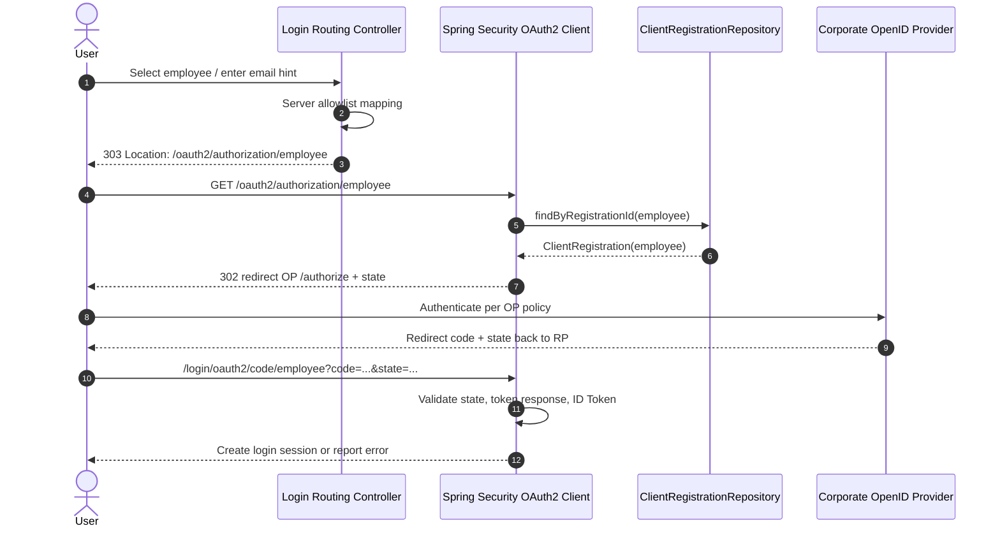

# 25.4. Routing Login by User Type or Organization Domain

A **Spring Security OAuth 2.0 / OpenID Connect (OIDC) Client** application can connect to multiple **OpenID Providers (OPs)**: employee SSO, a partner's identity provider, or a customer-facing login platform. When all of them appear on one website, users do not necessarily know which button to click for **"Which provider should I sign in with?"**.

A common experience is for the application to ask for the **user type** (employee, partner, customer) or **email address/organization domain**, and then route to the appropriate OP. This mechanism is often called **Home Realm Discovery (HRD)** or **Identity Provider Discovery**. In Spring Security, the application typically resolves a **configured `registrationId`**, then redirects the browser to the standard endpoint:

```text
/oauth2/authorization/{registrationId}
```

For example, someone entering `an@corp.example` might be routed to the `employee` registration, while someone choosing "Partner" might be routed to `partner`. However, **pre-login email addresses or user types are purely self-asserted information**; they do not prove the person belongs to that organization. Authentication, identity linking, and authorization must happen **after the OP successfully authenticates the user**, based on issuer, subject, and application policies.

This lesson presents design patterns, configuration, and code using **Spring Boot 3.x / Spring Security 6.x**, focusing on **Spring MVC/Servlet** while highlighting differences when applying to **Spring WebFlux/Reactive**.

> **Core principle:** Use pre-login input to **select a route to an approved provider**—never use it to verify identity, grant roles, choose an arbitrary issuer, or bypass authorization.

## 1. What You Will Be Able to Do After This Lesson

You will be able to:

1. Explain why an application with multiple OIDC providers needs a **login routing policy**.
2. Distinguish routing by **user type**, **email domain**, **organization code**, **subdomain**, and **authenticated identity**.
3. Configure multiple `ClientRegistration` entries with separate `registrationId` values.
4. Build a login method selection page and `/sso/start/**` routes that redirect only to permitted registrations.
5. Implement **home realm discovery** based on domains mapped through a server-side allowlist.
6. Handle unknown domains, domains with multiple providers, and intentionally spoofed inputs.
7. Protect `state`, PKCE, nonce, `redirect_uri`, issuer, and callbacks when multiple providers exist.
8. Map users after OIDC Login by **`(iss, sub)`** and verify tenant membership/roles from a trusted source.
9. Prevent account enumeration, open redirects, phishing, SSRF, and cross-tenant token confusion.
10. Understand the differences between Servlet and Reactive when selecting registrations.
11. Test provider selection, error routing, logging into the wrong OP, multi-tab flows, logout, and account switching.

## 2. Business Scenario: One Application, Multiple Identity Providers

Suppose an equipment rental portal serves three user groups:

| Group | Desired experience | Trusted OP | Registration ID |
| --- | --- | --- | --- |
| Internal employees | Sign in via company SSO | `https://sso.corp.example/realms/staff` | `employee` |
| Operations partners | Sign in via partner's system | `https://login.partner.example/oidc` | `partner` |
| Customers | Sign in via customer identity system | `https://identity.customer.example` | `customer` |

A login page might show three buttons, yet an organization with hundreds of partners usually wants to reduce clutter. For example:

- User selects "I am an employee".
- User selects "I am a partner".
- User enters a work email so the system suggests an OP.
- User selects an organization from a managed directory.
- User visits subdomain `alpha.portal.example` and is routed to Alpha's OP.

**The choices above are only pre-authentication routing steps.** An attacker can also click "Employee" or enter `ceo@corp.example`. The OP must still authenticate the user; only then does the application decide whether the user belongs to the tenant and has access permissions.

### 2.1. Overall diagram

```mermaid
flowchart TD
    A[Browser opens /login] --> B{Hint source?}
    B --> C[Selected user type]
    B --> D[Domain from email hint]
    B --> E[Organization code or subdomain]
    C --> F[Server-side routing policy]
    D --> F
    E --> F
    F --> G{Approved registration found?}
    G -- No or uncertain --> H[Manual selection / help page]
    G -- Yes --> I[Trusted registrationId]
    I --> J[/oauth2/authorization/registrationId]
    J --> K[Spring Security Authorization Request]
    K --> L[Configured OP authenticates user]
    L --> M[Callback + state/PKCE/nonce validation]
    M --> N[Verified Authentication]
    N --> O[Map issuer + subject to account]
    O --> P{Valid membership and permissions?}
    P -- No --> Q[Deny or require account linking]
    P -- Yes --> R[Allow access per role/tenant policy]
```

The routing layer should be **narrow and easy to test**. It selects an ID from a known set rather than directly constructing authorization URLs containing protocol parameters.

## 3. Four Concepts You Must Never Conflate

| Concept | Example | Can it be trusted before login? | What is it used for? |
| --- | --- | --- | --- |
| **Self-selected user type** | `employee` | No, only a hint | Decides which login button/flow is suggested |
| **Self-entered email** | `an@corp.example` | No, ownership unverified | Home realm discovery |
| **`registrationId`** | `employee` | Trusted when mapped by server to approved config | Selects `ClientRegistration` |
| **Verified OIDC identity** | `iss + sub` | Yes after Spring validates login; still requires authorization | Links account and checks permissions |

In addition, there are **`clientId`**, **provider alias**, **issuer URI**, and **tenant ID**. All of these differ from `registrationId`.

Example:

```yaml
registration:
  employee:
    provider: corporate-op
    client-id: enterprise-portal-prod
provider:
  corporate-op:
    issuer-uri: https://sso.corp.example/realms/staff
```

In this example:

- `employee` = **registration ID**.
- `corporate-op` = **provider configuration alias**.
- `enterprise-portal-prod` = **client ID issued by the OP**.
- `https://sso.corp.example/realms/staff` = **issuer URI**.
- "employee" = **business user group**, not proof of authentication.

The browser initiates the flow via `/oauth2/authorization/employee`, not a path carrying a client secret or an issuer URL from form input.

## 4. Two Decision Phases: Before and After Authentication

The same phrase "user type" often appears at two points with completely different meanings.

### 4.1. Before login: routing decision

```text
Input:
  emailHint = alice@corp.example
  selectedKind = employee

Decision:
  route to registrationId = employee
```

This is **selecting a provider to attempt authentication**—there are no trusted roles, principal, or membership yet.

### 4.2. After login: identity and permission verification

```text
Validated OIDC login:
  iss = https://sso.corp.example/realms/staff
  sub = 00u12345
  registrationId = employee

Server-side account mapping:
  (iss, sub) -> internalAccountId = 9182
  internalAccountId belongs to tenant corporate
  roles = [RENTAL_OPERATOR]
```

Only at this point does the application have grounds to grant permissions per policy. Even after a successful OIDC Login, a user may still not be authorized to use the application—for example, they are no longer an active employee or have not been invited to the tenant.

**Never write:** "User selects `employee` -> grant `ROLE_EMPLOYEE`." That is privilege escalation because anyone can click the button.

## 5. Standard Flow When Routing by Registration ID

On Servlet OAuth2 Login, Spring Security provides the default endpoint:

```text
GET /oauth2/authorization/{registrationId}
```

It is not an OP URL. It is an **endpoint inside the RP application** handled by `OAuth2AuthorizationRequestRedirectFilter`.

Example:

```text
GET /oauth2/authorization/employee
```

Spring will:

1. Look up `employee` in `ClientRegistrationRepository`.
2. Read the authorization endpoint, client ID, redirect URI, scopes, and provider metadata.
3. Create an authorization request including `state` and required parameters.
4. Apply PKCE/nonce according to the grant, OP, and corresponding configuration.
5. Persist request/callback correlation state via the authorization request repository mechanism.
6. Redirect the browser to the OP's proper Authorization Endpoint.
7. Receive the `/login/oauth2/code/employee` callback.
8. Verify the response and complete OIDC Login before creating the `Authentication`.

### 5.1. Sequence diagram



**The routing controller does not need to sign `state`, handle authorization codes, or fetch JWKS itself.** Leave those to Spring Security and the appropriate OAuth2/OIDC components.

## 6. When Should You Route by User Type?

Routing by user type fits when each group has **an intuitive and relatively stable login path**:

- "Company Employee".
- "Authorized Partner".
- "Individual Customer".
- "Organization Administrator" (button label only; admin rights are still checked post-login).

Advantages:

- No need to collect an email address before authentication.
- Easy to display on a single login page.
- Reduces dependence on email domain mapping.
- Lower risk of account enumeration.
- Easy to explain when a company uses multiple domains.

Limitations:

- Users may pick the wrong option.
- One person may belong to multiple groups.
- One group may encompass multiple OPs/tenants.
- The selection must never be used as authorization.

### 6.1. What if the user picks the wrong group?

If a user clicks "Employee" without having an account at Corporate OP, the OP may show an error or a login screen. The application should provide a way back to the provider selection page, rather than silently "trying every OP".

An error redirect should bring the user back to a generic page with a mild message, such as **"Unable to sign in using the selected method. Please try another method or contact your administrator."** Avoid revealing which email accounts exist at which OP.

## 7. When Should You Route by Organization Domain?

A B2B application can use **email-domain-based routing**:

```text
@corp.example      -> employee
@partner.example   -> partner
@customer.example  -> customer
```

If the user enters `name@corp.example`, the app looks up the **server-managed domain table** and sends the browser to `/oauth2/authorization/employee`.

**A domain is only a hint to locate an OP; it does not prove ownership.** An attacker can enter any email address before login.

### 7.1. Use exact mapping, not substring matching

Wrong:

```java
// WRONG: attacker@example.corp.example.evil would match.
if (email.contains("corp.example")) {
    return "employee";
}
```

Also avoid:

```java
// WRONG: an unapproved subdomain could still be matched.
if (domain.endsWith("corp.example")) {
    return "employee";
}
```

If policy only accepts `corp.example`, compare the **normalized and canonicalized domain string against an exact mapping**:

```text
domain == "corp.example"
```

Only allow subdomains when explicitly declared in the registry with DNS label boundary rules—such as `domain.equals("corp.example") || domain.endsWith(".corp.example")` **when all subdomains are genuinely managed by that organization**. For B2B tenants, exact mapping is the safer default.

### 7.2. Email domains can be ambiguous

Cases where hard auto-routing should be avoided:

- Shared email services like `gmail.com` or `outlook.com`.
- Two partners sharing the same email hosting domain.
- Contractors with a corporate email who must log in through a partner OP.
- One person belonging to two organizations with the same email alias.
- Users changing domains after a company merger.
- Customers linking multiple identities/OPs.
- Internationalized domain names (IDN) and punycode.
- Domains not registered in the system.

In these cases, display a **list of permitted providers** or ask the user for an **organization code** instead of probing multiple OPs automatically.

## 8. When to Route by Organization Code or Subdomain?

Instead of email, a SaaS app can use:

```text
alpha.portal.example  -> registrationId = alpha-oidc
beta.portal.example   -> registrationId = beta-oidc
```

or the user enters an organization code:

```text
Organization code = alpha
                    |
                    v
Approved tenant record
                    |
                    v
registrationId = alpha-oidc
```

Advantages:

- Maps directly to a managed tenant.
- Works when multiple tenants share an email domain.
- Avoids collecting email addresses just to find an OP.
- Can support custom branding/login policies.

However, **a subdomain/organization code is not proof the user belongs to the tenant**. After authentication, verify that the user is authorized in that exact tenant.

If the application runs across custom domains, control the **Host header and forwarded headers** from trusted proxies. Never rely on arbitrary client-sent `X-Forwarded-Host` from the Internet to select an OAuth issuer or redirect URI.

## 9. Configuring Three OIDC Providers in Spring Boot

### 9.1. Maven

```xml
<dependencies>
    <dependency>
        <groupId>org.springframework.boot</groupId>
        <artifactId>spring-boot-starter-web</artifactId>
    </dependency>
    <dependency>
        <groupId>org.springframework.boot</groupId>
        <artifactId>spring-boot-starter-security</artifactId>
    </dependency>
    <dependency>
        <groupId>org.springframework.boot</groupId>
        <artifactId>spring-boot-starter-oauth2-client</artifactId>
    </dependency>
</dependencies>
```

If using a Thymeleaf login page, add `spring-boot-starter-thymeleaf` according to the application's view technology choice.

### 9.2. `application.yml`

```yaml
spring:
  security:
    oauth2:
      client:
        registration:
          employee:
            provider: corporate-oidc
            client-id: ${EMPLOYEE_OIDC_CLIENT_ID}
            client-secret: ${EMPLOYEE_OIDC_CLIENT_SECRET}
            client-authentication-method: client_secret_basic
            authorization-grant-type: authorization_code
            redirect-uri: "{baseUrl}/login/oauth2/code/{registrationId}"
            scope:
              - openid
              - profile
              - email
            client-name: "Employee SSO"

          partner:
            provider: partner-oidc
            client-id: ${PARTNER_OIDC_CLIENT_ID}
            client-secret: ${PARTNER_OIDC_CLIENT_SECRET}
            client-authentication-method: client_secret_basic
            authorization-grant-type: authorization_code
            redirect-uri: "{baseUrl}/login/oauth2/code/{registrationId}"
            scope:
              - openid
              - profile
            client-name: "Partner SSO"

          customer:
            provider: customer-oidc
            client-id: ${CUSTOMER_OIDC_CLIENT_ID}
            client-secret: ${CUSTOMER_OIDC_CLIENT_SECRET}
            client-authentication-method: client_secret_basic
            authorization-grant-type: authorization_code
            redirect-uri: "{baseUrl}/login/oauth2/code/{registrationId}"
            scope:
              - openid
              - profile
            client-name: "Customer Login"

        provider:
          corporate-oidc:
            issuer-uri: https://sso.corp.example/realms/staff
          partner-oidc:
            issuer-uri: https://login.partner.example/oidc
          customer-oidc:
            issuer-uri: https://identity.customer.example
```

`issuer-uri` values are illustrative placeholder issuer addresses, not ready-to-use live service URLs. With real OPs, verify OIDC Discovery, TLS, ID Token issuer, and registered redirect URIs.

### 9.3. Equivalent `application.properties` for one provider

```properties
spring.security.oauth2.client.registration.employee.provider=corporate-oidc
spring.security.oauth2.client.registration.employee.client-id=${EMPLOYEE_OIDC_CLIENT_ID}
spring.security.oauth2.client.registration.employee.client-secret=${EMPLOYEE_OIDC_CLIENT_SECRET}
spring.security.oauth2.client.registration.employee.client-authentication-method=client_secret_basic
spring.security.oauth2.client.registration.employee.authorization-grant-type=authorization_code
spring.security.oauth2.client.registration.employee.redirect-uri={baseUrl}/login/oauth2/code/{registrationId}
spring.security.oauth2.client.registration.employee.scope=openid,profile,email
spring.security.oauth2.client.registration.employee.client-name=Employee SSO
spring.security.oauth2.client.provider.corporate-oidc.issuer-uri=https://sso.corp.example/realms/staff
```

The `partner` and `customer` registrations can be expressed similarly. Choose one configuration style in your project to avoid unintended property overrides.

### 9.4. One registration does not necessarily equal one OP

You can register two client IDs for the same issuer:

```text
registrationId = employee-web
clientId = web-client
issuer = https://sso.corp.example

registrationId = employee-admin-tool
clientId = admin-tool-client
issuer = https://sso.corp.example
```

Even though the issuer is the same, they can have different redirect URIs, scopes, and policies. **Routing must select the specific registration ID approved for the workflow**, not just the provider host.

## 10. Setting Up `SecurityFilterChain` for a Custom Login Page

In Spring MVC/Servlet:

```java
import org.springframework.context.annotation.Bean;
import org.springframework.context.annotation.Configuration;
import org.springframework.security.config.annotation.web.builders.HttpSecurity;
import org.springframework.security.web.SecurityFilterChain;

@Configuration
public class MultiProviderSecurityConfig {

    @Bean
    SecurityFilterChain securityFilterChain(HttpSecurity http)
            throws Exception {

        http
            .authorizeHttpRequests(authorize -> authorize
                .requestMatchers(
                    "/", "/login", "/login-error",
                    "/sso/start/**", "/sso/discover",
                    "/css/**", "/js/**", "/error")
                    .permitAll()
                .anyRequest().authenticated())
            .oauth2Login(oauth -> oauth
                .loginPage("/login")
                .failureUrl("/login?error"));

        return http.build();
    }
}
```

`oauth2Login(...)` still lets Spring Security handle the Authorization Code Flow; you are only replacing the **page that presents the login choices**.

Do not disable `csrf()`. If there is a POST form submitting an email hint for routing, it should also receive a valid CSRF token in a session-based website.

### 10.1. Login page controller

```java
import org.springframework.stereotype.Controller;
import org.springframework.web.bind.annotation.GetMapping;

@Controller
public class LoginPageController {

    @GetMapping("/login")
    String loginPage() {
        return "login"; // templates/login.html
    }
}
```

If the user clicks the `/oauth2/authorization/employee` link, Spring Security continues the flow. There is no need to construct authorization endpoint URLs manually inside this controller.

### 10.2. Sample login page with direct choices

```html
<section aria-labelledby="login-title">
  <h1 id="login-title">Choose sign-in method</h1>

  <a href="/sso/start/employee">I am an employee</a>
  <a href="/sso/start/partner">I am a partner</a>
  <a href="/sso/start/customer">I am a customer</a>
</section>
```

The `/sso/start/*` paths are custom application routes. They should **redirect to Spring Security's endpoint** rather than creating `state` or callback URLs manually.

## 11. A Controller Permitting Only Three Approved Choices

The code below uses **Java 17+**, matching the Spring Boot 3 baseline.

```java
import java.net.URI;

import org.springframework.http.HttpStatus;
import org.springframework.http.ResponseEntity;
import org.springframework.web.bind.annotation.GetMapping;
import org.springframework.web.bind.annotation.PathVariable;
import org.springframework.web.bind.annotation.RestController;
import org.springframework.web.server.ResponseStatusException;

@RestController
public class LoginStartController {

    @GetMapping("/sso/start/{kind}")
    public ResponseEntity<Void> start(
            @PathVariable String kind) {

        String registrationId = switch (kind) {
            case "employee" -> "employee";
            case "partner" -> "partner";
            case "customer" -> "customer";
            default -> throw new ResponseStatusException(
                    HttpStatus.NOT_FOUND);
        };

        URI internalAuthorizationUri = URI.create(
                "/oauth2/authorization/" + registrationId);

        return ResponseEntity
                .status(HttpStatus.SEE_OTHER)
                .location(internalAuthorizationUri)
                .build();
    }
}
```

Why is this safer than building a URL from a user-supplied issuer?

- `kind` is matched only against **three server-defined strings**.
- `registrationId` only accepts values from an allowlist, never reflecting arbitrary input.
- The redirect target is an **internal URL** handled by Spring Security.
- `client_id`, `redirect_uri`, issuer, scopes, and `state` come from `ClientRegistration`/Spring Security.
- No client secret appears in the response or URL.
- No permissions are granted based on `kind`.

**This is a routing step, not full OIDC login validation.** After the redirect, Spring Security and the OP perform the actual authentication.

### 11.1. Why use 303?

`303 See Other` tells the browser to follow up with a `GET` to the authorization initiation endpoint, which is especially fitting when the selection step is a `POST`. `302 Found` is also commonly used in browser redirects; what matters is testing behavior with your supported HTTP clients/browsers.

### 11.2. Do not accept an arbitrary `registrationId` from the user

Wrong:

```java
@GetMapping("/sso/start")
ResponseEntity<Void> start(@RequestParam String registrationId) {
    return ResponseEntity.status(302)
            .location(URI.create(
                "/oauth2/authorization/" + registrationId))
            .build();
}
```

Even though Spring Security's endpoint can reject nonexistent registrations, arbitrary pass-through code like this obscures business policy (which tenant may use which registration), weakens anti-spoofing/phishing controls, and risks path/redirect issues if input is unchecked.

Use an enum, an approved map, or a policy service. **"A `ClientRegistration` exists" does not automatically mean "every caller is allowed to start that registration's flow."**

## 12. Creating a Policy to Choose a Provider by Email Domain or User Type

An implementation should have **one central place** holding the domain/user-type-to-registration mapping. It knows nothing about client secrets, token endpoints, or JWT keys.

### 12.1. Example `LoginRoutingPolicy`

```java
import java.net.IDN;
import java.util.Locale;
import java.util.Map;
import java.util.Optional;

import org.springframework.stereotype.Component;

@Component
public final class LoginRoutingPolicy {

    private static final Map<String, String> DOMAIN_TO_REGISTRATION =
            Map.of(
                    "corp.example", "employee",
                    "partner.example", "partner");

    private static final Map<String, String> KIND_TO_REGISTRATION =
            Map.of(
                    "employee", "employee",
                    "partner", "partner",
                    "customer", "customer");

    public Optional<String> select(String emailHint, String kind) {
        String byKind = kind == null
                ? null
                : KIND_TO_REGISTRATION.get(
                        kind.trim().toLowerCase(Locale.ROOT));

        String byDomain = normalizedDomain(emailHint)
                .map(DOMAIN_TO_REGISTRATION::get)
                .orElse(null);

        // Two conflicting hints: do not decide arbitrarily.
        if (byKind != null
                && byDomain != null
                && !byKind.equals(byDomain)) {
            return Optional.empty();
        }

        // Registered domain takes precedence when clear.
        String selected = byDomain != null ? byDomain : byKind;

        // No result -> manual selection page.
        return Optional.ofNullable(selected);
    }

    private Optional<String> normalizedDomain(String emailHint) {
        if (emailHint == null
                || emailHint.isBlank()
                || emailHint.length() > 254) {
            return Optional.empty();
        }

        String value = emailHint.trim();
        int at = value.indexOf('@');

        // Accept only a single @ with both local and domain parts.
        if (at <= 0
                || at != value.lastIndexOf('@')
                || at == value.length() - 1) {
            return Optional.empty();
        }

        String rawDomain = value.substring(at + 1);

        try {
            String ascii = IDN.toASCII(
                    rawDomain, IDN.USE_STD3_ASCII_RULES)
                    .toLowerCase(Locale.ROOT);

            if (ascii.isBlank()
                    || ascii.length() > 253
                    || ascii.startsWith(".")
                    || ascii.endsWith(".")
                    || ascii.contains("..")) {
                return Optional.empty();
            }
            return Optional.of(ascii);
        } catch (IllegalArgumentException invalidDomain) {
            return Optional.empty();
        }
    }
}
```

**This is a minimal parser for an email hint field**, not a full RFC-compliant email validator or proof of email ownership. `IDN.toASCII` helps canonicalize international domains to ASCII/punycode for accurate comparison with the registry. Because the mapping only accepts **exact allowlisted domains**, unknown inputs cannot dynamically create registrations.

Use a vetted email validation library if the product has full EAI, Unicode, and mailbox syntax requirements; still preserve the **server-side routing map** and never turn a self-entered email into an identity.

### 12.2. Why never store `emailHint` as a verified identity?

In this flow, `emailHint` can be:

- A typo made by the user.
- An email that does not belong to them.
- A changed/shared email.
- An email supplied for routing confusion/phishing.
- Personal data that does not need to be retained after choosing a provider.

Therefore, never use an email hint to:

- Grant `ROLE_EMPLOYEE`.
- Assign tenant membership.
- Link two accounts.
- Query HR records and return existence status.
- Disable another user.
- Log unnecessary PII.

If you must keep `login_hint` for UX at the OP, restrict its lifecycle, avoid exposing it in URLs/logs, and treat it as an **unverified hint**.

## 13. Controller Receiving Email Hints via POST

To reduce the chance of emails being recorded in URLs/browser history/proxy logs, accept input via a **POST form** and return `303` to the internal authorization endpoint.

```java
import java.net.URI;

import org.springframework.http.HttpStatus;
import org.springframework.http.ResponseEntity;
import org.springframework.web.bind.annotation.PostMapping;
import org.springframework.web.bind.annotation.RequestParam;
import org.springframework.web.bind.annotation.RestController;

@RestController
public class LoginDiscoveryController {

    private final LoginRoutingPolicy policy;

    public LoginDiscoveryController(LoginRoutingPolicy policy) {
        this.policy = policy;
    }

    @PostMapping("/sso/discover")
    public ResponseEntity<Void> discover(
            @RequestParam(name = "email", required = false)
            String email,
            @RequestParam(name = "kind", required = false)
            String kind) {

        URI destination = policy.select(email, kind)
                .map(id -> URI.create(
                        "/oauth2/authorization/" + id))
                .orElseGet(() ->
                        URI.create("/login?choose=manual"));

        return ResponseEntity.status(HttpStatus.SEE_OTHER)
                .location(destination)
                .build();
    }
}
```

**Note:** `/sso/discover` is `permitAll` so unauthenticated users can call it, yet **the CSRF filter still applies to POST**. In addition, apply appropriate rate limiting/input-size limits to prevent abuse of a public endpoint.

### 13.1. HTML form with CSRF in Thymeleaf

```html
<form th:action="@{/sso/discover}" method="post">
  <label for="work-email">Work email (optional)</label>
  <input id="work-email"
         type="email"
         name="email"
         autocomplete="email"
         maxlength="254">

  <label for="account-kind">I am signing in as</label>
  <select id="account-kind" name="kind">
    <option value="">Choose later</option>
    <option value="employee">Employee</option>
    <option value="partner">Partner</option>
    <option value="customer">Customer</option>
  </select>

  <input type="hidden"
         th:name="${_csrf.parameterName}"
         th:value="${_csrf.token}">

  <button type="submit">Continue</button>
</form>
```

The `_csrf` expressions assume Spring Security and Thymeleaf provide `CsrfToken` to the template via the version's standard integration. Never hardcode a CSRF token and never disable CSRF just to make a form work.

### 13.2. Results from the policy

| Input | Mapping | Result |
| --- | --- | --- |
| `an@corp.example`, empty kind | Exact domain `corp.example` | `employee` |
| `bob@partner.example`, kind `partner` | Both point to one registration | `partner` |
| `an@corp.example`, kind `customer` | Two conflicting hints | Manual selection page |
| `alice@gmail.com`, empty kind | Domain not in registry | Manual selection page |
| Empty email, kind `customer` | Explicit user type | `customer` |
| `alice@corp.example.evil` | Does not match exact map | Manual selection page |
| Email with multiple `@` | Invalid hint | Manual selection page |
| Unknown kind | Not in type allowlist | Manual selection page |

From a security standpoint, this is **user experience routing**. Entering the right domain gives the user no special privilege and does not prove they are an employee; the OP and post-login policies still decide.

### 13.3. Avoiding account enumeration

Do not return responses like:

```text
Email alice@corp.example is currently a valid employee.
Email bob@corp.example does not have an account yet.
```

on a public endpoint. An actor can probe large lists of emails to infer employee/customer rosters. When using public domain mapping, only return the provider choice—never confirm whether a specific account exists. Rate limiting, response normalization, and anti-abuse monitoring can also be applied.

## 14. What to Do If the Domain Does Not Match?

A common UX mistake is **silently routing to a default OP** when a domain is unrecognized, leaving users confused as to why they were sent to another login screen.

Choose one of these clear policies:

1. **Manual selection page:** show providers allowed for the current environment.
2. **Ask for an organization code:** if one domain can belong to multiple tenants.
3. **Contact administrator:** if organizations must be onboarded first.
4. **Default customer provider:** only if this is an intentional product model that does not cause account confusion.
5. **"Go back" button after login failure:** avoid trapping the user in a redirect loop.

Do not sequentially probe `employee -> partner -> customer` by sending silent authorization requests. Each OP may require user interaction, consent, cookies, and separate trust boundaries.

### 14.1. Should you display the provider for a domain?

Displaying "Using Company SSO" is purely UX. If provider/tenant names are considered sensitive, use a generic message such as "Continuing to the appropriate sign-in provider" or ask for a known organization code.

How much organization metadata is revealed should be decided by product policy, not leaked from an OP error response.

## 15. `login_hint` and `domain_hint`: UX Helpers, Not Authentication

Some OPs support authorization request parameters such as:

- `login_hint`: suggests a username/email to display or prefill at the OP.
- `domain_hint`: suggests an organization/home realm for certain providers.
- `prompt`: adjusts OIDC login/consent interaction requirements.
- `ui_locales`: suggests UI language.

**These are not authentication mechanisms.** An OP accepting `login_hint=ceo@corp.example` does not prove the browser belongs to the CEO.

### 15.1. How Spring adds authorization parameters

In Servlet, Spring Security provides `DefaultOAuth2AuthorizationRequestResolver` and ways to customize `OAuth2AuthorizationRequest` via an authorization request resolver/customizer.

A controlled design:

```text
POST /sso/discover (email hint)
      |
      +--> normalize/domain routing
      +--> choose approved registration
      +--> save minimal hint in session if truly needed
      |
      v
GET /oauth2/authorization/{registrationId}
      |
      v
Custom OAuth2AuthorizationRequestResolver (optional)
      |
      +--> delegate standard request creation
      +--> add login_hint validated/read from trusted context
      |
      v
Authorization Request with state, PKCE/nonce as designed by framework
```

Do not hand-assemble `https://op.example/authorize?...` by concatenating query strings and bypassing Spring Security's request resolver. Doing so easily drops `state`, PKCE, nonce, redirect URI, and the persistence required for callbacks.

### 15.2. Example wrapping the resolver instead of rewriting the state machine

```java
import jakarta.servlet.http.HttpServletRequest;

import org.springframework.security.oauth2.client.registration
        .ClientRegistrationRepository;
import org.springframework.security.oauth2.client.web
        .DefaultOAuth2AuthorizationRequestResolver;
import org.springframework.security.oauth2.client.web
        .OAuth2AuthorizationRequestResolver;
import org.springframework.security.oauth2.core.endpoint
        .OAuth2AuthorizationRequest;

public final class TrustedLoginHintResolver
        implements OAuth2AuthorizationRequestResolver {

    private final OAuth2AuthorizationRequestResolver delegate;

    public TrustedLoginHintResolver(
            ClientRegistrationRepository registrations) {
        this.delegate =
                new DefaultOAuth2AuthorizationRequestResolver(
                        registrations, "/oauth2/authorization");
    }

    @Override
    public OAuth2AuthorizationRequest resolve(
            HttpServletRequest request) {
        return customize(delegate.resolve(request), request);
    }

    @Override
    public OAuth2AuthorizationRequest resolve(
            HttpServletRequest request,
            String clientRegistrationId) {
        return customize(
                delegate.resolve(request, clientRegistrationId),
                request);
    }

    private OAuth2AuthorizationRequest customize(
            OAuth2AuthorizationRequest original,
            HttpServletRequest request) {

        if (original == null) {
            return null;
        }

        // Architectural example: session attribute is created only by the server
        // after validating the email hint, never taken directly from OP URLs.
        Object hint = request.getSession(false) == null
                ? null
                : request.getSession(false)
                        .getAttribute("approvedLoginHint");

        if (!(hint instanceof String loginHint)
                || loginHint.isBlank()) {
            return original;
        }

        return OAuth2AuthorizationRequest.from(original)
                .additionalParameters(parameters ->
                        parameters.put("login_hint", loginHint))
                .build();
    }
}
```

Wire this resolver through configuration:

```java
http.oauth2Login(oauth -> oauth
        .authorizationEndpoint(endpoint ->
                endpoint.authorizationRequestResolver(
                        new TrustedLoginHintResolver(registrations))));
```

**Do not apply alongside another `oauth2Login(...)` block on the same chain without merging customizations.** This sample only illustrates delegating to preserve standard mechanics. In production, limit the session attribute's lifetime, remove the hint after use, avoid cross-tab or cross-provider hint leakage, and verify `login_hint` does not carry PII beyond its intended purpose.

### 15.3. When `login_hint` is not needed, omit it

If the OP can display the right login page based solely on the registration, let the routing controller redirect to `/oauth2/authorization/{registrationId}` and finish its responsibility. Fewer custom parameters reduce sensitive data in URLs and lower compatibility risks across providers.

## 16. After Login: Reading the Trusted Registration and OIDC Identity

Once the OIDC callback is validated, Spring Security creates an `Authentication` such as `OAuth2AuthenticationToken` with an `OidcUser`.

You can read which registration was used:

```java
import org.springframework.security.oauth2.client.authentication
        .OAuth2AuthenticationToken;
import org.springframework.security.oauth2.core.oidc.user.OidcUser;

void inspectValidatedLogin(
        OAuth2AuthenticationToken authentication) {

    String registrationId =
            authentication.getAuthorizedClientRegistrationId();

    if (!(authentication.getPrincipal() instanceof OidcUser user)) {
        throw new IllegalStateException(
                "Expected an OIDC principal");
    }

    String issuer =
            user.getIdToken().getIssuer().toString();
    String subject =
            user.getIdToken().getSubject();

    // Use issuer + subject in server-side identity mapping.
    // Do not log tokens or send claims directly to the browser.
    assertExpectedIdentityProvider(registrationId, issuer, subject);
}
```

In this example, `assertExpectedIdentityProvider` is a **business method to implement**, not a built-in Spring Security method. It should consult the organization's registry and verify trust/tenant conditions.

### 16.1. Why use `(issuer, subject)`?

OIDC `sub` is a subject identifier **within the scope of an issuer**. Two different OPs can both return `sub="123"` for two completely different people.

```text
OP employee:
  iss = https://sso.corp.example/realms/staff
  sub = 123

OP partner:
  iss = https://login.partner.example/oidc
  sub = 123
```

Never merge two identities solely because `sub` matches. External account keys should minimally include **`iss` and `sub`**, then link to an internal user ID via an approved workflow.

### 16.2. Do not rely solely on email to link accounts

Emails can:

- Change.
- Be reassigned to someone else.
- Collide across OPs.
- Have `email_verified` without a sufficient trust relationship to grant internal privileges.
- Be missing or masked in some provider profiles.

Email may be used for UX or account linking **with additional verification**, but never automatically link two accounts across issuers solely on matching email.

### 16.3. Checking tenant membership after OIDC validation

A safe flow:

```text
OIDC Login validated
      |
      v
(issuer, subject) -> InternalAccount
      |
      v
InternalAccount + selected tenant -> Membership
      |
      +--> Active? Right organization?
      |
      +--> Roles/permissions granted by internal policy
      |
      v
Grant access to the right resources
```

If a user chose `employee` and successfully authenticated with an OP account that is not on the active employee roster, the application can deny business access or route to onboarding. Never grant roles simply because the registration name contains `employee`.

## 17. Provider Routing and Authorization: Two Separate Mechanisms

Separate:

**Routing policy:** `"email domain / organization code / choice" -> registrationId`.

**Identity policy:** `"validated issuer + subject" -> internal account`.

**Authorization policy:** `"internal account + tenant + role" -> permitted action`.

Example:

```java
// PSEUDOCODE: all three interfaces below are application components.
String registrationId = routingPolicy.selectLoginProvider(input);

OidcIdentity identity =
        validatedOidcLogin.getVerifiedIdentity();

InternalAccount account =
        identityDirectory.linkedAccount(
                identity.issuer(), identity.subject());

authorizationPolicy.requirePermission(
        account, requestedTenant, "rental:read");
```

There is no safe automatic mapping from `registrationId = employee` to `ROLE_ADMIN`. That is an internal policy that must be verified separately.

### 17.1. Can OP-issued groups/roles be used?

Yes, if:

1. The OP is the organization's trusted authority for that claim.
2. The claim is verified in the ID Token or via an appropriately protected endpoint.
3. There is explicit role/group mapping per tenant and client.
4. Claims from other OPs or wrong-audience tokens are never accepted.
5. Proper role revocation lifecycles and reauthentication/session policies exist.

Never take a claim named `groups` or `roles` from **any OP** and automatically grant identical privileges.

## 18. Multiple Provider Mix-up: Avoiding Issuer and Callback Confusion

A system with `employee`, `partner`, and `customer` has multiple Authorization Endpoints and Token Endpoints. If an application hand-rolls its OAuth2 flow, a dangerous bug is **receiving an authorization response from provider A and exchanging the code at provider B's Token Endpoint**.

Spring Security manages registrations, the authorization request repository, and callback correlation. Never alter those bindings using inputs from the callback.

### 18.1. Components that must be bound together

| Attribute | Must be bound to |
| --- | --- |
| `registrationId` | The `ClientRegistration` selected before redirect |
| `state` | The authorization request created for the browser session |
| `redirect_uri` | The client registration registered at the OP |
| `code_verifier` (PKCE) | The corresponding `code_challenge` in the flow |
| `nonce` (OIDC when used) | The authentication request and ID Token response |
| Token endpoint | The provider of the selected registration |
| `iss` | The trusted issuer for the registration |
| `aud` | The RP's Client ID per OIDC validation |
| Subject | `(issuer, sub)` after ID Token verification |

Never use a callback `provider=...` parameter to choose the Token Endpoint, never accept an issuer from an unverified JWT header, and never share a single arbitrary callback without state correlation.

### 18.2. Default callbacks distinguish registrations

```text
/login/oauth2/code/employee
/login/oauth2/code/partner
/login/oauth2/code/customer
```

These URIs must be registered properly at each OP. Some applications use custom callback patterns; if customized, preserve state/client/issuer bindings and test each registration.

### 18.3. Opening multiple tabs during provider selection

A user might:

1. Start `employee` login in Tab A.
2. Start `partner` login in Tab B.
3. Have Tab B's callback arrive first.
4. Have Tab A's callback arrive later.

If you manually store a single session variable `selectedProvider` and use it to validate every callback, the two flows can overwrite each other. **Never use a single global session attribute as the sole source deciding the provider during callback**. Spring Security authorization requests with `state` provide correlation; custom resolvers/storage must be designed not to break this mechanism.

Account switching after login also needs clear session lifecycles to avoid retaining the previous user's tokens.

## 19. Multiple Providers Sharing One Domain: How to Handle?

An enterprise might have:

```text
staff@company.example      -> Company SSO A
contractor@company.example -> Partner SSO B
service@company.example    -> No interactive login allowed
```

Relying solely on the `company.example` domain is not enough. Options:

- Ask for the **account type** or organization code.
- Use an employee number / invitation flow with protected data.
- Select the OP at a pre-configured enterprise broker.
- Configure Home Realm Discovery directly **at the OP/broker**, if the product supports it.
- Send users to the login page of a unified OP so the OP selects upstream federation.

**Never have the backend probe whether a user "exists" at each OP** by sending emails to endpoints not designed for discovery. That leaks PII, enables account enumeration, and is hard to maintain.

### 19.1. When should HRD responsibility move to the OP?

If an identity broker supports realm discovery, the RP application might only need **one `ClientRegistration`** pointing to the broker. The broker then selects Active Directory, a SAML IdP, or an upstream social identity.

Advantages:

- Simpler RP.
- The OP/broker manages federation and contracts with upstream IdPs.
- Fewer registrations to manage.
- Fewer state/callback branches in the RP.

Trade-offs:

- Dependency on the broker and its policies.
- Need to verify the claims, issuer, and identity mappings the RP actually receives.
- Upstream identities are still not automatically equal to internal permissions.
- Redirects, logout, and account linking must still be controlled.

An OP might use SAML upstream while the RP application still runs **OIDC with the broker**. Do not confuse this with the application directly configuring Spring's `saml2Login()`.

## 20. Multi-tenant Dynamic Registrations

With three fixed providers, Spring Boot's auto-configured `InMemoryClientRegistrationRepository` is usually sufficient. With hundreds of organizations each having separate issuers/client IDs, dynamic registration management is needed.

### 20.1. Onboarding workflow for a tenant/OP

```text
Authorized admin registers the organization
        |
        v
Verify organization ownership and metadata
        |
        v
Approve issuer, client ID, redirect URI, scopes
        |
        v
Store client secret in secret manager
        |
        v
Create controlled ClientRegistration
        |
        v
Map tenant/domain -> registration ID
        |
        v
Enable login routing for the tenant
```

Never let the browser send `issuer=https://arbitrary.example` and have the app fetch discovery metadata, create a new registration, and send tokens/credentials there. That is an attack surface for **SSRF, issuer confusion, and credential leakage**.

### 20.2. What does the registry need?

An administrative record might contain:

```text
organizationId
approvedEmailDomains[]
registrationId
issuerUri
clientIdReference
clientSecretReference
allowedRedirectUris[]
scopes[]
status = ACTIVE | SUSPENDED
policyVersion
updatedAt
```

These fields are a **proposed administrative model**, not a schema auto-generated by Spring Security.

### 20.3. Changing a mapping does not automatically upgrade user sessions

If an admin switches `corp.example` from OP A to OP B:

- In-flight authorization requests awaiting callbacks must preserve their correlation.
- Sessions logged in via A do not automatically become identities from B.
- Old authorized clients/tokens may still exist.
- OP A and B have different logout endpoints.
- Account linking needs migration/review if subject or issuer changes.
- Monitoring must distinguish policy versions.

A migration plan is needed—not merely updating a map and hoping existing tokens/sessions stay valid.

## 21. Differences When Implementing on Spring WebFlux

The routing principle remains **server-side allowlist -> `registrationId` -> Spring Security OAuth2 authorization endpoint**, but the stack APIs change:

| Capability | Servlet | Reactive/WebFlux |
| --- | --- | --- |
| Web security config | `HttpSecurity` | `ServerHttpSecurity` |
| Filter chain | `SecurityFilterChain` | `SecurityWebFilterChain` |
| Registration repository | `ClientRegistrationRepository` | `ReactiveClientRegistrationRepository` |
| Lookup | `ClientRegistration findByRegistrationId(...)` | `Mono<ClientRegistration> findByRegistrationId(...)` |
| Request | `HttpServletRequest` | `ServerWebExchange` |
| User context | `SecurityContextHolder` within Servlet request | `ReactiveSecurityContextHolder` via Reactor Context |
| HTTP session | `HttpSession` | `WebSession` |
| Start authorization filter | `OAuth2AuthorizationRequestRedirectFilter` | `OAuth2AuthorizationRequestRedirectWebFilter` |

### 21.1. Security configuration on WebFlux

```java
import org.springframework.context.annotation.Bean;
import org.springframework.context.annotation.Configuration;
import org.springframework.security.config.Customizer;
import org.springframework.security.config.web.server.ServerHttpSecurity;
import org.springframework.security.web.server.SecurityWebFilterChain;

@Configuration
class ReactiveMultiProviderSecurityConfig {

    @Bean
    SecurityWebFilterChain webFilterChain(ServerHttpSecurity http) {
        return http
                .authorizeExchange(exchange -> exchange
                        .pathMatchers(
                                "/", "/login", "/sso/start/**",
                                "/sso/discover", "/css/**", "/error")
                            .permitAll()
                        .anyExchange()
                            .authenticated())
                .oauth2Login(Customizer.withDefaults())
                .build();
    }
}
```

If using a custom login page in WebFlux, configure it via `ServerHttpSecurity`'s `oauth2Login(...)` API and ensure the route is public. **Never mix `HttpSecurity` or Servlet resolvers into a WebFlux app.**

### 21.2. Reactive registration check before redirecting

```java
import java.net.URI;
import java.util.Map;

import org.springframework.http.HttpStatus;
import org.springframework.http.ResponseEntity;
import org.springframework.security.oauth2.client.registration
        .ReactiveClientRegistrationRepository;
import org.springframework.web.bind.annotation.GetMapping;
import org.springframework.web.bind.annotation.PathVariable;
import org.springframework.web.bind.annotation.RestController;

import reactor.core.publisher.Mono;

@RestController
class ReactiveLoginStartController {

    private static final Map<String, String> APPROVED =
            Map.of(
                    "employee", "employee",
                    "partner", "partner",
                    "customer", "customer");

    private final ReactiveClientRegistrationRepository registrations;

    ReactiveLoginStartController(
            ReactiveClientRegistrationRepository registrations) {
        this.registrations = registrations;
    }

    @GetMapping("/sso/start/{kind}")
    Mono<ResponseEntity<Void>> start(
            @PathVariable String kind) {

        String registrationId = APPROVED.get(kind);
        if (registrationId == null) {
            return Mono.just(ResponseEntity.notFound().build());
        }

        return registrations
                .findByRegistrationId(registrationId)
                .map(reg -> ResponseEntity
                        .status(HttpStatus.SEE_OTHER)
                        .location(URI.create(
                                "/oauth2/authorization/" +
                                reg.getRegistrationId()))
                        .<Void>build())
                .defaultIfEmpty(
                        ResponseEntity.notFound().build());
    }
}
```

This controller is an **alternative Reactive version**—do not declare it alongside the Servlet controller on the same route in a single-stack application. It takes the registration ID only from an allowlist, queries the repository with `Mono`, and redirects to Spring's authorization endpoint.

**Never call `block()`** in a WebFlux controller to look up registrations, and never call `subscribe()` manually. If a dynamic tenant registry uses a database, use a reactive driver or isolate blocking I/O properly without blocking the event loop.

### 21.3. Reactive routing does not automatically grant roles

Just like Servlet, OP claims and `Authentication` are trusted only after Spring verifies the callback. Tenant mapping and authorization still happen server-side; choosing `employee` or `/sso/start/employee` grants no employee privileges.

## 22. Avoiding Open Redirects When Preserving the Post-Login Target

Users may visit a protected resource before logging in:

```text
GET /orders/123
      |
      v
Login required
      |
      v
Choose provider
      |
      v
OIDC Login
      |
      v
Return to /orders/123
```

Some apps want to save `returnTo`. Never do:

```java
// WRONG: lets the client dictate an external URL.
String returnTo = request.getParameter("returnTo");
response.sendRedirect(returnTo);
```

Input like `//evil.example` or cleverly encoded URLs can cause an **open redirect**. If post-login redirection needs this capability:

- Prefer Spring Security's properly integrated **SavedRequest/RequestCache** mechanism.
- Or store a **validated relative path** in the server-side session/correlation context.
- Only permit destinations on a valid **route allowlist**.
- Never allow arbitrary `https://...` redirects to external websites.
- Bind the return path to the specific login attempt/session when necessary.
- Avoid query parameters containing tokens or sensitive data.
- On login failure, fall back to a safe generic page instead of automatically trying another OP.

### 22.1. `SavedRequest` is not proof of permission

Even when the user returns to `/orders/123` after login, Spring Security must still check whether the user has permission to view order 123. Redirecting back to a resource does not automatically grant permission.

## 23. What to Do When Logging In with the Wrong Provider?

A user might log in successfully at an OP without belonging to the account type the application expects. For example, a user selects `employee` and has a company OP account, yet has left the company or has not been granted system access.

Appropriate responses:

1. Validate `Authentication`, issuer, and subject.
2. Check internal account/tenant membership policy.
3. If unauthorized, report access denied or direct to onboarding/review.
4. Never switch providers after callback and reuse an old token.
5. Never treat the initial email hint as proof for granting permissions.
6. If the user needs to pick another provider, start a fresh flow with a new `state`/nonce/correlation.
7. Avoid automatic loops across OPs.

### 23.1. Authentication success vs. authorization success

OIDC Login success means the OP authenticated the user per contract, Spring verified the ID Token, and created an `Authentication`. It does not confirm the user may access every business operation.

An account may exist while `ROLE_RENTAL_MANAGER` must still come from a trusted policy, not from the registration name.

### 23.2. Never use a fallback provider to bypass login failures

If the employee OP rejects authentication, never silently "fall back to the customer OP" and attach the same account. That can weaken MFA/assurance requirements or enable account takeover via unsafe account linking.

To support multiple login methods for the same account, build a **controlled account linking/recovery process**, never automatic retries against a weaker provider.

## 24. Security When Routing by Email/Domain

| Risk | Anti-pattern | Solution |
| --- | --- | --- |
| **Fake employee** | User enters company email -> grant role | Route only; authorize after validated OIDC |
| **Account enumeration** | Endpoint reveals whether email exists in SSO | Generic response, never leak account existence |
| **SSRF** | Accept issuer URL from form and fetch metadata | Permit only centrally managed issuers/registrations |
| **Open redirect** | Redirect to arbitrary `returnTo`/OP URL | Server-side allowlist and internal authorization endpoint |
| **Provider mix-up** | Callback picks Token Endpoint from `provider` query | Preserve Spring's `state`/registration binding |
| **Domain spoofing** | `email.contains("corp.example")` | Canonicalize + exact allowlist |
| **IDN homograph** | Compare Unicode domains visually | IDNA canonical form, vetted registry, clear UX |
| **Email PII leak** | `GET /discover?email=...` + proxy logs | POST and data minimization/redaction |
| **Cross-tenant login** | Grant permissions from selected user type | Check issuer+sub+tenant membership |
| **Token leakage** | Send AT/ID Token to another OP | Registration-specific token handling |
| **State collision** | Single `selectedProvider` session var across tabs | Spring authorization request correlation, per-attempt context |
| **Redirect URI mismatch** | Public host differs from host Spring sees | Trusted proxy config and registered URIs |
| **Unsafe fallback** | OP A fails -> auto-login OP B | Explicit user choice/approved recovery |
| **Role confusion** | Treating `groups=admins` identically across all OPs | Issuer-specific authority mapping |
| **Untrusted Host** | Browser-set forwarded host | Proxy strips/overwrites headers and trusted domain map |

### 24.1. Never let the router return sensitive data

A public API only needs to return a redirect or a list of public login methods. Never return the `ClientRegistration` object, client secret, full discovery metadata, authorized clients, access/refresh/ID tokens, or account existence info.

### 24.2. TLS and redirect URIs

OPs typically require HTTPS and registered redirect URIs. When running behind a proxy:

```yaml
server:
  forward-headers-strategy: framework
```

can help Spring determine the public URL in a trusted proxy environment. **However, the proxy must strip and overwrite `Forwarded`/`X-Forwarded-*` sent by external clients.** Never trust host headers from the Internet to build `redirect_uri` or select providers.

### 24.3. Login routing and OAuth2 client secrets

The browser only sees the authorization request redirect; the client secret must remain on the backend/Token Endpoint. Never store client secrets in JavaScript, `localStorage`, or URLs. Email hints likewise do not need to be sent to the Token Endpoint as secrets or credentials.

## 25. Logging and Observability

A good router logs minimal metadata for diagnostics without storing unnecessary PII.

### 25.1. Acceptable logging

```text
event=sso_routing_decision
route=employee
source=organization_domain_allowlist
result=redirect
requestId=opaque-correlation-id
```

When not found:

```text
event=sso_routing_decision
result=manual_selection
reason=unknown_or_ambiguous_hint
requestId=opaque-correlation-id
```

There is no need to log the raw `emailHint`. When tracking organizations in multi-tenant setups, use log-approved internal tenant aliases and limit retention.

### 25.2. Things never to log

- Pre-login user email when there is no valid need.
- Client secrets/private keys.
- Authorization codes in callback URLs.
- `state`, nonce, PKCE `code_verifier`.
- Access/refresh/ID Tokens or full `Authorization` headers.
- Session cookies.
- Raw OIDC claims or UserInfo responses.
- Redirect `Location` values containing credentials.
- Token endpoint HTTP request/response bodies.

### 25.3. Useful metrics

| Metric | Meaning |
| --- | --- |
| Login route selections by registration | Measures selected flows, spots misconfiguration |
| Unknown/ambiguous domain hints | Identifies onboarding needs or confusing UX |
| OP redirect successes/failures | Distinguishes routing errors from OP unavailability |
| Callback failures by registration | Tracks state, issuer, redirect URI, token errors |
| Post-login membership denials | Catches wrong tenant mapping/role policies |
| Account-linking-required | Assesses cross-OP linking demand |
| Disabled/unknown registration requests | Detects broken links or enumeration attempts |
| Routing latency | Slow tenant registry queries |
| Session correlation failures | Multi-tab/multi-node issues |
| Login-loop occurrences | Repeated redirect chains |

Avoid metric labels containing emails, user IDs, or unnormalized arbitrary domains: they both explode cardinality and risk leaking personal data.

## 26. Testing Correct and Safe Routing

Do not only test that the browser receives HTTP 302. Test the **selected registration**, domain mapping accuracy, and **post-callback identity/roles**.

### 26.1. Unit test for `LoginRoutingPolicy`

```java
import static org.junit.jupiter.api.Assertions.assertEquals;

import java.util.Optional;

import org.junit.jupiter.api.Test;

class LoginRoutingPolicyTest {

    private final LoginRoutingPolicy policy =
            new LoginRoutingPolicy();

    @Test
    void employeeDomainRoutesToEmployeeSso() {
        assertEquals(
                Optional.of("employee"),
                policy.select("alice@corp.example", null));
    }

    @Test
    void caseInsensitiveDomainIsCanonicalized() {
        assertEquals(
                Optional.of("employee"),
                policy.select("Alice@CORP.EXAMPLE", null));
    }

    @Test
    void unknownDomainDoesNotAutoRoute() {
        assertEquals(
                Optional.empty(),
                policy.select("alice@unknown.example", null));
    }

    @Test
    void suffixSpoofingDoesNotMatch() {
        assertEquals(
                Optional.empty(),
                policy.select("alice@corp.example.evil", null));
    }

    @Test
    void conflictingKindAndDomainRequiresManualChoice() {
        assertEquals(
                Optional.empty(),
                policy.select("alice@corp.example", "customer"));
    }

    @Test
    void explicitCustomerChoiceCanBeSelectedWithoutEmail() {
        assertEquals(
                Optional.of("customer"),
                policy.select("", "customer"));
    }
}
```

These tests verify pure routing logic; **they do not prove a user actually belongs to the organization**. Roles and account mapping must be tested at the post-login stage.

### 26.2. MockMvc test for controller redirects

```java
import static org.springframework.test.web.servlet.request
        .MockMvcRequestBuilders.get;
import static org.springframework.test.web.servlet.result
        .MockMvcResultMatchers.header;
import static org.springframework.test.web.servlet.result
        .MockMvcResultMatchers.status;

import org.junit.jupiter.api.Test;
import org.springframework.beans.factory.annotation.Autowired;
import org.springframework.boot.test.autoconfigure.web.servlet.WebMvcTest;
import org.springframework.test.web.servlet.MockMvc;

@WebMvcTest(LoginStartController.class)
class LoginStartControllerTest {

    @Autowired
    MockMvc mvc;

    @Test
    void employeeChoiceRedirectsOnlyToInternalStartUrl()
            throws Exception {

        mvc.perform(get("/sso/start/employee"))
                .andExpect(status().isSeeOther())
                .andExpect(header().string(
                        "Location",
                        "/oauth2/authorization/employee"));
    }

    @Test
    void arbitraryChoiceIsRejected()
            throws Exception {

        mvc.perform(get("/sso/start/unknown"))
                .andExpect(status().isNotFound());
    }
}
```

If a test slice loads Spring Security filters, configure the appropriate test security context/mocks. Controller routing tests can run without a real OP; subsequent integration tests must confirm the actual Spring OAuth2 authorization endpoint works.

### 26.3. Integration test for authorization redirect

With a `ClientRegistration` fixture requiring no Internet queries:

```text
Given:
  registrationId = employee
  authorizationUri = https://idp.test/authorize
  clientId = test-employee-client

When:
  GET /oauth2/authorization/employee

Then:
  302 Location to https://idp.test/authorize
  client_id = test-employee-client
  response_type = code
  redirect_uri points to employee callback
  state exists and is stored/correlated
  nonce/PKCE per OIDC configuration
```

Use `MockMvc`/test clients with real HTTP sessions and security filters. Never claim `state`/PKCE/nonce were tested just because the router returned 303.

### 26.4. Negative cases you must not skip

| Test | Input/context | What to verify |
| --- | --- | --- |
| Unknown kind | `/sso/start/superadmin` | 404, does not dynamically create registration |
| Unknown domain | `user@unknown.example` | Manual selection, does not guess OP |
| Suffix spoofing | `user@corp.example.evil` | Does not match `corp.example` |
| Multiple `@` | `a@b@corp.example` | Rejected as normal email hint |
| Case variants | `USER@CORP.EXAMPLE` | Domain canonicalized properly |
| Unicode/IDN | Internationalized/homograph domain | Checked against verified registry |
| Shared domain | Domain spanning multiple tenants | Does not silently pick an OP |
| Mismatched hint | Corp email, customer kind | Manual selection or explicit policy |
| Login wrong OP | Callback from unexpected issuer | Rejected by OIDC/state validation |
| Account not member | Valid OIDC login, user not in tenant | No business permissions granted |
| Same `sub` different OPs | Different issuers | Accounts not auto-merged |
| Invalid redirect URI | Mismatched proxy `baseUrl` | Config caught, no arbitrary redirects |
| Open redirect attempt | `returnTo=https://evil...` | Never redirects to external URL |
| Missing CSRF | POST `/sso/discover` | Spring CSRF protection active |
| Multi-tab | Two flows picking different OPs | `state`/registration not mixed |
| Account switching | User A logs out then B logs in | Never uses A's tokens/authorities |
| Disabled tenant | Registry disables login | Router rejects; stale mapping not used |
| Sensitive logging | Email hint and fake token | Raw sensitive data not logged |
| Provider outage | OP authorization endpoint fails | Controlled error UI, no fallback to another OP |
| Reactive repository error | Mongo/R2DBC/HTTP registry fails | Event loop not blocked, no arbitrary provider chosen |

### 26.5. Mock login does not replace protocol tests

Spring Security Test provides `oauth2Login()`/`oidcLogin()` for MVC and `mockOidcLogin()` for WebFlux in appropriate contexts. These helpers test **controller authorization** with a simulated principal.

They **do not prove**:

- Email domains map to the right OP at login start.
- Redirects actually target the right authorization endpoint.
- Callback `state`/PKCE/nonce are protected.
- ID Token signature/issuer/audience validation.
- OP cookie/consent/login session behavior.

Separate routing unit tests, security filter integration tests, and OIDC protocol tests with OP fixtures.

## 27. Troubleshooting: Users Sent to the Wrong OP

| Symptom | Likely cause | Remediation |
| --- | --- | --- |
| Enter corp email but reach Customer OP | Wrong domain map or default fallback | Check normalized exact map and conflict policy |
| Link `/oauth2/authorization/staff` fails | YAML uses registration ID `employee` | Distinguish registration ID and provider alias |
| OP reports invalid redirect URI | URI not registered, wrong public proxy host | Check `redirect-uri` and forwarded headers |
| Login succeeds but user lacks permissions | User not mapped / membership invalid | Check `(iss, sub)` and authorization policy |
| User granted permissions just for selecting employee | Role mapping based on pre-login input | Remove implicit privilege mapping |
| Two OPs both return `sub=123` and merge users | Identity key uses only `sub`/email | Use issuer + subject and linking policy |
| Logged into wrong account after two tabs | Custom session/provider state overwritten | Keep Spring state correlation, avoid global var |
| New domain not recognized | Registry not onboarded / stale cache | Update approved domain mapping and invalidation |
| Browser always picks wrong OP | Hardcoded route entrypoint or login button | Check links and server allowlist |
| Redirected back to `/login` after login | `SavedRequest`/returnTo/role policy loop | Check success redirect and public routes |
| Customer picks employee yet OP still logs in | OP authenticates user, doesn't grant app role | Check post-login; may be allowed flow |
| Email appears in access logs | GET query contains email hint | Use POST and redaction |
| OAuth callback reports `invalid_state` | Lost session/correlation or broken custom resolver | Check cookies, state repo, multi-node routing |
| ISS mismatch | OP does not match registration/metadata | Never disable issuer validation; fix config |
| Token endpoint called on wrong OP | Provider mix-up or custom flow lacking binding | Use Spring authorization request `state` + registration |
| App has multiple registrations but shows one button | Incomplete custom login page/manual options | Iterate allowlist and render all permitted choices |
| WebFlux uses Servlet repository | Wrong stack | Use `ReactiveClientRegistrationRepository` and `ServerHttpSecurity` |
| Slow OP discovery at startup | Metadata I/O or unavailable issuer | Check timeouts, TLS, startup/caching |
| Disconnecting one OP leaves another OP session active | Separate OP sessions | Define per-provider logout/revocation policies |

### 27.1. Orderly investigation steps

1. Note the selected user type/tenant (do not log raw email).
2. Check whether the registration ID returned by the router is in the allowlist.
3. Check whether `ClientRegistrationRepository` or the reactive repository returns the right registration.
4. Check provider metadata: authorization URI, issuer, client ID, and redirect URI.
5. Confirm Spring builds the right authorization request with `state`/PKCE/nonce as applicable.
6. Identify which registration the callback is bound to.
7. Check ID Token issuer/audience/subject validation.
8. Check internal account mapping and tenant membership after login.
9. Review session/logout/account switching across multiple OPs.
10. Distinguish UX routing bugs from identity/authorization security bugs.

Never fix these issues by dropping `state`, disabling issuer validation, adding wildcard redirect URIs, or hardcoding a token endpoint from input.

## 28. Self-Practice Exercises

**Exercise 1 — Choosing provider by email.** An unauthenticated user enters `admin@corp.example`. Can the application grant `ROLE_ADMIN` immediately?

> No. A self-entered email is only a hint. OP authentication and post-login authorization policy from a trusted source are required.

**Exercise 2 — Registration ID.** YAML has `registration.employee.provider=corporate-oidc`. Which URL should the browser open to start login?

> `/oauth2/authorization/employee`. `corporate-oidc` is the provider alias.

**Exercise 3 — Domain spoofing.** Why is `email.contains("corp.example")` unsafe?

> The string `corp.example` can appear inside an unapproved domain like `corp.example.evil`. Use canonical exact domain mapping.

**Exercise 4 — Shared domain.** Multiple tenants share `@shared.example`. How should this be handled?

> Do not auto-route by a single domain. Use an organization code, manual selection, or HRD at an identity broker.

**Exercise 5 — Unknown domain.** Email `user@unknown.example` has no mapping. Should all OPs be probed to check whether the user exists?

> No. Doing so can cause enumeration/PII leaks. Send the user to manual selection/onboarding.

**Exercise 6 — IDN.** Why canonicalize domains before comparing?

> Domains can appear in uppercase, Unicode/IDN, or ASCII punycode. Mapping must compare against vetted canonical forms.

**Exercise 7 — Multiple login tabs.** A picks employee, B picks partner; B's callback arrives first. Should a single `selectedProvider` session attribute decide the Token Endpoint?

> No. Maintain correlation via `state`/authorization request; a global variable overwritten by tabs can cause provider mix-up.

**Exercise 8 — Same subject.** Two OPs both return `sub="123"`. Might they be the same person?

> Maybe or maybe not. Never auto-merge; external identity must include `iss` and `sub`, with separate account linking.

**Exercise 9 — Redirect URI.** OP A only registered `/login/oauth2/code/employee`, yet the app sends callback `/login/oauth2/code/partner`.

> Wrong registration/redirect URI binding; fix the configuration rather than weakening redirect URI validation.

**Exercise 10 — ReturnTo.** User sends `?returnTo=//evil.example`. Should they be redirected there after login?

> No. Use a saved request or a relative destination on a server-side allowlist.

**Exercise 11 — Success after OIDC.** User logs in successfully at Corporate OP but is no longer on the list of employees allowed to use the application.

> Deny business access or route to onboarding per policy; OIDC authentication success does not mean authorization success.

**Exercise 12 — Client secret.** Router takes `issuerUrl` input and dynamically creates an OAuth2 `ClientRegistration` with the company's shared secret.

> No. This creates SSRF/provider confusion and credential leakage risks. Dynamic registration must go through admin enrollment and an issuer allowlist.

**Exercise 13 — `login_hint`.** User enters an email and RP sends `login_hint` to the OP. Can the OP trust the hint as a verified email?

> No. `login_hint` is for UX and does not prove account ownership or permissions.

**Exercise 14 — Reactive.** A WebFlux router calls `registrations.findByRegistrationId(id).block()`.

> Avoid blocking on the event loop. Compose `Mono` and return a reactive response; for dynamic registries, use nonblocking I/O.

**Exercise 15 — OAuth2 token.** Why shouldn't the login routing controller fetch an access token itself with `POST /token`?

> It does not yet have a valid authorization code/grant context. Spring Security handles authorization requests, callbacks, and token exchange; routing only selects the registration.

**Exercise 16 — OP broker.** A company has 50 upstream SAML IdPs behind a single OIDC broker. Does the RP need 50 registrations?

> Not necessarily. The RP can register one OIDC client with the broker and let the broker handle federation/HRD per policy; it still must map the verified issuer/subject and check permissions.

**Exercise 17 — Testing.** A test only asserts `/sso/start/employee` returns 303. Is that enough to prove login reaches the right OP?

> No. Integration tests are needed for `/oauth2/authorization/employee`, callback, ID Token validation, `state`, and identity/tenant mapping.

**Exercise 18 — Logout/account switching.** User A logs out and User B logs in on the same browser, yet A's token remains in the authorized client repository.

> Clean up session/authorized clients and verify identity partitioning. Never allow B to use tokens issued to A.

## 29. Summary

```text
                           BEFORE LOGIN
User picks type / enters domain / organization code
                      |
                      v
         Canonicalize + server-side allowlist
                      |
            +---------+-----------+
            |                     |
       Unknown/ambiguous     Approved registrationId
            |                     |
            v                     v
    Manual selection page    /oauth2/authorization/{id}
                                  |
                                  v
                     Spring Security OIDC flow
                     - state, PKCE, nonce
                     - trusted issuer/endpoints
                     - registered redirect URI
                                  |
                                  v
                     OP authenticates browser user
                                  |
                                  v
                     Callback validated by Spring
                                  |
                           AFTER LOGIN
                                  |
                                  v
                           (iss, sub)
                                  |
                                  v
                      Internal identity mapping
                                  |
                                  v
                      Tenant membership and roles
                                  |
                       +----------+----------+
                       |                     |
                   Permitted             Not permitted
                       |                     |
                       v                     v
                  Enter app            Deny / onboarding or
                                         linking workflow
```

**Ten key points:**

1. **Login routing is provider selection, not authentication or authorization.**
2. **Pre-login user type/email is only a hint.** Never grant roles or confirm account membership from that input.
3. **Map inputs to approved registration IDs.** Never build issuers, token endpoints, or redirect URIs from free-form input.
4. **Spring's `/oauth2/authorization/{registrationId}` endpoint** should be the starting point for OAuth2 Authorization Code/OIDC Login.
5. **Domain routing uses canonical exact matching**, falls back when unknown/ambiguous, and never confirms account existence.
6. **After login, use `(iss, sub)` to link identities**, then verify tenant/roles per internal policy.
7. **Preserve `state`, PKCE, nonce, client registration, and callback bindings** across multiple providers; avoid mix-up from custom session state.
8. **Protect redirects, PII, and tokens.** Prevent open redirects, SSRF, email enumeration, and cross-provider token leakage.
9. **Servlet and Reactive have different APIs**, yet share the same server allowlist and post-login authorization principles.
10. **Test both the router and the OIDC flow plus post-login permissions**; a 302/303 alone does not prove secure login.

### References

- [Spring Security Reference — OAuth 2.0 Login (Servlet)](https://docs.spring.io/spring-security/reference/servlet/oauth2/login/index.html).
- [Spring Security Reference — OAuth2 Login Advanced Configuration](https://docs.spring.io/spring-security/reference/servlet/oauth2/login/advanced.html).
- [Spring Security Reference — OAuth2 Client](https://docs.spring.io/spring-security/reference/servlet/oauth2/client/index.html).
- [Spring Security Reference — Reactive OAuth2 Login](https://docs.spring.io/spring-security/reference/reactive/oauth2/login/index.html).
- [Spring Security API — ClientRegistrationRepository](https://docs.spring.io/spring-security/reference/api/java/org/springframework/security/oauth2/client/registration/ClientRegistrationRepository.html).
- [Spring Security API — DefaultOAuth2AuthorizationRequestResolver](https://docs.spring.io/spring-security/reference/api/java/org/springframework/security/oauth2/client/web/DefaultOAuth2AuthorizationRequestResolver.html).
- [Spring Security API — OAuth2AuthenticationToken](https://docs.spring.io/spring-security/reference/api/java/org/springframework/security/oauth2/client/authentication/OAuth2AuthenticationToken.html).
- [Spring Security API — ReactiveClientRegistrationRepository](https://docs.spring.io/spring-security/reference/api/java/org/springframework/security/oauth2/client/registration/ReactiveClientRegistrationRepository.html).
- [OpenID Connect Core 1.0](https://openid.net/specs/openid-connect-core-1_0.html).
- [OpenID Connect Discovery 1.0](https://openid.net/specs/openid-connect-discovery-1_0.html).
- [RFC 6749 — OAuth 2.0 Authorization Framework](https://www.rfc-editor.org/rfc/rfc6749).
- [RFC 7636 — Proof Key for Code Exchange (PKCE)](https://www.rfc-editor.org/rfc/rfc7636).
- [RFC 9207 — OAuth 2.0 Authorization Server Issuer Identification](https://www.rfc-editor.org/rfc/rfc9207).
- [RFC 9700 — Best Current Practice for OAuth 2.0 Security](https://www.rfc-editor.org/rfc/rfc9700).
- [OWASP OAuth2 Cheat Sheet](https://cheatsheetseries.owasp.org/cheatsheets/OAuth2_Cheat_Sheet.html).
- [OWASP Authentication Cheat Sheet](https://cheatsheetseries.owasp.org/cheatsheets/Authentication_Cheat_Sheet.html).
