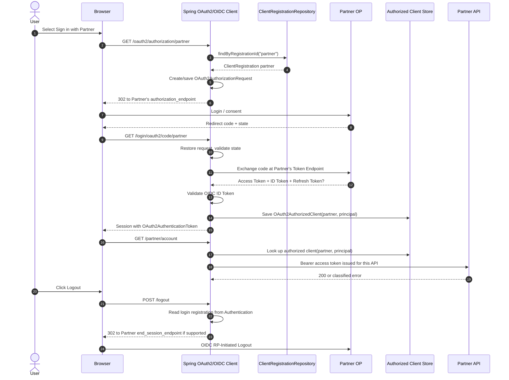
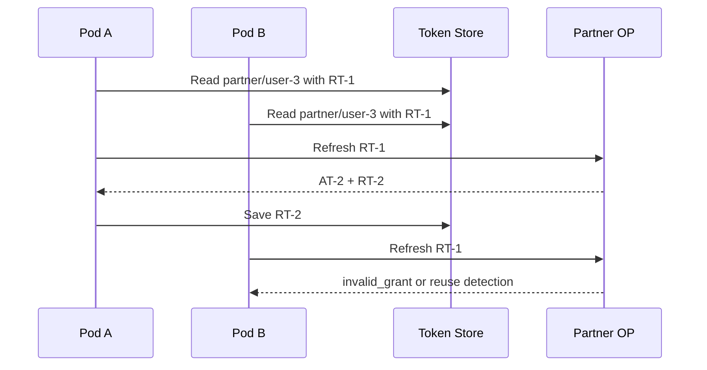

# 25.5. Preserving Registration ID Across Login, API Calls, and Logout

In a **Spring Security OAuth 2.0/OIDC Client** application supporting **multiple providers**, users can log in through one of several OpenID Providers (OPs), while the application may also hold multiple connections to external APIs. In this setting, selecting the right **`registrationId`** directly affects the login flow, where tokens are stored, which access token is sent to an API, and which OpenID Provider receives the logout request.

For example, a portal supports two providers:

- **`corp`** — OIDC provider for employees.
- **`partner`** — OIDC provider for partners.

If a user starts at `/oauth2/authorization/partner` yet post-login code fetches the `corp` authorized client, the result can be a missing token or sending a token to the wrong Resource Server. If during logout the application sends `partner`'s `id_token_hint` to `corp`'s `end_session_endpoint`, that is also a **trust boundary and identity data security flaw**.

This lesson shows how to preserve registration context across **login initiation -> authorization callback -> `Authentication` -> authorized client -> API call -> OIDC logout**, distinguishes when to **reuse the same registration** vs. when **each connection needs its own registration**, and provides Spring MVC/Servlet and Reactive WebFlux examples.

> **Core principle:** Keeping the right registration ID means consistently using the right `ClientRegistration` **within each defined flow**; it does not mean forcing every API call and every logout action to use the login provider's registration when they belong to distinct authorization flows.

## 1. Understanding `registrationId` Properly

Spring Security's `ClientRegistration` describes an OAuth2/OIDC Client registered with an Authorization Server: Client ID, client authentication, authorization grant, redirect URI, scopes, and provider metadata.

`registrationId` is the **internal configuration key** Spring uses to locate a `ClientRegistration`. Example:

```yaml
spring:
  security:
    oauth2:
      client:
        registration:
          corp:
            provider: company-op
            client-id: ${CORP_CLIENT_ID}
            client-secret: ${CORP_CLIENT_SECRET}
            authorization-grant-type: authorization_code
            scope: [openid, profile]
          partner:
            provider: partner-op
            client-id: ${PARTNER_CLIENT_ID}
            client-secret: ${PARTNER_CLIENT_SECRET}
            authorization-grant-type: authorization_code
            scope: [openid, profile]
        provider:
          company-op:
            issuer-uri: https://identity.company.example.test/realms/main
          partner-op:
            issuer-uri: https://identity.partner.example.test/tenant/main
```

In this example:

- `corp` and `partner` are **registration IDs**.
- `company-op` and `partner-op` are **provider IDs** in YAML, referencing provider configurations.
- `client-id` is issued by each Authorization Server, and **does not necessarily match `registrationId`**.
- `issuer-uri` is the trusted OP issuer address for fetching metadata and validating ID Tokens.

### 1.1. Easily confused identifiers

| Identifier | Example | Role |
|---|---|---|
| **`registrationId`** | `corp` | Key to look up a `ClientRegistration` in Spring |
| **Provider ID** | `company-op` | Key for provider details in `application.yml` |
| **OAuth2 `client_id`** | `web-portal-123` | Client identifier issued by the AS |
| **OIDC `issuer` (`iss`)** | `https://identity.company.example.test/...` | Identifier of the OP issuing the ID Token |
| **OIDC `subject` (`sub`)** | `user-782` | User identifier within the scope of an issuer |
| **`principalName`** | `user-782` or internal key | Key identifying the principal for storing authorized clients |
| **Business connection ID** | `connection-42` | Identifier of an application's external API connection |
| **HTTP session ID** | Session cookie | Associates the browser with a local authenticated session |

One ID cannot automatically substitute for another. `registrationId` is not proof of authentication, not an email, not an issuer URL, and not a secret.

### 1.2. One issuer can serve multiple ClientRegistrations

Example:

```text
registrationId: corp-login
  clientId: portal-web
  issuer: https://identity.company.example.test

registrationId: corp-reporting
  clientId: reports-client
  issuer: https://identity.company.example.test
```

Even with the same `issuer`, two registrations can differ in Client ID, scopes, redirect URIs, audience, and consent. A token issued for `corp-login` is not automatically valid for `corp-reporting`.

Conversely, an application with multiple issuers may receive identical `sub` values. Thus, OIDC identity mapping must normally evaluate the **verified `(iss, sub)` pair**, not just `sub` or email.

## 2. Diagram of Registration ID Across a Flow



The diagram illustrates the case where **the provider used for login also issues the access token for that API**. If the Portal logs in via Corp while the user separately authorizes Calendar, the Calendar API must use the **Calendar registration**, whereas Portal OIDC logout must select the **Corp registration**.

## 3. Registering Multiple OIDC Providers with Spring Boot

A fuller configuration:

```yaml
spring:
  security:
    oauth2:
      client:
        registration:
          corp:
            provider: company-op
            client-id: ${CORP_CLIENT_ID}
            client-secret: ${CORP_CLIENT_SECRET}
            client-authentication-method: client_secret_basic
            authorization-grant-type: authorization_code
            redirect-uri: "{baseUrl}/login/oauth2/code/{registrationId}"
            scope:
              - openid
              - profile
              - reports.read

          partner:
            provider: partner-op
            client-id: ${PARTNER_CLIENT_ID}
            client-secret: ${PARTNER_CLIENT_SECRET}
            client-authentication-method: client_secret_basic
            authorization-grant-type: authorization_code
            redirect-uri: "{baseUrl}/login/oauth2/code/{registrationId}"
            scope:
              - openid
              - profile
              - partner.read

        provider:
          company-op:
            issuer-uri: https://identity.company.example.test/realms/main
          partner-op:
            issuer-uri: https://identity.partner.example.test/tenant/main
```

The example domains are not real providers. To run, you must register each Client properly at its OP and configure approved redirect URIs.

### 3.1. Which paths does `registrationId` go into?

With the configuration above:

```text
Start Corp login:
  /oauth2/authorization/corp

Corp callback:
  /login/oauth2/code/corp

Start Partner login:
  /oauth2/authorization/partner

Partner callback:
  /login/oauth2/code/partner
```

If you put `company-op` in the initiation URL instead of `corp`, Spring by default will not find that `ClientRegistration` ID, because `company-op` is only the provider details ID.

### 3.2. `scope` alone does not guarantee the API accepts the token

`reports.read` in YAML is only an illustrative scope. The Authorization Server must support/grant that permission, and the Resource Server must accept the access token with the right audience, issuer, and scope. Having a successful OIDC login does not mean the access token can call every API.

### 3.3. Why use stable IDs?

`registrationId` appears not only in YAML, but also in:

- Login initiation URLs and callback URIs.
- `OAuth2AuthenticationToken#getAuthorizedClientRegistrationId()`.
- `OAuth2AuthorizedClient#getClientRegistration()`.
- `OAuth2AuthorizedClientService` storage keys.
- `@RegisteredOAuth2AuthorizedClient`.
- `WebClient`/`RestClient` token selection.
- OIDC logout provider lookup.
- Background jobs, audit metadata, and connection records.

Renaming `corp` to `company-oidc` can require data migration and updating redirect URIs, not merely changing a display label.

## 4. Login Initiation Phase: Selecting the Right `ClientRegistration`

Spring Security provides the default authorization initiation endpoint following the pattern:

```text
GET /oauth2/authorization/{registrationId}
```

Example provider selection page:

```html
<nav aria-label="Sign in">
  <a href="/oauth2/authorization/corp">
    Sign in with company account
  </a>

  <a href="/oauth2/authorization/partner">
    Sign in with partner account
  </a>
</nav>
```

Each link intentionally selects a backend-configured `ClientRegistration`. This is simple, explicit, and avoids guessing Authorization Endpoint URLs from issuers.

### 4.1. Do not take arbitrary issuers from the browser

Risky design:

```text
/login?issuer=https://unknown.example.test
```

where the backend fetches metadata and redirects the user to an arbitrary OP. Without a trust model, this can lead to open redirects, SSRF, or issuer confusion. With a known set of providers, the backend should use an **allowlist of registration IDs**.

Example:

```java
import java.util.Map;

public final class LoginProviderChoices {

    private static final Map<String, String> CHOICES = Map.of(
        "company", "corp",
        "external", "partner"
    );

    private LoginProviderChoices() {}

    public static String registrationIdFor(String choice) {
        String registrationId = CHOICES.get(choice);
        if (registrationId == null) {
            throw new IllegalArgumentException(
                "Unsupported authentication provider"
            );
        }
        return registrationId;
    }
}
```

This maps a choice from a fixed list; it **does not replace** Spring Security's validation of `state`, callback, PKCE, nonce, and tokens.

### 4.2. Do not use registration ID as OAuth2 `state`

`registrationId` is a public configuration key. `state` is a high-entropy value binding the authorization response to the request initiated by the Client.

| Value | Purpose |
|---|---|
| `registrationId` | Selects `ClientRegistration` |
| Authorization `state` | Binds callback to the initial authorization request |
| OIDC `nonce` | Binds ID Token to the authentication request when applicable |
| PKCE `code_verifier` | Proves Client holds the secret for the authorization code |
| Authorization code | Single-use code exchanged for tokens |

Never use `registrationId` in place of `state` or `nonce`. Never write an arbitrary cookie containing only the registration ID and use it in place of the authorization request repository.

## 5. Callback: Preserve the Original `ClientRegistration`, Do Not Trust Just the URL Segment

After the user authenticates at Partner OP, the browser may receive:

```http
GET /login/oauth2/code/partner?code=EXAMPLE_CODE&state=EXAMPLE_STATE HTTP/1.1
Host: portal.example.test
Cookie: JSESSIONID=EXAMPLE_SESSION
```

Spring Security must restore the authorization request saved during redirect and verify the callback belongs to the right flow. Typical steps include:

1. Correlate `state` in the callback with the prior authorization request.
2. Identify the original `ClientRegistration`.
3. Verify the redirect URI and flow metadata.
4. Exchange the authorization code at the **matching provider's Token Endpoint**.
5. Send PKCE `code_verifier` when required by the flow.
6. For OIDC, verify ID Token issuer, signature, audience, timestamps, and nonce.
7. Build `OAuth2AuthenticationToken`/`OidcUser` or `OAuth2User` as appropriate.
8. Save the issued authorized client under the matching principal/registration.

### 5.1. Do not select the provider solely from callback query/path

Do not write a custom controller like:

```java
// UNSAFE DESIGN if verification steps are skipped:
// String registrationId = request.getParameter("provider");
// String code = request.getParameter("code");
// Send code to an arbitrary endpoint based solely on browser input.
```

A callback URL containing `partner` **does not prove by itself** that the code was issued by Partner. The right registration must be paired with **a bound authorization request, trusted issuer metadata, and verified protocol checks**.

### 5.2. Redirect URIs must be registered per Client

Example public callbacks:

```text
https://portal.example.test/login/oauth2/code/corp
https://portal.example.test/login/oauth2/code/partner
```

If the app runs behind a reverse proxy, `{baseUrl}` must reflect the exact public HTTPS host. Never "fix" `redirect_uri_mismatch` by disabling validation or using overly broad wildcard URIs.

## 6. After Login: Reading the Registration from `Authentication`

In Spring Security Servlet, a user logged in via OAuth2/OIDC typically has an `Authentication` of class:

```java
org.springframework.security.oauth2.client.authentication.OAuth2AuthenticationToken
```

The method:

```java
String getAuthorizedClientRegistrationId();
```

reports **the registration used for the current OAuth2 Login session**.

### 6.1. Controller observing the login registration

```java
import java.util.Map;

import org.springframework.security.core.Authentication;
import org.springframework.security.oauth2.client.authentication.OAuth2AuthenticationToken;
import org.springframework.web.bind.annotation.GetMapping;
import org.springframework.web.bind.annotation.RestController;

@RestController
public class LoginContextController {

    @GetMapping("/me/provider")
    public Map<String, String> currentProvider(
            Authentication authentication) {

        if (authentication instanceof OAuth2AuthenticationToken oauth2) {
            return Map.of(
                "loginRegistrationId",
                oauth2.getAuthorizedClientRegistrationId()
            );
        }

        return Map.of("authenticationType", "not-oauth2-login");
    }
}
```

This illustrative endpoint must be protected per policy. With form login, Bearer Resource Server, or custom auth, `Authentication` is not necessarily an `OAuth2AuthenticationToken`. **Never blindly cast every `Authentication`** to that type.

### 6.2. Do OIDC issuer/subject play the same role as registration?

No. With OIDC Login, the principal is typically `OidcUser`. You can extract the verified identity:

```java
import org.springframework.security.core.Authentication;
import org.springframework.security.oauth2.client.authentication.OAuth2AuthenticationToken;
import org.springframework.security.oauth2.core.oidc.user.OidcUser;

if (authentication instanceof OAuth2AuthenticationToken oauth2
        && oauth2.getPrincipal() instanceof OidcUser user) {

    String loginRegistrationId =
        oauth2.getAuthorizedClientRegistrationId();

    String issuer = user.getIdToken().getIssuer().toString();
    String subject = user.getSubject();

    // registrationId: selects Client.
    // (issuer, subject): links external identity.
}
```

Identity mapping should use **verified `(iss, sub)`** plus internal account ownership, not email alone. `registrationId` is still needed to select authorized clients and OP metadata.

## 7. `OAuth2AuthorizedClient` Holds Both Registration and Principal

After login, Spring can store the authorized client:

```text
OAuth2AuthorizedClient
├── clientRegistration
│     └── registrationId = partner
├── principalName = user-486
├── accessToken
└── refreshToken? (may be null)
```

`OAuth2AuthorizedClientService` typically looks up tokens by the pair:

```java
<T extends OAuth2AuthorizedClient> T loadAuthorizedClient(
    String clientRegistrationId,
    String principalName
);
```

Examples:

```text
("corp", "user-corp-3")       -> Corp authorized client
("partner", "user-partner-8") -> Partner authorized client
("calendar", "internal-42")   -> Calendar authorized client
```

**Right registration ID with the wrong `principalName` still returns null.** Even matching both keys is not enough if web login stores tokens in a session repository while a background job reads a different service store.

### 7.1. Reading the authorized client by login registration

```java
import org.springframework.security.core.Authentication;
import org.springframework.security.oauth2.client.OAuth2AuthorizedClient;
import org.springframework.security.oauth2.client.OAuth2AuthorizedClientService;
import org.springframework.security.oauth2.client.authentication.OAuth2AuthenticationToken;

public class LoginAuthorizedClientReader {

    private final OAuth2AuthorizedClientService service;

    public LoginAuthorizedClientReader(
            OAuth2AuthorizedClientService service) {
        this.service = service;
    }

    public OAuth2AuthorizedClient read(
            Authentication authentication) {

        if (!(authentication instanceof OAuth2AuthenticationToken oauth2)) {
            throw new IllegalArgumentException(
                "OAuth2 Login authentication required"
            );
        }

        return service.loadAuthorizedClient(
            oauth2.getAuthorizedClientRegistrationId(),
            authentication.getName()
        );
    }
}
```

This example applies when the authorized client is actually stored in **that service**. If the setup uses `HttpSessionOAuth2AuthorizedClientRepository` or another store, use the appropriate repository/manager; do not assume the token is missing just because the service returns null.

### 7.2. Never use a token map keyed solely by provider name

Wrong:

```java
// Dangerous in multi-user apps:
Map<String, String> accessTokensByProvider;
```

Key `"partner"` does not distinguish user A from user B and risks cross-account token leakage. Use Spring Security's abstractions with principal isolation and ownership checks.

## 8. Calling APIs: Select the Authorized Client Explicitly

### 8.1. Servlet `WebClient`

For Spring MVC using `WebClient`, the appropriate class is `ServletOAuth2AuthorizedClientExchangeFilterFunction`:

```java
import org.springframework.context.annotation.Bean;
import org.springframework.context.annotation.Configuration;
import org.springframework.security.oauth2.client.registration.ClientRegistrationRepository;
import org.springframework.security.oauth2.client.web.OAuth2AuthorizedClientRepository;
import org.springframework.security.oauth2.client.web.reactive.function.client.ServletOAuth2AuthorizedClientExchangeFilterFunction;
import org.springframework.web.reactive.function.client.WebClient;

@Configuration
public class PartnerApiConfig {

    @Bean
    WebClient partnerApiClient(
            ClientRegistrationRepository registrations,
            OAuth2AuthorizedClientRepository clients) {

        var oauth2 =
            new ServletOAuth2AuthorizedClientExchangeFilterFunction(
                registrations, clients
            );

        return WebClient.builder()
            .baseUrl("https://api.partner.example.test")
            .apply(oauth2.oauth2Configuration())
            .build();
    }
}
```

Calling the API:

```java
import static org.springframework.security.oauth2.client.web.reactive.function.client.ServletOAuth2AuthorizedClientExchangeFilterFunction.clientRegistrationId;

String response = partnerApiClient.get()
    .uri("/v1/account")
    .attributes(clientRegistrationId("partner"))
    .retrieve()
    .bodyToMono(String.class)
    .block(java.time.Duration.ofSeconds(10));
```

Blocking synchronously with `block` is only suitable in contexts where blocking threads is acceptable, such as certain Servlet controllers. Never use `block()` on a Reactor event-loop.

**Important:** `clientRegistrationId("partner")` selects the `ClientRegistration`, but whether the Partner API accepts the access token still depends on audience, scope, issuer, and policy.

### 8.2. Passing an already-resolved authorized client

You can use `@RegisteredOAuth2AuthorizedClient`:

```java
import org.springframework.security.oauth2.client.OAuth2AuthorizedClient;
import org.springframework.security.oauth2.client.annotation.RegisteredOAuth2AuthorizedClient;

@GetMapping("/partner/account")
public String partnerAccount(
        @RegisteredOAuth2AuthorizedClient("partner")
        OAuth2AuthorizedClient partnerClient) {

    return partnerApiClient.get()
        .uri("/v1/account")
        .attributes(
            ServletOAuth2AuthorizedClientExchangeFilterFunction
                .oauth2AuthorizedClient(partnerClient)
        )
        .retrieve()
        .bodyToMono(String.class)
        .block(java.time.Duration.ofSeconds(10));
}
```

This method must sit inside a controller with the corresponding imports/fields. The annotation does not grant consent automatically: if the user has not authorized `partner`, the system still needs the appropriate authorization flow.

### 8.3. Risk of enabling the default authorized client

```java
oauth2.setDefaultOAuth2AuthorizedClient(true);
```

can cause `WebClient` to automatically pick the authorized client attached to the current OAuth2 `Authentication` for requests that do not specify a registration. In a multi-provider app, a shared `WebClient` can easily send a token to the wrong host:

```text
User logs in via Corp
    -> default client = corp

WebClient sends request to Partner API
    -> accidentally attaches Corp access token
    -> 401 or credential leakage to unintended origin
```

Prefer explicit `clientRegistrationId(...)` or `oauth2AuthorizedClient(...)`, dedicated `WebClient` beans per API host, and HTTP destination allowlists.

## 9. Login Provider Can Differ from API Provider

This is the most critical point when implementing multiple providers.

```text
Portal login:
  loginRegistrationId = corp

External API connections:
  calendarRegistrationId = google-calendar
  crmRegistrationId      = salesforce-crm
  storageRegistrationId  = box-storage
```

When the user:

- **Logs into the portal:** selects `corp`.
- **Calls Calendar API:** selects the authorized `google-calendar` registration.
- **Calls CRM API:** selects the authorized `salesforce-crm` registration.
- **Performs OIDC logout from the portal:** selects `corp` from the login session's `Authentication`.
- **Disconnects Calendar:** handles `google-calendar` tokens/revocation per policy—never logs out of Corp just because Calendar failed.

Therefore, "preserving registration ID across the flow" accurately means **preserving the right registration for each connection/grant flow**, not forcing every step to use one immutable ID.

### 9.1. Use variable names that reflect intent

```java
String loginRegistrationId = "corp";
String reportsApiRegistrationId = "corp";
String calendarConnectionRegistrationId = "google-calendar";
```

If one service handles multiple responsibilities, a generic `registrationId` variable easily hides picking the wrong token.

### 9.2. Account linking is not a simple second OAuth2 Login

A user already logged into Corp wants to connect the Partner API. If you simply trigger a new `oauth2Login` via Partner, Spring may replace the current `Authentication` with the Partner user after callback. Then **the portal's `loginRegistrationId` also changes**, even though the original intent was only to link an external account.

An intentional linking flow should:

1. Verify the user currently logged into the portal.
2. Save a pending connection context bound to the internal account and session.
3. Initiate the authorization code flow to the external provider.
4. Protect `state`, PKCE, and OIDC nonce per flow.
5. Verify the external identity/issuer/subject after callback.
6. Link to the internal account **whose ownership has been verified**.
7. Save the `OAuth2AuthorizedClient` for the external registration.
8. Keep the portal `Authentication` if the goal is API linking rather than switching users.
9. Never auto-merge accounts on matching emails.

Do not expect default OAuth2 Login to preserve the login provider after a second authorization flow; this is an architectural requirement that must be explicitly designed.

## 10. Token Audience and Scopes: Right Registration Is Not Enough

Suppose:

```text
Login provider:
  issuer = https://identity.company.example.test

ID Token:
  aud = portal-client-id

Access Token:
  aud = userinfo-service
  scope = openid profile

Reports API requires:
  aud = reports-api
  scope = reports.read
```

Even if `WebClient` selects `corp`, the API may return 401 because the access token has the wrong audience. Never "fix" this by sending an ID Token as a Bearer token or trying an arbitrary registration.

Verify:

- Which Authorization Server issues tokens for that Resource Server?
- Which `client_id` and grant are permitted to request that token?
- Are the access token's scopes and audience accurate?
- Has the user granted appropriate consent?
- Does the provider use resource indicators or token exchange?
- Does the API trust that AS's issuer and signing keys?

### 10.1. HTTP 401 and 403 differ from registration lookup errors

| Symptom | Typical meaning |
|---|---|
| `No ClientRegistration` | Wrong or undeclared registration ID |
| `OAuth2AuthorizedClient` not found | Wrong registration/principal/store or not authorized yet |
| HTTP 401 `invalid_token` | API rejected access token: expired/revoked/wrong audience/issuer |
| HTTP 403 `insufficient_scope` | API accepted auth mechanism, but permissions are lacking |
| Token Endpoint `invalid_grant` | Invalid grant/code/refresh token |
| Token Endpoint `invalid_client` | Wrong client authentication |

Never try different registrations automatically to bypass a 403 or 401. Doing so can violate permission boundaries.

## 11. OIDC Logout Must Select the Login Session's OP

When a user logs in via `partner`, the local `Authentication` normally contains:

```text
OAuth2AuthenticationToken
  principal = Partner's OidcUser
  authorizedClientRegistrationId = partner
```

`OidcClientInitiatedLogoutSuccessHandler` on Servlet uses `Authentication` and `ClientRegistrationRepository` to build an RP-Initiated Logout redirect based on the matching provider's metadata, when supported.

### 11.1. Servlet config with OIDC logout

```java
import org.springframework.context.annotation.Bean;
import org.springframework.context.annotation.Configuration;
import org.springframework.security.config.Customizer;
import org.springframework.security.config.annotation.web.builders.HttpSecurity;
import org.springframework.security.oauth2.client.oidc.web.logout.OidcClientInitiatedLogoutSuccessHandler;
import org.springframework.security.oauth2.client.registration.ClientRegistrationRepository;
import org.springframework.security.web.SecurityFilterChain;

@Configuration
public class MultiProviderSecurityConfig {

    @Bean
    SecurityFilterChain securityFilterChain(
            HttpSecurity http,
            ClientRegistrationRepository registrations) throws Exception {

        var oidcLogout =
            new OidcClientInitiatedLogoutSuccessHandler(registrations);

        oidcLogout.setPostLogoutRedirectUri("{baseUrl}/signed-out");

        return http
            .authorizeHttpRequests(authorize -> authorize
                .requestMatchers("/", "/signed-out", "/error").permitAll()
                .anyRequest().authenticated()
            )
            .oauth2Login(Customizer.withDefaults())
            .oauth2Client(Customizer.withDefaults())
            .logout(logout -> logout.logoutSuccessHandler(oidcLogout))
            .build();
    }
}
```

When Partner `Authentication` is available in the logout success handler and provider metadata contains `end_session_endpoint`, the handler can send the browser to **Partner OP**. If the current session logged in via Corp, the handler targets Corp.

### 11.2. `end_session_endpoint` is optional

A successful OIDC Login does not guarantee the OP supports RP-Initiated Logout. The `end_session_endpoint` metadata field is optional, and some providers do not advertise it.

If the endpoint is missing, fall back to local logout and accurately inform the user about logout scope. **Never guess `issuer + "/logout"`**, or send tokens to an unverified endpoint.

### 11.3. Never send an ID Token hint to the wrong issuer

An RP-Initiated Logout request might contain:

```text
https://identity.partner.example.test/endsession
    ?id_token_hint=EXAMPLE_PARTNER_ID_TOKEN
    &post_logout_redirect_uri=https%3A%2F%2Fportal.example.test%2Fsigned-out
```

Wrong and risks leaking identity information:

```text
https://identity.company.example.test/endsession
    ?id_token_hint=EXAMPLE_PARTNER_ID_TOKEN
```

`id_token_hint` must match the OP/Client that issued the ID Token. Never use an access token, refresh token, or another provider's ID Token as the hint.

### 11.4. Portal logout differs from API disconnect

When the user clicks **Logout portal**, the local session is cleared; OP logout uses the **login registration**.

When the user clicks **Disconnect Calendar**, the application handles the authorized client and revocation tied to the **Calendar registration**. It does not necessarily log out of Corp or all other providers.

Local logout, OP RP-Initiated Logout, and OAuth2 token revocation are **distinct operations**.

## 12. Multi-provider and Multiple Sessions

A user might have:

```text
Browser A:
  loginRegistrationId = corp

Browser B:
  loginRegistrationId = partner

Shared authorized-client service:
  corp / principal-X
  partner / principal-Y
  calendar / principal-Z
```

Logging out Browser A does not by default:

- Clear Browser B's local session.
- Log out Partner OP in Browser B.
- Revoke Calendar's refresh token.
- Log out all applications and all devices.

"Logout all devices" requires a broader strategy: session management, OP capabilities, front-/back-channel logout, token revocation, and Resource Server enforcement. You cannot simply loop an OIDC logout handler over every registration ID.

### 12.1. Account switching in one browser

If a browser logs into Corp and later completes a Partner login, the current `Authentication` may become the Partner `Authentication` depending on configuration. OIDC logout uses the **current `Authentication`**, not automatically remembering the first provider.

Therefore, distinguish clearly whether the user is **switching accounts** or **linking an external API**; otherwise logout may look like it "picked the wrong OP" when Spring is actually handling the new `Authentication`.

## 13. Reactive WebFlux: Corresponding Classes

If the application uses `SecurityWebFilterChain` and `ServerHttpSecurity`, never import Servlet-specific classes by mistake.

| Servlet Spring MVC | Reactive WebFlux |
|---|---|
| `SecurityFilterChain` | `SecurityWebFilterChain` |
| `HttpSecurity` | `ServerHttpSecurity` |
| `ClientRegistrationRepository` | `ReactiveClientRegistrationRepository` |
| `OAuth2AuthorizedClientRepository` | `ServerOAuth2AuthorizedClientRepository` |
| `ServletOAuth2AuthorizedClientExchangeFilterFunction` | `ServerOAuth2AuthorizedClientExchangeFilterFunction` |
| `OidcClientInitiatedLogoutSuccessHandler` | `OidcClientInitiatedServerLogoutSuccessHandler` |
| `SecurityContextHolder` per Servlet context | `ReactiveSecurityContextHolder` |

### 13.1. Reactive security chain and logout

```java
import org.springframework.context.annotation.Bean;
import org.springframework.security.config.Customizer;
import org.springframework.security.config.web.server.ServerHttpSecurity;
import org.springframework.security.oauth2.client.oidc.web.server.logout.OidcClientInitiatedServerLogoutSuccessHandler;
import org.springframework.security.oauth2.client.registration.ReactiveClientRegistrationRepository;
import org.springframework.security.web.server.SecurityWebFilterChain;

@Bean
SecurityWebFilterChain webFluxSecurity(
        ServerHttpSecurity http,
        ReactiveClientRegistrationRepository registrations) {

    var logout =
        new OidcClientInitiatedServerLogoutSuccessHandler(registrations);

    logout.setPostLogoutRedirectUri("{baseUrl}/signed-out");

    return http
        .authorizeExchange(exchanges -> exchanges
            .pathMatchers("/", "/signed-out", "/error").permitAll()
            .anyExchange().authenticated()
        )
        .oauth2Login(Customizer.withDefaults())
        .oauth2Client(Customizer.withDefaults())
        .logout(spec -> spec.logoutSuccessHandler(logout))
        .build();
}
```

### 13.2. Reactive `WebClient` with explicit registration

```java
import org.springframework.context.annotation.Bean;
import org.springframework.security.oauth2.client.registration.ReactiveClientRegistrationRepository;
import org.springframework.security.oauth2.client.web.server.ServerOAuth2AuthorizedClientRepository;
import org.springframework.security.oauth2.client.web.reactive.function.client.ServerOAuth2AuthorizedClientExchangeFilterFunction;
import org.springframework.web.reactive.function.client.WebClient;

@Bean
WebClient partnerWebClient(
        ReactiveClientRegistrationRepository registrations,
        ServerOAuth2AuthorizedClientRepository authorizedClients) {

    var oauth2 =
        new ServerOAuth2AuthorizedClientExchangeFilterFunction(
            registrations, authorizedClients
        );

    return WebClient.builder()
        .baseUrl("https://api.partner.example.test")
        .filter(oauth2)
        .build();
}
```

A request:

```java
import static org.springframework.security.oauth2.client.web.reactive.function.client.ServerOAuth2AuthorizedClientExchangeFilterFunction.clientRegistrationId;

Mono<String> response = partnerWebClient.get()
    .uri("/v1/account")
    .attributes(clientRegistrationId("partner"))
    .retrieve()
    .bodyToMono(String.class);
```

The pipeline executes lazily under Reactor; never use `block()` on the Netty event-loop.

### 13.3. Reading login registration from `ReactiveSecurityContext`

```java
import org.springframework.security.core.context.ReactiveSecurityContextHolder;
import org.springframework.security.oauth2.client.authentication.OAuth2AuthenticationToken;
import reactor.core.publisher.Mono;

Mono<String> currentLoginRegistration() {
    return ReactiveSecurityContextHolder.getContext()
        .map(context -> context.getAuthentication())
        .ofType(OAuth2AuthenticationToken.class)
        .map(OAuth2AuthenticationToken::getAuthorizedClientRegistrationId)
        .switchIfEmpty(Mono.error(
            new IllegalStateException("No OAuth2 login authentication")
        ));
}
```

Never pull Servlet's ThreadLocal `SecurityContextHolder` inside a Reactor pipeline assuming context always propagates across threads. For background tasks, pass a dedicated trusted service/connection context.

## 14. Background Jobs: Which Registration Is Used?

In `@Scheduled`, a queue consumer, or a batch job, there may be no local HTTP session. Thus:

- For **`client_credentials`**, the job uses the service `ClientRegistration`, needing no user login registration.
- For **user-delegated offline access**, the job uses the registration and principal saved from the user-authorized external connection.
- When the API provider differs from the login provider, the job still uses the verified API registration rather than looking up an old request's `OAuth2AuthenticationToken`.

### 14.1. Service manager and Client Credentials

```java
import org.springframework.security.oauth2.client.OAuth2AuthorizeRequest;

OAuth2AuthorizeRequest request =
    OAuth2AuthorizeRequest
        .withClientRegistrationId("reporting-service")
        .principal("service:reporting")
        .build();
```

`reporting-service` is the registration configured for service-to-service calls. `service:reporting` is merely a principal key to store the authorized client, not impersonating a user.

In Servlet, the appropriate manager for the service tier is `AuthorizedClientServiceOAuth2AuthorizedClientManager`; in Reactive, it is `AuthorizedClientServiceReactiveOAuth2AuthorizedClientManager`.

### 14.2. When a job acts on behalf of a user

An internal message might contain:

```text
connectionId = conn-42
```

The worker queries the database after verifying account/tenant ownership:

```text
conn-42:
  registrationId = google-calendar
  authorizedClientPrincipalName = stored-trusted-principal
  status = CONNECTED
```

Only then does the worker fetch the authorized client. Never let a user-controlled message directly specify another user's `principalName` or another tenant's registration.

## 15. When the Same OP Has Multiple ClientRegistrations

Suppose:

```yaml
spring:
  security:
    oauth2:
      client:
        registration:
          corp-login:
            provider: corp-op
            client-id: ${LOGIN_CLIENT_ID}
            client-secret: ${LOGIN_CLIENT_SECRET}
            authorization-grant-type: authorization_code
            scope: [openid, profile]

          corp-api:
            provider: corp-op
            client-id: ${API_CLIENT_ID}
            client-secret: ${API_CLIENT_SECRET}
            authorization-grant-type: authorization_code
            scope: [openid, reports.read]

        provider:
          corp-op:
            issuer-uri: https://identity.company.example.test/realms/main
```

Logging in via `corp-login` does not mean a token has been issued for `corp-api`, even though both registrations share the same issuer.

- Portal `Authentication` is tied to `corp-login`.
- Authorized client `corp-api` requires its own grant/consent if demanded by the API.
- OIDC logout uses the login registration `corp-login`.
- Renaming `corp-login`'s token into an object labeled `corp-api` grants no new permissions.

### 15.1. Do not pick an API client solely by issuer

A service seeing two registrations with the same issuer cannot assume they are equivalent. `client_id`, scopes, Token Endpoint policies, and redirect URIs may differ.

### 15.2. Do not link users solely by email

Same email from two issuers does not guarantee the same identity. Use verified `(iss, sub)` and an account linking policy.

## 16. Changing a Registration ID in Production

Changing:

```text
partner -> partner-oidc
```

can affect:

- Login links.
- Callback URIs registered at the OP.
- `OAuth2AuthenticationToken` and active sessions.
- Data keys in `OAuth2AuthorizedClientService`.
- JDBC rows containing `client_registration_id`.
- External connection rows, jobs, and queue messages.
- `WebClient` configuration.
- OIDC logout provider mapping and telemetry.

### 16.1. Migration plan

1. Inventory all registrations and dependencies.
2. Check whether issuer, Client ID, and grant are changing.
3. Update login/callback and post-logout redirect URIs at the provider.
4. Audit authorized clients currently stored under the old ID.
5. Choose a safe data migration or require reauthorization.
6. Verify principal/tenant ownership before migrating rows.
7. Never mix tokens from two different Client IDs.
8. Test refresh token rotation during rolling deployment.
9. Maintain clear diagnostics for older sessions.
10. Have a proper rollback plan; never dump raw tokens into logs/CSVs.

### 16.2. Why can renaming lose tokens?

`OAuth2AuthorizedClientService` looks up by `(registrationId, principalName)`. An old database row `("partner","user-3")` does not automatically become `("partner-oidc","user-3")`. Even if the key is updated, whether the old token stays valid depends on Client ID, issuer, and provider policy.

### 16.3. Rolling deployment issues

If old pods use `partner` and new pods use `partner-oidc` while sharing a JDBC database, requests may look up two different keys. A controlled state transition and version-compatibility strategy is needed.

## 17. Multi-tenant: Registration ID Is Not a Tenant Boundary

One provider can have multiple tenants:

```text
Tenant A:
  issuer = https://id.example.test/tenant/a
  sub = 123

Tenant B:
  issuer = https://id.example.test/tenant/b
  sub = 123
```

Two identities with the same `sub` yet different issuers are not a single identity. Using only `principalName="123"` and a shared registration without tenant isolation risks mixing tokens.

Design for:

- Verified `(iss, sub)` -> internal account mapping.
- Tenant-appropriate registration/issuer.
- Ownership checks before fetching an authorized client.
- Stable principal keys that do not collide across tenants.
- Preventing Tenant A from requesting tokens for Tenant B's Client.
- HTTP destinations matching the Resource Server and trust boundary.

### 17.1. Reference domain record

```java
public record ExternalConnection(
    String id,
    String internalAccountId,
    String registrationId,
    String authorizedClientPrincipalName,
    String externalIssuer,
    String externalSubject,
    String status
) {}
```

This record stores **metadata** to manage the connection; actual tokens live in the protected authorized client service/store. The browser should only pass a connection ID, and the backend must verify ownership before retrieving the registration/principal.

## 18. Refresh Token Rotation and `invalid_grant` Errors

`OAuth2AuthorizedClient` may contain a refresh token; when the access token expires, a properly configured manager/provider can send a Refresh Token Grant to that registration's Token Endpoint.

```text
Authorized client:
  registrationId = partner
  principalName = user-3
  accessToken = AT-1
  refreshToken = RT-1

Successful refresh:
  accessToken = AT-2
  refreshToken = RT-2 (if provider uses rotation)
```

If the same record is refreshed concurrently by two pods:



Preserving the right registration still **does not solve concurrency automatically**. With refresh token rotation, consider single-flight, optimistic locking, distributed coordination, and persistence of the new token.

### 18.1. Do not try another registration when refresh fails

If the Partner refresh token is revoked, never switch to Corp's token to keep calling the Partner API. That crosses permission boundaries. The system must clean up the broken authorized client and ask the user to reauthorize **the exact external connection**, per policy.

### 18.2. Local session and external connection are separate

A user can remain logged into the portal via Corp even when the Calendar refresh token has been revoked. Rather than logging out of the entire portal by default, mark the Calendar connection as `RECONNECT_REQUIRED`.

## 19. Security When Selecting a Registration

### 19.1. Right registration yet wrong HTTP host is still dangerous

```java
webClient.get()
    .uri(userSuppliedAbsoluteUrl)
    .attributes(clientRegistrationId("partner"))
    .retrieve();
```

If `userSuppliedAbsoluteUrl` points to a host outside the trust boundary, Partner's access token can be exfiltrated to the wrong destination. Restrict outbound origins, use server-side base URLs, controlled relative paths, and check redirect behavior.

### 19.2. Do not take the logout endpoint from user input

A `registrationId=partner` value chosen by a user on the login page is not proof that the current session logged in via Partner. On logout, rely on the verified `Authentication` and trusted `ClientRegistrationRepository`. Never redirect an ID Token hint to a host taken from a query parameter.

### 19.3. Do not treat registration ID as an access permission

Knowing the string `partner` does not entitle a user to use a Partner authorized client. OAuth2 authorization, principal ownership, tenant checks, and API permission checks are all required.

### 19.4. Never log credentials

Logs may record:

```text
event=oauth2_login_success
loginRegistrationId=partner

event=oauth2_api_call
apiRegistrationId=partner
targetService=partner-api
httpStatus=200

event=oidc_logout_started
loginRegistrationId=partner
opLogoutSupported=true
```

Never log raw access/refresh tokens, authorization codes, session cookies, Client secrets, or logout URLs containing `id_token_hint`.

### 19.5. Avoid open redirects and spoofed forwarded hosts

`{baseUrl}` URLs in callbacks/logout can break if a reverse proxy does not pass scheme/host accurately. Trust proxy headers only from controlled proxies. Never accept an arbitrary `post_logout_redirect_uri` from the browser.

## 20. Testing Multi-provider Flows

Test with at least two registrations having distinct issuers and Client IDs.

### 20.1. Corp Login

1. `GET /oauth2/authorization/corp` redirects to Corp's Authorization Endpoint.
2. Callback `/login/oauth2/code/corp` has a valid `state`.
3. Token request uses Corp's `ClientRegistration`/Token Endpoint.
4. ID Token issuer/audience/nonce are validated.
5. `Authentication` has `getAuthorizedClientRegistrationId() == "corp"`.
6. Authorized client is stored under `corp` and the exact principal.
7. Corp API receives a token with the right scope/audience.
8. OIDC logout redirects to Corp OP when supported.

### 20.2. Partner Login

Repeat the same steps for Partner. Ensure Corp's Token Endpoint is not called, Corp tokens are never used for Partner API, and Partner ID Token hints are never sent to Corp's logout endpoint.

### 20.3. Account linking and external APIs

1. User logs into Corp.
2. User requests to link Calendar.
3. Calendar authorization flow is protected.
4. Backend checks connection ownership and external identity.
5. Calendar authorized client is saved under the right registration/principal.
6. Portal login session stays Corp **if required by design**.
7. Calendar API uses the Calendar registration.
8. Portal logout uses Corp; disconnecting Calendar runs separate token cleanup.

### 20.4. Failure cases

- Callback with wrong `state` is rejected.
- User A cannot retrieve User B's token simply by knowing the registration ID.
- Token with wrong audience is rejected by the Resource Server without trying another registration.
- Missing `end_session_endpoint` falls back to local logout.
- Invalid `post_logout_redirect_uri` is handled explicitly.
- Renamed registration is verified against database rows and redirect URIs.
- Concurrent refresh does not lose the newly issued token.
- Multi-tenant users with the same `sub` do not merge identities.

These are **recommended** test scenarios, not claims that code has already been executed or QA'd.

## 21. Flow-Based Troubleshooting

| Symptom | Possible cause | Remediation |
|---|---|---|
| `/oauth2/authorization/company-op` fails | Used provider ID instead of registration ID | Use `corp` per configuration |
| Callback `redirect_uri_mismatch` | Public URI has wrong host/path/registration | Cross-check OP registration and proxy |
| Callback `invalid_state` | Lost/mismatched authorization request or cookie | Check session, state, and multi-tab |
| `Authentication` shows Partner when Corp was expected | Partner flow replaced local login | Check initiation and account switching |
| `OAuth2AuthorizedClient` not found | Wrong registration/principal/store | Check keys and storage |
| Logged into Corp yet Calendar API needs a token | Separate API registration lacks consent yet | Authorize Calendar via proper flow |
| API 401 `invalid_token` | Expired/revoked token or wrong audience | Check Resource Server contract |
| API 403 `insufficient_scope` | Token lacks permissions | Request proper scope; do not try another provider |
| Token Endpoint `invalid_grant` | Wrong, expired, or rotated code/refresh token | Inspect grant and token lifecycle |
| OIDC logout goes to wrong OP | Custom handler picks wrong registration | Use login `Authentication` and provider metadata |
| Logout does not redirect to OP | Missing OIDC principal or `end_session_endpoint` | Local fallback, check discovery |
| Post-logout immediately returns to login | `/signed-out` is protected | `permitAll`, avoid auto-login |
| Tokens "disappear" after renaming registration ID | Rows persisted under old key | Run safe migration or reauthorize |
| Background worker uses wrong user's token | Unchecked principal/tenant mapping | Enforce trusted connection records and ownership |
| `WebClient` attaches Bearer to public host | Default token or arbitrary URL | Separate `WebClient` beans and allowlist hosts |
| Multi-tenant user identities merge | Using email or `sub` without issuer | Use verified `(iss, sub)` and tenant mapping |

### 21.1. Diagnostic order

1. Identify the **`registrationId` at login start**.
2. Check whether `ClientRegistrationRepository` has that ID.
3. Check the callback and saved authorization request/`state`.
4. Check post-login `Authentication` and verified issuer.
5. Check the authorized client by registration/principal.
6. Check which registration the API request attributes select.
7. Check the access token's audience/scope/issuer.
8. Check login vs. external API connection policies.
9. Check the OIDC logout handler and matching OP metadata.
10. Check sessions, multi-tenant/account linking, and mappings.
11. Check migration if a registration was recently renamed.
12. Emit sanitized logs; never dump credentials.

## 22. Practice Exercises

### Exercise 1: Registration vs. Provider ID

Configuration:

```yaml
registration:
  company-login:
    provider: company-op
provider:
  company-op:
    issuer-uri: https://id.example.test
```

**Question:** What is the login initiation URL?

**Suggested answer:** `/oauth2/authorization/company-login`.

### Exercise 2: Reading registration from `Authentication`

```java
if (authentication instanceof OAuth2AuthenticationToken oauth2) {
    String id = oauth2.getAuthorizedClientRegistrationId();
}
```

**Explanation:** This is the current login `ClientRegistration`, not necessarily the API registration for every external connection.

### Exercise 3: Corp Portal + Calendar API

User logs into Corp and has authorized Google Calendar.

**Suggested answer:** Calendar API uses `google-calendar`; Portal OIDC logout uses `corp`.

### Exercise 4: Authorized client not found

Store holds `("partner","partner-sub-7")`; service queries `("partner","corp-sub-1")`.

**Suggested answer:** Wrong principal key. Use a verified and consistent mapping; never substitute principals arbitrarily.

### Exercise 5: ID Token hint sent to the wrong provider

User logs into Partner, logs out to Corp's endpoint with Partner's ID Token.

**Suggested answer:** Trust boundary violation; obtain `ClientRegistration` from the login `Authentication` and matching OP metadata.

### Exercise 6: One issuer, two registrations

`corp-login` and `corp-api` share the same issuer yet have different Client IDs.

**Suggested answer:** Logging in with `corp-login` does not issue a token for `corp-api`. A dedicated authorization flow for the API is required.

### Exercise 7: Resource Server returns 403

`corp` token lacks `reports.write`.

**Suggested answer:** Request the proper permission/adjust policy; never use a Partner token to bypass authorization.

### Exercise 8: Renaming a registration ID

Team renames `partner` to `partner-oidc` while many refresh tokens exist in JDBC.

**Suggested answer:** Inventory callbacks, login links, token keys, jobs, principals/issuers, and execute a safe migration or reauthorization.

### Exercise 9: Two tenants with the same subject

Tenant A and B both have `sub="123"`, with different issuers.

**Suggested answer:** Never merge by `sub` or email alone; use verified `(iss, sub)` and ownership.

### Exercise 10: Account linking

User is logged into Corp, clicks "Connect Partner", and the callback switches the local session to Partner.

**Suggested answer:** The linking flow must be designed separately if Corp `Authentication` must be preserved; verify the pending connection and external identity.

### Exercise 11: Background job

Job reads `registrationId` from a user-modifiable queue message and fetches another user's token.

**Suggested answer:** Accept only a trusted connection ID, look up metadata from server-side records, and verify ownership before retrieving tokens.

### Exercise 12: Wrong destination

`WebClient` selects `partner` while a browser-supplied URI points to an external host.

**Suggested answer:** Even the right registration is dangerous with the wrong origin. Use allowlisted hosts/base URLs and control redirects.

### Exercise 13: Token Endpoint `invalid_grant`

Partner refresh fails; service tries refreshing Corp instead.

**Suggested answer:** Never switch grants/identities. Stop using the broken Partner refresh token, clean up, and reauthorize the Partner connection when needed.

### Exercise 14: WebFlux

Reactive code tries to read `Authentication` from Servlet's ThreadLocal.

**Suggested answer:** Use Reactive `SecurityContext` or pass trusted context; background jobs should use a service-based manager.

### Exercise 15: Logout all devices

User logs out of Corp on a laptop; Partner session on a phone and Calendar background job keep running.

**Suggested answer:** Local logout/RP-Initiated Logout do not clear those states by default. Separate multi-session, OP logout, and token revocation policies are required.

## 23. Implementation Checklist

- [ ] Name `registrationId` clearly and stably, distinct from provider ID/issuer.
- [ ] Login chooser includes only permitted registration IDs.
- [ ] Callback validates saved authorization request, `state`, and PKCE/nonce where applicable.
- [ ] Never select arbitrary issuers/Token Endpoints from query parameters.
- [ ] Read login registration from `OAuth2AuthenticationToken` where appropriate.
- [ ] OIDC identity mapping uses verified `(iss, sub)`.
- [ ] Authorized clients are saved/loaded using the exact `(registrationId, principalName)` and repository.
- [ ] API registration is chosen per connection/resource, not defaulted to the login registration.
- [ ] Access tokens satisfy the Resource Server's audience, scope, and issuer.
- [ ] `WebClient`/`RestClient` never send tokens to arbitrary hosts.
- [ ] Never enable default authorized client on a shared HTTP client spanning multiple origins.
- [ ] Account linking is separated from login-as if the product must keep the existing `Authentication`.
- [ ] Multi-tenant ownership and principal isolation are enforced.
- [ ] OIDC logout uses the provider of the current login `Authentication`.
- [ ] `end_session_endpoint` and post-logout redirect URIs are verified per OP.
- [ ] Local logout is distinguished from disconnect/token revocation.
- [ ] Never send an ID Token hint to a different issuer.
- [ ] Background jobs use trusted connections/registrations/principals.
- [ ] Changing a registration ID has a migration plan for token storage and redirects.
- [ ] Refresh rotation/concurrency is protected across multiple instances.
- [ ] Logging distinguishes `loginRegistrationId`, `apiRegistrationId`, and `logoutRegistrationId`, without tokens.
- [ ] Tests cover both providers with different issuers and multiple Clients sharing an issuer.

## 24. References

1. [Spring Security Reference — OAuth2 Login (Servlet)](https://docs.spring.io/spring-security/reference/servlet/oauth2/login/index.html): login initiation, callback, and OIDC authentication.
2. [Spring Security Reference — OAuth2 Client (Servlet)](https://docs.spring.io/spring-security/reference/servlet/oauth2/client/index.html): `ClientRegistration`, authorized clients, and managers.
3. [Spring Security API — ClientRegistration](https://docs.spring.io/spring-security/reference/api/java/org/springframework/security/oauth2/client/registration/ClientRegistration.html): registration ID, provider details, and grant.
4. [Spring Security API — OAuth2AuthenticationToken](https://docs.spring.io/spring-security/reference/api/java/org/springframework/security/oauth2/client/authentication/OAuth2AuthenticationToken.html): `getAuthorizedClientRegistrationId()`.
5. [Spring Security API — OAuth2AuthorizedClient](https://docs.spring.io/spring-security/reference/api/java/org/springframework/security/oauth2/client/OAuth2AuthorizedClient.html): `ClientRegistration`, `principalName`, and tokens.
6. [Spring Security API — OAuth2AuthorizedClientService](https://docs.spring.io/spring-security/reference/api/java/org/springframework/security/oauth2/client/OAuth2AuthorizedClientService.html): save/load by registration and principal.
7. [Spring Security API — ServletOAuth2AuthorizedClientExchangeFilterFunction](https://docs.spring.io/spring-security/reference/api/java/org/springframework/security/oauth2/client/web/reactive/function/client/ServletOAuth2AuthorizedClientExchangeFilterFunction.html): selecting authorized client for Servlet `WebClient`.
8. [Spring Security API — ServerOAuth2AuthorizedClientExchangeFilterFunction](https://docs.spring.io/spring-security/reference/api/java/org/springframework/security/oauth2/client/web/reactive/function/client/ServerOAuth2AuthorizedClientExchangeFilterFunction.html): Reactive `WebClient` OAuth2 filter.
9. [Spring Security Reference — OIDC Logout (Servlet)](https://docs.spring.io/spring-security/reference/servlet/oauth2/login/logout.html): RP-Initiated Logout and OIDC logout success handler.
10. [Spring Security Reference — OIDC Logout (Reactive)](https://docs.spring.io/spring-security/reference/reactive/oauth2/login/logout.html): reactive logout.
11. [OpenID Connect Core 1.0](https://openid.net/specs/openid-connect-core-1_0.html): issuer, subject, audience, nonce, and ID Token validation.
12. [OpenID Connect Discovery 1.0](https://openid.net/specs/openid-connect-discovery-1_0.html): provider metadata.
13. [OpenID Connect RP-Initiated Logout 1.0](https://openid.net/specs/openid-connect-rpinitiated-1_0.html): end-session endpoint and logout hints.
14. [OAuth 2.0 — RFC 6749](https://www.rfc-editor.org/rfc/rfc6749): Authorization Code Flow and token semantics.
15. [OAuth 2.0 Security Best Current Practice — RFC 9700](https://www.rfc-editor.org/rfc/rfc9700): redirect/token security.

## 25. Summary

**`registrationId` is a Spring Security OAuth2 Client configuration key**, not an issuer, Client ID, or user identity. In an OAuth2/OIDC Login flow, the application must pick the right registration when initiating authorization, restore the authorization request on callback, verify tokens against the corresponding OP, and save the authorized client under the proper registration/principal. When calling APIs, select an authorized client whose grant, scopes, and audience are valid for the Resource Server. On OIDC logout, send the browser to the OP determined from the **current login session's `Authentication`**.

**Consistency does not mean every step must use the same registration.** If login uses Corp while the user has linked Calendar and CRM, the API integrations have their own registrations, while Portal OIDC logout still belongs to Corp. Clearly separating **`loginRegistrationId`**, **`apiRegistrationId`**, and **`connectionRegistrationId`** alongside verified external identities, principal ownership, and HTTP origin trust prevents wrong tokens, wrong issuers, logging out of the wrong OP, and account-linking vulnerabilities in multi-provider applications.
