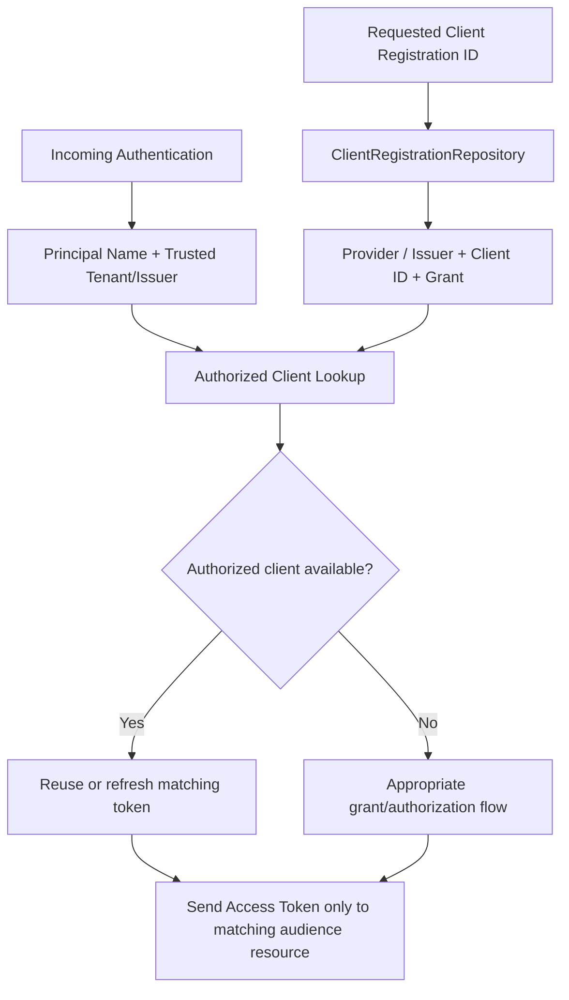
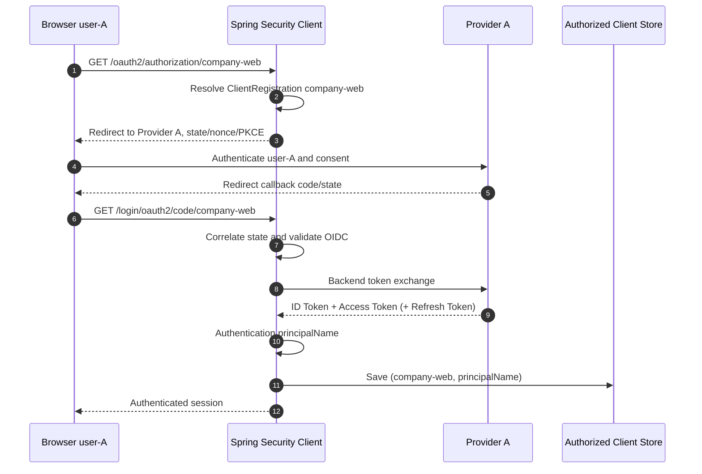
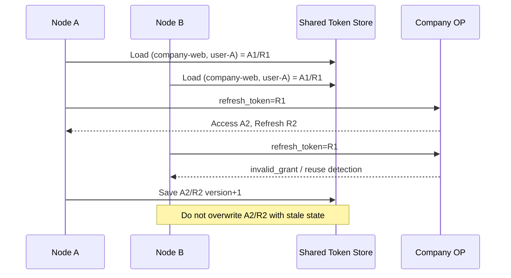
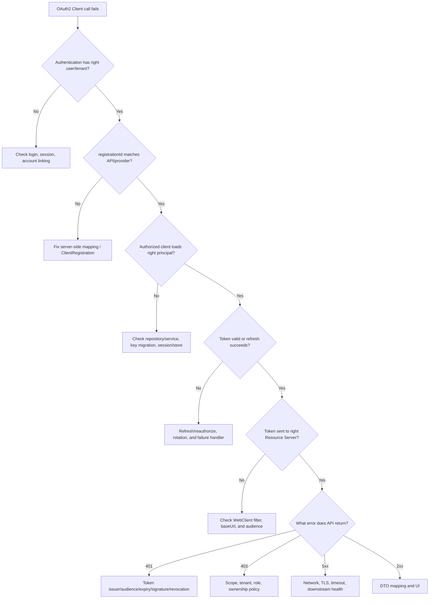

# 25.7. Separating Authorized Clients by Provider and Principal

In a **Spring Security OAuth 2.0 / OpenID Connect (OIDC) Client** application integrating multiple identity providers, a successful login solves only part of the problem. Once a user is authenticated, the application must also store and use the right **`OAuth2AuthorizedClient`** matching that user's **client registration** and **principal**.

If an application has two OpenID Providers, multiple OAuth2 client registrations, multiple users, multiple tenants, or background jobs running with `client_credentials`, looking up tokens with the wrong key can cause severe bugs:

- Using **user A's Access Token** to call an API on behalf of **user B**.
- Using a token issued by **provider A** to call an API belonging to **provider B**.
- Mixing Refresh Tokens between two client registrations even when they share an issuer.
- Using a broad machine token to "work around" a missing user token.
- Overwriting a newly issued Refresh Token during a refresh race.
- Failing to find an authorized client after changing how `principalName` is constructed or across instances.
- Leaking tokens through `WebClient`, logging, or an API allowing arbitrary principal selection.

Spring Security has a very important foundational model:

\[
\text{Authorized Client Lookup Key}
\approx
(\text{clientRegistrationId},\ \text{principalName})
\]

This is the characteristic lookup key of **`OAuth2AuthorizedClientService`**, not a mechanism that automatically understands all tenants, issuers, or business permissions. **Providers** are usually linked indirectly via `ClientRegistration`; if the system has multiple dynamic issuers/tenants, designers must ensure data partitioning is not lost when mapping down to this key pair.

This lesson focuses on separating authorized clients by **provider, registration, user principal, tenant, and grant type**, Spring Boot configuration, loading/saving via repositories/services, Servlet/Reactive managers, `WebClient` examples, refresh token concurrency, account linking models, troubleshooting, and security controls.

## 1. Four Concepts to Distinguish First

In a multi-provider system, several names often appear together:

| Concept | Meaning | Example |
|---|---|---|
| **OpenID Provider / Authorization Server** | System issuing tokens and authenticating users, identified by issuer and metadata. | `https://id.company.example/realms/main` |
| **Provider ID in Spring Boot** | Configuration key under `spring.security.oauth2.client.provider`. | `company-oidc` |
| **Client Registration ID** | Unique key for Spring Security to look up a `ClientRegistration`. | `company-orders` |
| **Principal Name** | Principal name used in the authorization/token store context. | `company-sub-7f42` |

One user can have one or more authorized clients, each tied to a **registration ID** and **principal name**.

### 1.1. Provider is not synonymous with client registration

One provider can serve multiple OAuth2 clients:

```text
OpenID Provider: company-oidc
  |
  +-- ClientRegistration company-web
  |      client_id=employee-portal
  |
  +-- ClientRegistration company-calendar
  |      client_id=calendar-connector
  |
  +-- ClientRegistration reports-machine
         client_id=nightly-reports
```

All three registrations can share the same issuer or token endpoint while having different `client_id`, `client_secret`, scopes, grant types, and token policies.

Conversely, two registrations with similar names do not necessarily point to the same provider.

**Do not pass `providerId` instead of `registrationId` when calling `loadAuthorizedClient` or `OAuth2AuthorizeRequest.withClientRegistrationId(...)`.**

### 1.2. Principal Name is not synonymous with email

Principal name is the key tied to `Authentication`. In OIDC, a trustworthy identifier normally comes from the pair:

```text
(issuer, subject / sub)
```

because `sub` is only defined as unique within an issuer per the OIDC specification. The same `sub` string across two different issuers **does not necessarily represent the same person**.

Email can change, be unverified, or be reassigned; never use a caller-supplied email to decide which token gets loaded.

### 1.3. Authorized client is not `Authentication`

| Component | Answers the question | Primary lifecycle |
|---|---|---|
| `Authentication` | Who is the current user authenticated as? | Application security context/session. |
| `OidcUser` and `OidcIdToken` | Which identity did the OP confirm? | Result of OIDC login. |
| `ClientRegistration` | Which OAuth2 client can request tokens from which provider? | Application configuration. |
| `OAuth2AuthorizedClient` | Which Access/Refresh Token does this registration hold for this principal? | OAuth2 authorization/token lifecycle. |
| `OAuth2AuthorizedClientRepository`/Service | Where are authorized clients saved/loaded? | Session or request-independent persistence. |

Never assume that finding an authorized client in the database means the user has an **authenticated HTTP session**. Likewise, never assume that having a valid session means every provider/registration has a token.

## 2. Overall Example: Two Providers, Two Users, and One Machine Client

Suppose the system has:

```text
Provider A: company-oidc (issuer https://id.company.example/main)
Provider B: partner-oidc (issuer https://login.partner.example/main)

Registrations:
  company-web     -> Provider A -> Authorization Code/OIDC
  company-calendar-> Provider A -> Authorization Code/OIDC
  partner-web     -> Provider B -> Authorization Code/OIDC
  reports-machine -> Provider A -> Client Credentials

Principals:
  user-A (company subject 1001)
  user-B (company subject 1002)
  user-A when linked to partner account (partner subject p-778)
  service:nightly-reports
```

Logically separate authorized clients:

| Registration ID | Principal key | Token | Purpose |
|---|---|---|---|
| `company-web` | `company-sub-1001` | A1/R1 | User A accesses company API. |
| `company-web` | `company-sub-1002` | A2/R2 | User B accesses company API. |
| `company-calendar` | `company-sub-1001` | A3/R3 | User A grants calendar access. |
| `partner-web` | `partner-sub-p-778` | A4/R4 | User A linked partner account. |
| `reports-machine` | `service:nightly-reports` | A5; usually no Refresh Token | Scheduled machine job. |

This table illustrates identifier design; the actual `principalName` comes from `Authentication.getName()` or an application-provided technical principal—Spring Security does not automatically prepend prefixes as shown in the table.

Tokens A1–A5 must stay **isolated**, even when two registrations share a provider or two people share a display email.



**Principle:** resolve the **exact registration and exact principal** first, and only then handle using or refreshing the Access Token.

## 3. Which Key Does Spring Security Use to Store Authorized Clients?

The `OAuth2AuthorizedClientService` interface on the Servlet stack exposes:

```java
<T extends OAuth2AuthorizedClient> T loadAuthorizedClient(
    String clientRegistrationId,
    String principalName
);
```

When saving:

```java
void saveAuthorizedClient(
    OAuth2AuthorizedClient authorizedClient,
    Authentication principal
);
```

And when removing:

```java
void removeAuthorizedClient(
    String clientRegistrationId,
    String principalName
);
```

These are the three core operations. For an `OAuth2AuthorizedClient`, Spring Security retains:

```text
OAuth2AuthorizedClient
  ├── ClientRegistration
  │     ├── registrationId
  │     ├── clientId
  │     ├── authorizationGrantType
  │     └── provider details
  ├── principalName
  ├── OAuth2AccessToken
  └── OAuth2RefreshToken (nullable)
```

### 3.1. Why not use only the provider ID?

Suppose `company-web` and `company-calendar` both use `company-oidc`. If the token store keyed by:

```text
(providerId, principalName)
```

the same user's tokens would overwrite each other across two client registrations that differ in scopes/audience/client authentication. Spring Security partitions by **registration ID** by default, which represents the exact boundary of an OAuth2 client configuration.

### 3.2. Why not use only the principal name?

If a single token is stored under:

```text
principalName = "employee-1001"
```

while the app calls both company and partner APIs, there is no guarantee which issuer/client/audience that token belongs to. Omitting the registration from the storage key removes a critical isolation layer.

### 3.3. Why isn't provider always a separate key column?

In Spring Security's standard model, each `ClientRegistration` has a unique `registrationId` and holds provider/issuer details. Thus **registration ID can serve as an indirect partition by provider**.

However, with **dynamic tenants** or a registration name that points to different providers per request, the default key pair may be **insufficient** if records from different issuers share the same `registrationId` and `principalName` in one store. In that case, design an extra boundary or stable key name incorporating tenant/issuer per policy.

Never swap provider metadata dynamically under a shared registration ID without re-evaluating the token store.

## 4. `ClientRegistrationRepository` Is Where Providers Are Defined

In Spring Boot, configuration can look like:

```yaml
spring:
  security:
    oauth2:
      client:
        registration:
          company-web:
            provider: company-oidc
            client-id: ${COMPANY_WEB_CLIENT_ID}
            client-secret: ${COMPANY_WEB_CLIENT_SECRET}
            client-authentication-method: client_secret_basic
            authorization-grant-type: authorization_code
            redirect-uri: "{baseUrl}/login/oauth2/code/{registrationId}"
            scope:
              - openid
              - profile
              - orders.read

          partner-web:
            provider: partner-oidc
            client-id: ${PARTNER_WEB_CLIENT_ID}
            client-secret: ${PARTNER_WEB_CLIENT_SECRET}
            client-authentication-method: client_secret_basic
            authorization-grant-type: authorization_code
            redirect-uri: "{baseUrl}/login/oauth2/code/{registrationId}"
            scope:
              - openid
              - profile
              - partner.orders.read

        provider:
          company-oidc:
            issuer-uri: https://id.company.example/realms/main
          partner-oidc:
            issuer-uri: https://login.partner.example/tenant/main
```

Here:

- `company-web` is OAuth2 Client A's registration ID.
- `partner-web` is OAuth2 Client B's registration ID.
- `company-oidc` and `partner-oidc` are provider keys in Boot config.
- `issuer-uri` is the OIDC issuer used for discovery/validation.
- `client-id` is a client's identity at the OP; **not the principal name**.
- `scope` is what the app requests; the authorization server decides what is actually granted.

Client secrets must come from an appropriate secret management source; the example uses environment placeholders and **never** hardcodes real credentials.

### 4.1. Two login URLs create two separate flows

With two registrations:

```text
GET /oauth2/authorization/company-web
GET /oauth2/authorization/partner-web
```

Spring Security looks up the registration from the last URL segment to build an Authorization Request to the matching issuer/provider.

Default callbacks:

```text
/login/oauth2/code/company-web
/login/oauth2/code/partner-web
```

Because authorization requests differ, `state`/nonce/PKCE context must stay bound to the right flow and session. **Never arbitrarily rewrite `registrationId` during a callback** to exchange a code issued by OP A at OP B's token endpoint.

### 4.2. Provider metadata does not replace OAuth2 client registration

OIDC discovery supplies details like authorization endpoint, token endpoint, JWKS URI, and issuer. It **does not register client ID/secret/scopes** and does not replace isolating authorized clients by principal.

Even if OP A and OP B share part of a URL path or share a UI logo, always verify the **exact issuer** and specific registration ID.

### 4.3. Two registrations sharing one issuer are still distinct

Additional example:

```yaml
spring:
  security:
    oauth2:
      client:
        registration:
          company-calendar:
            provider: company-oidc
            client-id: ${COMPANY_CALENDAR_CLIENT_ID}
            client-secret: ${COMPANY_CALENDAR_CLIENT_SECRET}
            authorization-grant-type: authorization_code
            redirect-uri: "{baseUrl}/login/oauth2/code/{registrationId}"
            scope:
              - openid
              - calendar.read
```

Even though `company-web` and `company-calendar` both use `company-oidc`, they can have **different client IDs, consent, audiences, and Refresh Tokens**.

Never write `company-calendar`'s token into the record keyed by `company-web` just because they share an issuer.

## 5. Principals in OIDC: `iss` + `sub` and Display Names

An OIDC ID Token contains claims:

```json
{
  "iss": "https://id.company.example/realms/main",
  "sub": "1001",
  "aud": "company-web-client-id",
  "exp": 1794825000
}
```

This example only illustrates claims. At another OP, the subject could also be `1001`:

```json
{
  "iss": "https://login.partner.example/tenant/main",
  "sub": "1001",
  "aud": "partner-web-client-id",
  "exp": 1794825000
}
```

**Two `sub=1001` values do not prove it is the same identity.** To link an account across multiple issuers, the application must rely on **verified issuer/subject pairs** and a permitted account linking policy.

### 5.1. Where does `Authentication.getName()` come from?

With `oauth2Login()`, Spring Security creates an `OAuth2AuthenticationToken`. `getName()` typically reflects the authenticated principal's name; for `OidcUser`, by default it can be based on `sub` or the configured user-name attribute claim.

Example:

```java
@GetMapping("/who-am-i")
public String whoAmI(Authentication authentication) {
    return authentication.getName();
}
```

If an application customizes `OidcUserService` or the principal name attribute, **the value of `getName()` can change**. A token store keyed by principal name must use **consistent naming** from save time to load time.

### 5.2. Do not use email as an immutable identifier key

Risks of using email:

- Email can change.
- Some providers do not guarantee `email_verified`.
- Different issuers can return the same email for unrelated accounts.
- Email aliases/case normalization can cause collisions or key drift.
- One user can have multiple email addresses.

Therefore, email is better suited for **display/contact** than as a multi-provider authorized client key without durable identity mapping and proper safeguards.

### 5.3. Account linking differs from token merging

An internal user may link:

```text
internalUserId = employee-42
  |
  +-- company issuer + sub=1001
  |
  +-- partner issuer + sub=partner-778
```

The application may treat them as one **internal account** after a verified linking workflow. However, the OAuth2 authorized clients must remain **two separate authorizations**:

```text
(company-web, principalCompany) -> token-company
(partner-web, principalPartner) -> token-partner
```

Account linking does not mean copying OP A's Refresh Token to OP B's client registration or treating token A as valid for API B.

## 6. Example of Principal Collision Across Multiple Providers

Suppose a developer writes a custom token store:

```text
Map<String, OAuth2AuthorizedClient> tokensByPrincipalName
```

A user logs into company with `getName()="1001"`, and later another user logs into partner who also has `getName()="1001"`.

If the store only keys by `1001`:

```text
Map["1001"] = companyAuthorizedClient
Map["1001"] = partnerAuthorizedClient  // overwrites
```

When a service reads `Map["1001"]` to call the company API, it may use a partner token with the wrong issuer/audience—or worse, leak tokens across identities if downstream validation is weak.

The minimum right key for storage under Spring's interface is:

```text
(clientRegistrationId, principalName)
```

Example:

```text
(company-web, 1001) -> company token
(partner-web, 1001) -> partner token
```

If each registration ID binds permanently to one provider/issuer, the two tokens stay separated.

If a registration ID is **not** bound to a fixed issuer (e.g., dynamic tenant registration), additional partitioning rules are required so an identity from tenant A never shares the same storage key as tenant B.

## 7. Required Isolation Layers

| Isolation layer | Key or boundary | Why it is needed |
|---|---|---|
| **Provider/issuer** | `issuer-uri` / verified issuer | Avoid confusing identities and tokens across two OPs. |
| **OAuth2 client registration** | `registrationId` | Separate client ID, grant, scopes, audience, secrets, and tokens. |
| **End user principal** | `Authentication.getName()` / trusted key | Never pull another person's token. |
| **Tenant/workspace** | Tenant ID from verified security context | Never mix tokens across SaaS customers. |
| **Grant/workload** | Separate user and machine registrations | Never use machine tokens in place of delegated user tokens. |
| **Session/web request** | Browser-bound cookie + `SecurityContext` | Never read tokens from another user's request/session. |
| **Storage namespace** | DB schema/key prefix/RBAC and encryption context | Prevent overly broad reads, key collisions, and token leaks. |
| **Resource Server** | Audience/scope/tenant/ownership policy | A right-user token is not guaranteed right for every API or resource. |

No single field guarantees complete isolation. Separating by registration and principal is foundational, yet **business authorization and tenant controls must still be enforced across relevant layers**.

## 8. Login Flow and Saving `OAuth2AuthorizedClient`

In OIDC Authorization Code Flow:



Key points:

1. Registration `company-web` determines the OP and client credentials.
2. The user completes the flow and receives a principal.
3. `OAuth2AuthorizedClient` is saved by registration and principal in the appropriate repository/service.
4. On subsequent API calls, the application must load that **exact** entry.

**`state` and OIDC `nonce`** protect binding the authorization response to the login request. They are **not long-term keys** of the authorized client store; token storage keys follow separate logic.

### 8.1. What if a user logs into provider B after provider A?

In a simple browser session, logging in again via provider B can replace the application's current `Authentication`. That **does not automatically link** the two external identities or grant permission to load provider A's authorized client under the new principal.

If a product supports multiple external accounts under one internal account, build an explicit **account linking/secondary authorization** flow; never rely on switching browser logins while keeping prior Refresh Tokens as an unrestricted token pool.

### 8.2. Two OPs with the same `sub`

With the same `principalName="1001"` yet different registration IDs, standard service lookup still distinguishes them via `clientRegistrationId`.

This is a concrete benefit of the two-part key. Still, **DB separation alone is not enough** if a controller lets a user request any registration and the repository loads another principal's token due to custom code.

## 9. `OAuth2AuthorizedClientRepository` vs. `OAuth2AuthorizedClientService`

In **Servlet**:

| Interface | Methods take | Primary context |
|---|---|---|
| `OAuth2AuthorizedClientRepository` | Registration, `Authentication`, `HttpServletRequest`/Response | Within an HTTP request/session. |
| `OAuth2AuthorizedClientService` | `registrationId` and `principalName` | Independent of HTTP request; convenient for persistence/services. |

Direct lookup via service:

```java
OAuth2AuthorizedClient companyClient =
    authorizedClientService.loadAuthorizedClient(
        "company-web",
        authentication.getName()
    );
```

Lookup via repository:

```java
OAuth2AuthorizedClient companyClient =
    authorizedClientRepository.loadAuthorizedClient(
        "company-web",
        authentication,
        request
    );
```

These snippets illustrate the difference: **the service takes a principal name string**, whereas **the repository takes `Authentication` and the Servlet request** to enforce corresponding save/load policies.

### 9.1. `AuthenticatedPrincipalOAuth2AuthorizedClientRepository`

A common implementation delegates to `OAuth2AuthorizedClientService` for authenticated principals and may use a session-based repository in certain anonymous contexts per its strategy.

What matters is knowing **which repository `oauth2Login()` and managers/`WebClient` actually use**. If login saves to service A while `WebClient` searches service B or another session, an "authorized client not found" error cannot be solved by tweaking the provider ID.

### 9.2. `HttpSessionOAuth2AuthorizedClientRepository`

An HTTP-session-backed repository suits browser-session use cases, with caveats:

- Sessions must be tied to the right user and invalidated/rotated per security policy.
- If the same session is reused to switch accounts, prevent unintended reuse of old authorized clients.
- Clusters require shared sessions or sticky routing as appropriate.
- Session stores/backups can contain sensitive tokens.
- Losing the session makes the authorized client inaccessible.
- An HTTP session is not an automatic per-tenant DB partition.

A session-backed repository does not automatically verify audience/scope/tenant for outbound APIs.

### 9.3. `JdbcOAuth2AuthorizedClientService`

The JDBC service normally uses fields and keys tied to `client_registration_id` and `principal_name`. Token rows can hold Access Tokens, Refresh Tokens, and metadata.

Do not assume the JDBC service provides **application-level encryption**, extra tenant columns, optimistic locking for rotation, or access boundaries for every custom multi-tenant model. If isolation beyond the built-in contract is needed, design a custom service/store or appropriate key namespacing.

## 10. Selecting the Right Authorized Client in a Servlet Controller

A Spring MVC example:

```java
import java.time.Instant;
import java.util.Map;

import org.springframework.security.oauth2.client.OAuth2AuthorizedClient;
import org.springframework.security.oauth2.client.annotation.RegisteredOAuth2AuthorizedClient;
import org.springframework.web.bind.annotation.GetMapping;
import org.springframework.web.bind.annotation.RestController;

@RestController
public class AuthorizedClientMetadataController {

    @GetMapping("/internal/authorized-client/status")
    public Map<String, Object> companyStatus(
            @RegisteredOAuth2AuthorizedClient("company-web")
            OAuth2AuthorizedClient client) {

        Instant expiresAt = client.getAccessToken().getExpiresAt();

        return Map.of(
            "registrationId",
            client.getClientRegistration().getRegistrationId(),
            "expiresAt",
            expiresAt == null ? "unknown" : expiresAt.toString(),
            "hasRefreshToken",
            client.getRefreshToken() != null
        );
    }
}
```

`@RegisteredOAuth2AuthorizedClient("company-web")` requests the authorized client for the **specified registration**, within the request/`Authentication` context resolved by Spring Security.

This is an educational example; metadata endpoints must still be protected by security policy and **must never return Access Tokens, Refresh Tokens, or client secrets**.

### 10.1. The annotation does not grant access across all providers

If the user logged in via `partner-web` while the controller asks for `company-web`, do not assume Spring Security can return a company token. A separate authorization flow or prior account linking may be required.

The annotation **does not mean** "grab whatever token the user has from a similar provider."

### 10.2. Avoid bare annotations in complex systems

For example:

```java
@RegisteredOAuth2AuthorizedClient
OAuth2AuthorizedClient authorizedClient
```

can depend on the registration in authentication/context depending on resolver capabilities. With multiple providers, it is clearer to write:

```java
@RegisteredOAuth2AuthorizedClient("company-web")
OAuth2AuthorizedClient authorizedClient
```

Explicitly naming the registration reduces the chance of reading the wrong token and helps code reviewers see which API requires which permission.

## 11. Using `OAuth2AuthorizedClientManager` to Load/Refresh

In Spring Security Servlet, `OAuth2AuthorizedClientManager` coordinates loading authorized clients, running grant providers, refreshing tokens when needed, and saving results per configuration.

Example using the manager with the request's `Authentication`:

```java
import org.springframework.security.core.Authentication;
import org.springframework.security.oauth2.client.OAuth2AuthorizeRequest;
import org.springframework.security.oauth2.client.OAuth2AuthorizedClient;
import org.springframework.security.oauth2.client.OAuth2AuthorizedClientManager;

public final class UserAuthorizedClientAccess {

    private final OAuth2AuthorizedClientManager manager;

    public UserAuthorizedClientAccess(
            OAuth2AuthorizedClientManager manager) {
        this.manager = manager;
    }

    public OAuth2AuthorizedClient companyClient(
            Authentication authentication) {

        OAuth2AuthorizeRequest request =
            OAuth2AuthorizeRequest
                .withClientRegistrationId("company-web")
                .principal(authentication)
                .build();

        OAuth2AuthorizedClient client = manager.authorize(request);

        if (client == null) {
            throw new IllegalStateException(
                "Company OAuth2 authorization is unavailable"
            );
        }

        return client;
    }
}
```

**`principal(authentication)` must receive a verified `Authentication` from the request**, not an arbitrary browser-supplied string. The manager does not automatically know all tenant/business rules of the application.

### 11.1. Never fabricate a fake principal to load tokens

Wrong:

```java
// WRONG if principalName is taken from ?user=... in the browser.
OAuth2AuthorizeRequest request =
    OAuth2AuthorizeRequest
        .withClientRegistrationId("company-web")
        .principal(userSuppliedPrincipalName)
        .build();
```

If the manager/service uses that name to look up tokens, a caller could request another principal's token whenever the application lacks authorization checks.

Properly, user principals must come from a verified **`SecurityContext`**, or a trusted service identity in a machine-to-machine flow.

### 11.2. Account linking case

When an internal user is allowed to use a linked provider token, the service should:

1. Verify the current user is permitted to access the linked account.
2. Determine the issuer + subject linked via a trustworthy flow.
3. Determine which registration matches the OP/API to call.
4. Load the authorized client using the exact principal key used when saving.
5. Restrict destination and token usage permissions.
6. Maintain auditing/consent and revoke/unlink mechanisms.

Never simply grab `linkedUserEmail` and use it as `principalName` to query all provider tokens.

## 12. Configuring the Manager for User Flows on Servlet

Example manager using the Servlet request's `OAuth2AuthorizedClientRepository`:

```java
import org.springframework.context.annotation.Bean;
import org.springframework.context.annotation.Configuration;
import org.springframework.security.oauth2.client.DefaultOAuth2AuthorizedClientManager;
import org.springframework.security.oauth2.client.OAuth2AuthorizedClientManager;
import org.springframework.security.oauth2.client.OAuth2AuthorizedClientProvider;
import org.springframework.security.oauth2.client.OAuth2AuthorizedClientProviderBuilder;
import org.springframework.security.oauth2.client.registration.ClientRegistrationRepository;
import org.springframework.security.oauth2.client.web.OAuth2AuthorizedClientRepository;

@Configuration
public class UserOAuth2ManagerConfiguration {

    @Bean
    OAuth2AuthorizedClientManager userAuthorizedClientManager(
            ClientRegistrationRepository registrations,
            OAuth2AuthorizedClientRepository authorizedClients) {

        OAuth2AuthorizedClientProvider provider =
            OAuth2AuthorizedClientProviderBuilder.builder()
                .authorizationCode()
                .refreshToken()
                .build();

        DefaultOAuth2AuthorizedClientManager manager =
            new DefaultOAuth2AuthorizedClientManager(
                registrations,
                authorizedClients
            );

        manager.setAuthorizedClientProvider(provider);
        return manager;
    }
}
```

This example covers flows using authorization code and Refresh Token in a **Servlet HTTP context**. It does not mean the manager will automatically open a browser for an unauthorized registration, or that a Refresh Token is guaranteed to be issued by the OP.

### 12.1. Why not put every grant into one manager indiscriminately?

If the same manager includes:

```java
.authorizationCode()
.refreshToken()
.clientCredentials()
```

the application can authorize both user-based and machine registrations. That is not necessarily wrong, yet in multi-provider and multi-tenant systems, separating **user managers** and **machine managers** usually makes permission boundaries and principal keys clearer.

Never let a user API controller arbitrarily select the `reports-machine` registration without policy enforcement.

## 13. Machine Clients: Keeping Them Separate from User Principals

`client_credentials` usually issues Access Tokens representing the **workload/client**, not a logged-in user.

Example registration:

```yaml
spring:
  security:
    oauth2:
      client:
        registration:
          reports-machine:
            provider: company-oidc
            client-id: ${REPORTS_CLIENT_ID}
            client-secret: ${REPORTS_CLIENT_SECRET}
            client-authentication-method: client_secret_basic
            authorization-grant-type: client_credentials
            scope:
              - reports.write
        provider:
          company-oidc:
            issuer-uri: https://id.company.example/realms/main
```

A background job can use a stable technical principal:

```java
OAuth2AuthorizeRequest request =
    OAuth2AuthorizeRequest
        .withClientRegistrationId("reports-machine")
        .principal("service:nightly-reports")
        .build();
```

`principal("service:nightly-reports")` is the **storage key for the authorized client** in the machine context; it **does not turn a Client Credentials token into a user token for someone with that name**.

### 13.1. Service-backed manager for background jobs

```java
import org.springframework.context.annotation.Bean;
import org.springframework.context.annotation.Configuration;
import org.springframework.security.oauth2.client.AuthorizedClientServiceOAuth2AuthorizedClientManager;
import org.springframework.security.oauth2.client.OAuth2AuthorizedClientManager;
import org.springframework.security.oauth2.client.OAuth2AuthorizedClientProvider;
import org.springframework.security.oauth2.client.OAuth2AuthorizedClientProviderBuilder;
import org.springframework.security.oauth2.client.OAuth2AuthorizedClientService;
import org.springframework.security.oauth2.client.registration.ClientRegistrationRepository;

@Configuration
public class MachineOAuth2ManagerConfiguration {

    @Bean
    OAuth2AuthorizedClientManager machineAuthorizedClientManager(
            ClientRegistrationRepository registrations,
            OAuth2AuthorizedClientService authorizedClients) {

        OAuth2AuthorizedClientProvider provider =
            OAuth2AuthorizedClientProviderBuilder.builder()
                .clientCredentials()
                .build();

        AuthorizedClientServiceOAuth2AuthorizedClientManager manager =
            new AuthorizedClientServiceOAuth2AuthorizedClientManager(
                registrations,
                authorizedClients
            );

        manager.setAuthorizedClientProvider(provider);
        return manager;
    }
}
```

This manager fits when **there is no Servlet `HttpServletRequest`**. `OAuth2AuthorizedClientService` stores by registration ID and technical principal; the application can reuse the machine token without borrowing a user's HTTP session.

### 13.2. Keep machine and user registrations separate

Example:

```text
(company-web, employee-42) -> delegated Access Token
(reports-machine, service:nightly-reports) -> workload Access Token
```

Never allow `/orders?registration=reports-machine` to pick the machine registration to call an API requiring delegated user scopes. That can be **privilege escalation**.

When a user token is missing or revoked, handle reauthorization/failure rather than falling back to a machine token just to "keep things working."

## 14. How Does `ClientRegistration` Relate to Issuer and Audience?

A registration describes the **OAuth2 Client** and provider metadata; however, issued Access Tokens can still differ in **audience/resource, scopes, grant, and policy**.

Example:

```text
Registration company-web:
  provider = company-oidc
  scopes = openid, profile, orders.read
  intended resource = orders-api

Registration company-calendar:
  provider = company-oidc
  scopes = openid, calendar.read
  intended resource = calendar-api
```

Even with the same OP, never use a token meant for the calendar API to call the orders API if scopes/audience do not match.

**Key token boundaries include:**

- Issuer defined by the OP/Authorization Server.
- Client registration/client ID receiving authorization.
- Grant type and subject (if any).
- Audience/resource indicator.
- Granted scopes/permissions.
- Resource Server's tenant/ownership policies.
- Expiry, revocation, and sender constraints if applicable.

Spring Security's authorized client store separates **exact registration + principal**, yet **does not replace Resource Server token/authorization validation**.

### 14.1. Do not use provider name to decide audience

One provider can issue tokens for multiple APIs. `company-oidc` does not mean every API in the company accepts the same token.

If an API returns 401 due to wrong audience, do not switch to another registration name under the same issuer hoping the problem goes away. Obtain tokens per the provider's authorization/resource contract.

### 14.2. ID Token is not an Access Token

OIDC login returns an ID Token for the client to verify identity. When calling APIs, use **`OAuth2AuthorizedClient.getAccessToken()`** or the `WebClient` OAuth2 filter, never `OidcUser.getIdToken().getTokenValue()`.

ID Token audience is normally the client ID; a Resource Server requires an Access Token intended for its resource.

## 15. Calling APIs with the Right Authorized Client via `WebClient` on Servlet

A `WebClient` used for `orders-api` should have a **fixed base URL** and require an explicit authorized client.

Configuration:

```java
import org.springframework.context.annotation.Bean;
import org.springframework.context.annotation.Configuration;
import org.springframework.security.oauth2.client.OAuth2AuthorizedClientManager;
import org.springframework.security.oauth2.client.web.reactive.function.client.ServletOAuth2AuthorizedClientExchangeFilterFunction;
import org.springframework.web.reactive.function.client.WebClient;

@Configuration
public class CompanyApiWebClientConfiguration {

    @Bean
    WebClient companyOrdersWebClient(
            OAuth2AuthorizedClientManager userAuthorizedClientManager) {

        ServletOAuth2AuthorizedClientExchangeFilterFunction oauth2 =
            new ServletOAuth2AuthorizedClientExchangeFilterFunction(
                userAuthorizedClientManager
            );

        return WebClient.builder()
            .baseUrl("https://api.orders.example.org")
            .apply(oauth2.oauth2Configuration())
            .build();
    }
}
```

With the manager-based constructor, evaluate configuring an appropriate **authorization failure handler** for cases where the Resource Server rejects the token. Do not assume every 401 automatically triggers refresh or removes the authorized client across all versions/wiring styles.

Service receiving a pre-resolved object:

```java
import org.springframework.security.oauth2.client.OAuth2AuthorizedClient;
import org.springframework.security.oauth2.client.web.reactive.function.client.ServletOAuth2AuthorizedClientExchangeFilterFunction;
import org.springframework.stereotype.Service;
import org.springframework.web.reactive.function.client.WebClient;
import reactor.core.publisher.Mono;

@Service
public class CompanyOrdersApi {

    private final WebClient webClient;

    public CompanyOrdersApi(WebClient companyOrdersWebClient) {
        this.webClient = companyOrdersWebClient;
    }

    public Mono<String> listOrders(
            OAuth2AuthorizedClient companyClient) {

        return webClient.get()
            .uri("/api/orders")
            .attributes(
                ServletOAuth2AuthorizedClientExchangeFilterFunction
                    .oauth2AuthorizedClient(companyClient)
            )
            .retrieve()
            .bodyToMono(String.class);
    }
}
```

### 15.1. Controller selecting a specific registration

```java
import org.springframework.security.oauth2.client.OAuth2AuthorizedClient;
import org.springframework.security.oauth2.client.annotation.RegisteredOAuth2AuthorizedClient;
import org.springframework.web.bind.annotation.GetMapping;
import org.springframework.web.bind.annotation.RestController;
import reactor.core.publisher.Mono;

@RestController
public class CompanyOrdersController {

    private final CompanyOrdersApi api;

    public CompanyOrdersController(CompanyOrdersApi api) {
        this.api = api;
    }

    @GetMapping("/my-orders")
    public Mono<String> myOrders(
            @RegisteredOAuth2AuthorizedClient("company-web")
            OAuth2AuthorizedClient client) {

        return api.listOrders(client);
    }
}
```

This pattern reduces risks:

- The controller explicitly names the registration to use.
- The service does not guess the provider from an email.
- The token is attached to one specific API request.
- `WebClient` does not hold Access Tokens in a global default header.
- The browser receives business data, never raw tokens.

### 15.2. Never use one `WebClient` with a default token for all APIs

If you enable:

```java
oauth2.setDefaultOAuth2AuthorizedClient(true);
```

on a `WebClient` calling multiple hosts, the filter may automatically attach Bearer tokens to requests that should not carry credentials. With multiple providers, this is even more dangerous: a token from OP A could be sent to a host belonging to OP B or an external server.

Prefer:

- Dedicated `WebClient` instances per Resource Server.
- Fixed/allowlisted base URLs.
- Explicit `oauth2AuthorizedClient(client)` for requests needing user tokens.
- Never forwarding `Authorization` headers across cross-origin redirects.
- Never accepting a full URL from the browser and attaching a Bearer token.

## 16. Reactive/WebFlux: Separating Authorized Clients with Corresponding Interfaces

In **Spring WebFlux**, registration/principal concepts still exist, but the storage/loading APIs are **reactive**:

| Servlet | Reactive/WebFlux |
|---|---|
| `ClientRegistrationRepository` | `ReactiveClientRegistrationRepository` |
| `OAuth2AuthorizedClientRepository` | `ServerOAuth2AuthorizedClientRepository` |
| `OAuth2AuthorizedClientService` | `ReactiveOAuth2AuthorizedClientService` |
| `OAuth2AuthorizedClientManager` | `ReactiveOAuth2AuthorizedClientManager` |
| `DefaultOAuth2AuthorizedClientManager` | `DefaultReactiveOAuth2AuthorizedClientManager` |
| `ServletOAuth2AuthorizedClientExchangeFilterFunction` | `ServerOAuth2AuthorizedClientExchangeFilterFunction` |
| `HttpSecurity` | `ServerHttpSecurity` |

Conceptual reactive service lookup:

```java
Mono<OAuth2AuthorizedClient> authorizedClient =
    reactiveAuthorizedClientService.loadAuthorizedClient(
        "company-web",
        principalName
    );
```

Here `principalName` must come from the security context or trusted linkage, never an unchecked query parameter.

### 16.1. WebFlux controller using the annotation

```java
@GetMapping("/my-orders")
public Mono<String> myOrders(
        @RegisteredOAuth2AuthorizedClient("company-web")
        OAuth2AuthorizedClient client) {

    return ordersApi.listOrders(client);
}
```

The annotation lets the controller receive the authorized client for the registration via reactive argument resolution and the corresponding manager/repository.

Once a service receives `OAuth2AuthorizedClient`, it can pass it to the reactive `WebClient` filter:

```java
.attributes(
    ServerOAuth2AuthorizedClientExchangeFilterFunction
        .oauth2AuthorizedClient(client)
)
```

Never use the Servlet-specific OAuth2 `WebClient` filter in a WebFlux server just because both classes have similar names.

### 16.2. Reactor Context is not Servlet ThreadLocal

WebFlux keeps authentication in the reactive context. A callback on another thread must never assume:

```java
SecurityContextHolder.getContext().getAuthentication()
```

is the accurate identity source for a reactive request.

Use argument resolution, `ReactiveSecurityContextHolder`, or pass an explicit authorized client/principal. Never call `block()` on the Reactor event loop to wait on a JDBC service or HTTP request; choose an appropriate non-blocking solution.

## 17. Are Provider-Specific Authorized Client Managers Necessary?

In many applications with clearly separated registration IDs and a unified provider chain, **one manager** can serve multiple providers. The manager selects the `ClientRegistration` by `registrationId` and applies the matching grant/provider metadata.

However, there are cases where splitting managers by purpose makes sense:

- User-delegated Authorization Code + Refresh Token.
- Machine-to-machine Client Credentials.
- A provider requiring special token endpoint HTTP client settings, mTLS, or client assertions.
- A client needing different retries/timeouts.
- A tenant with its own token storage policy and encryption keys.
- A client group with dedicated refresh/revocation policies.

**Splitting managers does not replace registering the right registrations**, and does not solve cross-tenant isolation if both managers still read from the same unpartitioned store.

### 17.1. Rules for choosing the grant chain

| Case | Authorized Client Provider | Typical principal key |
|---|---|---|
| OIDC-logged-in user needing Refresh Token Grant | `RefreshTokenOAuth2AuthorizedClientProvider` | User/registration's `Authentication.getName()`. |
| User needing Authorization Code Flow | `AuthorizationCodeOAuth2AuthorizedClientProvider` with web login flow | User's principal per policy. |
| Background job | `ClientCredentialsOAuth2AuthorizedClientProvider` | Stable technical principal. |
| Device Code or specialized extension | Provider/flow supported by framework and OP | Grant-appropriate identity context; do not assume web user. |

When the manager is invoked, the provider may return an existing token, refresh it, or take no action depending on conditions. Not every `manager.authorize` call hits the token endpoint.

## 18. `principalName` Must Stay Consistent Across Save and Load

A common problem with custom principal mapping:

**Before code change:**

```text
authentication.getName() = "oidc-sub-1001"
store key = ("company-web", "oidc-sub-1001")
```

**After changing `OidcUserService` or the name attribute:**

```text
authentication.getName() = "alice@example.org"
lookup key = ("company-web", "alice@example.org")
```

Result: the old authorized client is still in the DB, yet code can no longer find it.

Changing principal names can impact:

- Logging in and loading authorized clients.
- Refresh Token Grant.
- Logout cleanup.
- Account linking.
- Migrating persistent authorized clients.
- Multi-tenant isolation.
- Audit record correlation.

### 18.1. Do not quick-fix by looking up by email

A dangerous workaround is trying:

```text
If not found by new principal:
    look up token by email
    or SELECT latest token for registration
```

This can return someone else's token. Design a migration with **trustworthy identity binding** and ownership verification before moving data.

### 18.2. When migrating principal keys is necessary

A conceptually safe plan:

1. Define the old and new principal rules.
2. Build mapping from **verified `issuer + sub`** to the internal account.
3. Never rely on unverified emails or self-asserted query parameters.
4. Only migrate authorized clients belonging to the right registration/issuer/tenant.
5. Preserve appropriate encryption/versioning and revocation history.
6. Avoid mixing Refresh Tokens from two external accounts.
7. Include rollback/cleanup or require reauthorization if binding cannot be verified.
8. Log audit metadata, never raw tokens.

Never bulk-rewrite `principalName` in a token store without a trustworthy identity source.

## 19. Multi-Tenant: When Is the Default Key Pair Insufficient?

Suppose a SaaS app uses the same registration ID for all customers:

```text
registrationId = "oidc"
principalName  = "1001"

Tenant alpha:
  issuer = https://id.alpha.example
  sub = 1001

Tenant beta:
  issuer = https://id.beta.example
  sub = 1001
```

If the application has dynamic registrations and all tenants store under:

```text
("oidc", "1001")
```

then token records can **collide**. That is an unsafe design example.

### 19.1. Safer ways to organize

Architectural options:

1. **Unique Registration IDs per tenant/provider**, e.g., `alpha-oidc` and `beta-oidc`.
2. **Trust-namespaced principal keys**, e.g., internal opaque IDs bound to a valid issuer/tenant.
3. **Custom authorized client store with tenant partitioning**, enforcing tenant checks on every load/save/remove.
4. **Separate storage/IAM/KMS keys** for sensitive tenant groups where required.
5. **Formal account linking**, rather than matching email or subject strings.
6. **Resource Server tenant checks** independent of token storage.

Not every measure is needed in every product. However, you must prove that **two different external identities can never share the same storage key and authorization context** unintentionally.

### 19.2. Illustrative schema for a custom store

An **application-designed** schema, not `JdbcOAuth2AuthorizedClientService`'s default schema:

```sql
CREATE TABLE app_oauth2_authorized_client (
    tenant_id           VARCHAR(128) NOT NULL,
    registration_id     VARCHAR(128) NOT NULL,
    issuer_key          VARCHAR(512) NOT NULL,
    principal_key       VARCHAR(512) NOT NULL,
    access_ciphertext   TEXT NOT NULL,
    access_expires_at   TIMESTAMP NOT NULL,
    refresh_ciphertext  TEXT,
    token_version       BIGINT NOT NULL DEFAULT 0,
    updated_at          TIMESTAMP NOT NULL,
    PRIMARY KEY (
        tenant_id,
        registration_id,
        issuer_key,
        principal_key
    )
);
```

This is a reference schema illustrating boundaries; adapt it to your DBMS, encryption approach, timezone/precision, and retention policy.

### 19.3. Adding a tenant column alone does not create isolation

If the query remains:

```sql
SELECT *
FROM app_oauth2_authorized_client
WHERE registration_id = ?
  AND principal_key = ?;
```

omitting `tenant_id` and `issuer_key`, the wrong record can be read or the query can return multiple rows.

A custom store must enforce full security partitioning across **load, save, update, delete, refresh concurrency, and admin operations**, not only in the insert statement.

### 19.4. Tenant must come from a trusted context

Avoid:

```text
GET /orders?tenant=beta
  -> load beta token from query parameter
```

if the user has not been verified as a member of tenant beta. Tenant context must be bound to authentication and membership/authorization policies. When allowing users to switch tenants, verify switch permission and pick the tenant-appropriate registration/authorized client.

## 20. Identity Linking Across Multiple Providers

A person may want to connect two services:

```text
Log into app via company-oidc
  -> use "Link Partner Account" feature
  -> complete Authorization Code Flow at partner-oidc
  -> save partner authorized client
  -> app can subsequently call partner-api per consent
```

This is **account linking/secondary authorization**, not automatically obtaining provider B's token upon logging into provider A.

### 20.1. Relationship model

```text
Internal Account: employee-42
  |
  +-- ExternalIdentity
  |      issuer: https://id.company.example/main
  |      sub: company-1001
  |      registration: company-web
  |      authorizedClientKey: (...)
  |
  +-- LinkedExternalIdentity
         issuer: https://login.partner.example/main
         sub: partner-778
         registration: partner-web
         authorizedClientKey: (...)
```

When linking, there must be a mechanism proving the user controls **both accounts** via appropriate authorization/consent. Never auto-link solely on matching emails.

### 20.2. Keep tokens from the two links separate

An authorized client issued by partner OP must never overwrite the company record. Token renewal, revocation, scopes, and provider policies remain independent.

If the user unlinks the partner account, only the tokens/authorizations belonging to that partner link are removed/revoked per policy—never delete company tokens or another user's tokens.

### 20.3. Avoid mechanically using the current `Authentication.getName()`

If the current login is via company, `Authentication.getName()` may be the company subject. Yet the linked partner authorized client was stored under a different linked account principal.

A call:

```java
service.loadAuthorizedClient(
    "partner-web",
    companyAuthentication.getName()
);
```

may fail to find the token or use the wrong mapping if the architecture tries to unify identities with arbitrary strings.

A **controlled mapping layer** is needed: internal account -> linked issuer/sub -> authorized client principal key, with authorization checks. Never let users pass another `principalName` in a request to fetch tokens.

## 21. Choosing Which Token for Which API: Explicit Mapping

A good design normally maintains a mapping:

| Business API | Permitted registration | Subject entity | Token type |
|---|---|---|---|
| `orders-api` | `company-web` | Company-logged-in user | Delegated user Access Token |
| `partner-api` | `partner-web` | Permitted linked partner account | Delegated partner Access Token |
| `calendar-api` | `company-calendar` | User who authorized calendar | Calendar Access Token |
| `reports-admin-api` | `reports-machine` | Technical service principal | Client Credentials Access Token |

Never determine the registration solely from a browser-supplied string like `?clientRegistrationId=...`.

Better yet, the API-calling service already knows its registration/destination, or uses a **server-side policy registry** mapping use cases to registrations and scopes.

### 21.1. Example service with two separate `WebClient` instances

```text
CompanyOrdersApi:
  baseUrl = https://api.orders.example.org
  permitted registration = company-web

PartnerOrdersApi:
  baseUrl = https://api.partner.example.org
  permitted registration = partner-web
```

The controller can accept the matching authorized client, or the service resolves it with the manager after policy confirms the user has a linked identity.

### 21.2. Never reuse tokens when audiences differ

Two APIs accepting the same OAuth2 token format does not mean an Access Token issued for API A works on API B.

Resource Servers must verify issuer, signature/introspection, audience/resource, scopes, and tenant/ownership. Investigate 401/403 errors per API contract; never disable audience validation to make tokens "multi-provider."

## 22. Token Storage, Encryption, and Access Controls

Authorized clients hold **Access Tokens** and possibly **Refresh Tokens**. These are sensitive credentials and must be protected in storage and at runtime.

Control layers:

- Least-privilege DB accounts and network isolation.
- HTTPS/TLS for connections to token endpoints, databases, and downstream APIs.
- At-rest encryption and backup encryption.
- Application-level encryption/KMS when the threat model demands protection against DB read exposure.
- Separating encryption keys from database read permissions.
- Key rotation, retention, and authorized client deletion per policy.
- Never logging raw tokens, client secrets, or token endpoint bodies.
- Restricting access to heap dumps, traces, and Actuator/config endpoints.
- Separate namespaces per tenant/provider where needed.

### 22.1. What should a token store hold?

Conceptual record example:

```text
tenantId          = alpha
registrationId    = company-web
issuerKey         = company-oidc
principalKey      = company-1001
accessToken       = encrypted(...)
accessExpiresAt   = ...
refreshToken      = encrypted(...) / null
tokenVersion      = 8
updatedAt         = ...
```

Never return this record verbatim from a public controller. Even metadata like issuer, principal, and scopes can be sensitive depending on the product.

### 22.2. Never cache tokens under an incomplete key

Wrong:

```java
Map<String, String> accessTokensByEmail;
```

or:

```java
Map<String, OAuth2AuthorizedClient> lastTokenByProvider;
```

because registration/principal context is lost. Caches must use fully partitioned keys and adhere to the same security policies as the backing store, with sensible TTL/eviction. Tokens must not live indefinitely just because a cache has not evicted them.

### 22.3. Session store differs from authorized client store

An authenticated HTTP session may not contain all authorized clients if the app persists tokens in a JDBC service. Conversely, tokens in JDBC may outlive session logout when the application allows offline access.

Separate these lifecycles:

- **User web session**: how long the browser remains authenticated.
- **OAuth2 authorization**: how long the client is authorized to use tokens and Refresh Tokens.
- **OP SSO session**: authentication state at the provider.
- **Domain authorization**: which data the user may access at the moment of the API call.

Never treat one remaining alive as proof that the other three remain valid.

## 23. Refresh Token Rotation and Per-Principal Keys

When an Access Token is close to expiring, an `OAuth2AuthorizedClientManager` with a refresh provider can send a Refresh Token Grant.

Example:

```text
(company-web, company-1001) -> Access Token A1, Refresh Token R1
(company-web, company-1002) -> Access Token B1, Refresh Token S1
(partner-web, partner-778)  -> Access Token P1, Refresh Token T1
```

Refreshing user A at company must update **only**:

```text
(company-web, company-1001)
```

Never touch user B's tokens or the partner registration.

### 23.1. Cluster race conditions



If the OP enforces Refresh Token Rotation, the second request may be rejected or cause the token family to be revoked per policy.

### 23.2. Coordination keys must be sufficiently partitioned

If using a distributed lock/single-flight, the key can be based on:

```text
(tenant, registrationId, issuer, principalKey)
```

matching your custom store's design.

Never lock solely on `principalName` (causing unrelated provider refreshes to block each other), nor solely on provider ID (causing all users to contend on one coarse lock).

### 23.3. Atomic updates and optimistic versioning

When the OP returns a new Refresh Token, update Access/Refresh Tokens and version consistently. If a node reads a stale record, re-read after acquiring the lock or use optimistic locking so it never overwrites the new token.

If the token endpoint refresh **succeeds** yet the DB commit fails, R1 may already be revoked while the store still holds R1. Plan a failure/recovery policy for this; do not assume retrying R1 will always succeed.

### 23.4. Failure handlers can accidentally delete newly saved records

A subtle race:

1. Node A refreshes successfully and saves R2.
2. Node B uses old R1 and receives `invalid_grant`.
3. Node B handles the error by calling `removeAuthorizedClient(company-web, user-A)` without checking version.
4. The newly saved R2 record can be deleted.

In distributed systems with rotation, **failure cleanup also needs coordination or version checks**. Do not lock only the success write path while leaving the error-delete path unguarded.

## 24. `clockSkew` and Refresh Timing

`RefreshTokenOAuth2AuthorizedClientProvider` usually has a `clockSkew` to treat an Access Token as expiring **before** `expiresAt`.

Concept:

\[
\text{refreshThreshold} = \text{expiresAt} - \text{clockSkew}
\]

Example:

```text
expiresAt = 10:05:00
clockSkew = 60 seconds
threshold = 10:04:00
```

This is only **the threshold when the manager evaluates the token**; there is no background scheduler auto-refreshing it.

### 24.1. Each registration can have a different TTL

```text
company-web Access Token TTL = 5 minutes
partner-web Access Token TTL = 60 minutes
reports-machine TTL = 45 seconds
```

A 60-second skew makes sense for a multi-minute user token, yet is too large for a 45-second machine token. If managers/providers are shared, inspect token TTLs and choose appropriate policies instead of copying a fixed value.

### 24.2. Node clocks must stay synchronized

If nodes have different clock drift, the same token may be considered expiring at different times. Do not use a large skew to mask minute-level clock drift; enforce time sync and monitor drift.

### 24.3. Refresh failures must not fall back to another provider's token

If the partner Refresh Token is revoked, never use the company token just because both are linked to the same internal account. Those are **two separate authorizations**.

Remove/re-authorize the exact linked registration without changing the API's issuer/audience.

## 25. Handling Logout, Account Unlinking, and Token Revocation

A user can:

- Log out of the browser session.
- Sign out of SSO at the OP.
- Unlink an external provider account.
- Withdraw consent for an OAuth2 client.
- Have their internal account disabled.
- Have tokens revoked by an admin.

These are distinct events. Each event must determine **which authorized clients are affected**.

### 25.1. Local logout

When a user logs out of `orders-web`, the app usually invalidates the local session and clears `SecurityContext`. Depending on policy, it may remove session-bound authorized clients or retain offline tokens if valid consent exists.

Never delete all tokens sharing the same email across other providers when the user only meant to log out of one session.

### 25.2. Unlinking one provider

For example, the user unlinks their partner account:

```text
Remove/revoke:
  (partner-web, linkedPartnerPrincipal)

Keep:
  (company-web, companyPrincipal)
  (company-calendar, companyPrincipal) if still permitted
```

Verify ownership of the linked identity, revoke at the OP when supported, remove the local authorized client under the exact key, and clean up mappings per policy.

### 25.3. Store removal differs from OP revocation

`OAuth2AuthorizedClientService.removeAuthorizedClient(...)` only deletes the local record. It **does not automatically call the Token Revocation Endpoint** of the Authorization Server.

If an API requires immediate revocation, call the provider-supported mechanism (e.g., RFC 7009 when available); never treat DB deletion as a guarantee that the Access Token is invalidated at the Resource Server.

### 25.4. Disabled accounts

An internally locked user might still hold an unexpired Access Token. The Resource Server/app must enforce account/tenant policies at access time; never rely solely on whether an authorized client remains in the store.

## 26. Multi-Provider Identity and Session Fixation / Account Switching

When a user switches from account A to account B in the same browser:

- Current `Authentication` may change.
- Session may be rotated/invalidated per config.
- Authorized clients in A's session/store must never be used for B.
- UI must clear cached data belonging to A.
- Cookies for OP A and OP B may coexist independently.
- Account linking is completely different from a login account switch.

### 26.1. Never hold `OAuth2AuthorizedClient` in a singleton field

Wrong:

```java
@Service
public class BadTokenStore {
    private OAuth2AuthorizedClient latestClient;
}
```

One Spring singleton serves multiple users. User B can overwrite A's `latestClient`, or A's next request can use B's token.

Use a repository/service keyed by registration + principal and pass authorized clients through specific request/service methods.

### 26.2. Never use session ID as a permanent identity

Session IDs change on login, expire, or get invalidated. They are browser session keys, **not stable OIDC identifiers** for storing offline tokens.

If retaining Refresh Tokens across session restarts, use trustworthy identity binding with registration/issuer/subject and matching storage policies—never just an old session ID as `principalName`.

### 26.3. Never auto-merge two external identities due to matching emails

If company and partner OPs both return `alice@example.org`, that is not enough to grant access to Refresh Tokens of both accounts. Linking must be authenticated by the user at each OP and protected against account takeover.

## 27. Caching and Multiple Instances

When deploying multiple replicas:

```text
Browser
   |
 Load Balancer
  /       \
Node A   Node B
  \       /
 Shared Authorized Client Store
```

If each node uses a separate `InMemoryOAuth2AuthorizedClientService`, the same principal/registration may miss tokens saved on the other node.

Factors to evaluate:

- Session persistence / shared `WebSession`/`HttpSession` per stack.
- Shared OAuth2 authorized client store.
- Consistent `principalName`/registration IDs across all instances.
- Identical client registration/provider metadata.
- Token encryption keys and KMS permissions.
- Distributed locking / optimistic versioning for Refresh Token Rotation.
- Tenant partitioning enforced on every node.
- Appropriate backup/restore and token retention.
- Clock drift and token expiry.

### 27.1. Cache keys should reflect exact identity boundaries

Conceptual example:

```text
oauth2:authorized:
  tenant=alpha:
  registration=company-web:
  issuer=company-oidc:
  principal=company-sub-1001
```

This is not a mandatory Redis key syntax; namespace/escape properly, consider key size, and protect personal data. Avoid putting raw emails/subjects into logs or cache keys exposed in admin UIs; properly designed opaque surrogate keys/hashes can be used.

### 27.2. Cache TTL differs from token expiry

An Access Token with `expiresAt=10:05` does not become valid until 10:30 just because the Redis TTL is 30 minutes.

Conversely, deleting the entire authorized client upon Access Token expiry can discard the Refresh Token needed to refresh. Retention must consider grant and policy, not only Access Token TTL.

### 27.3. Session data and tokens in backups

Authorized clients can hold long-lived Refresh Tokens. DB dumps/Redis snapshots/heap dumps may contain credentials; enforce encryption, RBAC, retention, and auditing. Never restore tenant A's token backups into a staging environment for tenant B.

## 28. Accessing Authorized Clients by Permission, Not Just Key Knowledge

A common authorization flaw is **IDOR on the token store**:

```text
GET /debug/authorized-client?registration=company-web&principal=alice
```

if the controller uses query parameters directly:

```java
// WRONG: no authorization for caller to read alice's token.
service.loadAuthorizedClient(registration, principal);
```

Even if the service only returns metadata, the endpoint can disclose the existence of external identities/authorizations.

### 28.1. Rules to enforce

- Derive the current user from the authenticated security context.
- Never let the browser pick `principalName` in token lookups.
- Accept only registration IDs in a feature-scoped allowlist.
- When accessing linked accounts, verify user authorization over the link.
- Enforce a verified tenant context in every query.
- Never return raw tokens over REST APIs.
- Restrict admin/support metadata viewing by role.
- Audit sensitive revoke/unlink/migration operations.

### 28.2. A key is not permission

The `(registrationId,principalName)` pair is a **locator**, not **proof of authorization**. Knowing the key name does not entitle a caller to read/use the token.

Token usage policies belong in the service/controller/manager/store and the corresponding Resource Server.

## 29. Separating Providers Does Not Open Permissions by Default

An application may let users pick a provider on the login page:

```html
<a href="/oauth2/authorization/company-web">
  Sign in via company
</a>
<a href="/oauth2/authorization/partner-web">
  Sign in via partner
</a>
```

Yet this does not mean every authenticated user may use every registration/grant in the app.

For instance, `reports-machine` must not appear on an end-user login page. Client Credentials is a workload grant, not a browser OIDC login option.

If the application includes providers with different trust/policies, classify:

- Which users may use which providers?
- May this registration call internal admin APIs?
- What assurance/MFA level does the OP enforce?
- Is account linking permitted?
- Which tenant permits which issuers?
- Which client registration may request which scopes?

These questions are not answered simply by adding more `ClientRegistration` entries.

## 30. Logging/Metrics with Multiple Providers

During an incident, operators need to know which authorization failed **without viewing raw tokens**.

Recommended fields:

| Metadata | Example |
|---|---|
| `registrationId` | `company-web` |
| Provider alias | `company-oidc` |
| Issuer alias | `company-main` instead of sensitive URL/query if needed |
| Principal diagnostic ID | Internal opaque correlation ID |
| Tenant alias | `alpha` per permission/logging policy |
| Grant type | `authorization_code`, `refresh_token`, `client_credentials` |
| Token remaining TTL | `120s` |
| Has refresh token | `true/false` |
| Refresh outcome | `reused`, `refreshed`, `invalid_grant` |
| Downstream API alias | `orders-api` |
| HTTP status | `401`, `403`, `5xx` |
| Store version | `tokenVersion=8` |

Never log:

- Access Token, Refresh Token, ID Token.
- Client secrets or private keys.
- Full token endpoint request/response payloads.
- Authorization codes, `state`, `nonce`, PKCE verifiers.
- Raw browser session cookies.
- Unnecessary emails or subjects as metric labels.
- Full `OAuth2AuthorizedClient`/`ClientRegistration` dumps.

### 30.1. Never use token values as cache/debug correlation

Tokens are credentials and must not be used as trace IDs, metric labels, or log keys. Use independent opaque correlation IDs and log bounded token version/registration metadata.

### 30.2. Distinguish three failure groups

- **Authentication failure**: login/OIDC verification or `SecurityContext` error.
- **Authorized client failure**: missing entry or refresh failure for registration/principal.
- **Resource Server authorization failure**: API rejects token due to issuer/audience/scope/ownership.

Changing `principalName` will not fix a wrong audience; increasing `clockSkew` will not fix a wrong registration lookup; re-logging in will not replace a missing access policy permission.

## 31. Troubleshooting Table for Multiple Providers and Principals

| Symptom | Possible cause | Investigation path |
|---|---|---|
| User A sees User B's data. | Global token cache, IDOR, user-supplied principal lookup, or session reuse. | Check `Authentication` binding, authorized client key, tenant policy, cache isolation. |
| Company login succeeds, yet partner API returns 401. | Sending company token, wrong audience/issuer, or partner not authorized. | Check registration/token acquisition and Resource Server validation. |
| `loadAuthorizedClient` returns `null`. | Wrong registration ID or `principalName`, different store, lost session. | Compare save/load keys and bean wiring. |
| Tokens not found after changing name attribute. | `Authentication.getName()` changed. | Migrate via trusted issuer/sub or require reauthorization. |
| Two providers share the same `sub`. | Missing namespace when registration/tenant key is shared. | Ensure unique registration/issuer partitioning. |
| Two registrations on the same provider overwrite tokens. | Custom store key contains only provider ID. | Key by registration ID and principal. |
| Fails only in cluster. | In-memory store, unshared sessions, token refresh race. | Shared store, time sync, concurrency/versioning. |
| Partner refresh wipes company token. | Overly broad cleanup/remove key. | Remove strictly by registration/principal/tenant. |
| `invalid_grant` after concurrent refresh. | Refresh Token Rotation reuse or revoked token. | Coordination, optimistic lock, and failure cleanup. |
| Token exists in DB yet browser gets prompted to log in. | Web session/`SecurityContext` has its own lifecycle. | Check session; do not treat token store as authentication. |
| API returns 403 even with valid token. | Scope/role/tenant/ownership policy. | Investigate authorization; do not switch grants. |
| Background job lacks Refresh Token. | `client_credentials` normally issues no Refresh Token. | Use Client Credentials provider to fetch a new token. |
| `WebClient` sends token to another host. | Default token policy / uncontrolled absolute URI or redirect. | Fixed API clients, explicit token selection, allowlist. |
| One tenant reads another tenant's token. | Query missing tenant/issuer predicate or key collision. | Enforce storage partitioning and authorization on every operation. |
| Token stays in DB after logout. | Offline consent/retention or missing cleanup logic. | Distinguish local logout, revocation, and storage policy. |
| Provider metadata changed yet old token still used. | Dynamic registration reused ID or stale cache. | Versioning/namespacing; never bind new issuer to old token. |
| Token manager returns `null` for another registration. | Not yet authorized or provider chain lacks grant support. | Run authorization flow for right client; never borrow arbitrary tokens. |
| Support asks for raw token to debug. | Lack of safe observability. | Provide issuer alias, expiry, registration, error code instead of token. |

### 31.1. Layered diagnostic workflow



Never debug by printing raw Access Tokens or disabling Resource Server validations. Use metadata, correlation IDs, and restricted diagnostic permissions.

## 32. Migration Case When Changing Providers

Suppose an application migrates from an old OP to a new OP:

```text
Before:
  registrationId = company-web
  issuer = https://id.old.example
  user subject = old-1001

After:
  registrationId = company-web (reused)
  issuer = https://id.new.example
  user subject = new-1001
```

If you reuse the same registration ID and old storage/cache, Access/Refresh Tokens issued by **the old issuer** may remain in records looked up under **the new configuration**.

This can cause 401s, `invalid_grant`, or identity confusion if custom mapping is too simplistic.

### 32.1. Migration design

Safe options:

- Create a new registration ID per provider/issuer version, e.g., `company-v2`.
- Partition or invalidate old authorized clients when changing providers.
- Require reauthorization with the new OP.
- Only migrate account mappings via a verified identity migration process.
- Never try to refresh a token issued by the old OP at the new OP's token endpoint.
- Purge old records per retention/revocation policy.

A provider migration is more than editing `issuer-uri` in YAML.

### 32.2. Do not merge tokens when two providers merge

If business requirements merge accounts, verify **token audience, scopes, and client registrations**; never copy Access/Refresh Tokens as ordinary profile data. Credentials from an old issuer do not automatically become valid at a new issuer.

## 33. Important Anti-Patterns

### 33.1. Keying token store solely by provider

```text
Map<providerId, authorizedClient>
```

causes all users and registrations on that provider to overwrite one another. At minimum, key by registration + principal, adding tenant/issuer boundaries when required by the model.

### 33.2. Keying store solely by email

Email can change or collide across issuers. Never use caller-supplied email to load tokens.

### 33.3. One registration ID representing multiple dynamic issuers without partitioning

If tokens for tenants A and B are stored under the same `(registrationId,principalName)`, collisions can occur. Use unique registration IDs or an appropriate custom multi-tenant store.

### 33.4. Treating `principalName` as permission to read a token

Principal key only locates the record. Callers must still be authenticated/authorized and never allowed to pick another user's principal.

### 33.5. Using a user's name as a `client_credentials` principal to simulate delegation

`principal("alice")` does not turn a machine Access Token into Alice's user token. Permissions are granted by the grant/AS, not by the storage key name.

### 33.6. Using provider A's token for provider B

Do not assume OPs sharing the OIDC standard allow cross-using Access Tokens. APIs check issuer, audience, and scopes per policy.

### 33.7. Global authorized client cache in a singleton

A singleton field can share tokens across users. Use per-user/registration stores and method parameters.

### 33.8. Uncoordinated refresh races

Two nodes can reuse an old Refresh Token simultaneously. Coordination must follow the authorized client key and include failure cleanup so new tokens are not deleted.

### 33.9. Picking registration from query input

Users could pick a machine registration or a provider outside their permissions. Use trusted routing/policy mapping.

### 33.10. Treating a token in the DB as the user still being logged in

Authorized client stores and `WebSession`/`SecurityContext` have separate lifecycles. Require genuine authentication for requests.

### 33.11. Disabling audience validation to "reuse" tokens

Violates OAuth2 boundaries. Request tokens for the target resource rather than making the Resource Server accept wrong-audience tokens.

### 33.12. Logging raw authorized clients on error

The object may contain Access/Refresh Tokens. Log safe metadata, never credentials.

## 34. Reference Architecture

```text
                         Browser / API Caller
                                  |
                                  | Session / Authentication
                                  v
                        Spring Security Client
                                  |
                     Trusted User + Tenant Context
                                  |
                          API Use-Case Mapping
                                  |
               +------------------+------------------+
               |                                     |
               v                                     v
       User OAuth2 Client Manager             Machine Client Manager
       Authorization Code/Refresh             Client Credentials
               |                                     |
               v                                     v
      ClientRegistrationRepository           ClientRegistrationRepository
               |                                     |
       +-------+--------+                      reports-machine
       |                |                              |
       v                v                              v
   company-web       partner-web             principal=service:reports
   Provider A        Provider B
       |                |
       +--------+-------+
                |
                v
       Authorized Client Repository/Service
                |
          Key = registrationId + principalName
                |
         +------+-------+------------+
         |              |            |
         v              v            v
    user A/company  user B/company  user A/partner
      token A          token B        token P
         |              |            |
         +--------------+------------+
                        |
                Explicit WebClient Choice
                        |
                  Fixed Resource Server
                        |
           issuer/audience/scope/tenant checks

Additional controls:
  - Per-tenant/issuer namespace when required
  - Consistent account-linking identity mapping
  - Encrypted token persistence, RBAC, KMS
  - Refresh Token Rotation coordination
  - Session/logout/revocation lifecycle separation
  - Redacted logging/observability
```

You do not necessarily have to create completely separate classes for every provider, yet **authorization and token-partitioning logic must be explicit** wherever registration, principal, tenant, storage key, and Resource Server destination are decided.

## 35. Recommended Design Sequence

When building a multi-provider Spring Security OAuth2/OIDC Client:

1. **List all issuers/Authorization Servers** and trust boundaries, not just provider display names.
2. **Assign unique, stable registration IDs** per OAuth2 client context.
3. **Distinguish provider ID from registration ID** in Spring Boot.
4. **Choose a durable principal name** from verified authentication; for OIDC, account for issuer + subject.
5. **Define the multi-tenant model** and ensure registration/principal keys never collide across tenants.
6. **Separate user-delegated registrations from machine registrations** along with managers/grant policies where appropriate.
7. **Configure repository/service consistently** across `oauth2Login()`, controllers, managers, and `WebClient`.
8. **Isolate authorized clients by registration + principal**; add custom partitioning when dynamic issuers/tenants exist.
9. **Define account linking separately** if an internal account uses multiple external identities.
10. **Restrict API -> registration mapping** with trusted policies rather than raw user query input.
11. **Select tokens explicitly for outbound APIs** and validate audience/scopes at the Resource Server.
12. **Protect token storage** with least privilege, encryption/retention, and redaction.
13. **Design refresh concurrency** and token rotation when running multiple instances.
14. **Build logout/unlink/revocation policies** scoped to the exact registration/principal/tenant.
15. **Emit appropriate observability metadata** to distinguish login, token store, and API authorization failures.
16. **Prepare a migration plan** whenever changing issuers, principal names, or registration IDs.

A system may start with a few registrations and an in-memory store; as providers/tenants/replicas grow, re-evaluate these boundaries instead of copying a single-provider model verbatim.

## 36. References

- [Spring Security Reference — OAuth 2.0 Client (Servlet)](https://docs.spring.io/spring-security/reference/servlet/oauth2/client/index.html)
- [Spring Security Reference — OAuth 2.0 Client Core](https://docs.spring.io/spring-security/reference/servlet/oauth2/client/core.html)
- [Spring Security Reference — Authorized Clients (Servlet)](https://docs.spring.io/spring-security/reference/servlet/oauth2/client/authorized-clients.html)
- [Spring Security Reference — OAuth 2.0 Login](https://docs.spring.io/spring-security/reference/servlet/oauth2/login/index.html)
- [Spring Security Reference — OAuth 2.0 Client (Reactive)](https://docs.spring.io/spring-security/reference/reactive/oauth2/client/index.html)
- [Spring Security API — OAuth2AuthorizedClient](https://docs.spring.io/spring-security/reference/api/java/org/springframework/security/oauth2/client/OAuth2AuthorizedClient.html)
- [Spring Security API — OAuth2AuthorizedClientService](https://docs.spring.io/spring-security/reference/api/java/org/springframework/security/oauth2/client/OAuth2AuthorizedClientService.html)
- [Spring Security API — OAuth2AuthorizedClientRepository](https://docs.spring.io/spring-security/reference/api/java/org/springframework/security/oauth2/client/web/OAuth2AuthorizedClientRepository.html)
- [Spring Security API — OAuth2AuthorizedClientManager](https://docs.spring.io/spring-security/reference/api/java/org/springframework/security/oauth2/client/OAuth2AuthorizedClientManager.html)
- [Spring Security API — OAuth2AuthenticationToken](https://docs.spring.io/spring-security/reference/api/java/org/springframework/security/oauth2/client/authentication/OAuth2AuthenticationToken.html)
- [Spring Security API — ClientRegistration](https://docs.spring.io/spring-security/reference/api/java/org/springframework/security/oauth2/client/registration/ClientRegistration.html)
- [Spring Security API — JdbcOAuth2AuthorizedClientService](https://docs.spring.io/spring-security/reference/api/java/org/springframework/security/oauth2/client/JdbcOAuth2AuthorizedClientService.html)
- [Spring Security API — DefaultReactiveOAuth2AuthorizedClientManager](https://docs.spring.io/spring-security/reference/api/java/org/springframework/security/oauth2/client/DefaultReactiveOAuth2AuthorizedClientManager.html)
- [OAuth 2.0 Authorization Framework — RFC 6749](https://www.rfc-editor.org/rfc/rfc6749)
- [OAuth 2.0 Bearer Token Usage — RFC 6750](https://www.rfc-editor.org/rfc/rfc6750)
- [OAuth 2.0 Token Revocation — RFC 7009](https://www.rfc-editor.org/rfc/rfc7009)
- [OAuth 2.0 Security Best Current Practice — RFC 9700](https://www.rfc-editor.org/rfc/rfc9700)
- [OpenID Connect Core 1.0](https://openid.net/specs/openid-connect-core-1_0.html)
- [OpenID Connect Discovery 1.0](https://openid.net/specs/openid-connect-discovery-1_0.html)

**Conclusion:** in Spring Security OAuth2/OIDC Client, authorized clients must be **properly separated by `clientRegistrationId` and `principalName`**, while ensuring each registration is bound to a **trusted provider/issuer, grant, scope/audience, and tenant**. Never merge tokens by email, provider display name, or a singleton cache; and never let callers pick principals/registrations to read credentials. With multiple OPs and linked accounts, keep each authorization separate, use consistent managers/repositories, scope tokens per Resource Server, and protect Refresh Token Rotation/concurrency. When these boundaries are clearly designed, an application can support multiple providers, users, and tenants without mixing identities, misusing Access Tokens, or unintentionally escalating privileges.
