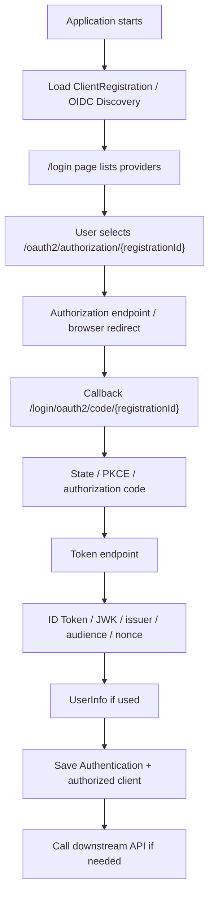
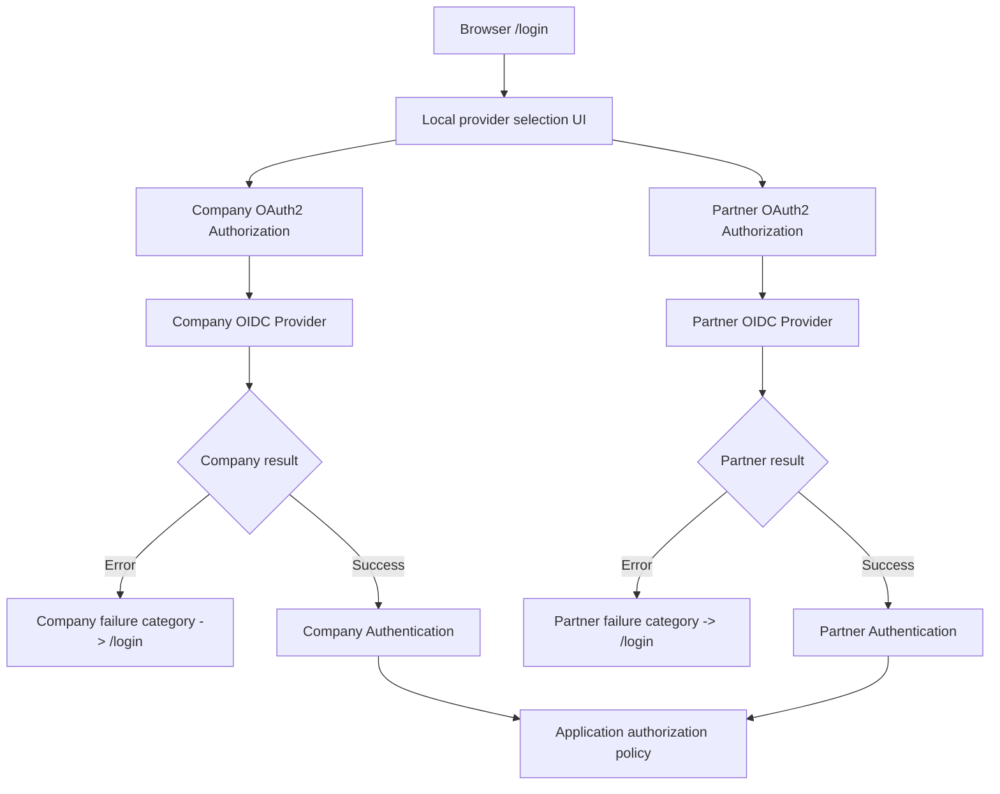

# 25.10. Handling One Provider's Failure While Other Providers Remain Operational

An application using **Spring Security OAuth 2.0 / OpenID Connect (OIDC) Client** can allow users to sign in with multiple identity providers (Identity Provider — IdP, or OpenID Provider — OP). For example, a portal supports **Company SSO** for employees and **Partner SSO** for partners.

One day, Company SSO returns HTTP 503 at its token endpoint, while Partner SSO continues operating normally. What should the system do?

**The goal is not to "switch tokens from Company to Partner."** The goal is **fault isolation per provider**, so that:

1. Users selecting Company see an appropriate error message without getting stuck in an infinite redirect loop.
2. Users selecting Partner can still complete Authorization Code/OIDC Login normally.
3. Valid already-logged-in sessions, components independent of Company, and independent API connections are not destroyed just because one OP is having an incident.
4. Checks for `state`, PKCE, issuer, audience, nonce, or token signatures are never skipped to "keep the system running."
5. Operations can identify **which provider**, **which step of the flow**, and **which error category** occurred without exposing authorization codes, ID Tokens, access tokens, or personal data.

This lesson belongs to chapter **25. Multiple Providers**, focusing on **partial failure / fault isolation** strategies for Spring Security OAuth2 Login on Servlet. Techniques related to Reactive WebFlux are contrasted where relevant, while the main code uses **`HttpSecurity` / `SecurityFilterChain`**.

> **Version scope:** Spring Boot 3.x, Spring Security 6.x, Java 17+. Illustrated APIs align closely with Spring Security 6.5; package names and auto-configuration policies may differ in other versions. `example.test` URLs and provider details are illustrative, not live servers.

---

## 1. Business Scenario and Fault Isolation Principles

Suppose an application has:

```text
                              +-------------------------------+
                              | Spring Boot Portal            |
                              | /login                        |
                              +---------------+---------------+
                                              |
                             User selects login provider
                                              |
                       +----------------------+--------------------+
                       |                                           |
                       v                                           v
              Company SSO (OP A)                         Partner SSO (OP B)
              https://id.company...                      https://id.partner...
              [EXPERIENCING 503]                         [OPERATIONAL]
                       |                                           |
                       v                                           v
              Display Company error                      Partner login
              Do not switch to token B                   Unaffected
```

Key requirements:

- **Per-provider failure:** failures occurring in one registration's flow must be handled as failures of that registration.
- **Graceful degradation:** the UI still renders permitted login choices, displays an understandable message, and preserves a path back.
- **Fail closed:** never accept a token with the wrong issuer, never assign a user an identity from another provider, and never skip correlation checks.
- **Bounded failure:** bounded timeouts and retries; a hanging provider must not tie up threads, connection pools, or the browser indefinitely.
- **Observability:** log by registration ID and failure category without secrets.
- **Recovery:** when the provider recovers, allow starting a fresh login flow properly; never reuse stale authorization codes or fall into redirect loops.

### 1.1. Distinguishing "provider down" from "user lacks permission"

A callback containing:

```text
error=access_denied
```

usually means the user declined consent or the OP denied authorization; it is **not enough to mark the provider as having an outage**.

Conversely, DNS errors/timeouts/HTTP 503 at the token endpoint can signal degraded provider availability. Meanwhile, `invalid_client` usually indicates a wrong client secret, authentication method, or OP policy—do not retry it continuously.

### 1.2. "Another provider is up" does not mean "User A can log in via Provider B"

Two providers can represent **two different identity domains**:

```text
issuer = https://id.company.example.test
sub    = 43fa...

issuer = https://id.partner.example.test
sub    = 43fa...
```

Even when `sub` matches, the two identities are not the same because **the issuers differ**. Email can also change, be recycled, or be unverified.

If a user is only allowed to use Company SSO under corporate policy, never automatically log them in via Partner SSO to work around an outage. Only offer another choice when **the application and account linking policy** permit it.

## 2. Points Where a Provider Can Fail

An OIDC login involves multiple independent steps; "provider error" is overly broad.



| Stage | Example failure | Blast radius | Response |
| --- | --- | --- | --- |
| **Startup/discovery** | OP A fails to return `.well-known/openid-configuration` | Can prevent the entire app from starting if config relies on eager discovery | Design startup not to depend on OP A when availability requires it |
| Authorization start | Registration A missing, wrong authorization URI | Login link A | Never forge redirects; show error/path back |
| Authorization endpoint | OP A 503, DNS failure, login page hangs | Browser cannot complete login A | No browser retry loop; UI informs/offers deliberate retry |
| Authorization response | `access_denied`, `server_error`, `temporarily_unavailable` | One transaction on A | Classify by error code; separate user cancel from outage |
| Callback correlation | Missing/wrong `state`, expired session | Untrusted transaction A | Reject callback; never try using the code for B |
| Token endpoint | Timeout, 5xx, `invalid_grant`, `invalid_client` | A's token exchange | Never use B's token; handle by error category |
| OIDC validation | Wrong `iss`/`aud`/signature/nonce, JWKS unreachable | A's token validation | Fail closed; never drop signature/issuer validation |
| UserInfo | HTTP 401/500/timeout | A's OIDC/OAuth2 user enrichment | Policy-dependent; never create arbitrary users |
| Authorized client refresh | A's refresh token revoked or OP A outage | APIs using token A | Preserve unrelated connections for B; classify failure |
| Resource Server A | API A returns 401/403/503 | Features depending on API A | Do not infer B login is broken |

**Successful login and downstream API availability are two separate things.** OP A may still permit logins while A's Reports API is down; or OP A may be down while a user holds a valid local session and features not requiring OP A still function.

---

## 3. One Configuration with Multiple `ClientRegistration` Entries

Spring Security distinguishes OAuth2 Clients by **`registrationId`**. A Spring Boot example:

```yaml
spring:
  security:
    oauth2:
      client:
        registration:
          company:
            provider: company-op
            client-id: ${COMPANY_OIDC_CLIENT_ID}
            client-secret: ${COMPANY_OIDC_CLIENT_SECRET}
            client-authentication-method: client_secret_basic
            authorization-grant-type: authorization_code
            redirect-uri: "{baseUrl}/login/oauth2/code/{registrationId}"
            scope:
              - openid
              - profile
              - email

          partner:
            provider: partner-op
            client-id: ${PARTNER_OIDC_CLIENT_ID}
            client-secret: ${PARTNER_OIDC_CLIENT_SECRET}
            client-authentication-method: client_secret_basic
            authorization-grant-type: authorization_code
            redirect-uri: "{baseUrl}/login/oauth2/code/{registrationId}"
            scope:
              - openid
              - profile

        provider:
          company-op:
            issuer-uri: https://id.company.example.test/realms/main
          partner-op:
            issuer-uri: https://id.partner.example.test/tenant
```

Both registrations have separate default callbacks:

```text
GET /oauth2/authorization/company
GET /oauth2/authorization/partner

GET /login/oauth2/code/company?code=...&state=...
GET /login/oauth2/code/partner?code=...&state=...
```

Core points:

- `company` and `partner` are the application's **registration IDs**.
- `company-op` and `partner-op` are provider metadata keys.
- `client-id` is the client identifier at each OP, not `registrationId`.
- Each issuer must have its own configuration/metadata and trust boundary.
- Each `ClientRegistration` defines the corresponding client's grant, redirect URI, and scopes.

**Never create one shared registration and swap `authorizationUri`/`tokenUri` from raw query parameters.** That breaks issuer boundaries and can leak codes/client credentials.

### 3.1. Maven dependencies

```xml
<dependencies>
    <dependency>
        <groupId>org.springframework.boot</groupId>
        <artifactId>spring-boot-starter-web</artifactId>
    </dependency>
    <dependency>
        <groupId>org.springframework.boot</groupId>
        <artifactId>spring-boot-starter-security</artifactId>
    </dependency>
    <dependency>
        <groupId>org.springframework.boot</groupId>
        <artifactId>spring-boot-starter-oauth2-client</artifactId>
    </dependency>
</dependencies>
```

Examples run on **Servlet/Spring MVC**. Spring WebFlux uses `ReactiveClientRegistrationRepository`, `ServerHttpSecurity`, and `SecurityWebFilterChain` respectively; never mix WebFlux config into Servlet examples.

## 4. Special Risk: Discovery Preventing the Entire Application from Starting

When using:

```yaml
provider:
  company-op:
    issuer-uri: https://id.company.example.test/realms/main
```

Spring Boot/Spring Security may need to **fetch discovery metadata** from the issuer to construct `ClientRegistration`. If Company OP is unreachable **at application startup**, building the repository and application context can fail.

```text
Portal Startup
    |
    +-- Resolve Company OIDC metadata -> timeout/503
    |                                    |
    |                                    v
    |                             ClientRegistration setup fails
    |
    +-- Partner metadata available ------+----> App may fail to start
```

Therefore, **merely adding an `AuthenticationFailureHandler` on the callback is not enough**: the application does not even have an HTTP server up to handle requests yet.

### 4.1. Reducing startup discovery dependencies

One approach is to **build `ClientRegistration` explicitly with known endpoints and a fixed issuer**, rather than calling discovery while building the registration. For OIDC, you must **retain issuer validation**—never omit the issuer just to avoid an HTTP request.

Spring Security's `ClientRegistration.Builder` supports:

```text
issuerUri(...)
authorizationUri(...)
tokenUri(...)
jwkSetUri(...)
userInfoUri(...)
userNameAttributeName(...)
```

A manually configured `@Bean` can define both registrations:

```java
package example.security;

import org.springframework.beans.factory.annotation.Value;
import org.springframework.context.annotation.Bean;
import org.springframework.context.annotation.Configuration;
import org.springframework.security.oauth2.client.registration.ClientRegistration;
import org.springframework.security.oauth2.client.registration.ClientRegistrationRepository;
import org.springframework.security.oauth2.client.registration.InMemoryClientRegistrationRepository;
import org.springframework.security.oauth2.core.AuthorizationGrantType;
import org.springframework.security.oauth2.core.ClientAuthenticationMethod;

@Configuration
class ExplicitOidcRegistrations {

    @Bean
    ClientRegistrationRepository clientRegistrationRepository(
            @Value("${app.oidc.company.client-id}") String companyId,
            @Value("${app.oidc.company.client-secret}") String companySecret,
            @Value("${app.oidc.partner.client-id}") String partnerId,
            @Value("${app.oidc.partner.client-secret}") String partnerSecret) {

        ClientRegistration company =
            oidcRegistration(
                "company",
                "Company SSO",
                companyId,
                companySecret,
                "https://id.company.example.test/realms/main",
                "https://id.company.example.test/realms/main/authorize",
                "https://id.company.example.test/realms/main/token",
                "https://id.company.example.test/realms/main/jwks",
                "https://id.company.example.test/realms/main/userinfo");

        ClientRegistration partner =
            oidcRegistration(
                "partner",
                "Partner SSO",
                partnerId,
                partnerSecret,
                "https://id.partner.example.test/tenant",
                "https://id.partner.example.test/tenant/authorize",
                "https://id.partner.example.test/tenant/token",
                "https://id.partner.example.test/tenant/jwks",
                "https://id.partner.example.test/tenant/userinfo");

        return new InMemoryClientRegistrationRepository(company, partner);
    }

    private ClientRegistration oidcRegistration(
            String registrationId,
            String name,
            String clientId,
            String clientSecret,
            String issuer,
            String authorizationUri,
            String tokenUri,
            String jwkSetUri,
            String userInfoUri) {

        return ClientRegistration.withRegistrationId(registrationId)
            .clientName(name)
            .clientId(clientId)
            .clientSecret(clientSecret)
            .clientAuthenticationMethod(ClientAuthenticationMethod.CLIENT_SECRET_BASIC)
            .authorizationGrantType(AuthorizationGrantType.AUTHORIZATION_CODE)
            .redirectUri("{baseUrl}/login/oauth2/code/{registrationId}")
            .scope("openid", "profile", "email")
            .issuerUri(issuer)
            .authorizationUri(authorizationUri)
            .tokenUri(tokenUri)
            .jwkSetUri(jwkSetUri)
            .userInfoUri(userInfoUri)
            .userNameAttributeName("sub")
            .build();
    }
}
```

This is an **illustrative architectural pattern using static metadata**. The `authorize`, `token`, and `jwks` addresses in the example must be replaced with endpoints **confirmed by the provider**; never guess endpoints by appending strings to the issuer.

With this approach, discovery is not needed to build registrations at startup, yet network calls are still needed **at login time**—especially for the token endpoint, JWKS, and UserInfo. Inspect your actual version/codebase to ensure no other bean triggers eager network lookups during startup.

### 4.2. Caution when mixing `issuer-uri` and explicit endpoints in YAML

Never assume that merely adding `authorization-uri` and `token-uri` alongside `issuer-uri` guarantees Spring Boot skips discovery. Auto-configuration logic may still invoke discovery to populate metadata.

If you want **intentional startup independence**, use explicit configuration verified on your exact version, or a system-managed snapshot/last-known-good metadata mechanism—never drop issuer validation.

### 4.3. Turning a startup outage into a runtime failure does not fix everything

Static configuration removes one dependency point yet introduces responsibilities:

- Endpoints may change during OP upgrades.
- JWK key rotation must still be supported properly.
- Metadata can become stale.
- Issuer, redirect URIs, and trust configuration must be protected.
- Tests must verify OIDC validation actually checks issuer and signatures.
- While OP A is down, logging into A still cannot succeed solely because metadata is static.

**The goal is to keep Partner SSO operational**, not to bypass Company SSO security.

## 5. Four Error Categories That Require Different Treatment

Errors can be grouped into:

| Category | Examples | What the app should do |
| --- | --- | --- |
| **User decision** | `access_denied` (consent declined) | Notify that permission was not granted; let user return to choose a provider |
| **Temporary availability** | Timeout, transient DNS error, HTTP 502/503, `temporarily_unavailable` | Bounded retry / ask user to try again later; do not impact other OPs |
| **Configuration/contract error** | `invalid_client`, redirect URI mismatch, `invalid_scope`, wrong issuer metadata | Alert operations, do not retry continuously; fix configuration |
| **Security/correlation failure** | Wrong `state`, invalid nonce, signature/issuer/audience mismatch | **Fail closed**; never switch to another provider to bypass verification |

Even though two failures both send the user back to `/login`, **their operational causes and application actions are very different**.

### 5.1. OAuth2 authorization response errors

The OP can return the browser to the callback with:

```text
/login/oauth2/code/company?
    error=temporarily_unavailable
    &error_description=...
    &state=...
```

Related OAuth2 error codes:

- `access_denied`;
- `invalid_request`;
- `unauthorized_client`;
- `unsupported_response_type`;
- `invalid_scope`;
- `server_error`;
- `temporarily_unavailable`.

OIDC also defines interaction errors such as `login_required`, `interaction_required`, `consent_required`, or `account_selection_required` in relevant contexts.

Never display raw `error_description`; it can contain untrusted content, HTML/script characters, query parameters, internal details, or PII.

### 5.2. Token endpoint errors

If the authorization code callback is valid yet token exchange fails:

```json
{
  "error": "invalid_grant",
  "error_description": "Authorization code expired"
}
```

`invalid_grant` can mean a used/expired code, revoked refresh token, PKCE verifier mismatch, or mismatched redirect URI. It **does not prove the provider is down**.

### 5.3. Missing callback

When the OP times out on its login page or DNS fails before redirecting back to the RP, **the callback's `AuthenticationFailureHandler` may never be called at all**.

Different UX and operations are needed:
- The login page always offers a safe path back.
- The UI can display system-verified status.
- Avoid auto-retry loops through the authorization endpoint.
- Users can manually retry or select another provider when policy allows.

---

## 6. The Login Page Must Be Independent of Each OP's Availability

A poor design is having `/login` always redirect straight to Company SSO:

```text
GET /login -> 302 /oauth2/authorization/company
```

When Company fails, users no longer see the Partner option. A redirect loop can make the whole system look completely dead.

A better design is an RP-served **provider selection page**:

```text
GET /login
  -> Render local UI
     [Sign in with Company SSO]
     [Sign in with Partner SSO]
     [Help / Status]
```

**Do not make network calls to both OPs synchronously when rendering the page.** The login chooser should still load even when one OP is slow.

### 6.1. Configuring `SecurityFilterChain`

```java
package example.security;

import org.springframework.context.annotation.Bean;
import org.springframework.context.annotation.Configuration;
import org.springframework.security.config.annotation.web.builders.HttpSecurity;
import org.springframework.security.web.SecurityFilterChain;
import org.springframework.security.web.authentication.AuthenticationFailureHandler;

@Configuration
class MultiProviderSecurityConfiguration {

    @Bean
    SecurityFilterChain securityFilterChain(
            HttpSecurity http,
            AuthenticationFailureHandler safeOAuth2FailureHandler) throws Exception {

        return http
            .authorizeHttpRequests(authorize -> authorize
                .requestMatchers(
                    "/",
                    "/login",
                    "/error",
                    "/css/**",
                    "/js/**")
                .permitAll()
                .anyRequest().authenticated())
            .oauth2Login(oauth2 -> oauth2
                .loginPage("/login")
                .failureHandler(safeOAuth2FailureHandler))
            .build();
    }
}
```

This is Servlet `HttpSecurity`. When setting `loginPage("/login")`, the application must **provide the login page itself** and links to the corresponding registrations; Spring Security no longer generates the default login page.

### 6.2. Controller for the login page

```java
package example.web;

import org.springframework.stereotype.Controller;
import org.springframework.ui.Model;
import org.springframework.web.bind.annotation.GetMapping;
import org.springframework.web.bind.annotation.RequestParam;

@Controller
class LoginPageController {

    @GetMapping("/login")
    String login(
            @RequestParam(name = "reason", required = false) String reason,
            Model model) {

        String message = switch (reason == null ? "" : reason) {
            case "cancelled" ->
                "You did not grant login permission. You can try again when ready.";
            case "unavailable" ->
                "The sign-in provider is temporarily unavailable. Please try again later.";
            case "failed" ->
                "Could not complete sign-in. Please try again or contact support.";
            default -> "";
        };

        model.addAttribute("errorMessage", message);
        return "login";
    }
}
```

This snippet assumes Thymeleaf or a matching view resolver. **Messages are mapped from a fixed set** rather than reflecting raw query/`error_description` values.

### 6.3. Illustrative HTML template

```html
<!DOCTYPE html>
<html lang="en" xmlns:th="http://www.thymeleaf.org">
<head>
    <meta charset="UTF-8" />
    <title>Select Sign-In Provider</title>
</head>
<body>
<main>
    <h1>Sign in</h1>

    <p th:if="${errorMessage != ''}"
       role="alert"
       th:text="${errorMessage}"></p>

    <nav aria-label="Sign-in options">
        <a th:href="@{/oauth2/authorization/company}">
            Sign in with Company SSO
        </a>
        <a th:href="@{/oauth2/authorization/partner}">
            Sign in with Partner SSO
        </a>
    </nav>
</main>
</body>
</html>
```

The paths use **static, backend-approved registration IDs**. Never build:

```html
<!-- Do not let untrusted input decide registration/redirect. -->
<a th:href="${param.redirectUrl}">Sign in</a>
```

unless real validation/allowlisting exists. If the app enforces tenant policies, display only providers the user is **permitted** to use; do not freely display all providers if they have different permission boundaries.

### 6.4. Query `reason` is not a security source of truth

A user can edit the URL themselves:

```text
/login?reason=unavailable
```

Therefore, the notice on the login page **is purely UX information**, not operational proof to automatically alter routing or grant permissions. Trusted availability state must come from monitoring or backend policy, never from a query string.

---

## 7. `AuthenticationFailureHandler`: Handling Callback Errors per Provider

In Servlet, the OAuth2 Login flow uses **`OAuth2LoginAuthenticationFilter`** to process Authorization Code Flow callbacks. When an **`AuthenticationException`** occurs inside the filter, it can invoke the configured `AuthenticationFailureHandler`.

Thus a good handler must:

1. Never leak provider exceptions to the browser.
2. Identify **`registrationId` from the callback path against an allowlist**.
3. Classify recognizable OAuth2 errors.
4. Log the category and registration ID without logging tokens/codes/state.
5. Redirect to a safe local page without looping back to the failing OP.
6. Never force logging in with a different provider.

### 7.1. Implementing the failure handler

```java
package example.security;

import java.io.IOException;
import java.util.Set;

import jakarta.servlet.http.HttpServletRequest;
import jakarta.servlet.http.HttpServletResponse;

import org.slf4j.Logger;
import org.slf4j.LoggerFactory;
import org.springframework.context.annotation.Bean;
import org.springframework.context.annotation.Configuration;
import org.springframework.security.core.AuthenticationException;
import org.springframework.security.oauth2.core.OAuth2AuthenticationException;
import org.springframework.security.web.authentication.AuthenticationFailureHandler;

@Configuration
class OAuth2FailureHandlingConfiguration {

    private static final Logger log =
        LoggerFactory.getLogger(OAuth2FailureHandlingConfiguration.class);

    private static final String CALLBACK_PREFIX =
        "/login/oauth2/code/";

    private static final Set<String> REGISTRATIONS =
        Set.of("company", "partner");

    @Bean
    AuthenticationFailureHandler safeOAuth2FailureHandler() {
        return (request, response, exception) -> {
            String provider = safeRegistrationFromCallback(request);
            String reason = safeReason(exception);

            // Never log raw exception message: may contain code,
            // state, URI, or provider description.
            log.warn("oauth2_login_failure provider={} category={}",
                provider, reason);

            String target = request.getContextPath()
                + "/login?reason=" + reason;

            response.sendRedirect(response.encodeRedirectURL(target));
        };
    }

    private static String safeRegistrationFromCallback(
            HttpServletRequest request) {

        String path = request.getServletPath();

        if (!path.startsWith(CALLBACK_PREFIX)) {
            return "unknown";
        }

        String candidate = path.substring(CALLBACK_PREFIX.length());

        return REGISTRATIONS.contains(candidate)
            ? candidate
            : "unknown";
    }

    private static String safeReason(AuthenticationException exception) {
        if (exception instanceof OAuth2AuthenticationException oauth2) {
            String errorCode = oauth2.getError().getErrorCode();

            return switch (errorCode) {
                case "access_denied" -> "cancelled";
                case "temporarily_unavailable", "server_error" ->
                    "unavailable";
                default -> "failed";
            };
        }

        return "failed";
    }
}
```

**Limitations of this snippet:**
- `safeRegistrationFromCallback()` assumes the **default callback path**. If you change `redirectionEndpoint().baseUri()` or servlet mappings, keep the detection logic in sync.
- The callback URI is an **untrusted HTTP request path**; the allowlist prevents log injection and unknown registration values, yet **the callback path itself must never be treated as verified proof of provider identity**. The OAuth2 flow verifies correlation/issuer.
- The handler only processes **`AuthenticationException` passing through the OAuth2 Login authentication filter**. It **does not catch startup/discovery errors, HTTP 503s on the OP's page outside the RP, or exceptions from another filter**.
- `safeReason()` may need deeper inspection if a provider error is wrapped inside an exception; defaulting to `failed` avoids exposing details.
- `IOException` and other unused imports can be omitted in a real project; the example focuses on the failure contract.

### 7.2. Why not use raw `exception.getMessage()` on the login page?

An exception or `error_description` can contain:

- Token endpoint URLs with query parameters;
- Authorization code/`state`;
- Configuration data or HTTP responses;
- HTML strings returned by a provider;
- User PII;
- Details allowing attackers to distinguish accounts/tenants.

Example to avoid:

```java
response.sendRedirect(
    "/login?error=" + exception.getMessage());
```

Beyond XSS/phishing risks when rendered, the URL can end up in browser history/access logs and cause encoding/open-redirect issues if constructed unsafely.

### 7.3. Why shouldn't `access_denied` be reported as "service down"?

When a user intentionally declines consent, showing "Company SSO is experiencing an outage" is wrong. Display a message like:

> You did not grant login permission. If you want to continue, please try again.

Conversely, `server_error` or `temporarily_unavailable` signals a different provider/authorization flow issue. Never lump both into the same "availability outage" metric if monitoring must stay accurate.

### 7.4. Never redirect to Provider B from the failure handler

Avoid:

```java
// Anti-pattern: if Company fails, automatically launch Partner.
response.sendRedirect("/oauth2/authorization/partner");
```

Because:
- The user might not have an account at Partner;
- Partner might return a different identity;
- Tenant/workforce policy might forbid it;
- It creates loops if Partner also fails;
- It can cause account mix-up if business code links by email.

**Returning the user to the selection page and explaining still-valid options** is better than silently switching OPs.

## 8. When the Failure Handler Does Not Catch the Error

Robust handling classifies errors by **origin point**.

| Where error occurs | Will `oauth2Login`'s `AuthenticationFailureHandler` definitely run? | How to handle |
| --- | --- | --- |
| Callback handled by `OAuth2LoginAuthenticationFilter` throwing `AuthenticationException` | Normally **yes** | Custom failure handler |
| Browser hits network error on OP's authorization endpoint page | **No** | UI/monitoring/let user return to RP |
| Spring Boot fails building `ClientRegistration` during startup discovery | **No** | Change registration/startup dependency architecture |
| `OAuth2AuthorizationRequestRedirectFilter` fails before redirect/callback | **Cannot assume** | Check specific filter/exception handling |
| Scheduled refresh token job | **No** | `OAuth2AuthorizedClientManager` failure handler |
| Resource Server returns 401/403 when app calls API | **No** | HTTP client/interceptor/authorized-client failure handling |
| Business controller throws exception after login | **No** | Controller/service error handling |

### 8.1. Never catch every `Throwable` and grant login

A dangerous anti-pattern:

```java
try {
    authenticateWithCompany();
} catch (Exception ex) {
    return createLocalAuthentication("alice");
}
```

This is an **authentication bypass**. If identity cannot be verified by the chosen provider, the outcome must be **login failure**, never fabricating a replacement `Authentication`.

### 8.2. Never turn a `state` error into "try another provider"

`invalid_state_parameter` or a missing authorization request can happen due to lost browser sessions, modified callbacks, concurrent tabs, or CSRF. This is a **correlation failure that must fail closed**.

Never take Company's authorization code and send it to Partner's token endpoint; authorization codes are bound to the client/redirect URI/AS and are normally single-use.

---

## 9. Preserving `state`, PKCE, and Issuer Boundaries Across Providers

Values belonging to one authorization flow:

```text
Company Flow:
  registrationId = company
  issuer         = https://id.company.example.test/realms/main
  state          = S-company
  redirectUri    = https://app.example.test/login/oauth2/code/company
  code_verifier  = V-company (if PKCE)

Partner Flow:
  registrationId = partner
  issuer         = https://id.partner.example.test/tenant
  state          = S-partner
  redirectUri    = https://app.example.test/login/oauth2/code/partner
  code_verifier  = V-partner (if PKCE)
```

Only when a callback is valid for **that exact transaction** does the framework proceed with token exchange and OIDC validation.

### 9.1. Never skip `state` checks when Provider A is slow

Wrong:

```text
If authorization request is not found in session:
    pick the first registration
    try exchanging the code
```

This breaks anti-login-CSRF/mix-up defenses. Properly, **reject the callback**, show a login session expired message, and start a fresh flow when the user tries again.

### 9.2. Never reuse a `code_verifier` from another provider

PKCE uses the `code_verifier` of the matching authorization request. If the verifier is lost, never borrow another flow's verifier or disable PKCE just to make token exchange succeed.

### 9.3. ID Tokens must be verified against issuer and audience

An OIDC ID Token from Company cannot be accepted as Partner's ID Token just because its signature/subject "looks plausible."

Constraints include:
- Signature using a JWK from the exact OP;
- `iss` matching the configured issuer;
- `aud` containing an allowed client ID;
- `exp`, `iat`, and time constraints;
- `nonce` where applicable;
- Matching `sub` when validating UserInfo.

**Never use Partner's JWK Set to verify Company's ID Token**, and never "fall back" to another JWK URL when Company's JWKS times out. JWKS keys can be cached per issuer/`kid`, provided proper cache lifecycle and validation rules are respected.

## 10. Identifying Users Across Multiple Issuers

OIDC identifies an end-user by at least the combination:

```text
(issuer, subject)
```

Example:

```text
("https://id.company.example.test/realms/main", "user-001")
("https://id.partner.example.test/tenant", "user-001")
```

These are two distinct tuples. Never use a standalone `sub` as a global user ID in a multi-provider system.

### 10.1. Matching emails do not prove it is the same account

`email` can be:
- Unverified;
- Changed over time;
- Recycled;
- Normalized differently across OPs;
- Spoofed by an untrusted issuer.

Therefore, during a Company outage, a user signing into Partner with a similar email **must never automatically receive the Company account's internal permissions**.

### 10.2. If account linking is permitted

A controlled account-linking mechanism is needed, such as:
- User already has a valid session and completes additional verification;
- Verified admin/provisioning workflow;
- Confirming both identities with their respective OPs while operational;
- Persisting the link between `(issuer, sub)` and the local user ID;
- Enforcing tenant, role, and permission checks after login.

**Account linking is an identity governance problem**, not a "tactical retry" inside a failure handler.

### 10.3. If tenant-specific identity policies exist

Never let a raw `tenant=foo` query parameter arbitrarily route a user to any provider.

Maintain a trustworthy mapping:

```text
Authenticated/verified tenant A:
    allowed registrations: company

Authenticated/verified tenant B:
    allowed registrations: partner

A user permitted in both A and B:
    may choose from the permitted set
```

Even on the pre-auth login page, how the tenant is determined must be designed safely. A URL tenant hint can be UX input, **not authorization proof**.

---

## 11. Provider Status and Circuit Breakers: Should You Use Them?

You can expose per-provider availability status:

```text
company -> UNAVAILABLE
partner -> AVAILABLE
```

Yet distinguish **monitoring-inferred status** from **absolute truth**:

- A healthy discovery endpoint does not mean the authorization endpoint/token endpoint/UserInfo are all healthy.
- An `access_denied` error does not make a provider `UNAVAILABLE`.
- Monitoring probes may run in a different region than the user.
- An OP may be healthy while one registration/client secret is misconfigured.
- A provider outage may be a localized network issue between the RP and OP.

### 11.1. Never probe every provider synchronously on each login page request

Anti-pattern:

```text
GET /login
   -> HTTP GET OP A metadata
   -> HTTP GET OP B metadata
   -> HTTP GET OP C metadata
   -> Render only after all three respond
```

When A times out, the login page slows down or fails even though B/C are healthy.

Better:
- Render the login page from a trusted list of registrations.
- Read **cached** status from separate monitoring if needed.
- Probe each provider's health with appropriate timeouts and cadence.
- Never expose raw error messages as provider status.
- Ensure the User Agent still has valid paths to select/switch providers.

### 11.2. Simple availability model

```java
enum ProviderAvailability {
    AVAILABLE,
    DEGRADED,
    UNAVAILABLE,
    UNKNOWN
}
```

This is an application enum, not a built-in Spring Security API.

A status service might expose the contract:

```java
interface ProviderStatusReader {
    ProviderAvailability status(String registrationId);
}
```

**The Status Reader does not decide whether a token is valid.** Even if status says `AVAILABLE`, Spring Security must still verify login/tokens; even if status says `UNAVAILABLE`, business policy may let users retry with clear messaging.

### 11.3. Where do circuit breakers fit?

If there are high-volume server-to-server calls to APIs/token endpoints, circuit breakers/bulkheads/timeouts can prevent OP A from exhausting thread/connection pools.

Be careful:
- Each provider/destination gets its own circuit.
- Never share a circuit breaker between A and B if they are independent.
- Never cache a successful `Authentication` to "replay" when a provider fails.
- Never apply automatic retries to single-use authorization codes.
- Never use circuit breaker state to grant roles/users.
- Do not blindly place a circuit breaker in front of the browser login authorization endpoint; browser flows have their own lifecycle and UX.

## 12. Managing Timeouts and Retries at the Token Endpoint

### 12.1. Classify before retrying

| Error | Should you auto-retry? | Reason |
| --- | --- | --- |
| Transient DNS / connection timeout | May consider bounded retry if idempotent and contract permits | Transient network issue |
| Token endpoint HTTP 503 | Bounded backoff; do not necessarily retry authorization codes immediately | AS outage / rate control |
| `temporarily_unavailable` | Let user retry deliberately; avoid redirect loops | OAuth availability error |
| `invalid_client` | **No** repeated identical retries | Fix credentials/config |
| `invalid_grant` | **No** infinite retries on auth code/refresh token | Single-use code, revoked/expired token |
| `invalid_scope` | **No** | Invalid config/consent |
| State/nonce/signature mismatch | **No** | Security failure |
| User `access_denied` | **No** auto-retry | User declined |

### 12.2. Why can retrying token requests be dangerous?

An authorization code is typically a **single-use credential**. Suppose the token endpoint processed the code and issued tokens, yet the response was lost in transit. The client cannot be sure whether the request succeeded.

```text
RP -> POST /token (code=C1)
OP -> processes C1, issues token
Network -> drops response
RP -> retries code=C1
OP -> invalid_grant because C1 was already used
```

Naive retries will not improve the outcome. Report that login was not completed and restart the authorization flow **with a fresh request** if the user chooses.

### 12.3. Prevent OP A from exhausting all HTTP connections

With a custom HTTP client:
- Appropriate connection timeout/read timeout;
- Separate or per-host bounded connection pools;
- Bulkheads/circuit breakers on appropriate paths;
- Retries with jitter/backoff and budgets;
- Metrics per host/registration;
- Limits on pending login flows;
- Never log token endpoint form bodies containing `code`/verifier/`client_secret`.

Much of this lives at the HTTP/operations layer, not a single `oauth2Login()` flag.

## 13. What About Already-Logged-In Sessions?

Scenario:

```text
08:00 Alice logs in with Company successfully
08:20 Company OP starts experiencing an outage
08:30 Alice opens a local Portal page
08:31 Bob logs into Partner freshly
```

**Alice can continue using her valid Portal session** for features that do not need to call Company OP again, if security/session policy allows. **Bob can still log into Partner** because flow B is independent.

However, if one of Alice's pages calls an API whose access token expired, the manager may try refreshing at Company's token endpoint and fail. In that case:

- Never log out all Portal users just because one client failed to refresh;
- Never use a Partner access token for Company's API;
- Return an error/degraded status only for features depending on Company's token;
- Distinguish `invalid_grant` (broken credential) from HTTP 503 (temporary provider outage);
- Never delete an otherwise valid authorized client solely due to a transient network timeout without justification.

### 13.1. Can an unexpired access token still be used?

Possibly, if the Resource Server still accepts the token without needing OP runtime calls, though **there is no universal guarantee**. The Resource Server might use introspection calling the OP, or the token might have been revoked.

A self-contained JWT API can keep validating signatures from its JWK cache for a period, while still enforcing expiry and issuer/audience validation.

### 13.2. Never turn A's refresh error into deleting B's token

Authorized clients are usually keyed by:

```text
(clientRegistrationId, principalName)
```

Example:

```text
(company-api, alice) -> token A
(partner-api, alice) -> token B
```

When refreshing token A fails, never delete B, never assign A to B, and never change `principalName` to look up another token.

### 13.3. Login session differs from `OAuth2AuthorizedClient`

- `SecurityContext`/HTTP session stores the user's `Authentication` at the RP.
- `OAuth2AuthorizedClient` stores access/refresh tokens for calling APIs.
- `ClientRegistrationRepository` stores OP/AS metadata.
- `AuthorizationRequestRepository` stores `state`/correlation across login redirects.

Failures at each layer must be handled at that layer. Never wipe all HTTP sessions because a provider metadata health check failed.

---

## 14. Do Not Conflate OP Errors with Resource Server Errors

A client can receive:

```text
Authorization Server / token endpoint:
    400 invalid_grant
    401 invalid_client
    503 unavailable

Resource Server / business API:
    401 Bearer invalid_token
    403 Bearer insufficient_scope
    503 API unavailable
```

Each error has a different impact.

### 14.1. `401 invalid_token` at an API

May mean the token expired, was revoked, or has the wrong issuer/audience. If using Servlet RestClient's `OAuth2ClientHttpRequestInterceptor` or WebClient's `ServletOAuth2AuthorizedClientExchangeFilterFunction`, verify the authorization failure handler configuration to clean up broken authorized clients when appropriate.

**Do not assume HTTP 401 from an API automatically logs the user out of the RP or affects all providers.**

### 14.2. `403 insufficient_scope`

The token may be valid yet lack permissions. Never switch to another provider or a broader-scoped client to bypass policy. Obtain valid authorization/consent or return an access denied error.

### 14.3. API A returning 503 does not mean OP A is down

The Resource Server and Authorization Server may be separate services/clusters. Monitoring should keep labels distinct:
- `op_authorization`;
- `op_token_endpoint`;
- `op_jwks`;
- `op_userinfo`;
- `resource_api`.

Never infer "OP unavailable" solely from an API 503.

## 15. JWK Cache and Provider-Specific Trust

An OIDC ID Token normally requires signature verification against the **matching OP's** JWK Set.

```text
Company ID Token
    iss = https://id.company...
    kid = key-company-2
        |
        v
    Company JWK Set

Partner ID Token
    iss = https://id.partner...
    kid = key-partner-8
        |
        v
    Partner JWK Set
```

If Company's JWKS endpoint temporarily fails:
- A verifier with a valid cached key may continue per cache policy;
- When a new uncached key is needed, validation must fail;
- Never fetch Partner's JWK Set to verify Company's ID Token;
- Never disable signature validation;
- Never accept `alg=none` or unapproved algorithms.

### 15.1. Key rotation during a partial outage

An OP may rotate keys while its metadata/JWKS endpoint is failing. Tokens signed with the new key will fail verification. This is a **per-provider degraded login** scenario requiring clear logs/metrics—never treat a token as valid just because the user previously had a session.

### 15.2. Issuer and client audience must still match

Configuring a static issuer to avoid startup discovery **must not turn into skipping issuer checks**. Ensure `ClientRegistration` and OIDC validators still match `iss` against the trusted issuer and `aud` against the proper client ID.

## 16. State/Correlation Errors in a Multi-Provider Environment

A user opens two tabs:

```text
Tab A: /oauth2/authorization/company
    state = A-123

Tab B: /oauth2/authorization/partner
    state = B-456
```

Partner's callback with `state=B-456` must restore authorization request B, not request A.

A custom `AuthorizationRequestRepository` storing only one slot in the session can overwrite across tabs:

```text
session["AUTH_REQUEST"] = latestRequest
```

When callback A arrives, the repository only has B -> state mismatch. Never conclude Company OP is having an outage just because states mismatched.

### 16.1. Distinguishing session problems from OP outages

| Symptom | Likely cause |
| --- | --- |
| Callback missing session cookie | `SameSite`, `Secure`, `Domain`, `Path`, proxy |
| Authorization request not found | Session timeout/overwrite/stale callback |
| `state` mismatch | CSRF/mix-up, stale callback, multi-tab, or altered request |
| Token endpoint timeout | OP/AS/network, after correlation succeeded |
| Wrong ID Token `iss` | Wrong issuer/security validation, not a normal availability issue |

**Never auto-replay old callbacks.** If state is lost, the user should start a fresh login flow when the provider is permitted and available.

## 17. Never Share OAuth2 Tokens or Exceptions in Global Mutable State

Wrong:

```java
// ANTI-PATTERN
static String lastAccessToken;
static String lastProviderError;
static String currentProvider;
```

In a server handling concurrent requests:
- Alice's request can write token A and Bob can read it by mistake;
- Company's error gets attributed to Partner;
- One tenant can see another tenant's error or data.

Proper approach:
- Immutable `ClientRegistration` entries per registration ID;
- Authorized client storage keyed by registration + principal;
- Request-scoped or correlation-safe context;
- Provider health snapshots per registration, not per user;
- Separate logging context per request/trace ID;
- Never store raw tokens in mutable global fields.

### 17.1. Never mutate `ClientRegistrationRepository` when a provider is down

`InMemoryClientRegistrationRepository` usually holds fixed registrations. Deleting Company's registration when a health check fails can cause:
- In-flight callbacks to no longer find the registration;
- Users seeing different login URL errors;
- Inconsistent session/authorized client code;
- Unclear recovery mechanics.

**Provider availability should be separate operational state**, not deleting client metadata or changing secrets/issuers in runtime due to an HTTP 503.

## 18. Logging, Metrics, and Per-Provider Alerting

A sanitized event:

```json
{
  "event": "oauth2_login_failure",
  "provider_registration": "company",
  "stage": "token_endpoint",
  "category": "temporarily_unavailable",
  "environment": "production",
  "trace_id": "internal-trace"
}
```

This is an **application-designed example schema**, not Spring Security's default log format.

### 18.1. What to log

- `registrationId` from the allowlist;
- Failure stage (discovery, authorization, callback, token, JWK, UserInfo, refresh, API);
- Normalized error code;
- HTTP status category (if any);
- Latency histograms/timeout counters;
- Environment, region, and internal trace ID;
- Error counts and success rates per provider.

### 18.2. What never to log

- `authorization code`;
- `state` / PKCE verifier;
- Access tokens, refresh tokens, ID Tokens;
- `client_secret`;
- Raw `error_description` or `error_uri`;
- `Authorization`/`Cookie` headers;
- Full callback URLs containing `code` and `state`;
- Full `OAuth2AuthenticationToken` or OIDC claims;
- Emails, `sub`, or unnecessary personal data.

### 18.3. Alerts should not lump all providers together

An alert like "OIDC login failure rate 40%" may hide that Company is down while Partner is completely healthy. Add metrics such as:

```text
oauth2_login_attempts{registration="company"}
oauth2_login_failures{registration="company",category="unavailable"}
oauth2_login_successes{registration="partner"}
oauth2_token_timeout{registration="company"}
oauth2_jwks_errors{registration="company"}
```

Avoid high-cardinality labels like raw user IDs, raw `error_description`, or exception messages. Use only bounded registration IDs and categories.

### 18.4. When correlation across logs is needed

Use system-generated internal trace IDs. Never log raw OAuth2 `state` to "correlate two requests"; `state` is protocol data sent through the browser and can be exposed.

## 19. Guardrails Against Leaking Provider Errors to Users

A UI should differentiate messages:

| Scenario | Illustrative UX |
| --- | --- |
| User declined permission | "You did not grant login permission. You may try again." |
| Company temporarily disrupted | "Unable to connect to Company SSO right now. Please try again later." |
| Partner operating normally | Show Partner button if user is permitted to use it |
| Login session expired | "Sign-in session expired. Please start again." |
| Client configuration error | "Sign-in is currently unavailable. Support has been notified." |
| Token failed OIDC validation | "Unable to verify sign-in identity." |
| API error after login | "This feature is temporarily unavailable." |

**Never mention**:
- Client secrets;
- Internal IPs/token endpoint responses;
- Provider stack traces;
- Unnecessary OIDC claims;
- Raw `error_description` supplied by the OP;
- "You were switched to Partner and kept your Company permissions" without an approved account-linking policy.

## 20. A Controlled Recovery Policy

Scenario where Company OP is down for 30 minutes:

```text
T0: Health monitoring: Company token endpoint fails consecutively
T1: Company status = DEGRADED/UNAVAILABLE (after threshold)
T2: /login keeps running, Partner remains selectable
T3: Company users receive retry-later guidance
T4: Existing logged-in sessions keep using independent features
T5: Recovery monitoring confirms Company is healthy
T6: Company provider is marked AVAILABLE again
T7: Users initiate fresh authorization requests as needed
```

Use thresholds/hysteresis to avoid flickering UI status when an OP flaps; never embed a live network probe inside login page rendering.

### 20.1. Health status does not replace identity verification

When monitoring reports `AVAILABLE`, Spring Security must still:
- Correlate `state`;
- Verify code/PKCE;
- Obtain tokens only from the matching AS;
- Validate the ID Token;
- Apply user provisioning/authorization policies.

There is no "fast-track login" simply because a provider transitioned back to `AVAILABLE`.

### 20.2. Never auto-replay callbacks after an outage

Authorization codes are short-lived and usually single-use. After an incident, send the user through **a fresh flow**. Never reuse a URL containing `code` from browser history.

---

## 21. Multi-Provider Architecture by Fault Domain

A practical architecture can separate:



Where:
- The provider selection UI belongs to the RP and does not directly depend on OP availability.
- Registrations, issuers, token endpoints, JWKS, and sessions are managed with clear boundaries.
- A failure in one flow leads only to that flow's failure.
- After successful login, a central business policy governs permissions; **never auto-merge accounts solely on matching emails**.
- Availability status is advisory for user decisions; it never replaces OAuth2 validation.

### 21.1. Do you need a separate `SecurityFilterChain` per OP?

**Not required.** Usually one `SecurityFilterChain` with multiple `ClientRegistration` entries and `oauth2Login()` is enough to select providers by `registrationId`.

Split into multiple chains only when there are distinct security boundaries, proper matchers/ordering, and separate requirements. Arbitrarily adding chains can cause callbacks to hit a chain without OAuth2 Login filters or apply the wrong policies.

### 21.2. Do you need separate REST clients per provider?

When the app also calls APIs or token endpoints of each provider, consider separate transport settings and connection pools/bulkheads per host/trust boundary. **You do not need an extra HTTP client just so the login page can show the Partner button**, yet avoid a global retry config on one OP slowing down all requests.

### 21.3. Never add a wrong-issuer logout fallback

If a user logged into Company and Company OP is down during logout, local logout must still work. Never redirect Company's ID Token to Partner's logout endpoint as a "fallback." OIDC RP-Initiated Logout requires **`end_session_endpoint` of the exact OP logged into**; if that OP is unreachable, perform local logout and communicate the limitation.

## 22. Operational Scenario: When Should Provider A Logins Be Blocked?

If monitoring signals Company is in an outage:
- UI can display "Company SSO is temporarily disrupted";
- You can temporarily disable the Company button or let users retry per policy;
- Return users to the login page if flow A fails;
- Never disable Partner functionality;
- Never use UI state as the sole security barrier.

However, **temporarily blocking a browser flow can cause confusion** if monitoring misfires; mechanisms should support `UNKNOWN`, `DEGRADED`, and recovery states.

If enforcing a block before starting authorization:
- Use an explicit policy/gateway/guard keyed by allowlisted registration ID;
- Never rely on raw user-supplied provider codes;
- Preserve standard OAuth2 filters/handlers for allowed authorization flows;
- Never break in-flight callbacks when provider status transitions from `AVAILABLE` to `UNAVAILABLE`;
- Never swap the `ClientRegistration` in mid-flight;
- Ensure the block cannot cause an open redirect.

**This is an operational policy**, not Spring Security automatically failing over OAuth2 Login.

## 23. OP Outages and Multi-Device Sessions

A user might have:
- A Company-authenticated session on browser A;
- A Partner session on browser B;
- A background integration holding a Company refresh token;
- Another API using an unrelated service token.

There is no blanket rule "one OP down = log out all sessions." Each case has a different trust boundary.

### 23.1. Existing sessions when the OP recovers

If the local session is still valid, the user may not need to log in again. If the session expired during the outage, the user needs a fresh authorization flow with the right provider.

### 23.2. Company refresh token revoked

That is a failure specific to the Company authorized client. Never delete Partner tokens or switch to client credentials to "borrow" user permissions.

### 23.3. Sessions at other RPs

An OP outage does not prove all RP sessions are being terminated. OIDC RP-Initiated/Back-Channel Logout are distinct mechanisms from token endpoint availability.

---

## 24. Testing Partial Failure Scenarios

In real implementations, a test suite can **simulate OP A failing while OP B operates normally**. This is a test design for learners; this lesson does not execute project tests.

| Test case | OP A | OP B | Expected outcome |
| --- | --- | --- | --- |
| Startup when A discovery is down | Metadata timeout | Normal | With explicit registration design, Portal still starts |
| Login page | Unresponsive | Normal | Local page still loads |
| Start login A | Authorization endpoint 503 | Unaffected | A fails cleanly, no redirect loop |
| Start login B | Unrelated | Authorization OK | B enters standard authorization flow |
| Callback A `access_denied` | User declined | Unrelated | Cancel message, OP not marked down |
| Callback A `server_error` | OAuth2 error | Normal | Category unavailable, B remains usable |
| Token endpoint A 503 | A 503 | B 200 | A fails; B flow can succeed |
| A wrong signature/issuer | Invalid ID Token | B valid | A rejected; B key/issuer not used |
| Session A expired | Missing state | B normal | A callback rejected; code not replayed |
| Two tabs A/B | Same browser session | Same browser session | Accurate per-state correlation or clear error |
| Token refresh A `invalid_grant` | Refresh revoked | B token valid | B authorized client not deleted |
| Downstream API A 503 | API A unavailable | API B normal | Feature A degraded, B normal |
| A recovery | Returns to 200 | Still normal | Fresh flow A succeeds; old callback not replayed |
| Callback B while A health changes | Status A = DOWN | Callback B OK | Registrations/flow B not removed |

### 24.1. How to use a test OP environment?

You can use mock HTTP token/JWKS endpoints, fake authorization responses with valid states generated from real requests, or a test OP supporting OIDC discovery. Never forge dummy tokens and disable signature/issuer validation just to make tests pass.

### 24.2. Include both positive and negative tests

- Positive: OP B callback and valid ID Token -> login succeeds.
- Negative: OP A ID Token with wrong `iss` -> login A rejected.
- Negative: A's `state`/cookie altered -> callback rejected.
- Negative: API B's token sent to API A -> Resource Server rejects it.
- Positive: user sees safe notice during A outage.
- Negative: raw exceptions/`error_description` never appear in HTML or `Location`.
- Negative: unknown provider in path/query never used to pick OP/token endpoint.

## 25. Common Troubleshooting

| Symptom | Likely cause | Investigation path |
| --- | --- | --- |
| Whole app fails to start when one OP is down | Eager issuer discovery in `ClientRegistration` | Check startup dependencies; explicit metadata with issuer validation |
| `/login` page times out | Page render synchronously probes all OPs | Separate cached status/monitoring from page render |
| Company fails and Partner redirects also fail | Global filter/exception handling or shared pool exhausted | Check shared HTTP pools, timeouts, `SecurityFilterChain` |
| Company callback fails to `/login?error` with useless message | Missing safe `AuthenticationFailureHandler` | Classify callback error category |
| User `access_denied` counted as outage | Misclassification | Separate user cancellation from availability |
| `invalid_client` loops infinitely | Wrong client secret/config, unbounded retries | Stop retrying; fix OP registration |
| `invalid_grant` after retry | Single-use code or PKCE/redirect mismatch | Never replay codes; start fresh flow |
| Callback cannot find authorization request | Session cookie/timeout/multi-tab | Check `state`, session, storage |
| One flow succeeds yet switches to wrong identity | Auto provider fallback or email-based account linking | Use `(issuer, sub)`, identity policy |
| ID Token A verified with key B | Wrong shared JWK cache/decoder | Cache and validate issuer-specifically |
| JWKS A unavailable during key rotation | Cache lacks new key | Fail closed, wait for OP recovery |
| User A cannot open local pages after OP goes down | Security chain forces re-login every request | Check session validity and auth rules |
| Reports API A 503 counted as login error | Conflating API and OP stages | Separate metrics/exception handlers |
| B token deleted when A refresh fails | Authorized client cleanup uses global key | Delete strictly by registration + principal |
| Login page hides B too | Global `allProvidersDown` flag | Track status per registration |
| Redirect loop through Company | Redirecting `/login` straight to OP A | Provider selection page must be a local view |
| `error_description` HTML rendered in UI | Reflecting raw provider data | Map error codes to fixed safe messages |
| Unknown registration placed in URL | Registration from user input | Strict allowlist and URI construction |
| Explicit endpoints still fail at startup | Another bean still calls discovery | Audit full bootstrap path/trust configuration |
| OP A fails and user sees "Partner login keeps Company permissions" | Wrong identity mapping | Allow switching only when policy permits |
| OP A timeouts exhaust thread pool | Unbounded retries/HTTP client | Timeouts, bulkheads, connection pools |
| Health page says B is down while B is OK | Shared circuit breaker or monitoring | Per-provider metrics and probes |
| Proxy breaks callbacks | Forwarded Host/Proto or `redirect-uri` registration | Public URL, trusted proxy headers |
| OP B connection OK yet API B returns 401 | Wrong audience/scope/issuer | Separate login vs. API authorization |
| Custom failure handler does not run before redirect | Error outside `OAuth2LoginAuthenticationFilter` | Layer startup/redirect/callback handling |
| Old callback still fails after OP recovery | Expired/used code/`state` | Start a new authorization flow |

## 26. Practice Exercises

### Exercise A — Discovery lost at startup

Company OP fails to return discovery metadata; Partner OP is healthy. The app uses two `issuer-uri` entries and fails startup.

**Question:** will adding `oauth2Login().failureHandler(...)` fix it?

> **No.** The error happens before the servlet application serves requests. Change bootstrap dependencies—such as explicit trusted `ClientRegistration` metadata while preserving full issuer/JWK/token validation.

### Exercise B — Company `access_denied`

A callback:

```text
/login/oauth2/code/company?error=access_denied&state=...
```

**Question:** should Company be marked `UNAVAILABLE`?

> **Not by default.** This usually means the user declined consent or the OP denied authorization. Classify per contract to avoid skewing availability metrics.

### Exercise C — Partner remains healthy

Company token endpoint returns 503; Partner token endpoint returns valid tokens.

**Question:** what should the handler do?

> Handle Company's flow failure with a safe message and preserve Partner links if policy allows; never call Partner's token endpoint with Company's code.

### Exercise D — Wrong callback `state`

User starts Company login, yet callback lacks `state`; can the app try Partner registration and skip correlation?

> **No.** Missing `state` makes the transaction untrusted. Fail closed and start a new flow if the user chooses.

### Exercise E — Matching email

Alice has email `alice@example.test` at both Company and Partner.

**Question:** can Partner `Authentication` automatically be treated as the Company account when Company is down?

> Not based on email alone. Valid identity linking and business authorization are required; OIDC identity is minimally `(issuer, subject)`.

### Exercise F — JWKS A timeout

Company ID Token is signed with an uncached new key; Company's JWKS endpoint times out. Partner JWKS still works.

**Question:** can Partner's key be used?

> **No.** Each OP has its own trust boundary. Never verify Company tokens with another OP's keys; fail safely.

### Exercise G — Company refresh `invalid_grant`

A user session holds authorized clients for Company and Partner. Company refresh returns `invalid_grant`.

**Question:** should both be deleted?

> No. Run failure cleanup strictly for the matching registration + principal; preserve valid Partner credentials.

### Exercise H — OP browser login hangs

User picks Company; browser never receives a redirect back to RP because OP does not respond.

**Question:** is `AuthenticationFailureHandler` guaranteed to be invoked?

> No. The browser is still at the OP; no callback reaches the RP. Dedicated UX and provider status/retry strategies are needed beyond callback handlers.

### Exercise I — API 403 insufficient scope

Partner login succeeds; Partner Resource Server returns `insufficient_scope`.

**Question:** should the app try Company's token automatically?

> No. API authorization is a separate responsibility; scopes/consent must be handled for the matching registration and Resource Server policy.

### Exercise J — `/login` page calls both OPs on every request

Company outage makes the login page take 20 seconds even though Partner is healthy.

**Question:** what architectural change is needed?

> Avoid blocking live probes on the login page; render static provider choices and read separate cached status/monitoring.

### Exercise K — User selects an unknown provider

Browser sends `/oauth2/authorization/untrusted`.

**Question:** should the app fetch metadata from a user-supplied hostname?

> No. Process only backend-managed/allowlisted registrations; unknown registrations must be rejected safely.

### Exercise L — Exception containing sensitive info

Handler puts raw `exception.getMessage()` into the redirect URL.

**Question:** what are the risks?

> It can expose tokens/callback queries, internal details, or untrusted content, causing log/URL leakage and XSS on render. Use error categories and fixed messages.

### Exercise M — Provider A recovers

After 30 minutes Company OP recovers, yet a user has an old callback URL containing `code` and `state`.

**Question:** should that URL be replayed?

> No. Old authorization codes and `state` may be expired or single-use. Start a new authorization request to obtain a fresh code/`state`.

### Exercise N — Shared circuit breaker

Both Company and Partner share one breaker instance; Company timeouts trip the breaker `OPEN`, blocking Partner.

**Question:** what design fits better?

> Per-provider/host isolation with separate bulkheads/timeouts where needed. One OP outage must not take down an independent OP's path.

### Exercise O — Existing session

Alice logged into Company before the OP went down and is viewing a data-only Portal page.

**Question:** must Alice be logged out immediately just because health check A failed?

> There is no general requirement to do so. Check local session policy and whether the feature depends on the OP; never wipe all sessions over an availability error.

### Exercise P — Login shortcut during Provider A outage

A developer creates a local `Authentication` from an old database email instead of OP verification.

**Question:** is that acceptable?

> **No.** That is an authentication bypass. An approved independent authentication method with equivalent assurance and policy is required; never grant access without verifying the user.

## 27. Production Incident Response Procedure

When receiving "Company login is failing while Partner works normally," proceed in order:

1. Identify the failing **`registrationId`** from allowlisted logs/categories.
2. Check whether the app started cleanly; if not, inspect **startup discovery**.
3. Confirm `/login` is served by the application independently of OPs.
4. Identify which stage failed: authorization, callback, token, JWKS, UserInfo, or API.
5. If an OAuth2 `error` exists, classify the code; never use raw `error_description` as a UI message.
6. If no callback arrived, check browser network/OP status; the failure handler may not have run.
7. If a callback arrived, verify session/`state`/PKCE/callback route for that registration.
8. Investigate token/JWK failures without disabling issuer/signature validation.
9. Verify `ClientRegistration` A/B have separate issuers/endpoints/client IDs/secrets.
10. Check HTTP timeouts, connection pools, and circuit breakers for improper sharing.
11. Confirm Partner flow still works end-to-end from new authorization request to ID Token validation.
12. Inspect existing sessions and features depending on OP A; avoid global logouts.
13. For refresh failures, inspect authorized client storage and clean up strictly per registration/principal.
14. Fix configuration errors such as `invalid_client` instead of retrying indefinitely.
15. When the OP recovers, execute a fresh login flow without replaying old callbacks.
16. Document root cause by provider, stage, latency, and user impact; never store secrets/PII.

---

## 28. Decision Diagram

```text
A user fails to sign in via Provider A
                    |
                    v
Can the application start up?
          |
          +-- NO
          |    |
          |    +--> Eager discovery/registration network dependency?
          |            |
          |            +--> Explicit trusted metadata/startup isolation
          |            +--> Keep issuer/JWK/token validation
          |
          +-- YES
               |
               v
        Did the callback reach the RP?
               |
               +-- NO
               |    |
               |    +--> OP browser/authorization endpoint timeout
               |    +--> Local login page stays reachable
               |    +--> No auto-retry loop
               |
               +-- YES
                    |
                    v
             Is correlation valid?
                    |
                    +-- NO -> Fail closed, never use A's code for B
                    |
                    +-- YES
                         |
                         v
                   Did OAuth2 login succeed?
                         |
                         +-- NO
                         |   +--> access_denied -> User declined
                         |   +--> 503/timeout -> Provider unavailable
                         |   +--> invalid_client -> Config issue
                         |   +--> invalid_grant -> Grant/PKCE/code
                         |   +--> invalid iss/aud/signature -> Security failure
                         |   |
                         |   +--> Safe failure page / user chooses next step
                         |
                         +-- YES
                             |
                             +--> Authentication bound to issuer+subject
                             +--> Normal business authorization
                             +--> Never auto-use B's token for API A

Regardless of A's failure:
   Provider B is independent -> still accessible if user/policy permits
   Never switch identities automatically, skip validation, or leak credentials.
```

### Key Takeaways

1. **Isolate failures by `registrationId` and OAuth2/OIDC flow stage**, rather than marking all SSO down due to one OP failing.
2. **Startup discovery is an easy-to-miss dependency.** An `issuer-uri` can tie startup to provider availability; for independent startup, use trusted explicit metadata while keeping issuer/JWK validation.
3. **`AuthenticationFailureHandler` covers certain callback authentication failures**, not OP browser hangs or pre-startup failures.
4. **The provider selection page should be RP-served and must not synchronously probe all OPs.** Let users choose another provider when permitted, without auto-falling back to the wrong identity.
5. **Never skip `state`, PKCE, or issuer/audience/signature/nonce checks** to work around incidents.
6. **Each authorized client and session has its own boundary.** One token/refresh error must not wipe other registrations.
7. **Error codes differ from outages.** `access_denied`, `invalid_client`, `invalid_grant`, HTTP 503, and `insufficient_scope` carry distinct meanings.
8. **Display controlled messages, log by category, and never log secrets.**
9. **Recover with a fresh authorization flow**; never replay stale codes/`state`.
10. **Fault isolation does not replace business authorization and identity governance.**

### Official Documentation

- [Spring Security — OAuth2 Login Core](https://docs.spring.io/spring-security/reference/servlet/oauth2/login/core.html)
- [Spring Security — OAuth2 Login Advanced Configuration](https://docs.spring.io/spring-security/reference/servlet/oauth2/login/advanced.html)
- [Spring Security — OAuth2 Login](https://docs.spring.io/spring-security/reference/servlet/oauth2/login/index.html)
- [Spring Security — OAuth2 Client Core Interfaces](https://docs.spring.io/spring-security/reference/servlet/oauth2/client/core.html)
- [Spring Security — OAuth2 Authorized Client Manager](https://docs.spring.io/spring-security/reference/servlet/oauth2/client/authorized-clients.html)
- [Spring Security API — ClientRegistration.Builder](https://docs.spring.io/spring-security/reference/6.5/api/java/org/springframework/security/oauth2/client/registration/ClientRegistration.Builder.html)
- [Spring Security API — OAuth2LoginAuthenticationFilter](https://docs.spring.io/spring-security/reference/6.5/api/java/org/springframework/security/oauth2/client/web/OAuth2LoginAuthenticationFilter.html)
- [Spring Security API — OAuth2AuthenticationException](https://docs.spring.io/spring-security/reference/6.5/api/java/org/springframework/security/oauth2/core/OAuth2AuthenticationException.html)
- [OpenID Connect Core 1.0](https://openid.net/specs/openid-connect-core-1_0.html)
- [OpenID Connect Discovery 1.0](https://openid.net/specs/openid-connect-discovery-1_0.html)
- [RFC 6749 — OAuth2 Authorization Framework](https://www.rfc-editor.org/rfc/rfc6749)
- [RFC 7636 — Proof Key for Code Exchange (PKCE)](https://www.rfc-editor.org/rfc/rfc7636)
- [RFC 9700 — OAuth2 Security Best Current Practice](https://www.rfc-editor.org/rfc/rfc9700)
