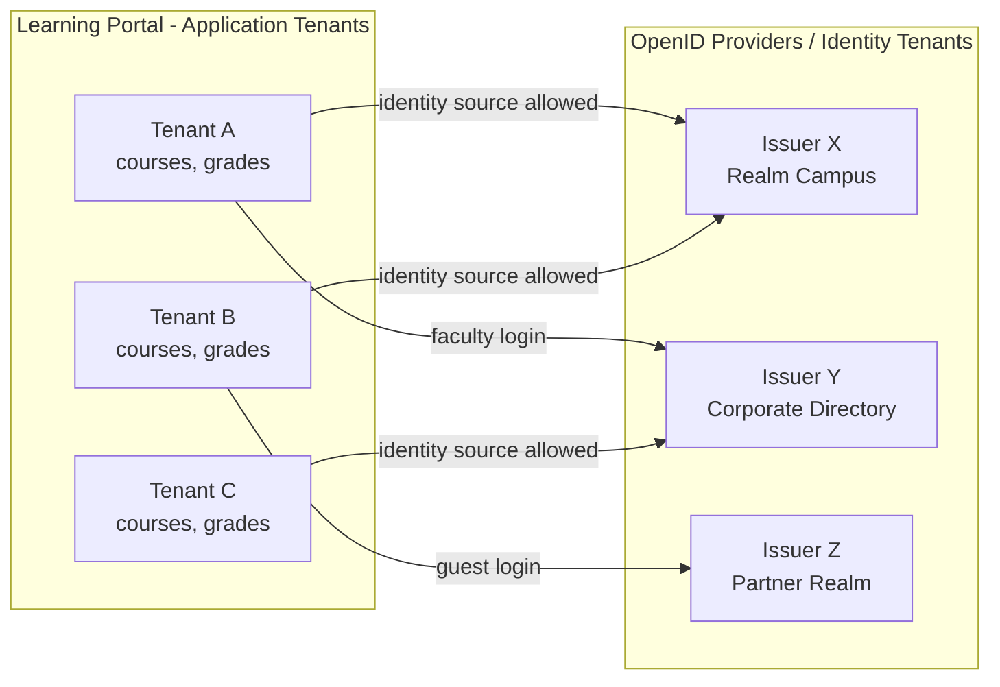
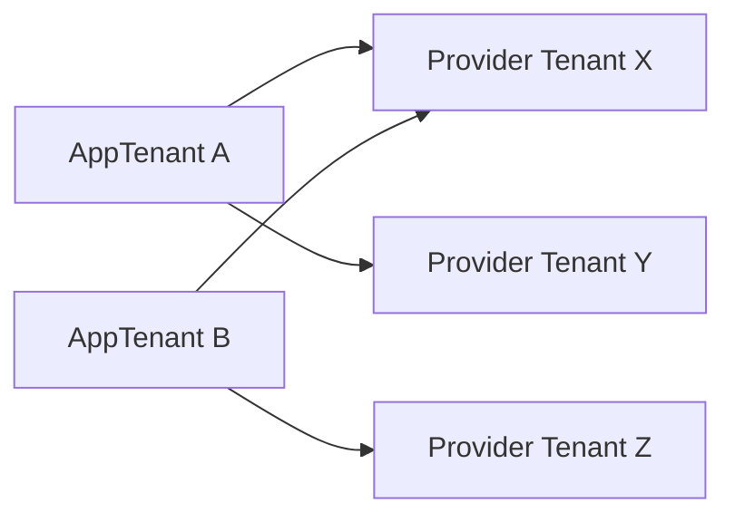
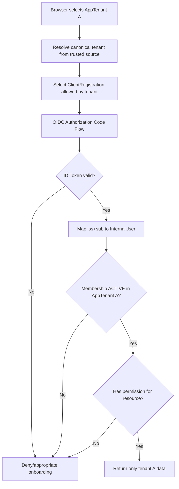

# 26.1. Distinguishing Application Tenants and Provider Tenants

## Lesson Objectives

In the topic of **multi-tenant Spring Security OAuth 2.0/OIDC Client**, the same word *tenant* can refer to two completely different boundaries. After this lesson, you will be able to:

- Distinguish **application tenant** (the application's data/permission tenant) from **provider tenant**, **realm**, **directory**, or **organization** of an OpenID Provider (OP).
- Explain why `appTenantId` does not necessarily match `tid`, `iss`, `realm`, `clientRegistrationId`, or `clientId`.
- Design one-to-one, one-to-many, many-to-one, and many-to-many mappings between SaaS tenants and identity systems.
- Understand why **successful OIDC authentication does not automatically grant access to an application tenant's data**.
- Use the **`(iss, sub)`** pair as the OIDC external identity key and map it to an internal user/membership.
- Select `ClientRegistration` in a controlled manner, persist **login intent** throughout the Authorization Code Flow, and avoid cross-tenant login/issuer confusion.
- Enforce tenant-level authorization across controllers, services, databases, caches, Resource Servers, authorized-client stores, and tenant-switching flows.
- Distinguish common multi-tenant models from tenant-independent authorities such as `/common` in Microsoft Entra ID.
- Properly test guest users, multiple OPs, multi-tab logins, tenant authorization, account linking, and cross-tenant data isolation.

---

## 1. Context: One SaaS, Multiple Organizations, Multiple Login Services

Suppose **Learning Portal** is a Spring Boot application rented by multiple universities:

```text
Learning Portal (a SaaS platform)
│
├── AppTenant T-UNIV-A: University A
│   ├── University A's courses/grades
│   ├── University A's students, faculty
│   └── University A's STUDENT, TEACHER, TENANT_ADMIN roles
│
└── AppTenant T-UNIV-B: University B
    ├── University B's courses/grades
    ├── University B's students, faculty
    └── University B's STUDENT, TEACHER, TENANT_ADMIN roles
```

Each organization logs in with its own IAM system:

```text
University A -> Campus Identity, realm university-a
University B -> Enterprise Directory, directory university-b
```

A student belonging to A receives an ID Token:

```json
{
  "iss": "https://idp.example.org/realms/university-a",
  "sub": "student-7e04",
  "aud": "learning-portal-client-a",
  "iat": 1893456900,
  "exp": 1893457200
}
```

The system needs to answer **two independent questions**:

1. **Who has been authenticated?** Which OP/issuer issued the ID Token, who is the subject, and are the signature/audience/nonce valid?
2. **What is that person allowed to do in which tenant of Learning Portal?** Do they have an active membership and the corresponding permissions? Which tenant does the resource belong to?

A valid OIDC token from one university does **not by default** allow the user to view data of every tenant in the SaaS.

> **Principle:** A **provider tenant** is an identity management and authentication boundary. An **application tenant** is a boundary for application data, membership, policies, and business authorization. The two concepts can be mapped to each other, but must not be assumed to always be identical.

### 1.1. Relationship Diagram



One **issuer can serve multiple application tenants**, and one **application tenant can trust multiple issuers**. Therefore, deriving the application tenant from a single claim is usually insufficient.

## 2. What Is an Application Tenant?

An **application tenant** is the logical unit that a SaaS platform uses to partition data and apply business policies.

For example:

```text
appTenantId     = T-UNIV-A
displayName     = University A
slug            = university-a
subscription    = Enterprise
dataPartition   = courses, grades, enrollments of A
roles           = STUDENT, TEACHER, TENANT_ADMIN
status          = ACTIVE
```

An application tenant can correspond to:

- A university.
- An enterprise customer.
- An independent workspace.
- A department requiring contractual data separation.
- An organization with its own billing, retention policies, and permissions.
- A legal entity with data residency requirements.

The canonical identifier should be **owned by the application**, such as a UUID or an immutable key. Display names, slugs, or domain names may change.

### 2.1. An Application Tenant Is a Data Boundary

A course:

```json
{
  "id": "COURSE-428",
  "tenantId": "T-UNIV-A",
  "title": "Spring Security"
}
```

If the browser calls:

```http
GET /t/university-b/api/courses/COURSE-428 HTTP/1.1
Cookie: SESSION=<session>
```

then the system must compare:

```text
Requested AppTenant = T-UNIV-B
Course AppTenant    = T-UNIV-A
```

If they differ, data may only be returned when there is a designed and approved **cross-tenant sharing workflow**. Having a valid OIDC session does not bypass this check.

### 2.2. An App Tenant Does Not Necessarily Have Its Own OP

It is possible to have:

```text
Tenant A ─┐
Tenant B ─┼──> one Shared Identity Provider
Tenant C ─┘
```

All three tenants share the same `iss` and a user may even share the same `sub`. Data must still be isolated by `appTenantId` and membership.

## 3. What Is a Provider Tenant/Realm/Directory?

A **provider tenant** is a unit or namespace managed by an Identity Provider. Depending on the product, it may be called:

```text
tenant
directory
realm
organization
identity pool
identity partition
```

It can determine:

- Account directory and authentication source.
- Password/MFA/Conditional Access.
- OAuth client registration and consent policies.
- OIDC issuer, Authorization Endpoint, Token Endpoint, JWKS.
- Guest/B2B invitation.
- Client registration and redirect URIs.
- Signing keys, token claims, and OP SSO session lifecycle.

An OP realm may have its own issuer:

```text
https://login.example.org/realms/university-a
https://login.example.org/realms/university-b
```

**Do not assume every provider shares the same realm and issuer model.** Some OPs have a single issuer for multiple organizations; some have tenant-specific issuers; some support a tenant-independent sign-in authority.

### 3.1. OIDC `iss` Is the Issuer Identifier

For example:

```json
{
  "iss": "https://login.example.org/realms/university-a"
}
```

`iss` is a standard ID Token claim and must be verified against the flow's **ClientRegistration/trust policy**.

The two values:

```text
https://login.example.org/realms/university-a
https://login.example.org/realms/university-b
```

are **two different issuers**, even though the hostname is the same. OIDC Core treats the path in an issuer URI as part of the issuer identifier.

Do not replace issuer matching with:

```java
issuer.startsWith("https://login.example.org")
```

### 3.2. `tid` Is Provider-Specific, Not a Mandatory Claim Across All OPs

A provider like Microsoft Entra may issue:

```json
{
  "tid": "directory-guid-1234"
}
```

However, there is no universal OIDC rule requiring Keycloak, Auth0, Cognito, or every other OP to use the same `tid` claim.

Use distinct names:

```text
appTenantId          = Learning Portal's key
providerTenantId     = tenant key per the OP's contract
issuer               = OIDC iss claim
subject              = OIDC sub claim
```

## 4. Comparison Table of the Two Tenant Types

| Criterion | Application tenant | Provider tenant |
| --- | --- | --- |
| Owner | SaaS/Learning Portal | OpenID Provider/IAM |
| Purpose | Data partitioning, billing, business logic, roles | Identity partitioning/management, authentication policy |
| Identifier | Internal `appTenantId` | Realm, directory GUID, organization ID, issuer |
| Users | App memberships | IdP accounts/guests |
| Rights | STUDENT/TEACHER per workspace | IdP groups, MFA, admin/guest settings |
| Trust boundary | Authorization + data isolation | Authentication + token signing/trust |
| Relation to `iss` | Not necessarily one-to-one | May determine issuer per provider contract |
| Relation to `registrationId` | Can use mapping | ClientRegistration is the OAuth client configuration |
| Tenant deletion | Separate data lifecycle | Separate identity lifecycle |
| Key tests | Cross-tenant access/IDOR | Issuer, signature, audience, state/nonce |

### 4.1. Seven Easily Confused Identifiers

Suppose:

```text
appTenantId             = T-UNIV-A
appTenantSlug           = university-a
providerId              = campus-identity
providerTenantId        = realm-university-a
oidcIssuer              = https://login.example.org/realms/university-a
clientRegistrationId    = campus-a
oauthClientId           = learning-portal-client-a
```

These values serve **different roles**. Do not put all of them into a vague variable named `tenantId`.

Clearer data types:

```java
record AppTenantId(String value) {}
record ProviderTenantId(String value) {}
record ExternalIdentityKey(String issuer, String subject) {}
record OAuthClientRegistrationKey(String value) {}
```

Internal types can be UUIDs/ULIDs or appropriate opaque IDs. Distinct type names help reduce parameter mix-ups in code.

## 5. One-to-One and Many-to-Many Relationships

### 5.1. One-to-One

```text
AppTenant A -> OP Realm A
AppTenant B -> OP Realm B
```

This is the simple case, but **not an invariant property** of multi-tenancy.

### 5.2. Multiple AppTenants Sharing One Provider Tenant

```text
AppTenant A ─┐
AppTenant B ─┼──> Corporate Identity Realm
AppTenant C ─┘
```

A conglomerate might use a single Entra directory for three subsidiaries, each renting its own workspace in the SaaS.

In this case, all users may receive the same `iss` or `tid`, but their roles/permissions in A, B, and C differ.

### 5.3. One AppTenant Allowing Multiple Provider Tenants

```text
Faculty OP ──┐
             ├──> AppTenant A
Student OP ──┘
```

A university may allow faculty and students to sign in through two different identity sources.

### 5.4. Many-to-Many



You cannot use:

```java
appTenantId = idToken.getClaimAsString("tid");
```

as a universal rule to determine the application tenant.

### 5.5. One User Can Belong to Multiple AppTenants

```text
User U-504:
    Membership Tenant A = STUDENT
    Membership Tenant B = TEACHER
```

With the same OIDC Authentication, the user must have **different permissions per tenant**. Do not create a global `ROLE_TEACHER` and use it to allow editing grades across every workspace.

## 6. Distinguishing External Identity, Internal User, and Membership

Recommended model:

```text
ExternalIdentity (iss, sub)
              |
              v
        InternalUser (userId)
          /             \
         v               v
 Membership A       Membership B
 role STUDENT       role TEACHER
```

Three concepts:

- **ExternalIdentity:** an account verified by an OP, keyed by `(iss, sub)` in OIDC.
- **InternalUser:** the application's stable user ID, which can link multiple verified external identities.
- **Membership:** the relationship between an internal user and an app tenant, carrying role, status, and permissions.

### 6.1. `(iss, sub)` Is the OIDC Identity Key

For example:

```text
(https://idp.example/realms/a, student-42)
(https://idp.example/realms/b, student-42)
```

These are **not assumed to be the same identity**. `sub` is scoped to the issuer.

If an OP uses **pairwise subject identifiers**, even the same person can receive different `sub` values across clients/sector identifiers. Verified account linking is required, not inference from matching names or emails.

### 6.2. Email Is Not a Cross-Provider Identity Key

Two tokens:

```json
{
  "iss": "https://issuer-x.example",
  "sub": "x-1",
  "email": "student@example.edu",
  "email_verified": true
}
```

and:

```json
{
  "iss": "https://issuer-y.example",
  "sub": "y-9",
  "email": "student@example.edu",
  "email_verified": true
}
```

are not sufficient proof that the two identities should be **automatically merged**.

Emails can change, be reassigned, be aliases, be absent from the ID Token, or be handled differently across OPs. Account linking must follow a proper ownership verification workflow.

### 6.3. An Existing Provider Account Does Not Auto-Create Membership

A user may log in through a valid OP but not yet be invited into the SaaS tenant.

```text
Token valid = TRUE
External identity recognized = TRUE
Membership in AppTenant A = FALSE
```

The result is **no access to A's resources**, unless an onboarding policy permits creating a membership through a controlled step.

## 7. Illustrative Database Model

The schema may include:

```sql
CREATE TABLE app_tenant (
    tenant_id     VARCHAR(64) PRIMARY KEY,
    slug          VARCHAR(120) NOT NULL UNIQUE,
    display_name  VARCHAR(255) NOT NULL,
    status        VARCHAR(30) NOT NULL
);

CREATE TABLE identity_provider (
    provider_id   VARCHAR(64) PRIMARY KEY,
    name          VARCHAR(255) NOT NULL
);

CREATE TABLE identity_source (
    identity_source_id  VARCHAR(64) PRIMARY KEY,
    provider_id         VARCHAR(64) NOT NULL,
    issuer_uri          VARCHAR(500) NOT NULL,
    provider_tenant_key VARCHAR(255),
    registration_id     VARCHAR(150) NOT NULL,
    FOREIGN KEY (provider_id)
        REFERENCES identity_provider(provider_id)
);

CREATE TABLE app_tenant_identity_source (
    tenant_id          VARCHAR(64) NOT NULL,
    identity_source_id VARCHAR(64) NOT NULL,
    enabled            BOOLEAN NOT NULL,
    PRIMARY KEY (tenant_id, identity_source_id),
    FOREIGN KEY (tenant_id)
        REFERENCES app_tenant(tenant_id),
    FOREIGN KEY (identity_source_id)
        REFERENCES identity_source(identity_source_id)
);
```

User and membership:

```sql
CREATE TABLE app_user (
    user_id VARCHAR(64) PRIMARY KEY,
    status  VARCHAR(30) NOT NULL
);

CREATE TABLE external_identity (
    identity_id    VARCHAR(64) PRIMARY KEY,
    user_id        VARCHAR(64) NOT NULL,
    issuer_uri     VARCHAR(500) NOT NULL,
    subject_value  VARCHAR(500) NOT NULL,
    UNIQUE (issuer_uri, subject_value),
    FOREIGN KEY (user_id) REFERENCES app_user(user_id)
);

CREATE TABLE tenant_membership (
    tenant_id VARCHAR(64) NOT NULL,
    user_id   VARCHAR(64) NOT NULL,
    role      VARCHAR(100) NOT NULL,
    status    VARCHAR(30) NOT NULL,
    PRIMARY KEY (tenant_id, user_id, role),
    FOREIGN KEY (tenant_id) REFERENCES app_tenant(tenant_id),
    FOREIGN KEY (user_id) REFERENCES app_user(user_id)
);
```

The purpose is to represent a **one-to-many mapping**, not to copy the schema verbatim into a production database. During implementation, consider:

- Stable identifier keys and contract constraints.
- Indexes, unique constraints, and preventing provisioning races.
- Auditing changes to tenant-to-provider mappings.
- Membership statuses `ACTIVE`, `REVOKED`, `PENDING`.
- Dedicated encryption/token storage.
- Data retention, administrative permissions, and tenant lifecycle.
- Queries always scoped by tenant; never filter only after reading data.

## 8. What Is Spring Security's `ClientRegistration`?

Spring Security defines:

```java
ClientRegistration
```

to describe an OAuth2/OIDC Client configuration with a provider, including:

```text
registrationId
clientId
clientSecret or other client authentication
authorizationGrantType
redirectUri
scopes
authorizationUri
tokenUri
jwkSetUri
issuerUri
userInfoEndpoint
```

`ClientRegistration` does not by itself represent an AppTenant. One registration can serve multiple application tenants, or one tenant can have multiple registrations.

### 8.1. YAML with Two OIDC Registrations

```yaml
spring:
  security:
    oauth2:
      client:
        registration:
          campus-a:
            provider: campus-a-op
            client-id: ${CAMPUS_A_CLIENT_ID}
            client-secret: ${CAMPUS_A_CLIENT_SECRET}
            client-authentication-method: client_secret_basic
            authorization-grant-type: authorization_code
            redirect-uri: "{baseUrl}/login/oauth2/code/{registrationId}"
            scope:
              - openid
              - profile
              - email

          campus-b:
            provider: campus-b-op
            client-id: ${CAMPUS_B_CLIENT_ID}
            client-secret: ${CAMPUS_B_CLIENT_SECRET}
            client-authentication-method: client_secret_basic
            authorization-grant-type: authorization_code
            redirect-uri: "{baseUrl}/login/oauth2/code/{registrationId}"
            scope:
              - openid
              - profile

        provider:
          campus-a-op:
            issuer-uri: https://login.example.edu/realms/a
          campus-b-op:
            issuer-uri: https://login.example.edu/realms/b
```

This means:

```text
registrationId campus-a
    -> OAuth Client ID from CAMPUS_A_CLIENT_ID
    -> issuer https://login.example.edu/realms/a

registrationId campus-b
    -> OAuth Client ID from CAMPUS_B_CLIENT_ID
    -> issuer https://login.example.edu/realms/b
```

**There is not yet any information** about which app tenant A/B is allowed to use that registration. Application routing/authorization rules are required.

### 8.2. `registrationId` Differs from `clientId`

```text
registrationId = campus-a
clientId       = learning-portal-client-a
```

The first value is assigned by the Spring application to look up configuration. The second value is issued by the OP/AS during client registration.

### 8.3. `registrationId` Differs from `iss`

```text
registrationId = campus-a
issuer         = https://login.example.edu/realms/a
```

An OIDC ID Token typically **does not contain a `registrationId` claim**. Spring Security tracks the registration through the OAuth2 authorization transaction.

### 8.4. One Registration Serving Multiple App Tenants

If `campus-shared` is used for Tenants A, B, and C:

```text
AppTenant A ─┐
AppTenant B ─┼──> registration campus-shared
AppTenant C ─┘
```

then:

```java
String appTenantId =
    authentication.getAuthorizedClientRegistrationId();
```

is wrong: the registration does not uniquely identify a single app tenant.

## 9. Authentication Is Not Tenant-Level Authorization

Successful OIDC Login means Spring Security has received an Authentication after the flow:

```text
Authorization Code exchange
ID Token signature/claims validation
state/nonce checks per flow
OidcUser/OAuth2AuthenticationToken
```

However, this is **not enough** to allow reading an app tenant's data.

A secure decision chain:



**Do not** shortcut this to:

```text
ID Token issuer valid -> allowed into every workspace using that issuer
```

### 9.1. A User in Two App Tenants Has Two Roles

```text
U-504, Tenant A -> STUDENT
U-504, Tenant B -> TEACHER
```

A global `ROLE_TEACHER` is not valid if it is only supposed to apply in B.

Authorization should evaluate:

```text
(internalUserId, appTenantId, permission, resourceId)
```

For example:

```text
(U-504, T-A, GRADE_WRITE) = DENY
(U-504, T-B, GRADE_WRITE) = ALLOW
```

### 9.2. OAuth Scopes Do Not Prove Membership

An Access Token containing:

```text
scope = courses.read
```

means the token was granted API permission under the AS/RS contract. It **does not by itself state** that the user has permission to read every course across all application tenants.

The Resource Server must independently check tenant membership, ownership, and resource authorization.

## 10. Selecting a Tenant When Starting Login

The application can select the app tenant based on:

- A registered subdomain, e.g., `university-a.portal.example.org`.
- A server-side mapped path, e.g., `/t/university-a`.
- Workspace selection in the UI.
- A signed/server-side looked-up invitation token.
- A tenant discovery service with an allowlist configuration.

### 10.1. A Tenant Slug Is Only a Locator

A URL:

```http
GET /t/university-b/api/courses HTTP/1.1
```

does not prove the user has a membership in B. The backend must:

```text
Resolve "university-b" -> canonical T-UNIV-B
Read authenticated user
Check active membership in T-UNIV-B
Authorize action/resource
```

### 10.2. Host and Forwarded Headers Must Be Properly Trusted

Do not trust `Host`, `X-Forwarded-Host`, or `Forwarded` supplied directly by the browser if they can alter the tenant, `redirect_uri`, or OP.

When a reverse proxy is permitted to set forwarded headers, you need:

- The proxy strips/overwrites headers from untrusted clients.
- Hostnames are allowlisted and mapped to tenants via a repository.
- Public callback HTTPS/scheme/port match the OP registration.
- An unregistered host cannot select an arbitrary registration.

### 10.3. Do Not Use Email Domain as Authorization

For example:

```text
student@university-a.edu
```

can help display a **login hint** if the organization has configured domain discovery. However, an email address does not prove active membership, role, or resource ownership.

## 11. Tenant-to-Provider Mapping Must Be Controlled by the Backend

An illustrative service:

```java
public record TenantLoginRoute(
    String appTenantId,
    String registrationId,
    String expectedIssuer
) {}

public interface TenantIdentityRoutingService {
    TenantLoginRoute resolve(
        String appTenantId,
        String providerAlias
    );
}
```

Conceptual implementation:

```java
@Service
class TenantIdentityRoutingServiceImpl
        implements TenantIdentityRoutingService {

    private final TenantRepository tenants;
    private final IdentitySourceRepository identitySources;

    TenantIdentityRoutingServiceImpl(
            TenantRepository tenants,
            IdentitySourceRepository identitySources) {
        this.tenants = tenants;
        this.identitySources = identitySources;
    }

    @Override
    public TenantLoginRoute resolve(
            String appTenantId,
            String providerAlias) {

        Tenant tenant = tenants.findActiveById(
            appTenantId
        ).orElseThrow(() ->
            new AccessDeniedException(
                "Unknown or inactive app tenant"
            )
        );

        IdentitySource source =
            identitySources.findEnabled(
                tenant.id(), providerAlias
            ).orElseThrow(() ->
                new AccessDeniedException(
                    "Provider is not allowed for tenant"
                )
            );

        return new TenantLoginRoute(
            tenant.id(),
            source.registrationId(),
            source.expectedIssuer()
        );
    }
}
```

`TenantRepository`, `IdentitySourceRepository`, `Tenant`, and `IdentitySource` are application abstractions, not built-in Spring Security classes.

Important:

- Users may select a provider alias, **not** specify an arbitrary issuer/JWKS.
- Mappings must be approved by an admin and have `ACTIVE` status.
- Do not fall back to the first provider if the mapping does not exist.
- Do not allow a suspended tenant to initiate new authorization flows.
- If a provider registration is disabled, have a policy to clear cache/token state.

## 12. Example of Routing OIDC Login on Servlet

Suppose the browser visits:

```text
https://portal.example.org/t/university-a/login
```

Controller:

```java
@Controller
class TenantLoginController {

    private final TenantDirectory directory;
    private final TenantIdentityRoutingService routing;

    TenantLoginController(
            TenantDirectory directory,
            TenantIdentityRoutingService routing) {
        this.directory = directory;
        this.routing = routing;
    }

    @GetMapping("/t/{slug}/login")
    String login(
            @PathVariable String slug,
            @RequestParam(defaultValue = "campus")
            String providerAlias) {

        String appTenantId =
            directory.requireActiveIdForSlug(slug);

        TenantLoginRoute route =
            routing.resolve(appTenantId, providerAlias);

        String registrationId =
            route.registrationId();

        // The registration was selected from the backend allowlist.
        // This example only shows routing; you still need to bind
        // appTenantId to the OAuth2 authorization transaction.
        return "redirect:/oauth2/authorization/" +
            UriUtils.encodePathSegment(
                registrationId, StandardCharsets.UTF_8
            );
    }
}
```

**Warning:** this example only selects the right OAuth2 registration. To ensure the login callback binds to the right app tenant, a **login intent bound to `state`** is required. Do not treat a simple redirect as a complete multi-tenant implementation.

### 12.1. Do Not Take the App Tenant from Unverified Callback Query Parameters

Wrong:

```text
GET /login/oauth2/code/campus-a?code=...&state=...&tenant=b
```

then:

```java
String tenant = request.getParameter("tenant");
```

to grant yourself access to tenant B.

A callback parameter can be modified by a browser/attacker. It must only be treated as untrusted input, not proof of the original tenant.

## 13. `state`, `nonce`, and Login Intent

**`state`** binds the OAuth2 Authorization Response to the Authorization Request; **`nonce`** binds the OIDC ID Token to the Authentication Request in applicable flows.

```text
state:
    authorization request <-> authorization response

nonce:
    ID Token <-> OIDC authentication request
```

### 13.1. Per-Transaction Login Intent

A server-side record:

```json
{
  "stateKey": "random-opaque-key",
  "appTenantId": "T-UNIV-A",
  "registrationId": "campus-a",
  "expectedIssuer": "https://login.example.edu/realms/a",
  "createdAt": "2026-11-16T03:00:00Z",
  "expiresAt": "2026-11-16T03:05:00Z"
}
```

It must be:

- Created after the tenant/provider mapping is validated.
- Bound to the `state` of the specific Authorization Request.
- Stored server-side or integrity-protected/encrypted per the threat model.
- Time-limited and replay-protected.
- Consumed when the callback completes.
- Immutable so the user cannot alter the transaction's app tenant after the OP redirect.
- Synchronized across nodes if the app runs in a cluster.

Spring Security provides `OAuth2AuthorizationRequestRepository` in Servlet and the corresponding repository in Reactive to manage the Authorization Request. The application can extend that mechanism or maintain its own store keyed by a trusted transaction ID.

### 13.2. Multi-Tab Bug When Storing Only `currentTenant`

Two tabs in the same browser:

```text
Tab A:
  starts login for Tenant A
  session.currentTenant = A

Tab B:
  starts login for Tenant B
  session.currentTenant = B

Tab A:
  callback arrives later
  session.currentTenant is now B
```

If `session.currentTenant` is used as the sole source at callback time, the app may attach flow A's identity to B.

**Fix:** login intent must be **bound to each `state`**, not a singleton variable storing the "last selected tenant".

### 13.3. Do Not Use `nonce` Instead of `state`

The OP may return `nonce` in the ID Token, but nonce does not replace the full OAuth2 `state` and request repository. Keep **both** when required by the flow.

## 14. `OAuth2AuthorizationRequestResolver` and the Registration List

Spring Security Servlet provides the extension point:

```java
OAuth2AuthorizationRequestResolver
```

Commonly used:

```java
DefaultOAuth2AuthorizationRequestResolver
```

Example configuring a custom resolver (assuming the `resolver` bean enforces tenant mapping):

```java
@Bean
SecurityFilterChain security(
        HttpSecurity http,
        OAuth2AuthorizationRequestResolver resolver)
        throws Exception {

    http
        .authorizeHttpRequests(auth -> auth
            .requestMatchers(
                "/", "/t/{slug}/login", "/assets/**"
            ).permitAll()
            .anyRequest().authenticated()
        )
        .oauth2Login(oauth2 -> oauth2
            .authorizationEndpoint(endpoint -> endpoint
                .authorizationRequestResolver(resolver)
            )
        );

    return http.build();
}
```

Do not let the resolver dynamically create registrations from URLs supplied by anonymous users.

### 14.1. Be Careful with Dynamic Issuers

Wrong:

```text
GET /oauth2/start?issuer=http://127.0.0.1/internal
```

and the server directly calls OIDC Discovery on that issuer.

Risks:

- SSRF against internal networks/metadata endpoints.
- Token endpoint/JWKS pointed at an attacker-controlled server.
- Selecting the wrong issuer or leaking credentials externally.
- Trust confusion across ClientRegistrations.

IdP onboarding must include review, egress restrictions, HTTPS, allowlists, and issuer validation per the provider contract.

### 14.2. Callback URI Must Be Registered with the OP

For example:

```text
{baseUrl}/login/oauth2/code/{registrationId}
```

Depending on the design, the callback can use a shared domain or a tenant domain. Do not solve "multiple tenants" using wildcard redirect URIs or unchecked open redirects.

## 15. Authorization After the OIDC Callback

After Spring Security validates the ID Token, the application can:

1. Receive the authenticated `OidcUser` and `OAuth2AuthenticationToken`.
2. Read the login intent bound to the matching authorization transaction.
3. Verify the authenticated registration and issuer against the app tenant's mapping.
4. Map `(iss, sub)` to an internal user.
5. Verify both the user and the app tenant are active.
6. Verify active membership and allowed roles.
7. Establish a controlled tenant-aware context.
8. Redirect the browser to the tenant's URL (without open redirects).

### 15.1. Valid Token Without Membership

For example:

```text
Intended AppTenant: T-UNIV-A
Registration: campus-a
ID Token: valid, issuer a, subject guest-99
Membership guest-99/T-UNIV-A: NONE
```

Result:

```text
Authentication at OP: succeeded
Authorization to AppTenant A: denied/onboarding
```

Do not automatically grant `TENANT_ADMIN` merely because the issuer matches.

### 15.2. Distinguishing Error Types

| Step | Error | Correct response |
| --- | --- | --- |
| State/nonce | Transaction mismatch | Reject login |
| ID Token | Invalid signature/issuer/audience | Do not create authenticated identity |
| Registration | Provider not allowed for app tenant | Reject login route |
| Identity mapping | External identity not yet linked | Controlled provisioning |
| Membership | Not a member of app tenant | Deny tenant data |
| Tenant status | Tenant suspended | Deny access |
| Resource ownership | Resource belongs to another tenant | 403/404 per policy |
| Scope | Access Token lacks API scope | Grant valid API permission or 403 |

## 16. Example Reading the Authenticated Identity in Spring MVC

```java
@RestController
class IdentityController {

    @GetMapping("/api/me/identity")
    Map<String, String> identity(
            @AuthenticationPrincipal OidcUser user,
            OAuth2AuthenticationToken authentication) {

        return Map.of(
            "issuer",
            user.getIdToken().getIssuer().toString(),
            "subject",
            user.getSubject(),
            "registrationId",
            authentication.getAuthorizedClientRegistrationId()
        );
    }
}
```

This example is for learning/testing only; the route must be authenticated, and avoid returning raw identity metadata in production unless necessary.

`issuer`, `subject`, and `registrationId` **do not automatically equal `appTenantId`**.

### 16.1. External Identity Key

```java
record ExternalIdentityKey(
    String issuer,
    String subject
) {}

ExternalIdentityKey key(OidcUser user) {
    return new ExternalIdentityKey(
        user.getIdToken().getIssuer().toString(),
        user.getSubject()
    );
}
```

Only read from an `OidcUser` created **after OIDC validation**; never Base64URL-decode a raw JWT yourself and treat its claims as trustworthy.

## 17. Authorization in Controllers and Services

Suppose the application defines:

```java
interface TenantDirectory {
    String requireActiveIdForSlug(String slug);
}

interface IdentityService {
    String requireInternalUserId(ExternalIdentityKey key);
}

interface TenantAuthorization {
    void requirePermission(
        String userId, String appTenantId, String permission
    );
}
```

A controller:

```java
@RestController
class CourseController {

    private final TenantDirectory tenants;
    private final IdentityService identities;
    private final TenantAuthorization authorization;
    private final CourseService courses;

    CourseController(
            TenantDirectory tenants,
            IdentityService identities,
            TenantAuthorization authorization,
            CourseService courses) {
        this.tenants = tenants;
        this.identities = identities;
        this.authorization = authorization;
        this.courses = courses;
    }

    @GetMapping("/t/{slug}/api/courses")
    List<CourseDto> list(
            @PathVariable String slug,
            @AuthenticationPrincipal OidcUser user) {

        String tenantId =
            tenants.requireActiveIdForSlug(slug);

        String userId = identities.requireInternalUserId(
            new ExternalIdentityKey(
                user.getIdToken().getIssuer().toString(),
                user.getSubject()
            )
        );

        authorization.requirePermission(
            userId, tenantId, "COURSE_READ"
        );

        return courses.findForTenant(tenantId);
    }
}
```

In production, DTOs/repositories, validation, paging, exception handling, and auditing must be supplied by the project. **Key takeaway:** the tenant is the result of trusted resolution + membership, not an arbitrary claim.

### 17.1. Tenant-Scoped Query

Right:

```sql
SELECT *
FROM course
WHERE tenant_id = :authorizedTenantId
  AND course_id = :courseId;
```

Insufficient:

```sql
SELECT *
FROM course
WHERE course_id = :courseId;
```

and hoping the client will not guess another tenant's course ID. This is **IDOR/cross-tenant data exposure**.

### 17.2. Defense in Depth

You can enforce protection at multiple layers:

```text
Controller -> require authenticated identity
Service -> require tenant membership + permission
Repository -> tenantId predicate
Database -> row-level security/schema isolation if applicable
Cache -> tenant-aware key
```

Do not use arbitrary request header data to select a database schema or tenant ID.

## 18. `X-Tenant-Id` and Host/Path Are Not Inherently Trusted

Wrong:

```java
String tenantId = request.getHeader("X-Tenant-Id");
return repository.findByTenantId(tenantId);
```

A browser can modify the header to attempt to fetch tenant B's data.

In a gateway/BFF architecture, a tenant header may be used as **internal propagated metadata** when:

- The gateway has authenticated the caller.
- Untrusted client-side headers are stripped/overwritten by the gateway.
- Downstream services still verify tenant/resource permissions.
- mTLS/signed internal tokens/trust policies exist between services when needed.
- Auditing distinguishes the requested tenant from the authorized tenant.

### 18.1. WebFlux Uses Reactor Context

In WebFlux, you should not use a `static ThreadLocal` as the tenant context for an async request chain. The tenant context can be propagated via `Reactor Context` or explicit parameters, but it must be backed by an authenticated identity and membership.

### 18.2. Cache Must Be Scoped by Tenant

Wrong:

```text
cache key = courseId
```

Better:

```text
cache key = (appTenantId, courseId, permissionContext)
```

If the cache returns data based on user-specific policies, you also need to factor in user ID/role/policy version when constructing the key.

## 19. Scopes, Groups, Roles, and App Permissions

### 19.1. OAuth Scopes Are Not Equivalent to Tenant Roles

```json
{
  "scope": "courses.read"
}
```

Scopes are issued by the AS for the API under a contract. They do not prove the user has membership in tenant A or permission to view course X.

A complete policy:

```text
Bearer token signature/introspection valid
issuer/audience valid
required scope valid
app tenant membership valid
resource ownership valid
```

### 19.2. IdP Groups Are Not Automatically SaaS Roles

A provider may emit:

```json
{
  "groups": ["faculty", "students"]
}
```

However, you cannot automatically equate:

```text
IdP group faculty -> TENANT_ADMIN in every tenant
```

You need a mapping managed by tenant/platform admins:

```text
(issuer, externalGroupId, appTenantId)
    -> application role/permission
```

Group data in a token may be incomplete due to size/overage limits; contract and freshness policies must be applied.

### 19.3. Tenant-Aware Method Security

Conceptual example:

```java
@PreAuthorize(
    "@tenantAuth.canManage(authentication, #tenantId)"
)
public void updateTenantSettings(
        String tenantId, UpdateTenantRequest request) {
    // Perform operation after policy check
}
```

The `tenantAuth` bean must check **tenant-specific permissions**, not merely read a global `hasRole('ADMIN')`.

## 20. Microsoft Entra ID: A Specific Multi-Tenant Example

Microsoft Entra ID has:

```text
directory tenant
tenant ID (tid)
tenant-specific authority
/common or /organizations authority
guest/B2B users
multi-tenant app registration
```

Learning Portal still maintains its own `AppTenantId`. Do not force the two values to be identical.

### 20.1. `/common` Is an Entrypoint, Not the Issuer for Every User

An Entra multi-tenant app may start authorization at:

```text
https://login.microsoftonline.com/common
```

or:

```text
https://login.microsoftonline.com/organizations
```

Under the Entra contract, these are **tenant-independent authorities** used to accept users from multiple directories. The actual issuer claim in the token corresponds to the authenticated tenant.

Do not set a naive rule:

```text
Expected iss == https://login.microsoftonline.com/common
```

and then disable issuer validation when it fails to match.

### 20.2. Validate Issuer According to Provider Documentation

With tenant-independent metadata, Microsoft instructs verifying the relationship between:

```text
tid
iss
issuer of the signing key
metadata/token version
```

as well as the application's tenant allowlist. Checking `jwt.getIssuer() != null` is not enough.

If the SaaS only allows specific directories, maintain an allowlist of approved provider tenants for each app tenant.

### 20.3. Guest/B2B Users

A user may be a guest in a partner's directory even though their email belongs to another organization. `tid`, issuer, and identity context must be interpreted according to the OP contract; do not infer the **app tenant** from the email domain.

Distinguish between:

```text
home directory
resource directory
application workspace
```

and verify guest membership/permissions before granting access to data.

## 21. Keycloak Realms Example

An OP like Keycloak typically has per-realm issuers:

```text
https://sso.example.org/realms/students
https://sso.example.org/realms/faculty
```

However:

```text
AppTenant University-A
    -> Students realm
    -> Faculty realm
```

or:

```text
AppTenant A ─┐
AppTenant B ─┼──> Shared Faculty realm
```

can both be valid if permitted by the app mapping.

**Do not** parse the last path segment of the issuer URI to use as `appTenantId`:

```java
String appTenant =
    issuer.substring(issuer.lastIndexOf('/') + 1);
```

Realm names and tenant slugs can change or fail to match, especially when an identity broker is involved.

## 22. `OAuth2AuthorizedClient` Must Also Be Properly Partitioned

Spring Security OAuth2 Client stores:

```java
OAuth2AuthorizedClient
```

with:

```text
ClientRegistration
principalName
Access Token
optional Refresh Token
```

Many authorized-client stores key by:

```text
(registrationId, principalName)
```

or store per browser session.

### 22.1. Two Issuers with the Same `sub`

If a principal key of just `"student-42"` is used for both issuers, the store can cause identity confusion when registration/storage is poorly designed.

Use:

```text
(issuer, subject)
```

to map external identity, then a controlled, stable internal user ID. The token store must still separate **registration and delegation context**.

### 22.2. Same Registration, Multiple App Tenants

A user may have a `shared-op` Access Token used across multiple workspaces if allowed by the provider contract, but **app membership must still be checked on every request**.

If authorization grants/tokens are issued separately per app tenant, the default `(registration, principal)` key may be insufficient; you need to separate registration, principal/grant binding, or the repository strategy.

### 22.3. Client Credentials per Tenant

```text
Tenant A -> client_credentials A -> Access Token A
Tenant B -> client_credentials B -> Access Token B
```

Do not share a single global service account token if credentials/audiences/permissions must actually be separated per tenant.

### 22.4. Do Not Send a Token to the Wrong Resource Server

An access token issued by Provider A's AS cannot automatically be used for API B. It must match:

```text
issuer
audience
scope
tenant binding
Resource Server trust
```

The ID Token is for OIDC Client login, **not a substitute for an Access Token** when calling APIs.

## 23. Switching Tenants Within the Same Session

A user with memberships:

```text
Tenant A: STUDENT
Tenant B: TEACHER
```

can switch workspaces:

```text
A -> B
```

but the app must:

1. Resolve canonical tenant B.
2. Check active membership U/B.
3. Recompute tenant-specific roles/permissions.
4. Attach the verified tenant context.
5. Refresh/invalidate tenant-scoped caches as needed.
6. Navigate to B's URLs.
7. Ensure API and database queries remain scoped to B.

### 23.1. Is Re-Login via OIDC Required?

Not necessarily, if the same identity is allowed into both app tenants. However, reauthentication/step-up may be required if Tenant B:

- Only accepts Provider B.
- Requires stronger MFA/assurance.
- Requires a different consent/grant.
- Has not completed account linking.
- Only allows identities from a specific issuer.

Do not treat switching tenants as merely updating an `activeTenantId` field in the session while keeping all old permissions.

### 23.2. Do Not Inherit the Previous Tenant's Role

Wrong:

```text
activeTenant A, role TEACHER
switch to B
role is still TEACHER
```

Right:

```text
switch to B
load/check roles & membership for B
```

A session may hold tenant context, but it **does not replace policy evaluation** on sensitive actions.

## 24. Provisioning, Invitations, and Deprovisioning

Ways to grant membership include:

1. A tenant admin invites the user.
2. Provisioning via SCIM/HR/SIS.
3. An approval workflow based on proof of organization affiliation.
4. Auto-provisioning **with an explicit policy** for a verified issuer/group/domain.
5. Time-limited guest membership with restricted roles.

**Do not** automatically grant an admin role just because a user has an email domain that looks like the tenant.

### 24.1. When a User Is Removed from a Tenant

If a user is already logged in and their membership is revoked, an active session should not retain permissions indefinitely.

Choose a freshness strategy:

```text
Per-request membership check
Short-lived authorization cache
Version/epoch invalidation
Event-driven session cleanup
```

A `SUSPENDED` tenant status must also take effect immediately per policy.

### 24.2. Account Linking Must Require Proof

Having the same email at two OPs is not enough to merge accounts. A linking workflow should:

- Verify the existing identity.
- Verify the new identity via a valid flow.
- Check for conflicts with another user.
- Include auditing and approval permissions if needed.
- Never automatically alter memberships in other tenants.

## 25. Logout in a Multi-Provider Model

When a user logged in via Provider X but is currently viewing AppTenant B, OIDC RP-Initiated Logout must rely on the **authenticated registration of the login session**, not simply pick the issuer of the active app tenant.

Wrong:

```text
User logs in with Issuer X
Switch to AppTenant B (mapped to Issuer Y)
Logout -> send ID Token X to Issuer Y
```

Risk: **sending the ID Token/hint to the wrong provider**, which can leak tokens or cause logout to fail.

Right:

```text
Logout local session per policy
If performing OP logout:
    determine OP from the authenticated OIDC Authentication/ClientRegistration
```

Separate:

```text
Switch workspace
Local logout
OP SSO logout
Token revocation
Authorized-client cleanup
```

Each operation has its own scope.

## 26. Dynamic ClientRegistration and Provider Onboarding

For a few fixed OPs, YAML and `InMemoryClientRegistrationRepository` may suffice. With hundreds of customer-managed IdPs, a dynamic registry may be needed.

Values that must be governed:

```text
registrationId
clientId
client secret/private key reference
issuerURI
authorizationURI
tokenURI
jwkSetURI
redirectURI
scopes
allowed application tenants
status/configVersion
```

### 26.1. SSRF Risk in OIDC Discovery

Do not allow an anonymous user to pass an arbitrary URL into:

```java
ClientRegistrations.fromIssuerLocation(
    userSuppliedIssuer
);
```

where the server immediately fetches metadata. This can cause SSRF, internal network access, and token/credential confusion.

You should enforce:

- Admin-managed onboarding and approval.
- HTTPS and TLS verification.
- Host/port allowlists or egress controls.
- Blocking private/link-local/reserved networks if required by the threat model.
- Timeouts and redirect restrictions.
- Validating issuer metadata against trust policy.
- Secret vaulting, rotation, and auditing.
- Disable/revoke policies when a tenant/provider is offboarded.

### 26.2. Do Not Cache Old Configurations Indefinitely

Client secrets, issuer metadata, and allowed mappings can change. If every node caches old registrations indefinitely, a disabled provider may still remain usable.

Versioning/invalidation is needed, especially when a tenant is suspended or an IdP is revoked.

## 27. `iss`, `sub`, `tid`, `oid`, and `aud`

| Claim/key | Meaning | Can be used for | Should not be used as |
| --- | --- | --- | --- |
| `iss` | OIDC issuer | Identifying the external identity source | Universal app tenant ID |
| `sub` | Subject within issuer | Combining with `iss` to identify external identity | Global ID across providers |
| `aud` | Token audience | Ensuring the token is intended for the client/API | Tenant membership |
| `azp` | Authorized party when applicable | Checking OIDC client policy | Application tenant |
| `exp`, `iat` | Token time claims | Verifying validity window | Tenant role |
| `nonce` | OIDC transaction binding | Preventing replay/mix-up per flow | Tenant permission |
| `tid` | Provider-specific tenant ID | Provider directory context per contract | App tenant ID without mapping |
| `oid` | Entra-specific object identifier | Object ID within directory context | Global user ID without issuer/tenant |
| `email` | OIDC optional profile claim | Contact/display when permitted | Auto-linking identity |
| `groups` | Provider/profile-specific | Validated policy input | Global admin privilege |

No single claim replaces the full chain:

```text
OIDC Authentication
   -> ExternalIdentity
   -> InternalUser
   -> AppTenant Membership
   -> Permission
   -> Resource Ownership
```

## 28. Testing Tenant Mapping and Authorization

Sample data:

```text
AppTenant A:
    allowed issuers = [X, Y]

AppTenant B:
    allowed issuers = [X]

User U1:
    identity = (X, sub=1)
    membership = [A:STUDENT, B:TEACHER]

User U2:
    identity = (Y, sub=2)
    membership = [A:VISITOR]
```

Test matrix:

| Case | Expectation |
| --- | --- |
| U1 logs in via X into A | STUDENT role in A |
| U1 logs in via X into B | TEACHER role in B |
| U2 logs in via Y into A | VISITOR permission only |
| U2 logs in via Y into B | Denied because Y is not allowed for B |
| Valid Issuer X, user lacks membership in A | Denied/onboarding |
| Same `sub=1`, different issuer | Do not auto-merge identities |
| Same email, different issuer | Do not auto-link |
| Tenant A suspended | Blocked even if token is still valid |
| User membership revoked mid-session | Blocked per freshness policy |
| Switch from A to B | Recompute roles/context |
| Change `/t/a` to `/t/b` | Cannot bypass membership |
| Manually tamper with `X-Tenant-Id` | Cannot bypass permission |
| Tab A logs into tenant A, Tab B into tenant B | Login intents do not overwrite each other |
| OP X ID Token in registration Y callback | Reject issuer/transaction mismatch |
| Same `kid`, two OPs | Do not mix JWKS |
| Logout after tenant switch | Do not send ID Token to wrong OP |
| M2M authorized client for A selected in B | Do not use wrong grant/token |

### 28.1. Unit Test for Identity Key

```java
@Test
void sameSubjectAtDifferentIssuerIsNotSameIdentity() {
    ExternalIdentityKey one =
        new ExternalIdentityKey(
            "https://idp.example/realms/a", "123"
        );

    ExternalIdentityKey two =
        new ExternalIdentityKey(
            "https://idp.example/realms/b", "123"
        );

    assertThat(one).isNotEqualTo(two);
}
```

### 28.2. Unit Test for Per-Tenant Role

```java
@Test
void teacherInTenantBIsNotTeacherInTenantA() {
    String userId = "U-504";

    assertThat(policy.canAccess(
        userId, "T-B", "GRADE_WRITE"
    )).isTrue();

    assertThat(policy.canAccess(
        userId, "T-A", "GRADE_WRITE"
    )).isFalse();
}
```

### 28.3. Unit Test for Fail-Closed Membership

```java
@Test
void validIdentityWithoutMembershipIsDenied() {
    String userId = "U-NEW";

    assertThatThrownBy(() ->
        authorization.requirePermission(
            userId, "T-A", "COURSE_READ"
        )
    ).isInstanceOf(AccessDeniedException.class);
}
```

The code snippets assume application-defined services/test fixtures and imports; they are not built-in framework classes.

## 29. Testing OIDC Login End-to-End

To test the entire flow, you can set up OP stubs X and Y with:

```text
/.well-known/openid-configuration
/authorize
/token
/jwks
```

Test steps:

1. Browser selects tenant A.
2. Backend maps A to registration X.
3. Create authorization request with `state`, nonce, and PKCE per config.
4. Persist login intent bound to `state`.
5. OP X returns callback code/state.
6. Token Endpoint issues a validly signed ID Token.
7. Spring Security verifies the ID Token and transaction.
8. Map `(iss, sub)` to internal user.
9. App verifies membership in A.
10. Browser is granted access to **only A's data**.

### 29.1. Mixing `state` Between Two Flows

Create login intents A and B in two tabs, then swap callback code/state.

**Expectation:** login does not bind to the wrong tenant; state/nonce/registration policy rejects the mismatch.

### 29.2. Valid Token for a Different Tenant

OP X token has valid signature/issuer/audience, but the mapping for AppTenant B does not allow X.

**Expectation:** disallow login to tenant B; do not fall back to another provider.

### 29.3. Mocked OIDC Principal Is Insufficient for Token Validation

`oidcLogin()` in MockMvc or `mockOidcLogin()` in WebFlux helps test authorization under a simulated principal; they **do not actually execute** Token Endpoint calls, JWS validation, or state/nonce callbacks.

Layer your tests:

```text
Unit: tenant mapping, membership, identity linking
MockMvc/WebTestClient: controller/filter authorization
Integration: OIDC provider, state/nonce, token validation
Browser E2E: login redirects, cookies, switch tenant
```

Do not claim token validation testing succeeded just because a mocked `OidcUser` test returned HTTP 200.

## 30. Real-World Scenarios

### Scenario A — Two Workspaces Sharing One Issuer

Tenants A and B use OP X. U1 belongs to both with different permissions.

**Outcome:** one Authentication can be shared, but per-tenant memberships/roles must be checked; `iss=X` does not determine A or B.

### Scenario B — One Workspace Allowing Faculty and Student IdPs

Tenant A allows Issuer Faculty and Issuer Students.

**Outcome:** both OPs must be allowlisted, each flow's ID Token verified separately, and then the user mapped/checked for membership per policy.

### Scenario C — Entra Guest User

User is a guest in directory B, but their email belongs to A.

**Outcome:** do not infer app tenant A from email; use the validated token issuer/provider contract and app membership.

### Scenario D — Same `sub` Across Two Realms

Issuer A/sub 42 and Issuer B/sub 42.

**Outcome:** two distinct external identities; merging into one internal user requires verified linking.

### Scenario E — Customer-Entered Dynamic Provider

An unauthorized user submits an issuer pointing to `http://127.0.0.1/...`.

**Outcome:** reject onboarding before the server calls discovery. Do not create an SSRF risk.

### Scenario F — Switching Tenant via Query/Header

User logged into A sends `X-Tenant-Id=B`.

**Outcome:** deny access to B without B membership; API enforces tenant predicates.

### Scenario G — Token with Valid Scope but Wrong Tenant

Access Token `courses.read` is valid for the Course API. The course belongs to tenant B, while the user only belongs to A.

**Outcome:** deny. Scope does not replace membership/ownership.

### Scenario H — Logging Out Right After Switching Tenants

User logs in via OP X, then switches to AppTenant B linked to OP Y.

**Outcome:** OIDC logout does not send ID Token X to OP Y; OP logout uses the authenticated registration.

## 31. Common Pitfalls

| Pitfall | Consequence | Mitigation |
| --- | --- | --- |
| `appTenantId = token.tid` | Confuses provider tenant and SaaS tenant | Internal mapping |
| `appTenantId = token.iss` | Fails to support multiple tenants per issuer | Membership + tenant context |
| `userId = sub` | Collision across issuers | `(iss, sub)` |
| Merging users by email | Account takeover | Verified account linking |
| Trusting tenant URL/header as permission | Cross-tenant IDOR | Per-request authorization |
| Allowing arbitrary issuer/JWKS input | SSRF/trust confusion | Approved IdP registry |
| Using `/common` and disabling issuer validation | Accepts users from wrong directory | Vendor-specific validation, tenant allowlist |
| Global `ROLE_ADMIN` | A's role used in B | Tenant-scoped permissions |
| Login intent storing only `lastTenant` | Multi-tab login mix-up | State-bound intent |
| Token store using shared principal | Token collision/cross-user leak | Stable identity + registration isolation |
| Repository query without tenant filter | Data leakage | Tenant predicate/RLS |
| Cache keyed only by `resourceId` | Cross-tenant cache leak | Tenant-aware keys |
| Logout based on active tenant | Sends token to wrong OP | Logout based on authenticated registration |
| Disabled tenant with live session | Stale permissions | Freshness/revocation |
| Using ID Token instead of Access Token | Wrong token purpose/audience | Proper Access Token for API |
| One global `kid` across all OPs | Key confusion | JWKS bound to issuer |
| Treating mocked OIDC Login tests as production assurance | Misses issuer/state bugs | Full flow integration tests |

## 32. Diagnostic Checklist

When a user reports logging in successfully but seeing the wrong workspace:

1. Which **hostname/path** did the request enter on?
2. Which **canonical `appTenantId`** does the tenant slug map to?
3. Which providers/registrations does that tenant allow?
4. Did the authorization request have the right `state`, `nonce`, and `redirect_uri`?
5. Did the callback match the authorization transaction?
6. Was the ID Token verified for signature/issuer/audience/time/nonce?
7. Which internal user does `(iss, sub)` map to?
8. Which app tenant did the login intent belong to, and was it overwritten by multi-tab flows?
9. Does the user have an active membership in that tenant?
10. Are roles/permissions scoped properly to the tenant?
11. Does the API verify the request tenant and resource ownership?
12. Does the DB query include a tenant predicate?
13. Does the cache use tenant-aware keys?
14. Is the authorized-client store fetching a token for the wrong registration/principal?
15. After switching tenants, are old roles/tokens retained?
16. Are sensitive tokens, secrets, or tenant lists being logged?

Do not fix errors by disabling issuer validation, hard-coding a default tenant, or granting global admin roles.

## 33. Practice Exercises

### Exercise 1 — Distinguish Tenants

```text
AppTenant = T-ACME-HR
Provider Tenant = directory-123
Issuer = https://login.example.org/realms/acme
```

**Answer:** The three identifiers belong to three different scopes and do not have to be equal.

### Exercise 2 — One Issuer, Two Tenants

**Question:** Can `iss` be used to decide whether the user is in A or B?

**Answer:** No. Login intent/tenant selection and membership are required.

### Exercise 3 — One Tenant, Multiple Issuers

**Question:** When a user has a token from Issuer Y which is allowed for A, do they automatically have permission to enter A?

**Answer:** No. An allowed identity source is only one condition; membership/authorization is still required.

### Exercise 4 — Duplicate `sub` Across Two OPs

**Answer:** `(iss=X, sub=42)` differs from `(iss=Y, sub=42)`. Do not auto-link.

### Exercise 5 — Duplicate Email

**Answer:** Do not automatically merge internal users. Use an account linking workflow with proof.

### Exercise 6 — Two Login Tabs

**Answer:** Bind the appTenant login intent to **each flow's own `state`**, do not use `session.lastTenant`.

### Exercise 7 — Entra `/common`

**Answer:** This is a tenant-independent entrypoint. Validate the actual issuer and `tid`/signing key per the vendor contract, combined with an allowlist.

### Exercise 8 — Guest User

**Answer:** Do not infer the app tenant from the home email domain. Check the token/context and approved membership.

### Exercise 9 — Cross-Tenant Role

**Answer:** `TEACHER` in A does not automatically grant permission to enter grades in B.

### Exercise 10 — Query Containing Another Tenant's Course ID

**Answer:** The service/repository must enforce tenant ownership/predicates, even when the token/Authentication is valid.

### Exercise 11 — Shared `system` M2M Job

**Answer:** Separate grants and token stores by registration/principal/tenant context; do not share tokens if policies differ.

### Exercise 12 — Logout After Tenant Switch

**Answer:** Perform OP logout from the authenticated registration, not by picking based on the active appTenant.

## 34. Review Questions

**1. What is an application tenant?**

> The unit of data partitioning, membership, and business permissions managed by the SaaS.

**2. What is a provider tenant?**

> An identity/IAM unit such as a realm, directory, or organization belonging to an OP.

**3. Must the two tenant types have a one-to-one relationship?**

> No. They can be one-to-many or many-to-many.

**4. Which OIDC claim indicates the issuing authority?**

> `iss`.

**5. Which OIDC claim is used with issuer to identify an external user?**

> `sub`, forming `(iss, sub)`.

**6. Is `tid` mandatory in OIDC Core?**

> No; it is provider-specific.

**7. Is `clientRegistrationId` an AppTenant ID?**

> No. It is the OAuth Client configuration key in Spring Security.

**8. Does a valid OIDC token grant SaaS membership?**

> No. Membership and permissions are decided by the app.

**9. Can email be used for automatic account linking?**

> It should not be; proof and controlled linking are required.

**10. How does `state` help with multi-tenant login?**

> It binds the callback to the authorization request and the created login intent.

**11. Why should you not just store `currentTenant` in the session during login?**

> Two concurrent tabs/flows can overwrite it, causing the callback to bind to the wrong tenant.

**12. What is Entra's `/common`?**

> A tenant-independent authority, not the actual issuer of every ID Token.

**13. Can an Access Token with `courses.read` read every tenant?**

> No. App membership and resource ownership are required.

**14. Why is `X-Tenant-Id` from the browser untrusted?**

> The browser can modify it; the backend must verify context + permissions.

**15. What must be checked when switching tenants?**

> Active membership, new roles/permissions, and tenant-scoped caches/data.

**16. Can one OP realm serve two app tenants?**

> Yes. The two app tenants must still isolate their data.

**17. Should logout use the current tenant's OP or the login OP?**

> The OP associated with the session's authenticated OIDC registration/identity, not arbitrarily chosen by workspace.

**18. What safeguards does dynamic registration require?**

> Admin approval, allowlist/egress/TLS/issuer validation, credential protection, and auditing.

**19. Is JWT `aud` an appTenant ID?**

> Not by default; it is the token audience for the client/API.

**20. What is the most important boundary against data leaks?**

> The binding between the authenticated user, canonical app tenant, tenant-specific permissions, and resource ownership at the API/database layers.

---

## Key Takeaways

In **multi-tenant Spring Security OAuth 2.0/OIDC Client**, an **application tenant** is the boundary for **data, membership, roles, billing, and SaaS policies**, whereas a **provider tenant/realm/directory** is the boundary for **authentication, issuer, account directory, and token signing** at the OP. Never assume `appTenantId = tid`, `appTenantId = iss`, or `appTenantId = clientRegistrationId`.

A secure flow must: **resolve a trusted app tenant → select an allowed ClientRegistration → keep login intent bound to `state` → verify the OIDC token → map `(iss, sub)` to an internal user → check tenant membership/permissions → enforce resource isolation in the API and database**. When users switch tenants, switch providers, link accounts, or log out, those boundaries must be preserved. Valid OIDC Authentication **must always be paired with application authorization** before accessing customer data.

## References

- [Spring Security — OAuth2 Login Servlet](https://docs.spring.io/spring-security/reference/servlet/oauth2/login/index.html): OIDC/OAuth2 login and ClientRegistration.
- [Spring Security — OAuth2 Client](https://docs.spring.io/spring-security/reference/servlet/oauth2/client/index.html): authorized client, registration, token management.
- [Spring Security — Advanced OAuth2 Login](https://docs.spring.io/spring-security/reference/servlet/oauth2/login/advanced.html): authorization request resolver and extension points.
- [Spring Security — Reactive OAuth2 Login](https://docs.spring.io/spring-security/reference/reactive/oauth2/login/index.html): WebFlux OAuth2/OIDC login.
- [OpenID Connect Core 1.0](https://openid.net/specs/openid-connect-core-1_0.html): issuer, subject, pairwise identifiers, and ID Token validation.
- [OpenID Connect Discovery 1.0](https://openid.net/specs/openid-connect-discovery-1_0.html): issuer and metadata.
- [RFC 9700 — OAuth 2.0 Security Best Current Practice](https://www.rfc-editor.org/rfc/rfc9700): protecting Authorization Code Flow, redirects, and mix-up.
- [Microsoft Learn — Convert single-tenant app to multitenant](https://learn.microsoft.com/en-us/entra/identity-platform/howto-convert-app-to-be-multi-tenant): `/common`, `/organizations`, and multi-issuer.
- [Microsoft Learn — Access tokens and multitenant issuer validation](https://learn.microsoft.com/en-us/entra/identity-platform/access-tokens): issuer, `tid`, signing-key issuer.
- [Microsoft Learn — Claims Validation](https://learn.microsoft.com/en-us/entra/identity-platform/claims-validation): tenant/subject context.
- [OWASP — Authorization Cheat Sheet](https://cheatsheetseries.owasp.org/cheatsheets/Authorization_Cheat_Sheet.html): deny by default, least privilege, and object ownership.
