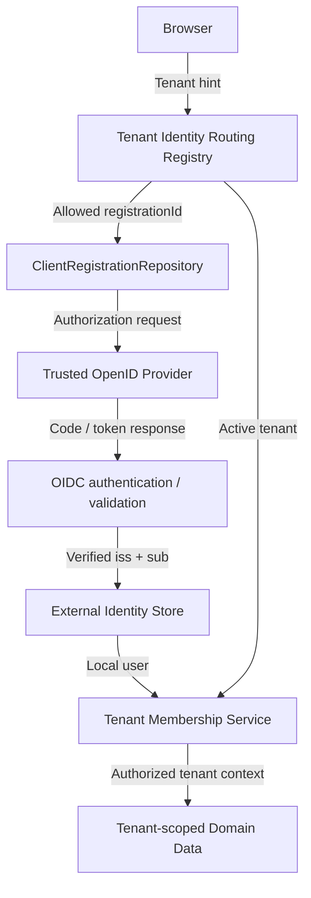
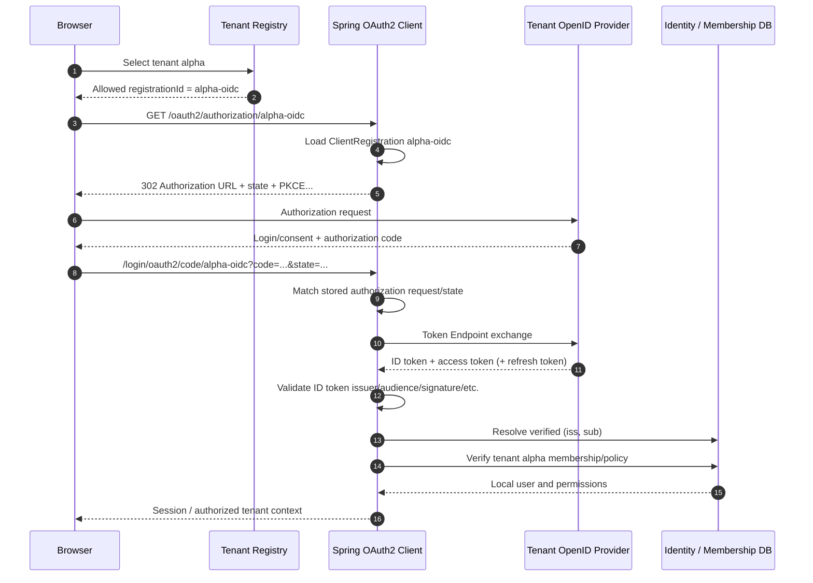

# 26.2. Designing Registrations by Tenant and Issuer

When a **Spring Security OAuth 2.0/OIDC Client** application serves multiple organizations, enterprise customers, or isolated environments, you cannot assume every user logs in through the same **OpenID Provider (OP)** and the same **OAuth client registration**.

For example, a SaaS platform has customers:

- **Tenant Alpha** logs in with Alpha company's own IdP.
- **Tenant Beta** uses an IdP belonging to the Beta system.
- **Tenant Gamma** shares an OpenID Provider with Beta but has a different **client ID, scope policy, and redirect URI**.
- A large customer may have multiple SSO methods, or switch identity providers during a migration.

If the wrong issuer is selected, the application may fail ID Token verification. More seriously, if tenant selection and authorized client storage are not properly bound, the application can mix up **identities, sessions, tokens, and data access permissions** across tenants.

This lesson focuses on designing three core concepts:

1. **Tenant** — the organizational and authorization boundary of the business system.
2. **ClientRegistration/registrationId** — the OAuth2/OIDC client configuration that Spring Security uses to initiate and complete login.
3. **Issuer (iss)** — the identifier of the OP issuing the ID Token, used to verify the authentication source.

**Core principle:** tenant, registration, and issuer are related to each other but are **not identical**. You must design explicit mappings, verify the OIDC issuer accurately, and enforce permissions at the business layer rather than inferring the tenant solely from a user's domain or email.

---

## 1. The Multi-Tenant OIDC Client Problem

Suppose a SaaS application:

```text
https://app.saas.example
```

serves three customers:

| Tenant | User domain | OP/issuer | OAuth client |
|---|---|---|---|
| alpha | `alpha.example` | `https://id.alpha.example` | `alpha-portal-client` |
| beta | `beta.example` | `https://login.identity.example/realms/beta` | `beta-portal-client` |
| gamma | `gamma.example` | `https://login.identity.example/realms/beta` | `gamma-portal-client` |

In this example:

- Tenants **beta** and **gamma** share the same issuer but have different client IDs.
- Tenant **alpha** has a different issuer.
- Email domain is data that supports **IdP hints**, not sufficient proof to grant access to a tenant.
- Each tenant may require different scopes, claims, consent, and logout policies.

A proper design-level mapping might look like:

```text
tenant alpha
    |
    +-- allowed registrations
          |
          +-- alpha-oidc
                 |
                 +-- issuer = https://id.alpha.example
                 +-- client_id = alpha-portal-client
                 +-- scopes = openid profile email

tenant beta
    |
    +-- beta-oidc
          |
          +-- issuer = https://login.identity.example/realms/beta
          +-- client_id = beta-portal-client

tenant gamma
    |
    +-- gamma-oidc
          |
          +-- issuer = https://login.identity.example/realms/beta
          +-- client_id = gamma-portal-client
```

### 1.1. The Real Problem Is Not Just Multiple URLs

A system can easily store multiple `issuer-uri` entries in YAML. However, a multi-tenant architecture must also answer:

1. How is the tenant selected **before login**?
2. Which registration is allowed to be used for that tenant?
3. How does Spring Security bind the callback to the original authorization request?
4. If the same issuer serves multiple tenants, how does the application know which tenant the user belongs to?
5. If two issuers both emit `sub=123`, how do you prevent mixing up users?
6. Could tenant A's access token accidentally be sent to tenant B's API?
7. Are client credentials/redirect URIs isolated?
8. When a tenant is locked or changes IdPs, how are existing sessions and tokens handled?

Therefore, the design must cover **identity selection, protocol validation, data authorization, and token lifecycle**.

## 2. Distinguishing Tenant, `registrationId`, and Issuer

### 2.1. Tenant Is a Business Concept

A tenant might look like:

```text
tenant_id = alpha
display_name = Alpha Corporation
data_partition = alpha
billing_account = ...
status = ACTIVE
```

The tenant determines data boundaries, quotas, policies, and which users/workloads are allowed to access resources.

**OIDC does not automatically create a business tenant for the application.** The OP authenticates a subject; which tenant that subject can enter belongs to the SaaS system and trusted authorization sources.

### 2.2. `registrationId` Is Spring Security's Internal Key

For example:

```yaml
spring:
  security:
    oauth2:
      client:
        registration:
          alpha-oidc:
            ...
```

`alpha-oidc` is a **registrationId**. Spring Security uses it to:

- Look up `ClientRegistration`.
- Select OP endpoints/client credentials.
- Initiate the authorization request.
- Correlate the callback with the authorization context.
- Look up/save `OAuth2AuthorizedClient`.
- Help distinguish multiple registrations sharing the same issuer.

A Registration ID is **not** the client ID issued by the OP, not the issuer URL, and does not by itself prove tenant ownership.

### 2.3. Issuer Is the Identifier of the OpenID Provider

For example:

```text
iss = https://id.alpha.example
```

An OIDC ID Token contains the `iss` claim. The RP must verify that it matches the **trusted issuer of the selected registration**.

An issuer can contain a path:

```text
https://login.identity.example/realms/beta
```

Two URLs with the same hostname but different paths can be **two different issuers**. Do not strip the path or compare by hostname alone.

### 2.4. Client ID Is the OAuth Client Identity at the OP

For example:

```text
registrationId = alpha-oidc
clientId       = alpha-portal-client
issuer         = https://id.alpha.example
```

In an OIDC ID Token, `aud` usually relates to **`clientId`**, not `registrationId`.

A registration can use `client_secret_basic`, `private_key_jwt`, mTLS, or another method depending on the OP/client contract.

## 3. Cardinality: One Tenant Does Not Necessarily Equal One Issuer

Common relationships:

| Relationship | Scenario | Design |
|---|---|---|
| 1 tenant → 1 registration → 1 issuer | Each customer has its own IdP | One fixed registration per tenant |
| N tenants → 1 issuer → multiple registrations | Shared OP, different client IDs/policies | Separate registrations even though the issuer is identical |
| N tenants → 1 registration → 1 issuer | One shared login client, SaaS authorizes tenant after login | Can work if identity mapping/authorization is explicit |
| 1 tenant → multiple registrations/issuers | Tenant uses multiple enterprise IdPs or is migrating | Allowlist registrations per tenant |
| 1 issuer → multiple `sub`s across multiple tenants | Shared enterprise directory | Must check tenant membership |
| 1 subject → multiple tenant memberships | User is a consultant for multiple customers | Select **active tenant** after authentication and reauthorize |

**Do not force the architecture into rules like "tenant ID always equals issuer" or "tenant ID always equals registrationId".** Use a registry/mapping that defines the relationship explicitly.

### 3.1. One Issuer Serving Multiple Tenants

For example, `https://login.identity.example/realms/shared` issues ID Tokens for all employees/customers.

Token:

```json
{
  "iss": "https://login.identity.example/realms/shared",
  "sub": "user-725",
  "aud": "saas-portal",
  "exp": 1794803600
}
```

From `iss` and `sub` alone, the RP identifies the external identity. However, if the user can belong to both tenant alpha and tenant gamma, **which tenant is currently selected** is a separate business decision, typically verified by a membership service and active tenant context.

### 3.2. One Tenant Using Multiple Issuers

For example, tenant alpha uses one OP for employees and another OP for partners.

```text
alpha
  |-- alpha-employees -> issuer company
  |-- alpha-partners  -> issuer partners
```

A user having the same email across two issuers is not automatically treated as the same local account. If account linking is desired, a dedicated secure workflow is required.

### 3.3. A Tenant Changing Issuers

Migrating from an old issuer to a new issuer is not just swapping a URL:

```text
old issuer = https://id-old.alpha.example
new issuer = https://id-new.alpha.example
```

The external identity `(iss,sub)` changes. The RP needs a migration/linking policy; if you drop `iss` from the identity key, you risk linking the wrong accounts.

## 4. Registry Design Pattern: Separating Config from Business Permissions

A clean architecture can use two logical registries.

### 4.1. Tenant/Identity Routing Registry

```text
TenantIdentityConfig
  tenantId
  status
  allowedRegistrationIds
  defaultRegistrationId
  permittedLoginDomains (optional hints)
  loginPolicy
  identityMappingPolicy
```

This registry answers **which tenant is allowed to log in through which registration**.

### 4.2. OAuth Client Registration Registry

```text
ClientRegistration
  registrationId
  provider/issuer
  clientId
  clientAuthenticationMethod
  authorizationGrantType
  redirectUri
  scopes
  provider endpoints/JWKS metadata
```

This registry serves **Spring Security's OAuth2/OIDC protocol**.

### 4.3. Local Identity/Membership Registry

A separate layer:

```text
ExternalIdentity
  issuer
  subject
  linkedLocalUserId

TenantMembership
  localUserId
  tenantId
  status
  roles / permissions
```

After authentication, the app checks external identity and tenant membership. Do not let `ClientRegistration` automatically decide all tenant permissions just because login came from the right IdP.



The **tenant hint** path may be supplied by the browser, but the membership decision happens **after the identity has been verified**.

## 5. Naming `registrationId` Stably and Unambiguously

Good examples:

```text
alpha-oidc
beta-employees
beta-partners
gamma-oidc
```

A registration ID does not have to match the tenant name. A good design requires:

- Uniqueness across the entire RP.
- Stability over time, or a migration policy.
- No client secrets, private data, or unnormalized raw URLs.
- Explicit mapping to issuer/clientId.
- An enabled/disabled state.
- Rules for handling tenant deletion or OP changes.
- Never letting a request parameter dynamically create a new registration.

### 5.1. Avoid Using Email as a Registration ID

```text
registrationId = alice@alpha.example
```

is the wrong abstraction because a registration describes an OAuth client/OP, not a user.

### 5.2. Registration ID Is Not the Sole Source for Choosing the Active Tenant

A `shared-idp` registration can serve multiple tenants. After login, the app needs to know which tenant the user wants to act in and verify membership. Do not infer the tenant from the registration string when the mapping is not 1:1.

### 5.3. Do Not Reuse a Registration ID for a Different Issuer Without Migration

If `alpha-oidc` previously pointed to issuer A and later switches to issuer B, old authorized clients/session mappings might still be tied to `alpha-oidc`. Controlled invalidation/migration is needed; never silently edit the issuer and continue using old token state.

## 6. Static Configuration of Multiple Registrations in Spring Boot

This is the easiest starting point to observe.

```yaml
spring:
  security:
    oauth2:
      client:
        registration:
          alpha-oidc:
            provider: alpha
            client-id: ${ALPHA_CLIENT_ID}
            client-secret: ${ALPHA_CLIENT_SECRET}
            client-authentication-method: client_secret_basic
            authorization-grant-type: authorization_code
            redirect-uri: "{baseUrl}/login/oauth2/code/{registrationId}"
            scope:
              - openid
              - profile
              - email

          beta-oidc:
            provider: beta
            client-id: ${BETA_CLIENT_ID}
            client-secret: ${BETA_CLIENT_SECRET}
            client-authentication-method: client_secret_basic
            authorization-grant-type: authorization_code
            redirect-uri: "{baseUrl}/login/oauth2/code/{registrationId}"
            scope:
              - openid
              - profile
              - email
              - groups

        provider:
          alpha:
            issuer-uri: https://id.alpha.example
          beta:
            issuer-uri: https://login.identity.example/realms/beta
```

**Meaning of the labels:**

- `registration.alpha-oidc`: local registration ID.
- `provider: alpha`: reference to the provider metadata configuration.
- `client-id`/`client-secret`: RP credentials for the corresponding OP.
- `issuer-uri`: trusted issuer for discovery/validation.
- `scope: openid`: requests OIDC login and returns an ID Token.
- `redirect-uri`: Spring Security callback, must match the configuration allowed by the OP.

Do not store secrets in the source repository. The `${...}` examples represent Spring property placeholders resolved via environment/secrets configuration at deployment time.

### 6.1. Provider Name Is Not the Issuer ID

In YAML:

```yaml
provider:
  beta:
    issuer-uri: https://login.identity.example/realms/beta
```

`beta` is only a local key name. The `iss` claim in the ID Token must match the actual issuer URI, not the literal `beta`.

### 6.2. Same Issuer, Different Client IDs

```yaml
spring:
  security:
    oauth2:
      client:
        registration:
          beta-oidc:
            provider: shared-op
            client-id: ${BETA_CLIENT_ID}
            client-secret: ${BETA_CLIENT_SECRET}
            authorization-grant-type: authorization_code
            redirect-uri: "{baseUrl}/login/oauth2/code/{registrationId}"
            scope: openid,profile

          gamma-oidc:
            provider: shared-op
            client-id: ${GAMMA_CLIENT_ID}
            client-secret: ${GAMMA_CLIENT_SECRET}
            authorization-grant-type: authorization_code
            redirect-uri: "{baseUrl}/login/oauth2/code/{registrationId}"
            scope: openid,profile

        provider:
          shared-op:
            issuer-uri: https://login.identity.example/realms/shared
```

The two registrations share the same issuer but have different client IDs. The OP verifies the client and redirect URI per registration; Spring verifies the ID Token audience against the selected client ID.

**A shared issuer does not mean a token from the beta registration can be used to call APIs for the gamma registration.**

## 7. Servlet `SecurityFilterChain` Configuration

For a Spring MVC application:

```groovy
dependencies {
    implementation 'org.springframework.boot:spring-boot-starter-web'
    implementation 'org.springframework.boot:spring-boot-starter-security'
    implementation 'org.springframework.boot:spring-boot-starter-oauth2-client'
}
```

Security config:

```java
import org.springframework.context.annotation.Bean;
import org.springframework.context.annotation.Configuration;
import org.springframework.security.config.Customizer;
import org.springframework.security.config.annotation.web.builders.HttpSecurity;
import org.springframework.security.web.SecurityFilterChain;

@Configuration
public class WebSecurityConfig {

    @Bean
    SecurityFilterChain appSecurity(HttpSecurity http) throws Exception {
        http
            .authorizeHttpRequests(auth -> auth
                .requestMatchers(
                    "/", "/login", "/choose-tenant", "/error",
                    "/css/**", "/js/**")
                    .permitAll()
                .anyRequest().authenticated())
            .oauth2Login(Customizer.withDefaults());

        return http.build();
    }
}
```

`oauth2Login()` enables Spring to handle the OAuth2/OIDC Authorization Code Flow. It **does not automatically create a tenant authorization policy** and does not automatically check whether the user is allowed to access the selected tenant's data.

### 7.1. Authorization Initiation URL

For registration `alpha-oidc`:

```text
/oauth2/authorization/alpha-oidc
```

For `beta-oidc`:

```text
/oauth2/authorization/beta-oidc
```

Spring uses the registration ID in this path to load the matching `ClientRegistration`.

### 7.2. Callback URL

For example:

```text
/login/oauth2/code/alpha-oidc
/login/oauth2/code/beta-oidc
```

This is Spring Security's callback endpoint. Do not write your own controller to read `code` from the query string when the framework already manages the flow; it needs to verify `state`, client registration, token response, and ID Token.

## 8. Tenant-Based Login Flow



Two critical points in time:

**Before authentication:** the chosen tenant is only a **hint/routing intent**, not proven permission.

**After authentication:** the RP relies on the verified issuer/subject and authoritative membership data to decide whether the user can enter the tenant.

## 9. How Is the Tenant Selected Before Login?

There are multiple sources for a tenant hint.

| Hint source | Example | Pros | Risks |
|---|---|---|---|
| Subdomain | `alpha.app.example` | Natural UX per customer | Host header/proxy trust, DNS, custom domains |
| URL path | `/t/alpha/login` | Easy to route on one domain | User can edit path, must allowlist |
| Tenant picker | User selects Alpha/Beta | Explicit | User may pick a tenant they do not belong to |
| Email domain | `user@alpha.example` | Helps IdP discovery UX | Domain does not prove membership, email can be spoofed |
| Invitation link | Verified onboarding link | Ties to a specific tenant | Link token needs signing, expiry, anti-replay |
| Enterprise domain mapping | `login.alpha.example` | Supports white-labeling | DNS ownership and host validation |
| Query string | `?tenant=alpha` | Simple | Easy to tamper with, use only as routing hint |

Regardless of the method chosen, **the hint source must never automatically become authorization**.

### 9.1. Tenant Picker

The user chooses a configured tenant:

```html
<a href="/login/tenant/alpha">Log in to Alpha</a>
<a href="/login/tenant/beta">Log in to Beta</a>
```

The RP queries the tenant registry, determines the allowed registration, and redirects to Spring's OAuth2 authorization endpoint.

### 9.2. Email Domain Discovery Is Only a Hint

Do not do:

```text
User enters ceo@alpha.example
=> auto-grant tenant=alpha and ROLE_ADMIN
```

A user-entered email is unverified. Even an email claim after OIDC can change and is insufficient to prove membership across all providers.

Only use domains to suggest a registration/OP when a trusted mapping exists; membership must be verified separately.

### 9.3. Tenant Under a Custom Domain

With:

```text
https://login.alpha-customer.example
```

a reverse proxy may forward requests to the same SaaS backend. The application must determine the tenant from a **managed hostname with verified ownership**, not from an arbitrary `Host` or `X-Forwarded-Host` header outside a trusted proxy.

## 10. Example of Selecting a Registration via a Server-Side Allowlist

A controller should not accept an issuer URL or client ID directly from the browser. Instead, accept a tenant key and look up a **trusted mapping**.

### 10.1. TenantLoginRoute

```java
public record TenantLoginRoute(
    String tenantId,
    String registrationId,
    boolean enabled
) {}
```

### 10.2. Simple Registry

```java
import java.util.Map;
import java.util.Optional;

public final class TenantLoginRegistry {

    private final Map<String, TenantLoginRoute> routes = Map.of(
        "alpha", new TenantLoginRoute(
            "alpha", "alpha-oidc", true),
        "beta", new TenantLoginRoute(
            "beta", "beta-oidc", true)
    );

    public Optional<TenantLoginRoute> resolve(String tenantKey) {
        if (tenantKey == null) {
            return Optional.empty();
        }

        return Optional.ofNullable(routes.get(tenantKey))
            .filter(TenantLoginRoute::enabled);
    }
}
```

This is an illustrative mapping. Production can use a database/cache, but must enforce authorization when modifying mappings and validation before activating configurations.

### 10.3. Controller to Start Login

```java
import java.net.URI;

import org.springframework.http.HttpStatus;
import org.springframework.http.ResponseEntity;
import org.springframework.web.bind.annotation.GetMapping;
import org.springframework.web.bind.annotation.PathVariable;
import org.springframework.web.bind.annotation.RestController;

@RestController
public final class TenantLoginController {

    private final TenantLoginRegistry tenants;

    public TenantLoginController(TenantLoginRegistry tenants) {
        this.tenants = tenants;
    }

    @GetMapping("/login/tenant/{tenantKey}")
    public ResponseEntity<Void> start(
            @PathVariable String tenantKey) {

        var route = tenants.resolve(tenantKey);

        if (route.isEmpty()) {
            return ResponseEntity.notFound().build();
        }

        String registrationId = route.get().registrationId();

        // Only fixed, validated registration IDs from the
        // trusted registry, never a user-supplied URL.
        URI destination = URI.create(
            "/oauth2/authorization/" + registrationId);

        return ResponseEntity
            .status(HttpStatus.FOUND)
            .location(destination)
            .build();
    }
}
```

This example assumes `registrationId` is pre-assigned by the registry and uses a safe format such as `[a-z0-9-]+`. If mappings come from a DB, validate the registration ID during onboarding to prevent path injection/invalid redirects.

**Do not take `tenantKey` and concatenate it directly into an issuer URL** such as `https://{tenantKey}.idp.example` without an allowlist and trust policy.

### 10.4. Selecting a Tenant Does Not Mean Permissions Are Verified

After OAuth2 Login succeeds, the app must verify the user has membership in `route.tenantId()`. Do not store the tenant chosen from the request in the session and assume it is a verified role.

## 11. What Information Should Be Bound to the Authorization Request?

If a tenant is selected before login, the callback may arrive minutes later. During that interval, the user could:

- Open another tab to log into a different tenant.
- Change the active tenant.
- Cancel and restart the authorization request.
- Be redirected back from the OP via a request to a different URL.

The RP needs to **bind the tenant intent to the initiated authorization transaction**, rather than just reading "current tenant" from an easily overwritten session variable.

### 11.1. OIDC `state` Binding

Spring Security uses a random `state` to correlate the callback response with the saved authorization request.

```text
Authorization request A:
  state = random-A
  registration = alpha-oidc
  tenantIntent = alpha

Authorization request B:
  state = random-B
  registration = beta-oidc
  tenantIntent = beta
```

When callback A arrives, the context of **request A** must be used, not a session field like "the last tenant the user selected" that request B just overwrote.

### 11.2. Do Not Set `state` to the Tenant ID

Wrong:

```text
state=alpha
```

`state` must be a sufficiently random/unpredictable correlation value per the framework's design. A tenant ID does not replace `state`.

### 11.3. Adding Application Context Safely

When you need to preserve a tenant hint, you can:

- Store it in an authorization request repository correlated by `state`.
- Use a server-side transaction record keyed by `state`/internal nonce.
- Use the `OAuth2AuthorizationRequestResolver` extension point supported by Spring.
- When customizing, preserve `state`/PKCE/nonce validation and avoid altering callback validation.

Do not stuff a raw untrusted tenant URL into `state`, decode it, and treat it as authorization. If stateless encoded `state` is needed, you must protect integrity, prevent replay, and bind it to the exact transaction by design.

### 11.4. Concurrent Multi-Tab Logins

A default authorization request repository may limit the number of pending login attempts per session depending on implementation/version. If multi-tab support is required, test it and use a repository/keying strategy keyed appropriately by `state`, rather than assuming every version supports unlimited concurrent flows automatically.

## 12. Callback, Redirect URI, and Registration Binding

An authorization request for `alpha-oidc` typically contains:

```text
client_id=alpha-portal-client
redirect_uri=https://app.saas.example/login/oauth2/code/alpha-oidc
response_type=code
scope=openid profile email
state=<random>
code_challenge=<pkce-if-used>
code_challenge_method=S256
```

Callback:

```text
https://app.saas.example/login/oauth2/code/alpha-oidc
  ?code=...
  &state=...
```

The RP must verify the callback belongs to the right **authorization request and registration**. If an attacker tries to send OP B's authorization response to the callback intended for OP A, the registration/issuer/PKCE/state bindings must prevent an invalid login.

### 12.1. Distinct Callback Paths Help

`/login/oauth2/code/{registrationId}` helps identify the registration on the callback. This is a useful default design, but **the path alone does not replace `state` and issuer validation**.

### 12.2. Callback URI Must Be Registered with the OP

The AS/OP must allow the redirect URI per client registration. Avoid wildcards and arbitrary domains:

```text
Unsafe:
  https://*.example.org/*
```

If tenants have custom domains, you need an explicit redirect URI registration strategy or a centralized callback domain with a safe correlation/redirect-back policy.

### 12.3. Do Not Redirect Back to Arbitrary URLs After Login

Do not accept:

```text
/login/tenant/alpha?returnTo=https://attacker.example
```

and send the browser to `returnTo` after login without validation. This creates an **open redirect** risk and can leak authorization-related data depending on the flow.

Allow only internal relative paths or registered allowlisted origins; bind the return target to the authorization transaction if needed.

## 13. Issuer Matching and Mix-Up Attack Protection

**Authorization Server mix-up** occurs when a client confuses which AS/OP is participating in an authorization transaction, causing it to send a code/token request to the wrong destination or process a response using another issuer's configuration.

In a multi-issuer client, this is a central threat model.

### 13.1. Layers of Protection

- The registration is selected **before** redirecting.
- The authorization request is saved with `state`.
- The callback is bound to the exact registration/issuer.
- The Token Endpoint is read from the trusted `ClientRegistration`.
- The ID Token `iss` must match the configured issuer.
- The ID Token `aud` must include the right OAuth client ID.
- Check `azp` when required by the profile.
- The PKCE verifier must belong to the same authorization request.
- Never use another issuer's JWKS.
- Never allow the callback to supply an arbitrary issuer/token endpoint URL.

### 13.2. Issuer Parameter in the Authorization Response

OAuth 2.0 Authorization Server Issuer Identification (RFC 9207) defines the `iss` parameter in the authorization response to mitigate mix-up risks when supported by the AS/client.

Do not confuse `iss` in the authorization response with `iss` in the **ID Token**: they appear at different stages and have different validation logic.

Whether Spring Security supports/verifies a specific extension depends on the version and provider configuration. With or without the response `iss` parameter, **OIDC ID Token issuer validation and state/registration binding remain essential requirements**.

### 13.3. Do Not Compare Hostname Alone

Two issuers:

```text
https://id.example.org/realms/alpha
https://id.example.org/realms/beta
```

have the same hostname but different issuer IDs. Comparing:

```java
assertIssuerHostEquals("id.example.org");
```

is insufficient.

You must match the issuer identifier per metadata/trust configuration, applying normalization only when strictly conforming to the spec and API in use.

### 13.4. Do Not Use Email Domain to Select JWKS

Wrong:

```text
JWT email = person@alpha.example
=> Fetch https://alpha.example/.well-known/jwks
=> Trust token signature
```

Issuer/JWKS trust comes from the configured registration, not from a claim presented by an unverified token.

## 14. Discovery, `issuer-uri`, and `ClientRegistrations`

When a provider supports OpenID Connect Discovery, you can use the issuer URI to fetch metadata:

```text
https://id.alpha.example/.well-known/openid-configuration
```

Metadata may contain:

```json
{
  "issuer": "https://id.alpha.example",
  "authorization_endpoint": "https://id.alpha.example/authorize",
  "token_endpoint": "https://id.alpha.example/token",
  "jwks_uri": "https://id.alpha.example/jwks",
  "userinfo_endpoint": "https://id.alpha.example/userinfo"
}
```

### 14.1. Metadata Is Part of the Trust Boundary

The RP must ensure:

1. The metadata `issuer` matches the registered issuer.
2. Endpoints conform to the provider/security contract.
3. TLS validation is enabled.
4. Metadata is never fetched from a host arbitrarily chosen by a user request.
5. JWK keys are used in the context of the **matching issuer**.
6. Metadata and keys are cached/refreshed according to an appropriate policy.

### 14.2. Creating a `ClientRegistration` from Issuer

Spring Security provides the `ClientRegistrations.fromIssuerLocation(...)` helper.

```java
import org.springframework.security.oauth2.client.registration.ClientRegistration;
import org.springframework.security.oauth2.client.registration.ClientRegistrations;

ClientRegistration alpha = ClientRegistrations
    .fromIssuerLocation("https://id.alpha.example")
    .registrationId("alpha-oidc")
    .clientId(alphaClientId)
    .clientSecret(alphaClientSecret)
    .redirectUri("{baseUrl}/login/oauth2/code/{registrationId}")
    .scope("openid", "profile", "email")
    .build();
```

This example assumes the OP supports discovery and the helper can fetch metadata compatible with the Spring version.

**This operation can perform HTTP I/O while building the registration.** Do not perform discovery from an arbitrary URL directly during a login request without rate limiting, network isolation, timeouts, and a trusted issuer policy.

### 14.3. `fromIssuerLocation` Does Not Mean Trusting Any Issuer

Wrong:

```java
ClientRegistrations.fromIssuerLocation(
    request.getParameter("issuer"))
    .build();
```

The browser could supply:

```text
http://169.254.169.254/
http://localhost:...
https://attacker.example/...
```

leading to **SSRF**, trusting malicious metadata, sending client secrets/assertions to another host, or causing resource exhaustion.

Do not solve this merely by checking `startsWith("https://")`. You need a registry allowlist, HTTPS, endpoint trust, validation, blocking internal networks per the threat model, and onboarding approval.

## 15. Static Repository: Suitable for Few or Infrequently Changing Tenants

Spring Security Servlet uses:

```java
ClientRegistrationRepository
```

A familiar implementation:

```java
InMemoryClientRegistrationRepository
```

Example:

```java
import org.springframework.context.annotation.Bean;
import org.springframework.context.annotation.Configuration;
import org.springframework.security.oauth2.client.registration.ClientRegistrationRepository;
import org.springframework.security.oauth2.client.registration.InMemoryClientRegistrationRepository;
import org.springframework.security.oauth2.client.registration.ClientRegistration;

@Configuration
public class MultiTenantRegistrationConfig {

    @Bean
    ClientRegistrationRepository clientRegistrationRepository(
            TenantRegistrationSettings settings) {

        ClientRegistration alpha =
            settings.alphaRegistration();

        ClientRegistration beta =
            settings.betaRegistration();

        return new InMemoryClientRegistrationRepository(
            alpha, beta);
    }
}
```

`TenantRegistrationSettings` is an illustrative application abstraction holding validated configuration. There is no built-in class with this name in Spring.

### 15.1. Why Starting Static Is Often Good

- Every registration is validated at bootstrap time.
- Secrets and issuer URLs are explicit.
- Easy to audit tenant onboarding.
- No arbitrary network discovery on incoming requests.
- Unlikely to introduce races changing registrations mid-OAuth flow.
- Can use the generated login page when the repository supports listing registrations.

### 15.2. Drawbacks

- Adding a tenant may require a deploy/restart, depending on the config source.
- Not suitable if thousands of tenants change continuously.
- Secret and issuer metadata rotation requires an update process.
- A discovery failure at startup can affect booting if no suitable fallback/caching mechanism is in place.

With a small number of tenants, **simplicity and auditability** can outweigh dynamic registration.

## 16. Dynamic `ClientRegistrationRepository` for Many Tenants

When tenants are onboarded continuously, the application may need a repository backed by a dynamic registry.

### 16.1. It Does Not Have to "Build from Issuer URL" on Every Request

A better approach:

```text
Tenant onboarding workflow
   -> Validate tenant ownership
   -> Approve issuer/client metadata
   -> Fetch/verify discovery
   -> Store trusted sanitized registration
   -> Publish active registry snapshot

Login request
   -> Lookup registrationId in trusted snapshot
   -> Start authorization immediately
```

Do not use browser requests as the source supplying all of `issuerUri`, `clientId`, `clientSecret`, and endpoints.

### 16.2. Repository Backed by a Registry Snapshot

Java example:

```java
import java.util.Iterator;
import java.util.List;
import java.util.Map;
import java.util.function.Function;
import java.util.stream.Collectors;

import org.springframework.security.oauth2.client.registration.ClientRegistration;
import org.springframework.security.oauth2.client.registration.ClientRegistrationRepository;

public final class TenantClientRegistrationRepository
        implements ClientRegistrationRepository,
                   Iterable<ClientRegistration> {

    private final Map<String, ClientRegistration> byId;

    public TenantClientRegistrationRepository(
            List<ClientRegistration> trustedRegistrations) {

        this.byId = trustedRegistrations.stream().collect(
            Collectors.toUnmodifiableMap(
                ClientRegistration::getRegistrationId,
                Function.identity()
            )
        );
    }

    @Override
    public ClientRegistration findByRegistrationId(
            String registrationId) {
        return byId.get(registrationId);
    }

    @Override
    public Iterator<ClientRegistration> iterator() {
        return byId.values().iterator();
    }
}
```

This code represents an **immutable snapshot**. In a real dynamic system, the registry can provide atomic versioned snapshots/caches rather than a map fixed for the lifetime of the process.

`Iterable<ClientRegistration>` is useful when the framework needs to enumerate registrations, such as for the auto-generated login page. However, with thousands of tenants, **you should not list all providers/tenants publicly on the login page**; use a tenant picker/known route instead.

### 16.3. Dynamic Repositories Must Be Consistent Across a Request

Suppose:

```text
T0: Login starts with registration alpha-v1
T1: Admin changes token endpoint and client secret
T2: Callback arrives, repository returns alpha-v2
```

There is a risk that the callback uses a different configuration than the initial authorization request.

Strategies:

- Do not arbitrarily change issuer/client ID under the same registration ID.
- Version the registration on breaking changes, e.g., `alpha-oidc-v2`.
- Keep the old configuration available while in-flight authorization transactions exist.
- Synchronize registry snapshots across nodes.
- Configure dual-valid client credentials per rotation policy when supported by the AS.
- Test callbacks during rollouts.

**Do not change the issuer of an active registration between authorization and token exchange** without an explicit migration/correlation strategy.

## 17. Controlled Dynamic Registry Model

A conceptual schema:

```text
Tenant:
  tenant_id
  display_name
  status

TenantIdentityProvider:
  tenant_id
  registration_id
  issuer_uri
  client_id
  client_secret_reference
  client_authentication_method
  allowed_scopes
  redirect_uri
  enabled
  configuration_version
  approved_at
```

Separate `client_secret_reference` from the raw secret. The registry stores a reference to KMS/secret manager, not easily accessible plaintext secrets in a configuration table.

### 17.1. Workflow to Onboard an Enterprise Tenant

1. An authenticated admin creates an onboarding request.
2. Verify domain/tenant ownership per workflow.
3. The tenant provides the issuer and OAuth client metadata.
4. Backend checks that the issuer URL meets the allowlist/network policy, HTTPS, and trust contract.
5. Perform OIDC discovery in a controlled manner.
6. Compare `issuer` in metadata against the expected issuer.
7. Verify endpoints, JWKS, client auth method, and redirect URI registration.
8. Store the client secret in the secret manager.
9. Assign a stable `registrationId`, scopes, and token audience policy.
10. Activate after approval and integration testing.
11. Publish the new registry snapshot to instances.
12. Audit all changes.

### 17.2. Block Arbitrary Discovery Acting as a Proxy Service

If a SaaS lets any user enter an issuer URL and triggers discovery, the app can be abused to connect to internal networks. This is an **SSRF risk**. You must separate an **admin-controlled onboarding workflow** from an unauthenticated user's login request.

### 17.3. Cache Metadata and Keys

Discovery/JWK retrieval can cause network I/O and hit rate limits. The registry should:

- Cache configurations by TTL/version.
- Cache JWKs per HTTP and decoder policy.
- Support safe key rotation.
- Prevent request storms when an issuer temporarily fails.
- Never use stale keys indefinitely when an issuer is revoked.
- Isolate errors per provider so they do not affect all tenants.

## 18. OIDC User Identity: Keyed by `(iss, sub)`

A valid ID Token:

```json
{
  "iss": "https://id.alpha.example",
  "sub": "user-725",
  "aud": "alpha-portal-client",
  "exp": 1794803600,
  "iat": 1794800000,
  "email": "person@alpha.example",
  "email_verified": true
}
```

The RP can store the external identity:

```text
issuer = https://id.alpha.example
subject = user-725
```

### 18.1. Why Not Use `sub` Alone?

Issuer Beta could also issue:

```text
sub = user-725
```

Two identical `sub` values **do not mean the same user**.

### 18.2. Why Not Use Email as the Key?

An email can:

- Change.
- Be reassigned to someone else.
- Be absent.
- Be unverified.
- Match across providers with different trust levels.
- Fail to correspond accurately to tenant membership.

Even `email_verified=true` does not by default prove the user has permission to access every tenant using that email domain.

### 18.3. `(iss, sub)` Pair and Tenant Membership

A user can have an external identity at a shared issuer while belonging to two tenants:

```text
ExternalIdentity:
  (issuer=shared, sub=user-725) -> localUserId=U42

Membership:
  U42 -> tenant-beta  [ACTIVE, VIEWER]
  U42 -> tenant-gamma [ACTIVE, ADMIN]
```

The user chooses the active tenant; the app checks the corresponding membership. Do not apply the `ADMIN` role from tenant gamma to requests targeting tenant beta.

### 18.4. When the App Allows Account Linking

If a local user is linked to multiple OIDC identities:

```text
LocalUser U42
  -> (issuer-A, sub-A)
  -> (issuer-B, sub-B)
```

You need a linking workflow that verifies ownership of both identities or an enterprise-approved policy. Do not auto-link solely because two ID Tokens share the same email/name.

## 19. Reading Issuer and `registrationId` Properly from Authentication

After successful OIDC Login in Spring Security Servlet, `Authentication` is typically an `OAuth2AuthenticationToken`, and the principal may be an `OidcUser`.

```java
import java.util.Map;

import org.springframework.security.core.Authentication;
import org.springframework.security.oauth2.client.authentication.OAuth2AuthenticationToken;
import org.springframework.security.oauth2.core.oidc.user.OidcUser;
import org.springframework.web.bind.annotation.GetMapping;
import org.springframework.web.bind.annotation.RestController;

@RestController
public class IdentityController {

    @GetMapping("/whoami")
    public Map<String, String> whoami(Authentication auth) {

        if (!(auth instanceof OAuth2AuthenticationToken token)
                || !(token.getPrincipal() instanceof OidcUser user)) {
            throw new IllegalStateException(
                "Expected an authenticated OIDC user");
        }

        return Map.of(
            "registrationId", token.getAuthorizedClientRegistrationId(),
            "issuer", user.getIdToken().getIssuer().toString(),
            "subject", user.getSubject()
        );
    }
}
```

This example only returns illustrative metadata. In production, consider not exposing raw issuer/subject values if the UI does not need them, and use proper error handling instead of `IllegalStateException`.

### 19.1. Selected Registration ID Does Not Replace Issuer Verification

`token.getAuthorizedClientRegistrationId()` tells you which registration Spring processed the login through.

`user.getIdToken().getIssuer()` comes from the ID Token verified by the framework.

To establish a trustworthy tenant identity:

```text
registrationId -> trusted mapping to tenant(s)/issuer
verified issuer + subject -> local identity
local identity + active tenant -> membership/permissions
```

Do not just read `registrationId` and automatically grant a local admin role.

### 19.2. OAuth2-Only Providers Differ from OIDC

If a registration does not request `openid`, the principal may be an `OAuth2User` rather than an `OidcUser`. In that case, there is no OIDC Core ID Token `iss/sub` available by default.

This lesson focuses on OIDC; if you need to support OAuth2-only providers, you must design a dedicated identity namespace and trusted user info mapping, without assuming every provider has identical claims.

## 20. Tenant Authorization After Login

Authentication answers the question:

> "Which registration/issuer did the OP authenticate this subject under?"

Domain authorization answers:

> "Is this subject/local user allowed to access tenant X and resource Y?"

These are two distinct steps.

### 20.1. Business Service

```java
public interface TenantAccessService {

    boolean canAccessTenant(
        String localUserId,
        String tenantId
    );
}
```

A real service may query a membership table, policy engine, or authoritative directory.

### 20.2. Validating Request Context

Example domain route:

```text
GET /tenants/alpha/orders/742
```

The server must:

1. Identify the authenticated local user.
2. Determine the requested tenant from the route.
3. Verify active membership in tenant alpha.
4. Check role/scope/action.
5. Verify order 742 belongs to alpha.
6. Return data only if all conditions pass.

Do not trust `tenant=alpha` in a JWT custom claim unless that claim is part of an authoritative, validated contract, and never allow permissions to bypass business policy.

### 20.3. Fail Closed When Mapping Is Missing

If the user has authenticated via OIDC but no account/membership is found:

```text
OIDC authentication = SUCCESS
Tenant access       = DENIED or pending provisioning
```

Do not automatically treat them as a member of a tenant just because they came from an issuer shared by multiple organizations.

## 21. Data Model for Local Identity and Tenant Mapping

A conceptual schema:

```sql
CREATE TABLE external_identity (
    issuer VARCHAR(500) NOT NULL,
    subject VARCHAR(255) NOT NULL,
    local_user_id VARCHAR(100) NOT NULL,
    created_at TIMESTAMP NOT NULL,
    PRIMARY KEY (issuer, subject)
);

CREATE TABLE tenant_membership (
    tenant_id VARCHAR(100) NOT NULL,
    local_user_id VARCHAR(100) NOT NULL,
    membership_status VARCHAR(30) NOT NULL,
    role_name VARCHAR(100) NOT NULL,
    PRIMARY KEY (tenant_id, local_user_id)
);
```

This is an **illustrative** schema, not one created by Spring Security.

If a user can hold multiple roles in a single tenant, the table must be adjusted to support composite membership-roles, unique constraints, and auditing.

### 21.1. Do Not Use `registrationId` as the Sole External Identity Key

One issuer can have multiple registrations for the same user. Conversely, one registration can use a shared issuer across multiple tenants.

The OIDC external identity key should still prioritize **`(iss, sub)`**. Registration ID is the context of the OAuth client/authorization transaction, not necessarily an independent user namespace.

### 21.2. Tenant ID Must Be Stable

A tenant's display name or custom domain may change. Use a stable internal tenant ID to link data and memberships; do not use a domain as the primary key if domains can be transferred to another customer.

### 21.3. Tenant Context Must Be Controlled in Services/Repositories

Do not just put a tenant ID into a `ThreadLocal` and let every database query use it without checking membership. With WebFlux, Reactor Context must be propagated properly; with Servlet, async threads also need explicit scoping.

An architecture can use:

```text
Authenticated principal
    +
Authorized tenant context (validated)
    |
    v
Tenant-scoped service/repository
    |
    v
Row/partition authorization
```

## 22. `OAuth2AuthorizedClient` Storage in Multi-Tenancy

`OAuth2AuthorizedClient` is typically keyed by:

```text
(clientRegistrationId, principalName)
```

For example:

```text
(alpha-oidc, user-725) -> AT-alpha, RT-alpha
(beta-oidc, user-725)  -> AT-beta, RT-beta
```

### 22.1. `registrationId` Must Be Unique per Actual Registration

If the same `company` registration ID is reused across tenants/issuers in a shared store, authorized clients can get mixed up.

In a multi-tenant deployment, ensure at minimum:

- Unique registration IDs app-wide or explicit namespacing in storage.
- A stable `principalName` that cannot collide in a way that mixes tokens.
- Token state retains appropriate source issuer/client ID/resource context.
- When a login session switches tenants, the previous tenant's token is not automatically reused in the next tenant.

### 22.2. `principalName` May Need to Be Composite

One option is using an external identity stably mapped to a local user ID.

```text
principalName = local-user-U42
```

However, if the app stores tokens across different issuers/registrations, the principal key must ensure a local user cannot mistakenly use a delegation from another linked account.

Some architectures use:

```text
tenant_id + local_user_id + external_identity_id
```

in custom storage. Note that the default `OAuth2AuthorizedClientService` API uses `registrationId`/`principalName`; if additional dimensions are added, encode/map them safely rather than concatenating strings arbitrarily in ways prone to collisions.

### 22.3. Do Not Cache by Issuer Alone

Wrong:

```java
Map<String, String> tokenByIssuer;
```

An issuer can serve multiple clients and multiple users. Caching access tokens by issuer is far too broad, risking token leaks/cross-user authorization issues.

### 22.4. Scopes and Audience

An access token intended for the `orders-alpha` API is not automatically valid for `orders-beta`. Different providers may issue identically named scopes with different meanings.

Use API-specific `RestClient`/`WebClient` instances and explicit registrations/policies. Do not use a global outbound HTTP interceptor that automatically attaches the user's Bearer token to any API host specified by a request.

## 23. Access Token Audience in Multi-Tenant Design

An RP may authenticate via OIDC through OP Alpha but call:

```text
https://api.saas.example/tenants/alpha/orders
```

The Resource Server must check:

- Access token issuer matches a trusted source.
- Access token audience/resource matches the API.
- Token is not expired/revoked.
- Scopes match the operation.
- User/tenant membership and object authorization.

### 23.1. ID Token Does Not Replace Access Token

An ID Token with `aud=alpha-portal-client` is intended for the RP. Do not use an ID Token as a Bearer access token merely because it contains tenant/sub claims.

### 23.2. Different Issuers at the Resource Server

If an API accepts access tokens from multiple trusted issuers, it needs an **`AuthenticationManagerResolver`** or reactive JWT decoder selection based on the issuer and configured trust policy.

This is **Resource Server multi-issuer design**, which differs from the **OAuth Client multi-registration** problem under discussion. Do not copy a "read `iss` then pick a decoder" algorithm into client login before verifying the OIDC authorization request context.

### 23.3. Delegation and Token Exchange

When a user from tenant Alpha needs to call an API in another trust domain, Token Exchange or an appropriate grant supported by the Authorization Server may be required.

Do not send a token with tenant Alpha's audience to tenant Beta's API and skip audience validation just to make the request work.

## 24. Multiple Tenants Sharing One Issuer: Checking Audience and Tenant

Suppose:

```text
beta-oidc:
  issuer = shared-op
  client_id = saas-beta-client

gamma-oidc:
  issuer = shared-op
  client_id = saas-gamma-client
```

If beta's callback receives an ID Token:

```json
{
  "iss": "https://login.identity.example/realms/shared",
  "sub": "user-725",
  "aud": "saas-gamma-client"
}
```

then `iss` appears valid, but **`aud` does not match beta's client ID**. The RP must reject the ID Token if it fails OIDC audience rules.

### 24.1. `azp` When Multiple Audiences Exist

In OIDC, the `azp` claim can be used to identify the authorized party when a token has multiple audiences. The client must validate it according to OIDC rules and configured Spring Security validation.

Do not assume `azp=registrationId` when `registrationId` differs from `clientId`. `azp` is normally compared against the actual OAuth client ID.

### 24.2. Same Issuer Does Not Automatically Share Browser Sessions

An OP may provide shared SSO, but each RP client registration still has its own authorization request and authorized client lifecycle. A user may log in at the same OP while each app/registration receives a different ID Token or access token.

### 24.3. Is an OP Tenant Claim Required?

If the OP emits a claim:

```json
"tenant_id": "beta"
```

only use it as an authoritative tenant assignment when there is an **explicit contract that the OP verified membership in that tenant** and the token/claim has been validated. In a multi-organization shared OP, a self-configured or user-editable claim is not sufficient basis for authorization.

## 25. How to Switch Active Tenants After Login

A user may belong to multiple tenants:

```text
U42 memberships:
  alpha -> VIEWER
  beta  -> ADMIN
```

You do not necessarily have to force the user through OIDC login again every time they switch tenants if identity and policy allow it. However, the application must **reauthorize** under the new active tenant.

### 25.1. Server-Side Tenant Switching

Flow:

```text
POST /switch-tenant
  tenantId=beta
     |
     v
Validate authenticated local user U42
     |
     v
Check active membership U42 -> beta
     |
     v
Update active tenant context in session
     |
     v
Apply beta-specific authorization on subsequent requests
```

Switching tenants merely by modifying a cookie/query parameter in the browser without server validation is insecure.

### 25.2. Does Switching Tenants Require OAuth Reauthorization?

If the new tenant uses a different **registration/issuer/clientId** and the API requires a token from that registration, OAuth authorization/login with the appropriate registration may be necessary.

If the registration/issuer is the same and the token resource/audience matches while the user has memberships in multiple tenants, the app may just switch the domain context per policy.

Do not assume a different tenant automatically requires a new ID Token; what matters is the security contract and token audience/authorization.

### 25.3. Token Cache When Switching Tenants

After switching:

- Do not automatically send tenant alpha's token to beta's API.
- Do not overwrite registration alpha's token state with beta's token.
- Do not use beta's scopes to authorize alpha operations.
- If there is a logout/invalidation policy on switch, clean up authorized clients for the specific registration.
- Prevent stale async requests from overwriting the new active tenant context.

## 26. Multi-Tab OIDC Login and Session Context

A browser may open two tabs:

```text
Tab A -> /login/tenant/alpha
Tab B -> /login/tenant/beta
```

If the application only stores:

```text
session.currentTenantHint = "alpha"
```

and Tab B overwrites it with `beta`, callback A can end up bound to beta by mistake.

### 26.1. Binding per Authorization Transaction

Each pending authorization request should bind:

```text
state A -> registration alpha-oidc -> tenant alpha
state B -> registration beta-oidc  -> tenant beta
```

If customizing `AuthorizationRequestRepository`, ensure concurrent pending states are managed properly and cleaned up after callbacks/timeouts.

### 26.2. Membership Check Is Still Required After Login

Even when tenant hint A is preserved accurately, a user coming from issuer A does not automatically have permission for tenant alpha. Check local identity mapping after OIDC verification.

### 26.3. Session Fixation and Rotation

Spring Security provides appropriate session protection mechanisms for Servlet. If the session ID changes after authentication, any custom correlation/index must track the final session ID rather than retaining a stale pre-login session ID.

### 26.4. Browser Logout Does Not Automatically Revoke All Tenant Grants

If a user logs out of the RP session, persistent authorized clients across multiple tenants may continue to exist depending on storage. An explicit logout/token revocation policy is required, especially when using offline access.

## 27. Protecting Per-Tenant Secrets and Configuration

A tenant can have its own client secret:

```text
alpha-oidc -> secret-alpha-v3
beta-oidc  -> secret-beta-v1
```

Never allow tenant A to access tenant B's secret via admin APIs, logs, dumps, or caches.

### 27.1. Secret References

A registry can store:

```text
tenantId=alpha
registrationId=alpha-oidc
secretRef=kms://oauth/alpha/client-secret
```

The application loads the secret using a restricted identity service account. Do not return secret values in tenant admin GET responses.

### 27.2. Rotation Policy

When rotating a secret:

1. AS/OP prepares the new credential per its supported capabilities.
2. Update the secret manager.
3. Publish the new registry snapshot.
4. Synchronize app instances.
5. Ensure pending authorization callbacks can still exchange valid codes.
6. Retire the old secret after a safe overlap window.
7. Audit `invalid_client` errors per registration.

### 27.3. Key/Certificate Rotation

For `private_key_jwt` or mTLS, use a dedicated key/certificate per registration/security boundary and manage its lifecycle. Do not share a single private key across all tenants unless dictated by a specific threat model/policy.

### 27.4. Do Not Log `ClientRegistration` Directly

`ClientRegistration` can contain the client secret. Do not log/toString the entire registration or binding configuration at an uncontrolled DEBUG log level.

Log non-secret metadata instead:

```text
registrationId=alpha-oidc
issuerAlias=alpha-sso
grantType=authorization_code
clientAuthMethod=client_secret_basic
```

Never log `client_secret` or raw ID Token/access token/refresh tokens.

## 28. Provider-Specific Metadata, Scopes, and Claim Mapping

Two issuers do not always return identical profile responses.

### 28.1. OIDC Standard Claims

Claims such as:

```json
{
  "sub": "user-725",
  "name": "Example User",
  "preferred_username": "employee725",
  "email": "user@alpha.example",
  "email_verified": true
}
```

may be missing or granted differently depending on scopes/provider policies.

### 28.2. Custom Group/Role Claims

One provider may return:

```json
{
  "groups": ["team-a", "team-b"]
}
```

Another provider:

```json
{
  "realm_access": {
    "roles": ["viewer", "editor"]
  }
}
```

Do not arbitrarily map the string `admin` from an untrusted/uncontracted claim into `ROLE_ADMIN` across the entire SaaS.

### 28.3. Adapter per Issuer/Registration

An architecture:

```text
Verified OIDC principal
    |
    v
ProviderProfileAdapter by trusted registration/issuer
    |
    v
NormalizedIdentity (iss, sub, displayName...)
    |
    v
LocalAccountMapping
    |
    v
TenantMembership / Authorization
```

The adapter normalizes attributes, while role/tenant authorization belongs to the authoritative policy.

### 28.4. Do Not Bypass OIDC Validation When Providers Return Custom JSON

If a UserInfo response has an unusual structure, you may need a custom user service/attribute mapper. However, never skip checking that **UserInfo `sub` matches ID Token `sub`** or issuer/audience validation just to "support every tenant".

## 29. Multi-Tenant Configuration in Reactive WebFlux

In WebFlux, the corresponding abstractions are:

| Goal | Servlet | Reactive |
|---|---|---|
| OAuth Client registration | `ClientRegistrationRepository` | `ReactiveClientRegistrationRepository` |
| Static registration repo | `InMemoryClientRegistrationRepository` | `InMemoryReactiveClientRegistrationRepository` |
| Security DSL | `HttpSecurity` | `ServerHttpSecurity` |
| Security chain | `SecurityFilterChain` | `SecurityWebFilterChain` |
| Login feature | `oauth2Login()` | `oauth2Login()` in reactive DSL |
| Authorized client store | `OAuth2AuthorizedClientService` | `ReactiveOAuth2AuthorizedClientService` |
| Request-scoped authorized client repo | `OAuth2AuthorizedClientRepository` | `ServerOAuth2AuthorizedClientRepository` |
| Authorized client manager | `OAuth2AuthorizedClientManager` | `ReactiveOAuth2AuthorizedClientManager` |

### 29.1. WebFlux Security Config

```java
import org.springframework.context.annotation.Bean;
import org.springframework.context.annotation.Configuration;
import org.springframework.security.config.Customizer;
import org.springframework.security.config.annotation.web.reactive.EnableWebFluxSecurity;
import org.springframework.security.config.web.server.ServerHttpSecurity;
import org.springframework.security.web.server.SecurityWebFilterChain;

@Configuration
@EnableWebFluxSecurity
public class ReactiveMultiTenantSecurity {

    @Bean
    SecurityWebFilterChain security(ServerHttpSecurity http) {
        return http
            .authorizeExchange(exchanges -> exchanges
                .pathMatchers(
                    "/", "/login", "/choose-tenant", "/error")
                    .permitAll()
                .anyExchange().authenticated())
            .oauth2Login(Customizer.withDefaults())
            .build();
    }
}
```

### 29.2. Reactive Registration Lookup

```java
import org.springframework.security.oauth2.client.registration.ReactiveClientRegistrationRepository;
import org.springframework.security.oauth2.client.registration.ClientRegistration;
import reactor.core.publisher.Mono;

public final class ReactiveRegistrationLookup {

    private final ReactiveClientRegistrationRepository registrations;

    public ReactiveRegistrationLookup(
            ReactiveClientRegistrationRepository registrations) {
        this.registrations = registrations;
    }

    public Mono<ClientRegistration> find(String registrationId) {
        return registrations.findByRegistrationId(registrationId);
    }
}
```

If the registry reads a DB during a WebFlux request, do not perform blocking JDBC/HTTP discovery on the event loop. Use a reactive cache/repository or offload legacy I/O in a controlled manner.

### 29.3. Authentication Context in WebFlux

WebFlux uses `ReactiveSecurityContextHolder` and Reactor Context. Do not pass the active tenant through an arbitrary static variable/`ThreadLocal` across reactive threads. Use a trusted request-specific context and membership validation.

### 29.4. Same Identity Principles

Whether Servlet or Reactive:

```text
tenant hint -> trusted registration
registration -> verified issuer/client
(iss, sub) -> local user
(local user, tenant) -> membership
```

The difference is primarily the API programming model, not the security requirements.

## 30. Multi-Node, Cache, and Registry Consistency

A SaaS with multiple replicas:

```text
Browser
   |
Load Balancer
   |
+-- Node A: registration snapshot v10
+-- Node B: registration snapshot v11
+-- Node C: registration snapshot v10
   |
Shared authorized-client/session stores
```

If Node A initiates login with `alpha-oidc` v10, but the callback lands on Node B which already has v11 with a different issuer/clientId, login can fail or cause serious confusion.

### 30.1. Synchronizing Config Versions

A strategy is needed:

- Atomic registry snapshots.
- Publishing versions across the entire cluster.
- Pinning config for the duration of pending auth flows if needed.
- Never unexpectedly altering issuer/redirect/token endpoints under the same registration ID.
- Clear rollback/disable policies.
- Monitoring config skew across nodes.

### 30.2. Shared Session/Authorization Request Store

OAuth2 `state` typically requires retrieving the initial authorization request on callback. If the load balancer is not sticky or nodes can restart, appropriate session persistence/routing is needed.

Having a shared session store does not mean dynamic registration snapshots synchronize automatically; the two are separate problems.

### 30.3. Authorized Clients After Registration Disablement

When a tenant admin disables SSO:

```text
registration alpha-oidc enabled=false
```

it does not mean all access tokens/refresh tokens have been revoked. You must decide:

- Whether to delete local authorized client records.
- Whether to call AS token revocation.
- Whether to invalidate sessions.
- Whether to block tenant data access immediately.
- Whether to allow pending callbacks to complete.

**Disabling login** and **disabling tenant access** must be distinguished. If a tenant is suspended, domain authorization must deny access immediately per policy, even for existing tokens/sessions.

## 31. Changing Issuer or Migrating a Tenant's IdP

A migration plan can include two registrations running in parallel:

```text
alpha-oidc-old -> issuer old
alpha-oidc-new -> issuer new
```

### 31.1. Dual-Run Transition Phase

1. Create a new registration rather than immediately mutating the old registration's issuer.
2. Verify login/claims/subject mapping with the new IdP.
3. Establish approved account linking.
4. Roll out the new registration to the tenant.
5. Keep callbacks for in-flight old flows valid briefly if policy permits.
6. Clean up authorized clients/sessions for the old registration on schedule.
7. Revoke credentials/tokens per AS support.
8. Disable the old registration and clean up secrets/metadata.

### 31.2. Do Not Auto-Match Users by Email

The new issuer may emit a different `sub`. User mapping requires identity proof or admin-approved migration, not relying on a shared email as sole proof.

### 31.3. Tenant Rollback

If rolling out the new IdP fails, you can temporarily revert to the old registration if the AS/credentials remain valid. However, tokens and sessions from both issuers must still be managed separately without overwriting into a single source-agnostic record.

## 32. Common Design Mistakes

### 32.1. Registration ID Used as Tenant ID

```text
registrationId=shared-idp
tenant=shared-idp
```

If the same registration serves hundreds of tenants, every user could be misassigned to the same tenant.

### 32.2. Tenant Inferred from an Unverified Email

A user enters any corporate email and is automatically granted membership. This is a tenant authorization bypass.

### 32.3. Issuer Taken from the Request

```text
/login?issuer=https://attacker.example
```

then fetching metadata and using that issuer for login. This can lead to SSRF and trust confusion.

### 32.4. Comparing Hostname Alone

Ignoring the issuer path can mix up two realms on the same domain.

### 32.5. Dynamic Registry Changing Client Secret/Issuer Between Login and Callback

Easily causes `invalid_client`, `invalid_grant`, or wrong-issuer/token exchange errors.

### 32.6. Not Storing Registration in the Authorization State Context

The callback uses "the last tenant in the session", causing races when multiple tabs log in concurrently.

### 32.7. Using `sub` or Email as a System-Wide Identity Key

Two issuers can have the same subject string/email, leading to account collisions.

### 32.8. Treating a Valid Issuer as Sufficient Tenant Authorization

A shared issuer has many users/tenants; membership authorization is required.

### 32.9. Caching Tokens by Issuer

Tokens belong to a client/principal/resource; overly broad caches can leak across tenants.

### 32.10. Using an ID Token to Call APIs

ID Tokens are for the RP; APIs must receive an access token matching the resource audience.

### 32.11. An HTTP Client Attaching a Bearer Token to Arbitrary URLs

An attacker could control the target and steal another tenant's access token.

### 32.12. Letting a Custom Domain Dictate All Tenant Policy

Host headers can be spoofed if proxy trust is misconfigured. Domain mapping must come from a registry with verified ownership.

### 32.13. Auto-Creating `ClientRegistration` from Untrusted JWKS

JWT `jku`/`kid` headers must never override trusted issuer metadata.

### 32.14. Changing Issuer While Keeping Old Authorized Client Records

Old tokens may still be tied to `registrationId`; migration/cleanup is required.

### 32.15. Logging Client Secrets, Tokens, or Full `ClientRegistration` Objects

Can expose credentials and user identity information.

## 33. Testing Multi-Tenant OAuth2 Login

Although this is a design lesson, production implementations need a clear test suite.

### 33.1. Positive Path

```text
Tenant alpha -> alpha-oidc -> issuer Alpha
ID Token:
  iss=Alpha
  aud=alpha-client
  sub=user-725

Membership:
  user-725 -> alpha ACTIVE

Expected:
  Authentication success
  Active tenant alpha
  Correct local user and permissions
```

### 33.2. Wrong Issuer

Start login with `alpha-oidc`, but the ID Token has Beta's `iss`.

**Expectation:** reject authentication; do not automatically switch to the beta registration based on an unverified claim.

### 33.3. Wrong Audience

The issuer matches, but `aud` is another tenant's client ID.

**Expectation:** reject the ID Token.

### 33.4. Missing Membership

Valid OIDC login via Alpha, but the user has no membership in tenant alpha.

**Expectation:** deny access to tenant data; handle onboarding/error per policy.

### 33.5. Same `sub` Across Issuers

`(issuer-A, user-123)` and `(issuer-B, user-123)` must not map to the same user without account linking.

### 33.6. Multi-Tab State Separation

Tab A starts login for alpha, Tab B starts login for beta. Callback A must correlate to the alpha transaction, and callback B to beta, or be safely rejected if the repository does not support concurrent pending transactions.

### 33.7. Registration Disabled Mid-Flow

After A starts login, an admin disables the registration. The callback must be handled per an explicit policy; do not grant tenant access merely because the flow began before disablement.

### 33.8. Issuer Discovery SSRF

A user tries supplying issuers:

```text
http://127.0.0.1:8080
http://169.254.169.254
https://attacker.example
```

**Expectation:** no network call is made to these URLs from login input.

### 33.9. Token Cache Separation

Two users with the same issuer but different principals; authorized clients must not mix. The same user across two registrations must also not cross-use access tokens.

### 33.10. Tenant Switch

User has permission for alpha but not beta. Selecting `/tenants/beta` must be denied even though the user remains authenticated at the OP.

### 33.11. Multi-Node Configuration Skew

Start on a node with snapshot v1, callback hits a node with v2. The system must handle this safely and not use a new issuer/clientId to exchange the code for an old transaction.

### 33.12. Provider Key Rotation

The OP rotates JWKs; login must continue verifying via cache/refresh per policy without skipping signatures or accepting keys from another issuer.

## 34. Observability and Auditing by Tenant/Registration

Events should distinguish:

```text
event=oidc_login_started
tenantKey=alpha
registrationId=alpha-oidc
issuerAlias=alpha
configVersion=12
correlationId=<non-secret-id>
```

```text
event=oidc_login_completed
tenantKey=alpha
registrationId=alpha-oidc
issuerAlias=alpha
outcome=success
membershipCheck=passed
```

```text
event=oidc_login_failed
tenantKey=beta
registrationId=beta-oidc
reason=issuer_mismatch
```

**Do not log**:

```text
client_secret=...
authorization_code=...
access_token=...
refresh_token=...
id_token=...
Authorization: Bearer ...
```

### 34.1. Metric Cardinality

You can measure:

```text
oidc_login_total{
  registration="alpha-oidc",
  outcome="success"
}
```

If there are hundreds of thousands of tenant/registration IDs, cardinality becomes high; consider aggregating by provider class, region, or tier. Never use email, subject, or raw tokens as metric labels.

### 34.2. Useful Monitoring

- Login success/failure per trusted issuer alias.
- `invalid_client` after secret rotation.
- Callback `state` mismatches, nonce mismatches, and issuer mismatches.
- Discovery/JWKS latency, cache misses, and errors.
- Tenant membership denials.
- Count of disabled registrations/stale configs.
- Authorized client refresh failures.
- Multi-node registry version skew.
- API 401s due to wrong audience, API 403s due to tenant authorization.

### 34.3. Do Not Treat Login Success Rate as Tenant Authorization Success Rate

Successful OIDC authentication followed by a denied membership check is a **valid security outcome**, not necessarily an IdP error. Metrics should separate protocol failures from domain authorization failures.

## 35. Choosing a Design by Scale

| Context | Starting strategy |
|---|---|
| 2–10 enterprise tenants | Static YAML/`InMemoryClientRegistrationRepository` |
| 10–100 tenants, infrequent changes | Controlled config registry, deploy versioned snapshots |
| Thousands of tenants, frequent onboarding | Dynamic trusted registry/cache, immutable config versions |
| Multiple tenants sharing OP/client | One registration can serve multiple tenants; membership check is mandatory |
| Tenant has its own IdP | One or more registrations with dedicated issuer/client credentials |
| Tenant has a custom domain | Verified domain-to-tenant routing, trusted proxy headers |
| Tenant frequently changes OP | Versioned registrations, migration/account linking workflow |
| App has both Servlet and scheduled jobs | Separate web manager and service-based manager/token scopes |
| WebFlux application | Reactive registration repository and non-blocking metadata/config loading |

Do not prematurely optimize complex dynamic registration before knowing how many tenants you actually have and how often configurations change. Conversely, if a SaaS has thousands of tenants, stuffing them all into `application.yml` and redeploying on every onboarding creates operational and UX risks.

## 36. Pre-Implementation Architecture Checklist

1. **What is a tenant?** Are there a stable tenant ID and an explicit domain authorization boundary?
2. **Is `registrationId` unique?** Are you avoiding reusing the same ID for different issuers/clients?
3. **Which issuers are trusted?** Do you have an allowlist/onboarding approval and exact issuer validation?
4. **How many registrations does a tenant have?** Is many-to-many supported when needed?
5. **How many tenants does an issuer serve?** Is there an independent membership check?
6. **Where does the pre-login tenant hint come from?** Is it treated strictly as routing intent?
7. **Does `state` preserve the authorization request context?** Are cross-tab races prevented?
8. **Does the callback bind to the right registration?** Are `state`/PKCE/nonce and audience validated?
9. **Are redirect URIs registered accurately with the OP?** No wildcards/open redirects?
10. **Is dynamic issuer/discovery protected against SSRF?** Never fetching URLs from arbitrary input?
11. **Is the registry versioned?** Do you prevent config changes between start and callback?
12. **How are secrets managed?** KMS/secret references/rotation/auditing?
13. **Is the identity key based on `(iss, sub)`?** Is there an explicit account linking policy?
14. **Where is tenant membership verified from?** Not just free-form email/group claims?
15. **Does authorized client storage isolate registration/principal?** Never caching by issuer alone?
16. **Does the access token match audience/scopes/resource?** Never relaying tokens to arbitrary hosts?
17. **Does active tenant switching reauthorize?** Never treating a session field as permission?
18. **Are multi-node registry/session stores consistent?** Is version skew handled?
19. **Are logout, tenant disablement, and token revocation separated?** Are old tokens handled?
20. **Does monitoring distinguish issuer mismatches, state errors, and membership denials?**
21. **Have you tested wrong-issuer, wrong-audience, same-sub, multi-tab, and custom-domain attacks?**
22. **Do Servlet/Reactive implementations use the proper APIs and thread models?**

## 37. Summary

Designing an **OIDC Client by tenant and issuer** is not just adding more `spring.security.oauth2.client.registration` entries. Three layers must be organized together:

**Layer 1 — Routing/configuration**

```text
tenant hint
  -> trusted tenant registry
  -> allowed registrationId
  -> ClientRegistration
  -> trusted issuer/clientId/redirectUri
```

**Layer 2 — Protocol authentication**

```text
authorization state + registration binding
  -> OP authorization code
  -> Token Endpoint
  -> validate ID Token (iss, aud, signature, nonce, time)
  -> verified external identity (iss, sub)
```

**Layer 3 — Domain authorization**

```text
verified external identity
  -> local user mapping
  -> active tenant membership
  -> tenant-specific permissions
  -> resource/object authorization
```

**Do not collapse tenant, `registrationId`, and issuer into a single variable.** One issuer can serve multiple tenants; one tenant can use multiple issuers; and a registration is the identity/configuration of an OAuth client, not sufficient proof of an End-User's membership.

In Spring Security, `ClientRegistrationRepository`/`ReactiveClientRegistrationRepository` helps select and manage OAuth registrations. However, the remaining responsibilities—trusted tenant routing, dynamic registry governance, exact issuer/audience checks, mix-up prevention, authorized client management, and **tenant data isolation**—must be explicitly designed in the application.

When these boundaries are maintained, the architecture can scale from a handful of enterprise tenants in YAML to a multi-issuer SaaS with automated onboarding without compromising authentication and authorization security.

## 38. References

- [Spring Security — OAuth 2.0 Login (Servlet)](https://docs.spring.io/spring-security/reference/servlet/oauth2/login/index.html): OIDC/OAuth2 Login, registrations, and callbacks.
- [Spring Security — OAuth 2.0 Client (Servlet)](https://docs.spring.io/spring-security/reference/servlet/oauth2/client/index.html): `ClientRegistrationRepository`, `ClientRegistration`, and authorized client lifecycle.
- [Spring Security — OAuth 2.0 Login (Reactive)](https://docs.spring.io/spring-security/reference/reactive/oauth2/login/index.html): WebFlux login and reactive registrations.
- [Spring Security — OAuth 2.0 Client (Reactive)](https://docs.spring.io/spring-security/reference/reactive/oauth2/client/index.html): reactive authorized clients and WebClient.
- [Spring Boot — Spring Security](https://docs.spring.io/spring-boot/reference/web/spring-security.html): client configuration properties in Boot.
- [OpenID Connect Core 1.0](https://openid.net/specs/openid-connect-core-1_0.html): ID Token, `iss`/`sub`/`aud`, `azp`, and OIDC validation.
- [OpenID Connect Discovery 1.0](https://openid.net/specs/openid-connect-discovery-1_0.html): issuer discovery and OP provider metadata.
- [OpenID Connect Dynamic Client Registration 1.0](https://openid.net/specs/openid-connect-registration-1_0.html): client registration metadata and onboarding contract.
- [RFC 6749 — OAuth 2.0 Authorization Framework](https://www.rfc-editor.org/rfc/rfc6749): authorization code, redirect URI, state, and client authentication.
- [RFC 7636 — Proof Key for Code Exchange](https://www.rfc-editor.org/rfc/rfc7636): PKCE and code interception defense.
- [RFC 9207 — OAuth 2.0 Authorization Server Issuer Identification](https://www.rfc-editor.org/rfc/rfc9207): response issuer identification and mix-up mitigation.
- [RFC 9700 — Best Current Practice for OAuth 2.0 Security](https://www.rfc-editor.org/rfc/rfc9700): authorization server mix-up, redirect URI, security best practices.
- [RFC 8707 — Resource Indicators for OAuth 2.0](https://www.rfc-editor.org/rfc/rfc8707): requesting an access token targeted to the right API/resource audience.
- [RFC 8414 — OAuth 2.0 Authorization Server Metadata](https://www.rfc-editor.org/rfc/rfc8414): AS discovery metadata beyond OIDC-specific Discovery.
