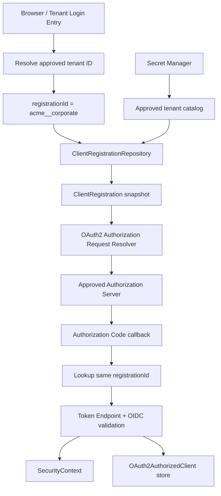
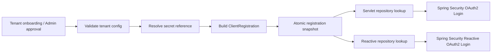

# 26.3. Looking Up `ClientRegistration` with a Custom Repository

## 1. Problem: An OAuth2/OIDC Client Application Serving Multiple Tenants

Suppose a Spring Boot application named **Workspace Portal** serves multiple enterprise customers (*tenants*). Each tenant has its own Identity Provider (IdP/OpenID Provider — OP) or a dedicated client registration on the same SSO system:

| Tenant | OpenID Provider | Client ID | Internal Registration ID |
| --- | --- | --- | --- |
| Acme | `https://id.acme.example/realms/staff` | `portal-acme` | `acme__corporate` |
| Beta | `https://login.beta.example/oidc` | `portal-beta` | `beta__corporate` |
| Gamma | `https://id.company.example/realms/gamma` | `portal-gamma` | `gamma__corporate` |

When there are few tenants, you can declare each entry statically in `application.yml`. However, in a SaaS system, tenants may be onboarded or have their configurations updated while the application is running. We need a mechanism to **look up `ClientRegistration` by a trusted key**, rather than assuming a YAML file contains every tenant at startup.

Spring Security OAuth2 Client uses the interface:

```java
org.springframework.security.oauth2.client.registration
    .ClientRegistrationRepository
```

for Servlet applications; or:

```java
org.springframework.security.oauth2.client.registration
    .ReactiveClientRegistrationRepository
```

for WebFlux. Implementing a custom repository allows loading registrations from a database, a tenant catalog system, a secret manager, or an approved cache.

**However, a repository is not just a lookup map.** It is the configuration boundary of the OAuth2/OIDC process: it determines **which client**, **which issuer**, **which Authorization Endpoint/Token Endpoint**, **which client secret**, **which scopes**, and **which redirect URI** are used to authenticate users or call APIs.

A lookup bug can lead to:

- Tenant A's login being sent to Tenant B's IdP.
- An authorization code being processed with the wrong client secret.
- A token belonging to a user of one tenant being stored/read in another tenant's context.
- The application querying metadata from an attacker-supplied URL, creating **SSRF**.
- OIDC issuer/audience mix-ups across providers.
- `registrationId` changing between login initiation and callback.
- Mid-flight configuration changes causing login loops or token endpoint failures.

> **Principle:** a tenant identifier may originate from a URL/subdomain, but `ClientRegistration` must come from a **trusted, access-controlled catalog**. Never construct the issuer URI, token URI, client secret, or callback URL directly from arbitrary HTTP parameters.

### 1.1. Lesson Objectives

After this lesson, you will be able to:

1. Explain the role of `ClientRegistration` and the two Servlet/Reactive repository interfaces.
2. Choose a stable `registrationId` convention for tenants and providers.
3. Distinguish tenant resolution at **login initiation**, at the **OAuth2 callback**, and after the user is authenticated.
4. Implement a Servlet repository that looks up registrations from an immutable snapshot.
5. Build `ClientRegistration` instances from approved data and protect client secrets.
6. Implement reactive lookup using `Mono<ClientRegistration>`.
7. Connect the repository with `oauth2Login()`, `oauth2Client()`, and the authorized-client manager.
8. Design catalog updates, caching, secret rotation, and multi-pod consistency.
9. Prevent cross-tenant token reuse, issuer mix-up, SSRF, and open redirects.
10. Write unit/integration/security tests for both successful lookups and denials.

## 2. What Does `ClientRegistration` Contain?

`ClientRegistration` describes an **OAuth2/OIDC Client registered with an Authorization Server**. Common properties include:

| Property | Role | Example |
| --- | --- | --- |
| `registrationId` | Internal key for Spring Security to locate the client | `acme__corporate` |
| `clientId` | OAuth client identifier at the OP/AS | `portal-acme` |
| `clientSecret` | Secret if confidential client and required by auth method | From secret manager |
| `clientAuthenticationMethod` | How the client authenticates at the Token Endpoint | `client_secret_basic` |
| `authorizationGrantType` | Grant: `authorization_code`, `client_credentials`... | `authorization_code` |
| `redirectUri` | Callback URI for Authorization Code | `{baseUrl}/login/oauth2/code/{registrationId}` |
| `scopes` | Requested scopes | `openid`, `profile`, `email` |
| `authorizationUri` | Authorization Endpoint | Per OP metadata |
| `tokenUri` | Token Endpoint | Per OP metadata |
| `jwkSetUri` | JWKS Endpoint for signature verification | Per OP metadata |
| `issuerUri` | Issuer identifier to verify OIDC identity | `https://id.acme.example/realms/staff` |
| `userInfoUri` | UserInfo Endpoint, if used | Per OP metadata |
| `clientName` | Descriptive label that may be displayed in UI | `Acme SSO` |
| `providerConfigurationMetadata` | Additional provider metadata | `end_session_endpoint` if present |

Distinguish carefully:

- `registrationId` is **not** `clientId`. An RP may name a registration `acme__corporate` while the OP uses `portal-acme` as the client ID.
- `registrationId` is **not** the issuer. Multiple registrations can share the same issuer, e.g., two clients with different scopes on the same IdP.
- `issuerUri` is **not** the downstream API base URL.
- `ClientRegistration` **does not hold** a user's access token/refresh token. Tokens are stored in `OAuth2AuthorizedClient`.
- `ClientRegistrationRepository` **does not replace** `OAuth2AuthorizedClientRepository` or `OAuth2AuthorizedClientService`.

### 2.1. Three Commonly Confused Repositories

| Repository | Stored data | Purpose |
| --- | --- | --- |
| `ClientRegistrationRepository` | Client/OP configuration | Look up registration by `registrationId` |
| `AuthorizationRequestRepository` | Authorization request awaiting callback, including `state` and PKCE metadata if any | Correlate redirect/callback |
| `OAuth2AuthorizedClientRepository` / Service | Access token, refresh token, registration, principal | Call APIs and manage token lifecycle |

In WebFlux, there are corresponding **Reactive** and **Server** variants. A custom `ClientRegistrationRepository` **does not automatically replace** state/nonce/PKCE management or authorized client storage.

### 2.2. Data Flow Diagram



In the diagram, the two lookup steps before redirect and at callback must refer to the same registration semantics. Tenant resolution **must not re-read from a new unrelated input** and accidentally pick a different IdP.

## 3. Contract of the Servlet Repository

The `ClientRegistrationRepository` interface is minimal:

```java
public interface ClientRegistrationRepository {

    ClientRegistration findByRegistrationId(String registrationId);
}
```

In standard Spring Security versions, when a registration is not found, the method returns **`null`**.

There are no separate parameters named `tenantId`, `HttpServletRequest`, `host`, or `Authentication`. All multi-tenant mapping logic must be solved via:

- A `registrationId` convention that distinguishes tenant/provider.
- Or another trusted resolver selecting `registrationId` before the repository is invoked.
- Or a custom authorization request resolver/compatible components if needs are more complex.

### 3.1. Why Use a Tenant-Distinguishing `registrationId`?

If all tenants use the same ID:

```text
registrationId = corporate
```

but endpoints and client IDs differ by tenant, the call:

```java
repository.findByRegistrationId("corporate")
```

does not contain enough information to identify the tenant. If the repository tries to read a **ThreadLocal current request**, bugs will occur when code runs in token refresh jobs, callbacks, background tasks, or requests spanning threads.

A simpler strategy is:

```text
acme__corporate
beta__corporate
gamma__corporate
```

Where:

- `acme`, `beta`, `gamma` are **approved tenant codes**.
- `corporate` indicates the provider/login method type.
- The full ID is **unique and stable**, even when the client secret changes.
- The ID is safe to place in a **URL path segment**.
- Only IDs existing in the catalog are accepted.

Do not take a raw email domain or unverified hostname as `registrationId` and create a client on the fly at request time.

### 3.2. Should the Repository Parse `registrationId`?

Not necessarily. If the repository uses `Map<String, ClientRegistration>`, looking up by the **full ID** is simpler and less error-prone:

```java
ClientRegistration registration =
    approvedMap.get(registrationId);
```

Splitting the string on `"__"` is only useful for logging/catalog lookup or admin operations. **Never treat parsing `tenantId` from the string as verifying the user's permission for that tenant.**

### 3.3. `Iterable<ClientRegistration>` and the Default Login Page

An easily overlooked Spring Security detail: the OAuth2 Login page generated by `DefaultLoginPageGeneratingFilter` can list links to registrations **only if the repository also implements `Iterable<ClientRegistration>`**. This is documented in the advanced OAuth2 Login docs.

That means the following class satisfies the lookup contract:

```java
final class TenantClientRegistrationRepository
        implements ClientRegistrationRepository {
    // findByRegistrationId(...)
}
```

but **the default login page may not automatically list the links**. If you want registrations to appear on the default page, also implement:

```java
Iterable<ClientRegistration>
```

However, a SaaS with thousands of tenants **should not publicly list all IdPs/tenant names** on the login page. In that case, a **dedicated login page** with controlled tenant selection is usually more appropriate; auto-rendering every registration is unnecessary.

## 4. Contract of the Reactive Repository

WebFlux uses:

```java
public interface ReactiveClientRegistrationRepository {

    Mono<ClientRegistration> findByRegistrationId(
        String registrationId);
}
```

When a registration is not found, the standard behavior is **`Mono.empty()`**, not emitting a `null` `ClientRegistration` inside a `Mono`.

Differences:

| Servlet | Reactive WebFlux |
| --- | --- |
| `ClientRegistrationRepository` | `ReactiveClientRegistrationRepository` |
| `ClientRegistration findByRegistrationId(String)` | `Mono<ClientRegistration> findByRegistrationId(String)` |
| `return null` on miss | `return Mono.empty()` on miss |
| Data may come from a blocking source | Must not block the event loop to fetch data |
| Usually with `HttpSecurity` | With `ServerHttpSecurity` |
| `InMemoryClientRegistrationRepository` | `InMemoryReactiveClientRegistrationRepository` |

Do not do:

```java
@Override
public Mono<ClientRegistration> findByRegistrationId(String id) {
    return Mono.just(blockingJdbcLookup(id)); // risks blocking the event loop
}
```

If the source is inherently blocking, use an appropriate scheduler or design cached snapshots/reactive persistence. Later sections choose snapshots so lookups require no network I/O on the request path.

## 5. Recommended Architecture: Approved Tenant Catalog and Registration Snapshots

To avoid network-dependent lookups and untrusted data every time a browser starts login:



Separate the **control plane** from the **request plane**:

- **Control plane:** admin onboarding/updating tenants, verifying the IdP, checking issuer/endpoints/redirect URIs, fetching secrets from the vault, building registrations, and publishing snapshots.
- **Request plane:** only looks up **approved** registrations by ID; fast, thread-safe, and never follows unverified URLs.

Benefits:

1. Never fetches OIDC Discovery from a user-supplied hostname.
2. No slow vault/database queries on every HTTP request.
3. Can swap the entire snapshot consistently.
4. Exhibits **fail-closed** behavior when a registration does not exist.
5. Easy to test and operate.
6. Reduces the risk of half-updated registrations.

### 5.1. Basic Catalog Requirements

An entry needs:

```text
tenantId
providerKey
registrationId
clientId
clientAuthenticationMethod
secretReference
authorizationGrantType
redirectUriTemplate
scopes
issuerUri
authorizationUri
tokenUri
jwkSetUri
userInfoUri if used
status: APPROVED / DISABLED
configVersion
```

Additional fields like resource/audience, network policies, or allowed callback domains may be included depending on the system.

**Important data note:** `secretReference` should point to a secret manager; avoid storing plaintext secrets in the tenant catalog or logs. `ClientRegistration` may need to hold the secret value at runtime to perform client authentication; protect memory dumps, diagnostic endpoints, and service access permissions.

### 5.2. Trust Only the Approved Tenant Catalog

Do not build registrations like:

```java
String issuer = "https://" +
    request.getParameter("tenant") +
    ".example.com";
```

and call discovery. An abused input value can make the application reach localhost/metadata services/internal networks or a rogue OP.

When onboarding a new IdP:

- Verify tenant ownership and admin privileges.
- Validate canonical issuer URI, HTTPS, and hostname allowlist/egress policy.
- Check DNS resolution and prevent redirects/SSRF in the network layer.
- Ensure the OP metadata issuer matches the expected value.
- Store verified endpoints and validate certificates/hostnames.
- Restrict allowed redirect URIs and minimal scopes.
- Verify client credentials registered at the OP.
- Enforce config versioning, disable/revoke/rollback controls.

## 6. Java Example: Building `ClientRegistration` from Trusted Config

For illustration, define a record representing an entry **approved by the control plane**:

```java
public record ApprovedOidcClient(
    String registrationId,
    String tenantId,
    String clientId,
    String clientSecret,
    String issuerUri,
    String authorizationUri,
    String tokenUri,
    String jwkSetUri,
    String clientName
) {}
```

This is an **internal DTO for the example**, not a Spring Security class. In production, `clientSecret` is typically resolved via a secret manager at the snapshot build/update boundary and should not reside as plaintext in a catalog database.

### 6.1. Factory to Build `ClientRegistration`

```java
public final class TenantClientRegistrationFactory {

    public ClientRegistration build(ApprovedOidcClient cfg) {
        return ClientRegistration
            .withRegistrationId(cfg.registrationId())
            .clientId(cfg.clientId())
            .clientSecret(cfg.clientSecret())
            .clientAuthenticationMethod(
                ClientAuthenticationMethod.CLIENT_SECRET_BASIC)
            .authorizationGrantType(
                AuthorizationGrantType.AUTHORIZATION_CODE)
            .redirectUri(
                "{baseUrl}/login/oauth2/code/{registrationId}")
            .scope("openid", "profile")
            .authorizationUri(cfg.authorizationUri())
            .tokenUri(cfg.tokenUri())
            .jwkSetUri(cfg.jwkSetUri())
            .issuerUri(cfg.issuerUri())
            .clientName(cfg.clientName())
            .build();
    }
}
```

The APIs here belong to Spring Security OAuth2 Client. The goal is to build a registration **with explicit issuer/OP endpoints** instead of concatenating endpoint paths from tenant input.

The example uses OIDC scope `openid` and Authorization Code. These settings must match the real OP; if using `private_key_jwt`, mTLS, PKCE, or another client authentication method, construct the registration according to the provider's exact contract.

**OIDC note:** `issuerUri` and `jwkSetUri` must come from trusted provider metadata/trust configuration. Never disable issuer validation to "let multiple tenants log in". Every tenant must be bound to its **expected issuer** and appropriate audience/client ID.

### 6.2. Why Is `issuerUri` Needed?

If the same system supports multiple IdPs, verifying only the ID Token signature without binding `iss` and `aud` risks **identity mix-up**.

The OIDC Client must verify:

- `iss` matches the registration's configured issuer.
- `aud` contains the matching client ID, and `azp` when required by the standard.
- Token signature/algorithm and JWKS trust are accurate.
- Expiry, issued-at, and nonce when used by the flow.
- Any other policy-mandated validations.

By constructing `ClientRegistration` properly, Spring Security has the information needed to perform OIDC checks per provider. A custom repository **must not omit the issuer or swap JWKS URIs arbitrarily** when using OIDC.

### 6.3. Metadata Discovery vs. Directly Configured Endpoints

Another option when an **issuer has already been approved** is calling `ClientRegistrations.fromIssuerLocation(issuerUri)` in the **control plane** to build the builder from metadata. API behavior and discovery support depend on the Spring Security version/provider.

Keep in mind:

- Discovery is an **outbound HTTP request**.
- Never use an issuer taken directly from a user request to auto-fetch.
- Require timeouts, TLS, SSRF protection, and egress policies.
- The metadata `issuer` must be verified against the expected issuer.
- When provider metadata changes, version/refresh consistently.
- Never perform unbounded discovery inside each HTTP login request.

If using explicit endpoints from an approved catalog as shown above, you must still verify those endpoints accurately during onboarding.

## 7. Servlet Repository with an Atomic Snapshot

Here is a practical implementation example that only looks up built/vetted registrations.

```java
import java.util.Collection;
import java.util.Iterator;
import java.util.LinkedHashMap;
import java.util.Map;
import java.util.Objects;
import java.util.concurrent.atomic.AtomicReference;

import org.springframework.security.oauth2.client.registration
    .ClientRegistration;
import org.springframework.security.oauth2.client.registration
    .ClientRegistrationRepository;

public final class SnapshotClientRegistrationRepository
        implements ClientRegistrationRepository,
                   Iterable<ClientRegistration> {

    private final AtomicReference<Map<String, ClientRegistration>>
        current = new AtomicReference<>(Map.of());

    public SnapshotClientRegistrationRepository(
            Collection<ClientRegistration> approved) {
        replaceApproved(approved);
    }

    @Override
    public ClientRegistration findByRegistrationId(
            String registrationId) {

        if (registrationId == null) {
            return null;
        }

        return current.get().get(registrationId);
    }

    @Override
    public Iterator<ClientRegistration> iterator() {
        return current.get().values().iterator();
    }

    public void replaceApproved(
            Collection<ClientRegistration> approved) {

        Objects.requireNonNull(approved, "approved");
        Map<String, ClientRegistration> next =
            new LinkedHashMap<>();

        for (ClientRegistration registration : approved) {
            Objects.requireNonNull(registration, "registration");

            String id = registration.getRegistrationId();

            if (id == null || id.isBlank()) {
                throw new IllegalArgumentException(
                    "Missing registrationId");
            }

            if (next.putIfAbsent(id, registration) != null) {
                throw new IllegalArgumentException(
                    "Duplicate registrationId: " + id);
            }
        }

        current.set(Map.copyOf(next));
    }
}
```

**Why choose this design?**

- Lookup is a map read, avoiding database/IdP queries on the login request path.
- `AtomicReference` allows **swapping the snapshot atomically**.
- `Map.copyOf` produces an unmodifiable map.
- Multiple threads never observe a half-constructed map.
- Unknown ID → `null`, conforming to the Servlet repository contract.
- Implements `Iterable<ClientRegistration>` to support components needing iteration, including the default login page if enabled.
- Duplicate IDs are rejected instead of silently overwriting a tenant.

**Limitation:** this repository only manages the snapshot within **a single JVM**. It does not guarantee that pods share the same snapshot version. Also, `Iterable` here may return all registrations; SaaS applications should use a **tenant-specific login page** to avoid exposing all tenants publicly.

### 7.1. Why Not Mutate an Active `ClientRegistration`?

`ClientRegistration` is designed to represent a complete configuration snapshot. When refreshing:

```text
Version 10:
  acme__corporate -> issuer A, clientSecret K1

Version 11:
  acme__corporate -> issuer A, clientSecret K2
```

Build a **new object**, validate it, and swap the snapshot once. Never mutate fields on a shared object while Spring Security is processing redirects/token exchanges.

### 7.2. `replaceApproved` Does Not Verify Approval Itself

The method name explicitly states **approved input**. It **does not validate trust/policy** of endpoints or client secrets on its own.

In production, only the control-plane service should have permission to invoke this method. Users/controllers must never call `replaceApproved` with JSON received from a browser. Before publishing a snapshot, verify:

- Allowed issuer/HTTPS/endpoint consistency.
- Redirect URIs and scopes.
- Client authentication method.
- Tenant mapping and uniqueness.
- Source credentials/secret provenance.
- Tenant status (`ACTIVE`/`DISABLED`).
- Version/rotation policy.

## 8. Configuring Spring Boot to Use a Custom Repository

### 8.1. Creating the Bean from an Approved Catalog

Example:

```java
@Configuration
class TenantOauthClientConfiguration {

    @Bean
    ClientRegistrationRepository clientRegistrationRepository(
            ApprovedTenantCatalog catalog,
            TenantClientRegistrationFactory factory) {

        var registrations = catalog.activeOidcClients()
            .stream()
            .map(factory::build)
            .toList();

        return new SnapshotClientRegistrationRepository(
            registrations);
    }

    @Bean
    SecurityFilterChain securityFilterChain(HttpSecurity http)
            throws Exception {

        http
            .authorizeHttpRequests(auth -> auth
                .requestMatchers("/", "/login/**", "/assets/**")
                    .permitAll()
                .anyRequest().authenticated())
            .oauth2Login(Customizer.withDefaults())
            .oauth2Client(Customizer.withDefaults());

        return http.build();
    }
}
```

`ApprovedTenantCatalog` is an **application-defined interface/service**:

```java
interface ApprovedTenantCatalog {
    Collection<ApprovedOidcClient> activeOidcClients();
}
```

This example assumes the catalog is provisioned from a database/secret manager in the control plane. There is no built-in `ApprovedTenantCatalog` class in Spring Security; the team must implement it.

### 8.2. Important Warning About Spring Boot Auto-Configuration

Spring Boot has auto-configuration that creates a `ClientRegistrationRepository` from:

```yaml
spring:
  security:
    oauth2:
      client:
        registration:
          ...
```

However, if you **register your own `ClientRegistrationRepository` bean**, auto-configuration may **back off**. This means:

- Registrations from YAML are **not automatically merged** with your custom repository.
- Previously static registrations may disappear from lookups if not included in the custom repository.
- Downstream `OAuth2AuthorizedClientManager` instances may also fail to find old registrations.
- A successful startup does not guarantee every `registrationId` referenced in code still exists.

Make an explicit choice:

1. Use **only** the custom catalog.
2. Or merge a trusted static list with approved dynamic clients **using duplicate/override guards**, then publish a combined snapshot.

Never assume Spring Boot will automatically combine two repositories when multiple beans exist.

### 8.3. Bean Lifecycle and Dependencies

`ClientRegistrationRepository` is used by OAuth2 Login, the authorization request resolver, token exchange, and the OAuth2 Client manager. Therefore, the repository should be ready during security infrastructure initialization.

If the catalog experiences a network failure at startup, define a policy:

- Fail startup if critical tenant configurations are missing.
- Fall back to a last-known-good approved snapshot if architecture and freshness allow.
- Never return a registration guessed from a URL.
- Never disable issuer validation as a temporary login workaround.
- Emit telemetry for missing config without exposing secrets.

## 9. Resolving the Tenant When Starting Login

A simple approach: the user visits an internal URL controlled by the application:

```text
GET /login/acme
```

The application maps tenant ID `acme` to registration ID `acme__corporate` **from the approved catalog** and redirects:

```text
302 Location: /oauth2/authorization/acme__corporate
```

Spring Security uses the default filter to initiate the Authorization Code flow:

```text
GET /oauth2/authorization/{registrationId}
```

### 9.1. Illustrative Controller

```java
@Controller
class TenantLoginController {

    private final TenantLoginDirectory directory;

    TenantLoginController(TenantLoginDirectory directory) {
        this.directory = directory;
    }

    @GetMapping("/login/{tenantCode}")
    ResponseEntity<Void> login(
            @PathVariable String tenantCode) {

        String registrationId =
            directory.approvedRegistrationIdFor(tenantCode);

        if (registrationId == null) {
            return ResponseEntity.notFound().build();
        }

        URI target = URI.create(
            "/oauth2/authorization/" + registrationId);

        return ResponseEntity.status(HttpStatus.FOUND)
            .location(target)
            .build();
    }
}
```

`TenantLoginDirectory` is an **application-defined** component that returns only registration IDs present in the approved catalog and safe for use in a URL path:

```java
interface TenantLoginDirectory {
    String approvedRegistrationIdFor(String tenantCode);
}
```

**Do not** create a registration by appending `tenantCode` to an issuer URL. The controller only selects from the approved set.

### 9.2. Why Not Trust `Host` or `X-Forwarded-Host` Arbitrarily?

A multi-subdomain application might want:

```text
https://acme.portal.example.com -> tenant=acme
https://beta.portal.example.com -> tenant=beta
```

This is valid **only when the hostname is validated at the ingress/trusted proxy** and matched against registered hostnames/tenants.

Do not use:

```java
String tenant = request.getHeader("Host").split("\\.")[0];
```

as the sole basis of trust. Attackers can spoof `Host`/`Forwarded` headers in many environments, leading to wrong-tenant logins, open redirects, or discovery SSRF.

Safe design:

1. Ingress blocks hostnames outside the allowlist.
2. Proxy strips/overwrites forwarded headers from clients.
3. Backend maps **verified host → approved tenant**.
4. Tenant catalog determines `registrationId`.
5. Security flow uses the exact registration across redirect/callback.
6. After login, still verify **whether the user has permission to belong to that tenant**.

### 9.3. Tenant Discovery from Email Domain

An email domain can serve as a *hint* to locate a tenant:

```text
user@acme.example -> suggests Acme
```

However, a user-entered email **does not prove tenant access**. After OIDC Login succeeds, you must validate the issuer, verified identity, and membership/entitlements from an approved source.

Never grant permissions based on an email domain string **before** OP authentication.

## 10. Callback: Keeping the Same Registration Used at Redirect

Spring Security Servlet's default Authorization Code callback typically takes the form:

```text
GET /login/oauth2/code/{registrationId}?code=...&state=...
```

For example:

```text
GET /login/oauth2/code/acme__corporate
    ?code=FAKE_AUTHORIZATION_CODE
    &state=FAKE_RANDOM_STATE
```

Spring Security uses the saved authorization request to verify `state` and related data. With OIDC, it also checks ID Token issuer/audience/nonce per the flow.

### 10.1. Do Not Resolve Tenant from Callback Query Parameters

Bad design:

```text
/login/oauth2/code/acme__corporate?code=...&tenant=beta
```

and then taking `tenant=beta` to query the repository and exchange the code at Beta's Token Endpoint. That query value is untrusted and is not part of the established request correlation.

Right:

- Registration ID and authorization request must match the initiated flow.
- `state` must be validated before trusting the authorization response.
- PKCE code verifier (if used) must come from the saved authorization request.
- `redirect_uri` sent during code exchange must match the URI originally used/registered.
- OIDC `iss`/`aud`/nonce must be verified against the expected registration.

**Do not disable state validation or share a single registration pointing to a per-request issuer** just to reduce the number of registrations.

### 10.2. Registration Must Remain Stable During a Login Flow

Suppose:

```text
10:00 acme__corporate -> clientId A, clientSecret K1, issuer A
10:01 browser begins login with that registration
10:02 admin updates registration: clientSecret K2
10:03 OP callback returns code issued for clientId A
```

If the OP does not yet recognize K2 or rotation is mid-flight, the token request can fail.

Similarly, changing the issuer/token URI between redirect and callback can violate trust boundaries.

Update policies are needed:

- Secret rotation with an overlap window accepting two credentials at the OP if supported.
- Never alter issuer/clientId of an actively used registration uncontrollably.
- For major identity/provider changes, consider creating a **new `registrationId` version**.
- Plan to wait for pending flows to exceed their TTL before removing old registrations.
- Observe cache/snapshot versions across all pods.
- If rollback is required, revert to the last-known-good approved config rather than widening trust.

### 10.3. Why Can't We Always Use One Shared Callback Without `registrationId`?

You can customize the callback/authorization request resolver to use a shared URI, but you must **accurately restore the registration** from state/authorization request and enforce client/provider binding.

That customization goes beyond replacing `ClientRegistrationRepository`. In the default flow, keeping the callback:

```text
/login/oauth2/code/{registrationId}
```

makes correlation much cleaner. If an OP does not allow registering thousands of redirect URIs, revisit the client registration/callback architecture rather than simply dropping registration correlation.

## 11. After Login, How Is the Authentication's Tenant Determined?

Spring Security Servlet typically produces an `OAuth2AuthenticationToken`:

```java
OAuth2AuthenticationToken authentication = ...;

String registrationId =
    authentication.getAuthorizedClientRegistrationId();
```

`registrationId` can look up in the catalog which tenant/OP the login went through.

However, **`registrationId` does not by itself prove the user is authorized for the tenant**, because a user might initiate login to a different tenant or the same OP may host multiple users.

Two steps are required:

1. **Verify OIDC identity:** issuer, audience, signature, nonce, and claims per protocol.
2. **Tenant authorization:** does the user subject/organization membership/roles/entitlements authorize access to the selected tenant?

For example:

```text
registrationId = acme__corporate
OIDC issuer    = https://id.acme.example/realms/staff
OIDC subject   = user-481
tenant target  = acme

Authorization:
    Is (issuer, subject) a member of tenant Acme?
```

Only after membership/entitlement is verified should Acme data be returned. Finding a `ClientRegistration` is **not** the final authorization decision.

### 11.1. Subject Is Not Always Globally Unique

The `sub` claim is normally unique **within one issuer**, not necessarily across all IdPs.

Wrong:

```text
userKey = sub
```

when multiple issuers can produce `sub="123"`.

Better identity modeling:

```text
identityKey = (issuer, subject)
tenantMembershipKey = (tenantId, issuer, subject)
```

For user-delegated authorized clients, ensure cache/storage keys do not mix users/issuers/tenants. Basic `OAuth2AuthorizedClientService` implementations commonly key by `(registrationId, principalName)`; because `registrationId` already distinguishes tenant/provider, it adds a layer of isolation, but you must still avoid using a shared `principalName` across different users.

## 12. Using the Repository for Outbound OAuth2 Client Requests

A custom registration repository is not limited to browser login. A service can also call the manager to acquire a token for a downstream API:

```java
OAuth2AuthorizeRequest authorizeRequest =
    OAuth2AuthorizeRequest
        .withClientRegistrationId("acme__inventory_m2m")
        .principal("inventory-worker-acme")
        .build();

OAuth2AuthorizedClient authorized =
    authorizedClientManager.authorize(authorizeRequest);
```

Here the example uses a dedicated **machine-to-machine** registration:

```text
acme__inventory_m2m -> client_credentials
```

It is not Acme's interactive OIDC login. The same repository can hold multiple grant types, but the **authorized-client provider chain** must be configured appropriately for each grant.

A safe rule:

```text
registrationId + principalName + target/tenant policy
    -> matching authorized client
```

Do not build an HTTP client with Acme's default bearer token and allow code to send it to Beta's API.

### 12.1. One Registration per Downstream When Needed

For example:

```text
acme__corporate       -> OIDC Login
acme__inventory_m2m   -> Inventory API M2M
acme__billing_m2m     -> Billing API M2M
beta__corporate       -> OIDC Login
beta__inventory_m2m   -> Inventory API M2M
```

There is no rule requiring "one tenant may only have one `ClientRegistration`". A tenant can have multiple clients with different grants, scopes, audiences, and secrets.

### 12.2. Do Not Confuse Scope with Tenant Permission

The `inventory.read` scope only expresses a token-level capability. The API must still verify audience/issuer/tenant/ownership and business policies. Using the wrong registration can produce a validly signed token with the wrong audience or tenant.

## 13. Reactive Lookup from the Same Snapshot

If the application uses Spring WebFlux, a simple reactive implementation can delegate to a **non-blocking snapshot lookup**.

```java
import reactor.core.publisher.Mono;

import org.springframework.security.oauth2.client.registration
    .ClientRegistration;
import org.springframework.security.oauth2.client.registration
    .ReactiveClientRegistrationRepository;

public final class SnapshotReactiveClientRegistrationRepository
        implements ReactiveClientRegistrationRepository {

    private final SnapshotClientRegistrationRepository snapshot;

    public SnapshotReactiveClientRegistrationRepository(
            SnapshotClientRegistrationRepository snapshot) {
        this.snapshot = snapshot;
    }

    @Override
    public Mono<ClientRegistration> findByRegistrationId(
            String registrationId) {

        return Mono.defer(() ->
            Mono.justOrEmpty(
                snapshot.findByRegistrationId(registrationId)));
    }
}
```

This illustrates a **shared lookup model**. If deploying both Servlet and WebFlux in the same module, manage bean types explicitly; in a pure WebFlux app, you can hold your own `AtomicReference<Map<String, ClientRegistration>>` and read the map directly without defining a Servlet repository bean.

Because lookup is purely a map read, `Mono.defer` looks up the snapshot when the publisher is subscribed. No I/O blocks the Reactor event loop.

### 13.1. If a Reactive Database Query Is Truly Required

Skeleton example:

```java
@Override
public Mono<ClientRegistration> findByRegistrationId(
        String registrationId) {

    return approvedTenantStore
        .findApprovedByRegistrationId(registrationId)
        .flatMap(entry -> secrets.resolve(entry.secretReference())
            .map(secret -> factory.build(
                entry.toApprovedOidcClient(secret))));
}
```

Here `approvedTenantStore`, `secrets.resolve(...)`, and the mapper are **application-defined reactive APIs**. This snippet cannot be dropped in directly without reactive database/secret clients.

Constraints to guarantee:

- Return only **approved** registrations; deny disabled/unknown ones.
- Validate/look up the registration ID by exact match, never picking a nearest match.
- Never query URLs from user input.
- Enforce timeouts/rate limiting/circuit breakers for the catalog and vault.
- Never retry infinitely when the secret manager times out.
- Never cache failures in a way that blocks newly onboarded tenants for too long.
- Never log secrets or sensitive metadata.
- Define what happens if the catalog goes down between Authorization Code redirect and callback.

Never run blocking JDBC inside `flatMap` and call it reactive.

### 13.2. `Mono.empty()` and `Mono.error(...)` Have Different Meanings

For an unknown ID:

```java
return Mono.empty();
```

accurately means **no registration exists**.

If the approved catalog/storage is unreachable due to an outage:

```java
return Mono.error(new RegistrationLookupUnavailableException(...));
```

indicates a **system error**, not a nonexistent tenant.

Distinguishing the two cases prevents turning an outage into a misleading 404 or trying to create an unsafe fallback registration.

Different Spring Security components may map these signals to failure responses depending on implementation; test this during integration.

## 14. Configuring WebFlux with `ReactiveClientRegistrationRepository`

Example:

```java
@Configuration
@EnableWebFluxSecurity
class ReactiveTenantSecurity {

    @Bean
    ReactiveClientRegistrationRepository
    reactiveClientRegistrationRepository(
            ApprovedTenantCatalog catalog,
            TenantClientRegistrationFactory factory) {

        var registrations = catalog.activeOidcClients()
            .stream()
            .map(factory::build)
            .toList();

        var snapshot =
            new SnapshotClientRegistrationRepository(registrations);

        return new SnapshotReactiveClientRegistrationRepository(
            snapshot);
    }

    @Bean
    SecurityWebFilterChain securityWebFilterChain(
            ServerHttpSecurity http) {

        return http
            .authorizeExchange(exchanges -> exchanges
                .pathMatchers("/", "/login/**", "/assets/**")
                    .permitAll()
                .anyExchange().authenticated())
            .oauth2Login(Customizer.withDefaults())
            .oauth2Client(Customizer.withDefaults())
            .build();
    }
}
```

As with Servlet, this is an **alternative configuration option**, not a requirement that one app run both Servlet and WebFlux simultaneously.

A custom WebFlux login page should link to:

```text
/oauth2/authorization/{registrationId}
```

when default filter routes are kept. Avoid exposing the full list of tenants unnecessarily.

## 15. Caching and Config Changes: Fast Lookups Without Stale or Wrong Data

### 15.1. Possible Cache Layers

| Layer | Usage | Risks |
| --- | --- | --- |
| Local immutable snapshot | Very high lookup speed | Pods may temporarily hold different versions |
| Local TTL cache | Reduces DB/secret manager load | Stale secret/issuer during rotation |
| Shared distributed catalog | Synchronizes config across pods | Outages and consistency lag |
| Secret manager cache | Reduces vault requests | Rotation windows and secret exposure |
| OIDC discovery metadata cache | Reduces load on metadata endpoints | Key/endpoint changes, stale issuer |
| Authorized-client token store | Reuses access/refresh tokens | Not a registration cache; separate isolation |

**Do not cache `ClientRegistration` solely by `(tenantId)` while ignoring provider/client variants** if a tenant has multiple registrations.

A safe cache key is typically the **exact registration ID**, with versioned data. Never use a raw `Host` header or user-provided issuer as a key to auto-create cache entries.

### 15.2. Publish Snapshots as a Single Atomic Operation

Updating multiple registrations row-by-row between requests can expose a half-updated state:

```text
A already uses secret K2
B is still on the old version
C has no metadata yet
```

Snapshot model:

```text
Catalog version 41 -> build & validate all entries
    |
    +-- if any invalid -> reject publication
    |
    +-- if all valid -> atomic swap snapshot(version=41)
```

Never mutate individual fields of a `ClientRegistration` mid-flow. With `AtomicReference`, every lookup observes a complete map.

### 15.3. Single-Node Snapshots Do Not Solve Multi-Pod Consistency

Suppose:

```text
Login initiation -> Pod A, config version 10
OIDC callback    -> Pod B, config version 11
```

Even when the authorization request/state is stored in a shared session, Pod B may see a **different** registration if version 11 changed the issuer/client ID/token endpoint.

Mitigations:

- Publish catalog versions synchronously per rollout procedure.
- Provide a grace period for breaking changes.
- Retain old registration versions long enough for in-flight flows to finish if policy permits.
- Test cross-pod callbacks.
- Never change an OIDC issuer arbitrarily under the same registration ID.
- Synchronize browser session/authorization request stores when running multiple pods.
- Control token caches/repositories and secret rotations.

### 15.4. Do Not Cache Unknown Registrations Permanently

A tenant might be onboarded right after a request queried an ID that did not yet exist. A **negative cache** with no TTL or invalidation will keep reporting the new registration as unknown.

If using local snapshots, publishing a new approved catalog version replaces the data and clears any stale misses simultaneously. There is no need to invent a fallback registration on a cache miss.

## 16. Secret Rotation and Client Credential Changes

In enterprise environments, client secrets are rotated periodically.

### 16.1. Reference Workflow

1. The OP supports issuing a new secret or rotating per policy.
2. Control plane stores the new reference in the secret manager.
3. Build a new `ClientRegistration` with the valid secret.
4. Publish the snapshot to pods according to plan.
5. Verify the Token Endpoint accepts the new secret.
6. Wait for in-flight authorization flows to complete within an appropriate grace window.
7. Revoke the old secret at the OP.
8. Monitor `invalid_client` errors and authorization failures.

If a provider only allows one active secret at a time, a cutover window with errors may exist; plan the cutover accordingly and do not promise zero-downtime if the OP does not support it.

### 16.2. Changes That Should Be Considered Breaking

- `clientId` changes.
- `issuerUri` changes to a different OP.
- `authorizationUri`/`tokenUri` crosses trust domains.
- `redirectUri` changes.
- Client auth method changes to mTLS/`private_key_jwt`.
- Scope/consent rules change in ways requiring fresh user authorization.

Do not let a callback carrying a code issued for an old client be processed by a completely different registration. When changing OP/client identity, it is often better to **create a new `registrationId`** and phase out the old ID.

### 16.3. Disabling a Tenant Must Not Blindly Delete Only the Map Entry

When a tenant is suspended:

- Block **new logins**.
- Review existing sessions.
- Review authorized clients/token reuse.
- Review still-running background jobs.
- Enforce revocation/data access policies.
- Record audit logs/config versions.
- Do not delete a tenant entry and expect all user sessions or API tokens to become invalid automatically.

`ClientRegistrationRepository` is part of **OAuth client configuration**, not a complete revocation or tenant access-control system.

## 17. Multi-Tenancy and Security: Boundaries That Must Hold

### 17.1. Tenant ID Is Not Proof of Membership

A browser can visit:

```text
/oauth2/authorization/beta__corporate
```

That only initiates login via Beta's registration (if public); it **does not prove the user has rights to Beta's data**.

After OIDC login, you must:

- Verify the OIDC token against Beta's issuer.
- Identify the authenticated subject.
- Check membership/entitlements in Beta.
- Bind the verified tenant context into authorization policies.
- Use this tenant when querying data, never a post-login `tenant` query parameter.

### 17.2. Issuer Mix-Up and JWKS Substitution

Never allow:

```text
registrationId=acme__corporate
issuerUri=https://attacker.example
jwkSetUri=https://attacker.example/keys
```

just because an admin API accepts raw fields without approval. If a token from an unexpected issuer is trusted, an attacker can attempt to submit a validly signed token from the wrong trust context.

Fields that must be bound together:

```text
registrationId -> trusted issuer -> expected clientId/audience
               -> trusted Authorization/Token/JWKS endpoints
               -> allowed redirect URI and scope
```

OIDC validation must preserve issuer/audience/signature/nonce checks; never merely decode a JWT.

### 17.3. SSRF via Dynamic Discovery

A user-controlled issuer URL can point to:

```text
http://localhost:...
http://169.254.169.254/...
https://internal-admin.example/...
```

or a public host redirecting to an internal network. If the application fetches `/.well-known/openid-configuration` from that URL, it can create SSRF.

Defenses:

1. Approved catalog instead of user-supplied URLs.
2. HTTPS, domain/IP egress policies, and DNS rebinding protection.
3. Never follow redirects to unapproved origins.
4. Timeouts/body size limits and TLS validation.
5. Verify issuer/metadata consistency.
6. Never include client secrets or bearer tokens in discovery requests.
7. Only approved administrators may modify trust anchors.

### 17.4. Never Attach the Wrong Tenant's Client Secret

A particularly dangerous bug:

```text
registrationId = beta__corporate
clientId = beta-client
clientSecret = acme-secret
tokenUri = beta-token-endpoint
```

Usually the token request will fail, but the main risk is **sending Acme's secret to Beta's endpoint or a rogue OP**. Ensure the `issuer/clientId/secretRef/endpoints` tuple is managed under the same approved catalog record, rather than assembled from unprotected independent cache keys.

### 17.5. Logout Also Requires Accurate Lookup

OIDC RP-Initiated Logout uses the issuer/`end_session_endpoint` from the registration. If a multi-tenant registration is mixed up, the app could send tenant A's ID Token hint to tenant B's Logout Endpoint.

Do not only test login; verify the logout handler selects the **exact issuer/registration** and does not leak ID Token hints.

## 18. Custom Repository and Related Customizations

Not every multi-tenant problem is solved by `ClientRegistrationRepository` alone.

| Problem | Common extension point |
| --- | --- |
| Look up client config by registration ID | `ClientRegistrationRepository` or Reactive equivalent |
| Select registration from verified route/host | Tenant Login Controller or authorization request resolver |
| Modify authorization request parameters | `OAuth2AuthorizationRequestResolver` / Reactive equivalent |
| Store state/PKCE/nonce across callback | Authorization Request Repository |
| Choose callback base URI | OAuth2 Login redirection endpoint config |
| Obtain/refresh tokens | `OAuth2AuthorizedClientManager` / Reactive manager |
| Store access/refresh tokens | Authorized Client Repository/Service |
| Determine tenant after authentication | OIDC authentication + domain authorization service |
| Claim/role mapping | OIDC user service/authorities mapper, tenant authorization |
| OP logout endpoint | OIDC logout success handler + correct registration |
| Continuously changing runtime config | Admin control plane, snapshot cache/invalidation |

A code smell is forcing the repository to know `HttpServletRequest`, parse headers, query external APIs, mint access tokens, and write sessions all at once. Separate into **resolver → repository → security flow → domain authorization**.

## 19. Unit Tests for Lookup and Tenant Isolation

Use Spring Boot Test/JUnit 5 (or standard JUnit) to test the repository without calling an OP.

### 19.1. Two Independent Registrations

```java
class SnapshotClientRegistrationRepositoryTest {

    private static ClientRegistration registration(
            String id,
            String clientId,
            String issuer) {

        return ClientRegistration.withRegistrationId(id)
            .clientId(clientId)
            .clientSecret("FAKE_TEST_SECRET")
            .clientAuthenticationMethod(
                ClientAuthenticationMethod.CLIENT_SECRET_BASIC)
            .authorizationGrantType(
                AuthorizationGrantType.AUTHORIZATION_CODE)
            .redirectUri(
                "{baseUrl}/login/oauth2/code/{registrationId}")
            .scope("openid", "profile")
            .issuerUri(issuer)
            .authorizationUri(issuer + "/authorize")
            .tokenUri(issuer + "/token")
            .jwkSetUri(issuer + "/keys")
            .build();
    }

    @Test
    void resolvesExactRegistrationWithoutCrossTenantFallback() {
        var acme = registration(
            "acme__corporate",
            "portal-acme",
            "https://id.acme.example");

        var beta = registration(
            "beta__corporate",
            "portal-beta",
            "https://login.beta.example");

        var repository =
            new SnapshotClientRegistrationRepository(
                List.of(acme, beta));

        assertEquals(
            "portal-acme",
            repository.findByRegistrationId(
                "acme__corporate").getClientId());

        assertEquals(
            "portal-beta",
            repository.findByRegistrationId(
                "beta__corporate").getClientId());

        assertNull(
            repository.findByRegistrationId(
                "unknown__corporate"));

        assertNull(
            repository.findByRegistrationId(
                "acme__partner"));
    }
}
```

The `/authorize`, `/token`, `/keys` URLs in the **test fixture** are just dummy strings to construct the object; in production, endpoints must come from trusted OP metadata, not by appending strings to the issuer with a generic formula.

### 19.2. Duplicate `registrationId` Must Be Rejected

```java
@Test
void duplicateRegistrationIdsAreRejected() {
    var first = registration(
        "acme__corporate",
        "portal-acme",
        "https://id.acme.example");

    var second = registration(
        "acme__corporate",
        "portal-other",
        "https://id.other.example");

    assertThrows(
        IllegalArgumentException.class,
        () -> new SnapshotClientRegistrationRepository(
            List.of(first, second)));
}
```

If duplicates silently overwrote each other, a tenant could be redirected to a different IdP without admin detection.

### 19.3. Atomic Snapshot Update

```java
@Test
void replacesSnapshotWithoutLeakingRemovedRegistration() {
    var oldRegistration = registration(
        "acme__corporate",
        "portal-acme-v1",
        "https://id.acme.example");

    var newRegistration = registration(
        "acme__corporate",
        "portal-acme-v2",
        "https://id.acme.example");

    var repository =
        new SnapshotClientRegistrationRepository(
            List.of(oldRegistration));

    repository.replaceApproved(
        List.of(newRegistration));

    assertEquals(
        "portal-acme-v2",
        repository.findByRegistrationId(
            "acme__corporate").getClientId());
}
```

This test verifies basic snapshot replacement; a real concurrency test can run multiple readers/writers to ensure every lookup returns a complete object without caller locking.

### 19.4. Reactive Lookup with `StepVerifier`

```java
@Test
void reactiveMissCompletesEmpty() {
    var servletSnapshot =
        new SnapshotClientRegistrationRepository(
            List.of());

    var reactiveRepository =
        new SnapshotReactiveClientRegistrationRepository(
            servletSnapshot);

    StepVerifier.create(
            reactiveRepository.findByRegistrationId(
                "unknown__corporate"))
        .verifyComplete();
}
```

Reactive hit:

```java
@Test
void reactiveHitReturnsCorrectRegistration() {
    var acme = registration(
        "acme__corporate",
        "portal-acme",
        "https://id.acme.example");

    var snapshot =
        new SnapshotClientRegistrationRepository(
            List.of(acme));

    var reactive =
        new SnapshotReactiveClientRegistrationRepository(
            snapshot);

    StepVerifier.create(
            reactive.findByRegistrationId(
                "acme__corporate"))
        .assertNext(found -> {
            assertEquals(
                "acme__corporate", found.getRegistrationId());
            assertEquals(
                "portal-acme", found.getClientId());
        })
        .verifyComplete();
}
```

`StepVerifier` belongs to `reactor-test`; when testing Spring WebFlux, you can add:

```gradle
testImplementation 'io.projectreactor:reactor-test'
```

## 20. Integration Tests: Full Authorization Code/OIDC Flow

Repository unit tests alone do not prove the login flow is wired properly. Integration tests should check:

### 20.1. Login Initiation

```text
GET /login/acme
    -> 302 /oauth2/authorization/acme__corporate

GET /oauth2/authorization/acme__corporate
    -> 302 Acme Authorization Endpoint
    -> Has client_id=portal-acme
    -> Has redirect_uri for acme__corporate
    -> Has random state
    -> Has openid scope and PKCE if enabled by config
```

At the same time:

```text
GET /oauth2/authorization/unknown__corporate
    -> Does not dynamically create a registration.
    -> Does not redirect to an untrusted provider.
    -> Error behavior conforms to security policy.
```

For Servlet, use MockMvc + `spring-security-test`. For WebFlux, use `WebTestClient` + security test support. Tests should run against fake OP endpoints without needing real client secrets.

### 20.2. Callback and Issuer Validation

Using an OIDC test provider/sandbox:

- Start Acme login, callback uses **matching state** → continues through the flow.
- Start Acme login, callback has wrong state → rejected.
- Code belongs to Beta while callback binds to Acme → must not authenticate erroneously.
- ID Token has wrong issuer → rejected.
- ID Token audience has wrong client ID → rejected.
- ID Token has wrong nonce when flow uses nonce → rejected.
- Old/wrong client secret → Token Endpoint failure, no fallback to another tenant.
- Expired authorization request session → callback without valid state rejected.

**Do not craft an unverified fake ID Token and treat it as E2E proof.** When testing security integration, test against an issuer/JWKS sandbox or mock validators **only in test configuration**—never disable production OIDC validation.

### 20.3. Cross-Tenant Authentication and Authorization

A user may log in successfully through Acme's OP yet lack entitlement to a specific workspace.

Test:

```text
Tenant in registration = acme
OIDC subject           = user-12
Allowed workspace      = acme-team-1
Requested workspace    = beta-team-9

Expected:
    HTTP authorization denial.
    No beta data returned.
```

This condition belongs to **domain authorization**, not repository lookup. Checking only that the user has an `OidcUser` does not test tenant isolation.

### 20.4. Cross-Pod Callback and Config Version

An important integration scenario:

```text
Pod A has snapshot version 10.
Pod A creates authorization request.
Browser goes to OP.
Pod B has snapshot version 11.
OP callback lands on Pod B.
```

The test must verify:

- `state`/authorization request can be loaded from the shared session/repository.
- Registration identity has not changed dangerously.
- If secret rotation has a grace period, the Token Endpoint succeeds.
- If the update is breaking, the system rejects safely/prompts the user to retry without switching issuer/tenant.
- No token/session belonging to another tenant is persisted.

## 21. Security Test Matrix

| ID | Scenario | Expectation |
| --- | --- | --- |
| S01 | Known approved registration | Returns exact `ClientRegistration` |
| S02 | Unknown registration ID | `null`/`Mono.empty()`, no fallback |
| S03 | Disabled tenant | Disallows initiating new login |
| S04 | Duplicate ID in catalog | Reject publication |
| S05 | Input such as `../other` | Does not select a tenant outside allowlist |
| S06 | Spoofed `Host`/`X-Forwarded-Host` | Cannot pick arbitrary issuer/tenant |
| S07 | Issuer URI is localhost/metadata host | Blocked at onboarding/egress |
| S08 | ID Token wrong issuer | OIDC validation fails |
| S09 | ID Token wrong audience | OIDC validation fails |
| S10 | State/nonce mismatch | Login fails |
| S11 | Tenant A's client secret attached to tenant B | Reject publishing invalid registration |
| S12 | Tenants A and B share same `sub` | Do not mix principals/permissions |
| S13 | User A requests tenant B | Membership check denies if unauthorized |
| S14 | Client credentials token of A calls API B | API rejects based on audience/tenant |
| S15 | Callback after breaking snapshot update | Does not log in with wrong issuer |
| S16 | Missing/inaccessible catalog | Fail closed, never use untrusted default |
| S17 | Multi-pod snapshot mismatch | Rollout/failure handling tested |
| S18 | Repeated unknown IDs | Rate-limited/does not leak secrets |
| S19 | Tenant onboarded with negative cache active | New entry appears after publish |
| S20 | Secret rotation | Cutover plan and correct secret ref |
| S21 | Logout of user belonging to tenant A | Does not send ID Token hint to OP B |
| S22 | Default login page listing | Does not leak tenant list beyond UX policy |
| S23 | Admin updates issuer against policy | Does not publish/trust URL |
| S24 | Registry outages | Stable and observable behavior |
| S25 | Concurrent snapshot replacement | Lookup always returns complete object |
| S26 | User enters spoofed email domain | Does not auto-grant tenant permission |
| S27 | Expired authorized client | Manager handles token lifecycle separately |
| S28 | Static YAML registrations not merged | Caught in integration tests |

## 22. Observability Without Leaking Secrets

Useful events:

```text
event=client_registration_lookup
registrationId=acme__corporate
result=hit
catalogVersion=41
lookupLatencyMs=1
```

Or:

```text
event=client_registration_lookup
registrationIdClass=unknown
result=miss
```

On update:

```text
event=catalog_snapshot_publish
catalogVersion=42
tenantCount=180
registrationCount=210
result=success
```

Metrics to track:

- Lookup hit/miss/error rate.
- Active catalog version on each pod.
- Count of active/disabled registrations.
- Tenant onboarding latency.
- Secret rotation failures.
- Token Endpoint `invalid_client` by registration.
- OIDC issuer/audience validation failures (sanitized).
- Callback mismatches, missing session/state.
- Rate of unrecognized registration IDs.
- Network/metadata/secret-manager availability.

**Do not log**:

```text
clientSecret=<secret>
Authorization: Basic ...
id_token=<raw-id-token>
access_token=<raw-token>
refresh_token=<raw-token>
userEmail=<pii>
```

When registration IDs contain tenant names, consider privacy/metric cardinality. Never put raw user-submitted `registrationId` values into unbounded-cardinality metric labels.

## 23. Common Implementation Mistakes

### Mistake 1 — Using One Shared Registration ID for Every Tenant

`findByRegistrationId("corporate")` cannot distinguish Acme/Beta. A repository relying on `ThreadLocal`/`Host` from the request easily picks the wrong one during callbacks/background work.

**Solution:** use a unique `registrationId` per tenant+provider, or a resolver with fully designed correlation.

### Mistake 2 — Dynamic Discovery from User Input

A request containing `issuer=https://attacker.example` causes the app to fetch metadata and trust new JWKS.

**Solution:** approved catalog/allowlist, SSRF protection, and issuer validation.

### Mistake 3 — Custom Repository Bean Drops Static YAML Registrations

Spring Boot auto-config backs off; static Google login disappears.

**Solution:** merge registrations per explicit policy and test lookup of every ID.

### Mistake 4 — Repository Does Not Implement `Iterable` While Expecting the Default Login Page

`findByRegistrationId` works, but the login page lists no providers.

**Solution:** implement `Iterable` or build a custom login page (usually better for multi-tenant SaaS).

### Mistake 5 — Returning a Default Registration on Lookup Miss

Attacker requests `unknown__corporate`, and the repository falls back to Acme by default.

**Solution:** fail closed. Return `null`/`Mono.empty()` with proper error handling.

### Mistake 6 — Changing Issuer Between Login Start and Callback

Causes ID Token issuer mismatch, wrong Token Endpoint, or mix-up risk.

**Solution:** versioned registrations, grace period/compatibility, and pod synchronization.

### Mistake 7 — Caching Only by Tenant, Ignoring Client Variants

Acme logs in and calls inventory using the same `ClientRegistration` with the wrong grant/scopes.

**Solution:** exact registration ID per provider/grant/downstream when needed.

### Mistake 8 — Running Blocking Database Reads in a Reactive Repository

Blocks the Reactor event loop.

**Solution:** non-blocking cache/reactive driver, or `boundedElastic` adapter when strictly necessary and bounded.

### Mistake 9 — Treating `sub` as System-Wide Unique

Users from two issuers with the same `sub` get mapped to one account.

**Solution:** `(issuer, sub)` identity key and tenant membership.

### Mistake 10 — Validating Only Tenant from URL Without Authorizing the User

A user can try choosing any tenant via the login link.

**Solution:** verify identity from the OP and check tenant entitlements independently.

### Mistake 11 — Deleting a Registration to Revoke Active Sessions

Repository lookup disappears, but existing sessions/tokens may remain valid.

**Solution:** tenant suspension policy managing sessions, tokens, and domain access separately.

### Mistake 12 — Logging Plaintext Client Secrets

Logging full `ClientRegistration`/catalog records or debugger auto-serialization.

**Solution:** redaction, never log objects containing secrets, vault usage, and least privilege.

### Mistake 13 — Using `registrationId` as a Tenant-Specific HTTP Host

A method constructs an API host from `registrationId` and attaches a bearer token.

**Solution:** separate downstream API allowlists, audience binding, and OAuth client registrations.

### Mistake 14 — Multi-Pod Snapshots Diverging Too Long

One pod starts login while another pod handles the callback with different configuration.

**Solution:** control catalog versions, rollout coordination, and shared state/callback tests.

### Mistake 15 — Sharing One Static Client Secret Across All Tenants for Convenience

Not necessarily wrong if the same OP/client is authorized for multiple tenants, but if trust boundaries differ, it violates least privilege and widens the blast radius.

**Solution:** evaluate each model (shared app registration vs. per-tenant client), scope/audience/security posture, and key rotation policy.

## 24. Practical Scenarios

### Scenario A — Onboarding a New Tenant Without Restarting the Service

**Context:** Gamma is approved in the tenant catalog.

**Design:** build `ClientRegistration` from approved data, resolve secret, validate issuer/endpoints/redirect URI, publish atomic snapshot. Login via `gamma__corporate` starts working once pods receive the updated version.

### Scenario B — User Sends `/oauth2/authorization/evil__corporate`

**Expectation:** lookup miss → do not dynamically create an OP registration; return appropriate failure response. Never fetch URLs outside the allowlist and never leak the tenant catalog.

### Scenario C — Tenants Using the Same OP with Different Client IDs

**Context:** Acme and Beta share an issuer, each with its own client ID/secret.

**Solution:** two registration IDs are still required, even though endpoints are identical. OIDC audience is checked per client ID.

### Scenario D — Tenants A and B Having the Same `sub`

**Context:** two IdPs issue tokens for subject `user42`.

**Solution:** identity key uses `(issuer, sub)`; tenant authorizations are distinct. Never merge data just because the subject string matches.

### Scenario E — Rotating Secret While Browser Is at the IdP

**Context:** authorization request used K1, callback arrives after repository switched to K2.

**Solution:** depending on the provider, overlapping secrets/stable versions may be needed; never swap issuer/clientId or fall back to the wrong tenant.

### Scenario F — WebFlux Lookup Must Query a Slow Database

**Context:** every login triggers a blocking JDBC call.

**Solution:** approved snapshot/cache or reactive DB; keep the event loop non-blocking with timeouts and bounded requests.

### Scenario G — Spring Boot with Both Static Logins and Dynamic Tenant Clients

**Context:** Google registration from YAML disappears after adding a custom repository bean.

**Solution:** build a combined approved snapshot with duplicate checks and test every `registrationId`; do not expect Boot to merge them automatically.

### Scenario H — Callback Lands on a Different Pod

**Context:** Pod A initiates login, Pod B handles callback.

**Solution:** shared authorization request/session state, identical registration config or compatibility window; never skip `state` validation.

### Scenario I — Accessing Another Tenant's Resources After Login

**Context:** User completed OIDC Login for Acme, requests `/tenant/beta/reports`.

**Solution:** domain authorization verifies whether the user has Beta membership; never treat Acme login as Beta access.

### Scenario J — A Tenant Is Suspended

**Context:** Admin disables Acme.

**Solution:** block new logins through that registration while applying explicit session/token/domain access policies. Deleting the repository entry alone does not revoke all credentials.

### Scenario K — OpenID Provider Metadata Changes

**Context:** OP changes `token_endpoint` or JWKS URI.

**Solution:** fetch/validate metadata in the control plane, version and publish snapshot per policy; never accept changes pointing to an unapproved untrusted host.

### Scenario L — Auto-Generated Login Page Listing Every Tenant

**Context:** Default page exposes thousands of tenant IdPs.

**Solution:** build a public tenant selector with minimal info or controlled user-initiated discovery. Do not expose internal organization names unnecessarily.

## 25. Review Questions

**1. What does `ClientRegistrationRepository` do?**

Looks up OAuth2/OIDC client configuration by `registrationId`; it does not store access tokens or refresh tokens.

**2. What is the Servlet contract when a registration is not found?**

`findByRegistrationId(...)` returns `null`.

**3. What is the Reactive contract when a registration is not found?**

Returns `Mono.empty()`.

**4. Why is a unique `registrationId` per tenant/provider needed?**

So callbacks, token managers, and lookups do not need to guess the tenant from untrusted HTTP request data.

**5. Is `registrationId` the same as `clientId`?**

No. One is Spring Security's internal key; the other is the client identifier registered at the OP/AS.

**6. Does creating a custom repository automatically configure login entrypoints/callbacks?**

No. OAuth2 Login still needs a `SecurityFilterChain`, valid client registrations, request/response correlation, and registered provider callback URIs.

**7. Why not build the issuer URL from a tenant parameter?**

Risks SSRF, trusting a rogue OP, and mix-up. Use only an approved catalog.

**8. When a custom repository bean is defined, are Boot YAML registrations still auto-merged?**

Do not assume so. Auto-configuration may back off, and you must merge explicitly if needed.

**9. When is `Iterable<ClientRegistration>` useful?**

When using the default login page that needs to list OAuth clients, though multi-tenant SaaS often prefers a custom login page.

**10. Is `ClientRegistration` the object that stores user tokens?**

No. That is `OAuth2AuthorizedClient`.

**11. What is the issuer boundary in multi-tenant OIDC?**

The ID Token issuer must match the registered issuer, and the audience must target the right client; a valid signature alone does not mean every issuer is trusted.

**12. Does a tenant chosen via URL prove the user is authorized for that tenant?**

No. Membership/entitlements must be verified after login.

**13. Why can an identity key using only `sub` be wrong?**

`sub` can collide across two different issuers. Use `issuer+subject`.

**14. When is an atomic snapshot needed?**

When the tenant catalog is updated concurrently with login requests, so readers never observe half-updated data.

**15. Does `AtomicReference` synchronize across all pods?**

No. It is only atomic within one JVM. Multiple pods need separate distribution/rollout policies.

**16. Why should issuer/clientId not be refreshed uncontrollably under the same `registrationId`?**

An in-flight Authorization Code flow could be switched to a different OP/client, causing failures or mix-ups.

**17. Where should client secrets come from?**

A secret manager/vault or equivalent secure source; never from browser input.

**18. Should a reactive repository call `.block()` to query a DB?**

Not on the request/event loop. Prefer a reactive source or cached snapshot.

**19. How do `Mono.empty()` and `Mono.error()` differ?**

Empty means not found; error means lookup/storage failure and must be handled separately.

**20. Can the same repository serve both login and client credentials?**

It can store multiple registrations, but managers/providers and token storage must separate grants, scopes, principals, and tenants properly.

**21. Does updating the registration map automatically log out all users?**

No. Sessions, authorized clients, and token revocation have separate lifecycles.

**22. What problems arise if a callback hits Pod B on a different version than Pod A?**

Config skew can occur. You need snapshot synchronization/compatibility, shared authorization request state, and cross-pod callback tests.

**23. Why should you not log full `ClientRegistration` objects?**

They can expose client secrets or sensitive trust endpoint details.

**24. How should a custom repository be tested?**

Test hit/miss, duplicates, tenant isolation, reactive empty, snapshot replacement, login initiation, callback state, OIDC issuer/audience, cross-pod updates, and security failures.

**25. What check is essential after OIDC login succeeds?**

Domain authorization: whether the authenticated user has permission for the tenant/resource being accessed.

**26. Can `registrationId` replace OAuth2 `state`?**

No. Registration ID selects the client; `state` correlates the authorization response with the request and protects the callback.

**27. When a tenant is disabled, is removing the registration enough?**

No. You also need policies for managing sessions, authorized clients, API access, and token revocation if required.

**28. When should you choose static YAML over a custom repository?**

When the number of registrations is small, rarely changes, and is easily managed via deployments. A custom repository pays off when you have a catalog, runtime onboarding/rotation, or clear dynamic lookup requirements.

## 26. References

- [Spring Security Reference — OAuth 2.0 Login Core Configuration (Servlet)](https://docs.spring.io/spring-security/reference/servlet/oauth2/login/core.html)
- [Spring Security Reference — Advanced OAuth 2.0 Login Configuration](https://docs.spring.io/spring-security/reference/servlet/oauth2/login/advanced.html)
- [Spring Security Reference — OAuth 2.0 Client (Servlet)](https://docs.spring.io/spring-security/reference/servlet/oauth2/client/index.html)
- [Spring Security Reference — OAuth 2.0 Login (Reactive)](https://docs.spring.io/spring-security/reference/reactive/oauth2/login/index.html)
- [Spring Security Reference — OAuth 2.0 Client Core (Reactive)](https://docs.spring.io/spring-security/reference/reactive/oauth2/client/core.html)
- [Spring Security API — ClientRegistrationRepository](https://docs.spring.io/spring-security/reference/api/java/org/springframework/security/oauth2/client/registration/ClientRegistrationRepository.html)
- [Spring Security API — ReactiveClientRegistrationRepository](https://docs.spring.io/spring-security/reference/api/java/org/springframework/security/oauth2/client/registration/ReactiveClientRegistrationRepository.html)
- [Spring Security API — ClientRegistration.Builder](https://docs.spring.io/spring-security/reference/api/java/org/springframework/security/oauth2/client/registration/ClientRegistration.Builder.html)
- [Spring Security API — InMemoryClientRegistrationRepository](https://docs.spring.io/spring-security/reference/api/java/org/springframework/security/oauth2/client/registration/InMemoryClientRegistrationRepository.html)
- [Spring Security API — InMemoryReactiveClientRegistrationRepository](https://docs.spring.io/spring-security/reference/api/java/org/springframework/security/oauth2/client/registration/InMemoryReactiveClientRegistrationRepository.html)
- [Spring Security API — DefaultOAuth2AuthorizationRequestResolver](https://docs.spring.io/spring-security/reference/api/java/org/springframework/security/oauth2/client/web/DefaultOAuth2AuthorizationRequestResolver.html)
- [OpenID Connect Core 1.0](https://openid.net/specs/openid-connect-core-1_0.html)
- [OpenID Connect Discovery 1.0](https://openid.net/specs/openid-connect-discovery-1_0.html)
- [RFC 6749 — OAuth 2.0 Authorization Framework](https://www.rfc-editor.org/rfc/rfc6749)
- [RFC 7636 — Proof Key for Code Exchange](https://www.rfc-editor.org/rfc/rfc7636)
- [RFC 9700 — OAuth 2.0 Security Best Current Practice](https://www.rfc-editor.org/rfc/rfc9700)

**Key takeaway:** **A custom `ClientRegistrationRepository` is a trusted client-configuration lookup layer**, not the place to auto-grant tenant permissions or store access tokens. A multi-tenant design should choose a stable, unique `registrationId` per tenant/provider, map to an approved catalog, protect issuers/client secrets/endpoints, and verify OIDC issuer/audience after callback. For Servlet, the repository returns `ClientRegistration` or `null`; for WebFlux, it returns `Mono<ClientRegistration>` or `Mono.empty()`. Atomic immutable snapshots can provide fast lookups, provided you manage multi-pod consistency, rotations, and in-flight authorization requests. Never trust a user-supplied host/issuer to trust a provider automatically, never mix tokens across tenants, and always check user membership after login succeeds.
