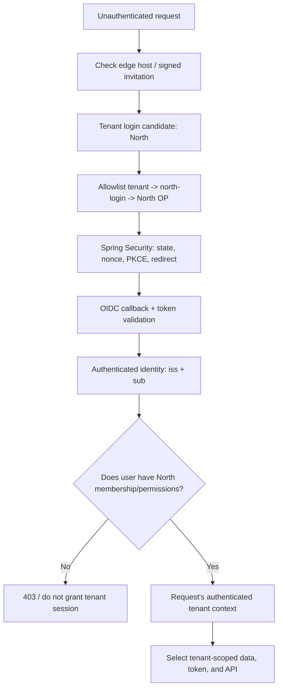
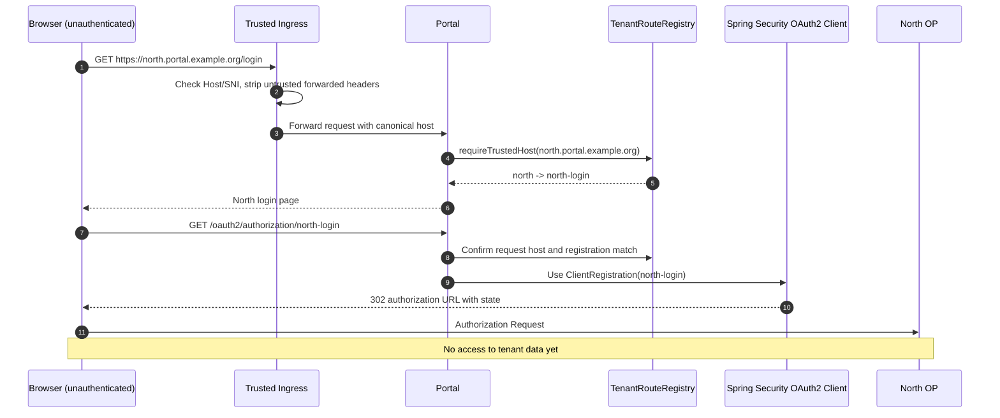
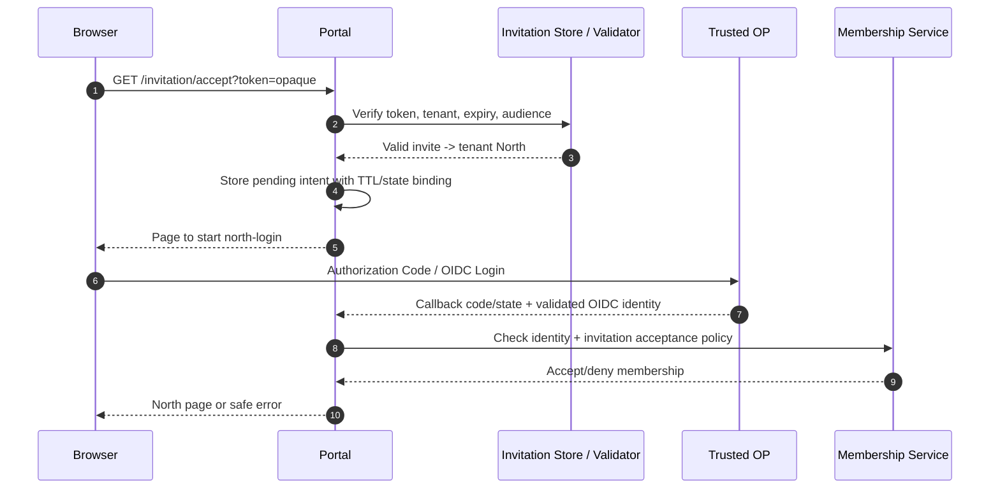
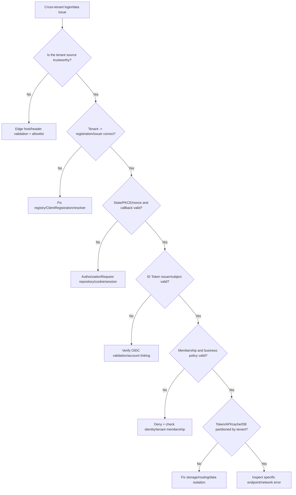

# 26.4. Selecting a Tenant from a Verified Request Context

In a **Spring Security OAuth 2.0 / OpenID Connect (OIDC) Client** system serving multiple tenants, the application frequently has to determine the tenant to know **which OpenID Provider to send the user to**, **which client registration to use**, **where to look up the authorized client/token**, and **which tenant's data policy to apply**. The challenge is that a tenant indicator can appear in many places: subdomain, URL path, header, query parameter, invitation, session, or authenticated identity. Not every source is trustworthy.

The principle of **"Selecting a Tenant from a Verified Request Context"** is:

> **Never take a client-supplied `tenantId` string and treat it as an authorized tenant.** You must determine the source of the information, verify the trust boundary, map to a server-side configuration, and **re-verify the user's relationship to the tenant after OAuth2/OIDC Login completes**.

Two stages must be distinguished clearly:

- **Before login:** there is no authenticated user identity yet. The application can determine the **intended login tenant** from a gateway-controlled host, a signed invitation, or an allowlisted UI selection. This tenant helps **route to the registration/OP**, but **does not prove the user belongs to the tenant**.
- **After login:** Spring Security has verified the OIDC response and created an `Authentication`. The application must identify the external identity using **`(issuer, subject)`**, map it to a local identity, verify membership/permissions for the tenant, and only then allow access to tenant resources or appropriate tokens.

**A valid host is not proof that the user is a tenant member.** **A valid ID Token does not automatically prove the user may view all tenant data.** **A stored authorized client does not replace authorization checks at the Resource Server.**

## 1. Learning Objectives

After this lesson, you will be able to:

1. Distinguish `tenant hint`, `login tenant`, `authenticated tenant`, and `resource tenant`.
2. Evaluate the trustworthiness of hosts, forwarded headers, paths, query parameters, request headers, cookies, signed invitations, sessions, and authenticated principals.
3. Design a server-side `tenant → registrationId → issuer/authorization policy` allowlist.
4. Build a tenant resolver using data from a controlled ingress/reverse proxy.
5. Route the OAuth2 Authorization Request to the exact `ClientRegistration` in Spring Security Servlet.
6. Coordinate `DefaultServerOAuth2AuthorizationRequestResolver` in WebFlux without blocking the event loop.
7. Bind the callback to the original `state`/request; verify `iss`, `sub`, registration, and membership after login.
8. Understand why `SecurityContext`, sessions, `OAuth2AuthorizedClientRepository`/`Service`, and token caches require tenant boundaries.
9. Prevent cross-tenant access, provider mix-up, confused deputy, open redirects, SSRF, and token leakage.
10. Write tests covering both valid requests and attempts to tamper with tenant, host, issuer, or principal.

## 2. Problem: One Portal, Multiple Organizations

Example of a SaaS with two enterprise customers:

```text
https://north.portal.example.org
  └─ Tenant North
     └─ OIDC registration: north-login
        └─ Expected issuer: https://id.north.example.org/realms/employees

https://south.portal.example.org
  └─ Tenant South
     └─ OIDC registration: south-login
        └─ Expected issuer: https://id.south.example.org/realms/employees
```

When a user visits the North host, Portal wants to show a "Log in to North" button and initiate:

```text
GET https://north.portal.example.org/oauth2/authorization/north-login
```

However, an attacker might try:

```text
GET https://north.portal.example.org/oauth2/authorization/south-login
GET https://north.portal.example.org/login?tenant=south
Host: south.portal.example.org
X-Forwarded-Host: south.portal.example.org
```

If the application selects a tenant simply because a parameter or header says "south", an attacker can force Portal to use a different client/issuer/token than the original request's tenant. This flaw typically leads to **tenant confusion**, **cross-tenant data access**, **token cache collisions**, or **provider mix-ups**.

### 2.1. Tenant Selection Is Not Tenant Authorization



The tenant in step C only selects the **login workflow**. Permission to access data is decided in step H and continues to be checked when the user accesses resources.

### 2.2. Four Different Tenant Concepts

| Concept | Example | Can it be trusted directly? |
|---|---|---|
| **Requested tenant** | `?tenant=north` or `/t/north` | No; this is a request/selection, not yet authorized |
| **Login-routing tenant** | Host mapped by ingress to North, mapped to `north-login` | Can be used **to pick the flow** after verifying source/mapping; does not prove user membership |
| **Authenticated tenant** | Logged-in local user with active North membership | Only after verifying identity + server-side policy |
| **Resource tenant** | `/api/tenants/north/reports` | Must match the authenticated tenant/membership and resource authorization |

Do not lump all four into a single thread-local variable named `currentTenant` without knowing where it came from and its trust level.

## 3. Why Is "Verified" a Hard Requirement?

An HTTP request carries plenty of data that the client can actively supply. A field name that looks "internal" does not guarantee a genuine value:

```http
GET /reports?tenantId=south HTTP/1.1
Host: north.portal.example.org
X-Tenant-ID: south
Cookie: preferredTenant=south
```

In this example:

- `tenantId` query: controlled by the caller.
- `X-Tenant-ID` header: controlled by the caller unless stripped/overwritten by the edge.
- `preferredTenant` cookie: modifiable by the browser if lacking integrity protection.
- `Host` header: forgeable if the edge/backend does not verify accepted hosts.
- `X-Forwarded-Host`: meaningful only when a **trusted** reverse proxy strips client-sent values and sets canonical values itself.

Therefore, two questions must both be answered:

1. **Was this value genuinely produced/validated by a trusted component?**
2. **Given the selected tenant, is the user authorized to work in that tenant?**

These are two separate verifications.

## 4. Matrix of Tenant Resolution Sources

| Source | Suitable for | Trust conditions / limitations |
|---|---|---|
| Controlled subdomain | Routing tenant login | Edge validates Host/SNI, allowlist; no direct backend access or spoofed forwarded headers |
| Path `/t/{tenant}` | Tenant hint, UX routing | Allowlist mapping; verify membership after login; path itself does not prove permission |
| Query `?tenant=...` | Tenant hint before login | Never use as permission; must normalize and check policy |
| Header `X-Tenant-ID` | Routing behind a trusted gateway | Gateway must strip/overwrite Internet headers and authenticate the caller if used for authorization |
| Cookie `lastTenant` | Remembering UI selection | Never use as proof of permission without integrity and membership checks |
| Signed invitation link | Identifying intended tenant/flow | Verify signature, audience, expiry, nonce/one-time policy; never assume link holder is a member |
| Server-side web session | Holding login intent or verified tenant | Session must have fixation/CSRF protection, TTL, and bind to the matching `Authentication` |
| `SecurityContext.Authentication` | Identifying logged-in user | Must be authenticated by Spring Security, never from a self-asserted header |
| Verified OIDC ID Token | Obtaining external issuer/subject | Framework checks `iss`/`aud`/`exp`/`nonce`/signature; membership must still be checked |
| Membership database / policy service | Deciding whether user has tenant rights | Query by verified local identity; permissions and status must be active |
| `OAuth2AuthorizedClient` | Accessing issued tokens | Not a tenant authentication source; must bind principal/registration/issuer/storage |

### 4.1. Trust by Level, Not by Variable Name

Example code:

```java
String tenant = request.getHeader("X-Verified-Tenant");
```

A header named "Verified" is **not self-verifying**. You can only rely on it if the deployment guarantees:

- Browsers cannot reach the backend directly via another path.
- The gateway authenticated the request or host mapping.
- The gateway stripped client-sent headers and overwrote the value from its own policy.
- The gateway → application link is protected.
- The app still validates that the tenant ID is in an allowlist.

Without these guarantees, treat the header as untrusted input.

### 4.2. Host Also Has a Trust Boundary

Even `request.getServerName()` is not "authentic" in every environment. Behind a reverse proxy, it can be influenced by `Host` or forwarded headers; a weakly configured reverse proxy may forward an attacker-supplied host.

**Only use host for tenant routing after the edge has normalized and validated the served host.** Ideally, explicitly define the virtual hosts to route, block unknown hosts at ingress, and check the allowlist again inside the application.

## 5. Designing a Server-Side Tenant Routing Registry

Instead of concatenating:

```java
String registrationId = tenantFromQuery + "-login";
```

maintain an explicit mapping:

```text
Trusted host                 Tenant ID     Registration     Expected issuer
-----------------------------------------------------------------------------------
north.portal.example.org     north         north-login     https://id.north.example.org/...
south.portal.example.org     south         south-login     https://id.south.example.org/...
```

This ensures the chosen tenant **cannot arbitrarily dictate the issuer/token endpoint** simply by modifying a URL string.

### 5.1. Configuration Model

```java
record TenantRoute(
        String tenantId,
        String externalHost,
        String registrationId,
        String expectedIssuer,
        String displayName) {}
```

A simple registry:

```java
import java.util.Locale;
import java.util.Map;
import org.springframework.security.access.AccessDeniedException;

final class TenantRouteRegistry {

    private final Map<String, TenantRoute> byHost = Map.of(
            "north.portal.example.org",
            new TenantRoute(
                    "north",
                    "north.portal.example.org",
                    "north-login",
                    "https://id.north.example.org/realms/employees",
                    "North Account"),

            "south.portal.example.org",
            new TenantRoute(
                    "south",
                    "south.portal.example.org",
                    "south-login",
                    "https://id.south.example.org/realms/employees",
                    "South Account"));

    TenantRoute requireTrustedHost(String externalHost) {
        if (externalHost == null) {
            throw new AccessDeniedException("Missing tenant host");
        }

        String canonical = externalHost.toLowerCase(Locale.ROOT);
        TenantRoute route = byHost.get(canonical);

        if (route == null) {
            throw new AccessDeniedException("Unsupported tenant host");
        }

        return route;
    }
}
```

This is an **illustrative registry sample**, not a replacement for edge configuration. In production, normalize hostnames/IDN, strip trailing dots, and handle ports properly. Never do loose checks like `contains("north")` or `endsWith("example.org")`, which could accept forged hosts like `north.portal.example.org.attacker.invalid`.

### 5.2. Never Store Credentials in the View Model

`TenantRoute` only holds routing metadata. OAuth2 client secrets and private keys must reside in secret configuration/`ClientRegistrationRepository`, never returned to the browser:

```text
TenantRoute:
  tenantId, externalHost, registrationId, expectedIssuer, displayName

ClientRegistration (server-side):
  clientId, clientSecret / private key, grant, scopes,
  authorizationUri, tokenUri, redirectUri, issuer metadata
```

Every mapping must go through a trusted configuration workflow; never create arbitrary `ClientRegistration` entries from `?issuer=https://...` or an un-allowlisted host.

## 6. Configuring Spring Boot OAuth2 Client for Tenants

A straightforward approach is using a **dedicated registration per tenant**:

```yaml
spring:
  security:
    oauth2:
      client:
        registration:
          north-login:
            provider: north-op
            client-id: "${NORTH_OIDC_CLIENT_ID}"
            client-secret: "${NORTH_OIDC_CLIENT_SECRET}"
            client-authentication-method: client_secret_basic
            authorization-grant-type: authorization_code
            client-name: "North Account"
            redirect-uri: "{baseUrl}/login/oauth2/code/{registrationId}"
            scope: [openid, profile, email]

          south-login:
            provider: south-op
            client-id: "${SOUTH_OIDC_CLIENT_ID}"
            client-secret: "${SOUTH_OIDC_CLIENT_SECRET}"
            client-authentication-method: client_secret_basic
            authorization-grant-type: authorization_code
            client-name: "South Account"
            redirect-uri: "{baseUrl}/login/oauth2/code/{registrationId}"
            scope: [openid, profile, email]

        provider:
          north-op:
            issuer-uri: "https://id.north.example.org/realms/employees"
          south-op:
            issuer-uri: "https://id.south.example.org/realms/employees"
```

The endpoints/issuers are hypothetical examples. In a real environment, verify OP discovery metadata, TLS, exact issuer, supported grants, redirect URIs, and scopes. Client secrets come from a secret manager or environment variables; never commit real values to Git.

### 6.1. Why Select the Registration Before Login?

`ClientRegistration` binds to:

- The provider's authorization endpoint/token endpoint.
- Client ID and client authentication method.
- Scopes, redirect URI, and PKCE/nonce behavior per flow.
- Issuer/JWK Set metadata required for OIDC validation.

Selecting the wrong registration can send the user to the wrong OP, cause callback mismatches, use mismatched client credentials, or result in an authentication from the wrong trust domain.

### 6.2. `registrationId` Is Not `tenantId`

For example:

```text
tenantId:      north
registrationId:north-login
clientId:      reports-portal-north-prod
provider ID:   north-op
issuer:        https://id.north.example.org/realms/employees
```

These strings have distinct responsibilities. Multiple registrations can exist for one tenant; multiple tenants can share one OP. Do not write authorization logic like `registrationId.startsWith(tenantId)` and treat it as a security invariant.

### 6.3. Shared OP Does Not Mean Shared Tenant Permissions

An enterprise may share a single Corporate OP for North and South:

```text
issuer = https://login.corporate.example.org
tenant North -> registrationId north-login
tenant South -> registrationId south-login
```

An ID Token from the same issuer can authenticate a user, but **that user is not necessarily a member of both tenants**. When sharing an issuer, per-tenant memberships/roles must all the more come from a trusted authorization source and be checked after login.

## 7. Selecting a Tenant Before Login: For Routing Only

Before performing OIDC Login, `SecurityContext` has no authenticated user. The application can:

1. Identify the host accepted by ingress.
2. Resolve to a `TenantRoute` via the server allowlist.
3. Render the appropriate login page.
4. Start OAuth2 authorization for the approved registration.
5. Let Spring Security generate `state`/nonce/PKCE and save the original authorization request.

**No permission to read North data is granted yet** simply because the URL has the North host.

### 7.1. Trust Flow Diagram



### 7.2. Host Selects the Flow, Not the Identity

On the North host, the user might still be someone without a North account. The OP may return an error, or the OP may authenticate the user while the application **must check membership** before granting access to North Portal.

If the system supports invitation-only tenants, an invitation can identify the intended tenant. However, the person opening the link must complete authentication and be bound to the invitation per policy, not merely possess the URL.

## 8. Configuring Ingress/Reverse Proxy and Forwarded Headers

Deployment example:

```text
Browser
   |
   | HTTPS north.portal.example.org
   v
Ingress / API Gateway
   - accepts exact list of hosts
   - terminates TLS
   - strips X-Forwarded-* sent by browser
   - sets forwarded metadata from actual connection
   |
   | private network / mTLS as needed
   v
Spring Boot Portal
```

Spring Boot provides forwarded-header handling configuration, for example:

```yaml
server:
  forward-headers-strategy: framework
```

**Only enable/apply this in an architecture with a trusted proxy.** If the application lets Internet clients send `Forwarded`/`X-Forwarded-Host` directly to the backend, forwarded-header processing can allow clients to **spoof the external host/scheme**. Strip untrusted incoming headers at the edge, restrict network paths, and verify the host allowlist before using it for tenant selection or redirect URIs.

### 8.1. Avoid Weak Hostname Matching

Do not do:

```java
// UNSAFE: client can use a forged host containing the substring.
if (request.getServerName().contains("north")) {
    return "north";
}
```

Do:

```java
// After edge ensures a canonical host:
TenantRoute route = registry.requireTrustedHost(
        request.getServerName());
```

using an **exact match** against an approved server host. When ports and schemes are involved, normalize using a trusted URL parser rather than manually splitting a `Host` string that may contain IPv6, IDN, or malformed data.

### 8.2. Callback Redirect URI Must Be Controlled

With:

```yaml
redirect-uri: "{baseUrl}/login/oauth2/code/{registrationId}"
```

Spring Security may use the external scheme/host observed on the request to construct the redirect URI. If the host/proxy source is untrusted, an attacker can influence the callback URL. This is why host validation is critical **both for tenant selection and for the redirect URI**.

A stricter option is using a fixed, pre-registered redirect URI per tenant when appropriate:

```text
north-login:
  https://north.portal.example.org/login/oauth2/code/north-login

south-login:
  https://south.portal.example.org/login/oauth2/code/south-login
```

Ensure the app and OP configurations match; never use broad wildcard redirect URIs to "legitimize" any hostname.

## 9. Spring MVC: Rendering the Login Page for a Controlled Host

In Servlet, you can obtain the external host from `HttpServletRequest` **after ingress has verified/normalized it**, query the registry, and render the matching page.

### 9.1. Login Page Controller

```java
import jakarta.servlet.http.HttpServletRequest;
import org.springframework.stereotype.Controller;
import org.springframework.ui.Model;
import org.springframework.web.bind.annotation.GetMapping;

@Controller
class TenantLoginController {

    private final TenantRouteRegistry routes;

    TenantLoginController(TenantRouteRegistry routes) {
        this.routes = routes;
    }

    @GetMapping("/login")
    String login(HttpServletRequest request, Model model) {

        // Safe only when ingress validates Host and forwarded headers.
        TenantRoute tenant =
                routes.requireTrustedHost(request.getServerName());

        model.addAttribute("tenantDisplayName", tenant.displayName());
        model.addAttribute("registrationId", tenant.registrationId());

        return "tenant-login";
    }
}
```

`TenantRouteRegistry` is an application-managed dependency; in a real Spring app, register it as a bean (`@Bean`/`@Component`) and populate it from a trusted server-side source. This example focuses solely on tenant selection logic.

### 9.2. Thymeleaf Template

```html
<!DOCTYPE html>
<html lang="en" xmlns:th="http://www.thymeleaf.org">
<head>
  <meta charset="UTF-8" />
  <title>Tenant Login</title>
</head>
<body>
  <main>
    <h1 th:text="${tenantDisplayName}">Tenant Portal</h1>
    <p>Sign in with an account for this organization.</p>

    <a th:href="@{/oauth2/authorization/{id}(id=${registrationId})}">
      Sign in with organization account
    </a>

    <p th:if="${param.error}" role="alert">
      Sign-in did not complete. Please try again.
    </p>
  </main>
</body>
</html>
```

This page contains no client secrets, access tokens, refresh tokens, or browser-supplied issuer URLs. `registrationId` comes from the server-side registry based on the controlled host, not from `?registrationId=...`.

### 9.3. `SecurityFilterChain` Configuration

```java
import org.springframework.context.annotation.Bean;
import org.springframework.security.config.annotation.web.builders.HttpSecurity;
import org.springframework.security.web.SecurityFilterChain;

@Bean
SecurityFilterChain securityFilterChain(HttpSecurity http)
        throws Exception {

    return http
            .authorizeHttpRequests(auth -> auth
                    .requestMatchers(
                            "/", "/login", "/error", "/css/**")
                    .permitAll()
                    .anyRequest().authenticated())
            .oauth2Login(oauth2 ->
                    oauth2.loginPage("/login"))
            .build();
}
```

The `/login` page is public so unauthenticated browsers can pick the right OP. However, **merely displaying only `north-login` on the page does not stop a user from manually typing `/oauth2/authorization/south-login`**. You must protect the actual authorization request initiation step as shown in the next section.

## 10. Spring MVC: Protecting Registration Selection at the Authorization Endpoint

OAuth2 Login normally initiates via:

```text
/oauth2/authorization/{registrationId}
```

When multiple tenants have separate registrations, a user on the North host must not be allowed to arbitrarily start the South registration if policy forbids cross-tenant flows on that host.

`DefaultOAuth2AuthorizationRequestResolver` can be **wrapped** to permit only the registration matching the resolved `TenantRoute`.

### 10.1. Wrapper Principle

```text
Incoming request:
  host = north.portal.example.org
  path = /oauth2/authorization/north-login

TrustedTenantRegistry:
  expected registration = north-login

Custom OAuth2AuthorizationRequestResolver:
  - do path and expected registration match?
  - if no: deny
  - if yes: delegate to DefaultOAuth2AuthorizationRequestResolver
      -> framework creates state, nonce, PKCE per configuration
```

Do not build the entire `OAuth2AuthorizationRequest` yourself just to block the wrong registration; let Spring Security handle the protocol logic.

### 10.2. Servlet Implementation Example

```java
import jakarta.servlet.http.HttpServletRequest;
import org.springframework.security.access.AccessDeniedException;
import org.springframework.security.oauth2.client.web
        .OAuth2AuthorizationRequestResolver;
import org.springframework.security.oauth2.core.endpoint
        .OAuth2AuthorizationRequest;

final class TenantBoundAuthorizationRequestResolver
        implements OAuth2AuthorizationRequestResolver {

    private static final String START = "/oauth2/authorization/";

    private final OAuth2AuthorizationRequestResolver delegate;
    private final TenantRouteRegistry routes;

    TenantBoundAuthorizationRequestResolver(
            OAuth2AuthorizationRequestResolver delegate,
            TenantRouteRegistry routes) {
        this.delegate = delegate;
        this.routes = routes;
    }

    @Override
    public OAuth2AuthorizationRequest resolve(
            HttpServletRequest request) {

        String path = request.getRequestURI()
                .substring(request.getContextPath().length());
        if (!path.startsWith(START)) {
            return null;
        }

        TenantRoute route =
                routes.requireTrustedHost(request.getServerName());
        String expectedPath = START + route.registrationId();

        if (!expectedPath.equals(path)) {
            throw new AccessDeniedException(
                    "Registration not allowed on tenant host");
        }

        return delegate.resolve(request, route.registrationId());
    }

    @Override
    public OAuth2AuthorizationRequest resolve(
            HttpServletRequest request,
            String clientRegistrationId) {

        TenantRoute route =
                routes.requireTrustedHost(request.getServerName());

        if (!route.registrationId().equals(clientRegistrationId)) {
            throw new AccessDeniedException(
                    "Registration does not match tenant host");
        }

        return delegate.resolve(request, clientRegistrationId);
    }
}
```

This is an example of **protecting registration at authorization initiation**, assuming the app is mounted at a normal context path and the request URI is handled consistently by the security filter. Also verify URL normalization, path parameters, encoded separators, reverse proxy prefixes, and custom matchers/base URIs if your system alters them. Never manually split URLs or concatenate browser strings and treat them as a trusted registration.

Returning `null` for paths that are not authorization initiations lets the resolver ignore unrelated requests. When the wrong registration is requested on a valid host, the example throws `AccessDeniedException` so policy/security exception handling rejects it; avoid silently falling back to a default OP that logs the user into the wrong tenant.

### 10.3. Registering the Resolver with OAuth2 Login

```java
import org.springframework.context.annotation.Bean;
import org.springframework.security.config.annotation.web.builders.HttpSecurity;
import org.springframework.security.oauth2.client.registration
        .ClientRegistrationRepository;
import org.springframework.security.oauth2.client.web
        .DefaultOAuth2AuthorizationRequestResolver;
import org.springframework.security.web.SecurityFilterChain;

@Bean
SecurityFilterChain tenantSecurityFilterChain(
        HttpSecurity http,
        ClientRegistrationRepository registrations,
        TenantRouteRegistry routes) throws Exception {

    var defaultResolver =
            new DefaultOAuth2AuthorizationRequestResolver(
                    registrations, "/oauth2/authorization");

    var tenantResolver =
            new TenantBoundAuthorizationRequestResolver(
                    defaultResolver, routes);

    return http
            .authorizeHttpRequests(auth -> auth
                    .requestMatchers("/login", "/error").permitAll()
                    .anyRequest().authenticated())
            .oauth2Login(oauth2 -> oauth2
                    .loginPage("/login")
                    .authorizationEndpoint(endpoint ->
                            endpoint.authorizationRequestResolver(
                                    tenantResolver)))
            .build();
}
```

This is an **alternative configuration** to the chain in Section 9.3; an application should deploy only the chain suited to its routing. If multiple `SecurityFilterChain` beans exist, define explicit matchers/order so all related authorization/callback paths enter the right security flow.

### 10.4. Why Not Check Only in the `/login` Controller?

A `/login` controller can render North properly while exerting zero control over `/oauth2/authorization/south-login` handled by Spring Security filters. Attackers do not have to click UI buttons; they can send HTTP requests directly. **Registration enforcement must sit where the authorization request is actually created**, not just in templates.

### 10.5. 403 or an Error Page?

Requests for the wrong tenant must be rejected in a controlled manner. For UX, you can display a message like "This login method is not available for the current organization." Operationally, log the approved registration ID and canonical host, without logging credentials, `state`, authorization codes, or ID Tokens.

Do not redirect the user to the South OP as an "automatic fallback" if they select the wrong registration on North, unless it is an intentional, protected, and clearly explained tenant-switching flow.

## 11. Handling the Authorization Callback: Never Trust Tenant from Query Params

After the OP authenticates the user, the browser returns to:

```text
https://north.portal.example.org/login/oauth2/code/north-login
    ?code=<ONE_TIME_CODE>
    &state=<OPAQUE_STATE>
```

At this point, an attacker might tamper with query params/cookies or try sending the callback to a different host. The application should not determine the tenant from:

```text
?tenant=north
?registrationId=north-login
X-Tenant-ID: north
```

instead of the data bound by Spring Security to the **original authorization request**, client registration, and OIDC token validation.

### 11.1. Role of `state`

`state` binds the authorization response to the authorization request initiated by the client. Spring Security uses `OAuth2AuthorizationRequestRepository` (Servlet) or `ServerAuthorizationRequestRepository` (Reactive) to maintain correlation context between redirect and callback.

In a multi-tenant system, preserve:

- The Registration ID selected on the original request.
- The allowed callback host/URI corresponding to the registration.
- `state`/PKCE/nonce generated and verified by the framework.
- The tenant login intent in integrity-protected server-side storage, if business logic needs to cross-check it separately.

Do not set `state="north"` or `state=tenantId` to "pass the tenant through the OP". `state` must be sufficiently random and handled per OAuth2; tenant metadata can be attached to the request state **server-side** via a protected mechanism.

### 11.2. If You Need to Persist Tenant Login Intent Across the Redirect

A design can store:

```text
OAuth2AuthorizationRequest:
  state = random opaque value
  registrationId = north-login
  application attribute:
      expectedTenantId = north
      expectedHost = north.portal.example.org
```

Application attributes (if using `OAuth2AuthorizationRequest.attributes`) are internal data that the repository must persist and protect; they **do not automatically become query parameters sent to the OP**. Access belongs to the resolver/repository APIs; retrieving them on callback must rely on framework-supported flows or trusted custom correlation storage.

**Beware of multiple tabs/concurrent login attempts.** A single session attribute `pendingTenant=north` can be overwritten by a South login attempt. The design must bind to the `state`/authorization transaction and include TTL/cleanup.

### 11.3. Checking the Callback Host

If each registration has its own callback host:

```text
north-login -> north.portal.example.org/login/oauth2/code/north-login
south-login -> south.portal.example.org/login/oauth2/code/south-login
```

then the server must reject callbacks sent to a host that violates the mapping. One approach is protecting callback routes at the ingress and/or security layer, then comparing the expected host against the trusted mapping—never merely checking a "tenant" query parameter.

## 12. After Login: Verifying Identity and Tenant Membership

When Spring Security OIDC Login completes, `Authentication` is typically an `OAuth2AuthenticationToken` with an `OidcUser` principal. The token/claims have passed the framework's OIDC validation for the registration.

The application can use:

```java
import org.springframework.security.oauth2.client.authentication
        .OAuth2AuthenticationToken;
import org.springframework.security.oauth2.core.oidc.user.OidcUser;

if (authentication instanceof OAuth2AuthenticationToken oauth2
        && oauth2.getPrincipal() instanceof OidcUser oidcUser) {

    String registrationId =
            oauth2.getAuthorizedClientRegistrationId();
    String issuer = oidcUser.getIdToken()
            .getClaimAsString("iss");
    String subject = oidcUser.getIdToken()
            .getClaimAsString("sub");

    // Look up local identity by (issuer, subject),
    // then verify membership for the target tenant.
}
```

Do not use `email`, `preferred_username`, or `name` as a unique identifier across multiple issuers. OIDC `sub` is only meaningful within its issuer. `clientRegistrationId` also reveals which registration the user came through; however, the registration name itself is not proof that the user holds an admin role.

### 12.1. Complete Verification Chain

```text
OIDC Login succeeded:
    client registration = north-login
    issuer             = https://id.north.example.org/...
    subject            = user-123
           |
           v
Identity registry:
    (issuer, subject) -> localUserId = 42
           |
           v
Membership policy:
    localUserId = 42
    tenantId    = north
    membership  = active
    roles       = REPORT_VIEWER
           |
           v
Protected request:
    resource.tenantId == north ?
    permission REPORT_VIEWER ?
           |
           v
Allow / Deny
```

### 12.2. Do Not Infer Membership from the Login Button

```java
// DO NOT DO THIS:
if (oauth2.getAuthorizedClientRegistrationId().equals("north-login")) {
    grantAllNorthPermissions();
}
```

Someone may log into the North OP yet **no longer have** membership in North Portal, or have membership granting read access only to a specific group. The registration only defines **authentication configuration**, not blanket business permissions.

### 12.3. Is a Tenant Claim in the ID Token Trustworthy?

An OP may emit a claim like:

```json
{
  "iss": "https://id.north.example.org/realms/employees",
  "sub": "user-123",
  "aud": "north-portal-client",
  "tenant_id": "north"
}
```

This claim **can only be trusted under the OP's contract** after the ID Token is verified, issuer/audience match, and the application knows the exact semantics of the claim. A `tenant_id` claim from another issuer might not carry the same semantics.

For sensitive authorization, you must also evaluate current membership status in the application's authoritative source; the ID Token may have been issued before the user's permissions were revoked.

## 13. Post-Login Tenant Check Pattern in Servlet

To illustrate a **per-request check**, we use the controlled host and the `Authentication` provided by Spring Security.

### 13.1. Service Resolving the Authorized Tenant

```java
import jakarta.servlet.http.HttpServletRequest;
import org.springframework.security.access.AccessDeniedException;
import org.springframework.security.core.Authentication;
import org.springframework.security.oauth2.client.authentication
        .OAuth2AuthenticationToken;
import org.springframework.security.oauth2.core.oidc.user.OidcUser;

record AuthorizedTenantContext(
        String tenantId,
        String localUserId,
        String registrationId) {}

interface LocalIdentityDirectory {
    String requireLocalUserId(String issuer, String subject);
}

interface TenantMembershipPolicy {
    boolean hasActiveMembership(String localUserId, String tenantId);
}

final class AuthorizedTenantResolver {

    private final TenantRouteRegistry routes;
    private final LocalIdentityDirectory identities;
    private final TenantMembershipPolicy memberships;

    AuthorizedTenantResolver(
            TenantRouteRegistry routes,
            LocalIdentityDirectory identities,
            TenantMembershipPolicy memberships) {
        this.routes = routes;
        this.identities = identities;
        this.memberships = memberships;
    }

    AuthorizedTenantContext requireForRequest(
            HttpServletRequest request,
            Authentication authentication) {

        TenantRoute route =
                routes.requireTrustedHost(request.getServerName());

        if (!(authentication instanceof OAuth2AuthenticationToken oauth2)
                || !(oauth2.getPrincipal() instanceof OidcUser oidc)) {
            throw new AccessDeniedException(
                    "Expected authenticated OIDC principal");
        }

        if (!route.registrationId().equals(
                oauth2.getAuthorizedClientRegistrationId())) {
            throw new AccessDeniedException(
                    "OIDC client registration differs from tenant route");
        }

        String issuer =
                oidc.getIdToken().getClaimAsString("iss");
        String subject =
                oidc.getIdToken().getClaimAsString("sub");

        if (!route.expectedIssuer().equals(issuer)) {
            throw new AccessDeniedException(
                    "Unexpected OIDC issuer for tenant");
        }

        String localUserId =
                identities.requireLocalUserId(issuer, subject);

        if (!memberships.hasActiveMembership(
                localUserId, route.tenantId())) {
            throw new AccessDeniedException(
                    "User is not a member of requested tenant");
        }

        return new AuthorizedTenantContext(
                route.tenantId(),
                localUserId,
                route.registrationId());
    }
}
```

`LocalIdentityDirectory` and `TenantMembershipPolicy` are **application-implemented interfaces**; this example does not define schema/local user provisioning. For applications with multiple registrations per tenant or policies allowing users to enter from another OP, the registration/issuer checks must be expanded via an **approved mapping**, never removed entirely.

### 13.2. Usage in a Protected Endpoint

```java
import jakarta.servlet.http.HttpServletRequest;
import org.springframework.security.core.Authentication;
import org.springframework.web.bind.annotation.GetMapping;
import org.springframework.web.bind.annotation.RestController;

@RestController
final class TenantReportsController {

    private final AuthorizedTenantResolver tenantResolver;
    private final ReportsService reports;

    TenantReportsController(
            AuthorizedTenantResolver tenantResolver,
            ReportsService reports) {
        this.tenantResolver = tenantResolver;
        this.reports = reports;
    }

    @GetMapping("/reports")
    ReportPage getReports(
            HttpServletRequest request,
            Authentication authentication) {

        AuthorizedTenantContext context =
                tenantResolver.requireForRequest(
                        request, authentication);

        return reports.findVisibleReports(
                context.tenantId(),
                context.localUserId());
    }
}
```

`ReportsService`/`ReportPage` are illustrative application components. The service **must still authorize individual reports** (unit, department, owner, status), not only filter by tenant ID. The tenant check is one layer of authorization, not the whole system.

### 13.3. Why Check on Every Request?

If a user's membership is revoked after login, old claims/sessions may persist. For sensitive resources, ensure current policy/membership is checked at the appropriate boundary or use a cache with TTL/invalidation matching your revocation latency requirements.

Checking the tenant once on OAuth2 login success and trusting the session forever allows stale permissions to persist until the session expires.

### 13.4. Avoid Uncontrolled Tenant Storage in the Session

`session.setAttribute("tenantId", tenantId)` can be handy for retaining a **UI selection**. However, if that tenant comes from a query parameter and is then used directly as a SQL filter, an attacker can switch tenants merely by changing the UI selection.

A session field trusted for authorization must:

1. Be created from verified post-login policy.
2. Be bound to the corresponding `Authentication`/local identity.
3. Be validated whenever the user switches tenants.
4. Be cleared/updated upon logout, principal change, or permission revocation.
5. Never be arbitrarily overwritten by an anonymous browser request.

## 14. Selecting a Tenant from a Signed Invitation or Organization Discovery

Not every system uses dedicated subdomains. Some systems share a single domain:

```text
https://portal.example.org/login?invite=<opaque-token>
```

An invitation token can indicate North and the intended registration. To use it as a trusted source, the server must verify:

- The token is signed or stored server-side as an opaque reference.
- The signature/MAC is verified with a secret key.
- `issuer`/`audience` match Portal.
- `expiresAt`/`notBefore` and TTL are reasonable.
- `nonce`/one-time use, preventing replay if required by the flow.
- Embedded `tenantId` or registration cannot be tampered with while remaining valid.
- Invite purpose cannot be confused with a bearer access token.
- After OIDC login, the user identity satisfies the conditions for accepting the invitation.

### 14.1. Invitation Workflow



**An invitation only identifies the workflow the user intends to complete**; it does not automatically grant permissions to whoever holds the URL. If an invitation targets a specific email or identity, verify it under the proper authentication/ownership contract.

### 14.2. Avoid Exposing Invitation Tokens via Telemetry

If an invitation token is in the URL, it can appear in browser history, referrers, reverse proxy logs, or analytics. Prefer short-lived, narrow-scoped opaque random tokens, exclude them from third-party scripts, and move to server-side correlation early. Never use access tokens/refresh tokens as invitation tokens.

### 14.3. Organization Discovery by Email Domain

A screen may ask for an email to **suggest** a tenant/OP:

```text
user enters alice@north.example.org
-> app suggests "Sign in to North"
```

However, an email **self-reported by the user before login** must never be used as proof that the person owns that mailbox or holds permissions in North. It serves UX/discovery only; identity/issuer/membership must still be verified afterward.

## 15. Are Request Headers Added by a Gateway Trustworthy?

Some organizations have a gateway authenticate requests and attach:

```http
X-Authenticated-Tenant: north
X-Authenticated-User: internal-user-42
```

If Spring Security still accepts requests directly from the Internet, an attacker can send identical headers. Only rely on them when:

1. The gateway genuinely authenticates the caller/identity per contract.
2. External client-sent headers are stripped, and the gateway issues fresh headers.
3. The backend accepts traffic exclusively from the trusted gateway.
4. Internal connections are protected, with service-to-service authentication as needed.
5. The app still validates the tenant ID against an allowlist and binds it to `Authentication`/local identity per the trust model.

For **OIDC Login from an unauthenticated browser**, an `X-Authenticated-Tenant` header normally does not exist and must never be simulated from the browser. This pattern fits API-to-API traffic or gateways handling authentication upfront.

### 15.1. Avoiding Confused Deputy

Confused deputy occurs when a service holding powerful credentials performs an action for a caller without **checking whether the caller is authorized to request that action on the target tenant**.

For example:

```text
Attacker sends tenant=south
      |
      v
Portal uses service token south-service
      |
      v
South Reports API returns data
```

This is still a vulnerability, even when the service token is valid and the South API verifies a valid JWT signature. Portal must verify user/membership/operation before exercising South's privileged credentials.

## 16. Separating Login Tenant from Resource Tenant When a User Has Multiple Memberships

A user can be a member of both North and South. Two designs exist:

### Design A: Tenant Fixed by Host

```text
north.portal.example.org -> tenant north
south.portal.example.org -> tenant south
```

A request on North **is not permitted** to read South data just because the user is also a member of South. The user must switch to the South host or an explicitly controlled route.

### Design B: User Selects Active Tenant After Login

```text
portal.example.org
   |
   +-- user authenticates via Corporate OP
   +-- memberships = [north, south]
   +-- user selects active tenant = north
   +-- every request checks active tenant and permissions
```

In this model, "active tenant" can be held in session/context after the server verifies membership. If the user switches from North to South:

1. Server re-verifies South membership.
2. Updates the active tenant in protected state, never trusting a raw query param.
3. Clears/switches tenant-scoped caches.
4. Selects the right API/authorized client and scope/audience.
5. Ensures no North data leaks into the new response/cache.
6. Audits the tenant switch event when required.

**Never turn the active tenant into a JVM-wide global property** or a thread-local that can leak across concurrent requests.

### 16.1. One Login Serving Multiple Tenants Does Not Mean One Access Token Works for Every API

If the Corporate OP issues an access token with audience `portal-api`, that token is not automatically valid at `north-reports-api` and `south-reports-api`. You need an appropriate token issuance contract—such as separate registrations/scopes/resources or provider-supported token exchange.

Updating `activeTenant` in the session does not automatically change the `aud`/`scope` of an access token.

## 17. Spring WebFlux Reactive: Non-Blocking Tenant Selection

In Spring WebFlux, requests are represented by `ServerWebExchange`; the security context travels through the Reactor Context. Do not rely on `HttpServletRequest` or thread-local `SecurityContextHolder` as an invariant source across reactive callbacks.

### 17.1. Host Mapping in WebFlux

A helper can read the external host from a request that passed through **trusted ingress**:

```java
import org.springframework.web.server.ServerWebExchange;

final class ReactiveTenantRoutes {

    private final TenantRouteRegistry registry;

    ReactiveTenantRoutes(TenantRouteRegistry registry) {
        this.registry = registry;
    }

    TenantRoute requireLoginTenant(ServerWebExchange exchange) {
        String host = exchange.getRequest().getURI().getHost();

        // Trust boundary sits at the gateway/forwarded header config.
        return registry.requireTrustedHost(host);
    }
}
```

`getURI().getHost()` performs no "verification magic": the application may only rely on the host when ingress has restricted and normalized the value. With HTTP `Host` headers containing ports/IDN or custom deployments, apply proper canonicalization.

### 17.2. Reactive Resolver Wrapping `DefaultServerOAuth2AuthorizationRequestResolver`

```java
import org.springframework.security.access.AccessDeniedException;
import org.springframework.security.oauth2.client.web.server
        .ServerOAuth2AuthorizationRequestResolver;
import org.springframework.security.oauth2.core.endpoint
        .OAuth2AuthorizationRequest;
import org.springframework.web.server.ServerWebExchange;
import reactor.core.publisher.Mono;

final class TenantBoundServerAuthorizationRequestResolver
        implements ServerOAuth2AuthorizationRequestResolver {

    private static final String START = "/oauth2/authorization/";

    private final ServerOAuth2AuthorizationRequestResolver delegate;
    private final ReactiveTenantRoutes routes;

    TenantBoundServerAuthorizationRequestResolver(
            ServerOAuth2AuthorizationRequestResolver delegate,
            ReactiveTenantRoutes routes) {
        this.delegate = delegate;
        this.routes = routes;
    }

    @Override
    public Mono<OAuth2AuthorizationRequest> resolve(
            ServerWebExchange exchange) {

        return Mono.defer(() -> {
            String path = exchange.getRequest().getPath()
                    .pathWithinApplication().value();

            if (!path.startsWith(START)) {
                return Mono.empty();
            }

            TenantRoute route = routes.requireLoginTenant(exchange);

            if (!path.equals(START + route.registrationId())) {
                return Mono.error(new AccessDeniedException(
                        "Registration not allowed for tenant host"));
            }

            return delegate.resolve(exchange, route.registrationId());
        });
    }

    @Override
    public Mono<OAuth2AuthorizationRequest> resolve(
            ServerWebExchange exchange,
            String registrationId) {

        return Mono.defer(() -> {
            TenantRoute route = routes.requireLoginTenant(exchange);

            if (!route.registrationId().equals(registrationId)) {
                return Mono.error(new AccessDeniedException(
                        "Wrong login registration for tenant"));
            }

            return delegate.resolve(exchange, registrationId);
        });
    }
}
```

`Mono.defer` keeps resolution inside the reactive subscription. This example uses a very short synchronous in-memory mapping; if the actual tenant registry queries a remote database, change the helper to return `Mono<TenantRoute>` and compose with `flatMap`. **Never call `.block()` inside the resolver**.

With custom path bases, context paths, or proxy prefixes, keep matchers/path normalization synchronized. Never allow the browser to tamper with encoded host/path segments to bypass the exact registration check.

### 17.3. Wiring the Resolver into `SecurityWebFilterChain`

```java
import org.springframework.context.annotation.Bean;
import org.springframework.security.config.web.server.ServerHttpSecurity;
import org.springframework.security.oauth2.client.registration
        .ReactiveClientRegistrationRepository;
import org.springframework.security.oauth2.client.web.server
        .DefaultServerOAuth2AuthorizationRequestResolver;
import org.springframework.security.web.server.SecurityWebFilterChain;

@Bean
SecurityWebFilterChain tenantWebFilterChain(
        ServerHttpSecurity http,
        ReactiveClientRegistrationRepository registrations,
        ReactiveTenantRoutes routes) {

    var defaultResolver =
            new DefaultServerOAuth2AuthorizationRequestResolver(
                    registrations);

    var tenantResolver =
            new TenantBoundServerAuthorizationRequestResolver(
                    defaultResolver, routes);

    return http
            .authorizeExchange(exchanges -> exchanges
                    .pathMatchers("/login", "/error").permitAll()
                    .anyExchange().authenticated())
            .oauth2Login(oauth2 -> oauth2
                    .loginPage("/login")
                    .authorizationRequestResolver(tenantResolver))
            .build();
}
```

These classes must be registered as Spring beans per the project structure. This is an alternative configuration for a default WebFlux chain; **do not run multiple chains with overlapping matchers concurrently** without explicit precedence.

### 17.4. Checking Tenant Authorization After Reactive Login

A reactive service should obtain `Authentication` from the Reactor context and call a non-blocking membership service:

```java
import org.springframework.security.access.AccessDeniedException;
import org.springframework.security.core.Authentication;
import org.springframework.security.core.context
        .ReactiveSecurityContextHolder;
import reactor.core.publisher.Mono;

Mono<AuthorizedTenantContext> currentTenant(
        ServerWebExchange exchange) {

    TenantRoute route = routes.requireLoginTenant(exchange);

    return ReactiveSecurityContextHolder.getContext()
            .map(context -> context.getAuthentication())
            .switchIfEmpty(Mono.error(
                    new AccessDeniedException("Not authenticated")))
            .flatMap(authentication ->
                    reactiveTenantPolicy.requireMembership(
                            authentication, route));
}
```

`reactiveTenantPolicy.requireMembership(...)` is an **application-implemented API** returning `Mono<AuthorizedTenantContext>` after verifying registration/issuer/subject and local membership. Do not write to a static `currentTenant` variable or read the principal from `request.getQueryParams()` to bypass Reactor SecurityContext.

### 17.5. Reactor Context vs. `ThreadLocal`

In Reactive applications, execution can hop across schedulers. Using `ThreadLocal<Tenant>` without proper context propagation can:

- Lose the tenant on a callback running on another thread.
- Read a leftover tenant from a previous request if cleanup fails.
- Cause cross-tenant data leaks that are hard to reproduce under load.

Prefer **passing `AuthorizedTenantContext` explicitly** through service methods or using a configured, controlled Reactor Context. Any context used for authorization must originate from a verified source and cannot be overridden by the client.

## 18. Where Should Tenant Context Live After Login?

| Storage mechanism | Pros | Limitations |
|---|---|---|
| Recompute from host + Authentication + membership | Closely tracks policy, limits stale state | May increase lookup cost |
| Immutable claim/authority verified at login | Easy to use during requests | Can go stale when permissions are revoked |
| Verified server-side session attribute | Preserves active tenant per user session | Must invalidate/update on switch/logout/revocation |
| Request attribute set by filter after policy check | Easy to pass across Servlet request | Scoped only to a single request |
| Server-set Reactor Context | Fits Reactive chains | Must manage propagation; never accept arbitrary input |
| Tenant in OP-verified token | Can fit a specific contract | Still requires understanding issuer, audience, semantics, and freshness |
| Self-asserted query/header/cookie | Convenient for UX | Not proof of authorization |

### 18.1. Using Request-Scoped Context with Explicit Trust Levels

A good structure distinguishes stages by type:

```java
record RequestedTenant(String tenantId) {}

record LoginTenant(
        String tenantId, String registrationId) {}

record AuthorizedTenant(
        String tenantId, String localUserId) {}
```

These types are models to aid code readability. Type names alone do not create security; only the **verified construction workflow** guarantees trustworthiness.

### 18.2. Avoid Passing Raw `tenantId` Through Every Service

Instead of:

```java
reportsDao.findReports(request.getParameter("tenantId"));
```

use a policy-verified context:

```java
AuthorizedTenantContext tenant =
        authorizedTenantResolver.requireForRequest(
                request, authentication);

reportsDao.findVisibleReports(
        tenant.tenantId(),
        tenant.localUserId());
```

The DAO must still apply the proper tenant condition in queries, tenant-aware database policies/RLS if present, and object-level authorization checks at the business layer.

## 19. Partitioning `OAuth2AuthorizedClient` and Token Stores by Tenant

After OIDC Login, Spring Security may save an `OAuth2AuthorizedClient` containing access/refresh tokens. This requires particular care in multi-tenancy.

`OAuth2AuthorizedClientService` typically keys by:

```text
(clientRegistrationId, principalName)
```

There is no `tenantId` component in the default key.

### 19.1. Dedicated Registrations per Tenant

```text
(north-login, employee-42) -> North AT/RT
(south-login, employee-42) -> South AT/RT
```

When registrations differ, the service key pair separates the two authorized clients. You must still verify principal identity, issuer/subject mapping, and tenant authorization; matching `"employee-42"` strings alone do not prove it is the same user.

### 19.2. One Registration Shared Across Multiple Tenants

```text
(company-login, employee-42) -> which token?
```

If North/South use the **same registration and the same `principalName`** while tokens have different tenant audiences/claims, the default store can overwrite or mistakenly reuse tokens.

Options to consider:

1. Separate registrations whenever client configurations or token audiences genuinely differ.
2. Map a stable principal identity partitioned by tenant under a controlled design, ensuring manager and storage use the exact same key.
3. Use custom storage/services with true tenant namespacing and explicit contracts.
4. Never use a token authorized for tenant A to call tenant B's API merely because usernames match.
5. Verify token audience/scope/issuer at the Resource Server and dispatch the right client at the BFF.

**Do not concatenate `tenantFromQuery + ":" + principalName` and assume it is safe.** First verify both tenant and principal. Moreover, if the Spring Security manager does not understand the modified key, saves and loads will diverge.

### 19.3. Client Credentials per Tenant

Suppose the backend has:

```text
north-api-service -> North client_credentials token
south-api-service -> South client_credentials token
```

A North user requesting a report export must never arbitrarily select `south-api-service` merely via `tenant=south`. The application must verify user membership and permissions, then route to the right server-configured service registration/URL.

For background jobs lacking a browser session, use a service manager (`AuthorizedClientServiceOAuth2AuthorizedClientManager` or Reactive equivalent) with a stable logical principal per policy. Never use a browser's `SecurityContext` as the identity for a global service token.

### 19.4. Redis/JDBC Tenant Isolation

When a custom store includes a tenant column:

```sql
-- Illustrative application schema, not Spring Security's default schema.
CREATE TABLE tenant_oauth2_authorized_client (
    tenant_id              varchar(100) NOT NULL,
    client_registration_id varchar(150) NOT NULL,
    principal_id           varchar(300) NOT NULL,
    encrypted_access_token bytea NOT NULL,
    encrypted_refresh_token bytea,
    token_expires_at       timestamptz,
    record_version         bigint NOT NULL DEFAULT 0,
    PRIMARY KEY (
        tenant_id,
        client_registration_id,
        principal_id
    )
);
```

This is an **illustrative** schema, omitting `issuedAt`, scopes, token type, schema version, and metadata required to reconstruct `OAuth2AuthorizedClient`. When creating a custom service, integrate consistently with `OAuth2AuthorizedClientManager`/repository and avoid dropping token/refresh metadata.

Never store plaintext tokens. Use encryption at rest with managed keys, restrict DB/Redis permissions, limit backups/logs, and guard concurrent refresh token rotation using versioning/CAS or single-flight control.

## 20. Tokens Do Not Automatically Carry Permissions for the Selected Tenant

Even when an OIDC user is logged in and a member of North, the access token issued by the OP may contain:

```text
iss   = Corporate OP
aud   = portal-web
scope = openid profile
```

While the Reports API requires:

```text
aud   = reports-api
scope = reports.read
tenant = north
```

Selecting tenant North in the request context **does not automatically change the access token's audience/scopes**. The application needs an OAuth2 client/grant/token exchange matching the API's contract. The Resource Server must verify the token and enforce tenant object authorization; do not merely trust `X-Tenant-ID` sent by Portal if the API itself does not verify source/policy.

### 20.1. Calling Downstream APIs via Server-Routed URLs

Do not write:

```java
// UNSAFE: browser can change tenant and API host.
String tenant = request.getParameter("tenant");
String target = request.getParameter("url");
webClient.get().uri(target)
        .header("X-Tenant-ID", tenant)
        .retrieve();
```

Instead:

```java
record TenantApiTarget(
        String registrationId,
        String baseUrl) {}

Map<String, TenantApiTarget> apiTargets = Map.of(
        "north",
        new TenantApiTarget(
                "north-api-service",
                "https://reports.north.example.org"),
        "south",
        new TenantApiTarget(
                "south-api-service",
                "https://reports.south.example.org"));
```

Only after `AuthorizedTenantContext` is verified should the app look up this table and call the matching API. Never let the user arbitrarily choose a URL to receive a bearer token; that causes **SSRF and token leakage**.

### 20.2. Host Selection at Login Does Not Protect Outbound Tokens

Even when login auth routes to the right issuer, downstream code can still pick the wrong authorized client if a default registration is misconfigured or tokens are stored under colliding principals. Unify the **tenant → downstream API → OAuth2 client/token → expected audience** mapping in a single server-side policy.

### 20.3. Caches Must Have Tenant Keys

```text
DO NOT:
  cacheKey = "reports:" + localUserId

CONSIDER:
  cacheKey = "reports:" + verifiedTenantId + ":" + localUserId + ":" + scope
```

Cache keys must match the actual data scope (tenant, principal, resource, permission, version) so a user switching tenants never receives a cached response from the previous tenant. Never build cache keys from an unauthorized `tenantId` query parameter.

## 21. Sessions, `SecurityContext`, and Switching Tenants

A web session might hold:

```text
Authentication:
   issuer/subject -> localUserId

Authorized tenant context:
   tenantId = north
   membershipVersion = 18

Authorized clients:
   north-login / north-api-service ...
```

However, risks include:

- Session fixation or an older login flow storing a pre-authentication tenant.
- User switches tenants without context/cache/token updates.
- Two tabs sharing a session while each selects a different tenant.
- Membership revoked while the session remains active.
- Concurrent requests retaining the previous tenant's context.

### 21.1. Multi-Tab Switching

```text
Tab A selects tenant North
Tab B selects tenant South
Both share the same HTTP session
```

If the session holds a mutable `activeTenant` variable relied upon by requests, Tab A could inadvertently read South data when Tab B changes the context. To mitigate this:

1. Prefer resolving the tenant from **each request's** host/path and checking membership.
2. If an active tenant in the session is needed, design version/context binding.
3. Base caching/queries/API routing on the verified tenant of the **current request**, never global mutable state.
4. For data-mutating operations, verify the tenant at the commit boundary when possible.

### 21.2. Re-Logging In to Another Provider

User logs into North and then visits the South host:

- North's `SecurityContext`/session may be invalid under South's policy.
- If the session cookie uses a shared domain, the browser may send the same session to both hosts.
- The BFF must check host → registration/issuer/tenant; never blindly reuse North's authenticated principal on South.
- If the product supports cross-tenant SSO, enforce explicit authorization and account mapping, not just assigning `activeTenant`.

**Broad cookie domains** (e.g., `.portal.example.org`) can leak sessions across subdomains; design trust boundaries and cookie scopes carefully. When tenants are separate trust domains, host-only cookies or separate session namespaces can be safer depending on the architecture.

### 21.3. Logout and Tenant Context

Local logout should clear the session/`SecurityContext` and any sensitive active tenant preferences stored in the session. If `OAuth2AuthorizedClient` is stored in a DB instead of the session, it can outlive logout; define separate cleanup/revocation policies.

Do not delete all tokens for a tenant just because one user logs out; scope cleanup by principal/registration. A background job's `client_credentials` token also does not belong to the user who just logged out.

## 22. Preventing Provider Mix-Up and Issuer Confusion

Multi-tenant systems often have multiple OIDC issuers. A callback arriving from an OP different from the one selected can indicate provider mix-up or authorization response injection if handled carelessly.

Spring Security OIDC Login must be configured with:

- An accurate `ClientRegistration` per issuer/client.
- An Authorization Request Repository and `state` correlation.
- PKCE where applicable and OIDC `nonce` per flow.
- Token endpoint/client authentication matching the registration.
- ID Token validation (signature, issuer, audience, expiry, and required claims).
- Callback/redirect URI matching the registration.
- Mapping `(iss, sub)` to the local identity.

### 22.1. Do Not Use Email Domain or Labels to Determine Issuer

```java
// UNSAFE for issuer verification:
String issuer = email.endsWith("@north.example.org")
        ? "https://id.north.example.org"
        : "https://id.south.example.org";
```

Email domains can be a UX hint, but issuer/token validation must rely on trusted registrations/OPs and verified responses, never inferred from self-reported profile attributes.

### 22.2. Bind Login Intent to the Callback

If multiple tenants share the same host, Spring-generated `state` still binds the response to the request. When the app needs a specific tenant intent, store it in server-side correlation alongside the flow rather than relying on a `?tenant=...` callback parameter that an attacker could alter.

Never disable `state`, `nonce`, PKCE, or issuer validation to "fix" multi-tenant callback errors.

### 22.3. Same Subject Does Not Mean Same Person

```text
North: iss=https://id.north.example.org, sub=000123
South: iss=https://id.south.example.org, sub=000123
```

These two identities merely share the same `sub` string. Only link them through an approved account-linking workflow with ownership proof per policy; never merge automatically based on matching names or emails.

## 23. Authorization Must Be Enforced on Every Data Access Path

An application might expose:

```text
GET    /tenants/north/reports
GET    /tenants/south/reports
POST   /tenants/north/reports
GET    /documents/{documentId}
GET    /search?q=...
```

Checking membership on the login page is insufficient. If `/documents/{documentId}` queries the database by ID alone, you must verify the document belongs to a tenant the user is authorized for. If `/search` queries across all data without a tenant filter, cross-tenant data leakage can occur.

### 23.1. Enforcing Object-Level Authorization

Service example:

```java
Document document = repository.findById(documentId)
        .orElseThrow(NotFoundException::new);

if (!document.tenantId().equals(authorizedTenant.tenantId())) {
    throw new AccessDeniedException("Cross-tenant access denied");
}

authorizationPolicy.requireRead(
        authorizedTenant.localUserId(), document);

return document;
```

`Document`, `NotFoundException`, and `authorizationPolicy` are application-level examples. Depending on anti-enumeration policies, the API may return 404 instead of 403 when the user is not allowed to know a resource exists. Regardless of code structure, **tenant and object permission checks must occur before returning data**.

### 23.2. Database Isolation

Beyond application policy, consider:

- `WHERE tenant_id = :verifiedTenantId` predicates in every query.
- Database Row-Level Security (RLS) using a server-controlled context.
- Dedicated schemas/databases per tenant when strong isolation is required.
- Least-privilege DB permissions for background jobs, analytics, and migrations.
- Integration tests dedicated to cross-tenant access.

Do not treat RLS as a substitute for selecting the right OAuth2 provider or token audience; these are distinct defensive layers.

## 24. Implementation Pitfalls to Avoid

1. **Taking `tenantId` from query/header/cookie and treating it as the authenticated tenant.**
2. **Trusting `Host`/`X-Forwarded-Host` without ingress control and header-spoofing protection.**
3. **Dynamically constructing issuer/token endpoints from user input** without an allowlist/trust review.
4. **Concatenating registration IDs from a tenant string** and bypassing server-side mappings.
5. **Filtering only UI buttons**, leaving other tenants' authorization endpoints directly callable.
6. **Granting data access based on host alone**, without checking user membership.
7. **Linking users across OPs solely by email or `sub` without issuer.**
8. **Disabling `state`/nonce/PKCE in custom resolvers** to simplify multi-tenant flows.
9. **Using callback `?tenant=...` to decide provider/tenant after token exchange.**
10. **Assuming a valid ID Token grants tenant admin rights.**
11. **Using an access token with tenant A's issuer/audience to call tenant B's API.**
12. **Storing tokens solely by `principalName` when multiple tenants share a registration**, causing collisions.
13. **Using a mutable session `activeTenant` across all tabs**, causing mix-ups when two tabs select different tenants.
14. **Using `ThreadLocal` for Reactive tenants without propagation/cleanup**, leaking context.
15. **Sending privileged credentials of another tenant to a caller-supplied URL**, causing confused deputy.
16. **Omitting tenant filters in SQL/search/cache**, even when the controller checked login.
17. **Accepting expired/replayed signed invitations**, or treating invitation bearers as members.
18. **Failing to handle revoked memberships in long-lived sessions**, retaining stale permissions.
19. **Logging tokens, ID Tokens, PII, or raw authorization codes.**
20. **Calling blocking DB/services on the WebFlux event loop** to verify tenants.

## 25. Testing Pre-Login Tenant Routing

A test suite must include both **positive** and **negative** cases.

| Request | Expectation |
|---|---|
| North host + `/login` | Page displays North, registration `north-login` |
| South host + `/login` | Page displays South, registration `south-login` |
| North host + `/oauth2/authorization/north-login` | Redirects to North OP with `state` |
| North host + `/oauth2/authorization/south-login` | Denied, does not redirect to South OP |
| Unknown host + `/login` | Denied, does not auto-create a tenant |
| Spoofed host `north.portal.example.org.attacker.invalid` | Fails allowlist match |
| Spoofed `X-Forwarded-Host` sent by client | Stripped/blocked at edge or does not affect tenant selection |
| `?tenant=south` on North host | Does not switch registration/issuer |
| Redirect URI with unregistered host | Rejected before/at OP, no wildcard fallback |
| Unknown registration | Does not build arbitrary authorization URI |

### 25.1. MockMvc Routing Example

```java
import static org.springframework.test.web.servlet.request
        .MockMvcRequestBuilders.get;
import static org.springframework.test.web.servlet.result
        .MockMvcResultMatchers.status;
import static org.springframework.test.web.servlet.result
        .MockMvcResultMatchers.redirectedUrlPattern;

@Test
void northHostStartsOnlyNorthRegistration() throws Exception {
    mvc.perform(get("/oauth2/authorization/north-login")
                    .with(request -> {
                        request.setServerName(
                                "north.portal.example.org");
                        return request;
                    }))
            .andExpect(status().is3xxRedirection())
            .andExpect(redirectedUrlPattern(
                    "https://id.north.example.org/**"));
}
```

This is a skeleton testing the Spring Security filter chain against test registrations with dummy authorization URIs. In production tests, also assert that `Location` contains the expected `client_id`, `redirect_uri`, `response_type=code`, and non-empty `state`.

**Important:** `MockMvc` lets you set `serverName` in the test fixture, which **does not prove the production proxy blocks Host spoofing**. Ingress/gateway behavior must be tested separately.

### 25.2. Testing Registration Mismatch

```java
@Test
void northHostCannotStartSouthRegistration() throws Exception {
    mvc.perform(get("/oauth2/authorization/south-login")
                    .with(request -> {
                        request.setServerName(
                                "north.portal.example.org");
                        return request;
                    }))
            .andExpect(status().isForbidden());
}
```

HTTP 403 is the expected result if custom `AccessDenied` handling returns 403. Depending on the security entrypoint/matcher, the app may return another error response; the critical contract is **never redirecting to the South OP**.

### 25.3. Testing Non-Static `state`

Starting the flow twice:

```text
GET /oauth2/authorization/north-login -> state A
GET /oauth2/authorization/north-login -> state B
assert A != B
```

Do not assert a hardcoded `state` value. If `state` is always `north` or a constant string, the flow weakens correlation/CSRF protection.

### 25.4. Testing Cross-Host Callbacks

Simulate an authorization request on North and then submit the callback to South with mismatched `state` or wrong registration/host. The flow must reject rather than inferring "the user wanted South". Integration tests must exercise a realistic session/authorization request repository.

## 26. Testing Membership and Resource Authorization

| Authenticated identity | Requested tenant | Membership | Expectation |
|---|---|---|---|
| North issuer + Alice | North | Active REPORT_VIEWER | Allowed to read permitted reports |
| North issuer + Alice | South | None | Denied |
| South issuer + Bob | North | None | Denied |
| North issuer + Alice | North | Revoked | Denied |
| North issuer + Alice | North | Active but lacks ADMIN | Admin actions denied |
| Unregistered issuer | North | Even if `sub` matches a user | Denied |
| Identity matching email only | North | No valid `iss/sub` mapping | Do not auto-link |
| User is member of both North/South | North tenant host | Active in both | Accesses only North on this request |
| `client_credentials` service | North | Triggering user lacks permission | Do not execute action on user's behalf |

### 26.1. Multi-Tab Test

```text
Tab A: North reports
Tab B: South reports
Same browser session
```

Verify both calls use the verified tenant of **that specific request**, unaffected by a global/session `activeTenant` overwritten by the other tab.

### 26.2. Token Storage Collision Test

Create fake authorized clients:

```text
(north-login, alice) -> fake-token-north
(south-login, alice) -> fake-token-south
```

Verify that when `WebClient`/manager calls the North API, it uses the North token. If the system uses a shared registration, test the custom tenant-key strategy and concurrent refresh behavior to prevent overwrites.

### 26.3. Revoked Permission Test

User logs in and then loses North membership. The next request to a protected resource must be denied per freshness/revocation policy. Never treat `SecurityContext.authentication.isAuthenticated()` as sufficient reason to skip current membership checks.

### 26.4. Reactive Test with `WebTestClient`

In WebFlux, use `WebTestClient` and `StepVerifier` to verify:

- North host maps to the exact registration.
- Resolver returns `Mono.empty()` for non-authorization paths.
- Resolver rejects registrations belonging to other tenants.
- Callbacks with issuer mismatches are handled properly.
- Membership service is composed via `flatMap`, non-blocking.
- When the policy service errors, requests fail closed instead of falling back to a default tenant.

Tests using mocked hosts only verify routing logic, not trusted proxy/ingress header stripping.

## 27. Observability, Auditing, and Log Security

Logs/metrics should capture **tenant routing decisions** and **authorization outcomes** without leaking credentials:

```text
event=tenant_login_started
trustedHost=north.portal.example.org
tenantId=north
registrationId=north-login
correlationId=generated-id

event=tenant_access_denied
tenantId=north
reason=membership_missing
correlationId=generated-id
```

This is an application-designed event schema. Control PII and cardinality; never log emails, ID Tokens, session cookies, raw `state`, authorization codes, or refresh tokens.

### 27.1. Useful Metrics

- Count of OAuth2 authorization attempts per allowlisted registration/tenant.
- Login success/failure rate per configured issuer.
- Count of registration mismatches on tenant hosts.
- Count of callback state/issuer mismatches.
- Count of membership denials grouped by reason.
- Count of tenant policy query errors or timeouts.
- Count of denied cross-tenant resource authorizations.
- Cache/token storage collisions or refresh concurrency errors.

Never use `principalName`/email/subject/token IDs as unbounded-cardinality metric labels.

### 27.2. Do Not Log Raw Forwarded Headers

Forwarded headers can contain unexpected hostnames/paths or attacker-injected data. When investigating, log the host **after normalization/allowlisting** along with the rejection reason. Avoid dumping raw request headers/cookies into production logs without redaction.

## 28. Diagnosing Tenant Selection Errors

| Symptom | Possible cause | Remediation |
|---|---|---|
| North tenant renders South page | Incorrect host routing/registry or proxy sending wrong host | Check ingress host validation, canonical host, mapping |
| Unknown host still resolves to a tenant | Unsafe default fallback | Fail closed, reject unknown hosts |
| Browser switches tenant via header | Gateway fails to strip/overwrite tenant header | Verify gateway/backend trust boundary |
| North login redirects to South OP | Registration chosen from query or wrapper not wired | Check authorization request resolver/filter chain |
| Callback `invalid_state` | Lost session/request repository, cross-host cookies, overlapping login attempts | Check state/PKCE/session/cookie `SameSite` |
| OP reports `redirect_uri_mismatch` | Host/proxy/redirect-uri mismatch | Use trusted headers and exact OP redirects |
| ID Token `issuer` mismatch | Wrong provider/registration or mix-up | Check `ClientRegistration` issuer and validation |
| Login succeeds but 403 on North | User lacks membership or `iss/sub` mapping is missing | Check identity registry/policy; never auto-grant permissions |
| Alice sees South data while on North | Query/cache missing tenant filter or mutable context | Check resource authorization/cache keys/DB policies |
| North token sent to South API | `WebClient` uses default authorized client or wrong routing URL | Select per-tenant registration/token/URL via allowlist |
| R2DBC/WebFlux slow during tenant lookup | Blocking DAO/`:block()` call | Use Reactive APIs/timeouts suited to load |
| Shared session across two hosts causes mix-up | Broad cookie domain, context not bound to tenant | Evaluate host-only cookies and per-request validation |
| Revoked membership still grants access | Permissions checked only at login, stale cache | Re-check permissions per freshness policy |
| Tenant A refresh overwrites tenant B | Authorized client storage key lacks partitioning | Design registration/principal/tenant isolation |

### 28.1. Investigation Workflow



Do not resolve issues by skipping issuer checks, disabling `state`, or falling back to a default tenant when the policy service fails. Systems must **fail closed** at security boundaries.

## 29. End-to-End Scenario: Two-Tenant SaaS with Separate OIDC and APIs

A SaaS has:

- Separate OP/registration for North and South.
- Spring MVC Portal behind a trusted ingress.
- Sessions in Spring Session Redis.
- Encrypted JDBC authorized clients.
- Tenant-partitioned Reports API.
- Dedicated `client_credentials` inventory service tokens per tenant.

```text
Browser
  |
  v
Trusted Ingress
  |
  +-- north.portal.example.org
  |      -> TenantRoute(North, north-login, North OP)
  |
  +-- south.portal.example.org
         -> TenantRoute(South, south-login, South OP)

Portal:
  - Before login: tenant routing by trusted host
  - OIDC: state/nonce/PKCE + exact ClientRegistration
  - After login: (iss,sub) -> localUserId
  - Membership: does user belong to tenant with matching role?
  - SecurityContext: authenticated principal
  - Authorized Client Store: registration + principal / tenant isolation

Reports API:
  - Token issuer/audience/scope
  - Resource.tenantId == authorized tenant
  - Object-level permissions
```

A valid request flow:

1. Browser accesses North host; ingress accepts the host and forwards the canonical host.
2. Controller selects North login from the registry.
3. Resolver allows only `north-login` on the North host.
4. Spring Security builds the authorization request, retaining required state/PKCE/nonce.
5. Corporate/North OP authenticates; callback is verified against the original request.
6. Spring Security validates the ID Token. Backend uses `(iss, sub)` to locate the local user.
7. Membership policy confirms North access; route/action/role are verified for the request.
8. Manager/`WebClient` retrieves the matching authorized client and calls the right API with a token carrying the proper audience/scope.
9. Reports API checks token and resource tenant before returning data.
10. If the user switches to South, all tenant authorization and token routing steps are re-evaluated; North's token is never reused automatically.

### 29.1. Production Deployment Checklist

| Question | Decision to make explicit |
|---|---|
| Where is the tenant obtained before login? | Host allowlist / signed invitation / server-driven discovery |
| How does the gateway protect Host/forwarded headers? | Host validation, strip/overwrite, private backend route |
| What if the tenant cannot be identified? | Reject, never pick an arbitrary default |
| Where is the tenant-to-registration/issuer mapping? | Server-side trusted registry |
| Does each tenant have its own OP? | Issuer/client validation, shared OP policy |
| How does the callback preserve tenant intent? | State correlation and secure server-side metadata |
| How is identity keyed? | `(iss, sub)`, mapped to local user |
| When is membership checked? | After login and at resource boundaries per freshness policy |
| Can users switch tenants? | Authorized switch flow, never a raw query flag |
| Are authorized clients isolated by tenant? | Registration/principal + custom isolation if needed |
| Can service credentials be chosen from user input? | Server allowlist, policy check before API call |
| Do data/cache/SQL enforce tenant filters? | Verified tenant context, object-level checks |
| Are multiple tabs/sessions handled? | Never rely on mutable global active tenant |
| Is the Reactive flow non-blocking? | `Mono`/`Flux`, Reactor SecurityContext |
| What is logged? | Allowlisted IDs, outcome, correlation; no tokens/PII |
| Which tests are mandatory? | Host/header spoofing, registration mismatch, membership, cross-tenant resource access |

## 30. Review Questions

1. Why can `tenantId` in a query parameter never automatically serve as the authenticated tenant?
2. How does a "login-routing tenant" differ from an "authorized tenant"?
3. What conditions make `Host` or `X-Forwarded-Host` trustworthy?
4. Why is a header named `X-Verified-Tenant` not self-verifying?
5. Why must there be a server-side allowlist mapping `tenant → registration → issuer`?
6. If a North request tries to use `south-login`, should it be blocked in the UI or in the authorization request resolver? Why?
7. How do `ClientRegistration`, `registrationId`, `clientId`, `issuer`, and `tenantId` differ in responsibility?
8. Why must the authorization callback never trust `?tenant=north`?
9. What do `state`/nonce/PKCE protect, and how can tenant metadata be carried safely?
10. If two tabs start login concurrently for two tenants, what risk does a single `pendingTenant` session attribute introduce?
11. After OIDC Login, why must user identification consider both `iss` and `sub`?
12. Does someone with a valid North ID Token automatically have permission to view all North Reports?
13. If a user is a member of both North and South, does accessing the North host permit reading the South API in the same request?
14. If a provider emits a `tenant_id` claim, what conditions are required before using it for authorization?
15. Which key does `OAuth2AuthorizedClientService` use by default? How does that affect multi-tenancy?
16. When one registration is shared across multiple tenants, how do you prevent token cache collisions?
17. Why can storing an active tenant in a mutable web session cause bugs when two tabs run concurrently?
18. Through which mechanism should Spring WebFlux pass the authenticated tenant instead of an arbitrary `ThreadLocal`?
19. May a South `client_credentials` token be used simply because a North user sends `tenant=south`?
20. How can you test host/registration routing without contacting a real OP?
21. Why does setting `serverName` in a MockMvc test not prove that ingress prevents Host spoofing?
22. When membership is revoked after login, what policy is needed so subsequent requests no longer hold permissions?
23. Why is checking tenant filters only in the controller insufficient if repositories/search/cache ignore tenant?
24. Which data must strictly never be logged when debugging tenant selection and OIDC flows?

## References

- [Spring Security Reference — OAuth2 Login (Servlet)](https://docs.spring.io/spring-security/reference/servlet/oauth2/login/index.html)
- [Spring Security Reference — OAuth2 Login Advanced Configuration](https://docs.spring.io/spring-security/reference/servlet/oauth2/login/advanced.html)
- [Spring Security Reference — OAuth2 Client Core Model](https://docs.spring.io/spring-security/reference/servlet/oauth2/client/core.html)
- [Spring Security Reference — Reactive OAuth2 Login](https://docs.spring.io/spring-security/reference/reactive/oauth2/login/index.html)
- [Spring Security Reference — Reactive OAuth2 Client](https://docs.spring.io/spring-security/reference/reactive/oauth2/client/index.html)
- [Spring Security Reference — Authorization (Servlet)](https://docs.spring.io/spring-security/reference/servlet/authorization/authorize-http-requests.html)
- [Spring Security API — ClientRegistration](https://docs.spring.io/spring-security/reference/api/java/org/springframework/security/oauth2/client/registration/ClientRegistration.html)
- [Spring Security API — DefaultOAuth2AuthorizationRequestResolver](https://docs.spring.io/spring-security/reference/api/java/org/springframework/security/oauth2/client/web/DefaultOAuth2AuthorizationRequestResolver.html)
- [Spring Security API — DefaultServerOAuth2AuthorizationRequestResolver](https://docs.spring.io/spring-security/reference/api/java/org/springframework/security/oauth2/client/web/server/DefaultServerOAuth2AuthorizationRequestResolver.html)
- [Spring Security API — OAuth2AuthenticationToken](https://docs.spring.io/spring-security/reference/api/java/org/springframework/security/oauth2/client/authentication/OAuth2AuthenticationToken.html)
- [Spring Security API — OAuth2AuthorizedClientService](https://docs.spring.io/spring-security/reference/api/java/org/springframework/security/oauth2/client/OAuth2AuthorizedClientService.html)
- [Spring Framework Reference — Forwarded Headers](https://docs.spring.io/spring-framework/reference/web/webmvc/filters.html)
- [Spring Boot Reference — Embedded Web Servers / Forwarded Headers](https://docs.spring.io/spring-boot/reference/how-to/webserver.html)
- [OpenID Connect Core 1.0](https://openid.net/specs/openid-connect-core-1_0.html)
- [RFC 6749 — OAuth2 Authorization Framework](https://datatracker.ietf.org/doc/html/rfc6749)
- [RFC 7636 — Proof Key for Code Exchange](https://datatracker.ietf.org/doc/html/rfc7636)
- [RFC 9700 — OAuth 2.0 Security Best Current Practice](https://www.rfc-editor.org/rfc/rfc9700.html)
