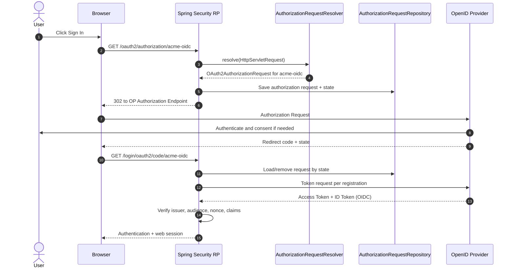

# 26.5. Custom Resolver to Select the Right Registration

> **Module:** Spring Security OAuth 2.0 OIDC Client  
> **Chapter:** 26. Multi-tenancy  
> **Focus:** Build a custom `OAuth2AuthorizationRequestResolver` in Spring Security Servlet to select the right `ClientRegistration` based on a controlled tenant, hostname, or route; ensure the entire Authorization Code/OIDC Login flow consistently uses the same registration, state, and identity context.

A SaaS application serving dozens of organizations may let each organization sign in using a different OpenID Provider (OP). For example: tenant `acme` uses its company Keycloak, while tenant `globex` uses a different OIDC provider. Other tenants share the same OP but have their own **Client ID**, **Client Secret**, **redirect URI**, or **scopes**.

When a user opens:

```text
GET https://app.example.test/t/acme/login
```

the application needs to pick the **right `ClientRegistration`** for tenant `acme` before creating the Authorization Request. If the wrong one is chosen, the browser may be sent to another organization's OP, the Token Endpoint may reject the code, ID Token validation may report an issuer/audience mismatch, or—even worse—the application could inadvertently bind an identity to the wrong tenant.

Spring Security provides `DefaultOAuth2AuthorizationRequestResolver`, which works well when the registration ID is already in the default URL:

```text
/oauth2/authorization/{registrationId}
```

For multi-tenant routing, we can wrap the default resolver with a custom `OAuth2AuthorizationRequestResolver` that maps a **controlled tenant identifier** to a **registration ID already present in `ClientRegistrationRepository`**.

**Key takeaway:** a custom resolver must **select the registration consistently**, not merely patch `authorizationUri` or `client_id` on the request while ignoring the Token Endpoint, callback, issuer validation, and authorized client storage. It also **does not replace** verifying which tenant the user actually belongs to after OIDC Login succeeds.

---

## 1. Learning Objectives

After this lesson, you will be able to:

1. Explain why multiple tenants often require multiple `ClientRegistration` entries or a registration routing policy.
2. Distinguish tenant ID, registration ID, provider ID, OIDC issuer, and OAuth2 `client_id`.
3. Describe where `OAuth2AuthorizationRequestResolver` fits into Spring Security Servlet's Authorization Code/OIDC Login flow.
4. Distinguish the two methods `resolve(HttpServletRequest)` and `resolve(HttpServletRequest, String)`.
5. Use `DefaultOAuth2AuthorizationRequestResolver` as a delegate to preserve state, redirect URI, and default extension points.
6. Write a resolver that selects a registration from an allowlisted route, preventing browsers from supplying arbitrary issuer or token URLs.
7. Register the resolver in `HttpSecurity.oauth2Login().authorizationEndpoint().authorizationRequestResolver(...)`.
8. Design `tenant -> registrationId` mappings when a tenant has one or multiple OPs.
9. Understand how `state` and `AuthorizationRequestRepository` bind the login transaction to the callback.
10. Avoid trusting unverified `Host`, `X-Forwarded-Host`, or query strings to select a tenant.
11. Explain why OIDC `iss/sub` and tenant membership must be verified **after** authentication.
12. Identify risks of mix-up, improper account linking, open redirects, SSRF via dynamic discovery, and confused deputy.
13. Understand how to handle multi-tenancy when client registrations are loaded dynamically from a database or control plane.
14. Contrast the Servlet resolver with equivalent interfaces in WebFlux.
15. Write unit/integration tests for mapping, callbacks, sessions, multiple tabs, wrong-tenant login, and configuration changes mid-login.

## 2. Problem: What Does "Right Registration" Mean?

Configuration example:

```text
Tenant acme:
  registrationId = acme-oidc
  issuer         = https://login.acme.test/realms/employees
  clientId       = app-acme
  redirectUri    = https://app.example.test/login/oauth2/code/acme-oidc

Tenant globex:
  registrationId = globex-oidc
  issuer         = https://identity.globex.test/oidc
  clientId       = app-globex
  redirectUri    = https://app.example.test/login/oauth2/code/globex-oidc
```

When a request starts at `/t/acme/login`, the system must:

1. Identify tenant `acme` from controlled routing data.
2. Look up the mapping `acme -> acme-oidc` from an internal registry.
3. Ensure `acme-oidc` is actually a configured/permitted registration.
4. Build the Authorization Request using `ClientRegistration("acme-oidc")`.
5. Save the Authorization Request alongside `state` in the repository.
6. Redirect the browser to **Acme OP's** Authorization Endpoint.
7. On callback, use the same registration/context to exchange the code and verify the token.
8. Confirm the newly authenticated principal has permission to enter tenant `acme` before granting application access.

If step 4 uses Acme while step 7 uses Globex, the transaction loses consistency. If step 8 is skipped, a valid user at one OP could be mistaken for a member of another tenant.

### 2.1. A URL Is Not the Registration Itself

```text
/t/acme/login
```

is merely the **tenant-selection input**. It does not contain enough information for OIDC Login. `ClientRegistration` also encompasses Client ID, authentication method, authorization grant type, redirect URI, scopes, issuer, and provider endpoints.

## 3. Distinguishing Five Types of Identifiers

| Term | Example | Who defines it? | Role |
|---|---|---|---|
| Tenant ID | `acme` | SaaS application | Data/permission space of an organization |
| Registration ID | `acme-oidc` | Spring Security application | Lookup key for `ClientRegistration` |
| Provider ID | `acme-op` | Spring Boot application | Reusing provider config across registrations |
| Issuer `iss` | `https://login.acme.test/realms/employees` | OP | Identifies the source issuing OIDC tokens |
| OAuth2 `client_id` | `app-acme` | AS/OP issued to RP | Identifies the OAuth2 Client at the AS |
| Subject `sub` | `user-734` | OP | Identifies the user within the issuer's scope |

One issuer can have **multiple registrations** because each tenant uses its own Client ID. A client registration normally belongs to a specific issuer/provider context. Never infer a tenant solely from the provider name or email domain.

### 3.1. Registration IDs Must Be Stable and Unambiguous

If each tenant has one registration, a convention like:

```text
acme-oidc
globex-oidc
initech-oidc
```

can be easy to manage. Still, this name is only an **internal key**, not proof the user belongs to the tenant. If a tenant is renamed or switches OPs, you need a migration strategy for redirect URIs and session/authorized-client lifecycles.

### 3.2. When One Tenant Has Multiple Login Methods

A tenant may allow two OPs:

```text
acme -> acme-employees-oidc
acme -> acme-partners-oidc
```

Then the mapping function cannot take only the tenant; it needs an **allowlisted login method choice** and corresponding policy:

```text
(tenant, loginMethod) -> registrationId
```

Do not let the browser pass an arbitrary `registrationId` and treat it as an allowed login method for the tenant.

## 4. Spring Security OAuth2 Login Flow Before Customization

On the Servlet stack, the typical flow:



When customizing the resolver, the start might be:

```text
GET /t/acme/login
```

after which the resolver looks up `acme-oidc`. **All subsequent steps** must consistently continue using the same registration and state.

## 5. Where Does the Resolver Sit in Spring Security Servlet?

Interface:

```java
org.springframework.security.oauth2.client.web.OAuth2AuthorizationRequestResolver
```

Main contract:

```java
OAuth2AuthorizationRequest resolve(HttpServletRequest request);

OAuth2AuthorizationRequest resolve(
    HttpServletRequest request,
    String clientRegistrationId);
```

Where:

- The method without a registration ID handles scenarios where the resolver itself must select one.
- The method accepting `clientRegistrationId` may be called by other components when a registration has already been specified.
- The resolver returns a matching `OAuth2AuthorizationRequest`, or `null` if the request falls outside its scope.
- It can throw an appropriate OAuth2 error when input must be rejected per policy, rather than returning an unsafe request.

### 5.1. `DefaultOAuth2AuthorizationRequestResolver`

Default implementation:

```java
org.springframework.security.oauth2.client.web.DefaultOAuth2AuthorizationRequestResolver
```

It can be instantiated with:

```java
new DefaultOAuth2AuthorizationRequestResolver(
    clientRegistrationRepository,
    "/oauth2/authorization"
);
```

Normally it matches:

```text
/oauth2/authorization/{registrationId}
```

and builds the Authorization Request from the corresponding configuration. It also provides a customizer mechanism to adjust additional request parameters.

**Do not rebuild the entire Authorization Request from scratch** just to switch the registration; it is better to determine the right registration ID and delegate to the default resolver.

## 6. Choosing Between a Resolver and a `ClientRegistrationRepository`

Two distinct responsibilities:

| Component | Question it answers | Example |
|---|---|---|
| Tenant routing/policy | Which tenant is this request trying to log into? | `/t/acme/login` |
| Custom authorization request resolver | Which client registration is used to start OAuth2? | `acme-oidc` |
| `ClientRegistrationRepository` | What are the details of that client registration? | Client ID, secret, issuer, URLs |
| Authorization request repository | What are the state and context of the current transaction? | State ↔ authorization request |
| Authentication provider/token response client | Exchange code and verify login | Token Endpoint, ID Token decoder |
| Account/tenant membership service | Does the newly authenticated principal belong to the tenant? | `(issuer,sub) -> tenant membership` |

Creating a custom resolver does not replace a trusted repository. The resolver only **selects the key**; the repository supplies the full registration details for subsequent steps.

### 6.1. If Client Registrations Are Fixed

`InMemoryClientRegistrationRepository` or Boot auto-configuration combined with an allowlisted mapping is sufficient.

### 6.2. If Tenants Are Added at Runtime

You need a `ClientRegistrationRepository` capable of looking up provisioned registrations, controlling configuration, and managing lifecycle updates; the resolver only uses **active/approved** registrations. Never fetch issuer metadata dynamically from a URL passed in a login request.

## 7. Which Data Should Select the Tenant?

Common sources:

1. **Path:** `/t/acme/login`.
2. **Subdomain:** `acme.app.example.test/login`.
3. **Tenant identification after an email/domain entry step:** discovery belonging to the control plane.
4. **Product-issued deep link**, signed/state-backed.
5. **Tenant switcher** when the user is already authenticated.
6. **Login method selection** within a tenant.

Their trust levels vary.

### 7.1. Paths Can Be Chosen by an Attacker

Any browser can open:

```text
/t/acme/login
```

That is fine: login initiation is normally a public entry point. However, **choosing Acme to log in does not prove the user belongs to Acme**. After the OP authenticates, the system must verify issuer/subject and tenant membership.

### 7.2. Hostnames via Proxies Need a Trust Boundary

When using `Host` or `X-Forwarded-Host` to identify a tenant, you must:

- Accept only hostnames in an allowlist/tenant domain registry.
- Configure the reverse proxy to strip/overwrite forwarded headers from untrusted sources.
- Trust forwarded headers only from controlled proxies.
- Normalize hostnames, ports, casing, and Unicode/punycode per policy.
- Avoid loose suffix matches like `host.endsWith("example.test")` without dot/boundary checks.
- Protect `{baseUrl}`/redirect-uri against host header injection.
- Verify custom domain ownership and TLS before activation.

Never use:

```java
String issuer = request.getParameter("issuer");
String authorizationUri = issuer + "/authorize";
```

to directly route OAuth2. It introduces SSRF, fake discovery, token leakage, and identity mix-up risks.

## 8. Designing a Safe `tenant → registration` Mapping

Small, static registry example:

```java
Map<String, String> routes = Map.of(
    "acme", "acme-oidc",
    "globex", "globex-oidc"
);
```

Registration values must exist in `ClientRegistrationRepository`.

Rules:

- Tenant IDs are syntax-validated against an allowlist.
- Registration IDs never come directly from the browser.
- Unknown tenants never fall back to a "default admin tenant".
- Disabled tenants cannot start login flows as active.
- If a tenant has multiple login methods, the key should include the allowlisted method.
- Changing tenants/providers requires policies for sessions and in-flight authorization requests.

### 8.1. Never Use a Default Registration for Unknown Tenants

Anti-pattern:

```java
return map.getOrDefault(tenant, "super-admin-oidc");
```

A typo or forged tenant would be routed to an overly privileged registration. Better: return an explicit routing error (404/4xx per UX) and emit no Authorization Request.

## 9. Configuring Two Client Registrations in Spring Boot

```yaml
spring:
  security:
    oauth2:
      client:
        registration:
          acme-oidc:
            provider: acme-op
            client-id: acme-portal
            client-secret: ${ACME_OIDC_CLIENT_SECRET}
            client-authentication-method: client_secret_basic
            authorization-grant-type: authorization_code
            redirect-uri: "{baseUrl}/login/oauth2/code/{registrationId}"
            scope:
              - openid
              - profile
              - email
          globex-oidc:
            provider: globex-op
            client-id: globex-portal
            client-secret: ${GLOBEX_OIDC_CLIENT_SECRET}
            client-authentication-method: client_secret_basic
            authorization-grant-type: authorization_code
            redirect-uri: "{baseUrl}/login/oauth2/code/{registrationId}"
            scope:
              - openid
              - profile
        provider:
          acme-op:
            issuer-uri: https://login.acme.test/realms/employees
          globex-op:
            issuer-uri: https://identity.globex.test/oidc
```

Domains and values are illustrative. In production:

- Issuer must match the real OIDC OP metadata.
- Client secrets live in a secret manager/environment; never commit them.
- Redirect URIs must be registered with each OP.
- TLS, forwarded headers, and externally visible base URL must align.
- Registration names must remain stable for callback routing.

### 9.1. Why Does the Redirect URI Include `registrationId`?

A common callback:

```text
/login/oauth2/code/acme-oidc
/login/oauth2/code/globex-oidc
```

allows Spring Security to look up the registration while processing the callback, alongside the previously saved authorization request.

Never patch only Acme's Authorization Endpoint URL while the callback still uses Globex's registration.

## 10. Writing `TenantAwareOAuth2AuthorizationRequestResolver`

The example below selects a registration from the route:

```text
/t/{tenant}/login
```

Each tenant has exactly one registration, and the mapping is declared statically in this lab.

```java
package example.security;

import java.util.Map;
import java.util.Objects;
import java.util.regex.Matcher;
import java.util.regex.Pattern;

import jakarta.servlet.http.HttpServletRequest;

import org.springframework.security.oauth2.client.registration.ClientRegistrationRepository;
import org.springframework.security.oauth2.client.web.DefaultOAuth2AuthorizationRequestResolver;
import org.springframework.security.oauth2.client.web.OAuth2AuthorizationRequestResolver;
import org.springframework.security.oauth2.core.endpoint.OAuth2AuthorizationRequest;

public final class TenantAwareAuthorizationRequestResolver
        implements OAuth2AuthorizationRequestResolver {

    private static final Pattern LOGIN_ROUTE =
        Pattern.compile("^/t/([a-z0-9][a-z0-9-]{0,31})/login$");

    private final OAuth2AuthorizationRequestResolver delegate;
    private final Map<String, String> routes;

    public TenantAwareAuthorizationRequestResolver(
            ClientRegistrationRepository registrations,
            Map<String, String> tenantRegistrations) {

        this.delegate = new DefaultOAuth2AuthorizationRequestResolver(
            registrations,
            "/oauth2/authorization"
        );
        this.routes = Map.copyOf(tenantRegistrations);
    }

    @Override
    public OAuth2AuthorizationRequest resolve(HttpServletRequest request) {
        String tenant = tenantFromRequestPath(request);
        if (tenant == null) {
            return null;
        }

        String registrationId = routes.get(tenant);
        if (registrationId == null) {
            return null; // Do not fall back to a default registration.
        }

        return resolve(request, registrationId);
    }

    @Override
    public OAuth2AuthorizationRequest resolve(
            HttpServletRequest request,
            String clientRegistrationId) {

        String tenant = tenantFromRequestPath(request);
        if (tenant == null) {
            return null;
        }

        String allowedRegistrationId = routes.get(tenant);
        if (allowedRegistrationId == null
                || !Objects.equals(
                    allowedRegistrationId,
                    clientRegistrationId
                )) {
            return null;
        }

        OAuth2AuthorizationRequest result =
            delegate.resolve(request, allowedRegistrationId);

        if (result == null) {
            return null;
        }

        // Attach internal context to the existing authorization request.
        // Preserve state, redirect-uri, and PKCE/nonce handled by delegate.
        return OAuth2AuthorizationRequest.from(result)
            .attributes(attributes ->
                attributes.put("app_tenant", tenant)
            )
            .build();
    }

    private static String tenantFromRequestPath(
            HttpServletRequest request) {

        String uri = request.getRequestURI();
        String context = request.getContextPath();

        if (!uri.startsWith(context)) {
            return null;
        }

        String applicationPath = uri.substring(context.length());
        Matcher matcher = LOGIN_ROUTE.matcher(applicationPath);

        return matcher.matches() ? matcher.group(1) : null;
    }
}
```

### 10.1. Line-by-Line Explanation

- `LOGIN_ROUTE` only accepts paths whose tenant slug matches the permitted format, avoiding free-form URLs.
- `Map.copyOf(...)` keeps the mapping snapshot immutable from callers in the lab.
- `resolve(request)` identifies the tenant and invokes the second overload with the allowlisted registration.
- `resolve(request, registrationId)` double-checks that the requested registration belongs to the route's tenant.
- `delegate.resolve(request, allowedRegistrationId)` lets Spring Security construct the Authorization Request from the right registration.
- `OAuth2AuthorizationRequest.from(result)` preserves the essential properties of the original request.
- The `app_tenant` attribute is strictly internal transaction metadata; it does not automatically make the user a member of that tenant.
- If the route does not belong to this resolver or the tenant has no mapping, returning `null` prevents redirecting to a default provider.

### 10.2. Rule for Unknown Tenants

In this example, the resolver returns `null` so the request continues to other filters/controllers; depending on the app, it may return 404 or reach another authorization entry point. **For production, define an explicit UX/error handler** so unknown/disabled tenants are never silently redirected to an implicit registration.

### 10.3. The Resolver Is Not Responsible for Checking Account Membership

If a user opens `/t/acme/login` and Acme OP issues a valid ID Token, that only proves an identity authenticated by Acme OP. The application must still map `(issuer, sub)` and check whether that person is allowed into tenant Acme.

### 10.4. Do Not Replace `state` with Predictable Values

Do not replace the delegate's `state` with `"acme"` or `"globex"`; `state` must be unpredictable to preserve correlation/CSRF protection in the OAuth2 Authorization Code Flow. If you need to remember the tenant, store it in server-side authorization request attributes or an independently designed/verified state mechanism.

## 11. Wiring the Resolver into `SecurityFilterChain`

Spring Security Servlet example:

```java
package example.security;

import java.util.Map;

import org.springframework.context.annotation.Bean;
import org.springframework.context.annotation.Configuration;
import org.springframework.security.config.Customizer;
import org.springframework.security.config.annotation.web.builders.HttpSecurity;
import org.springframework.security.oauth2.client.registration.ClientRegistrationRepository;
import org.springframework.security.oauth2.client.web.OAuth2AuthorizationRequestResolver;
import org.springframework.security.web.SecurityFilterChain;

@Configuration
public class MultiTenantSecurityConfig {

    @Bean
    OAuth2AuthorizationRequestResolver tenantAuthorizationRequestResolver(
            ClientRegistrationRepository registrations) {

        return new TenantAwareAuthorizationRequestResolver(
            registrations,
            Map.of(
                "acme", "acme-oidc",
                "globex", "globex-oidc"
            )
        );
    }

    @Bean
    SecurityFilterChain securityFilterChain(
            HttpSecurity http,
            OAuth2AuthorizationRequestResolver tenantAuthorizationRequestResolver)
            throws Exception {

        return http
            .authorizeHttpRequests(auth -> auth
                .requestMatchers("/", "/error", "/t/*/login")
                    .permitAll()
                .anyRequest().authenticated()
            )
            .oauth2Login(login -> login
                .authorizationEndpoint(endpoint -> endpoint
                    .authorizationRequestResolver(
                        tenantAuthorizationRequestResolver
                    )
                )
            )
            .build();
    }
}
```

Illustrative configuration for Spring Security Servlet 6.x and the Jakarta Servlet stack. In production, add authorization checks, CSRF, session management, headers, and business routes per application policy.

### 11.1. What Happens to the Default URL?

Because this resolver only matches `/t/{tenant}/login`, the path:

```text
/oauth2/authorization/acme-oidc
```

may **no longer be handled as before**. This can be intentional to force all logins through tenant routing. If you need to keep the default URL for internal use, write an explicit policy rather than leaving a bypass around multi-tenant mapping.

### 11.2. Why Is the Delegate's Base URI Still `/oauth2/authorization`?

In the example, the code calls the `delegate.resolve(request, registrationId)` overload with the chosen registration ID. The delegate handles constructing the `OAuth2AuthorizationRequest`; the outer resolver handles matching the alternate route. If you change route semantics or Spring Security versions, verify overload and filter behavior with integration tests.

Never place two mapping mechanisms side-by-side without knowing which one matches first.

## 12. The Resolver Must Support Both Overloads

A common mistake:

```java
@Override
public OAuth2AuthorizationRequest resolve(HttpServletRequest request) {
    // Contains tenant logic.
}

@Override
public OAuth2AuthorizationRequest resolve(
        HttpServletRequest request,
        String clientRegistrationId) {
    return delegate.resolve(request, clientRegistrationId);
}
```

If the second overload skips the tenant check, another component could request a registration that does not belong to the tenant in the route. Enforce **the same allowlist policy** in both methods.

A clean design extracts a helper:

```text
parseTenant(request)
  -> lookupAllowedRegistration(tenant, loginMethod)
  -> verifyRequestedRegistration(optional)
  -> delegate.resolve(request, allowedRegistration)
```

And test both overloads, not just browser GET requests.

## 13. Do Not Build the Authorization Request from Scratch Unnecessarily

An Authorization Request includes many security parameters:

- `client_id`;
- `response_type=code`;
- `scope`;
- `state`;
- `redirect_uri`;
- `nonce` for OIDC in applicable flows;
- `code_challenge` and `code_challenge_method` when using PKCE;
- configured provider-specific parameters;
- internal Spring Security attributes.

Manually copying a few parameters and dropping `state`/nonce/PKCE can break login or weaken protection.

Right direction:

```java
OAuth2AuthorizationRequest base =
    delegate.resolve(request, selectedRegistrationId);

return OAuth2AuthorizationRequest.from(base)
    .attributes(attrs -> attrs.put("app_tenant", tenant))
    .build();
```

Using `from(base)` preserves the request built by the framework rather than constructing a new one with missing fields.

## 14. `AuthorizationRequestRepository` and `state`

Spring Security saves the built authorization request before redirecting the browser to the OP. On the Servlet stack, a common repository is:

```java
HttpSessionOAuth2AuthorizationRequestRepository
```

It restores the request when the callback arrives carrying `code` and `state`.

### 14.1. Why Preserve the Registration in the Saved Request?

For example:

```text
Login start: /t/acme/login
Selected: acme-oidc
Generated state: unpredictable-value-91...
Callback: /login/oauth2/code/acme-oidc?code=...&state=...
```

On callback, Spring Security matches `state` against the saved authorization request and processes the code using the corresponding registration. If the tenant/provider changes mid-flow, never let a new URL from the user overwrite the data bound to the transaction.

### 14.2. Never Trust Callback Query `tenant`

Counterexample:

```text
/login/oauth2/code/acme-oidc?code=...&state=...&tenant=globex
```

If the app lets `tenant=globex` override the context selected before the redirect, it introduces cross-tenant confusion. Tenant context must come from the protected transaction and trusted identity mapping, never from an appended query parameter.

### 14.3. Multiple Tabs and Concurrent Logins

A single browser session may have two tabs starting OIDC Login for two tenants simultaneously. The session-based authorization request repository and state storage must be tested; some implementations/policies retain only the most recent request or impose constraints that invalidate older transactions.

If your product requires parallel login attempts:

- Design/reuse a repository keyed by `state`.
- Enforce TTL, one-time consumption, and anti-replay.
- Never store raw authorization requests containing secrets in the browser.
- Never rely on a single shared mutable `currentTenant` across the whole session as the sole source of truth.
- Verify callbacks match the right attempt even when tabs redirect differently.

Do not promise safe multi-tab login merely because the resolver picks the right registration at the start.

## 15. Callback URL and Registration Consistency

Normally:

```yaml
redirect-uri: "{baseUrl}/login/oauth2/code/{registrationId}"
```

is configured in each `ClientRegistration`.

On callback:

```text
/login/oauth2/code/acme-oidc
```

the framework expects the same `acme-oidc` registration. If the callback is altered to `globex-oidc` or `state` mismatches, it must be rejected.

### 15.1. Never Pick a New Registration at Callback from Host/Query

The custom resolver in this lesson primarily runs **before redirecting to the OP**. On callback, never take a new `tenant` from query/Host and arbitrarily swap the registration the framework used for the original authorization request.

### 15.2. When a Reverse Proxy Changes Host or Scheme

An app behind a reverse proxy might see:

```text
Internal: http://service:8080
External: https://acme.app.example.test
```

`{baseUrl}` must be handled safely so the redirect URI matches the value registered at the OP. Only trust forwarded headers from trusted proxies, never arbitrary client `X-Forwarded-Host` headers.

Incorrect forwarded headers can cause redirect mismatches, open redirects, or host header injection.

## 16. OIDC Authentication Does Not Replace Tenant Authorization

When the OP returns an ID Token, Spring Security must verify:

- Signature/JWK trust.
- `iss` matches the registration's issuer.
- `aud`/Client ID and corresponding audience requirements.
- `exp`, `iat`, clock skew.
- `nonce` when used.
- Other OIDC conditions per flow.

Afterward, the application must verify **whether the user is permitted to enter the tenant**.

For example:

```text
Requested tenant: acme
Registration: acme-oidc
Verified issuer: https://login.acme.test/realms/employees
Verified subject: user-734
Internal tenant membership: acme -> active member?
```

A valid ID Token does not automatically prove permission to open every workspace or record in Acme. OIDC authenticates identity; tenant membership and business authorization must be decided by application policy.

### 16.1. Use `issuer + subject` as the Identity Key

In OIDC, `sub` is scoped to the issuer:

```text
(issuer=Acme, sub=123)
(issuer=Globex, sub=123)
```

are not assumed to be the same person. Never merge accounts by `sub` alone or by an unverified email.

### 16.2. Do Not Rely Solely on a `groups` Claim

An OP may return `groups` or `roles`, which does not automatically grant `ROLE_ADMIN` in the application. Verify the claim source, tenant, tenant-specific scopes, and permission mapping per policy.

## 17. Hostname-Based Resolver Instead of Path

A SaaS may use:

```text
https://acme.app.example.test/login
https://globex.app.example.test/login
```

Flow:

```text
Trusted Host
    -> canonical domain registry
    -> tenant ID
    -> allowlisted registration ID
    -> DefaultOAuth2AuthorizationRequestResolver delegate
```

### 17.1. Why Is a Domain Registry Required?

Do not blindly take the segment before the first dot and treat it as the tenant:

```java
// ANTI-PATTERN, no domain validation:
String tenant = request.getServerName().split("\\.")[0];
```

The application may encounter:

- custom domains like `login.customer.example`;
- `www`, `api`, `localhost`, or internal hostnames;
- reverse proxy forwarded headers;
- tenant aliases;
- duplicate/lapsed domain ownership;
- Unicode domain names.

Use a registry with verified ownership:

```text
acme.app.example.test  -> tenant acme
globex.app.example.test -> tenant globex
login.customer.test    -> tenant customer-x
```

### 17.2. Do Not Read `X-Forwarded-Host` Directly in the Resolver

If the proxy has not sanitized the header, an attacker can supply a spoofed value and steer registration/redirect-uri selection. Configure trusted proxy handling at the infrastructure/Spring config level and validate the canonical hostname against the registry.

### 17.3. Simultaneous Path and Hostname

An application might receive:

```text
Host: acme.app.example.test
Path: /t/globex/login
```

Define an explicit policy: reject mismatches or pick a single authoritative source. Never silently prefer query/path in one step and `Host` in another, as that invites mix-ups.

## 18. Resolver by Login Method Within the Same Tenant

For example, tenant Acme has:

```text
/t/acme/login/employee
/t/acme/login/partner
```

Registry:

```java
record LoginRoute(String tenant, String method) {}

Map<LoginRoute, String> registrations = Map.of(
    new LoginRoute("acme", "employee"), "acme-employees-oidc",
    new LoginRoute("acme", "partner"), "acme-partners-oidc"
);
```

Notes:

- `method` is an enum/allowlisted slug, not a raw issuer URL.
- UX can let the user choose the login method, while membership/roles are verified after authentication.
- The `partner` provider does not automatically receive internal employee privileges.
- If a provider is disabled, the registry must reject new logins.
- When updating a registration, define the fate of in-flight login attempts and active sessions.

## 19. Multi-Tenant Dynamic `ClientRegistrationRepository`

When new customers are added at runtime, Spring Boot's `application.yml` is insufficient for all dynamic configurations. An architecture can separate:

```text
Tenant onboarding / admin control plane
    |
    v
Validate issuer metadata, endpoints, clientId, secret reference
    |
    v
Approve tenant provider configuration
    |
    v
Versioned ClientRegistration registry
    |
    v
TenantRoutingResolver -> registration ID
    |
    v
OAuth2 Login pipeline
```

A custom `ClientRegistrationRepository.findByRegistrationId(...)` can read from a trusted cache/config store. Secrets should live in a vault/secret manager, never embedded in client-visible URLs.

### 19.1. Do Not Resolve Arbitrary `issuer-uri` Values from Browser Requests

Counterexample:

```text
GET /login?issuer=http://169.254.169.254/...
```

If the server fetches OIDC discovery from this value, it can cause SSRF, reach internal metadata endpoints, or trust forged JWKs. Accept only onboarded/approved providers, enforcing HTTPS, allowlist/network egress controls, and metadata validation.

### 19.2. Dynamic Configurations Must Stay Synchronized Across Instances

A login request might start on instance A and its callback return to instance B. Both must resolve the same registration version or a snapshot compatible with the transaction.

- Shared control-plane registry/cache.
- Replication/versioning.
- Sticky sessions do not replace config consistency.
- Plan for Client secret/key rotation.
- Never delete a registration with active callbacks without a migration policy.
- Audit changes to issuer, Client ID, redirect URI, and allowed scopes.

## 20. Can One Tenant Share a Registration with Another Tenant?

Yes, if the architecture and OP support a single Client ID/issuer serving multiple tenants. For instance, the app has one OIDC registration for a shared corporate IdP and maps users → dedicated workspaces after login.

Then:

```text
acme -> shared-oidc
globex -> shared-oidc
```

The resolver alone is not enough to isolate tenant data access; both routes use the same OAuth2 Client. **State-bound tenant context and membership checks** are required to prevent a user from switching into an unauthorized workspace.

### 20.1. When Should Registrations Be Split?

Separate registrations per tenant may be needed when:

- Each tenant has its own Client ID/secret.
- Redirect URIs/issuers differ.
- OP/tenant policies differ.
- Scopes/claims, token audiences, or consent differ.
- Billing/quotas/auditing are tracked per tenant.
- Independent credential revocation/rotation is required.

Do not multiply registrations solely to enforce RP resource authorization if a properly designed shared Client meets requirements; conversely, never merge registrations from different issuers into one just to "simplify" callbacks.

## 21. Where Should Tenant Context Be Stored for the Callback?

The tenant is chosen before the redirect, while the callback happens in a later request. Options:

- **Server-side authorization request attributes** bound to `state`.
- A dedicated session/transaction store keyed by secure `state`.
- Context in the redirect URI only when explicitly registered and controlled, never trusting raw query params.
- An application-managed transaction key with TTL/one-time consumption.

### 21.1. Attributes Do Not Replace `Authentication`

In the resolver example:

```java
OAuth2AuthorizationRequest.from(result)
    .attributes(a -> a.put("app_tenant", tenant))
    .build();
```

only stores extra metadata in the authorization request handled by Spring Security. It **does not automatically** surface in `Authentication.getAuthorities()` or as verified membership. If needed in post-login checks, integrate reliably to retrieve the transaction context and cross-check the user identity.

### 21.2. Never Put Sensitive Tenant Data in `state` as Plaintext

`state` should be treated as an unpredictable correlation token and validated. Never use `state=tenant-id`; if an opaque `state` must carry data, include signing/encryption/nonce, expiry, one-time use, and tamper protection. Server-side `state` lookup is usually simpler and less risky.

## 22. Mix-Up Attacks and Cross-Tenant Confusion

When an RP communicates with multiple Authorization Servers, confusion over **which AS/OP sent an authorization response** can occur if the Client fails to maintain strict bindings between the original request, issuer, callback, and `state`.

Wrong example:

```text
Start: tenant acme -> OP A
Callback: code from OP B
Application: picks OP B because query has provider=b
Token exchange: sends wrong code/client secret
```

How to prevent:

1. Select the registration before redirecting from an allowlisted registry.
2. Store authorization request/correlation state securely.
3. Never let the callback override the registration via arbitrary params.
4. Use proper redirect URI/registration binding.
5. Verify OIDC issuer, audience, and nonce via the framework.
6. Ensure secrets/token requests go strictly to the configured Token Endpoint.
7. Check support for OAuth2 Authorization Server Issuer Identification where applicable.
8. Never strip out Spring Security's checks during customization.

### 22.1. The OP's Issuer Is Not the Tenant ID

One issuer can serve multiple tenants; one tenant can use multiple issuers. Login routing and membership checks may rely on two different models; you need a formal, testable mapping.

## 23. Open Redirects and `redirect_uri` Injection

If the resolver constructs a redirect URI from user input:

```java
// ANTI-PATTERN:
String redirectUri = request.getParameter("redirect_uri");
```

and puts it straight into `OAuth2AuthorizationRequest`, the Client risks redirecting to the wrong domain, leaking codes, or being rejected by the OP for redirect mismatch.

Principles:

- Use the redirect URI template registered in `ClientRegistration`.
- If supporting custom domains, allow only domains with verified ownership.
- Never read `Host`/`Forwarded` directly from untrusted sources.
- Never use unchecked wildcard redirect URIs.
- If there is a post-login return-to URL, enforce allowlist/internal-path rules and store it in secure transaction state—never turn it into the OAuth2 `redirect_uri`.

## 24. Never Change Issuer/Provider Endpoints from Query Parameters

Some developers write:

```java
OAuth2AuthorizationRequest.from(existing)
    .authorizationUri(userInputUrl)
    .build();
```

to "switch providers". Yet the Client registration still retains the original provider's Token Endpoint, JWKS URI, issuer, Client ID, and secret. The result can be failed logins or a serious mix-up.

**To change registration, select the right `ClientRegistration` from the start.** Never patch just a single URI.

If dynamic provider onboarding is needed, validate the configuration in the control plane, create a valid registration, and let the framework use it throughout the Authorization Code Flow.

## 25. Never Infer Authorization from Registration ID

A user might log in successfully via `acme-oidc` yet only be permitted to view tenant `acme` with role `VIEWER`.

Do not write:

```java
if ("acme-oidc".equals(registrationId)) {
    grant("ROLE_ADMIN");
}
```

The registration identifies the **Client and OP** used, not the user's business role. Look up membership/permissions from a trusted source; check for disabled accounts, suspended tenants, deprovisioned users, and other authorization constraints.

### 25.1. Account Linking

An internal user might link:

```text
(issuer A, sub A-123) -> internalUser U42
(issuer B, sub B-987) -> internalUser U42
```

but linking must be verified and audited. Matching emails across two issuers are insufficient for auto-linking. A resolver selecting the right issuer does not make account linking valid.

## 26. Sessions and Principals in a Multi-Tenant Environment

After OIDC Login, Spring Security Servlet may store `OAuth2AuthenticationToken`/`OidcUser` in the HTTP session's `SecurityContext`.

Distinguish carefully:

- **Login tenant:** the tenant the user chose for authentication.
- **Identity issuer/subject:** the verified OIDC identity pair.
- **Active workspace:** the workspace/tenant the UI is currently operating in.
- **Authorization tenant:** the tenant policy permits accessing resources for.
- **Authorized client:** OAuth2 credentials used to call APIs on the user's behalf, potentially bound to registration/principal.

Never use an unverified `HttpSession.setAttribute("tenant", queryValue)` to grant permissions. Every cross-tenant request requires an authorization check; a UI tenant switcher is not an authentication event.

### 26.1. Session Fixation

Spring Security includes session fixation protection that may rotate the session ID after login. If storing tenant transaction state in a session prior to callback, test the interaction between the authorization request repository, session rotation, and session configuration.

Do not depend on a fixed session ID across all login steps.

### 26.2. Logout and Switching Tenants

When a user switches tenants, the application may require:

- Switching workspaces if the identity holds the corresponding membership;
- Starting a new OIDC Login with the other tenant's registration;
- Keeping the current session and authorizing across multiple workspaces per policy;
- Logging out of the previous session before logging in again.

Never treat an active tenant change as retroactively changing the registration of an in-flight authorization request.

## 27. `AuthorizedClientRepository` and the Risk of Using the Wrong Tenant's Token

After login, the Client may store `OAuth2AuthorizedClient` by registration ID/principal name.

If multiple tenants share one registration or principal naming lacks clear namespacing, there is a risk of fetching another tenant's token when code calls:

```java
authorizedClientService.loadAuthorizedClient(
    registrationId,
    principalName
);
```

Key invariants to maintain:

- Registration matches the API target and tenant context.
- Principal key is derived from verified Authentication/identity.
- If tenant is a separate dimension of the authorization context, partition storage accordingly.
- Never take the principal name from a browser query parameter.
- Never send an access token with audience A to Resource Server B.
- Never key a token cache solely by Client ID when multiple users/tenants share a Client.

Having the right resolver at login is necessary but insufficient for token storage isolation.

## 28. Provider-Specific Parameters Are Not Registration Selection

Parameters such as:

- `prompt`;
- `login_hint`;
- `hd` (provider-specific);
- `domain_hint` (provider-specific);
- `acr_values`;
- `max_age`;

can tailor the sign-in experience, but **do not equate** to selecting the right Client registration.

For instance, `login_hint=alice@acme.test` is not proof the person logging in belongs to tenant Acme. `domain_hint` can be ignored by the OP and must be used strictly per contract.

### 28.1. `setAuthorizationRequestCustomizer`

Once the right registration is known, Spring Security supports a customizer on `DefaultOAuth2AuthorizationRequestResolver` in applicable versions, e.g., to append validated parameters.

That is a **post-selection** step. Never replace registration selection with `login_hint` and skip tenant membership checks.

## 29. When a Tenant Is Disabled or Switches OPs

Suppose an admin disables tenant Acme while a user is mid-login:

```text
T0: /t/acme/login -> acme-oidc
T1: Authorization Request saved, browser sent to OP
T2: Tenant acme is disabled
T3: Callback code/state returns
```

If the callback only validates the ID Token without checking tenant state, a user could be logged into a newly disabled tenant.

You need:

- Evaluation of tenant/account status at login success or before granting access.
- A policy when a registration is rotated/disabled mid-transaction.
- Retaining the registration snapshot long enough for active callbacks if permitted, or rejecting intentionally.
- Invalidating sessions/authorized clients during tenant offboarding.
- Blocking background jobs belonging to disabled tenants.
- Preventing in-flight attempts from reinstating revoked active state.

## 30. Caching and Performance of Tenant Mapping

A large SaaS may have many registrations, yet it should not synchronously call a remote control plane on every login request without caching/timeouts.

Considerations:

- Cache allowlisted mappings with TTL/versioning.
- Careful negative caching for unknown tenants.
- Invalidation when a tenant is disabled, a provider is rotated, or domain ownership changes.
- Never cache network errors as a "default provider".
- Never cache secrets in an unencrypted shared cache.
- Concurrency limits and login request flood protection.
- Metrics separating resolver lookup latency from Token Endpoint latency.

### 30.1. Cache Keys Must Partition Correctly

If selection depends on hostname + tenant + login method, the cache key must include all relevant inputs. Never use only `tenantSlug` if the same slug exists across multiple environments/organizations.

## 31. Redirecting Login from the Default URL to a Tenant-Aware URL

A simpler architecture than a full custom resolver can be:

1. MVC controller receives `/t/{tenant}/login`.
2. Validates the tenant on the server.
3. Redirects to `/oauth2/authorization/{allowedRegistrationId}`.
4. Default resolver handles it.

Pros:

- Less customization of Spring Security internals.
- Easy to understand with static registrations.
- Easy to test URL mapping.

Cons:

- May leave the default URL exposed, letting callers bypass tenant policy if unprotected.
- If tenant context must be tightly bound to the authorization request, state binding must be designed.
- Host-based routing/parameter customization can become awkward.
- Multi-provider selection still requires a formal policy.

**When the requirement is simply mapping route → registration, a controller redirect may suffice.** Use a custom resolver when you need to manage authorization initiation directly inside Spring Security or tightly integrate tenant context/parameters.

## 32. Prefer a Single Source of Truth for Tenant Routing

Do not give each layer its own separate rule:

```text
Controller: acme -> acme-oidc
Custom resolver: acme -> globex-oidc
Success handler: acme -> shared-oidc
Authorized client manager: acme -> default-m2m
```

This creates inconsistency and makes testing difficult.

Maintain a single `TenantIdentityRoutingService` or versioned registry with clear contracts:

```text
resolveLoginRegistration(tenantId, loginMethod)
resolveExpectedIssuer(registrationId)
resolveInternalTenant(issuer, subject)
isTenantActive(tenantId)
isIdentityMember(tenantId, issuer, subject)
```

These are **application-designed** interfaces, not built-in Spring Security methods. Each function serves a distinct decision; avoid mixing routing with authorization.

## 33. WebFlux Has Its Own Resolver

If the application runs on **Spring WebFlux**:

- Security configuration uses `ServerHttpSecurity` and `SecurityWebFilterChain`.
- Client registrations use `ReactiveClientRegistrationRepository`.
- Request context is `ServerWebExchange` instead of `HttpServletRequest`.
- The corresponding resolver is `ServerOAuth2AuthorizationRequestResolver`; the default implementation is `DefaultServerOAuth2AuthorizationRequestResolver` in applicable versions.
- The reactive resolver returns `Mono<OAuth2AuthorizationRequest>` instead of a synchronous object.

Do not use:

```java
OAuth2AuthorizationRequestResolver servletResolver;
HttpServletRequest servletRequest;
HttpSecurity http;
```

directly inside WebFlux. The two stacks have different APIs and storage models.

### 33.1. Do Not Block the Event Loop to Look Up Tenants

If tenant routing in WebFlux needs Redis/R2DBC/APIs, use reactive data access and compose `Mono`. Avoid `.block()` inside the reactive resolver.

### 33.2. Security Principles Remain Unchanged

Whether Servlet or WebFlux:

- Select registration from a trusted mapping.
- Preserve `state`/PKCE/nonce.
- Reject arbitrary issuer endpoints.
- Validate issuer/audience/subject.
- Verify tenant membership after authentication.
- Partition sessions/authorized clients by identity/tenant.

## 34. MockMvc Testing for the Resolver

Unit tests can invoke the resolver directly with a mock servlet request:

```java
import static org.assertj.core.api.Assertions.assertThat;
import org.junit.jupiter.api.Test;
import org.springframework.mock.web.MockHttpServletRequest;
import org.springframework.security.oauth2.core.endpoint.OAuth2AuthorizationRequest;

@Test
void selectsAcmeRegistration() {
    MockHttpServletRequest request =
        new MockHttpServletRequest("GET", "/t/acme/login");

    OAuth2AuthorizationRequest authorization =
        resolver.resolve(request);

    assertThat(authorization).isNotNull();
    assertThat(authorization.getClientId())
        .isEqualTo("acme-portal");
    assertThat(authorization.getAuthorizationUri())
        .isEqualTo("https://login.acme.test/realms/employees/protocol/openid-connect/auth");
}
```

This test assumes:

- `resolver` is built from a repository fixture containing `acme-oidc`.
- The fixture has the asserted Authorization Endpoint URL.
- OP test metadata is fixed.

Do not depend on a live OP's URL without a network test contract; in unit tests, use `ClientRegistration.withRegistrationId(...)` to construct explicit fixtures.

### 34.1. What Else to Test Beyond `client_id`?

- `state` is non-empty and varies across calls.
- `redirectUri` matches registration/base URL.
- Scopes match the tenant.
- Callback registration/issuer align.
- `app_tenant` attribute is attached properly.
- Unknown tenant requests return the policy-defined result/error.
- Overload `resolve(request, registrationId)` cannot bypass the tenant check.
- Requests outside `/t/{tenant}/login` are not mistakenly captured by the resolver.

## 35. Integration Testing with MockMvc and a Test OP

MockMvc can verify the redirect from the login entry:

```java
import static org.springframework.test.web.servlet.request.MockMvcRequestBuilders.get;
import static org.springframework.test.web.servlet.result.MockMvcResultMatchers.status;
import static org.springframework.test.web.servlet.result.MockMvcResultMatchers.header;
import static org.hamcrest.Matchers.startsWith;

mockMvc.perform(get("/t/acme/login"))
    .andExpect(status().is3xxRedirection())
    .andExpect(header().string(
        "Location",
        startsWith("https://login.acme.test/")
    ));
```

This tests the initiation route and **does not yet prove** authorization code/token exchange or ID Token validation.

To test end-to-end:

1. Use mock OPs/Authorization Servers for two issuers.
2. Capture the authorization URL, Client ID, `state`, and redirect URI.
3. Return an authorization code for the matching registration.
4. Complete token exchange with the corresponding Client authentication.
5. Verify ID Token issuer/audience/nonce.
6. Verify wrong issuer and wrong `state` are rejected.
7. Verify post-login tenant membership.
8. Verify the session receives no permissions from another tenant.

### 35.1. Limitations of `mockOAuth2Login` or `oidcLogin` Tests

Spring Security Test can inject a mock `Authentication` to test controllers/security rules. However, mock login bypasses the custom Authorization Request Resolver and real OP/token exchange. Separate integration tests are needed for routing.

## 36. Security Scenarios Worth Testing

| Scenario | Expectation |
|---|---|
| `/t/acme/login` | Uses `acme-oidc` |
| `/t/globex/login` | Uses `globex-oidc` |
| Unknown tenant | Never falls back to a privileged/default registration |
| Malformed tenant slug | Does not match; not decoded erroneously |
| Non-login request path | Resolver returns `null` |
| Overload requesting wrong registration | Returns no Authorization Request |
| Query `?registrationId=globex-oidc` on Acme route | Does not switch registration |
| Query `?issuer=...` | Does not fetch arbitrary discovery |
| Host/path tenant mismatch | Rejected per policy |
| Untrusted forwarded host | Does not affect tenant/redirect URI |
| Tampered `state` | Callback rejected |
| Altered callback registration | Does not perform token exchange with another provider |
| ID Token wrong issuer | Rejected |
| ID Token wrong audience | Rejected |
| Identity from valid OP without tenant membership | Denied tenant permissions |
| Same `sub` across two issuers | Two distinct identities |
| Matching email across two issuers | No auto-linking |
| Tenant disabled mid-login | Rejected based on current state |
| Tenant registration rotated | Callback handled per version policy |
| Two tabs logging into two tenants | `state`/correlation do not mix |
| Session fixation ID rotation | Login context is neither lost nor confused |
| Token storage using wrong principal | Cannot access another tenant's authorized client |

## 37. Common Implementation Issues

| Symptom | Likely cause | Fix |
|---|---|---|
| Login always goes to default OP | Resolver returns `null` or config not wired | Check filter chain/resolver matching |
| `authorization_request_not_found` | `state`/repository mismatch, lost cookie/session, multi-tab | Check `state`, session, callback, and request repository |
| `invalid_state_parameter` | `state` altered or replayed | Never bypass CSRF `state` validation |
| `invalid_redirect_uri` at OP | Unregistered URI, wrong Host/forwarded headers | Check trusted base URL and OP registration |
| `invalid_client` at Token Endpoint | Wrong registration Client ID/secret/method | Check tenant's `ClientRegistration` |
| `invalid_grant` | Code used with wrong Client/redirect URI, expired, or reused | Check callback and token exchange binding |
| `invalid_id_token` | Wrong issuer/audience/signature/nonce | Never skip validation; verify against OP metadata |
| Globex user accesses Acme | Missing membership check | Check issuer/`sub` and tenant authorization |
| Another tenant with same `sub` confused | Identity key uses only `sub` | Namespace by issuer |
| Request goes to unexpected authorization URL | Dynamic issuer/`authorizationUri` from input | Use only approved registrations |
| Resolver picks right OP, callback uses wrong Client | Callback/registration inconsistency | Keep registration and `state` from original authorization request |
| Host spoofing alters redirect URI | Forwarded headers not trusted properly | Configure proxy trust + host allowlist |
| Works on one pod, fails on another | Unsynchronized registration caches/session state | Shared/versioned registry and session store |
| Two-tab login fails randomly | Concurrent transaction state overwritten | Evaluate repository keyed by `state` |
| Spring Boot switches to MVC automatically | Both WebFlux and MVC starters present | Verify application type and matching resolver API |

## 38. Lab A — Two Tenants and One Resolver

**Goal:** implement the `/t/{tenant}/login` example.

1. Create two Client registrations in the test environment.
2. Create a map `acme -> acme-oidc`, `globex -> globex-oidc`.
3. Write `TenantAwareAuthorizationRequestResolver` using the delegate.
4. Wire the resolver into `HttpSecurity.oauth2Login()`.
5. Call `/t/acme/login` and inspect `Location`/Client ID.
6. Call `/t/globex/login` and verify the different registration.
7. Call `/t/unknown/login`; ensure no redirect to a default provider.
8. Try appending `registrationId=globex-oidc` on the Acme URL and confirm the registration does not change.

**Expected outcome:** routing creates an Authorization Request for the tenant's permitted Client, ignoring browser overrides.

## 39. Lab B — Protecting Callback and `state`

**Goal:** observe that the correct selection must persist across the entire flow.

1. Start Acme login with a test OP.
2. Persist authorization request/`state` in the proper repository.
3. Return a callback with valid `code` and `state`.
4. Verify Acme's Token Endpoint is called and the ID Token is validated.
5. Modify `state` in the callback; login must fail.
6. Change the callback registration ID to Globex; Acme's code must not work as Globex.
7. Try two tabs logging into Acme and Globex concurrently.
8. Check whether the transaction repository handles multiple attempts properly.

**Expected outcome:** `state` and registration binding prevent callback mix-ups, not just URL checks at step one.

## 40. Lab C — Shared Issuer, Two Tenant Registrations

**Goal:** distinguish issuer from registration.

1. Use one test OP serving both Acme and Globex.
2. Register two different Client IDs with the same issuer.
3. Configure `acme-oidc` and `globex-oidc`.
4. Verify the resolver selects the right Client ID for each tenant.
5. Verify the callback exchanges the code using the corresponding Client authentication.
6. Verify ID Token audience/Client ID.
7. Do not grant Acme access to a user merely because they hold a valid identity at the same issuer.
8. Test disabled account/missing tenant membership.

**Expected outcome:** sharing an OP does not mean sharing a registration or tenant access rights.

## 41. Lab D — Host-Based Routing and Reverse Proxy

**Goal:** prevent Host/forwarded-header injection.

1. Prepare a registry `acme.app.test -> acme` and `globex.app.test -> globex`.
2. Send a request with valid Acme `Host`, verify routing.
3. Send a `Host` absent from the allowlist; must reject.
4. Send an untrusted `X-Forwarded-Host: globex.app.test` and verify the tenant does not change.
5. Configure a trusted reverse proxy in the test network.
6. Check the externally visible `{baseUrl}` for the redirect URI.
7. Test a host/path mismatch and observe policy rejection.
8. Never use OP URL metadata supplied by the browser.

**Expected outcome:** host routing relies solely on verified sources, and redirect URIs cannot be steered by attackers.

## 42. Lab E — User Belonging to the Wrong Tenant

**Goal:** separate identity validation from membership authorization.

1. Initiate OIDC Login via Acme.
2. Test OP returns an ID Token with valid issuer/audience.
3. Membership store reports the user does not belong to Acme.
4. Application denies entry to Acme's workspace or grants no tenant authorities.
5. Try adding membership to the user and logging in again.
6. Try the same `sub` from Globex's issuer.
7. Try identical emails across the two issuers.
8. Check logs contain no raw tokens.

**Expected outcome:** selecting the right registration does not automatically grant membership.

## 43. Lab F — Dynamic Onboarding and Config Changes

**Goal:** handle registration lifecycle in a large SaaS.

1. Provision a new tenant in the control-plane registry.
2. Validate issuer metadata, redirect URI, Client ID/secret references, and allowlist.
3. Publish the approved registration with a version.
4. Resolver uses the new registration ID.
5. Start login and rotate secret/config before callback.
6. Verify the policy handling in-flight flows.
7. Disable the tenant mid-login and deny access at the post-auth step.
8. Verify pods have a consistent registration view.

**Expected outcome:** dynamic registration enforces trust boundaries, versioning, and failure policies without discovering issuers from request input.

## 44. Misconceptions to Avoid

| Misconception | Reality |
|---|---|
| "The resolver picked the tenant, so the user belongs to it." | Tenant membership must be verified after authentication. |
| "Registration ID is the issuer." | Registration is an internal key; issuer is published by the OP. |
| "One issuer has only one registration." | Multiple Client IDs/registrations can share an issuer. |
| "One tenant always has one OP." | A tenant can have multiple login methods/providers. |
| "Picking issuer via query param is flexible." | Easily causes SSRF/mix-up and trusting untrusted OPs. |
| "Just change `authorizationUri` to switch providers." | Token Endpoint, Client ID, issuer/JWKS, and callback must still align. |
| "A `tenant` query param on callback is trustworthy." | Tenant context must be bound to the authorization transaction. |
| "`state` can be the tenant name." | `state` must be random, unpredictable, and verified. |
| "A valid OIDC ID Token grants entry to all workspaces." | OIDC authenticates identity; it does not grant tenant authorization. |
| "Matching emails from two OPs mean the same person." | Never auto-link accounts by email. |
| "A custom resolver replaces `ClientRegistrationRepository`." | The resolver picks the key; the repository supplies configuration. |
| "Logout/login routing can trust any `Host`." | `Host`/forwarded headers must be trusted and allowlisted. |
| "Spring Security auto-config discovers runtime tenants." | Dynamic provisioning needs its own repository/registry. |
| "A `mockOidcLogin` unit test proves the resolver works." | You must test initiation routes and callbacks/token exchange. |
| "Two tabs are always safe because `state` differs." | Authorization request repository/concurrency must be tested. |
| "WebFlux reuses the Servlet resolver directly." | Reactive stacks have different interfaces and request contexts. |

## 45. Self-Check Questions

**Q1.** Which interface is used to customize Authorization Request creation on the Servlet stack?

*Hint:* `OAuth2AuthorizationRequestResolver`.

**Q2.** Why should you delegate to `DefaultOAuth2AuthorizationRequestResolver`?

*Hint:* preserves request/`state`/redirect URI generation and framework-managed protocol parameters.

**Q3.** When a browser opens `/t/acme/login`, does that prove the user is an Acme member?

*Hint:* no; it is only an initiation request anyone can send.

**Q4.** Can two tenants sharing an issuer use two different registrations?

*Hint:* yes, if they have different Client ID/secret/scope/redirect policies.

**Q5.** If a callback contains `?tenant=globex` while the original authorization request selected Acme, what should happen?

*Hint:* never let the query parameter override the transaction context.

**Q6.** Why shouldn't `X-Forwarded-Host` be read directly from the browser to determine the tenant?

*Hint:* it can be spoofed if proxy trust is not configured properly.

**Q7.** What must the second overload of the resolver check?

*Hint:* whether the requested registration ID belongs to the tenant's allowlisted mapping.

**Q8.** What goes wrong if you replace only the Authorization Endpoint URL while keeping the old registration's Token Endpoint/JWK?

*Hint:* issuer mix-up, failed token exchange, or security vulnerabilities.

**Q9.** Why must the `(issuer, sub)` pair be used in account mapping?

*Hint:* `sub` is scoped to the issuer.

**Q10.** When a tenant is disabled while a callback is pending, can you admit the user solely because the ID Token is valid?

*Hint:* no; current state/membership/tenant policy must be checked.

**Q11.** Why does `OAuth2AuthorizedClientService.loadAuthorizedClient(...)` need a tenant isolation policy?

*Hint:* the method takes registration/principal and does not automatically know if the current request is authorized to read that token.

**Q12.** What details should a regression test verify on the redirect to the OP?

*Hint:* Client ID, Authorization Endpoint, `state`, scopes, redirect URI, and the selected tenant's provider.

## 46. Production Readiness Checklist

1. **Routing source:** Which path/host/domain registry supplies the tenant, and is it allowlisted?
2. **Provider mapping:** Does each tenant/login method map to the right registration ID?
3. **Registration validation:** Are Client ID, secret, issuer, token endpoint, JWKS, and redirect URI approved?
4. **Default behavior:** Are unknown tenants rejected without falling back to a privileged Client?
5. **Resolver overloads:** Do both `resolve(...)` methods enforce the same tenant policy?
6. **State:** Is the Authorization Request stored/matched properly, without using raw tenant names as `state`?
7. **Callback:** Are registration/issuer/client bindings preserved through code exchange?
8. **OIDC validation:** Are signature, issuer, audience, nonce, and expiry never bypassed?
9. **Membership:** Is `(issuer, sub)` checked against tenant membership after login?
10. **Host/proxy:** Are forwarded headers sanitized/trusted and redirect base URLs safe?
11. **Account linking:** Is auto-linking by email prevented?
12. **Token storage:** Are authorized clients partitioned by principal/tenant/audience?
13. **Runtime changes:** Do tenant disablement/config rotations define policies for in-flight callbacks?
14. **Multiple tabs:** Are concurrent authorization requests/state repositories tested?
15. **Multi-instance:** Are shared registries/session stores and version consistency enforced?
16. **Security:** Are arbitrary `issuer`/`authorization_uri` values from browsers rejected?
17. **Observability:** Are logging/metrics tracked per registration and outcome without leaking tokens?
18. **Tests:** Are wrong issuer, wrong state, wrong registration, wrong tenant, and untrusted host covered?

## 47. References

- [Spring Security Reference — OAuth 2.0 Login](https://docs.spring.io/spring-security/reference/servlet/oauth2/login/index.html): Authorization Code/OIDC Login on Servlet.
- [Spring Security Reference — Advanced OAuth 2.0 Login](https://docs.spring.io/spring-security/reference/servlet/oauth2/login/advanced.html): Authorization Request Resolver and extension points.
- [Spring Security API — OAuth2AuthorizationRequestResolver](https://docs.spring.io/spring-security/reference/api/java/org/springframework/security/oauth2/client/web/OAuth2AuthorizationRequestResolver.html): the two resolver overloads.
- [Spring Security API — DefaultOAuth2AuthorizationRequestResolver](https://docs.spring.io/spring-security/reference/api/java/org/springframework/security/oauth2/client/web/DefaultOAuth2AuthorizationRequestResolver.html): default resolver, base URI, and customizer.
- [Spring Security API — OAuth2AuthorizationRequest](https://docs.spring.io/spring-security/reference/api/java/org/springframework/security/oauth2/core/endpoint/OAuth2AuthorizationRequest.html): authorization request and attributes.
- [Spring Security API — ClientRegistration](https://docs.spring.io/spring-security/reference/api/java/org/springframework/security/oauth2/client/registration/ClientRegistration.html): Client ID, issuer, endpoints, scope, and redirect URI.
- [Spring Security API — ClientRegistrationRepository](https://docs.spring.io/spring-security/reference/api/java/org/springframework/security/oauth2/client/registration/ClientRegistrationRepository.html): registration ID lookup.
- [Spring Security API — HttpSessionOAuth2AuthorizationRequestRepository](https://docs.spring.io/spring-security/reference/api/java/org/springframework/security/oauth2/client/web/HttpSessionOAuth2AuthorizationRequestRepository.html): state and authorization request persistence.
- [Spring Security Reference — Reactive OAuth 2.0 Login](https://docs.spring.io/spring-security/reference/reactive/oauth2/login/index.html): distinguishing WebFlux resolvers from Servlet.
- [Spring Security Reference — OAuth2 Client](https://docs.spring.io/spring-security/reference/servlet/oauth2/client/index.html): authorized-client lifecycle and storage.
- [OpenID Connect Core 1.0](https://openid.net/specs/openid-connect-core-1_0.html): issuer, subject, ID Token, nonce, and authentication.
- [RFC 6749 — OAuth 2.0 Authorization Framework](https://www.rfc-editor.org/rfc/rfc6749): authorization request, code, state, and token exchange.
- [RFC 7636 — PKCE](https://www.rfc-editor.org/rfc/rfc7636): code challenge/verifier.
- [RFC 9207 — OAuth2 Authorization Server Issuer Identification](https://www.rfc-editor.org/rfc/rfc9207): mitigating AS mix-up risks in applicable scenarios.
- [RFC 9700 — OAuth2 Security Best Current Practice](https://www.rfc-editor.org/rfc/rfc9700): protecting redirects, issuer/AS mix-ups, Clients, and token lifecycles.

**Conclusion:** A secure multi-tenant resolver **is not an arbitrary URL-concatenation function**. It is the gatekeeper that selects a login registration from a controlled routing context and registry, then lets Spring Security construct a standard Authorization Request with proper `state`, redirect URI, and OIDC/PKCE mechanisms. The callback must continue using that exact registration; after authentication, issuer/subject must be checked against membership before granting tenant permissions. Use the default delegate, allowlist mappings, trusted proxy/domain handling, and test both initiation and callbacks to prevent identity mix-ups, open redirects, and cross-tenant token leakage.
