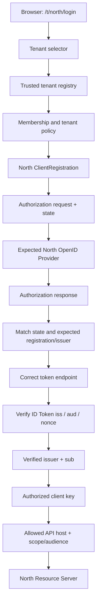
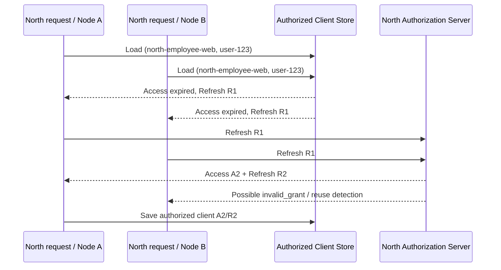

# 26.7. Preventing Issuer, Client, or Authorized Client Mix-Ups Across Tenants

## 1. Context: Login Succeeded, But Which Tenant's Token Is It?

A **Spring Security OAuth 2.0 / OpenID Connect (OIDC) Client** application can serve multiple organizations (*tenants*). Each organization may use its own OpenID Provider (OP) or Authorization Server (AS), or multiple tenants may share one provider while having different realms/organizations, client IDs, scopes, and Resource Servers.

Example **Employee Portal** serving two companies:

| Property | Tenant North | Tenant South |
| --- | --- | --- |
| Internal Tenant ID | `north` | `south` |
| OIDC issuer | `https://id.north.example.com/realms/staff` | `https://login.south.example.net/oidc` |
| Registration ID | `north-employee-web` | `south-employee-web` |
| OAuth client ID | `portal-north` | `portal-south` |
| API host | `https://api.north.example.com` | `https://api.south.example.net` |
| Example permission | `employee.read` | `employee.read` |

A user might hold accounts in both organizations. Therefore, even if both ID Tokens share `sub = "user-123"` or the same email, they **do not automatically prove the same identity**. Similarly, an access token valid for the North API **must never be sent to the South API**, and an `OAuth2AuthorizedClient` stored under a username must never be looked up arbitrarily just because a new HTTP request carries that name string.

These bugs fall under several forms commonly referred to as **issuer mix-up, client confusion, tenant confusion, and authorized-client/token mix-up**.

> **Overarching rule:** Every time the application starts OIDC Login, exchanges an authorization code, loads an authorized client, or calls a Resource Server, it must maintain a trustworthy chain: **tenant → expected issuer → client registration → authenticated subject → authorized client → permitted API destination**.

This lesson belongs to Chapter **26. Multi-tenancy** of the **Spring Security OAuth 2.0 OIDC Client** module and focuses on designing and verifying that chain.

### Learning Objectives

After this lesson, you will be able to:

1. Distinguish **tenant ID**, **issuer**, **client registration ID**, **OAuth client ID**, **subject**, and **authorized client principal name**.
2. Recognize OAuth2 Authorization Server mix-ups, OIDC ID Token mix-ups, and tokens sent to the wrong Resource Server.
3. Understand why `iss + sub` is the essential OIDC identifier, while `sub` or email alone cannot separate tenants.
4. Design a tenant-to-client mapping table from trusted configuration rather than accepting token URIs/issuers from the browser.
5. Use `ClientRegistrationRepository`, `OAuth2AuthenticationToken`, `OAuth2AuthorizedClientRepository`, or `OAuth2AuthorizedClientService` appropriately in Spring Security Servlet.
6. Bind the right registration/principal when invoking `OAuth2AuthorizedClientManager` or `WebClient`/`RestClient`.
7. Avoid `(registrationId, principalName)` cache key collisions when multiple issuers, tenants, audiences, or grants exist.
8. Validate authorization responses, callbacks, token endpoints, ID Tokens, and Resource Servers in the right context.
9. Handle migrations, logout, refresh token rotation, multi-session, dynamic tenants, and negative testing.
10. Define an operational observability plan to detect cross-tenant access **without logging tokens/secrets**.

Examples target **Spring Boot 3.x, Spring Security 6.x, Java 17+, Spring MVC/Servlet**. Some APIs appear or change by minor version; always check the BOM/framework version in use. The final section includes corresponding notes for WebFlux. Hostnames, issuers, client IDs, and tokens in this lesson are **illustrative data**.

---

## 2. Six Concepts That May Share Strings Without Sharing Meaning

### 2.1. Tenant ID

`tenantId` is the organizational identifier within the **application's business domain**:

```text
tenantId = north
tenantId = south
```

Tenant ID may appear in a URL such as `/t/north/dashboard` or a dedicated domain, yet a browser-supplied value **does not prove the user is a member of that tenant**.

Tenant ID must be mapped via trusted configuration or administrative data and **verified for membership/authorization** before being used to retrieve data or tokens.

### 2.2. Issuer

The OIDC issuer is the identity of the **OpenID Provider**, expressed by `iss` in the ID Token and `issuer` in provider metadata.

```json
{
  "iss": "https://id.north.example.com/realms/staff",
  "sub": "user-123",
  "aud": "portal-north",
  "exp": 1770000000
}
```

In this example, `iss` identifies the OP that issued the token. An issuer is not merely a "similar-looking" hostname; the **full, exact issuer URL** matters when verifying tokens and metadata.

Two different issuers can use the same `sub`. One issuer can also serve multiple tenants, so **issuer is not always sufficient to identify a tenant**.

### 2.3. `ClientRegistration.registrationId`

Spring Security uses **registration ID** as an internal key:

```text
north-employee-web
south-employee-web
```

`registrationId` selects a `ClientRegistration` holding client ID, grant, issuer/provider details, redirect URI, scopes, and other configuration.

It is **not** the client ID issued by the OP.

### 2.4. OAuth `client_id`

`client_id` is the application identifier **issued by the Authorization Server**. For example:

```text
North AS -> client_id=portal-north
South AS -> client_id=portal-south
```

One AS may issue multiple client IDs to the same RP (web, backend, mobile, environments). Identical client ID strings across **two different issuers** also do not prove they represent a single global client.

`client_id` is normally not a secret. The `client_secret` or private key used for client authentication is what must be protected.

### 2.5. OIDC `sub` and User Identity

`sub` is the subject identifier issued by the issuer. OpenID Connect Core requires it to be stable and unique **within the issuer's context** per provider rules.

For identity correlation, use the trusted pair:

```text
(issuer, subject)
```

For example:

```text
(https://id.north.example.com/realms/staff, user-123)
(https://login.south.example.net/oidc, user-123)
```

These can be two completely different people.

**Email is not an immutable identity key**: emails can change, be reassigned, be unverified, or appear across multiple organizations.

### 2.6. `OAuth2AuthorizedClient.principalName`

`OAuth2AuthorizedClient` contains:

```text
clientRegistration
principalName
accessToken
refreshToken (nullable)
```

`OAuth2AuthorizedClientService` typically saves/loads using:

```text
(registrationId, principalName)
```

It **does not automatically add issuer/tenant/audience to the standard key**. If the application shares a single `registrationId` across multiple issuers or uses an unnamespaced principal name, tokens from different contexts can overwrite each other or be loaded erroneously.

### 2.7. Reference Comparison Table

| Concept | Example | Trusted source | Do not use to infer |
| --- | --- | --- | --- |
| `tenantId` | `north` | Tenant registry + membership policy | Does not prove issuer/token |
| `issuer` | `https://id.north...` | Trusted discovery/AS config + token validation | Does not prove membership |
| `registrationId` | `north-employee-web` | Managed `ClientRegistrationRepository` | Not the OAuth client ID |
| `client_id` | `portal-north` | OP client registration | Does not prove user identity |
| `sub` | `user-123` | Verified ID Token | Not unique across all issuers |
| `principalName` | `user-123` or internal key | Spring Security authenticated principal strategy | Does not prove tenant rights |
| `aud` in ID Token | `portal-north` | Validated ID Token | Not default API audience |
| `aud` in access token | `employee-api-north` | AS/Resource Server contract | Do not infer from ID Token audience |
| API host | `api.north.example.com` | Allowed API destination registry | Never accept arbitrary URLs |

---

## 3. Types of Mix-Ups to Prevent

### 3.1. Authorization Server Mix-Up

In an OAuth2 Client supporting multiple Authorization Servers, an attacker may try to make the client **confuse which AS corresponds to the authorization response being processed**.

A classic risk pattern:

1. RP initiates an authorization flow with AS A.
2. After redirect/callback, RP treats the response as coming from AS B or sends the authorization code to the wrong Token Endpoint.
3. Authorization code, credentials, or tokens are sent to an endpoint that did not issue/register them.

You must bind the initial authorization request to the **expected issuer/registration** via `state` and reliably retained request context. When the OP/AS supports **RFC 9207 Issuer Identification**, `iss` in the authorization response lets the client detect certain mix-ups before exchanging the code.

**Never rely solely on a callback query parameter or caller-modifiable path segment to choose the Token Endpoint.**

### 3.2. ID Token Issuer Confusion

Suppose the app expects the North issuer yet accepts an ID Token:

```json
{
  "iss": "https://login.south.example.net/oidc",
  "sub": "user-123",
  "aud": "portal-north"
}
```

Even if the signature verifies against some JWKS, the token **does not match the expected issuer**. You must verify `iss` matches the selected registration's issuer exactly.

Never implement logic like "try verifying the signature against every tenant's JWKS and accept whichever passes" while ignoring issuer/client context.

### 3.3. Client Confusion

Two registrations share an issuer but have different OAuth clients:

```text
north-employee-web  -> client_id=portal-north-web
north-admin-tool    -> client_id=portal-north-admin
```

If an ID Token intended for `north-admin-tool` is accepted when handling a `north-employee-web` login, the application has skipped **audience/client binding**. In OIDC, the ID Token `aud` must contain the registered RP's exact client ID; `azp` must also be checked per OIDC rules when relevant.

Never allow a token issued for one OAuth client to substitute for another OAuth client's token, even when both are issued by the same AS.

### 3.4. Authorized-Client Mix-Up

If a service loads:

```java
authorizedClientService.loadAuthorizedClient(
        "shared-oidc", "user-123");
```

but `shared-oidc` is reused across multiple tenants and both issuers have `sub=user-123`, North's token could be used in South.

The default `(registrationId, principalName)` key pair has no separate tenant dimension. **Separating registration IDs or implementing proper storage namespacing** is a vital design requirement.

### 3.5. Resource Server / Destination Confusion

Even after obtaining the right access token, if the app sends:

```http
GET /v1/employees/me HTTP/1.1
Host: api.south.example.net
Authorization: Bearer <north-user-access-token>
```

then North's token was sent to an unauthorized destination. Even if the South Resource Server rejects it due to audience/issuer, the system may still have leaked a credential to the wrong recipient.

You must bind **registration + principal + access token + allowed API destination**, not just the token issuer.

### 3.6. Subject/Account-Linking Confusion

A user having the same email on North and South is not necessarily the same person or permitted to link accounts.

For example:

```text
North:
  iss=https://id.north.example.com/realms/staff
  sub=subject-91
  email=employee@example.com

South:
  iss=https://login.south.example.net/oidc
  sub=subject-17
  email=employee@example.com
```

Automatically merging two accounts solely because emails match can create **account takeover/cross-tenant data access**. Account linking requires a flow verifying **both accounts** or a trusted administrative rule, never relying on a single email claim.

### 3.7. Tenant Membership Confusion

Having the right issuer, client, and token is still **insufficient** if the user lacks rights to the tenant the API is accessing.

A shared issuer for North/South can issue valid ID Tokens to all employees. Tenant membership must still come from verified data or the application's authorization store.

**Issuer validation verifies the token's origin; tenant authorization verifies permissions inside the application.**

---

## 4. Trust Boundaries: From Browser to Resource Server

### 4.1. Trust Flow Diagram



Every arrow has a condition:

- **Browser → Tenant selector:** the tenant sent by the browser is a request intent, not yet a right.
- **Tenant selector → Registry:** only accept tenants with an allowed configuration.
- **Registry → Registration:** mapping is backend-managed, never from a user-supplied token URI.
- **Authorization request → Callback:** `state` must correlate with the saved request.
- **Callback → Token Endpoint:** send the code and client credentials strictly to the chosen AS.
- **Token Endpoint → ID Token:** issuer/audience/signature/expiry/nonce must be verified per flow.
- **Identity → Store:** token binds to a valid namespace/registration/principal.
- **Store → API:** Resource Server destination, scopes, and user membership must be verified.

### 4.2. No Single Claim or URI Replaces the Entire Pipeline

| Check | Primarily detects | Does not replace |
| --- | --- | --- |
| OAuth `state` | Flow correlation/CSRF | Issuer/audience validation |
| Authorization response `iss` (RFC 9207) | Some AS mix-ups before token exchange | ID Token signature/claims validation |
| OIDC `nonce` | Binding ID Token to authorization request per flow | Tenant membership |
| PKCE | Protecting authorization code from interception/replay per mechanism | Issuer/client audience |
| ID Token signature | Integrity and appropriate key source | Exact expected issuer if unchecked |
| ID Token `iss` | Which OP issued the ID Token | Audience/`azp`/tenant membership |
| ID Token `aud`/`azp` | Which OAuth client the token is for | Resource Server access rights |
| Access token audience | Which API the token is for | Browser tenant permission |
| Authorized-client key | Partitioning local token records | Remote AS/resource authorization |
| API host allowlist | Restricting where tokens are sent | Token validation at the Resource Server |

---

## 5. OIDC Issuer and Client Audience: Context-Aware Verification

### 5.1. Issuer Must Match Expected Issuer Exactly

Suppose OIDC discovery returns:

```json
{
  "issuer": "https://id.north.example.com/realms/staff",
  "authorization_endpoint": "https://id.north.example.com/realms/staff/protocol/openid-connect/auth",
  "token_endpoint": "https://id.north.example.com/realms/staff/protocol/openid-connect/token",
  "jwks_uri": "https://id.north.example.com/realms/staff/protocol/openid-connect/certs"
}
```

North login's ID Token must contain:

```json
{
  "iss": "https://id.north.example.com/realms/staff"
}
```

Never use `startsWith("https://id.north.example.com")` to accept a different realm, nor compare issuer URLs by hostname alone if the provider uses path/realm to separate tenants.

`https://example.com/tenant/A` and `https://example.com/tenant/B` are **two distinct issuer values** if specified by the discovery/token contract.

### 5.2. Signature and JWKS Must Bind to the Selected Issuer

A dangerous anti-pattern:

```java
// CONCEPTUAL ANTI-PATTERN:
for (JwkSet jwks : allTenantsJwkSets) {
    if (verifySignatureWith(jwks, idToken)) {
        return accept(idToken); // Fails to check expected issuer/client!
    }
}
```

A signature is only meaningful when bound to a **trusted issuer and key source**. A proper system must:

1. Determine the registration/expected issuer from the trusted authorization request.
2. Load the configured/discovered JWKS for that issuer.
3. Validate JWS signature, permitted algorithms, and `kid`/key selection per policy.
4. Validate `iss`, `aud`/`azp`, `exp`, `iat`, and `nonce`/relevant claims per OIDC flow.
5. Only then use `sub`/claims to associate the user.

Never accept arbitrary `jku`/`x5u`/JWKS URLs suggested by the token header without a trust policy; token headers are sender-controlled data.

### 5.3. ID Token Audience Must Be the Right Client ID

Example North ID Token:

```json
{
  "iss": "https://id.north.example.com/realms/staff",
  "sub": "user-123",
  "aud": "portal-north",
  "exp": 1770000000
}
```

If the current registration is `south-employee-web` with `client_id=portal-south`, this token **must be rejected**, even though `sub` matches and both belong to Employee Portal.

OIDC Core requires `aud` to contain the RP's client ID. For ID Tokens with multiple audiences, `azp` (authorized party) and related rules must be enforced per spec and OP contract. Never "ignore `azp` for compatibility" when a token is issued across multiple clients.

### 5.4. `nonce` Does Not Identify the Tenant

`nonce` is used to bind the ID Token to the original authorization request and prevent replay per flow/protocol. However:

```text
nonce match = matches the request that generated the nonce
issuer match = matches the OP that issued the token
aud match = matches the OAuth client
membership check = user has rights in the requested tenant
```

These checks complement one another. If an application stores a nonce and allows any issuer/client to sign an ID Token carrying that nonce, issuer/client confusion remains possible.

### 5.5. `sub`, `sid`, and Email: Do Not Interchange Them

- `sub`: subject issued by the OP, namespaced per issuer.
- `sid`: OP session identifier when supported, useful for OIDC logout/session management; not a global user identity.
- `email`: profile/contact claim, not an immutable authentication key.
- Tenant ID: business domain, may reside in a dedicated claim or be managed by the application.
- Internal user ID: the application's own account key, linked only after issuer+subject verification and policy checks.

A token containing `sid` does not mean the user is allowed to access every tenant under that issuer.

---

## 6. RFC 9207 and OAuth 2.0 Authorization Server Mix-Up

### 6.1. Problems Occur *Before* an ID Token Exists

OIDC ID Token validation normally runs **after the client has already sent the authorization code to the Token Endpoint**. If the code is sent to the wrong AS, credentials or authorization codes may already have leaked prior to ID Token inspection.

**RFC 9207 — OAuth 2.0 Authorization Server Issuer Identification** allows the AS to append an `iss` parameter to the authorization response so the client can detect AS mix-up earlier.

For example:

```http
GET /login/oauth2/code/north-employee-web
    ?code=AUTH_CODE_VALUE
    &state=RANDOM_STATE
    &iss=https%3A%2F%2Fid.north.example.com%2Frealms%2Fstaff
```

The client must compare the response's `iss` against the **expected issuer bound to the original authorization request**, not against an issuer picked from an arbitrary query/header.

### 6.2. Authorization Response `iss` Differs from ID Token `iss`

| Location | Timing | Meaning |
| --- | --- | --- |
| Authorization response `iss` per RFC 9207 | Callback before token exchange | Which AS generated the authorization response |
| ID Token `iss` per OIDC | After token exchange/ID Token validation | Which OP issued the ID Token |
| Access token `iss` (if JWT) | When API receives token | Token issuer per Resource Server policy |

Do not assume any one of these three automatically replaces the others.

### 6.3. Does Spring Security Enforce RFC 9207 Automatically in Every Version?

**Do not assume so.** Support for issuer identification in the authorization response depends on Spring Security version, OAuth2 provider, and application configuration.

In multi-AS integrations:

- Verify the actual framework version and its callback `iss` handling.
- If the AS supports RFC 9207, evaluate enabling/testing the corresponding support.
- If not, still ensure redirect URI strategy, `state` correlation, registration binding, and token endpoint selection prevent mix-ups.
- Separating callback URIs by issuer/registration adds binding, but **does not replace `state`/issuer verification**.
- Never pick the Token Endpoint from an `iss` param without checking it against the saved request.
- When an authorization response lacks `iss`, apply an explicit policy per provider profile and threat model—never guess the issuer from the `Host` header.

### 6.4. Anti-Pattern: Callback Deciding Registration from Query Params

```java
// ANTI-PATTERN - do not implement a callback like this.
@GetMapping("/oauth/callback")
void callback(
        @RequestParam String code,
        @RequestParam String registrationId,
        @RequestParam String tenant) {

    // Never exchange code against a tokenUri derived from a browser-supplied
    // tenant/registration without a stored authorization request.
}
```

Spring Security OAuth2 Login already provides authorization request repositories and callback filters to correlate `state`. Configure the standard flow instead of writing a custom controller that exchanges codes without binding to the prior request.

---

## 7. `ClientRegistration` Must Have Explicit Namespacing by Tenant and Purpose

### 7.1. Registration ID Is a Storage Key, Not Just a Display Name

An auditable convention:

```text
<tenant>--<provider>--<purpose>
```

For example:

```text
north--staff-idp--web
south--corporate-idp--web
north--calendar--delegated
north--reports--m2m
```

In this lesson, for readability, we use `north-employee-web` and `south-employee-web`. No strict format is mandated, but **a registration ID must never be reused to point to two different issuers/clients while old tokens remain stored**.

If the application keys tokens by `(registrationId, principalName)`, reusing a `default` registration across tenants strips issuer/client boundaries from the store key.

### 7.2. Spring Boot YAML Separating Registrations

```yaml
spring:
  security:
    oauth2:
      client:
        registration:
          north-employee-web:
            provider: north-provider
            client-id: ${NORTH_OIDC_CLIENT_ID}
            client-secret: ${NORTH_OIDC_CLIENT_SECRET}
            client-authentication-method: client_secret_basic
            authorization-grant-type: authorization_code
            redirect-uri: "{baseUrl}/login/oauth2/code/{registrationId}"
            scope:
              - openid
              - profile
              - employee.read

          south-employee-web:
            provider: south-provider
            client-id: ${SOUTH_OIDC_CLIENT_ID}
            client-secret: ${SOUTH_OIDC_CLIENT_SECRET}
            client-authentication-method: client_secret_basic
            authorization-grant-type: authorization_code
            redirect-uri: "{baseUrl}/login/oauth2/code/{registrationId}"
            scope:
              - openid
              - profile
              - employee.read

        provider:
          north-provider:
            issuer-uri: https://id.north.example.com/realms/staff

          south-provider:
            issuer-uri: https://login.south.example.net/oidc
```

Hosts/client IDs/secrets are illustrative data. With `issuer-uri`, Spring Boot can use OIDC discovery to configure authorization/token/userinfo/JWKS endpoints. Verify the provider's actual metadata/issuer—never infer token URIs by string concatenation.

Never commit client secrets to source control. Client authentication method, redirect URI, and scopes must match the application registered at each OP.

### 7.3. Backend-Managed Tenant Routing

Alongside OAuth registrations, the application needs a business mapping table:

```yaml
app:
  tenants:
    north:
      registration-id: north-employee-web
      expected-issuer: https://id.north.example.com/realms/staff
      api-base-uri: https://api.north.example.com

    south:
      registration-id: south-employee-web
      expected-issuer: https://login.south.example.net/oidc
      api-base-uri: https://api.south.example.net
```

This routing layer ensures:

- Only tenant IDs from an **allowlist** are accepted.
- The tenant's exact registration is looked up.
- The expected issuer is known to detect misconfigurations.
- The API destination that tokens are permitted to reach is defined.
- Browsers cannot choose `token_uri`, `jwks_uri`, or `client_secret`.

Issuer does not always equal tenant: two tenants can share an issuer while having different client IDs, organization constraints, memberships, and API destinations. Apply corresponding policies when that occurs.

### 7.4. Configuration Patterns and Risks

| Anti-pattern | Risk | Alternative design |
| --- | --- | --- |
| Single `default` registration ID for multiple issuers | Token cache collision and wrong-client handling | Stable IDs, partitioned by issuer/tenant |
| Issuer URL supplied via query param | SSRF/discovery injection, arbitrary token/JWKS endpoint | Trusted registry |
| South registration using North client secret | Failed client auth and credential leakage | Secrets scoped per AS/client |
| Treating `client_id` as globally unique | Same string across issuers does not share identity | Bind client ID to AS/registration |
| Caching registration by issuer hostname without path | Two realms can collide | Exact issuer + tenant + purpose |
| Provider domain suffix matching | Can accept spoofed hosts or wrong realms | Exact trusted endpoint mapping |
| Building redirect URI from user-sent `Host` | Open redirect/host header poisoning | Canonical base URL and trusted proxy config |
| Changing issuer while keeping old tokens | Old tokens loaded under new trust boundary | Explicit migration/revocation/re-authorization |

---

## 8. Tenant Registry and Spring Security Servlet

### 8.1. Illustrative Immutable Registry

```java
package com.example.portal.tenancy;

import java.net.URI;
import java.util.Map;

import org.springframework.security.access.AccessDeniedException;
import org.springframework.stereotype.Component;

@Component
public final class TenantOidcRegistry {

    public record TenantRoute(
            String tenantId,
            String registrationId,
            URI expectedIssuer,
            URI apiBaseUri) {
    }

    private final Map<String, TenantRoute> routes = Map.of(
            "north", new TenantRoute(
                    "north",
                    "north-employee-web",
                    URI.create("https://id.north.example.com/realms/staff"),
                    URI.create("https://api.north.example.com")),
            "south", new TenantRoute(
                    "south",
                    "south-employee-web",
                    URI.create("https://login.south.example.net/oidc"),
                    URI.create("https://api.south.example.net")));

    public TenantRoute require(String tenantId) {
        TenantRoute route = routes.get(tenantId);

        if (route == null) {
            throw new AccessDeniedException("Unknown tenant");
        }

        return route;
    }
}
```

This example uses static tenants. A real SaaS may read the registry from a database or configuration service, with validation during onboarding and versioning on updates; **browser-supplied data must never become a trusted `ClientRegistration`**.

### 8.2. Verifying Registry and `ClientRegistration` Share the Same Issuer

```java
import org.springframework.security.oauth2.client.registration.ClientRegistration;
import org.springframework.security.oauth2.client.registration.ClientRegistrationRepository;

public void verifyTenantRoute(
        TenantOidcRegistry.TenantRoute route,
        ClientRegistrationRepository registrations) {

    ClientRegistration registration =
            registrations.findByRegistrationId(route.registrationId());

    if (registration == null) {
        throw new IllegalStateException(
                "No registration for configured tenant");
    }

    String configuredIssuer =
            registration.getProviderDetails().getIssuerUri();

    if (!route.expectedIssuer().toString().equals(configuredIssuer)) {
        throw new IllegalStateException(
                "Tenant issuer does not match ClientRegistration");
    }

    if (!"https".equalsIgnoreCase(
            route.apiBaseUri().getScheme())) {
        throw new IllegalStateException(
                "Tenant API must use HTTPS");
    }
}
```

This is a **fragment** meant to be invoked by a validation/onboarding bean, not a self-executing method. In production, also validate API host/port, grants, scopes, and URL canonicalization. With OIDC issuer metadata, exact issuer string comparison is meaningful; for OAuth-only ASs, apply an equivalent trust contract.

### 8.3. Redirecting Only to Allowlisted OAuth Login Registrations

```java
package com.example.portal.web;

import com.example.portal.tenancy.TenantOidcRegistry;
import org.springframework.stereotype.Controller;
import org.springframework.web.bind.annotation.GetMapping;
import org.springframework.web.bind.annotation.PathVariable;

@Controller
public class TenantLoginController {

    private final TenantOidcRegistry tenants;

    public TenantLoginController(TenantOidcRegistry tenants) {
        this.tenants = tenants;
    }

    @GetMapping("/t/{tenantId}/login")
    public String startLogin(@PathVariable String tenantId) {
        var route = tenants.require(tenantId);

        return "redirect:/oauth2/authorization/"
                + route.registrationId();
    }
}
```

`/oauth2/authorization/{registrationId}` is Spring Security's standard OAuth2 Login initiation endpoint. Here the registration ID comes from the registry, **not from a path string concatenated onto an issuer URL from an unverified query**.

Before the user logs in, the application may not yet know their membership; **check membership after OIDC authentication** and before returning tenant data. If the product enforces invite/domain restrictions at initial login, that is an additional policy, not a replacement for ID Token validation.

### 8.4. Anti-Pattern: Login Picking Arbitrary Issuer/Client/Token Endpoint

```java
// ANTI-PATTERN: never construct login from untrusted input.
@GetMapping("/start-login")
public String start(
        @RequestParam String issuer,
        @RequestParam String clientId,
        @RequestParam String redirectUri) {

    return "redirect:" + issuer + "/authorize?client_id=" + clientId;
}
```

This opens the door to SSRF, open redirects, and client confusion while bypassing standard `state`/PKCE/OIDC validation mechanisms.

---

## 9. Authorization Request and Callback Must Bind to the Same Registration

### 9.1. Context-Consistent OAuth2 Login Flow

```text
GET /t/north/login
       |
       v
Trusted registry selects north-employee-web
       |
       v
GET /oauth2/authorization/north-employee-web
       |
       v
Create OAuth2AuthorizationRequest:
  client_id = portal-north
  redirect_uri = .../login/oauth2/code/north-employee-web
  state = unpredictable value
  scope = openid profile employee.read
       |
       v
Save authorization request in session/correlation repository
       |
       v
Redirect browser to North Authorization Endpoint
       |
       v
Callback: code + state (+ iss when RFC 9207 is supported)
       |
       v
Correlate with saved authorization request
       |
       v
Token request to matching North Token Endpoint
       |
       v
Validate North ID Token and user membership
```

Spring Security Servlet typically uses `HttpSessionOAuth2AuthorizationRequestRepository` to store the authorization request. This is a **pre-callback repository**, distinct from `OAuth2AuthorizedClientRepository` which stores access/refresh tokens after authorization succeeds.

### 9.2. Callback Path Does Not Prove the Issuer by Itself

By default, callbacks look like:

```text
/login/oauth2/code/{registrationId}
```

However, a caller can directly invoke a URL containing `south-employee-web` in the path. Seeing that path **is insufficient** to conclude the authorization code originated from South OP. You must verify `state`/stored request, client registration, response issuer identifier when available, and token/ID Token validation.

### 9.3. Anti-Pattern: Sending Code to a Query-Selected Token Endpoint

```text
GET /oauth/callback
    ?code=SOME_CODE
    &state=SOME_STATE
    &token_uri=https://untrusted.example/token

Application:
    POST code + client_secret to token_uri
```

Token URI/credentials must come from the trusted `ClientRegistration`, never from a caller-specified query/header.

### 9.4. `state`, `nonce`, PKCE, and Response `iss` Complement Each Other

- `state` binds the callback to the authorization request and prevents CSRF/mix-up via standard mechanisms.
- OIDC `nonce` binds the ID Token to the request when used/required.
- PKCE binds the authorization code to a verifier, reducing code interception risk.
- Authorization response `iss` (RFC 9207) detects certain AS mix-ups before token exchange.
- ID Token `iss/aud/azp` verify the source and intended client.
- Membership policy verifies the user has tenant rights.

Never skip issuer validation because PKCE is enabled, or skip membership because `state` matches. Each mechanism protects a **different boundary**.

### 9.5. Reverse Proxies, Sessions, and Callbacks

In multi-domain/multi-node environments:

- Redirect URIs registered with the OP must match public callbacks.
- Only trust `X-Forwarded-Host/Proto` from trusted proxies; never let an arbitrary `Host` determine `{baseUrl}`.
- Session cookies must be sent on the callback (`Secure`, `SameSite`, `Path`, `Domain` per flow).
- The OAuth authorization request repository must remain consistent between authorization and callback.
- Multi-node setups must use a shared session store or stickiness per design.
- Never log full callback URLs containing `code`/`state`.
- Alert on `state` mismatches, callback issuer mismatches, and token exchange failures.

---

## 10. Tenant Guard After Spring Security Verifies OIDC Login

### 10.1. Checks When a User Enters a Tenant

Suppose a request arrives:

```http
GET /t/north/employees/me
```

The backend needs:

1. Current `Authentication` is authenticated.
2. Login registration is `north-employee-web`.
3. ID Token issuer is North and has passed OIDC validation.
4. `(issuer, sub)` maps to the right internal user account.
5. User has active membership/role in tenant North.
6. API resource ID falls within the corresponding permissions.

### 10.2. Example Guard in a Servlet Service

```java
package com.example.portal.tenancy;

import org.springframework.security.access.AccessDeniedException;
import org.springframework.security.core.Authentication;
import org.springframework.security.oauth2.client.authentication.OAuth2AuthenticationToken;
import org.springframework.security.oauth2.core.oidc.user.OidcUser;
import org.springframework.stereotype.Service;

@Service
public class TenantOidcAccessGuard {

    private final TenantOidcRegistry tenants;
    private final TenantMembershipService membership;

    public TenantOidcAccessGuard(
            TenantOidcRegistry tenants,
            TenantMembershipService membership) {
        this.tenants = tenants;
        this.membership = membership;
    }

    public TenantOidcRegistry.TenantRoute requireAccess(
            String tenantId, Authentication authentication) {

        var route = tenants.require(tenantId);

        if (!(authentication instanceof OAuth2AuthenticationToken oauth2)
                || !(oauth2.getPrincipal() instanceof OidcUser user)) {
            throw new AccessDeniedException("OIDC login required");
        }

        if (!route.registrationId().equals(
                oauth2.getAuthorizedClientRegistrationId())) {
            throw new AccessDeniedException(
                    "Wrong client registration for tenant");
        }

        String issuer =
                user.getIdToken().getClaimAsString("iss");

        if (!route.expectedIssuer().toString().equals(issuer)) {
            throw new AccessDeniedException(
                    "Wrong OIDC issuer for tenant");
        }

        String subject = user.getIdToken().getSubject();

        if (!membership.mayAccess(
                route.tenantId(), issuer, subject)) {
            throw new AccessDeniedException(
                    "No tenant membership");
        }

        return route;
    }
}
```

Business interface (implemented by the application):

```java
package com.example.portal.tenancy;

public interface TenantMembershipService {

    boolean mayAccess(
            String tenantId,
            String verifiedIssuer,
            String verifiedSubject);
}
```

**This guard accepts an `Authentication` already verified by Spring Security, never a raw JWT string from the browser.** It enforces tenant policy after the framework validates the token; it does not replace OIDC signature/issuer/audience/nonce validation. The membership implementation must use a trusted source and fail closed, never granting access simply because emails match.

### 10.3. Accounts in Multiple Tenants

A user may have valid North and South accounts. However, an `OAuth2AuthenticationToken` from a North login does not automatically grant South rights.

To switch tenants:

- Perform authorization/login for the South registration.
- Validate the South issuer/ID Token and membership.
- If linking accounts, use an account-linking flow verifying **both** identities.
- Never automatically replace North's `Authentication` with South's based on `tenantId` in the request.
- Never load South's authorized client merely because North's principal name is also `user-123`.
- Control redirects/saved-requests to avoid landing in the wrong tenant after login.

### 10.4. One Shared Issuer for Multiple Organizations

When both North and South use the **same issuer** but different organizations:

```text
issuer = shared
registrationId = north-web / south-web
client_id = portal-north / portal-south
organization claim = north / south
```

An issuer check is necessary but **insufficient**. You must verify:

- Registration and ID Token `aud`/`azp`.
- Organization/tenant claims signed by the AS and properly interpreted by the app.
- Membership from the application store if claims are insufficient.
- Resource Server scopes/audience and object-level authorization.

If a provider allows one token across multiple organizations, the active tenant must be selected/verified separately by the app—never inferred solely from the issuer.

---

## 11. Is the Authorized Client Properly Partitioned?

### 11.1. `OAuth2AuthorizedClient` Holds Tokens Without a Standalone Tenant ID

Spring Security's object:

```text
OAuth2AuthorizedClient
├── ClientRegistration
│   ├── registrationId
│   ├── clientId
│   ├── authorizationGrantType
│   └── provider details
├── principalName
├── OAuth2AccessToken
│   ├── tokenValue
│   ├── expiresAt
│   └── scopes
└── OAuth2RefreshToken (optional)
```

There is no standalone `tenantId` field here. When persisted via `OAuth2AuthorizedClientService`, the typical key is:

```text
(clientRegistrationId, principalName)
```

For example:

```text
(north-employee-web, user-123)
(south-employee-web, user-123)
```

Thanks to distinct registration IDs, the authorized clients are separated **even though `principalName` is identical**.

However, if both are stored under:

```text
(shared-oidc, user-123)
```

there is no tenant key to distinguish the tokens.

### 11.2. `principalName` Does Not Automatically Prove the User Is Authorized

A service might call:

```java
OAuth2AuthorizedClient client =
        authorizedClientService.loadAuthorizedClient(
                "south-employee-web", "user-123");
```

The lookup method **does not verify who the caller is**, does not check membership, and does not confirm the user logged in via South's issuer. It merely looks up a record by key.

That is why you must never expose an endpoint like:

```java
// ANTI-PATTERN: browser chooses someone else's token key.
@GetMapping("/debug/authorized-client")
public Object token(
        @RequestParam String registrationId,
        @RequestParam String principalName) {

    return authorizedClientService.loadAuthorizedClient(
            registrationId, principalName);
}
```

This snippet can also accidentally serialize and return raw tokens. It poses both a credential leak risk and cross-tenant access risk.

### 11.3. Token Store Partitioning Strategies

| Strategy | When appropriate | What to control |
| --- | --- | --- |
| **Registration ID per tenant + issuer + purpose** | Explicitly governed tenants/clients | Never reuse IDs when issuer/client changes |
| Principal name namespaced with issuer/tenant | Multiple identity sources sharing a store | Apply same strategy across login/save/load/remove |
| Opaque internal account ID after verifying `(iss,sub)` | Account linking and internal user mapping needed | Verified mapping with uniqueness/ownership |
| Custom authorized-client store with tenant/grant dimension | Dynamic multi-tenancy, complex grants | Preserve compatibility with manager/repository |
| Session-bound authorized-client repository | Tokens scoped to browser session | Dedicated session lifecycle and revoke/refresh |
| Do not persist tokens for context-specific grants | Tokens differ per request/resource | Prevent manager from reusing stale clients via shared keys |

For OIDC logins with **a dedicated registration per tenant issuer/client**, the first strategy is usually easiest to audit. Yet if one issuer and one registration serve multiple resource audiences, you must still verify token audience/scope, and may need to split registrations per resource.

### 11.4. One Issuer and One User Can Still Have Multiple Tokens

Suppose the same North user needs:

```text
Employee API:
  audience=employee-api
  scope=employee.read

Billing API:
  audience=billing-api
  scope=billing.write
```

If two tokens with different audiences share the key:

```text
(north-oidc-shared, user-123)
```

then the manager/store could load a token not meant for the current API. **Even the `(issuer, sub)` pair is insufficient to separate resource-specific access tokens.** Split `ClientRegistration`/token profiles per API or use a custom store with a resource dimension when genuinely needed.

### 11.5. Save/Load/Remove/Refresh Must All Stay Synchronized

If you add a tenant prefix in only one controller:

```java
String principalKey = tenantId + ":" + authentication.getName();
```

while Spring Security `oauth2Login` still saves authorized clients under `authentication.getName()`, that code will fail to load the token.

For a namespacing strategy to work, all components must agree:

1. `Authentication` name after login.
2. `OAuth2AuthorizedClientRepository.saveAuthorizedClient`.
3. `OAuth2AuthorizedClientService.loadAuthorizedClient`.
4. `OAuth2AuthorizedClientManager` during authorize/refresh.
5. Failure handler when removing invalid clients.
6. Logout/disconnect token cleanup.
7. Migration for legacy records.
8. Background tasks using delegated tokens, if any.

Never customize one place and assume Spring automatically updates keys everywhere else.

---

## 12. `OAuth2AuthorizedClientRepository` and `OAuth2AuthorizedClientService` in Servlet

### 12.1. Service-Level Storage

Interface:

```java
public interface OAuth2AuthorizedClientService {

    <T extends OAuth2AuthorizedClient> T loadAuthorizedClient(
            String clientRegistrationId, String principalName);

    void saveAuthorizedClient(
            OAuth2AuthorizedClient authorizedClient,
            Authentication principal);

    void removeAuthorizedClient(
            String clientRegistrationId, String principalName);
}
```

Common implementations include `InMemoryOAuth2AuthorizedClientService`, `JdbcOAuth2AuthorizedClientService`, and custom variants. With JDBC, protect token values in the DB, backups, SQL logs, and lifecycle.

### 12.2. Repository-Level Storage

`OAuth2AuthorizedClientRepository` has a Servlet request-bound contract:

```java
<T extends OAuth2AuthorizedClient> T loadAuthorizedClient(
        String clientRegistrationId,
        Authentication principal,
        HttpServletRequest request);

void saveAuthorizedClient(
        OAuth2AuthorizedClient authorizedClient,
        Authentication principal,
        HttpServletRequest request,
        HttpServletResponse response);

void removeAuthorizedClient(
        String clientRegistrationId,
        Authentication principal,
        HttpServletRequest request,
        HttpServletResponse response);
```

A common implementation, `AuthenticatedPrincipalOAuth2AuthorizedClientRepository`, uses the service for authenticated principals and a session repository for the anonymous branch as configured. `HttpSessionOAuth2AuthorizedClientRepository` stores tokens in the session.

If your code removes a token from an `OAuth2AuthorizedClientService` while login actually saved it in `HttpSessionOAuth2AuthorizedClientRepository`, the removal will not affect the active record. Know exactly which store Spring Security and the manager are configured to use.

### 12.3. `OAuth2AuthenticationToken` Identifies the Login Registration

In Servlet MVC OIDC login:

```java
if (authentication instanceof OAuth2AuthenticationToken oauth2) {
    String registrationId =
            oauth2.getAuthorizedClientRegistrationId();

    String principalName = oauth2.getName();
}
```

**Use the registration ID from the verified `Authentication`**, rather than guessing from email or current hostname.

However, an app with multiple linked OAuth accounts may own authorized clients belonging to registrations other than the login registration. Permission to use each client must still be verified; **knowing the registration ID is not enough to authorize token usage**.

### 12.4. Never Use an `OAuth2AuthorizedClient` from One Session in Another Session

With a session-based repository:

```text
Session A / North login:
  authorized client North A

Session B / South login:
  authorized client South B
```

Never cache an authorized client fetched from session A inside a singleton service and serve it to B, or store raw access tokens in static fields. A `RestClient` bean can be shared, but **tokens must be selected per request/user/tenant**.

### 12.5. On Logout, Never Speculatively Delete Another Tenant's Tokens

If a user logs out of North:

```text
(company-oidc-north, user-123) -> clean up per policy

(company-oidc-south, user-123) -> different token, do not auto-delete
(reports-m2m-north, reports-worker) -> service token, do not delete
```

Logging out of one browser session differs from logging out of all devices/tenants. Define clear policies and use exact registration/principal keys. Never rely on a singleton `lastUsedRegistration`; that value could belong to another user.

---

## 13. Routing Tokens to the Right Tenant's Resource Server

### 13.1. An Access Token Must Only Be Sent to Its Intended API

After login, Spring Security may hold an access token in `OAuth2AuthorizedClient`. That token may only be used against Resource Servers authorized by the client/AS and permitted by the application.

Check **two layers**:

- **Application routing:** tokens from North's registration go strictly to North's API host.
- **Resource Server validation:** the API verifies signature/introspection, issuer, audience, expiration, scope, tenant policy, and object-level authorization.

If the South API rejects a North token with HTTP 401, that is good Resource Server defense, yet **a credential was still sent to the wrong place**, which may remain a security incident if South is outside North's trust boundary.

### 13.2. Service Using an Authorized Client Within an Authenticated Request

An illustrative service that does not refresh tokens itself, highlighting checks **before attaching the Bearer header**:

```java
package com.example.portal.employee;

import com.example.portal.tenancy.TenantOidcAccessGuard;
import com.example.portal.tenancy.TenantOidcRegistry;

import jakarta.servlet.http.HttpServletRequest;
import org.springframework.security.access.AccessDeniedException;
import org.springframework.security.core.Authentication;
import org.springframework.security.oauth2.client.OAuth2AuthorizedClient;
import org.springframework.security.oauth2.client.web.OAuth2AuthorizedClientRepository;
import org.springframework.stereotype.Service;
import org.springframework.web.client.RestClient;

@Service
public class TenantEmployeeApiClient {

    private final TenantOidcAccessGuard accessGuard;
    private final OAuth2AuthorizedClientRepository clients;
    private final RestClient http;

    public TenantEmployeeApiClient(
            TenantOidcAccessGuard accessGuard,
            OAuth2AuthorizedClientRepository clients,
            RestClient.Builder builder) {

        this.accessGuard = accessGuard;
        this.clients = clients;

        // No default OAuth2 token attachment on this RestClient.
        this.http = builder.clone().build();
    }

    public String currentEmployee(
            String tenantId,
            Authentication authentication,
            HttpServletRequest request) {

        TenantOidcRegistry.TenantRoute route =
                accessGuard.requireAccess(tenantId, authentication);

        OAuth2AuthorizedClient authorized =
                clients.loadAuthorizedClient(
                        route.registrationId(),
                        authentication,
                        request);

        if (authorized == null) {
            throw new AccessDeniedException(
                    "No authorized client for active tenant");
        }

        if (!route.registrationId().equals(
                authorized.getClientRegistration().getRegistrationId())) {
            throw new AccessDeniedException(
                    "Authorized client registration mismatch");
        }

        if (!authentication.getName().equals(
                authorized.getPrincipalName())) {
            throw new AccessDeniedException(
                    "Authorized client principal mismatch");
        }

        String registrationIssuer = authorized
                .getClientRegistration()
                .getProviderDetails()
                .getIssuerUri();

        if (!route.expectedIssuer().toString().equals(
                registrationIssuer)) {
            throw new AccessDeniedException(
                    "Authorized client issuer mismatch");
        }

        // URI is derived from trusted application routing config.
        // Do not allow callers to supply arbitrary absolute URLs.
        return http.get()
                .uri(route.apiBaseUri().resolve("/v1/employees/me"))
                .headers(headers -> headers.setBearerAuth(
                        authorized.getAccessToken().getTokenValue()))
                .retrieve()
                .body(String.class);
    }
}
```

This snippet intentionally **loads a token snapshot** to illustrate registration/principal/issuer/destination checks. It **lacks token refresh/error handling** and connector redirect/timeout configuration. For production, use `OAuth2AuthorizedClientManager` or a request-context-aware OAuth2 interceptor to handle token lifecycle alongside token placement guards.

### 13.3. Remaining Defenses Required Before Production

- The `RestClient` connector must not forward `Authorization` headers across redirects to different hosts.
- API base URIs must be validated for HTTPS, exact host/port, and route allowlist when loading configuration.
- Prevent other code from reusing the same `RestClient` with `setBearerAuth` to call arbitrary hosts.
- Resource Server must validate token issuer/audience/scope; the client does not replace this step.
- A token snapshot can expire between loading and the outbound call.
- When an API returns 401, classify expired/revoked/wrong audience—never fall back to another tenant's token.
- When an API returns 403, never escalate privileges by switching to an admin client registration.
- Logs/traces must never record `Authorization` headers or full `OAuth2AuthorizedClient` objects.
- When refreshing, use the manager with the right authenticated principal and repository—never use a refresh token directly as a raw API credential.

### 13.4. Choosing `OAuth2AuthorizedClientManager` for the Right Principal

For Servlet HTTP requests, `DefaultOAuth2AuthorizedClientManager` coordinates `ClientRegistrationRepository` and `OAuth2AuthorizedClientRepository`. An authorize request is expressed as:

```java
OAuth2AuthorizeRequest authorizeRequest =
        OAuth2AuthorizeRequest
                .withClientRegistrationId(route.registrationId())
                .principal(authentication)
                .build();

OAuth2AuthorizedClient client =
        authorizedClientManager.authorize(authorizeRequest);
```

This is a **Servlet request-scoped fragment** where the manager is configured to receive the appropriate HTTP request/response context. Never copy this into a scheduled job lacking a Servlet exchange, and never let users control `registrationId`/`authentication.getName()`.

Important:

- `authorize(...)` can refresh/re-issue tokens via the configured provider chain.
- Without an existing delegated authorization code grant, **the manager cannot mint a valid user token from an arbitrary principal name**.
- `client == null` is never a reason to fall back to someone else's token.
- If a service principal or M2M grant is required, use a separate service-tier registration/manager.

### 13.5. Avoid Default Tokens on Shared HTTP Clients

With `WebClient` on Servlet, `ServletOAuth2AuthorizedClientExchangeFilterFunction` offers `setDefaultOAuth2AuthorizedClient(true)`. With `RestClient`, an OAuth2 interceptor can also be configured to select tokens from request attributes.

If the same HTTP client calls multiple tenants/hosts and picks up a default token automatically, the token can **go to the wrong destination**. Therefore:

1. Separate HTTP clients per trusted API host, or build a wrapper permitting only fixed routes.
2. Obtain the registration from the tenant registry after authorization.
3. Obtain the principal from the request's verified `Authentication`.
4. Disable default user tokens on generic outbound HTTP clients.
5. Restrict redirects and outbound hosts at the HTTP connector/network policy layer.
6. Forbid user-supplied arbitrary URLs whenever a request carries a Bearer token.

---

## 14. Token Audience, Scopes, and Tenant Authorization

### 14.1. ID Token `aud` Differs from Access Token `aud`

In OIDC Login:

```text
ID Token:
  aud = OAuth client_id (the RP logging in)

Access Token:
  aud/resource = Resource Server per AS/API policy
```

**Never infer from ID Token `aud=portal-north` that the access token is automatically intended for `api.north.example.com`.** The API resource audience may be completely different.

An access token may be an opaque string with no JWT payload for the client to inspect. Rely on grant configuration/API contracts and let the Resource Server validate the token properly.

### 14.2. Scope Is Not Tenant Membership

A token containing:

```text
scope = employee.read
```

only shows the AS granted a scope per policy. It does not prove the user may view South's data or every employee in North.

The Resource Server must verify tenant membership, object ownership, or trusted domain-specific claims at every endpoint.

### 14.3. Same Issuer + Same Scopes Can Still Have Different Permissions

Two tenants sharing an issuer and `scope=employee.read` can still have isolated data:

```text
North employee.read -> reads only North employees
South employee.read -> reads only South employees
```

An API accepting a token from the right issuer without tenant binding creates cross-tenant authorization vulnerabilities (IDOR/BOLA). Enforce tenant checks in the authorization layer, not merely scope filtering.

### 14.4. Sender-Constrained Tokens Do Not Replace Tenant Isolation

If the system uses DPoP or mTLS-bound access tokens, attackers have a harder time replaying tokens without the matching key. Even so, the client must still:

- Never send tokens to the wrong destination.
- Never use North's token to call South.
- Never fetch keys/certificates for another tenant.
- Never skip issuer/client/subject/membership validation.

Sender constraints mitigate one class of replay risks; they do not replace route/identity partitioning.

---

## 15. Multi-Tenancy with Client Credentials and Workload Tokens

### 15.1. User OIDC Tokens and Service Tokens Do Not Share Principals

For example:

```text
North user login:
  registration = north-employee-web
  principal = user-123
  grant = authorization_code

North reports job:
  registration = north-reports-m2m
  principal = north-reports-worker
  grant = client_credentials

South reports job:
  registration = south-reports-m2m
  principal = south-reports-worker
  grant = client_credentials
```

Never use registration `north-reports-m2m` and technical principal `north-reports-worker` for a South job merely because both scopes are named `reports.read`.

### 15.2. A String Principal Does Not Authenticate a User

```java
OAuth2AuthorizeRequest request =
        OAuth2AuthorizeRequest
                .withClientRegistrationId("north-reports-m2m")
                .principal("north-reports-worker")
                .build();
```

In `client_credentials`, the technical principal acts as a cache key for the authorized client store. It **creates no browser `Authentication`**, proves no user authorization, and carries no delegated consent from an employee.

If a user controller triggers a backend Reports API call using an M2M token, the backend must still verify **the user's permission for that tenant/report** before making the outbound call.

### 15.3. Separating Managers by Execution Context

| Context | Appropriate Servlet manager | Storage mechanism |
| --- | --- | --- |
| User in HTTP MVC request | `DefaultOAuth2AuthorizedClientManager` | `OAuth2AuthorizedClientRepository` |
| Scheduled job / message consumer | `AuthorizedClientServiceOAuth2AuthorizedClientManager` | `OAuth2AuthorizedClientService` |
| WebFlux request | `DefaultReactiveOAuth2AuthorizedClientManager` | `ServerOAuth2AuthorizedClientRepository` |
| Reactive background | `AuthorizedClientServiceReactiveOAuth2AuthorizedClientManager` | `ReactiveOAuth2AuthorizedClientService` |

A service-tier worker must never "borrow" the last user request's `SecurityContext`. Select the right registration/tenant/service principal from authorized job metadata.

### 15.4. When a Job Has `tenantId` in a Queue Message

Example message:

```json
{
  "tenantId": "north",
  "jobId": "report-4812"
}
```

`tenantId` in the queue message must come from a trusted workflow or be verified against job ownership/authorization records. Never use an arbitrary queue payload to:

```text
tenantId -> create arbitrary ClientRegistration
          -> select other tenant's client secret
          -> call arbitrary API URL
```

The job needs an allowlist mapping `tenant → M2M registration/API host` and business authorization to execute that work.

---

## 16. Dynamic Tenant Onboarding and Configuration Rotation

### 16.1. When the Number of Tenants Is No Longer Fixed

A SaaS platform may support "Bring Your Own Identity Provider" (BYO-IdP), where a tenant admin submits issuer/metadata and OAuth client credentials during onboarding.

**Never** interpret "let tenants configure their own OP" as letting any HTTP caller supply `issuer-uri` at login time.

A secure onboarding workflow requires:

1. **Verifying tenant administrator privileges** and tenant ownership.
2. Checking the issuer URL uses HTTPS, has no userinfo/fragment, and does not point arbitrarily to private networks.
3. Fetching discovery metadata at trusted endpoints with SSRF protection and timeout/response size limits.
4. Matching the discovered `issuer` exactly against the issuer registered by the admin.
5. Verifying authorization/token/JWKS endpoints satisfy the provider trust policy; never validate only the issuer URL and blindly trust every advertised endpoint.
6. Verifying `ClientRegistration` client ID, client auth method, and redirect URI with the AS.
7. Storing the client secret or private key in a secret manager.
8. Generating a unique/immutable registration ID for `tenant + issuer + purpose`.
9. Recording config version and enabling use only after verification.
10. Maintaining a rollback/revocation plan if the OP changes or is compromised.
11. Auditing who modified issuers/clients/destinations.
12. Restricting where OP tokens can be sent via the Resource Server destination policy.

### 16.2. Regex Alone Cannot Prevent SSRF

An innocent-looking hostname can still resolve to a private/link-local IP, or redirect upstream to another address. The system needs:

- DNS/egress network restrictions.
- TLS hostname/certificate verification.
- Redirect policies on discovery/token/JWKS HTTP clients.
- Allowlists or approval of provider endpoints fitting the BYO-IdP model.
- Size limits/caching and TTLs for metadata/JWKS.
- Preventing client secrets from being sent to user-controlled hosts outside the contract.

A customer-managed tenant IdP trusted to assert identities for that tenant **must never become a trusted issuer for other tenants**.

### 16.3. Never Swap the Issuer Behind a Registration ID That Still Holds Tokens

Before:

```text
registrationId=north-employee-web
issuer=https://id.north.example.com/realms/staff
principalName=user-123
```

After changing OP:

```text
registrationId=north-employee-web
issuer=https://new-idp.north.example.org/oidc
principalName=user-123
```

If the same storage key is kept, the old authorized client could be loaded for the new registration. The old token could:

- Be rejected by the Resource Server.
- Carry different scopes/audiences.
- Contain a refresh token belonging to the old AS.
- Trigger refresh requests to the wrong token endpoint or credential handling errors.

Approach: **version the registration/namespace**, pause new logins during cutover, migrate verified account links, remove/revoke old authorized clients per policy, and require appropriate reauthorization. Never swap a URL without handling the token store.

### 16.4. Changing Client ID/Secret Also Requires Planning

Client secret rotation under the same client ID/AS may not require deleting all authorized clients, depending on the provider. However, changing **client ID** or grant/redirect policies can render old token families/refresh tokens incompatible.

Distinguish carefully:

- **Rotate secret for same client:** update runtime secret and evaluate token validity per OP.
- **Replace client ID:** consider a new registration version and reauthorization.
- **Replace issuer:** new trust boundary; do not assume subjects/keys remain identical.
- **Change Resource Server audience:** review token scopes/cache policies; old tokens may stop working.
- **Delete tenant:** disable routing, remove/revoke authorized clients, protect retention/backups, and avoid deleting another tenant by mistake.

### 16.5. What If Two Tenant Admins Pick the Same Custom Slug?

A tenant slug must never serve as a global authorization primitive unless uniqueness is guaranteed. Use an internal tenant UUID or a unique validated slug; build registration namespaces from **immutable tenant identity** with no string collisions.

During multi-tenant provisioning, concurrent onboarding can produce duplicate registration IDs without DB uniqueness/locking. Check uniqueness before and inside the configuration creation transaction.

---

## 17. User Identity Mapping: `iss + sub` and Internal Account

### 17.1. Verified Identifier Pair

An internal user linking table might store:

```text
oidc_identity
  internal_user_id = 7e79...
  issuer = https://id.north.example.com/realms/staff
  subject = user-123
  tenant_id = north
  verified_at = ...
```

If the South issuer also issues `sub=user-123`, that is a separate row unless there is a verified account-linking workflow.

An appropriate unique constraint might be:

```text
UNIQUE (issuer, subject, tenant_id)
```

Depending on whether one identity can link to multiple tenants, a `(issuer, subject)` unique constraint paired with a separate memberships table may fit better. **DB structure must reflect the identity/tenant membership definition**, rather than copying one schema blindly for every product.

### 17.2. Matching Email Does Not Mean Linked Accounts

Anti-pattern:

```java
// ANTI-PATTERN:
if (northUser.getEmail().equals(southUser.getEmail())) {
    linkAccountsWithoutVerification();
}
```

If email is unverified or reassigned, an attacker can attach an account they do not own. When linking accounts, the user must prove control over each identity, or an authorized admin executes it per policy with clear auditing.

### 17.3. Pairwise Subject Identifiers

An OIDC OP may use **pairwise subject identifiers**, causing two different OAuth clients to receive different `sub` values for the same human user.

Therefore:

- Never assume same OP issuer → same `sub` across all client IDs.
- Never fall back to email to "auto-merge" when subjects differ.
- If the product needs to link two registrations, use explicit account linking or authoritative identity mapping.
- Preserve `issuer` and `client/sector` context per OP contract when correlating identities.

### 17.4. Session Active Tenant Is Not a Source of Identity

You can store `activeTenantId=north` in the HTTP session for UI convenience. However, that variable is only a **selection context** and cannot substitute for:

- Authenticated OIDC identity.
- Registration issuer binding.
- Tenant membership.
- API route/destination policy.

A browser request may alter the session's active tenant; failing to check membership and token selection on tenant switch creates a cross-tenant access vector.

---

## 18. Refresh Tokens and Logout in Multi-Tenant Systems

### 18.1. Refresh Token Must Go to the Right Authorization Server

With authorization code login, a user may receive a refresh token. When the access token expires, `OAuth2AuthorizedClientManager` can use `RefreshTokenOAuth2AuthorizedClientProvider` to exchange the refresh token under the matching grant and client registration.

If a custom token store loads North's token under South's registration:

```text
Old authorized client:
  issuer North
  refresh_token = North-R1

Current manager:
  registration South
  token_uri = South Token Endpoint
  client_id = South client

Risk:
  North-R1 is sent to South AS.
```

Even if South rejects with `invalid_grant`, **the refresh token was already sent to the wrong endpoint**. If that endpoint were untrusted, the credential would be compromised.

Safeguards:

1. Every authorized client is stored with its exact registration/issuer.
2. Registration IDs are never reused for a different AS.
3. Every refresh token flow uses the corresponding manager/provider.
4. Token URI comes from trusted configuration.
5. Before refreshing after a config change, force reauthorization/migration rather than sending an old token to a new AS.
6. Never log refresh tokens or Token Endpoint request bodies.

### 18.2. Multi-Node Refresh Token Rotation Races

Suppose two North requests concurrently see the access token nearing expiration:



A shared JDBC service does not automatically guarantee distributed single-flight refresh. In multi-tenancy, the concurrency key must **include token ownership context**; locking globally on `principalName=user-123` can block unrelated tenants, while locking too narrowly fails to prevent races on the same grant.

Consider locking/re-reading, optimistic versioning, and OP-aware retry policies. Never blindly retry a rotated refresh token.

### 18.3. North Logout Does Not Automatically Log Out South

A user may hold two OIDC sessions or linked connections:

```text
North registration:
  north-employee-web, user-123

South registration:
  south-employee-web, user-123
```

Logging out of the North browser session may:

- Clear North's local `SecurityContext`/`HttpSession`.
- Trigger OIDC RP-Initiated Logout to North OP.
- Remove/revoke North's authorized client per policy.

However, it must never automatically:

- Send South's refresh token to North's revocation endpoint.
- Revoke South's token simply because `principalName` matches.
- Delete a background worker's M2M token.
- Log out every user sharing the same email across all issuers.

If the product offers a **"Logout all connected accounts"** button, use a trusted ownership index/policy, process each issuer/registration separately, and clearly explain the scope of effect.

### 18.4. Removing a Local Token Differs from Revoking at the Authorization Server

`OAuth2AuthorizedClientService.removeAuthorizedClient(...)` only deletes local storage. The RFC 7009 revocation endpoint is a separate HTTP operation that a provider may support.

Cases to distinguish:

| Scenario | Outcome |
| --- | --- |
| Remove North record | Backend no longer loads that North record under the old key |
| Revoke North refresh token at North AS | May prevent further North token issuance per AS policy |
| Revoke North access token | May reduce replay window depending on AS/RS enforcement |
| OIDC RP-Initiated Logout to North OP | Ends OP session per OP policy |
| Remove South authorized client | Affects South, not an automatic consequence of North logout |
| Invalidate browser session | Does not automatically revoke all remote access tokens |

A JWT access token may still be accepted by a Resource Server until `exp` if the API only verifies offline without revocation state. Do not equate UI logout with revocation success.

### 18.5. Concurrent Logout and Re-Login

If a service stores tokens under one key across all sessions of the same principal:

```text
T0  Old North session starts logout.
T1  New North session logs in, saves Token Y under same key.
T2  Old logout calls removeAuthorizedClient(key).
```

The old logout can delete Token Y without compare-and-delete/versioning. Decide between "logout this session" vs. "logout all devices" policies, and add session/grant version isolation if needed.

Similarly, an in-flight refresh request could save a new token **after** local removal. For strict security requirements, enforce a logout barrier/authorization epoch checked at the persistence layer.

---

## 19. Incident Observability Without Leaking Tokens

### 19.1. Useful Log Fields

Log **low-sensitivity, low-cardinality** fields:

```text
event=oauth2_login_callback_checked
tenant=north
registration_id=north-employee-web
expected_issuer_alias=north-staff-idp
result=success

event=tenant_access_denied
tenant=south
registration_id=north-employee-web
reason=registration_mismatch

event=authorized_client_rejected
expected_registration=south-employee-web
reason=principal_or_issuer_mismatch

event=outbound_oauth2_blocked
api=south-employee-api
reason=wrong_destination
```

`tenant`/`registration_id` may still be internal data and must follow privacy and logging policies. Avoid putting raw user emails, dynamic issuer URLs, user IDs, or token values into high-cardinality metric labels.

### 19.2. Never Log Sensitive Credentials/Claims

Avoid logging:

- Raw ID Tokens, access tokens, refresh tokens.
- `Authorization: Bearer ...` or client secrets.
- Authorization codes, PKCE verifiers, or OAuth `state`.
- Full `OAuth2AuthorizedClient`/`Authentication` object serializations.
- Full callback URLs containing `code`.
- Token Endpoint request/response bodies.
- Full dynamic issuer/JWKS URLs that could contain attacker-controlled strings.
- Reversible token fingerprints or values usable in place of tokens; use a separate random ID for correlation.

Instead of logging a raw token to "see which issuer it came from", log **expected issuer alias**, actual verified issuer category (`match`/`mismatch`), registration ID, and correlation ID.

### 19.3. Suggested Metrics

| Illustrative metric | Purpose |
| --- | --- |
| `oauth2.login.issuer_mismatch` | Count wrong callback/ID Token issuers |
| `oauth2.login.audience_mismatch` | Count ID Tokens not meant for selected client |
| `oauth2.login.state_mismatch` | Distinguish state/session correlation failures |
| `oauth2.tenant.membership_denied` | Track application authorization denials |
| `oauth2.tenant.registration_mismatch` | Detect active requests hitting wrong tenant |
| `oauth2.authorized_client.load_miss` | Surface key/migration/missing token issues |
| `oauth2.authorized_client.key_collision` | Alert on application-detected key collisions |
| `oauth2.authorized_client.refresh_failure` | Separate `invalid_grant`/OP unavailability |
| `outbound.oauth2.destination_denied` | Prevent sending Bearer tokens to wrong host |
| `outbound.oauth2.401` | Invalid token errors at API |
| `outbound.oauth2.403` | Scope/business permission errors at API |

These are **suggested metric names**, not all built into Spring Security automatically. Never use raw issuer URLs from the Internet/tenant onboarding as unbounded-cardinality labels.

### 19.4. Classifying Errors by Stage

```text
Tenant onboarding:
  invalid_issuer / metadata_endpoint_denied

Authorization initiation:
  tenant_unknown / registration_missing

Callback:
  state_mismatch / issuer_response_mismatch

ID Token validation:
  invalid_signature / wrong_issuer / wrong_audience

Application authorization:
  tenant_membership_denied / wrong_active_tenant

Authorized client store:
  principal_mismatch / registration_mismatch / missing_row

Token refresh:
  wrong_token_endpoint / invalid_grant / race

Resource Server:
  invalid_token / insufficient_scope / wrong_tenant
```

An `invalid_grant` at the Token Endpoint may stem from a wrong refresh token/client/issuer rather than "user entered wrong password". Separating stages prevents operations teams from fixing the wrong layer.

---

## 20. Practical Scenarios

The following cases describe **expected behavior by design**, not reports of actually executed tests.

### 20.1. Case A — North User Logs In via North Registration

```text
Tenant requested:
  north

Stored authorization request:
  registrationId = north-employee-web
  issuer = https://id.north.example.com/realms/staff

Callback:
  state matches
  ID Token iss = North issuer
  ID Token aud contains North client_id

Expected:
  OIDC Login succeeds if other validations pass.
  Tenant membership is still checked before accessing North data.
  Authorized client is stored under North registration/principal.
```

### 20.2. Case B — South Issuer Sends ID Token to North Callback

```text
Expected issuer:
  North OP

ID Token:
  iss = South OP

Expected:
  Token rejected; no North Authentication created.
  No authorized client stored under North key.
```

### 20.3. Case C — Same `sub` Across Two Issuers

```text
North:
  iss=North, sub=user-123

South:
  iss=South, sub=user-123

Expected:
  Do not auto-merge identities.
  Both accounts/authorized clients are properly partitioned.
```

### 20.4. Case D — Same Email but Different Subjects

```text
North email=employee@example.com, sub=N-91
South email=employee@example.com, sub=S-17

Expected:
  Do not auto-link accounts by email.
  Each identity requires issuer+subject and ownership verification.
```

### 20.5. Case E — Request to Tenant South with North Authentication

```text
HTTP:
  GET /t/south/employees/me

Authentication:
  registration=north-employee-web
  issuer=North

Expected:
  TenantOidcAccessGuard denies before loading South token.
  North access token is never sent to South API.
```

### 20.6. Case F — Client ID Mismatch in ID Token Audience

```text
Expected client_id:
  portal-north-web

ID Token aud:
  portal-north-admin

Expected:
  OIDC validation rejects token, even though issuer matches.
```

### 20.7. Case G — Authorization Response with Wrong `iss`

```text
Stored request:
  North registration / expected issuer North

Response:
  state matches
  iss = South issuer (RFC 9207 parameter)

Expected:
  Client supporting RFC 9207 must detect mismatch
  before sending code/credentials to Token Endpoint.
```

### 20.8. Case H — Registration ID Reused After Changing OP

```text
Old:
  registration=tenant-default
  issuer=North

New:
  registration=tenant-default
  issuer=South

Store:
  still holds (tenant-default, user-123) from North

Expected:
  Block uncontrolled migration.
  Do not refresh North token at South token endpoint.
```

### 20.9. Case I — User Supplies Unknown Issuer URI

```text
GET /login?issuer=https://attacker.example.net/oidc

Expected:
  Do not auto-create ClientRegistration from that URI.
  Accept only onboarded and allowlisted tenants/issuers.
```

### 20.10. Case J — Same Issuer but Different North/South Organizations

```text
ID Token:
  iss=shared corporate issuer
  aud=valid app client

Request:
  /t/south/... from user belonging only to North

Expected:
  Membership/organization authorization denies.
  Matching issuer alone is insufficient.
```

### 20.11. Case K — Authorized Client Loads Wrong Principal

```text
Authenticated principal:
  north-user-4821

Authorized client loaded:
  principalName=north-user-9274

Expected:
  Do not use token.
  Investigate principal key source and user isolation.
```

### 20.12. Case L — Wrong API Host Selected

```text
Token:
  North Employee API token

Outbound request:
  https://api.south.example.net/v1/employees/me

Expected:
  Destination policy denies before sending HTTP request.
  Do not rely solely on South API returning 401.
```

### 20.13. Case M — Access Token Scopes Valid but Wrong Membership

```text
Token:
  scope=employee.read

Current user:
  does not belong to South

Expected:
  Backend and Resource Server deny South data,
  regardless of identically named scope on the token.
```

### 20.14. Case N — North Logout While South Job Runs

```text
North browser:
  logs out and cleans up north-employee-web token.

South background job:
  uses south-reports-m2m, principal south-reports-worker.

Expected:
  Do not delete/revoke South M2M token due to North browser logout.
```

### 20.15. Case O — Two Nodes Refresh North Token Concurrently

```text
Node A/B:
  Load same North refresh token R1.

OP:
  refresh-token rotation enabled.

Expected:
  Can hit race/invalid_grant.
  Coordinate under exact North authorized-client key.
```

### 20.16. Case P — Pairwise Subjects Across Two Clients

```text
Same issuer, same human:
  client North gets sub=A1
  client South gets sub=B9

Expected:
  Do not infer from email that A1=B9.
  Account linking requires separate verification.
```

### 20.17. Case Q — Old Session Logout After New Login

```text
T0 Session S1 starts logout.
T1 Session S2 logs in and saves Token Y under same key.
T2 S1 logout deletes key.

Expected:
  Per-session/all-devices design dictates outcome.
  If Y must not be deleted, version isolation is required.
```

### 20.18. Case R — OP Metadata Unexpectedly Altered

```text
Registry:
  expected issuer North

Discovery:
  metadata issuer South or unexpected JWKS/token endpoint host

Expected:
  Onboarding/metadata refresh rejects per policy.
  Do not silently alter trust boundaries and reuse old tokens.
```

---

## 21. Testing Multi-Tenant OIDC Client: Testing Denial Cases

### 21.1. Unit Testing the Registry

A unit test should prove:

- `north` returns the right registration/issuer/API host.
- `south` returns its own separate configuration.
- Nonexistent tenants are rejected.
- No string prefix tricks: `north-attacker` does not map to North.
- No two registration IDs collide across configured tenants.
- Config issuer/route cannot be modified by callers.

JUnit 5 example:

```java
import static org.junit.jupiter.api.Assertions.*;

import org.junit.jupiter.api.Test;
import org.springframework.security.access.AccessDeniedException;

class TenantOidcRegistryTest {

    private final TenantOidcRegistry registry =
            new TenantOidcRegistry();

    @Test
    void returnsExpectedNorthRegistration() {
        var route = registry.require("north");
        assertEquals("north-employee-web", route.registrationId());
        assertEquals(
                "https://id.north.example.com/realms/staff",
                route.expectedIssuer().toString());
    }

    @Test
    void rejectsUnknownTenant() {
        assertThrows(
                AccessDeniedException.class,
                () -> registry.require("north-attacker"));
    }
}
```

This is a unit test example, **not an executed test report** from STEP 4.

### 21.2. Unit Testing the Guard with Mismatched `Authentication`

Key negative tests:

| Input | Expectation |
| --- | --- |
| Anonymous Authentication | Blocked |
| Form-login Authentication instead of OIDC | Blocked on endpoints requiring OIDC |
| North `OAuth2AuthenticationToken` on South | Blocked (registration mismatch) |
| North registration with South issuer claim | Blocked (issuer mismatch) |
| Matching registration/issuer, subject not in tenant | Blocked (membership) |
| Valid North membership | Allows North route, does not auto-grant South |
| Same `sub` from different issuers | Never shares account without linking |
| Matching email | Never bypasses membership |

With Mockito you can mock `OidcUser`/`OidcIdToken` and `OAuth2AuthenticationToken`, matching the real interfaces/constructors of your Spring Security version. Security integration tests should verify **the framework's ID Token validation** separately, not just unit-test the guard.

### 21.3. Callback/OP Integration Tests with Two Mock Issuers

An integration-test environment should include:

```text
Mock North OP:
  issuer North
  token endpoint North
  JWKS North
  client_id portal-north

Mock South OP:
  issuer South
  token endpoint South
  JWKS South
  client_id portal-south
```

Verify:

1. North login with valid North code/ID Token → succeeds.
2. North authorization response with `iss=South` → rejected when RFC 9207 is supported.
3. North callback with wrong/missing `state` → does not exchange code.
4. ID Token signed by South key injected into North flow → rejected.
5. North token with `aud=portal-south` → rejected.
6. North ID Token with `iss=South` even if signature validates against another JWKS → rejected.
7. Unexpected algorithm/JWKS/header-controlled URL → rejected.
8. Never send North code or client secret to South Token Endpoint.
9. Same issuer multi-org without valid South membership → access denied.
10. Logout/disconnect removes only the matching authorized client key.

**Never use production credentials or tokens in mock fixtures.** Use random test keys and deterministic local OPs.

### 21.4. Testing Token Store Isolation

With an in-memory/mock `OAuth2AuthorizedClientService` or JDBC test DB:

```text
Save:
  (north-employee-web, user-123) -> TokenNorth
  (south-employee-web, user-123) -> TokenSouth

Load North:
  must return TokenNorth

Load South:
  must return TokenSouth

Remove North:
  North missing
  South still present

Load with different principal:
  must not return user-123's token
```

If the application uses a custom store with a tenant dimension, tests must cover key collisions, migration, and concurrency. This is a **test contract**, not an assertion that Spring Security runs these tests automatically.

### 21.5. Testing Outbound Destinations

Mock the HTTP client/Resource Server to assert:

- North token is attached only when calling permitted North API hosts/paths.
- No Bearer header is sent to South host during a North call.
- Absolute URI overrides cannot bypass the destination guard.
- Cross-origin HTTP redirects do not forward tokens.
- Error logs contain no `Authorization` header.
- 401 never falls back to another tenant's token.
- 403 never escalates scopes via an admin client.

### 21.6. Testing Dynamic Onboarding and Stale Tokens

Test at minimum:

- Issuer metadata mismatching expected issuer → rejected.
- Token URI/JWKS host outside policy → rejected.
- Duplicate registration ID/tenant slug → rejected.
- Changing issuer while old rows remain in token store → old token not refreshed at new AS.
- Secret rotation on same client/issuer handled per policy.
- Valid OP key rotation does not accidentally turn into a new issuer.
- Disabling a tenant blocks login/API routing promptly per TTL/policy.
- Concurrent updates across multiple nodes never produce divergent trust configurations.

---

## 22. Troubleshooting: Symptoms and Causes

| Symptom | Common cause | Fix |
| --- | --- | --- |
| North user sees South data | Missing tenant membership/object authorization | Enforce authenticated identity + tenant + resource |
| Login callback reports issuer mismatch | Wrong tenant/issuer mapping or AS mix-up | Check stored registration and trusted discovery |
| Callback from South used for North | Wrong `state`/issuer response/client binding | Correlate request by `state`, RFC 9207 when supported |
| `invalid_client` at Token Endpoint | Client ID/secret/auth method wrong for AS | Verify `ClientRegistration` per tenant |
| `invalid_grant` on code exchange | Code sent to wrong AS, `redirect_uri`/PKCE mismatch, expired code | Check callback correlation and grant |
| ID Token `aud` differs from client | Wrong OAuth client/registration | Reject token, fix registration |
| ID Token `iss` differs from expected issuer | Wrong realm/OP | Reject token, never try-all-JWKS |
| Same email merges accounts | Account linking by unverified email | Use `issuer+sub` and verified linking |
| Same `sub` collides across two tenants | Shared `registrationId` or unnamespaced principal | Partition IDs by tenant/issuer/purpose or custom key |
| App loads old token after issuer change | Reused registration/storage key | Version config, purge/migrate/re-authorize |
| Authorized client missing after login | Different registration ID/principal name/store on save | Check repository/service wiring |
| API receives wrong principal's token | Singleton cache, browser-supplied principal | Obtain `Authentication` per request |
| API 401 | Wrong issuer/audience/expired/revoked token | Fix token/resource contract |
| API 403 | Scope/tenant membership/object permission | Evaluate authorization; never swap in privileged token |
| Access token sent to wrong host | Shared HTTP client default token/absolute URL/redirect | Dedicated client, destination allowlist |
| Background job uses previous user's token | `ThreadLocal`/static cache, wrong manager | Service-tier manager + stable workload principal |
| North logout deletes South token | Removal by shared principal lacking registration | Clean up exact keys, ownership policy |
| North refresh token sent to South AS | Wrong token store key/issuer config | Fail closed, never reuse registration |
| Sudden `invalid_grant` on refresh | Rotation race or wrong client/AS | Locking/re-reading/OP diagnostics |
| Spring Boot cannot find registration | Wrong key under `registration.*` | Check ID and provider mapping |
| Redirect URI built with wrong host | Wrong reverse proxy/forwarded-header config | Canonical URLs and trusted proxies |
| Login loses `state` across nodes | Unshared session store/bad affinity | Session persistence/cookie policy |
| OP metadata points to abnormal host | Onboarding/discovery SSRF | Reject and alert, restrict egress |
| North M2M job uses South credential | Wrong tenant-to-workload registration mapping | Service registration namespace and allowlist |
| Token reappears after logout | Concurrent refresh/login save | Logout barrier/versioned storage |
| API token has right issuer yet wrong tenant | Shared issuer, missing membership/org policy | Object/tenant-level authorization |

### 22.1. Ordered Diagnostic Flowchart

```text
Request asks for tenant T
      |
      v
Is tenant T in the trusted registry?
      |
      +-- No -> reject, do not build dynamic issuer
      |
      v
Does T's registration R exist and remain immutable?
      |
      +-- No -> configuration/onboarding issue
      |
      v
Are R's expected issuer I and OAuth client ID right?
      |
      +-- No -> config mismatch/OP registration
      |
      v
Does the OAuth authorization request have state/callback binding?
      |
      +-- No -> login CSRF/session/mix-up
      |
      v
Does authorization response issuer match I if supported?
      |
      +-- No -> reject before token exchange
      |
      v
Are ID Token signature / iss / aud / azp / nonce valid?
      |
      +-- No -> reject Authentication
      |
      v
Does verified subject have membership in tenant T?
      |
      +-- No -> deny access
      |
      v
Is authorized client key R + principal exact?
      |
      +-- No -> stop, never use someone else's token
      |
      v
Was the access token issued for the permitted API?
      |
      +-- No -> fix AS grants/audience/scope
      |
      v
Is the HTTP destination in tenant T's allowlist?
      |
      +-- No -> do not send Bearer token
      |
      v
Does Resource Server validate issuer/audience/scope/tenant?
      |
      +-- No -> fix Resource Server authorization
      |
      v
Return data scoped to tenant T
```

---

## 23. WebFlux/Reactive: Same Principles, Different APIs

### 23.1. Mapping the Core Classes

| Spring Security Servlet | Spring Security WebFlux |
| --- | --- |
| `SecurityFilterChain` / `HttpSecurity` | `SecurityWebFilterChain` / `ServerHttpSecurity` |
| `ClientRegistrationRepository` | `ReactiveClientRegistrationRepository` |
| `OAuth2AuthorizedClientService` | `ReactiveOAuth2AuthorizedClientService` |
| `OAuth2AuthorizedClientRepository` | `ServerOAuth2AuthorizedClientRepository` |
| `DefaultOAuth2AuthorizedClientManager` | `DefaultReactiveOAuth2AuthorizedClientManager` |
| `AuthorizedClientServiceOAuth2AuthorizedClientManager` | `AuthorizedClientServiceReactiveOAuth2AuthorizedClientManager` |
| `HttpSession` | `WebSession` |
| `SecurityContextHolder` typically thread-bound | `ReactiveSecurityContextHolder` in Reactor Context |

Despite different implementations, the trust chain remains:

```text
tenant -> expected issuer -> registration -> verified subject
       -> authorized client -> allowed Resource Server
```

### 23.2. Reactive Client Registration IDs Still Need Namespacing

`ReactiveClientRegistrationRepository.findByRegistrationId(...)` returns `Mono<ClientRegistration>`. If the same ID is shared across tenants and mapping depends on unstable request context, key collision/mix-up risks remain.

Never pick a reactive registration using an arbitrary issuer string from the request:

```java
// CONCEPTUAL ANTI-PATTERN:
return webClient.get()
        .uri(untrustedIssuer + "/.well-known/openid-configuration")
        .retrieve()
        .bodyToMono(ProviderMetadata.class);
```

If BYO-IdP is allowed, onboarding still requires SSRF protection and trusted configuration. Never build an Internet-facing discovery pipeline executing on every login from uncontrolled input.

### 23.3. `ServerOAuth2AuthorizedClientRepository` Also Needs the Right Principal

The reactive request repository loads clients via:

```java
repository.loadAuthorizedClient(
        registrationId,
        authentication,
        serverWebExchange);
```

`AuthenticatedPrincipalServerOAuth2AuthorizedClientRepository` can delegate the authenticated branch to `ReactiveOAuth2AuthorizedClientService`, while the anonymous branch uses a `WebSession` repository per configuration.

Token stores still normally partition by **registration + principal**; there is no automatic tenant dimension. With a custom reactive service adding a tenant dimension, apply the exact same strategy across save/load/remove and manager success/failure handling.

### 23.4. Do Not Lose `SecurityContext` in Reactor

In WebFlux, do not rely on a static `Authentication` or `ThreadLocal` set in an earlier request to fetch a token for a later request. Read `Authentication` from the reactive security context or verified exchange.

Services returning `Mono`/`Flux` should compose cleanly:

```java
return reactiveAuthorizedClientManager.authorize(request)
        .switchIfEmpty(Mono.error(
                new AccessDeniedException("No authorized client")))
        .flatMap(client ->
                authorizedApiCall(client, verifiedTenantRoute));
```

This is an illustrative fragment; `authorizedApiCall` and `verifiedTenantRoute` are verified by the business layer, not built-in Spring methods.

**Never call `.block()` on the WebFlux event loop** to look up tokens or fetch issuer metadata. Reactive does not reduce the obligation to validate issuer/client/tenant.

### 23.5. Reactive `WebClient` Also Risks Sending Tokens to the Wrong Host

`ServerOAuth2AuthorizedClientExchangeFilterFunction` can attach Bearer tokens for outbound `WebClient` calls. Enabling default authorized client on a general-purpose `WebClient` can carry the active user/tenant's token onto requests targeting other APIs.

The defensive layers mirror Servlet:

- Dedicated `WebClient` per Resource Server.
- Context-aware selection of client registration/principal.
- Filter checking exact HTTPS origin before OAuth2 token attachment.
- Never follow cross-origin redirects with Bearer tokens.
- Never accept arbitrary URLs from browsers.
- Resource Server must still validate issuer/audience/scope/tenant.

---

## 24. Design Principles to Prevent Tenant Mix-Ups

### 24.1. Seven Bindings Treated as a Contract

| Binding | Mandatory condition |
| --- | --- |
| **Tenant → registration** | Mapped from trusted configuration/registry |
| **Registration → issuer** | Exact trusted issuer and AS endpoints |
| **Authorization request → callback** | `state`/correlation and response issuer when supported |
| **ID Token → registration** | Signature + issuer + audience/`azp` + nonce/expiry |
| **Issuer/subject → tenant membership** | Verified identity, independent authorization policy |
| **Registration/principal → authorized client** | Storage keys never mix tenants/grants |
| **Authorized client → API host/resource** | Audience/scope and destination allowlist |

A flaw in any single binding can make OAuth2 Login "appear to work" while leaving cross-tenant operations insecure.

### 24.2. Policies at Every Stage

**At tenant onboarding**

- Only authorized admins may register issuers/clients.
- Validate exact issuer, metadata issuer, endpoints, and redirect URIs.
- Create immutable/unique registration IDs.
- Never accept user-supplied secrets/URLs directly at login.
- Protect client secrets/private keys.

**At login initiation**

- Select tenant from allowlist.
- Build authorization request with a verified registration.
- Persist `state` and correlation data securely.
- Never put arbitrary callback/`tokenUri` values into the request.

**At callback**

- Process only responses matching a stored authorization request.
- Check AS mix-up per framework/AS support, RFC 9207 if available.
- Redeem the code at the exact bound Token Endpoint.
- Validate ID Token issuer/client/key/nonce.

**When creating `Authentication`**

- Link identity by `issuer+subject`.
- Never auto-merge by email.
- Check tenant membership before granting tenant data access.
- Enforce policy when users request switching/linking accounts.

**When saving or loading tokens**

- Stable registration/namespace.
- Trustworthy, consistently used principal keys.
- Never use another user's/tenant's authorized client.
- Never reuse a token with different audience/scopes just because it is unexpired.
- Never cache raw tokens globally.

**When calling a Resource Server**

- URI host/port/path from policy.
- Never send tokens to arbitrary URLs or cross-origin redirects.
- Resource Server validates tokens and permissions.
- Never fall back to an admin/M2M token to bypass 401/403.

**On logout, revocation, migration**

- Delete exact keys/tenants/token families.
- Never revoke another workload/tenant based on matching email.
- Enforce config versioning when issuers/clients change.
- Control refresh/login/logout races.
- Track remote revocation separately from local removal.

### 24.3. Decisions to Document as ADRs or Security Policies

An Architecture Decision Record (ADR) can answer:

1. Is Tenant ID an immutable UUID, slug, or both?
2. Can an issuer be shared across multiple tenants?
3. Does each tenant have its own OAuth client ID?
4. How is a verified `(iss, sub)` mapped to an internal user identity?
5. Are account linking/tenant switching allowed, and how is ownership proven?
6. Is the authorized client store partitioned by registration, principal, session, or grant?
7. When issuer/client changes, what version keys and token migration/revocation rules apply?
8. Where are API audiences/scopes and destination allowlists declared?
9. When OP discovery/JWKS fails, does the app fail closed or use a policy-approved cache?
10. During concurrent login/refresh/logout, how is cross-session token reuse prevented?
11. Who can modify the tenant registry, rotate secrets, and view audit logs?
12. How will incident response revoke/disable a tenant if an OP is compromised?

Especially for BYO-IdP, a tenant-managed issuer can be a **trusted source for that tenant's identities** yet **never trusted to authenticate users of another tenant**.

---

## 25. Frequently Asked Questions

### 25.1. Do `issuer` and `tenantId` always map 1–1?

**No.** One issuer can serve multiple organizations, different realms can have different issuers, or multiple tenants can share one OP. Define mappings and memberships according to the actual system.

### 25.2. If two ID Tokens share `sub`, are they the same user?

**Not if issuers differ.** OIDC subjects are defined within the issuer's context. The verified `(iss, sub)` pair is the right starting point to distinguish identities.

### 25.3. Is a matching email enough to link North/South accounts?

No. Emails can change, be reused, or be unverified. Account linking requires verifying control of both accounts or an authoritative admin process.

### 25.4. How do `registrationId` and OAuth `client_id` differ?

`registrationId` is Spring Security's internal configuration key; `client_id` is the identifier issued by the Authorization Server. Two registrations can point to the same client ID if architecture allows, provided storage/authorization policies partition properly.

### 25.5. What if the issuer matches, but `aud` does not contain the client ID?

**Reject the ID Token.** A matching issuer does not make a token intended for another OAuth client valid. Enforce `aud` and `azp` per OIDC rules.

### 25.6. If PKCE is used, are issuer and `state` checks still necessary?

Yes. PKCE protects the authorization code through its own mechanism. `state`/issuer/client/ID Token validation remain essential to prevent CSRF, AS mix-up, client confusion, and identity errors.

### 25.7. Is authorization response `iss` (RFC 9207) the same as ID Token `iss`?

No. Authorization response `iss` appears on the callback **before token exchange**, while ID Token `iss` is inside the token issued later by the OP. Both can identify the AS/OP, but at different times and via different checks.

### 25.8. Does Spring Security automatically protect against all AS mix-ups?

Do not assume an absolute yes. Spring Security provides the OAuth2 Login flow, `state` correlation, and ID Token validation; RFC 9207 support depends on version/provider. The application remains responsible for trusted registrations, tenant membership, and token routing.

### 25.9. Why can an ID Token with a valid signature still be rejected?

Because it must also match **expected issuer, client audience, nonce/expiry, and profile rules**. A valid signature from another OP's key does not prove the token belongs to the current tenant registration.

### 25.10. Is simply editing the issuer URL in `application.yml` safe?

No, not if old authorized clients sit in the store or account mappings depend on the old issuer. You need versioning/migration/revocation/reauthorization policies, not just swapping a URI.

### 25.11. Does `OAuth2AuthorizedClientService` store by `tenantId`?

Not with a built-in tenant dimension. Typically load/remove uses `registrationId + principalName`. Tenant partitioning must reside in registration namespacing, principal naming, or a proper custom store.

### 25.12. Should `tenantId + ":" + sub` be used as `principalName`?

Possibly, **only if** that rule is enforced consistently across authentication, save, load, refresh, and remove, and built from verified identity. Never tack on a prefix in a single controller.

### 25.13. Is a separate registration per tenant enough to prevent cross-tenant access?

Not yet. You must also check tenant membership, account linking, Resource Server audience/scopes/object-level permissions, and API destination. Registration namespacing solves only one part of token isolation.

### 25.14. What if multiple tenants share both issuer and client ID?

The application needs separate identity/organization context and token store routing, verifying memberships/claims per the OP contract. You may need an extra dimension in the authorized client key or separate client registrations to avoid cross-context reuse.

### 25.15. If a user has two linked accounts, can a shared `OAuth2AuthenticationToken.getName()` be used?

Do not treat a shared name as permission for both. Each authorized client must have a verified owner/registration/account link, and each API action must pick the right account.

### 25.16. Why doesn't `loadAuthorizedClient` check tenant permissions?

Because it is a storage/token lifecycle API, not an authorization engine. The caller must enforce valid `Authentication`/ownership/tenant policies beforehand.

### 25.17. Do `WebClient`/`RestClient` automatically know which token goes to which host?

Not inherently. An OAuth2 interceptor/manager can attach tokens, but destination allowlists and route-level policies are the application/infrastructure's responsibility.

### 25.18. If the Resource Server returns 401 on a wrong-tenant token, is that already safe?

It is a good defensive layer, yet the token may already have been **sent to the wrong endpoint**. The client must prevent token leaks before the outbound HTTP request.

### 25.19. What if an API token has the right scope, but the user lacks tenant rights?

Deny at application/Resource Server authorization. Scope does not replace tenant membership or object-level permissions.

### 25.20. Should North logout revoke South tokens?

Not by default. Distinguish logging out of one tenant, logging out of all connected accounts, and revoking per-user/per-device grants—never act solely on matching email/`sub`.

### 25.21. Does dynamic BYO-IdP mean allowing any issuer URL?

No. Issuers must be onboarded by authorized admins, with validated discovery/trust endpoints, SSRF protection, TLS/egress policies, and immutable registrations.

### 25.22. Can one shared JWKS be used across all issuers?

Only if that is **part of a valid trust contract for those issuers** and tokens are still verified for exact issuer/client. Never accept an ID Token solely because "its signature passed against some JWKS".

### 25.23. Should `JwtIssuerAuthenticationManagerResolver` be used in OAuth2 Login?

`JwtIssuerAuthenticationManagerResolver` is typically used in a **Servlet OAuth2 Resource Server** to pick an authentication manager based on the issuer of an **inbound bearer JWT**. It is **not** a direct replacement for `ClientRegistrationRepository`, OAuth2 Login callback correlation, or OIDC Client authorized-client storage.

Client and Resource Server are two distinct roles; never use an inbound JWT API to "patch" multi-AS OAuth2 Client mix-ups.

### 25.24. Should a user be allowed to supply an arbitrary `principalName` to inspect authorized clients?

No. The principal key must derive from verified `Authentication` or an authorized administrative workflow. Otherwise, another user's/tenant's access/refresh tokens could be exposed.

### 25.25. Where should the most important tests start?

Start with **negative tests**: wrong issuer, wrong audience, wrong registration, same `sub` different issuer, same email, wrong tenant membership, stale authorized-client key, and tokens sent to the wrong API host. These are the bugs that stay hidden if you only test happy-path login.

---

## 26. Summary

Preventing issuer, OAuth client, and authorized client mix-ups in a **multi-tenant Spring Security OAuth 2.0 OIDC Client** requires a consistent model, not just a YAML snippet or a single token check:

- **Tenant** is the business boundary; it requires independent membership/authorization.
- **Issuer** identifies the OP/AS; the ID Token must match the expected issuer, not merely a similar domain.
- **`ClientRegistration`** identifies Spring's OAuth client configuration; use stable registration IDs partitioned by tenant/issuer/purpose as needed.
- **OIDC subject** must be interpreted within **`(iss, sub)`**; never use email or cross-issuer `sub` to auto-merge accounts.
- **Callbacks** must correlate with the authorization request via `state` and expected registration/issuer; evaluate RFC 9207 when supported by AS/framework.
- **ID Tokens** must be verified for signature, issuer, audience/`azp`, nonce/expiry, and applicable OIDC rules.
- **Authorized clients** are normally stored by **`(registrationId, principalName)`**; design namespacing or custom persistence when additional tenant/resource dimensions are needed.
- **Access tokens** must go only to the right Resource Server, and the Resource Server must still enforce issuer/audience/scope/tenant/object permissions.
- **Refresh/logout/migration** must use the exact registration/principal/AS/token ownership; never send an old refresh token to a new issuer.
- **Observability/tests** must focus on **cross-tenant denial** cases without exposing tokens/secrets.

Shortest diagram to remember:

```text
Browser selects tenant (untrusted intent)
                 |
                 v
Trusted tenant registry
                 |
                 v
ClientRegistration + expected issuer
                 |
                 v
Authorization request + state
                 |
                 v
Expected AS, callback correlation
                 |
                 v
Verified ID Token: iss / aud / azp / nonce
                 |
                 v
Verified identity: issuer + subject
                 |
                 v
Tenant membership authorization
                 |
                 v
Authorized client: registration + principal
                 |
                 v
Allowed Resource Server host + access token audience/scope
                 |
                 v
Resource Server tenant/object authorization
```

**Conclusion:** A validly signed access token can still belong to the **wrong issuer, wrong client, wrong principal, wrong tenant, or wrong Resource Server**. Multi-tenant security comes from **continuously binding and verifying those contexts**, not from picking whichever token "seems to work".

### References

- [Spring Security — OAuth 2.0 Login (Servlet)](https://docs.spring.io/spring-security/reference/servlet/oauth2/login/index.html)
- [Spring Security — OAuth 2.0 Client Core Interfaces (Servlet)](https://docs.spring.io/spring-security/reference/servlet/oauth2/client/core.html)
- [Spring Security — OAuth 2.0 Client Authorized Clients (Servlet)](https://docs.spring.io/spring-security/reference/servlet/oauth2/client/authorized-clients.html)
- [Spring Security — OAuth 2.0 Client Authorization Grants (Servlet)](https://docs.spring.io/spring-security/reference/servlet/oauth2/client/authorization-grants.html)
- [Spring Security — OAuth 2.0 Client (Reactive)](https://docs.spring.io/spring-security/reference/reactive/oauth2/client/index.html)
- [Spring Security API — ClientRegistration](https://docs.spring.io/spring-security/reference/api/java/org/springframework/security/oauth2/client/registration/ClientRegistration.html)
- [Spring Security API — OAuth2AuthenticationToken](https://docs.spring.io/spring-security/reference/api/java/org/springframework/security/oauth2/client/authentication/OAuth2AuthenticationToken.html)
- [Spring Security API — OAuth2AuthorizedClientService](https://docs.spring.io/spring-security/reference/api/java/org/springframework/security/oauth2/client/OAuth2AuthorizedClientService.html)
- [Spring Security API — OAuth2AuthorizedClientRepository](https://docs.spring.io/spring-security/reference/api/java/org/springframework/security/oauth2/client/web/OAuth2AuthorizedClientRepository.html)
- [OpenID Connect Core 1.0 — ID Token, issuer, subject and audience](https://openid.net/specs/openid-connect-core-1_0.html)
- [RFC 9207 — OAuth 2.0 Authorization Server Issuer Identification](https://www.rfc-editor.org/rfc/rfc9207)
- [RFC 6749 — The OAuth 2.0 Authorization Framework](https://www.rfc-editor.org/rfc/rfc6749)
- [RFC 7636 — Proof Key for Code Exchange (PKCE)](https://www.rfc-editor.org/rfc/rfc7636)
- [RFC 8414 — OAuth 2.0 Authorization Server Metadata](https://www.rfc-editor.org/rfc/rfc8414)
- [RFC 9700 — OAuth 2.0 Security Best Current Practice](https://www.rfc-editor.org/rfc/rfc9700)
- [RFC 6750 — OAuth 2.0 Bearer Token Usage](https://www.rfc-editor.org/rfc/rfc6750)
- [OWASP — OAuth 2.0 Cheat Sheet](https://cheatsheetseries.owasp.org/cheatsheets/OAuth2_Cheat_Sheet.html)
- [OWASP — Server Side Request Forgery Prevention Cheat Sheet](https://cheatsheetseries.owasp.org/cheatsheets/Server_Side_Request_Forgery_Prevention_Cheat_Sheet.html)
