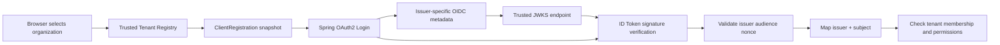
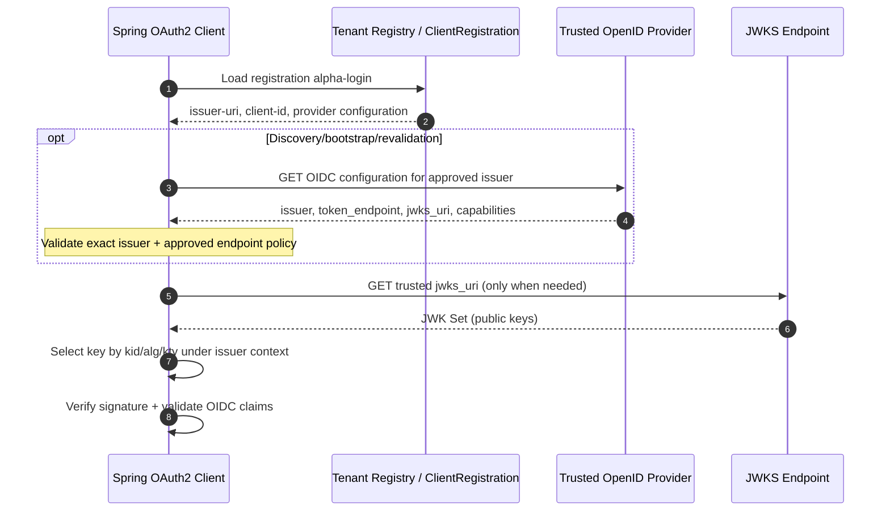
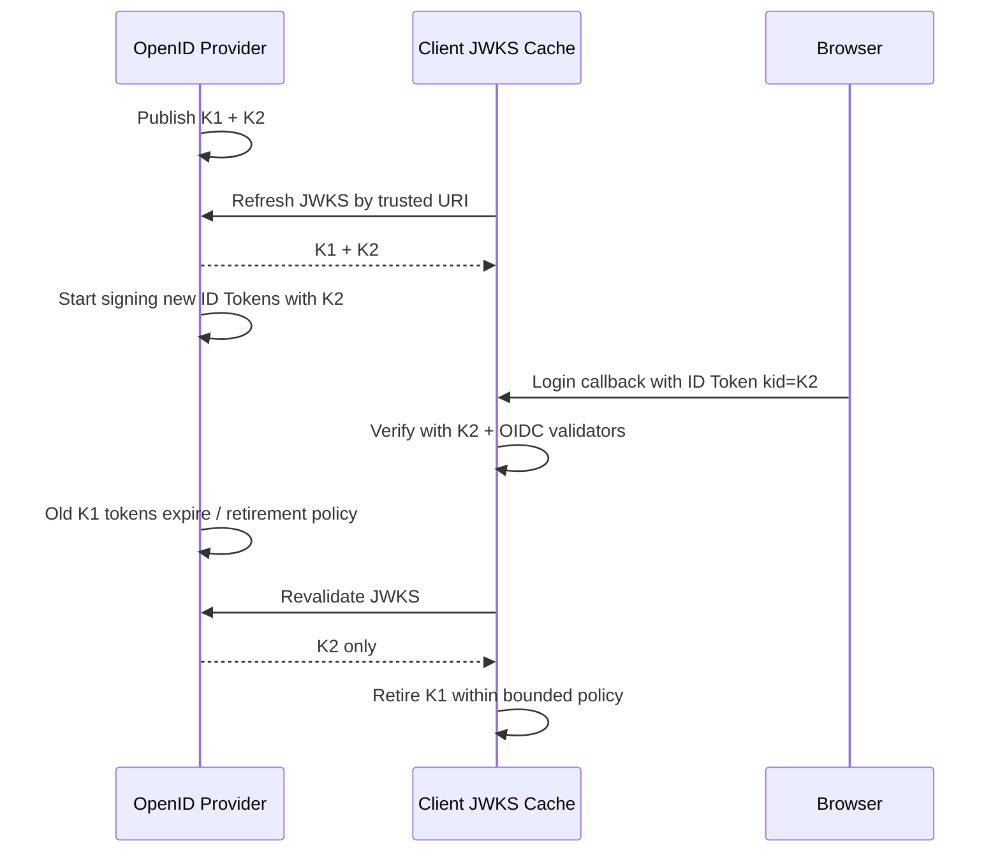
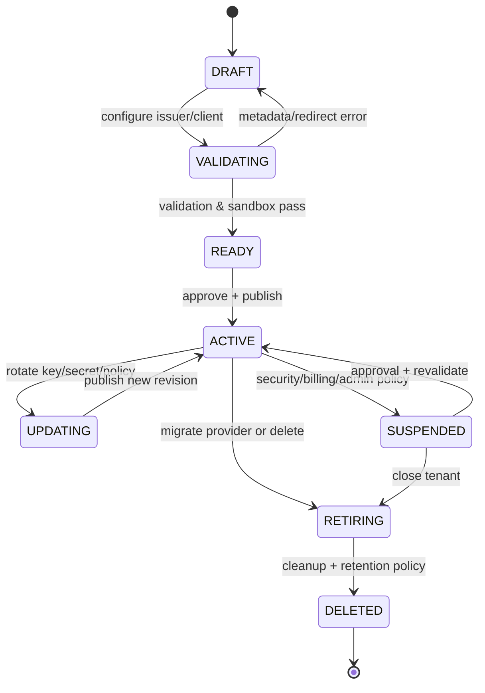

# 26.8. Metadata Caching, JWKS, and Tenant Configuration Lifecycle

In a **multi-tenant Spring Security OAuth 2.0 / OpenID Connect (OIDC) Client** application, each organization may use its own OpenID Provider (OP), issuer, OAuth2 client ID, redirect URI, and login policy. As the number of organizations grows, the application usually cannot re-fetch OIDC Discovery or download JWKS from the Internet on **every request**. It needs caching to reduce latency and lessen dependence on OP availability.

However, caching in authentication is not like caching images or reporting data. An **incorrect issuer, stale JWKS, rotated client secret, or invalidated tenant mapping** can break logins, bind the wrong identity, or keep trusting a revoked key. Conversely, an overly aggressive cache refresh policy can cause a **cache stampede**, causing hundreds of requests to fetch JWKS simultaneously and propagating an OP outage into the application.

This lesson focuses on **"Metadata Caching, JWKS, and Tenant Configuration Lifecycle"** in Chapter **26. Multi-tenancy** of the **Spring Security OAuth 2.0 OIDC Client** module. Examples are based on **Spring Boot 3.x, Spring Security 6.x**, distinguishing **Servlet** and **WebFlux/Reactive**. Because specific caching mechanisms vary across Spring Security versions and underlying JOSE/JWT libraries, treat the designs here as **principles and architectural patterns**; when configuring cache APIs for production, check the **Javadoc of the exact version in use**.

> **Core principle:** Caching may improve performance, but it must never alter the **trust boundary**. Tenants must be approved upfront, issuers must match metadata accurately, signing keys must come from the trusted issuer's JWKS, and signature verification never replaces checking `iss`, `aud`, `exp`, `nonce`, and tenant policies.

## 1. Learning Objectives

After this lesson, you will be able to:

1. Distinguish **tenant registry cache**, **OIDC Discovery metadata cache**, **JWKS/JWK cache**, **decoder/key selector cache**, and **authorized client/token storage**.
2. Explain which data can be shared across tenants and which must be isolated by issuer/client/registration/principal.
3. Understand `issuer-uri`, `.well-known/openid-configuration`, `jwks_uri`, `kid`, and `alg` in ID Token verification.
4. Design TTLs, conditional requests (`ETag`/`Last-Modified`), refreshes, invalidation, and bounded negative caching.
5. Operate **JWKS key rotation** with key overlap windows, recognizing new `kid` values, and preventing cache stampedes.
6. Handle OP metadata/JWKS errors with or without cached data, applying **fail closed** for untrusted tenants/issuers.
7. Manage tenant configuration from onboarding through active, rotate, suspend, retire, and delete without mixing accounts.
8. Evaluate the impact of changing `client_id`, client secret, issuer, redirect URI, and registration ID on in-flight authorization requests.
9. Implement a repository reading **immutable configuration snapshots** in Servlet or Reactive.
10. Design invalidation events, versioning, reconciliation, and multi-instance consistency.
11. Test OIDC issuer/JWKS rotation, account isolation, concurrency, outages, SSRF, and logging.
12. Maintain an incident troubleshooting runbook without printing access tokens, ID Tokens, refresh tokens, or client secrets.

## 2. A Typical Multi-Tenant System

Suppose an application provides a workplace portal for three organizations:

| Tenant | Registration ID | Issuer | Client ID |
| --- | --- | --- | --- |
| Alpha | `alpha-login` | `https://login.alpha.example/oidc` | `portal-alpha-web` |
| Beta | `beta-login` | `https://id.beta.example/realms/beta` | `portal-beta-web` |
| Gamma | `gamma-login` | `https://login.shared.example/tenant/gamma` | `portal-gamma-web` |

All URLs are examples. Each OP may publish metadata at its issuer discovery path, including authorization endpoint, token endpoint, and JWKS URI.



The steps in the diagram do not always execute sequentially on every request. Registrations and metadata may be pre-built; JWKS may come from memory and refresh only when needed. The diagram illustrates **trust relationships**, not a promise that every arrow equals an HTTP call.

### 2.1. Challenges at Hundreds of Tenants

When each tenant uses its own OP, common scenarios emerge:

- 300 client registrations and 300 issuer URLs.
- Each instance maintains its own JWKS cache.
- Multiple replicas boot concurrently and fetch OIDC metadata together.
- An OP rotates signing keys while the application still holds an older cache.
- A tenant rotates its client secret or terminates service.
- A tenant is disabled while old browser sessions remain live.
- An OP returns a JWT with a previously unseen `kid`.
- Two tenants share an issuer/JWKS yet have different client IDs.
- Node 1 holds tenant config version A while node 2 holds version B.
- An authorization flow starts with the old registration, but the callback returns after configuration changed.

A solid caching policy must address **both performance and correctness** across these scenarios.

## 3. Distinguishing Cache Types and Where State Lives

The first question is not "What is the TTL?", but **"Which object is being cached?"**

| Data layer | Suggested logical key | Data | Sensitivity | Lifecycle |
| --- | --- | --- | --- | --- |
| **Tenant routing registry** | Tenant ID, approved domain, policy revision | Map tenant → registration ID | Sensitive for config/permissions | Admin-driven changes |
| **ClientRegistration** | Registration ID + revision | Client ID, secret reference, issuer, redirect, scopes | May hold **client secret** | On enrollment/rotation |
| **OIDC Discovery metadata** | Trusted issuer + metadata generation | Authorization/token/JWKS endpoints, supported features | Public metadata but **integrity is critical** | Per provider/revalidation policy |
| **JWKS/JWK set** | Trusted issuer or approved JWKS URI + cache version | Public keys published by OP to sign JWTs | Usually public; source trust is critical | Key rotation/HTTP cache |
| **Decoder/key selector** | Trust configuration + registration/issuer + revision | Decoder and key/alg/validator bindings | Security-critical | Per revision/runtime config |
| **OIDC authorization request** | Random `state`/browser session | Redirect/client request, PKCE, nonce correlation | Sensitive, **short-lived** | Single login attempt |
| **OAuth2AuthorizedClient** | Registration + principal + context | Access token, refresh token, expiry | **Secret** | Token lifecycle/logout/revocation |
| **SecurityContext/WebSession** | Browser session | Authentication and session state | Sensitive | Session lifecycle |

**Never use a single generic cache keyed solely by `tenantId` to store everything.** Tenant registry, metadata, keys, user tokens, and sessions are distinct resources with different invalidation policies, access permissions, and TTLs.

### 3.1. Client Config Is Not User Tokens

`ClientRegistrationRepository` and `ReactiveClientRegistrationRepository` return OAuth2 client metadata. `OAuth2AuthorizedClientRepository`, `ServerOAuth2AuthorizedClientRepository`, or authorized client services store access/refresh tokens issued to principals.

Caching `ClientRegistration` does not mean caching tokens for all users. Conversely, refreshing JWKS **does not automatically refresh** user access tokens, and clearing the registration cache **does not revoke** refresh tokens at the OP.

### 3.2. Metadata Is Public, Not Harmless

A discovery document may contain:

```json
{
  "issuer": "https://login.alpha.example/oidc",
  "authorization_endpoint": "https://login.alpha.example/oidc/authorize",
  "token_endpoint": "https://login.alpha.example/oidc/token",
  "jwks_uri": "https://keys.alpha.example/oauth2/jwks",
  "response_types_supported": ["code"],
  "id_token_signing_alg_values_supported": ["RS256", "ES256"]
}
```

`jwks_uri` may reside on a different host than the issuer under a valid provider configuration. However, because **every endpoint in metadata affects the authentication flow**, accept them only via a configured/approved issuer and trusted HTTPS connections. Never let user input decide where the backend fetches metadata or sends client credentials.

## 4. How Do OIDC Discovery and JWKS Differ?

**OIDC Discovery metadata** answers: "Who is this OP, and where are its valid endpoints/capabilities?"

**JWKS** answers: "Which public keys has the OP published for verifiers to validate signatures of tokens belonging to this trust context?"



### 4.1. Discovery Does Not Necessarily Run on Every Login

When Spring Boot configures:

```yaml
spring:
  security:
    oauth2:
      client:
        provider:
          alpha-op:
            issuer-uri: https://login.alpha.example/oidc
```

Spring Boot/Spring Security may **resolve provider metadata when creating `ClientRegistration`**, such as during application context initialization. `ClientRegistration` is usually a stable configuration object; OP metadata changes **do not automatically mutate the live in-memory object immediately**.

Therefore, distinguish:

- **Built-in discovery at bootstrap.**
- **A custom metadata cache** if the application manages tenants dynamically.
- **A client registration update lifecycle** if the provider changes endpoints/algorithms/client info.
- **JWKS lookup/refresh** during JWT verification.

Never assume "Spring automatically refreshes all discovery metadata in the background every X minutes" without verifying the exact implementation and version.

### 4.2. JWKS Can Change Even When Issuer Does Not

OPs routinely rotate signing keys while keeping the same issuer, authorization endpoint, and client ID. In that case, the **JWK Set** must be updated while **`ClientRegistration`** does not necessarily need rebuilding.

Conversely, if the issuer/token endpoint/redirect policy changes, refreshing JWKS alone is **insufficient**.

## 5. Relevant Spring Security Components

| Component | Responsibility |
| --- | --- |
| `ClientRegistration` | OAuth2 client configuration and provider details |
| `ClientRegistrationRepository` | Servlet lookup by registration ID |
| `ReactiveClientRegistrationRepository` | Reactive lookup returning `Mono<ClientRegistration>` |
| `ClientRegistrations.fromIssuerLocation(...)` | Creates builder from issuer discovery; may perform HTTP I/O |
| `oauth2Login()` | Orchestrates Authorization Code/OIDC Login on Servlet |
| `oauth2Login()` with `ServerHttpSecurity` | OIDC Login on WebFlux |
| `OidcIdTokenDecoderFactory` | Builds JWT decoder for OIDC ID Tokens on Servlet per registration |
| Underlying JWT/JWK implementation | Fetches/holds public keys and verifies signatures per decoder |
| `OAuth2AuthorizedClientManager` | Authorizes/refreshes OAuth2 authorized clients (Servlet) |
| `ReactiveOAuth2AuthorizedClientManager` | Reactive counterpart |
| Authorized client service/repository | Stores access/refresh tokens by principal/context |
| `WebSession`/`HttpSession` | Stores browser session/correlation when configured |

**Important note:** A `NimbusJwtDecoder` configuration meant for **Resource Server JWT validation** does not automatically apply to **OAuth2 Login OIDC ID Token validation**. Those are two distinct integration paths. To customize caching/decoders/algorithms for the OIDC Client, check the corresponding factory/manager in your version.

### 5.1. How Does Spring Hold JWKs?

Decoders built on JOSE/JWK libraries may cache key sets and refresh when expired or upon encountering an unknown key ID, depending on the builder, library, and version. Never assume all decoders:

- Share a single global cache.
- Interpret HTTP `Cache-Control` identically.
- Immediately refresh on every unknown `kid`.
- Use the exact same fixed TTL.
- Share caches between Servlet login and Resource Server.
- Can be invalidated by an arbitrary application event.

To make operational guarantees, read the **source/Javadoc of your exact Spring Security/Nimbus version** and test against a real OP fixture.

## 6. Trust Boundary: Determine the Tenant Before Fetching Keys

A dangerous design flaw is extracting `iss`/`kid`/`jku` from an unverified JWT and letting them decide which HTTP URL the backend calls.

**Conceptually wrong:**

```text
Receive unverified JWT
        |
        v
Parse self-asserted iss or jku from JWT
        |
        v
GET that URL to fetch JWKS
        |
        v
Use returned public key to verify JWT
        |
        v
Trust JWT
```

An attacker can craft a token, point to a JWKS under their control, and make the signature "validate" with **the attacker's own key**, or abuse `jku`/`x5u` to trigger SSRF.

**Right approach:**

```text
Trusted tenant selection + approved ClientRegistration
        |
        v
Trusted issuer & approved JWKS endpoint
        |
        v
Receive ID Token from matching authorization/token flow
        |
        v
Select key from JWKS belonging to approved issuer
        |
        v
Verify JWS signature
        |
        v
Validate iss, aud, exp, iat, nonce, ...
        |
        v
Map verified (issuer, subject) + tenant membership
```

### 6.1. `kid` Is Only a Key-Selection Hint

A JWT protected header might contain:

```json
{
  "alg": "RS256",
  "kid": "signing-key-2026-11",
  "typ": "JWT"
}
```

`kid` is **not proof of trust** and is not globally unique. Two different issuers can both use `kid="key-1"`. Caches must never key **solely by `kid`**.

A minimal safe key lookup is bounded by:

```text
trusted issuer / JWK source
  +
approved algorithm/key type policy
  +
kid (if present)
```

If a token omits `kid`, the verifier may fall back to the JOSE library's key-selection behavior, yet **still strictly within the trusted JWK Set**; never fetch keys from a URI supplied by the token.

### 6.2. A Valid Signature Alone Is Insufficient

Even when a JWT is signed by Alpha OP's valid key, the ID Token must still satisfy:

- `iss` matches the configured/trusted issuer.
- `aud` contains the registration's exact client ID.
- `azp` is handled per OIDC rules where applicable.
- `exp`/`iat`/`nbf` per validators and clock-skew policy.
- `nonce` matches the authorization request when required by flow.
- Valid `sub`.
- Allowed JWS algorithm per client/OP policy.
- Any other OIDC profile validations.

**Never treat a decoder that only checks signatures as complete OIDC login.**

## 7. Static Config for Few Tenants: The Simplest Solution

If the application has only a few fixed OPs, start with Spring Boot properties instead of building a custom discovery caching layer.

### 7.1. Dependencies

Maven:

```xml
<dependencies>
  <dependency>
    <groupId>org.springframework.boot</groupId>
    <artifactId>spring-boot-starter-web</artifactId>
  </dependency>
  <dependency>
    <groupId>org.springframework.boot</groupId>
    <artifactId>spring-boot-starter-security</artifactId>
  </dependency>
  <dependency>
    <groupId>org.springframework.boot</groupId>
    <artifactId>spring-boot-starter-oauth2-client</artifactId>
  </dependency>
</dependencies>
```

If the app is **WebFlux**, use `spring-boot-starter-webflux` instead of `spring-boot-starter-web` along with reactive APIs. Do not arbitrarily include both starters when the architecture only needs one web stack.

### 7.2. `application.yml`

```yaml
spring:
  security:
    oauth2:
      client:
        registration:
          alpha-login:
            provider: alpha-op
            client-id: ${ALPHA_OIDC_CLIENT_ID}
            client-secret: ${ALPHA_OIDC_CLIENT_SECRET}
            client-authentication-method: client_secret_basic
            authorization-grant-type: authorization_code
            redirect-uri: "{baseUrl}/login/oauth2/code/{registrationId}"
            scope:
              - openid
              - profile
          beta-login:
            provider: beta-op
            client-id: ${BETA_OIDC_CLIENT_ID}
            client-secret: ${BETA_OIDC_CLIENT_SECRET}
            client-authentication-method: client_secret_basic
            authorization-grant-type: authorization_code
            redirect-uri: "{baseUrl}/login/oauth2/code/{registrationId}"
            scope:
              - openid
              - profile
        provider:
          alpha-op:
            issuer-uri: ${ALPHA_OIDC_ISSUER_URI}
          beta-op:
            issuer-uri: ${BETA_OIDC_ISSUER_URI}
```

```text
GET /oauth2/authorization/alpha-login
GET /oauth2/authorization/beta-login
```

These are the login initiation URLs under default OAuth2 Login configuration. `registrationId`, `client-id`, and `issuer-uri` are three distinct values.

### 7.3. Never Hardcode Arbitrary JWKS URIs Just to Skip Discovery

If the OP supports standard discovery via `issuer-uri`, prefer validated metadata. If a provider lacks discovery and the project must configure endpoints manually, take URIs from **trusted OP documentation** and verify consistency across issuer, token endpoint, and JWKS.

Never read `jwks_uri` from browser input, and never let tenant users edit OP URLs without onboarding and security review.

## 8. Metadata Cache: Identity and Keys Must Be Accurate

A metadata cache can store a verified record:

```json
{
  "issuer": "https://login.alpha.example/oidc",
  "authorization_endpoint": "https://login.alpha.example/oidc/authorize",
  "token_endpoint": "https://login.alpha.example/oidc/token",
  "jwks_uri": "https://keys.alpha.example/oauth2/jwks",
  "fetched_at": "2026-11-16T02:00:00Z",
  "validated_at": "2026-11-16T02:00:00Z",
  "configuration_revision": 17
}
```

The `fetched_at`, `validated_at`, and `configuration_revision` fields are **application-added cache metadata**, not standard fields guaranteed by OIDC Discovery.

### 8.1. Sensible Cache Key

```text
discovery:<approvedIssuerId>:<configurationRevision>
```

Avoid:

```text
discovery:<emailDomain>
discovery:<untrusted-iss-from-token>
discovery:<kid>
```

One email domain can map to multiple tenants; one issuer can serve multiple clients; a `kid` does not identify a discovery document.

If using the issuer URI as part of the key, canonicalize **according to your issuer registration rules** while keeping exact `issuer` comparison per standard. Never strip paths, trailing slashes, or alter hosts if doing so could collapse two distinct issuers into one.

### 8.2. What Must Be Validated Before Caching?

- Approved issuer.
- Proper TLS certificate and hostname verification.
- Metadata `issuer` matches **expected issuer** per OIDC rules.
- Authorization endpoint and token endpoint have valid URIs per provider contract.
- `jwks_uri` is valid and approved regarding network destination and scheme.
- HTTP client redirects are controlled and cannot land on internal/untrusted hosts.
- Capabilities actually match required flow, algorithms, and client policy.
- Never accidentally inject another tenant's metadata into the current snapshot.

A metadata document returning **HTTP 200** whose `issuer` mismatches must be rejected—never stored in cache "just in case".

### 8.3. Should Metadata TTL Equal JWKS TTL?

Not necessarily. Metadata endpoints are usually more stable than JWKS; signing keys may rotate far more frequently than endpoint URLs. Still, **there is no single universal TTL for all OPs**.

A policy should weigh:

1. `Cache-Control`/`Expires` if published by the OP and supported by the client library.
2. Provider SLA/cadence for metadata and JWK changes.
3. Frequency of tenant onboarding/reconfiguration.
4. Availability of proactive refresh or invalidation events.
5. Risk tolerance for using older metadata/keys.
6. OP availability and latency targets.

Never set metadata or JWKS TTL to `forever` and forget key rotation.

## 9. HTTP Caching: `Cache-Control`, `ETag`, `Last-Modified`

A JWKS endpoint may respond with:

```http
HTTP/1.1 200 OK
Content-Type: application/jwk-set+json
Cache-Control: public, max-age=300
ETag: "jwks-revision-42"

{"keys":[...]}
```

HTTP `Cache-Control` indicates the response may be considered fresh for the specified duration **if the client and policy properly honor HTTP caching**. Do not assume Spring/Nimbus automatically honors these headers identically in every configuration.

During revalidation, the client may send:

```http
GET /jwks HTTP/1.1
Host: keys.alpha.example
If-None-Match: "jwks-revision-42"
```

If unchanged:

```http
HTTP/1.1 304 Not Modified
ETag: "jwks-revision-42"
Cache-Control: public, max-age=300
```

The cache can then keep using the validated JWK Set, updating freshness per HTTP semantics and policy.

### 9.1. Properties to Keep Distinct

| Property | Meaning | Must not be mistaken for |
| --- | --- | --- |
| **TTL/freshness** | Duration data can be used before refresh | Proof a key has not been compromised |
| **ETag** | Representation validator at an endpoint | Cryptographic signature authenticating JWKS |
| **Last-Modified** | HTTP representation modification time | Guarantee every key change has a valid timestamp |
| **HTTP 304** | Representation unchanged per validator | Proof token authentication succeeded |
| **Cache invalidation event** | Signal the app should revalidate/fetch new snapshot | Permission to skip issuer/alg checks |
| **Cache miss** | No local data present | Permission to fetch from an untrusted URL |

An `ETag` does not prove an issuer is trustworthy; **TLS, issuer pinning, approved endpoints, and JWT validation** remain mandatory.

### 9.2. Should `stale-while-revalidate` Be Used?

It can be considered for **known-good metadata/keys with verified origin**, but evaluate carefully:

- An old key might just have undergone emergency revocation.
- Never serve stale **indefinitely**.
- Never accept tokens signed by an unverified new key.
- Never use stale policy to permit a disabled tenant.
- Never skip expected issuer/audience/nonce when using an older key.
- Enforce deadlines, alerts, and operational overrides for rapid invalidation.

Some architectures choose to **fail closed** immediately once JWKS expires and cannot refresh; others allow a short grace window with known keys under an approved policy. Never claim one option fits every risk profile.

## 10. JWKS and Signing Key Lifecycle

JWKS is a JSON Web Key Set, shown in an abbreviated illustrative example:

```json
{
  "keys": [
    {
      "kty": "RSA",
      "kid": "alpha-2026-11",
      "use": "sig",
      "alg": "RS256",
      "n": "<public-RSA-modulus-base64url>",
      "e": "AQAB"
    }
  ]
}
```

**JWKS used for signature verification normally contains public keys**, not the OP's private key. However, if an attacker can tamper with the JWKS cache or metadata, they can inject a rogue key into the trust path. Therefore, the JWKS cache must be protected for **integrity**, not merely confidentiality.

### 10.1. Never Select Keys Solely by `alg` or `kid`

A token header declaring `alg="RS256"` does not permit the client to accept RS256 if policy allows only ES256. `kid` is merely an identifier within a JWKS.

The verifier must combine:

- Approved JWS algorithm allowlist.
- Appropriate key type/curve/usage (`kty`, `crv`, `use`/`key_ops` when present).
- Trusted issuer/JWKS source.
- `kid` (if present).
- Valid signature.
- OIDC claims validators.

**Never accept `alg=none` or downgrade from asymmetric to HMAC just because the token header requests it.**

### 10.2. Illustrative Key Rotation Schedule

```text
T0:
  JWKS = {K1}
  OP signs ID Tokens with K1

T1:
  JWKS = {K1, K2}
  OP continues signing with K1
  Application has time to pick up K2

T2:
  JWKS = {K1, K2}
  OP starts signing with K2
  Still-valid tokens signed by K1 must still verify

T3:
  K1 tokens have expired per policy
  JWKS = {K2}
  K1 is removed after the transition window
```

If the OP removes K1 before K1-signed tokens expire, verifiers may reject those tokens. Conversely, keeping K1 forever allows retired keys to remain accepted.

**The key overlap window must be aligned between OP and application** accounting for token lifetime, propagation, cache TTL, clock skew, and incident response policy. During a key compromise, an OP may revoke early even at the cost of disruption.

### 10.3. Visual Timeline



Not every OP follows this exact timeline. This is an **idealized rotation workflow**; test it against your real provider.

## 11. Token Carries a New `kid`: What Should Happen?

Suppose the cache currently holds only K1 while the OP signed a token with K2. When the verifier sees `kid=K2`:

1. Verify the token came from a **trusted login flow/issuer**.
2. Never use `kid` to select a new issuer.
3. If supported by the decoder/key source, **revalidate JWKS from the approved URI** per policy.
4. Rate-limit refreshes; avoid duplicate calls for the same miss.
5. Accept K2 only if the fetched JWK Set arrives over a valid trust path and signature/claims validate.
6. If no matching key exists, **reject the token**—never temporarily disable signature validation.

### 11.1. Never Refresh Infinitely on Every Unknown `kid`

An attacker can send JWTs with:

```text
kid = random-1
kid = random-2
kid = random-3
...
```

If every token triggers a backend JWKS fetch, both the OP and the application face denial-of-service.

A **bounded unknown-key policy** can use:

- Sensible cache TTL.
- **Single-flight refresh** per trusted issuer/JWKS URI.
- Rate limiting on extra fetches triggered by unknown `kid`.
- Very short/bounded negative caching for nonexistent key IDs, if appropriate.
- Alerts when unknown `kid` rates spike abnormally.
- Never creating unbounded cache entries for every `kid` string.

**Never cache a "rejected token" as a verified token.** Negative caching only reduces lookup load; it must never alter security check outcomes.

### 11.2. Coordinator Example — Pseudocode

```text
function selectVerificationKey(trustedIssuer, tokenHeader):
    require trustedIssuer is registered and ACTIVE
    require tokenHeader.alg in allowedAlgorithms(trustedIssuer)

    cached = jwksCache.get(trustedIssuer)
    if cached has compatible key for tokenHeader.kid:
        return key

    if not issuerRefreshBudget.allowsRequest(trustedIssuer):
        return VERIFICATION_FAILURE

    with singleFlight(trustedIssuer):
        latest = jwksCache.recheck()
        if latest already has compatible key:
            return key

        fresh = fetchFromApprovedJwksUri(trustedIssuer)
        require validTlsAndEndpoint(fresh.source)
        require jwksMatchesTrustPolicy(fresh)

        jwksCache.atomicReplace(trustedIssuer, fresh)
        return selectCompatibleKeyOrFailure(fresh, tokenHeader)
```

This is an **architectural pattern**, not a built-in Spring Security function. If your Spring Security/Nimbus version's decoder already provides key-source caching/refetching, **leverage and properly configure/bound it** rather than layering a second parallel cache that drifts out of sync.

## 12. Cache Stampede in Multi-Instance Systems

Suppose 50 WebFlux/Servlet replicas receive ID Tokens signed with K2 at the same time:

```text
Node 01: cache K1 -> unknown kid K2 -> GET JWKS
Node 02: cache K1 -> unknown kid K2 -> GET JWKS
...
Node 50: cache K1 -> unknown kid K2 -> GET JWKS
```

If the OP enforces rate limits or the network is flaky, the entire cluster can fail simultaneously.

### 12.1. Mitigations by Scope

| Scope | Mitigation | Limitation |
| --- | --- | --- |
| Within one process | Single-flight or lock per issuer/JWKS source | Does not coordinate across instances |
| Across cluster | Shared cache or distributed refresh lease | Requires fencing, TTL, and stale-write protection |
| With OP | Conditional GET, honor HTTP cache headers | Provider may not support them |
| On deploy | Concurrency-bounded warm-up for active tenants | Cannot guarantee new keys arrive ahead of time |
| On error | Backoff + jitter + circuit breaker | Must never soften verification |
| For security | Allowlist issuer before lookup | Does not mitigate attacks if arbitrary URLs are fetched |

A shared JWKS cache can make sense because JWKs are public, yet **do not make all verification layers blindly share state**. Shared entries must be stored by trusted source with controlled freshness, versioning, and integrity; validators remain **per-registration/per-issuer policy**.

### 12.2. Isolating Blast Radius from a Single OP Failure

Suppose Alpha OP becomes unavailable. Alpha logins may fail or use cached valid keys within policy limits, yet **Beta and Gamma must not be impacted** by a global circuit breaker or a system-wide cache lock.

Scope concurrency limits, timeouts, retry budgets, and circuit breakers **per trusted issuer or provider group**. Never use a single global lock across all tenants.

## 13. Cache Keys and Cross-Tenant Sharing

### 13.1. Namespace Model

```text
tenant-routing:<approvedTenantId>:<policyRevision>
registration:<registrationId>:<configRevision>
discovery:<approvedIssuerId>:<metadataRevision>
jwks:<approvedJwksSourceId>:<cacheGeneration>
oidc-decoder:<registrationId>:<configRevision>
authorized-client:<registrationId>:<trustedPrincipalId>:<context>
```

These are suggested **logical keys**, not Redis keys created automatically by Spring. Design keys to avoid PII/secrets and never place raw session IDs or access token values in metrics/logs.

### 13.2. One Issuer Serving Multiple Clients

Example:

```text
Tenant Alpha -> issuer=https://login.shared.example
                 clientId=alpha-portal

Tenant Beta  -> issuer=https://login.shared.example
                 clientId=beta-portal
```

The two clients can share a **public JWKS source** by issuer if they share trust configuration. However, **ID Token validation must never share audience policies**:

```text
Alpha ID Token:
  iss = https://login.shared.example
  aud = alpha-portal

Beta ID Token:
  iss = https://login.shared.example
  aud = beta-portal
```

A shared decoder/cache that only verifies signatures without checking `aud` can accept a token for the wrong OAuth2 client. Therefore, even if **JWK fetching** is shared, keep **`ClientRegistration`-bound validators** separate.

### 13.3. Two Issuers Sharing the Same `kid`

```text
Issuer Alpha: kid=key-1, RSA public key A
Issuer Beta:  kid=key-1, RSA public key B
```

A global `kid -> key` cache creates a dangerous collision. `kid` is meaningful only within a **JWK source/trust boundary**; never use it as a standalone key.

### 13.4. Identical Issuers Do Not Prove Tenant Membership

A shared OP can use the same `iss` across multiple organizations. `(iss, sub)` is a stable key for identity at the OP, yet **tenant membership** must be verified against account mappings/tenant memberships or policy-approved claims. Never infer tenant solely from the selected client ID or login URL.

## 14. Tenant Configuration Lifecycle: An Essential State Machine

A tenant is not merely "present" or "absent". Explicit lifecycle management keeps changes safe.



This is an **application state-machine pattern**, not built-in Spring Security enums.

### 14.1. Meaning of Each State

| State | New logins | Metadata/JWKS | Existing tokens/sessions |
| --- | --- | --- | --- |
| **DRAFT** | Disallowed | Can validate in admin sandbox | None or unused |
| **VALIDATING** | Disallowed | Bounded fetch/verify from approved issuer | No real user logins |
| **READY** | Not yet published | Warm-up per policy | Not public yet |
| **ACTIVE** | Allowed per routing policy | Normal caching/refetching | Per token/session policy |
| **UPDATING** | Usually keeps current revision | Builds new revision in parallel | In-flight flows must bind to version |
| **SUSPENDED** | Blocks new logins by default | Used only for intentional handling | Explicit policy: invalidate or hold |
| **RETIRING** | No new flows on old revision | Kept minimally to finish/close valid flows by deadline | Cleanup/reconnect/migration |
| **DELETED** | No | Purge config/cache per retention | Revoke access per policy; token revocation if applicable |

**`Suspended`/`Deleted` must not be implemented merely as deleting an in-memory map entry.** Existing sessions and issued authorized clients may still remain live. "Block new logins" differs from "block all app access" and differs from "revoke tokens at the OP".

## 15. Onboarding a New Tenant: The Right Sequence

A trustworthy workflow:

1. An **authenticated administrative principal** requests adding a tenant.
2. Verify organization, domain/issuer ownership, and OP relationship per policy.
3. Create or receive an **OAuth2 client registration from the OP** through formal procedures.
4. Store `client_secret` or client authentication keys in a **secret manager**.
5. Specify the exact issuer URI, approved metadata/JWKS endpoints, and network egress policy.
6. Fetch discovery metadata from the trusted URI with timeouts, TLS, and SSRF controls.
7. Verify metadata `issuer` matches the expected issuer, along with response capabilities, `jwks_uri`, and algorithms.
8. Verify redirect URI, scopes, client authentication method, login flow, and OP contract.
9. Run integration tests with a sandbox/tenant test account.
10. Build `ClientRegistration` and caches under a **new revision**.
11. Perform bounded warm-up to avoid 100 instances fetching simultaneously.
12. Publish the tenant/domain → registration ID mapping once configuration is ready.
13. Monitor errors/latency, ready to roll back if needed.

```text
Admin approval -> Trusted config -> Validated metadata
                                 -> JWKS available
                                 -> ClientRegistration built
                                 -> Policy snapshot published
                                 -> Login route ACTIVE
```

Never allow unauthenticated users to submit `issuer=https://arbitrary-host` and have the backend immediately fetch metadata and create a client. That invites **SSRF, open redirects, provider confusion, or client credential leakage**.

### 15.1. Egress Controls for Discovery/JWKS

Metadata may specify a `jwks_uri` on a different host than the issuer. That is **not automatically wrong**, but requires:

- HTTPS and certificate validation.
- DNS/IP range controls, blocking loopback/link-local/metadata service/internal-only destinations unless explicitly approved.
- HTTP redirect controls.
- Allowlist or admin-approved endpoint policies.
- Timeouts/response size/JSON depth limits.
- Never using an HTTP proxy that leaks client secrets.
- Concurrency limits on simultaneous tenant onboarding.

Do not rely merely on blocking the literal hostname `localhost`; SSRF can use IP literals, DNS rebinding, IPv6, or redirects.

## 16. Configuration Changes: Grouping by Impact Level

Not all tenant configuration changes carry the same impact.

| Change | Technical impact | Recommended rollout |
| --- | --- | --- |
| Display name/branding | UI only, no effect on token validation | Publish policy revision, invalidate UI cache |
| Domain → registration mapping | New login routing | Update versioned allowlist; do not break active auth state |
| Requested scopes | Consent/token issuance | Test, possible re-consent; never auto-escalate permissions |
| Client secret rotation | Token Endpoint client authentication | Overlap/secret manager/update; verify issuer/clientId remain valid |
| Client ID change | ID Token `aud`, authorized client identity, OP registration | Create versioned registration/flow, typically requires reauthorization |
| Redirect URI change | Authorization request/callback matching | Register new URI first, retain old callback during transition |
| Issuer change | **Changes trust boundary** and `(iss,sub)` identity | Treat as controlled OP migration, not just a JWKS flush |
| JWKS URI change | Signing key source | Validate discovery/endpoint policy then rebuild decoder/key source |
| Accepted JWS algorithms change | Signature acceptance policy | Security review, key type migration |
| Tenant suspended | Authorization/routing policy | Block new logins, decide fate of existing sessions/tokens |
| Tenant deleted | Config, sessions, tokens, audit/retention | Retire → cleanup → revoke/expire → delete |

### 16.1. Rotating Client Secret Differs from Changing Issuer

If the OP rotates `client_secret` while keeping the same `client_id` and issuer:

- Older ID Tokens usually still verify against the issuer/public JWKS.
- New Token Endpoint requests must use the valid secret.
- Already logged-in browser sessions can remain valid per policy.
- Refresh token usage may be impacted if client authentication fails.

There is no need to automatically wipe the JWKS cache solely because a client secret rotated. However, if the client authentication method or key binding changed, check related profiles and dependencies.

### 16.2. Changing Issuer Is a Different Class of Event

If Alpha switches from:

```text
https://old-id.alpha.example/oidc
```

to:

```text
https://new-id.alpha.example/oidc
```

then **the two issuers are two distinct trust identities** unless an approved migration/account-linking workflow exists. Never:

- Use the old issuer's keys to trust the new issuer's ID Tokens.
- Rewrite the `iss` claim yourself.
- Merge accounts based on matching `sub` or email.
- Assume old refresh tokens work at the new OP.
- Accept mismatched-issuer tokens during a "grace period".

You can run both registrations/issuers in parallel with separate states, requiring users to reauthenticate or complete verified account linking.

## 17. Configuration Versioning: Avoiding Callbacks Using the Wrong Revision

A subtle scenario:

```text
T0: User starts login with alpha-login version V1
    - clientId = alpha-v1
    - redirectUri = /login/oauth2/code/alpha-login
    - issuer = OP-A

T1: Admin updates ClientRegistration under same ID to V2
    - clientId = alpha-v2
    - redirectUri unchanged

T2: OP returns authorization code for request V1

T3: App looks up registration ID alpha-login and sees only V2
    - Token Endpoint exchanges code using client alpha-v2
    - May fail with invalid_grant/invalid_client
```

This is not necessarily a cache bug: **configuration mutated between the two halves of an OIDC transaction**.

### 17.1. Using Versioned Registrations When Changing Protocol Parameters

One approach:

```text
alpha-login-v1 -> V1 (RETIRING)
alpha-login-v2 -> V2 (ACTIVE)

Alpha login routing:
  post-rollout -> /oauth2/authorization/alpha-login-v2

In-flight V1 callback:
  /login/oauth2/code/alpha-login-v1

V2 callback:
  /login/oauth2/code/alpha-login-v2
```

Notes:

- The OP must allow redirect URIs for both registrations during the overlap window.
- The repository must retain V1 long enough for valid in-flight flows awaiting callbacks.
- `state`, PKCE, and nonce must still correlate accurately.
- Authorized clients saved by `registrationId` may still reference V1; define a retention/reconnect policy.
- Never auto-migrate V1 tokens to V2 if client ID, issuer, or permissions differ.
- Retire V1 only after the deadline and migration policy complete.

**Versioning `registrationId` is a strategy**, not a requirement that every minor change mints a new registration. It is particularly valuable when changing client ID, issuer, or parameters affecting authorization requests/callbacks.

### 17.2. Avoid Holding One Shared `currentTenantConfig` Variable for All Flows

Across multiple tabs:

1. Tab A starts login with OP Alpha.
2. Tab B starts login with OP Beta.
3. Tenant Alpha is rotated.
4. Callbacks return in arbitrary order.

If you overwrite a single `currentIssuer` or `currentClientId` session attribute, flows can confuse OPs. Keep **Spring's registration/state binding** and per-authorization-request snapshots/correlation; never use a global mutable selected provider as the verification source on callback.

## 18. Immutable Snapshots for the Servlet Repository

Servlet's `ClientRegistrationRepository` has a synchronous `findByRegistrationId(...)` method. When a dynamic registry is needed, a suitable pattern is **reading a pre-validated immutable snapshot**, rather than calling databases/HTTP discovery on every login.

### 18.1. Revisioned Snapshot Pattern

```java
import java.util.Map;
import java.util.Objects;
import java.util.concurrent.atomic.AtomicReference;

import org.springframework.security.oauth2.client.registration
        .ClientRegistration;
import org.springframework.security.oauth2.client.registration
        .ClientRegistrationRepository;

public final class SnapshotClientRegistrationRepository
        implements ClientRegistrationRepository {

    public record Snapshot(
            long revision,
            Map<String, ClientRegistration> byRegistrationId) {

        public Snapshot {
            byRegistrationId = Map.copyOf(
                    Objects.requireNonNull(byRegistrationId));
        }
    }

    private final AtomicReference<Snapshot> current;

    public SnapshotClientRegistrationRepository(Snapshot initial) {
        this.current = new AtomicReference<>(
                Objects.requireNonNull(initial));
    }

    @Override
    public ClientRegistration findByRegistrationId(String id) {
        return current.get().byRegistrationId().get(id);
    }

    // Only the config administration component may publish.
    public void publishValidatedSnapshot(Snapshot next) {
        Snapshot previous = current.get();

        if (next.revision() <= previous.revision()) {
            throw new IllegalArgumentException(
                    "New snapshot must have a greater revision");
        }

        current.set(next);
    }
}
```

This is a **repository pattern** illustrating atomic reads. `publishValidatedSnapshot` **assumes** external validation of issuer/metadata/client secret/policy has already occurred. It is not a complete security review or tenant enrollment workflow.

**Concurrency limitation:** Checking revision with `get()` then `set()` can race if two publishers run concurrently. In that case, use a CAS loop or **a single publisher**:

```java
public void publishValidatedSnapshot(Snapshot next) {
    current.updateAndGet(previous -> {
        if (next.revision() <= previous.revision()) {
            throw new IllegalArgumentException(
                    "Stale snapshot revision");
        }
        return next;
    });
}
```

Implement only one of the two method variants above; the second snippet is a **replacement** when multiple publishers exist. To avoid reloading stale versions across nodes, revisions must also be governed by an **authoritative configuration store**, not an independent local counter.

### 18.2. Why Not Fetch Discovery Inside `findByRegistrationId`?

`findByRegistrationId` is called on the login processing path. If every call executes a DNS/HTTPS request to the OP:

- Login latency depends directly on OP metadata latency.
- An OP outage can tie up request threads for a long time.
- Concurrent requests trigger cache stampedes.
- Untrusted registration IDs can trigger unbounded I/O if an allowlist is missing.
- Keeping the same revision across the callback becomes very difficult.

Instead, build/validate configs in a **background administration workflow**, then publish snapshots to the hot path.

### 18.3. A Custom Repository May Override Boot Auto-Configuration

When you declare a custom `ClientRegistrationRepository` bean, Spring Boot may stop creating the in-memory repository from application properties. If your snapshot holds only Alpha, Beta/Gamma from YAML may no longer be reachable as expected.

Actively **merge all approved registrations** into the snapshot or continue using Boot defaults. Never define a custom bean just to test one tenant while dropping all remaining registrations.

## 19. Immutable Snapshots for Reactive/WebFlux

In WebFlux, the interface is:

```java
ReactiveClientRegistrationRepository
```

returning:

```java
Mono<ClientRegistration> findByRegistrationId(String id)
```

If the repository reads an in-memory snapshot, there is no reason to use `.block()`.

### 19.1. Reactive Repository Pattern

```java
import java.util.Map;
import java.util.Objects;
import java.util.concurrent.atomic.AtomicReference;

import org.springframework.security.oauth2.client.registration
        .ClientRegistration;
import org.springframework.security.oauth2.client.registration
        .ReactiveClientRegistrationRepository;

import reactor.core.publisher.Mono;

public final class SnapshotReactiveClientRegistrationRepository
        implements ReactiveClientRegistrationRepository {

    private final AtomicReference<Map<String, ClientRegistration>> snapshot;

    public SnapshotReactiveClientRegistrationRepository(
            Map<String, ClientRegistration> approved) {

        this.snapshot = new AtomicReference<>(
                Map.copyOf(approved));
    }

    @Override
    public Mono<ClientRegistration> findByRegistrationId(
            String registrationId) {

        return Mono.defer(() ->
                Mono.justOrEmpty(
                        snapshot.get().get(registrationId)));
    }

    public void publishApproved(
            Map<String, ClientRegistration> approved) {

        snapshot.set(Map.copyOf(
                Objects.requireNonNull(approved)));
    }
}
```

This implementation performs **non-blocking reads because data already lives in memory**. `publishApproved` must be invoked by a trusted config workflow; the example omits revision/CAS to focus on the Reactor contract. Production requires managing revisions and retiring registrations just like the Servlet version.

### 19.2. What If the Source Data Lives in a Database/Config Service?

You can use R2DBC or `WebClient` for reactive I/O. Still, **avoid turning every login into a remote config lookup** when a stable cached snapshot works.

Wrong:

```java
// Wrong: blocking call already occurred before creating the Mono.
return Mono.just(jdbcTemplate.queryForObject(...));
```

Better:

```text
Trusted config event / scheduled reconciliation
       |
       v
Reactive I/O fetch + validate
       |
       v
Build immutable snapshot
       |
       v
Publish revision atomically
       |
       v
WebFlux request: fast in-memory Mono lookup
```

If forced to call a blocking SDK, offload to a bounded scheduler/service with concurrency limits and timeouts; never run it on the event loop.

## 20. Building `ClientRegistration` from Approved Metadata

A common API:

```java
import org.springframework.security.oauth2.client.registration
        .ClientRegistrations;
import org.springframework.security.oauth2.client.registration
        .ClientRegistration;

ClientRegistration alpha =
        ClientRegistrations.fromIssuerLocation(
                "https://login.alpha.example/oidc")
            .registrationId("alpha-login-v2")
            .clientId("portal-alpha-web")
            .clientSecret(secretFromVault)
            .redirectUri(
                "{baseUrl}/login/oauth2/code/{registrationId}")
            .scope("openid", "profile")
            .build();
```

This illustrates the API for building from an issuer. **`secretFromVault` is an application variable fetched from a secret manager**, not a Spring API name. In a real app, configure the proper `clientAuthenticationMethod`, grant, scopes, redirect URI, and provider details matching the OP profile.

**Important:** `ClientRegistrations.fromIssuerLocation(...)` may execute HTTP Discovery while constructing the builder (depending on implementation/version). Never call it directly on the **WebFlux event loop** or on the `findByRegistrationId` hot path. Call it only for **approved issuers** with strict timeouts/network policies, and verify metadata/OP before publishing.

### 20.1. Never Trust a URL Merely Because It Uses HTTPS

HTTPS proves the connection reaches a host matching a certificate; **it does not prove that host is an OP approved by the organization**. If an issuer comes from an attacker-crafted query parameter, the attacker can still hold a valid HTTPS certificate for their own domain.

Trusted enrollment must create an allowlist/config record before discovery runs.

## 21. Caching Metadata/JWKS Does Not Mean Caching Decoders Forever

A decoder may hold:

- Key source.
- JWS algorithm policy.
- Issuer-specific configuration.
- Client/registration-specific claim validators.
- Underlying JWK Set cache.

If a tenant changes issuer, client ID, or accepted algorithms and you clear only the raw metadata cache, **an active decoder holding references to the old config may still be reused**.

A revision-driven invalidation pattern:

```text
Tenant config revision V2 approved
           |
           v
Rebuild ClientRegistration V2
           |
           v
Refresh/associate discovery metadata V2
           |
           v
Rebuild decoder/key-source binding if policy/issuer/URI changed
           |
           v
Publish config snapshot V2 atomically
           |
           v
Retire V1 per session/callback/token deadlines
```

**Never try mutating fields inside an already-published `ClientRegistration` or decoder without thread-safety guarantees.** Prefer immutable objects and replace-by-revision.

### 21.1. Routine JWKS Key Rotation Does Not Require Changing Registration ID

If issuer and client identity remain unchanged and the OP publishes K2 at the same trusted JWKS URI:

- Update the key set per decoder/cache behavior.
- You do not necessarily need to rebuild `ClientRegistration`.
- You do not need to mint a new registration ID.
- Continue verifying the same issuer/audience/nonce.

Only create versioned registrations when changing **parameters affecting OAuth2 flow/client identity/trust**. Avoid churning tenant configurations on every JWKS refresh.

## 22. Event-Driven Invalidation on Configuration Changes

In multi-instance systems, you can distribute **config events** from a single authoritative source:

```json
{
  "eventType": "TENANT_CONFIG_PUBLISHED",
  "tenantId": "alpha",
  "revision": 18,
  "changedFields": [
    "clientSecretReference",
    "redirectUri"
  ],
  "occurredAt": "2026-11-16T02:30:00Z"
}
```

This is an **application event pattern**, not a built-in Spring Security event. Never put real secrets/tokens onto a message broker.

### 22.1. Consumer Steps

1. Receive event and verify source/permissions.
2. Check that the revision is greater than the current version.
3. Fetch the config record from the authoritative store rather than trusting every field in the event.
4. Validate issuer/client/redirect/security policy.
5. Prepare new metadata/keys/`ClientRegistration`.
6. Publish the immutable snapshot using CAS/version guards.
7. Retain older versions for the migration window if needed.
8. Emit metrics/alerts and confirm rollout.
9. If an event is missed, scheduled reconciliation detects the revision gap and converges.

### 22.2. Events Do Not Guarantee All Nodes Update Simultaneously

In distributed systems, node A may be on V17 while node B is on V18 briefly. Set clear guardrails:

- Publish V18 only once all critical data for V18 is ready.
- Expose revision/generation in metrics.
- When routing/callbacks require strong consistency, use versioned registrations or coordinated rollouts.
- Enforce health/readiness policies if a node lacks a required revision.
- Prevent an older node from reverting to snapshot V16 and overwriting V18.
- Never use wall-clock timestamps instead of monotonic revisions when clock skew is possible.

A distributed cache does not automatically make routing registry, metadata, and decoders atomic across every process; **versioned snapshots** make drift observable and controllable.

## 23. Failure Policy: Serve Stale Cache or Fail Closed?

When an OP or cache store fails, distinguish **approved tenant**, **fresh metadata**, **known key**, **whether the issuer was disabled/revoked**, and **which step the request is in**.

| Scenario | Recommended action |
| --- | --- |
| Tenant ID absent from approved registry | **Reject**; never auto-discover |
| Tenant is `SUSPENDED` | **Block new flows** per policy; never fall back to another issuer |
| Initial metadata fetch fails | Do not activate tenant; report config/OP outage |
| Metadata cache is fresh, OP temporarily unavailable | Can use validated metadata per policy |
| Metadata expired, endpoint changed, OP errors | Fail closed for flows needing new endpoints; never guess URIs |
| JWKS is fresh and has compatible key | Can continue verifying per validators |
| Token has new `kid` but JWKS fetch fails | **Never accept an unverified token** |
| JWKS is stale with only old key | Decide via time-bounded security policy; never use indefinitely |
| OP reports key compromise/revocation | Invalidate/retire key immediately per incident plan; do not wait for TTL |
| Client secret rotated, Token Endpoint returns `invalid_client` | Investigate config revision/secret; never retry indefinitely |
| Metadata `issuer` mismatches | **Reject**; do not cache |
| JWKS URI resolves to internal/untrusted host | **Reject**; investigate SSRF/metadata |
| One tenant experiences errors | Isolate that tenant, avoid impacting other OPs |

### 23.1. Never Use `stale-if-error` for Tenant Access Rights

For images or CSS, stale-if-error can make sense. For a **tenant suspended due to a security incident**, a stale cache with `ACTIVE=true` must never allow logins indefinitely.

Separate:

- **Tenant status security policy** from the authoritative control plane.
- **Metadata/JWKS cache** belonging to the OP.
- **Authorized client/session state** belonging to the user token lifecycle.

An OP outage is never an excuse to ignore a disable event or auto-trust a new issuer.

### 23.2. Never Fall Back to Another OP on Cache Miss

If Alpha JWKS is unavailable, never try Beta JWKS or a "global fallback JWKS". Accepting keys from another provider breaks the issuer trust boundary.

**Fail closed** on unverifiable tokens; UX can show a temporary OP error page rather than forcing the user onto an unequivalent provider.

## 24. Token Cache and Sessions: Independent Lifecycles

Once a user completes OIDC login:

- `Authentication` in `SecurityContext` reflects the application session.
- `OAuth2AuthorizedClient` may hold access and refresh tokens.
- `HttpSession` or `WebSession` holds state per configuration.
- The tenant registry may advance revisions.
- The OP may revoke tokens or sessions.
- JWKS may rotate.

**A login session does not automatically refresh its policies** just because the JWKS cache refreshed.

### 24.1. Does Suspending a Tenant Terminate All Sessions?

Not automatically. If business requirements demand immediate suspension:

1. Block new login requests in the routing policy.
2. Decide whether to invalidate `SecurityContext`/sessions of users belonging to that tenant.
3. Stop background jobs using delegated tokens if needed.
4. Remove authorized clients or invoke revocation APIs per policy/provider.
5. Preserve required audit trails per retention policy.
6. Block old sessions from accessing resources via authorization middleware—not just hiding the login button.

**Relying on the ID Token verified at login provides no automatic notification of later tenant changes.** For immediate revocation policies, Resource Servers/applications must verify entitlement/session versions or an explicit invalidation mechanism.

### 24.2. Refresh Token Rotation Differs from JWKS Rotation

Two easily confused types of "rotation":

| Rotation | What changes? | Where it happens | Related cache/store |
| --- | --- | --- | --- |
| **JWKS signing key rotation** | OP's public/private signing keys | OP signing ID Tokens/JWTs | JWKS/key source/decoder |
| **Refresh token rotation** | An authorized client's refresh token | Token Endpoint during refresh | `OAuth2AuthorizedClientService`/repository |
| **Client secret rotation** | OAuth2 client credential | OP client registration/secret manager | `ClientRegistration`/config revision |
| **mTLS/`private_key_jwt` key rotation** | Client auth key/certificate | Client + OP | Key store, client auth config |
| **Session ID rotation** | Browser session identifier | RP session management | Web session store |

Do not try fixing `invalid_grant` caused by refresh token reuse by clearing the JWKS cache. Do not fix a new `kid` by forcing users to re-log in when a valid key refresh is all that is needed.

### 24.3. Concurrent Token Refresh and Tenant Updates

If worker A refreshes RT1 while an admin disables the tenant or changes the registration:

```text
A: loads authorized client (tenant ACTIVE, revision 17)
B: publishes tenant SUSPENDED, revision 18
A: refresh token succeeds
A: saves AT2/RT2
```

Do not let worker A's token save accidentally **resurrect tenant access rights**. Token storage and entitlement policy are two separate layers; whenever using the new token, verify the current tenant state and principal permissions per policy.

Use conditional persistence/versioning where storage requires it, especially with refresh token rotation across multiple replicas.

## 25. Cache and Secret Security

### 25.1. Public JWKS Still Requires Integrity

Public JWKS does not need confidentiality like a refresh token, yet requires:

- Fetching only from trusted OP/JWKS URIs.
- TLS and certificate validation.
- Cache poisoning/injection protection.
- Never using untrusted token headers as fetch URLs.
- Restricting cache mutation privileges to admin/worker processes.
- Rejecting algorithm downgrades.
- Auditing/invalidating on provider key compromise.
- Never mixing issuer/tenant key namespaces.

### 25.2. Client Secrets Do Not Belong in UI Caches

`ClientRegistration` holds or references the client secret. Never serialize the full object to the browser, store it in a broadly readable general-purpose distributed cache, or log it while debugging.

If caching client metadata:

- Use a secret manager/reference with access controls.
- Enforce encryption at rest/in transit as required.
- Rotate secrets by revision, avoiding plaintext in events.
- Never put secrets in metric labels, URLs, or error messages.
- Ensure proper retention/backup controls.
- Never expose `clientSecret` to frontend JS/`localStorage`.

### 25.3. Access and Refresh Tokens Should Not Share Metadata Caches

Tokens are per-principal credentials with distinct TTLs/rotation/revocation and isolation needs. Use properly designed authorized client services/repositories; never stuff user tokens into shared per-issuer metadata caches.

### 25.4. Data That Must Never Be Logged

- Raw ID Tokens, access tokens, refresh tokens.
- Client secrets/private keys, token endpoint assertions.
- `Authorization` headers and session cookies.
- Authorization codes, `state`, PKCE verifiers, nonces.
- Full `Location` redirects containing sensitive tokens/hints.
- Raw JWKS download URLs if they contain unexpected credentials/queries.
- User emails/subjects in metric labels.
- Full `ClientRegistration` or session objects.

Use non-secret correlation IDs, log-safe tenant aliases, revisions, and standardized error codes.

## 26. Observability: Making Cache and Key Lifecycles Visible

### 26.1. Suggested Metrics

| Metric | Meaning |
| --- | --- |
| `tenant_config_revision` per node | Detects drift across instances |
| Tenant `ACTIVE`/`SUSPENDED`/`RETIRING` counts | Tracks config lifecycle health |
| Metadata cache hits/misses/refreshes | Measures discovery cache efficiency |
| JWKS cache hits/misses | Measures key lookup efficiency |
| Unknown `kid` rate per approved issuer alias | Detects rotation or attacks |
| JWKS fetch HTTP failures/latency | Surfaces OP/network problems |
| ETag 304 ratio if HTTP client supports it | Measures revalidation efficiency |
| Signature verification failures | Token/key mismatches or attacks |
| OIDC issuer/audience/nonce validation failures | Trust boundary violations |
| Configuration publish/reconcile failures | Control plane health |
| Snapshot revision lag | Nodes behind on new config |
| Circuit breaker trips/retry budget exhausted | OP outages/cache stampedes |
| Login callback failures after rotation | V1/V2 registration mismatches |
| Unauthorized logins blocked due to `SUSPENDED` | Confirms enforcement |
| Token refresh/revocation failures | Separates from JWKS problems |

Never use unbounded `kid` values, self-asserted issuer URLs, or emails as metric labels if cardinality is uncontrolled. Use **approved issuer aliases** and error codes.

### 26.2. Safe Logging

```text
event=oidc_jwks_refresh
issuerAlias=alpha-op
configRevision=18
reason=scheduled_revalidation
httpStatus=304
outcome=unchanged
durationMs=68
correlationId=opaque-req-id
```

On failure:

```text
event=oidc_jwks_refresh
issuerAlias=alpha-op
reason=unknown_kid_bounded_refresh
outcome=network_failure
retryAllowed=false
```

Never write raw JWT/`kid` strings from untrusted tokens into fields capable of carrying control characters/PII without sanitization; better yet, log only a classification code or controlled hash when needed for investigation.

## 27. Testing Tenant Lifecycle and Caching

Do not test only happy-path login with a single static key. Tests must prove the system handles **changes over time**.

### 27.1. Test Matrix

| Test | Setup | Expected result |
| --- | --- | --- |
| T1: Onboard Alpha | Valid issuer/meta/JWKS | `READY` → `ACTIVE`, routing enabled |
| T2: Metadata issuer mismatch | Registered issuer A, metadata returns issuer B | Do not publish tenant |
| T3: Invalid TLS/hostname | Bad discovery/JWKS cert | Rejected, no `trustAll` |
| T4: SSRF metadata URI | `jwks_uri` points to localhost/link-local | Unapproved fetch blocked |
| T5: Initial JWKS K1 | ID Token signed by K1, right issuer/audience | Login verified |
| T6: K2 appears | OP publishes K1+K2, token uses K2 | Fetch/revalidate per policy; K2 verifies |
| T7: K1 retired | OP serves only K2 | K1 rejected outside validity/retirement policy |
| T8: Unknown random `kid` flood | Many bad tokens | Bounded refresh, does not hammer OP infinitely |
| T9: JWKS cache stale | OP unavailable | Fail closed or approved bounded stale use |
| T10: Metadata ETag | `If-None-Match` returns 304 | Retain validated representation, refresh freshness |
| T11: Wrong issuer token | Token signed by OP key yet wrong issuer claim | Rejected |
| T12: Wrong audience | Same issuer/JWKS, token for Beta client | Alpha login rejects |
| T13: Algorithm confusion | JWT `alg=none` or non-allowlisted alg | Rejected |
| T14: Shared `kid` | Alpha/Beta issuers both use `kid=K1` | Keys never mixed |
| T15: Shared issuer | Alpha/Beta share JWKS, different client IDs | Separate `aud`/tenant validators |
| T16: Config revision | Node A V17, node B V18 | Never overwrite newer revision; drift metrics emitted |
| T17: In-flight callback | V1 login, V2 published before callback | V1 completes per transition policy or fails cleanly without mixing V2 |
| T18: Client ID rotation | V1 old audience, V2 new | Never accept another client's token |
| T19: Issuer migration | Old issuer → new issuer | Never auto-merge `sub`/email; require linking |
| T20: Tenant `SUSPENDED` | Existing session + new login request | New login blocked; session policy enforced |
| T21: Tenant `DELETED` | Config/token/session cleanup | Not resurrected via stale cache |
| T22: Two instances | Concurrent JWKS refreshes | Single-flight/bounded requests per policy |
| T23: OP outage | Alpha metadata/JWKS fails | Does not take down Beta/Gamma cluster-wide |
| T24: Refresh token rotation | RT1 → RT2 in user token store | RT1 never reused due to race |
| T25: DEBUG logs/APM | Token/secret fixtures present | No raw credentials logged |
| T26: Reactive I/O | Slow discovery | Event loop stays unblocked |
| T27: Session/account switch | User A logs out, B logs in | Never reuses A's authorized client |
| T28: Config rollback | Rollback V18 to approved V17 | New control-plane revision and intentional rollback, no stale overwrite |

### 27.2. Using Fake OPs and JWKS Fixtures

An integration environment should have mock OPs or HTTP test doubles for:

- Discovery endpoint returning verified `issuer`/`jwks_uri`.
- JWKS responses with configurable `ETag`/`Cache-Control`.
- Two test RSA/EC key pairs K1 and K2.
- Corresponding signed ID Tokens with valid/invalid claims.
- Token Endpoint/Authorization Code callback simulation when testing full OIDC flows.
- Runtime JWKS updates without restarting the app.
- Simulated timeouts/5xx/429 and key compromise events.

**Use only test keys and tokens**; never put real production private keys/refresh tokens into fixtures. When testing key rotation, verify **signatures and claims**, not just HTTP 200.

### 27.3. Example Snapshot Repository Logic Test

```java
import static org.junit.jupiter.api.Assertions.assertEquals;
import static org.junit.jupiter.api.Assertions.assertNull;

import java.util.Map;
import org.junit.jupiter.api.Test;
import org.springframework.security.oauth2.client.registration
        .ClientRegistration;

class SnapshotRepositoryTest {

    @Test
    void newRevisionReplacesLookupWithoutPartialState() {
        ClientRegistration v1 = fixtureRegistration(
                "alpha-login-v1", "alpha-v1-client");
        ClientRegistration v2 = fixtureRegistration(
                "alpha-login-v2", "alpha-v2-client");

        var repository = new SnapshotClientRegistrationRepository(
                new SnapshotClientRegistrationRepository.Snapshot(
                        17, Map.of("alpha-login-v1", v1)));

        assertEquals("alpha-v1-client",
                repository.findByRegistrationId(
                        "alpha-login-v1").getClientId());

        // In production, v1 may remain RETIRING until a deadline.
        repository.publishValidatedSnapshot(
                new SnapshotClientRegistrationRepository.Snapshot(
                        18, Map.of(
                                "alpha-login-v1", v1,
                                "alpha-login-v2", v2)));

        assertEquals("alpha-v2-client",
                repository.findByRegistrationId(
                        "alpha-login-v2").getClientId());

        assertNull(repository.findByRegistrationId("unknown"));
    }

    // fixtureRegistration(...) builds ClientRegistration from
    // test metadata without calling a production OP.
}
```

**Limitation:** `fixtureRegistration` is a test helper you must implement; this is a unit test sample for snapshot logic, not a standalone runnable test class. Auth flow tests must exercise Spring Security filters against real/fake OP fixtures or dedicated test doubles.

### 27.4. Security Tests Must Cover Negative Cases

A test showing "JWT signed by K2 verifies" is **insufficient** if it would also verify a token from an unknown issuer or another audience. Mandatory tests:

```text
signature=valid, issuer=wrong          -> reject
signature=valid, audience=other-client -> reject
signature=invalid, issuer=expected     -> reject
kid=unknown, JWKS unavailable         -> reject
alg=none or unsupported algorithm     -> reject
tenant=SUSPENDED                      -> block according to policy
```

For users with multiple sessions, also test login/logout/account switching and token store isolation.

## 28. Operating Key Rotation Without Mass Outages

A preparation runbook prior to rotation day:

1. Confirm OP issuer, `jwks_uri`, signing algorithm policy, and current key list.
2. Confirm the OP provides a K1/K2 **overlap window** or an emergency rotation plan.
3. Verify the actual cache TTL in the decoder version deployed.
4. Prepare metrics for unknown `kid`, JWKS fetch errors, and login failures.
5. If warming up caches, refresh per trusted issuer with bounded concurrency.
6. Verify ID Token verification with K2 in sandbox/staging.
7. Monitor login failures when the OP starts signing with K2.
8. Never disable signature verification on unknown `kid`.
9. When K1 retires, confirm policy for remaining valid tokens per OP contract.
10. In case of key compromise, execute emergency invalidation and session/token response plans rather than relying solely on TTL.

### 28.1. Procedure When an OP Rotates Unexpectedly

```text
Alert: sudden spike in unknown kid
    |
    v
Verify issuer alias and ACTIVE tenant status
    |
    v
Check JWKS source/HTTP status/TLS
    |
    +--> New JWKS contains valid K2
    |       |
    |       v
    |   Bounded invalidate/refresh of trusted key cache
    |       |
    |       v
    |   Verify signature + OIDC claims
    |
    +--> Unable to fetch/no valid key
            |
            v
       Fail closed, report OP/key rotation failure
       Never use another issuer/URI
```

If signature mismatch symptoms coincide with a key compromise notice, prioritize incident response over short-term availability.

## 29. Common Troubleshooting

| Symptom | Possible cause | Investigation path |
| --- | --- | --- |
| One tenant's login fails right at startup | Issuer discovery unavailable or bad metadata | Check trusted issuer, TLS, metadata, and startup timing |
| `Unknown kid` after OP rotation | JWKS cache not updated yet | Inspect key source policy, TTL, bounded refetch |
| Still fails after JWKS refresh | Different issuer/audience/alg/nonce or wrong OP key set | Never assume the key is the sole cause |
| High JWKS cache hit rate, yet Alpha accepts Beta token | Shared decoder validator or wrong registration | Separate `aud`/issuer/client trust policies |
| Redis holds new JWKS, yet one node still uses K1 | Decoder retains its own local key source/cache | Identify the actual cache in use, not just Redis |
| Entire cluster fetches JWKS nonstop | Stampede or unknown-`kid` flood | Single-flight, rate limits, conditional GET |
| OP returns 304, yet cache keeps missing | Validated body/`ETag` not stored | Inspect conditional cache implementation |
| New tenant cannot log in despite registry entry | `ClientRegistration` not published or metadata validation failed | Inspect revision/`READY`/`ACTIVE` |
| Suspended tenant can still log in | Stale routing cache or missing session policy | Invalidate policy cache; enforce at authz |
| Callback after client ID rotation hits `invalid_grant` | V1 flow hitting V2 registration | Versioned registrations/overlap window |
| After changing issuer, user treated as old user | Mapping by email/`sub` alone | Use `issuer+subject`, account linking |
| `invalid_client` after secret rotation | Secret manager/revision drift | Inspect token endpoint client auth |
| WebFlux latency spikes | Blocking discovery on event loop | Bootstrap/cache snapshots, reactive I/O |
| JWKS URI points to private network | Unapproved metadata/issuer or SSRF | Reject; inspect enrollment/egress |
| One OP outage slows the whole site | Global lock/circuit breaker/shared timeout budget | Isolate per issuer/provider |
| Refresh token reuse detected | Concurrent RT rotation, unrelated to JWKS | Check authorized client concurrency |
| User logs out, yet cached tokens remain | Service-backed authorized clients | Cleanup/revocation policy |
| Debug log contains ID Token/client secret | Overbroad serialization/tracing | Redaction and log minimization |
| Authorization code callback hits wrong provider | State/registration binding broken during reload | Preserve in-flight snapshot/flow correlation |
| Restart loses tenants | In-memory-only snapshot, authoritative state not reloaded | Build/publish from trusted config store |

### 29.1. Safe Investigation Sequence

1. Identify **approved tenant ID, registration ID, issuer alias, and config revision**.
2. Distinguish whether failure occurred at **discovery**, **JWKS fetch**, **ID Token validation**, **Token Endpoint**, or **business authorization**.
3. Confirm tenant state is `ACTIVE` and routing mapping is accurate.
4. Verify metadata `issuer` and approved endpoints.
5. Inspect decoder/key source and TTL of the **exact deployed version**.
6. Inspect `kid`/`alg` without logging raw JWTs; use mock fixtures if needed.
7. Check signature and claims validators: `iss`, `aud`, `exp`, `nonce`.
8. Inspect cache hit/miss, `ETag`, HTTP status, and rate limits.
9. Check distributed snapshot revisions and in-flight callbacks.
10. If OP is unavailable or trust data invalid, fail closed and follow the incident runbook—**never bypass validation**.

## 30. Critical Anti-Patterns

### 30.1. Global JWKS Cache Keyed Solely by `kid`

`kid` is not globally unique across the Internet. Two issuers can share an ID with different keys. Always scope key lookups to a trusted issuer/JWK source.

### 30.2. Using `iss` from an Unverified JWT to Fetch Arbitrary Metadata

Lets attackers control trust sources and trigger SSRF. Use only issuers approved by the tenant registry and bound to the protocol flow.

### 30.3. Treating HTTP 200 Metadata as Sufficiently Trustworthy

The `issuer` in the response must match the expected issuer; endpoints/JWKS must satisfy trust/network policies. Any HTTPS host does not become a trusted IdP merely by holding a certificate.

### 30.4. Setting Infinite TTL on JWKS

OPs rotate keys, and compromised keys must be retired. Caching "forever" degrades safe operations.

### 30.5. Clearing the Entire Key Cache When One Tenant Updates Branding

Causes unnecessary load and impacts unrelated tenants. Invalidate strictly by the changed data type/namespace.

### 30.6. Disabling Signature Validation on JWKS Timeout

Never acceptable. For unverified new keys, fail closed. Old cached keys may only be used within an approved bounded stale policy.

### 30.7. Mutating an Active Registration's Issuer Mid-Login

Old callbacks could be processed under the new client ID/issuer. Explicit versioning/in-flight transition policies are required.

### 30.8. Assuming Invalidating Tenant Config Cache Revokes Sessions/Tokens

Logged-in users and background workers may still hold authorized clients. Separate session/authorization/revocation plans are needed.

### 30.9. Sharing One Client's Validators Across All Tenants

A JWKS source may be shared, but `aud`, expected issuer, allowed algorithms, and tenant policies must never be blurred.

### 30.10. Adding a Custom JWKS Cache Without Understanding Built-In Library Caching

Two caching layers with conflicting TTLs/refresh rules cause hard-to-debug stale keys. Check your Spring Security/Nimbus version and test behavior before adding abstractions.

### 30.11. Letting HTTP Requests Directly Choose the Config Loader's `issuer-uri`

Leads to SSRF/provider confusion. Tenant enrollment requires admin approval and an approved issuer registry.

### 30.12. Calling `.block()` in WebFlux to Fetch Metadata on Every Callback

Causes event-loop stalls. Pre-build snapshots and use reactive I/O at proper boundaries.

## 31. Practice Exercises

**Exercise 1 — JWKS or metadata?** Alpha OP keeps its old issuer/token endpoint but just added signing key K2. Must you create a new `ClientRegistration`?

> Not necessarily. When issuer/client identity and policy remain unchanged, refresh the trusted JWKS/key source; `ClientRegistration` can stay the same.

**Exercise 2 — Unknown `kid`.** An unverified JWT declares `kid="new-key"` and `jku="https://unknown.example/keys"`. May this URL be used?

> No. JWKs come strictly from approved issuer/JWKS endpoints. An unknown `kid` can trigger a bounded refetch from the trusted source, never from a token-asserted `jku`.

**Exercise 3 — Shared issuer.** Alpha and Beta share an issuer/JWKS but have different client IDs. Can an Alpha token log into Beta just because its signature is valid?

> No. Beta must verify `aud` matches Beta's client ID alongside other OIDC validators/tenant policies.

**Exercise 4 — ETag.** OP returns `304 Not Modified` for JWKS. Does this prove a new token is verified?

> No. That pertains only to HTTP representation revalidation; the token's signature and claims must still be verified.

**Exercise 5 — Secret rotation.** Alpha's client secret changed while the OP kept the same signing key. Must the entire JWKS cache be invalidated?

> Typically no. Client secrets belong to Token Endpoint client authentication, while JWKS belongs to token signature verification; check provider-specific profiles if applicable.

**Exercise 6 — Issuer rotation.** Alpha migrates to a new issuer while keeping `sub="123"`. Can it automatically be treated as the same account?

> No. A new issuer is a different trust identity. A verified migration/account-linking process is required.

**Exercise 7 — Callback in flight.** Browser starts Authorization Code Flow with client ID V1; admin updates the same registration ID to V2 before callback. What is the risk?

> The callback may use the wrong client ID/redirect/token endpoint and fail or cause confusion. A transition plan—such as versioned registrations and an overlap window—is required.

**Exercise 8 — Tenant suspended.** Admin disables a tenant while JWKS remains fresh. Should users still be allowed to log in?

> No, under default suspension policy. A fresh JWKS cache does not replace an `ACTIVE` tenant policy. Existing sessions must be handled per product suspension rules.

**Exercise 9 — Cache stampede.** 50 instances see new K2 simultaneously, each node fetching JWKS 10 times. Mitigations?

> Single-flight per trusted issuer, rate limits/budgets, backoff, shared caches or distributed refresh leases, and realistic testing.

**Exercise 10 — Fail closed.** JWKS fetch fails, and a token carries a new `kid` missing from cache. May signature checks be temporarily skipped to allow login?

> No. Without a trusted verification key, reject or return a temporary error.

**Exercise 11 — Reactive.** `ReactiveClientRegistrationRepository.findByRegistrationId` runs blocking JDBC on the request thread. Is this proper WebFlux?

> No. Use a non-blocking snapshot or reactive data source; never block the event loop.

**Exercise 12 — OP outage.** Alpha OP errors while Beta OP is healthy. Must the entire application fail?

> Not by default. Isolate caches/breakers/timeouts per issuer/tenant so only Alpha is impacted if there is no mandatory shared dependency.

**Exercise 13 — Token rotation.** A worker uses RT1 twice, triggering `invalid_grant`. Will refreshing JWKS fix it?

> No. Refresh token rotation is token lifecycle/concurrency, separate from JWKS signing key rotation.

**Exercise 14 — Metadata spoofing.** Discovery returns a different `issuer` than the one registered by the admin. Can we cache it and allow login because `jwks_uri` uses HTTPS?

> No. Reject metadata on issuer mismatch; HTTPS alone does not establish trust identity.

**Exercise 15 — Negative caching.** An attacker sends thousands of random `kid` values. Should every missing key be cached indefinitely?

> No. Bound key cardinality and TTL/refresh budgets; never create an unbounded negative cache driven by untrusted inputs.

**Exercise 16 — Authorized client.** Does invalidating the `ClientRegistration` cache remove refresh tokens from the database?

> No. Authorized client services/repositories have their own lifecycle requiring separate cleanup/revocation policies.

**Exercise 17 — Client ID rotation.** Alpha switches from client ID A to B while the issuer stays unchanged. Should an ID Token with `aud=A` be accepted for B?

> No. Audience validation remains bound to the exact client. New login/transition per OP contract is required.

**Exercise 18 — Never log sensitive data.** To debug an unknown `kid`, a developer wants to log the entire ID Token.

> Do not do that. Log issuer alias, registration ID, error category, request ID, and minimal metadata; use fake tokens in tests.

**Exercise 19 — Version drift.** Node 1 runs V17, node 2 runs V18; user starts login on node 1 and callback hits node 2. What should be done?

> Design versioned registrations/in-flight correlation and consistent rollouts; measure revision drift rather than blindly overwriting configs mid-callback.

**Exercise 20 — When does a shared JWKS cache make sense?** Two registrations share a trusted issuer and approved JWKS URI.

> Public JWK fetching/caching can be shared per trusted source, while audience/registration-specific validators remain separate and other issuers are rejected.

## 32. Summary

```text
Trusted Tenant Registry
  |  tenant lifecycle, issuer/client approval, revision
  v
Immutable ClientRegistration Snapshot
  |  registrationId -> trusted issuer + client configuration
  v
OIDC Login Flow
  |  state, PKCE, nonce, callback correlation
  v
OIDC Discovery Metadata Cache
  |  expected issuer, approved endpoints, fresh/revalidated data
  v
JWKS / JWK Cache
  |  trusted URI, kid/alg/key type, bounded refresh, rotation
  v
ID Token Verification
  |  signature + iss + aud + exp + nonce + policy
  v
Verified (issuer, subject)
  |  map internal identity
  v
Tenant Membership / Authorization
  |  ACTIVE policy, role, entitlements
  v
Access permitted or denied

Independent lifecycles:
  - OP signing key rotation
  - OAuth2 client secret/registration revision
  - refresh token rotation and authorized client storage
  - browser session and logout
  - tenant suspend/retire/delete
```

### Key Principles

1. **Metadata cache, JWKS, `ClientRegistration`, and authorized clients are distinct layers.** Never apply a single TTL/key/invalidation policy to all of them.
2. **Issuer must come from an approved tenant registration**; never take trust sources from unverified tokens or browser input.
3. **JWKS caches can be shared per trusted issuer/JWKS source**, yet audience, nonce, issuer, and tenant authorization validators must still match the specific registration.
4. **`kid` is not globally unique** and never authorizes fetching arbitrary `jku` URLs; handle unknown `kid` values via bounded trusted refetches.
5. **JWKS rotation requires overlap or an emergency retirement policy**—never cache keys indefinitely and never skip signature verification on cache misses.
6. **OIDC discovery is typically used when building `ClientRegistration`**; never assume automatic background refreshing across all Spring versions.
7. **Versioned snapshots and transition windows** prevent callbacks from using a different client ID/issuer than the one that initiated the flow.
8. **Tenant `SUSPENDED`/`DELETED` is a security policy decision** that must never be bypassed by stale caches or old sessions.
9. **Servlet uses `ClientRegistrationRepository`; WebFlux uses `ReactiveClientRegistrationRepository`.** Never block the event loop to run discovery per request.
10. **Multi-instance setups require revisions, reconciliation, rate limits, single-flight, and metrics**; shared Redis alone does not automatically synchronize every decoder/key store.
11. **Token/session/secret rotation differs from JWKS rotation**, requiring separate cleanup and revocation workflows.
12. **Test both positive and negative security cases**, not just HTTP 200 logins: wrong issuer, wrong audience, signature mismatch, unknown `kid`, key compromise, V1/V2 callbacks, SSRF, outages, and tenant suspension.

### References

- [Spring Security Reference — OAuth2 Login, Servlet](https://docs.spring.io/spring-security/reference/servlet/oauth2/login/index.html).
- [Spring Security Reference — OAuth2 Client, Servlet](https://docs.spring.io/spring-security/reference/servlet/oauth2/client/index.html).
- [Spring Security Reference — OAuth2 Login, Reactive](https://docs.spring.io/spring-security/reference/reactive/oauth2/login/index.html).
- [Spring Security Reference — OAuth2 Client, Reactive](https://docs.spring.io/spring-security/reference/reactive/oauth2/client/index.html).
- [Spring Security API — ClientRegistrations](https://docs.spring.io/spring-security/reference/api/java/org/springframework/security/oauth2/client/registration/ClientRegistrations.html).
- [Spring Security API — ClientRegistration](https://docs.spring.io/spring-security/reference/api/java/org/springframework/security/oauth2/client/registration/ClientRegistration.html).
- [Spring Security API — OidcIdTokenDecoderFactory](https://docs.spring.io/spring-security/reference/api/java/org/springframework/security/oauth2/client/oidc/authentication/OidcIdTokenDecoderFactory.html).
- [Spring Security API — ReactiveClientRegistrationRepository](https://docs.spring.io/spring-security/reference/api/java/org/springframework/security/oauth2/client/registration/ReactiveClientRegistrationRepository.html).
- [Spring Security Reference — JWT Resource Server](https://docs.spring.io/spring-security/reference/servlet/oauth2/resource-server/jwt.html) — to distinguish resource-server decoders from OIDC client decoders.
- [OpenID Connect Core 1.0](https://openid.net/specs/openid-connect-core-1_0.html).
- [OpenID Connect Discovery 1.0](https://openid.net/specs/openid-connect-discovery-1_0.html).
- [RFC 7517 — JSON Web Key (JWK)](https://www.rfc-editor.org/rfc/rfc7517).
- [RFC 7518 — JSON Web Algorithms (JWA)](https://www.rfc-editor.org/rfc/rfc7518).
- [RFC 7519 — JSON Web Token (JWT)](https://www.rfc-editor.org/rfc/rfc7519).
- [RFC 8725 — JSON Web Token Best Current Practices](https://www.rfc-editor.org/rfc/rfc8725).
- [RFC 9111 — HTTP Caching](https://www.rfc-editor.org/rfc/rfc9111).
- [RFC 9110 — HTTP Semantics](https://www.rfc-editor.org/rfc/rfc9110).
- [RFC 9700 — OAuth 2.0 Security Best Current Practice](https://www.rfc-editor.org/rfc/rfc9700).
- [OWASP OAuth2 Cheat Sheet](https://cheatsheetseries.owasp.org/cheatsheets/OAuth2_Cheat_Sheet.html).
- [OWASP SSRF Prevention Cheat Sheet](https://cheatsheetseries.owasp.org/cheatsheets/Server_Side_Request_Forgery_Prevention_Cheat_Sheet.html).
