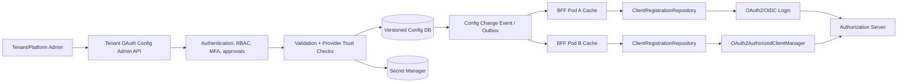
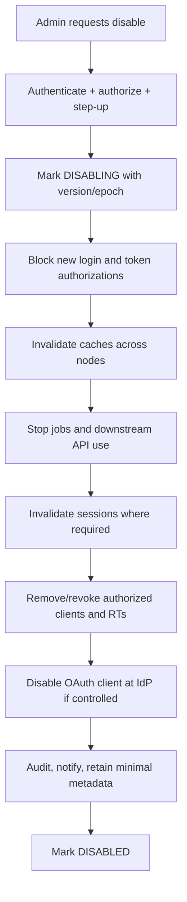

# 26.9. Registering, Updating, and Disabling Client Configurations per Tenant

## 1. Problem: Each Tenant Has Its Own OAuth2/OIDC Client Configuration

In a **Spring Security OAuth 2.0/OIDC Client** SaaS platform, multiple organizations share the same application, yet each organization may use a different Identity Provider (IdP) or a separate set of OAuth2 client credentials.

For example:

```text
                     SaaS Portal / Spring Boot
                               |
                +--------------+--------------+
                |              |              |
                v              v              v
           Tenant Alpha   Tenant Beta    Tenant Gamma
                |              |              |
        Corporate OIDC    Azure-like OIDC  External OAuth2
        client_id=A       client_id=B      client_id=C
        issuer=A          issuer=B         auth/token URLs=C
                |              |              |
                +--------------+--------------+
                               |
                   ClientRegistrationRepository
                   looks up registration by tenant
```

For multi-tenant enterprises, simply declaring all OAuth2 clients in one `application.yml` file can be insufficient:

- New tenants need **onboarding** without redeploying the entire system.
- Tenant administrators need to update `client_id`, client authentication method, scopes, or redirect URIs through a moderated workflow.
- Expiring client secrets require **rotation** without breaking in-progress logins.
- A tenant that is locked, leaves the platform, or violates policy needs its OAuth2 client configuration **disabled**.
- The platform runs on multiple pods: all instances must observe consistent configuration versions.
- Provider configurations may be updated or deleted while old OAuth2 Login callbacks, sessions, authorized clients, and refresh tokens still exist.

This lesson explains how to manage the **per-tenant OAuth2/OIDC Client configuration lifecycle**, not just how to read YAML.

> **Key principle:** `ClientRegistration` is the technical configuration for executing an OAuth2 flow; **whether a tenant is permitted to log in or use tokens is an additional application security decision**. Removing a registration from cache does not automatically revoke tokens, log out sessions, or disable the OAuth client at the Authorization Server.

### Objectives

After this lesson, you will be able to:

1. Distinguish tenant, provider, issuer, client registration, and authorized client.
2. Construct collision-free `registrationId` keys across tenants.
3. Design a controlled `DRAFT → VALIDATING → ACTIVE → SUSPENDED/DISABLED` lifecycle model.
4. Register new tenant configurations via a database/secret manager and dynamic repository.
5. Customize `ClientRegistrationRepository` or `ReactiveClientRegistrationRepository`.
6. Validate issuer discovery, authorization/token/JWKS endpoints, redirect URIs, scopes, and TLS.
7. Update configurations with versioning and handle in-flight OAuth2 logins.
8. Rotate client secrets/certificates/JWKs without unintentionally wiping out all sessions.
9. Disable a tenant or a registration with policy-driven impact on logins, refreshes, and API calls.
10. Design cache invalidation, multi-node consistency, transactions, and rollbacks.
11. Protect the system against SSRF, IdP mix-ups, tenant confusion, and token leakage.
12. Integrate Spring Security OAuth2 Login/OIDC and the authorized client manager.
13. Handle downstream effects on `OAuth2AuthorizedClientRepository`/`Service`, token rotation, and logout.
14. Test happy paths, errors, administrative races, and operational scenarios.

Domains, tenant IDs, registration IDs, and credentials in this lesson are illustrative examples. Code samples focus on **Spring Security Servlet/MVC**; reactive counterparts are covered afterward. Custom interfaces are clearly marked as application-implemented.

---

## 2. Distinguishing Multi-Tenancy Concepts

| Concept | Example | Meaning |
|---|---|---|
| Tenant | `tenant-alpha` | Organization/data partition authorized by the application |
| Provider | `corporate-oidc` | An OAuth2 or OpenID Connect provider |
| Issuer | `https://id.alpha.example/realms/workforce` | Namespace and token/metadata issuing authority of the AS/OP |
| Client registration ID | `t_alpha__workforce` | Spring Security's internal configuration lookup key |
| Client ID | `portal-app-alpha` | ID issued by the Authorization Server to the OAuth client |
| Client secret/key | Secret in vault | Credential used to authenticate the OAuth2 client when required |
| `OAuth2AuthorizedClient` | Registration + principal + access/refresh token | Issued token record, not the underlying config |
| `SecurityContext` | Current user's `Authentication` | Identity/authorities attached to session/request |
| Resource Server | `orders-api` | API validating access tokens and access permissions |
| Tenant policy | `LOGIN_ENABLED`, `API_ALLOWED`... | Determines which tenant capabilities are permitted to run |

### 2.1. `registrationId` Is Not `clientId`

For example:

```text
registrationId = t_alpha__workforce
clientId        = portal-app-prod
issuer          = https://id.alpha.example
```

`registrationId` is chosen by the **Spring application** to look up the right `ClientRegistration`; `clientId` is the identifier issued/registered by the AS.

Two tenants can share the same provider host with **different client IDs**, or have the same client ID in different AS realms. Never treat `clientId` as the sole tenant key.

### 2.2. Client Config Differs from Token Records

`ClientRegistration` describes:

```text
clientId, clientSecret, grantType, redirectUri,
authorizationUri, tokenUri, jwkSetUri,
issuerUri, scopes, clientAuthenticationMethod...
```

`OAuth2AuthorizedClient` holds:

```text
clientRegistration + principalName +
accessToken + refreshToken (if present)
```

Updating `ClientRegistration` in the DB does not mean every old `OAuth2AuthorizedClient` is automatically deleted or updated.

### 2.3. One Tenant Can Have Multiple Registrations

For example:

```text
tenant-alpha:
  workforce-login    -> authorization_code / OIDC
  reporting-service  -> client_credentials
  inventory-exchange -> token-exchange, if supported by AS
```

Disabling `workforce-login` does not necessarily disable `reporting-service`. You must decide explicitly between **disabling the entire tenant** vs. **disabling a specific registration**.

---

## 3. How Do Static YAML and Dynamic Registration Differ?

### 3.1. Familiar Static Configuration

```yaml
spring:
  security:
    oauth2:
      client:
        registration:
          alpha-workforce:
            provider: alpha-idp
            client-id: ${ALPHA_CLIENT_ID}
            client-secret: ${ALPHA_CLIENT_SECRET}
            authorization-grant-type: authorization_code
            redirect-uri: "{baseUrl}/login/oauth2/code/{registrationId}"
            scope:
              - openid
              - profile
        provider:
          alpha-idp:
            issuer-uri: https://id.alpha.example
```

Spring Boot binds the properties to `ClientRegistration` and registers a default `ClientRegistrationRepository`, typically `InMemoryClientRegistrationRepository`.

This works well for a small number of tenants with stable configs managed via infrastructure-as-code.

### 3.2. Runtime Onboarding Requirements

When a new tenant is created after the server is already running:

```text
Admin:
  POST /admin/tenants/t-beta/oauth-clients

Application:
  validate -> persist -> activate -> invalidate cache

Spring Security:
  findByRegistrationId("t_beta__workforce")
  -> returns new ClientRegistration without redeploy
```

This requires a **dynamic repository implementation**, not just editing properties in a YAML file.

### 3.3. `InMemoryClientRegistrationRepository` Is Not a CRUD Admin API

Spring Security provides a simple implementation to keep registrations in memory. It does not provide a tenant configuration CRUD contract, approval workflow, secret rotation, or multi-node propagation.

Servlet's `ClientRegistrationRepository` basically has only:

```java
ClientRegistration findByRegistrationId(String registrationId);
```

To create/edit/lock tenant clients, the **application** must build an administrative service/store and implement a repository backed by that store.

### 3.4. "Client Registration" Has Two Meanings

1. **Registering config in the SaaS application**: saving a `ClientRegistration` so Spring Security knows how to talk to an already-registered AS.
2. **Registering an OAuth2 client at the Authorization Server**: the AS creates `client_id`, secret, redirect URIs, and grant permissions—via console/API or a protocol like **RFC 7591 Dynamic Client Registration** if supported by the AS.

These are **two separate steps**. Inserting a row into the SaaS database **does not automatically create an OAuth2 client at the IdP**.

---

## 4. Per-Tenant Configuration Lifecycle Architecture



**Responsibilities to separate:**

- **Admin API**: admin authentication, authorization, CSRF if cookie-based, change auditing.
- **Validation service**: parses config/metadata and enforces provider allowlists.
- **Secrets vault**: stores client secrets/private keys; never keep plaintext in audit tables.
- **Configuration store**: holds tenant, registration, status, version, and metadata.
- **Runtime repository**: returns only registrations **permitted for use** in the right tenant context.
- **Cache + invalidation**: updates all nodes by version.
- **Session/token policy service**: decides the impact of updates/disablement on existing login sessions and authorized clients.

Do not lump everything into a mutable static map modified directly by web requests.

## 5. Recommended Lifecycle States

An application state machine might be:

```mermaid
stateDiagram-v2
    [*] --> DRAFT
    DRAFT --> VALIDATING: Submit
    VALIDATING --> ACTIVE: Approved and verified
    VALIDATING --> REJECTED: Validation failed
    REJECTED --> DRAFT: Edit
    ACTIVE --> UPDATING: Proposed new version
    UPDATING --> ACTIVE: Publish new version
    UPDATING --> ACTIVE: Reject update; keep old version
    ACTIVE --> SUSPENDED: Temporarily block usage
    SUSPENDED --> ACTIVE: Explicit re-enable
    ACTIVE --> DISABLED: Decommission
    SUSPENDED --> DISABLED: Decommission
    DISABLED --> [*]: Retention/archive policy
```



This is an **application-specific model**; Spring Security does not supply these enums or schema out of the box.

| State | Meaning | Recommended runtime policy |
|---|---|---|
| `DRAFT` | Not yet validated/approved | Do not use for login/token calls |
| `VALIDATING` | Configuration verification in progress | Do not use |
| `REJECTED` | Failed validation | Do not use |
| `ACTIVE` | Permitted for execution | Repository returns config; policy continues checking |
| `UPDATING` | New version under verification | **Old `ACTIVE` version** continues per policy |
| `SUSPENDED` | Temporarily locked | Block login/authorize/API usage per security requirements |
| `DISABLED` | Registration retired | Block new usage; clean up tokens/sessions per policy |
| `ARCHIVED` | Audit data retained post-decommission | Disallowed at runtime |

### 5.1. Why Should `UPDATING` Not Replace Live Config Immediately?

An admin might have just edited the issuer URI or secret; if runtime immediately switches to the new config before validation completes, it could break all tenants or send credentials to an untrusted endpoint.

Prefer:

```text
ACTIVE v12 -> all requests use v12

Candidate v13:
    validate -> approve -> publish atomically

ACTIVE v13 -> new requests receive v13
```

### 5.2. "Suspended" Differs from "Disabled"

`SUSPENDED` may permit quick restoration while preserving audits/configuration. `DISABLED` usually denotes decommissioning and may trigger removal/revocation.

Exact effects must be documented in policy; never rely on the state name alone to assume tokens have been revoked.

---

## 6. Identifying the Tenant Before Selecting Registration

A major SaaS risk is **tenant confusion**: a request for tenant A causes the backend to pick client B's configuration.

### 6.1. Sources of Tenant Context

Some architectures resolve the tenant from:

- Platform-managed subdomains, e.g., `alpha.portal.example`.
- Fixed path segments, e.g., `/t/alpha/...`.
- Backend-authenticated tenant membership.
- Session selection after permission verification.
- Verified invitation codes/organization identifiers.

**Never trust an arbitrary header/query**, such as:

```http
X-Tenant-Id: tenant-beta
```

if the backend has not verified permission to access that tenant.

### 6.2. Pre-Principal Login Flow

Before OAuth2 Login, the user has no authentication yet. Therefore, the tenant selected to initiate login must come from a policy-trusted source:

```text
https://alpha.portal.example
    -> platform-managed hostname maps to tenant-alpha
    -> tenant-alpha permits workforce login
```

Lacking a local authenticated principal does not mean any arbitrary provider may be selected.

### 6.3. `Host` Headers Can Be Spoofed

If the app relies on `Host` or `X-Forwarded-Host`, verify the request came through a trusted reverse proxy and the host is in a managed allowlist.

Never use a raw public `Host` header to build redirect URIs, run issuer discovery, or pick a tenant with privileged credentials without verification.

### 6.4. Registration ID Needs a Global Namespace

Spring Security typically handles routes:

```text
/oauth2/authorization/{registrationId}
```

and callbacks:

```text
/login/oauth2/code/{registrationId}
```

A `registrationId` like `"google"` cannot distinguish:

```text
tenant-alpha/google
tenant-beta/google
```

**A more controllable design:**

```text
registrationId = opaqueTenantKey + "__" + providerAlias
```

For example:

```text
t_3f9a__workforce
t_a71d__workforce
```

Never use an email or mutable tenant name as the sole part of the ID. Validate regex, length, and avoid path injection, percent-encoding surprises, and reserved characters.

### 6.5. Versions Should Live in the DB, Not Necessarily in `registrationId`

For example:

```text
registrationId = t_3f9a__workforce
activeVersion  = 12
```

After update:

```text
registrationId = t_3f9a__workforce
activeVersion  = 13
```

A stable registration ID simplifies routing and token lookups. However, a new version might change `client_id`/issuer significantly; a migration/token policy is needed rather than merely bumping a version pointer.

If multiple client IDs must coexist during cutover, you can use **versioned registration IDs** under an explicit plan with post-cutover cleanup; this is an architectural trade-off.

---

## 7. Illustrative Database Model

An SQL schema to manage per-tenant configuration:

```sql
CREATE TABLE tenant (
    id UUID PRIMARY KEY,
    slug VARCHAR(100) NOT NULL UNIQUE,
    status VARCHAR(24) NOT NULL,
    created_at TIMESTAMP WITH TIME ZONE NOT NULL
);

CREATE TABLE tenant_oauth_client (
    id UUID PRIMARY KEY,
    tenant_id UUID NOT NULL REFERENCES tenant(id),
    registration_id VARCHAR(160) NOT NULL UNIQUE,
    provider_alias VARCHAR(100) NOT NULL,
    active_version BIGINT,
    lifecycle_status VARCHAR(24) NOT NULL,
    updated_at TIMESTAMP WITH TIME ZONE NOT NULL,
    updated_by VARCHAR(200),
    CONSTRAINT uq_tenant_provider UNIQUE (tenant_id, provider_alias)
);

CREATE TABLE tenant_oauth_client_version (
    client_id UUID NOT NULL REFERENCES tenant_oauth_client(id),
    version BIGINT NOT NULL,
    issuer_uri VARCHAR(1024),
    authorization_uri VARCHAR(1024),
    token_uri VARCHAR(1024) NOT NULL,
    jwk_set_uri VARCHAR(1024),
    user_info_uri VARCHAR(1024),
    oauth_client_id VARCHAR(512) NOT NULL,
    secret_ref VARCHAR(512),
    auth_method VARCHAR(100) NOT NULL,
    grant_type VARCHAR(160) NOT NULL,
    redirect_uri_template VARCHAR(1024) NOT NULL,
    scopes_json TEXT NOT NULL,
    created_at TIMESTAMP WITH TIME ZONE NOT NULL,
    validated_at TIMESTAMP WITH TIME ZONE,
    validation_status VARCHAR(24) NOT NULL,
    PRIMARY KEY (client_id, version)
);
```

This is not a default Spring Security schema. Columns are illustrative to express the architecture.

### 7.1. Why Two Tables?

`tenant_oauth_client` holds the **stable identity** and points to `active_version`.

`tenant_oauth_client_version` holds an **immutable snapshot** for each proposed/approved version. This model supports:

- Diffing changes.
- Auditing.
- Atomic active version switching.
- Controlled rollbacks.
- Investigating errors from requests running on older versions.
- Tracking validation status.

### 7.2. Never Store Raw Client Secrets in Ordinary Tables

Store:

```text
secret_ref = vault://oauth/tenant-alpha/workforce/v13
```

and fetch the secret only when building a runtime `ClientRegistration`, scoped to the application's privileges.

Secret references should also not be exposed in public APIs or logs; vault paths can reveal internal metadata.

### 7.3. Unique Constraints

Tables should prevent:

- Two registrations sharing the same `registrationId`.
- Two records sharing `(tenant_id, provider_alias)` if business rules allow only one.
- Overwriting the same `(client_id, version)`.

If a tenant may have multiple registrations to the same provider, adjust unique constraints per business rule and use a dedicated stable client config ID.

### 7.4. Optimistic Version Updates

When two admins edit concurrently:

```text
Admin A reads active_version=12
Admin B reads active_version=12

Admin A publishes v13
Admin B publishes v14 based on v12
```

B should receive a conflict or rebase, never silently overwriting A.

Use:

```sql
UPDATE tenant_oauth_client
SET active_version = :new_version,
    updated_at = CURRENT_TIMESTAMP
WHERE id = :id
  AND active_version = :expected_old_version
  AND lifecycle_status = 'ACTIVE';
```

If `rows_updated=0`, raise a **version conflict**. This is DB-level CAS, distinct from refresh token rotation.

---

## 8. Workflow for Creating a New Registration

### 8.1. Onboarding Steps

1. **Authenticate admin** and verify tenant management permissions.
2. Accept configuration input using **allowlisted fields**, never an arbitrary serialized `ClientRegistration` object.
3. Create a `DRAFT` record.
4. Store the client secret/private key securely in the vault.
5. Validate tenant, redirect URI, provider discovery/metadata, grant, scopes, and authentication method.
6. Optionally test connectivity with credential-safe checks; do not require issuing real user tokens just to validate syntax.
7. Require approval/step-up per policy.
8. Publish the approved version in `ACTIVE` status transactionally.
9. Emit configuration event after commit.
10. Pods fetch/adopt the new version.
11. Run test login or service token check with test accounts/permissions.
12. Record audit logs and notify the tenant administrator.

### 8.2. Illustrative Admin API

```http
POST /admin/tenants/t-3f9a/oauth-clients HTTP/1.1
Content-Type: application/json
Cookie: SESSION=...
X-CSRF-TOKEN: ...

{
  "providerAlias": "workforce",
  "issuerUri": "https://id.alpha.example",
  "clientId": "portal-alpha",
  "clientAuthenticationMethod": "client_secret_basic",
  "grantType": "authorization_code",
  "redirectUriTemplate": "{baseUrl}/login/oauth2/code/{registrationId}",
  "scopes": ["openid", "profile", "email"]
}
```

**Never return secrets in JSON responses.** When secrets are submitted, use a secure one-time submission path or vaulted credential reference; never persist plaintext in request logs, APM, or audits.

### 8.3. API Result

```json
{
  "registrationId": "t_3f9a__workforce",
  "status": "VALIDATING",
  "candidateVersion": 1
}
```

An asynchronous validation workflow may run in the application, but only a privileged control-plane worker should be permitted to publish. Never let any tenant admin switch an issuer to an arbitrary host without policy enforcement.

---

## 9. Validating Configuration Before Activation

### 9.1. Internal Validation

Check:

- `tenantId` exists and is eligible for onboarding.
- `registrationId` is unique and properly formatted.
- `grantType` is within the set supported by the application.
- Client auth method is registered with the STS/IdP.
- `clientId` satisfies format/length rules.
- Scopes do not exceed organization/tenant policy.
- Redirect URI belongs to a platform-registered host/route.
- Secret/key reference exists and is accessible.
- Issuer/provider is in the allowlist/trust configuration.
- Token/JWKS/UserInfo endpoints use HTTPS per deployment security policy.

### 9.2. Validating the Issuer

With OIDC:

```text
issuer_uri = https://id.alpha.example
```

After OIDC discovery, the `issuer` field in provider metadata must **match the expected issuer exactly** per protocol. Never accept a discovered issuer merely because the hostname looks similar.

Verify authorization endpoint, token endpoint, JWK Set URI, and supported client authentication/grants against the provider's published capabilities.

### 9.3. Validating Redirect URIs

Redirect URIs must never be an arbitrary URL entered by a tenant admin:

```text
https://attacker.example/receive-code
```

Policy may permit verified tenant-dedicated hosts, but must:

- Allow only permitted schemes and hosts.
- Control reverse proxy/forwarded headers.
- Register redirect URIs at the AS.
- Prevent open redirects.
- Forbid unsafe wildcard subdomains.
- Keep callback routes consistent with Spring Security.

### 9.4. Validating Scopes and Audience

OIDC Login uses the `openid` scope, while downstream APIs require access tokens with matching audiences/scopes. Never allow tenant admins to add privileged scopes rejected by business policy.

### 9.5. Validating Metadata by Application Rules, Not Just HTTP 200

A metadata endpoint returning 200 does not prove the server is trustworthy. Verify:

- Issuer is allowlisted/pinned.
- TLS certificate/hostname.
- Metadata field types.
- JWK URI meets trust policy.
- Token endpoint is approved.
- Redirects cannot lead to private/loopback/metadata service addresses.
- IdP capabilities match registration settings.

---

## 10. SSRF and Risks of Automatic Discovery

A dangerous feature pattern:

```text
Tenant admin submits arbitrary issuerUri
    |
    v
ClientRegistrations.fromIssuerLocation(issuerUri)
    |
    v
Application automatically makes HTTP connection to supplied URL
```

Because discovery performs **network I/O**, querying unverified addresses creates SSRF.

### 10.1. Risks

- Accessing cloud instance metadata like `169.254.169.254`.
- Reaching localhost/admin interfaces.
- DNS rebinding.
- Following redirects to private IPs.
- Configuring `tokenUri` to point at an attacker host.
- Sending client secrets to an untrusted IdP/token endpoint.
- Server-side port scanning via validation calls.

### 10.2. Mitigations

- Allow only onboarded/approved issuers.
- Validate scheme/host/port and require HTTPS.
- Resolve DNS and inspect destination IPs at the network/HTTP client layer.
- Block private/loopback/link-local ranges unless explicitly permitted.
- Restrict redirects.
- Use an egress proxy/allowlist for metadata/TLS.
- Enforce timeouts and response size limits.
- Never send client secrets while probing an unapproved issuer.
- Require separate approval for new IdPs outside the allowlist.
- Monitor DNS/metadata changes per policy.

### 10.3. `ClientRegistrations` Is a Convenience API, Not a Trust Boundary

Spring Security offers:

```java
ClientRegistrations.fromIssuerLocation(issuerUri)
```

to construct a builder from provider metadata. This avoids manually typing endpoint URIs, yet **does not guarantee the issuer URI is trustworthy or that network requests cannot cause SSRF**.

If the platform already stores validated, versioned metadata, build `ClientRegistration` from the approved snapshot to avoid relying on network discovery on every login.

---

## 11. Dynamic `ClientRegistrationRepository` in Servlet

Spring Security interface:

```java
package org.springframework.security.oauth2.client.registration;

public interface ClientRegistrationRepository {
    ClientRegistration findByRegistrationId(String registrationId);
}
```

`findByRegistrationId` returns `ClientRegistration` if found, otherwise `null`.

It can be backed by an application-written **versioned tenant configuration service**.

### 11.1. Interface Architecture

```java
// Application-specific interface, NOT a Spring Security API.
public interface TenantClientRegistrationCatalog {
    Optional<ClientRegistration> findActiveByRegistrationId(
        String registrationId
    );
}
```

Runtime repository:

```java
import org.springframework.security.oauth2.client.registration.ClientRegistration;
import org.springframework.security.oauth2.client.registration.ClientRegistrationRepository;

public final class TenantAwareClientRegistrationRepository
        implements ClientRegistrationRepository {

    private final TenantClientRegistrationCatalog catalog;

    public TenantAwareClientRegistrationRepository(
            TenantClientRegistrationCatalog catalog) {
        this.catalog = catalog;
    }

    @Override
    public ClientRegistration findByRegistrationId(String registrationId) {
        return catalog.findActiveByRegistrationId(registrationId)
            .orElse(null);
    }
}
```

`TenantClientRegistrationCatalog` is an application abstraction to implement:

```text
registrationId
    -> validate canonical format
    -> read active metadata/version from cache/DB
    -> confirm tenant/registration status ACTIVE
    -> resolve client secret from vault
    -> construct immutable ClientRegistration
    -> return snapshot
```

### 11.2. Bean Registration

```java
import org.springframework.context.annotation.Bean;
import org.springframework.context.annotation.Configuration;
import org.springframework.security.oauth2.client.registration.ClientRegistrationRepository;

@Configuration
public class DynamicTenantClientConfig {

    @Bean
    ClientRegistrationRepository clientRegistrationRepository(
            TenantClientRegistrationCatalog catalog) {

        return new TenantAwareClientRegistrationRepository(catalog);
    }
}
```

This **replaces** the auto-configured default repository bean in standard application setups.

If the project also defines static registrations in `application.yml`, **do not assume** Spring Boot merges them into your custom repository automatically. An explicit composite/chain is required to support both static system registrations and dynamic tenant registrations.

### 11.3. Why Should `registrationId` Carry the Tenant Namespace?

On OAuth2 callbacks, Spring Security knows `registrationId` from the authorization request/redirect. If the repository relies solely on a `ThreadLocal` `TenantContext` inferred from the current request's host, callbacks can lack the right tenant context—especially with a shared callback host.

With a globally unique registration ID:

```text
t_3f9a__workforce
```

the repository resolves from server-side mapping without trusting any arbitrary tenant header.

**Even so, tenant binding must still be validated**: a callback with a valid registration ID does not prove the request belongs to the right tenant/session/user. Spring Security `state` and business tenant checks remain necessary.

### 11.4. Repository Lookup Does Not Equal Tenant Authorization

An internal service might query:

```java
repo.findByRegistrationId("t_beta__workforce")
```

and find Beta's configuration in the backend. That does not permit an Alpha user to run OAuth2 logins or API calls as Beta.

Tenant-specific login initiation needs a **resolver/policy** verifying host/path/session/tenant membership before accepting a registration ID.

---

## 12. Building `ClientRegistration` from Verified Metadata

Example building an OIDC registration from approved metadata:

```java
import org.springframework.security.oauth2.client.registration.ClientRegistration;
import org.springframework.security.oauth2.client.registration.ClientRegistrations;

public ClientRegistration buildRegistration(
        ValidatedTenantOAuthConfig cfg,
        String decryptedSecret) {

    return ClientRegistrations
        .fromIssuerLocation(cfg.issuerUri())
        .registrationId(cfg.registrationId())
        .clientId(cfg.oauthClientId())
        .clientSecret(decryptedSecret)
        .redirectUri(cfg.redirectUriTemplate())
        .scope(cfg.scopes().toArray(String[]::new))
        .build();
}
```

`ValidatedTenantOAuthConfig` is an application-defined **custom record/type**. `fromIssuerLocation` executes discovery when invoked, not just reading cached metadata.

**Important:** this snippet should only run when `cfg.issuerUri()` is already allowlisted and HTTP egress enforces SSRF protections. If the app stores validated metadata snapshots, construct `ClientRegistration` from approved fields without performing discovery on the hot path.

### 12.1. Never Run Discovery on Every Request

If every `findByRegistrationId` call executes OIDC discovery, one login can trigger multiple HTTP calls to the IdP, increasing latency and creating DoS exposure or coupling logins to metadata endpoint outages.

Prefer caching immutable `ClientRegistration` snapshots by:

```text
(registrationId, activeVersion)
```

with invalidation via events/TTL/fencing.

### 12.2. `ClientRegistration` Has No `enabled` Flag

Spring's `ClientRegistration` has no built-in field for per-tenant business states like `ACTIVE`/`DISABLED`.

Do not try serializing `enabled=true` into the Spring type and expecting the filter chain to block flows automatically. Runtime repositories and policy enforcement must handle status explicitly.

### 12.3. Never Mutate Client Secret on an Active Object

`ClientRegistration` is built via a builder with fixed config. For rotation/updates, construct a **new snapshot** instead of mutating fields on a shared global object while requests are running.

---

## 13. Enabling OAuth2 Login with a Dynamic Repository

Spring MVC/Servlet example:

```java
import org.springframework.context.annotation.Bean;
import org.springframework.context.annotation.Configuration;
import org.springframework.security.config.Customizer;
import org.springframework.security.config.annotation.web.builders.HttpSecurity;
import org.springframework.security.web.SecurityFilterChain;

@Configuration
public class OAuth2SecurityConfiguration {

    @Bean
    SecurityFilterChain securityFilterChain(HttpSecurity http)
            throws Exception {

        http
            .authorizeHttpRequests(authorize -> authorize
                .requestMatchers("/", "/login", "/assets/**").permitAll()
                .anyRequest().authenticated()
            )
            .oauth2Login(Customizer.withDefaults())
            .oauth2Client(Customizer.withDefaults());

        return http.build();
    }
}
```

When the container has a custom `ClientRegistrationRepository` bean, OAuth2 Login resolves registrations dynamically through that repository.

However, this is only **framework wiring**. In a SaaS, you must add:

- Tenant-aware login initiation.
- Registration allowlists.
- Session/state/PKCE handling.
- Host/redirect URI validation.
- Callback tenant binding.
- Disabled-tenant enforcement.
- Failure handling and auditing.

### 13.1. Per-Tenant Login Links

You can display:

```text
Alpha login page:
    /oauth2/authorization/t_3f9a__workforce

Beta login page:
    /oauth2/authorization/t_a71d__workforce
```

However, if all URLs are public and the repo returns both Alpha and Beta, an attacker can try starting Beta login from the Alpha host. OAuth2 login initiation needs a security policy confirming the **registration ID is allowed for the tenant context**.

### 13.2. `Iterable<ClientRegistration>` and the Default Login Page

Spring Security's login page generator lists registrations when the repository implements `Iterable<ClientRegistration>`.

A dynamic repository implementing only `ClientRegistrationRepository` may **not automatically render links** on the generated default login page.

For SaaS, a **custom tenant login page** listing only providers allowed for the host/tenant is usually better than enumerating all enterprise registrations.

Avoid implementing `Iterable` returning all tenant registrations if the login page could expose tenant/IdP metadata unrelated to the current user.

### 13.3. Custom `AuthorizationRequestResolver`

Spring Security provides:

```java
DefaultOAuth2AuthorizationRequestResolver
```

You can wrap the resolver to check the registration before issuing the authorization redirect:

```text
Inbound /oauth2/authorization/{registrationId}
    |
    +-- Resolve tenant from trusted host/path
    +-- Verify registration belongs to tenant
    +-- Check tenant+registration ACTIVE
    +-- Delegate to Spring OAuth2AuthorizationRequestResolver
    +-- Bind tenant/version metadata into server-side intent
```

Never create a static OAuth2 `state` or disable PKCE just to pass tenant context through the redirect.

### 13.4. Callback Must Re-Verify

Even if initiation was valid at T0, the registration might be disabled before the callback arrives at T1. Policy must decide:

```text
T0: Alpha login started with registration v12
T1: Security admin disables Alpha
T2: Callback arrives with code/state
```

For **emergency disablement**, reject the callback even if `state` is valid—do not rely solely on the T0 check.

---

## 14. Pending Authorization Requests and Config Versions

In the Authorization Code Flow, the browser may spend several minutes at the IdP before returning to the callback.

```text
T0: App builds authorize URL using config v12
T1: Admin updates config -> v13
T2: IdP callback returns authorization code
T3: App calls Token Endpoint
```

If v13 changed:

- `client_id`.
- `client_secret`.
- Redirect URI.
- Token Endpoint.
- Issuer.

then Token Exchange at T3 using v13 may **mismatch** the authorization request from T0.

### 14.1. Risks of Hot-Swapping

For example:

```text
Authorize:
    client_id = client-A
    redirect_uri = https://portal.example/login/oauth2/code/t_3f9a__workforce

Token request:
    client_id = client-B
```

The authorization code was issued to `client-A`, so exchanging it as `client-B` typically fails.

### 14.2. Policies for In-Flight Callbacks

Options include:

1. **Grace period/drain:** retain v12 config and v12 client credentials long enough for pending callbacks, then switch to v13.
2. **Version-pinned requests:** save a version/snapshot reference in the trusted authorization request context and use that version on callback if supported by a custom pipeline.
3. **Reject and restart login:** reject callbacks started before cutover and prompt the user to log in again.
4. **Dual registrations:** use distinct registration IDs/version IDs during complex cutovers.

**Important:** default Spring OAuth2 Login wiring does not automatically pin `ClientRegistration` versions across custom dynamic updates. If version-pinning is required, design and test the callback/token-exchange integration explicitly rather than saving a version number in session and assuming the framework uses it.

### 14.3. Emergency Disablement Prioritizes Security Over UX

If a client secret is compromised or a tenant is locked in an emergency, do not keep allowing v12 callbacks merely to reduce login errors.

When needed, **fail closed**, revoke credentials at the AS, and require fresh logins with the new configuration.

---

## 15. Updating Configurations: Classifying by Impact Level

Not all updates carry identical risk.

| Changed field | Impact level | Typical effect |
|---|---|---|
| Display name/logo | Low | Login UI and audit metadata |
| Scopes | Medium–high | Authorization consent and downstream API permissions |
| Redirect URI | High | In-flight authorization callbacks |
| Client secret | High | Token Endpoint client authentication, refresh requests |
| Client ID | Very high | Changes OAuth2 client identity, code binding, and existing tokens |
| Client auth method | High | Basic/Post/`private_key_jwt`/mTLS compatibility |
| Issuer URI | **Very high** | Trust domain and OIDC subject namespace |
| Authorization URI | High | Redirect trust and IdP mix-up |
| Token URI | **Very high** | Risk of sending credentials and codes to wrong host |
| JWK Set URI | **Very high** | ID Token signature validation |
| UserInfo URI | High | Identity attributes and endpoint trust |
| Grant type | High | OAuth2 flow semantics and manager providers |
| Tenant routing/host | High | Callback domain, cookie/session binding |
| Disable/enable | Very high | Logins, refreshes, API access, sessions |

### 15.1. Changing Issuer Is Not a "Minor URL Tweak"

OIDC identity is typically keyed by:

```text
(issuer, subject)
```

If the issuer changes, the identity pair changes even if `sub` happens to match. Never automatically merge accounts from the new issuer into the old one.

You may need a migration/federation plan and explicit verified identity linking, not just a record update.

### 15.2. Expanding Scopes May Require Fresh User Consent

If an admin adds `calendar.write`, existing access/refresh tokens do not automatically gain the new scope.

Evaluate user reauthorization and provider scope mappings rather than saving `scope` to the DB and assuming `OAuth2AuthorizedClient` is upgraded.

### 15.3. Changing Client Authentication Method

Switching from `client_secret_basic` to `private_key_jwt` or mTLS requires properly configured HTTP token response clients, key material, and IdP registration. Updating metadata alone is insufficient if the Spring client runtime does not yet support the new method in that version.

---

## 16. Rotating Client Secrets and Credentials

### 16.1. Safer Rotation Process

Workflow:

```text
Config v12:
    client_id = client-A
    secretRef = vault://alpha/old

Provider:
    create new client secret if AS supports concurrent secrets

Config v13:
    client_id = client-A
    secretRef = vault://alpha/new

Publish v13
    |
    +-- New auth/token requests use new secret
    +-- Old in-flight flows follow grace policy
    +-- Verify refresh and client_credentials calls

Provider:
    revoke old secret when safe

Vault:
    retire old secret per retention policy
```

### 16.2. Does the Provider Support Multiple Active Secrets?

**Not every AS allows two secrets to be valid simultaneously.** Some providers invalidate the old secret immediately upon rotation.

In that case, prepare:

- A maintenance/retry window.
- Fail-closed behavior.
- Reauthorization UX.
- Rapid rollout to all pods.
- `invalid_client` monitoring.
- Whether rollback is feasible (if the old secret was revoked, rollback cannot reuse it).

### 16.3. Private Key JWT / mTLS

For `private_key_jwt`, rotate private keys/JWK references, JWK IDs, and AS trusted keys. For mTLS, rotate client certificates/trust chains; lifetimes and key rollover may differ from secret rotation.

Never store private keys in plaintext `ClientRegistration` JSON or logs. Use a key vault/HSM or equivalent policy.

### 16.4. Secrets vs. Authorized Clients

Rotating a client secret can cause **refresh token grants** to fail if client authentication isn't updated, yet it does not necessarily invalidate all existing access tokens.

Conversely, some ASs revoke all client tokens when client registration changes. Check the provider's lifecycle contract.

---

## 17. Caching Immutable Registrations by Version

A dynamic runtime repository querying the DB/secret vault on **every login step** can be slow or overload dependencies. Use controlled caching:

```text
registrationId = t_3f9a__workforce
activeVersion  = 13

Cache key:
    (registrationId, activeVersion)

Cache value:
    immutable ClientRegistration snapshot
```

### 17.1. Why Cache by Version?

If an admin publishes v14, a v13 cache entry might still sit on another pod. The cache needs to know v13 is no longer the active version for **new requests**.

A design:

```text
Lookup registrationId
    -> read latest status/version from local policy snapshot
    -> if DISABLED: return null / deny
    -> if ACTIVE v14:
           cache.get(registrationId,v14)
           or load/build v14
```

### 17.2. Multi-Pod Invalidation

Options:

- DB change events + outbox + message bus.
- Redis pub/sub or event streams.
- Polling metadata versions at short intervals.
- TTL caches as a safety net.
- Version checks against the central store for sensitive operations.

**Never rely solely on best-effort events** if emergency disablement requires immediate effect. A pod that drops an event could continue using stale configuration.

### 17.3. TTL Does Not Replace an Emergency Deny Policy

If the cache TTL is 5 minutes and a tenant is locked due to an incident, a pod missing the event could keep allowing logins/refreshes for 5 minutes.

For strict requirements, enforce a **central denial/policy check** or cache invalidation with clear consistency guarantees, failing closed if the control plane cannot confirm status.

### 17.4. Do Not Cache Decrypted Secrets Indefinitely

Secrets may reside in memory while `ClientRegistration` is in use, but:

- Never write secrets to logs.
- Never serialize cached objects to untrusted endpoints.
- Never place secrets in metrics.
- Expire/purge old snapshots per cutover policy.
- Do not treat garbage collection as absolute memory erasure for secrets.
- Restrict which pods can read which secrets.

---

## 18. The Repository Must Distinguish `ACTIVE` and `DISABLED`

A conceptual implementation:

```java
public ClientRegistration findByRegistrationId(String registrationId) {
    ActiveRegistrationSnapshot snapshot =
        configService.findRuntimeSnapshot(registrationId);

    if (snapshot == null || !snapshot.isActive()) {
        return null;
    }

    return snapshot.clientRegistration();
}
```

**`ActiveRegistrationSnapshot` and `configService` are custom application abstractions.**

For a disabled registration, `ClientRegistrationRepository.findByRegistrationId` can return `null` to stop Spring Security from starting new flows for that registration.

However, returning `null` **does not automatically**:

- Expire already logged-in OAuth2 sessions.
- Revoke tokens accepted by Resource Servers.
- Delete authorized clients in the DB.
- Stop background jobs holding tokens from calling APIs.
- Halt in-flight callbacks if a snapshot is already in the pipeline.
- Stop a `WebClient` from sending a Bearer token afterward.

Thus, repository-only disablement is **insufficient** for a comprehensive deactivation policy.

### 18.1. Deny at Multiple Checkpoints

You may need to check tenant/registration status at:

1. Login initiation.
2. OAuth2 callback before establishing a local authenticated session.
3. Authorization manager/token acquisition.
4. Resource API gateway before using an authorized client.
5. Background jobs.
6. Sensitive endpoints when old sessions remain active.
7. Service token usage.
8. Admin re-enablement.

### 18.2. Choose Explicit Disable Modes

**Mode A — Block new logins:** prevents starting sign-in with that provider; existing sessions/API integrations may keep running per policy.

**Mode B — Block all token usage:** blocks refreshes, outbound API calls, and service jobs; may revoke/clean up authorized clients.

**Mode C — Lock the entire tenant:** blocks all login methods and business access for the tenant, depending on product needs.

DB states must express the mode and scope explicitly rather than leaving a boolean `enabled=false` open to team guesswork.

---

## 19. Disabling Config Locally Differs from Disabling Client at the Authorization Server

Suppose the platform sets:

```text
tenant_oauth_client.lifecycle_status = DISABLED
```

that only alters **SaaS internal configuration**. The OAuth2 client at the IdP may remain active:

```text
client_id = portal-alpha
secret = old-secret
refresh_token RT1 still valid at AS
```

For thorough lockouts, you may need to:

- Disable/delete the OAuth2 client at the IdP via its console/API.
- Revoke refresh tokens/authorizations per provider capabilities.
- Remove authorized clients from the SaaS store.
- Invalidate sessions per policy.
- Stop related scheduled jobs/webhooks.
- Remove credentials from the secret manager when no longer needed.
- Audit and notify the customer.

**RFC 7591 Dynamic Client Registration** and OAuth2 Token Revocation (RFC 7009) are relevant APIs when supported by the provider; do not assume every provider supports self-service register/delete/revoke.

---

## 20. Authorized Clients After Update/Disablement

An authorized client is stored by:

```text
(registrationId, principalName)
```

For example:

```text
registrationId = t_3f9a__workforce
principalName  = alice-901
accessToken    = AT1
refreshToken   = RT1
```

### 20.1. Updating Client Secret

After the secret changes, `AT1` may remain unexpired while refreshing `RT1` may fail if the provider stops accepting the old client authentication.

Some providers bind refresh tokens to client ID/credentials; verify actual behavior per deployment.

### 20.2. Updating Issuer/Client ID

This changes trust/client identity. Old tokens belong to the old issuer/client and **must never be automatically reused** with the new registration merely because `registrationId` stayed the same.

Define a migration:

```text
Old registration v12:
    issuer = A
    clientId = X

New registration v13:
    issuer = B
    clientId = Y
```

A safe approach is **invalidate/reconnect** authorized clients and review identity mappings rather than just editing a row.

### 20.3. Disabling Registration

`OAuth2AuthorizedClientService` may still contain old AT/RT records. If the application directly calls:

```java
authorizedClientService.loadAuthorizedClient(
    registrationId, principalName
);
```

and attaches a Bearer header, it could keep using the token even though the config repo returns `null`.

Enforce runtime tenant policy **before using tokens**, not just at login initiation.

### 20.4. Spring Session and Multiple Nodes

If a user logs in on pod A and an admin disables the tenant on pod B, the user's session may remain live in a shared session store.

The disable policy must affect **authenticated business requests**, not just update the login page. Use session invalidation, account disable checks, and short-lived authorization caches.

---

## 21. Refresh Token Rotation, Concurrency, and Disablement

Concurrent requests for the same tenant/authorized client may refresh at the same time:

```text
AT1 nearing expiry, RT1 available

Request A:
    refresh RT1 -> AT2 + RT2

Request B:
    refresh RT1 -> invalid_grant
```

If the AS uses refresh token rotation and replay detection, races can revoke the entire token family.

### 21.1. Dangerous Races During Disablement

```text
Thread A: checks tenant ACTIVE
Thread A: sends refresh request RT1

Admin:
    disables tenant
    removes authorized client

Thread A:
    receives AT2/RT2
    saves authorized client back to store
```

A late refresh response can **resurrect a token after disablement**.

### 21.2. Resolution Principles

- Enforce policy before authorization/refresh.
- Recheck tenant state/version before saving the new token.
- Use versioning/fencing or conditional writes to prevent stale operations from resurrecting records.
- Use distributed coordination when running multiple pods with strict rotation.
- Re-read the authorized client after acquiring the lock.
- Never let a stale refresh failure handler delete a newer token.
- Define explicit disable deadlines/consistency SLAs.
- In emergencies, revoke at the Authorization Server because local caches may lag.

### 21.3. Never Treat a Database Transaction as an HTTP Grant Lock

An ordinary JDBC transaction does not atomically span:

```text
load RT1 -> call remote AS -> save RT2
```

in multi-instance setups, especially with lock timeouts, network latency, and failures. Design token lifecycle concurrency separately.

---

## 22. Admin APIs: Authentication, Authorization, and Auditing

Admin endpoints managing OAuth2 config must be strictly protected:

```text
POST  /admin/tenants/{tenant}/oauth-clients
PATCH /admin/tenants/{tenant}/oauth-clients/{clientId}
POST  /admin/tenants/{tenant}/oauth-clients/{clientId}/validate
POST  /admin/tenants/{tenant}/oauth-clients/{clientId}/activate
POST  /admin/tenants/{tenant}/oauth-clients/{clientId}/suspend
POST  /admin/tenants/{tenant}/oauth-clients/{clientId}/disable
POST  /admin/tenants/{tenant}/oauth-clients/{clientId}/rotate-secret
```

### 22.1. Never Trust `tenantId` from the Path

An admin of tenant Alpha must never be able to change the URL to:

```text
/admin/tenants/t-beta/oauth-clients
```

and edit Beta.

Authorization must verify:

```text
authenticatedAdmin
    -> permitted to manage this tenant?
    -> permitted for this change type?
    -> requires step-up/approval?
```

### 22.2. CSRF Protection

If admin APIs use cookie sessions, state-changing operations require CSRF protection. OAuth2 login's `state` does not replace admin console CSRF tokens.

### 22.3. Separation of Duties: Creator vs. Approver

For enterprises, changing issuer/client secrets may require:

- Tenant admin proposes.
- Security/platform admin approves.
- Validation service runs with an egress allowlist.
- Atomic version publish.
- Immutable audit log.
- Controlled rollback.

### 22.4. Never Return Secrets to the Frontend

The Admin UI may receive status summaries:

```json
{
  "registrationId": "t_3f9a__workforce",
  "activeVersion": 13,
  "hasCredential": true,
  "status": "ACTIVE"
}
```

Never return:

```json
{
  "clientSecret": "...",
  "privateKey": "..."
}
```

Putting `clientSecret="********"` in DTOs invites mistakes; better to **omit the field entirely**, providing only `hasCredential` and rotate/update actions.

---

## 23. Versioned Updates and Transactional Publishing

A safe update workflow:

```text
1. Admin reads v12 with ETag/version.
2. Admin creates candidate v13 without modifying v12.
3. Validation service verifies metadata and policy.
4. Approval granted for v13.
5. Transaction:
       assert activeVersion == 12
       set activeVersion = 13
       write outbox event CONFIG_ACTIVATED(v13)
6. Commit.
7. Event consumers invalidate/reload caches.
8. New requests use v13 per policy.
9. Verify health and client login.
10. Decommission v12 after grace window or emergency cutoff.
```

### 23.1. Why Use an Outbox Event?

If the DB commits and the process crashes **before** sending the cache invalidation event, pods can remain on stale config.

A transactional outbox saves the change and event in the same transaction, then delivers the event reliably after commit.

### 23.2. Event Idempotency

Pods may receive duplicate or out-of-order events:

```text
CONFIG_ACTIVATED(v13)
CONFIG_ACTIVATED(v12)  // arrives late
```

Consumers must never regress active version back to v12 because of a delayed event. Only accept newer versions per control plane, or re-read active version from the DB.

### 23.3. Rollback Is Also a Publish

If v13 fails, rolling back to v12 must be recorded/audited and verified that v12 credentials remain valid. Never delete v13 without leaving an audit trail.

If issuer/client ID changed, rolling back can invalidate newly minted tokens. Plan migration/reconnection policies accordingly.

---

## 24. Tenant-Aware Routing and Callback Security

### 24.1. Initiation Must Select the Right Tenant

Flow:

```text
Browser at alpha.portal.example
    |
    v
Tenant resolver: tenant-alpha (trusted host mapping)
    |
    v
Allowed registration = t_3f9a__workforce
    |
    v
/oauth2/authorization/t_3f9a__workforce
```

Never let a request on Alpha proactively pick Beta's registration merely by knowing its ID.

### 24.2. Callback `registrationId` Alone Is Insufficient

A callback may arrive at a shared host:

```text
https://portal.example.com/login/oauth2/code/t_3f9a__workforce
```

Spring Security needs the `state` matching the authorization request; the app must also verify tenant/session binding and status.

### 24.3. `state`, PKCE, `nonce`

| Mechanism | Protects against / ensures |
|---|---|
| OAuth2 `state` | Correlates authorization response with request, prevents login CSRF |
| PKCE | Binds authorization code to verifier |
| OIDC `nonce` | Binds ID Token to login request |
| Tenant binding | Prevents cross-tenant callback/login mix-ups |
| Version binding | Identifies config used for an in-flight flow |
| Admin CSRF | Protects configuration modifications |
| Issuer validation | Prevents IdP mix-ups and tokens from untrusted issuers |

Never use a static `state` holding just the tenant ID, and never disable `state` validation for convenience in custom registration routing.

### 24.4. Never Derive Tenant Solely from Email Claim

Email domains can change or be unverified. Pre-login tenant selection needs its own policy; post-login tenant membership must be re-verified against internal accounts/trusted organization claims.

### 24.5. Multi-Issuer Identity Mapping

OIDC external identities should be keyed by:

```text
(verified iss, verified sub)
```

Never use bare `sub` or email to merge users across tenant IdPs.

If a tenant changes issuer URI, re-evaluate identity mappings as a trust-domain change rather than preserving mappings simply because `sub` matches.

---

## 25. Preventing Token Leakage via Registration Updates

Dangerous configuration:

```text
Tenant admin changes tokenUri:
    https://attacker.example/collect

Runtime:
    sends authorization code + client_secret
    to the new tokenUri
```

This is why **`tokenUri` must never be updated without approval**.

### 25.1. Sensitive Endpoints

- Authorization Endpoint: browser redirect target.
- Token Endpoint: receives authorization codes, refresh tokens, client credentials.
- JWKS URI: governs ID Token validation.
- UserInfo Endpoint: receives access tokens; redirecting to an attacker host leaks them.
- Revocation/Introspection endpoints if used.
- Redirect URI: receives authorization codes.

All must be validated against provider trust policy and versioned.

### 25.2. OIDC Metadata Can Change

Discovery metadata should be treated as input from a remote server trusted under an issuer, not content allowed to rewrite trust policies arbitrarily.

An issuer may be legitimate while updated metadata points `token_endpoint` to a different host; enforce allowed destinations, TLS, and metadata update controls—especially with self-hosted/enterprise IdPs.

### 25.3. Restrict Tenant Admin Privileges

A tenant admin may be allowed to configure their tenant's IdP **per policy**, yet must never be able to:

- Change another tenant's issuer.
- Overwrite the platform super-admin client's secret reference.
- Disable TLS verification.
- Allow private/loopback discovery hosts themselves.
- Grant arbitrary scopes/roles across all tenants.
- Disable the platform security chain.

Never equate "tenant admin" with "root operator of the identity platform".

---

## 26. Attaching Policy to `OAuth2AuthorizedClientManager`

An ordinary `OAuth2AuthorizedClientManager` handles:

```text
registration -> principal -> grant provider -> token
```

but does not automatically know about `tenant_oauth_client.lifecycle_status` in a custom DB.

### 26.1. Policy Gate Needed

Concept:

```java
public final class TenantAuthorizedClientGateway {

    private final TenantOAuthPolicy policy;
    private final OAuth2AuthorizedClientManager manager;

    public TenantAuthorizedClientGateway(
            TenantOAuthPolicy policy,
            OAuth2AuthorizedClientManager manager) {
        this.policy = policy;
        this.manager = manager;
    }

    public OAuth2AuthorizedClient authorize(
            String tenantId,
            String registrationId,
            Authentication principal) {

        policy.requireActiveForTokenUse(
            tenantId, registrationId, principal
        );

        OAuth2AuthorizeRequest request =
            OAuth2AuthorizeRequest
                .withClientRegistrationId(registrationId)
                .principal(principal)
                .build();

        OAuth2AuthorizedClient client =
            manager.authorize(request);

        policy.requireActiveForTokenUse(
            tenantId, registrationId, principal
        );

        return client;
    }
}
```

`TenantOAuthPolicy` is a **custom application service** that must check tenant membership, registration ownership, effective status, and disable mode; `Authentication` is imported from Spring Security.

### 26.2. Two Checks Do Not Provide Atomic Isolation

Between the second check and sending the HTTP request, an admin can still disable the tenant. In a distributed system, two synchronous checks cannot guarantee instantaneous cutoffs.

Systems requiring **emergency disablement** need revocation at the AS, central denial checks, transactional fencing, or short TTL policies matching the risk model.

### 26.3. Never Let Users Pick Arbitrary Registrations

Never write:

```java
String id = request.getParameter("registrationId");
manager.authorize(
    OAuth2AuthorizeRequest.withClientRegistrationId(id)
        .principal(authentication)
        .build()
);
```

without verifying `id` belongs to the right tenant/operation, as it could use another registration's token.

---

## 27. Background Jobs and Per-Tenant `client_credentials`

A service may run jobs:

```text
tenant-alpha/reporting-service
    -> client_credentials
    -> reporting API
```

Background jobs lack a Servlet request principal. Use the service-oriented manager:

```java
AuthorizedClientServiceOAuth2AuthorizedClientManager
```

with an appropriate `OAuth2AuthorizedClientService` and `ClientRegistrationRepository`.

### 27.1. Service Principal Names Must Be Namespaced by Tenant

For example:

```text
registrationId = t_3f9a__reporting
principalName  = svc:tenant-3f9a:reporting
```

Never share a single `system` `principalName` across all tenants if token storage lookups/policies could mix or be misused.

### 27.2. Disablement Must Stop Scheduled Work

A job executing after a tenant is disabled must not continue calling APIs simply because the token cache still holds an unexpired access token if policy requires a full lockout.

Check tenant status at scheduling/execution and before HTTP API calls, handling in-flight behavior and cleanup.

### 27.3. Background Manager Differs from Servlet Manager

Never retain an `HttpServletRequest` or a previous user's `SecurityContext` in background jobs. Use a stable service principal with the tenant's dedicated secret/key.

---

## 28. Disabling and Offboarding a Tenant

A decommissioning flow might include:



### 28.1. Why Have a `DISABLING` State?

Actions span DB updates, cache propagation, token revocation, session invalidation, and IdP admin APIs—which rarely fit in one atomic transaction.

The `DISABLING` state **blocks access immediately** while asynchronous cleanup runs. Only once cleanup finishes (or partial failures are handled) does it transition to `DISABLED`.

### 28.2. Partial Failure

For example:

```text
Local DB: DISABLING
Cache invalidation: success
Token revocation at IdP: HTTP 503
```

Never mark the whole workflow "revoked" when external APIs fail. Maintain retries/alerts and keep security state fail-closed.

### 28.3. Re-Enabling Is Not Just Flipping a Boolean

When re-enabling:

- Are credentials still valid?
- Did the provider issuer/metadata change?
- Is the Client ID still registered at the IdP?
- Are redirect URIs still allowlisted?
- Should old sessions/authorized clients be allowed to revive?
- Must users log in again?

**Never automatically restore revoked or deleted tokens** merely by flipping `DISABLED` back to `ACTIVE`.

### 28.4. Soft-Disable vs. Permanent Deletion

You may retain metadata/registration names for auditing and to prevent `registrationId` reuse by another tenant. Handle raw secrets and tokens per retention policy/applicable law.

---

## 29. Monitoring and Auditing

Events to track:

- `TENANT_CLIENT_CREATED`.
- `TENANT_CLIENT_VALIDATION_FAILED`.
- `TENANT_CLIENT_ACTIVATED`.
- `TENANT_CLIENT_UPDATED`.
- `TENANT_CLIENT_SECRET_ROTATED`.
- `TENANT_CLIENT_SUSPENDED`.
- `TENANT_CLIENT_DISABLED`.
- `TENANT_CLIENT_REENABLED`.
- Login started/failed by registration and tenant.
- OAuth2 callback `invalid_state`, issuer mismatch, unknown registration.
- Token Endpoint errors `invalid_client`, `invalid_grant`.
- Resource API 401/403 after rotation.
- Cache version mismatches.
- Config propagation lag across pods.
- Session/authorized-client cleanup failures.
- Revocation API failures.
- Concurrent publish/version conflicts.

### 29.1. Illustrative Audit Record

```json
{
  "event": "TENANT_CLIENT_ACTIVATED",
  "tenantRef": "tenant-3f9a",
  "registrationId": "t_3f9a__workforce",
  "oldVersion": 12,
  "newVersion": 13,
  "actorRef": "platform-admin-opaque-id",
  "approvalId": "approval-924",
  "result": "SUCCESS"
}
```

Never log:

```text
client_secret
private_key
client_assertion
access_token
refresh_token
id_token
authorization_code
code_verifier
Authorization header
```

### 29.2. Metric Cardinality

Tenant IDs can have very high cardinality. Bound metric labels, use sampling or aggregation; never put raw emails/subjects into metrics.

### 29.3. Alerts

Prioritize alerts when:

- Multiple tenants experience login failures after a rollout.
- `invalid_client` spikes after rotation.
- Unusual issuer/JWK mismatches occur.
- Cache lag leaves a disabled client active.
- Token revocation fails repeatedly.
- Client endpoints suddenly point to unapproved hosts.

---

## 30. Testing New Configuration Registration

### 30.1. Repository Unit Tests

A dynamic repository must satisfy:

| State | `findByRegistrationId` |
|---|---|
| `ACTIVE` with valid snapshot | Returns exact `ClientRegistration` |
| `DRAFT` | `null`/deny |
| `VALIDATING` | `null`/deny |
| `SUSPENDED` | `null`/deny per policy |
| `DISABLED` | `null`/deny |
| Nonexistent | `null` |
| Registration ID belonging to another tenant | Deny in tenant policy/login resolver |
| Stale cache while DB disabled | Deny within required SLA |

### 30.2. Config Validation Tests

- HTTP issuer instead of HTTPS when policy requires HTTPS.
- Issuer pointing to `localhost`, private IP, cloud metadata IP.
- Redirect URI pointing to attacker host.
- Token URI pointing to non-allowlisted host.
- JWKS URI violating trust policy.
- Client auth method unsupported by provider.
- Grants/scopes outside allowlist.
- Nonexistent or unreadable secret reference.
- Discovery endpoint redirecting to a blocked host.
- Provider metadata `issuer` mismatching requested issuer.

No live Internet calls are needed; use a mock HTTP server and controlled DNS/HTTP client to verify SSRF guards.

### 30.3. Multi-Tenancy Tests

- Tenant Alpha cannot start login using Beta's registration.
- An Alpha callback cannot attach to a Beta session.
- Two tenants using identical client IDs do not mix registrations.
- Registration IDs do not collide after renaming a tenant slug.
- Pending OAuth2 `state` binds accurately to tenant and registration.
- Logins after tenant disablement are rejected.

### 30.4. Update/Versioning Tests

- Admin A publishes v13, Admin B publishes v14 from v12: B hits conflict.
- Event v12 arriving after v13 does not roll back the cache.
- Missed events are detected and cache refreshes from central store.
- Secret rotation within grace period.
- Callback started on v12 handled per policy when v13 becomes active.
- Emergency disablement between authorization redirect and callback fails closed.

### 30.5. Authorized Client and Session Tests

- Tenant Alpha's token cannot be used for Beta.
- Disabling a registration stops API services from fetching/using tokens per mode.
- Old tokens in JDBC store cannot bypass policy.
- Concurrent refreshes do not resurrect records after disablement.
- Logout/session invalidation takes effect per policy.
- Re-enabling does not automatically restore revoked authorized clients.
- Background jobs do not keep running with policy-forbidden tokens.

---

## 31. Common Pitfalls

| Symptom | Cause | Remediation |
|---|---|---|
| New tenant in DB, missing on login | Repository still `InMemory` from startup | Switch to dynamic repository/explicit composite |
| Login page hides dynamic providers | Custom repository does not implement `Iterable` | Use a custom tenant login page |
| Can initiate another tenant's login | Lookup only by `registrationId`, lacking tenant policy | Check trusted tenant context before redirecting |
| Callback `invalid_state` | Session/state lost or wrong routing/cookies | Check state repository and callback binding |
| Callback `invalid_client` after rotation | Secret/`clientId` changed mid-flight | Grace/version policy or restart login |
| Pre-disable login still calls APIs | Session/tokens remain live | Enforce disablement at business/token usage |
| Disabled client still refreshes | Authorized client service holds old RT | Runtime policy, revoke/remove, fencing |
| Pod B still on config v12 | Invalidation event lost/TTL too long | Version checks, outbox, central deny |
| Tenant A gets Tenant B's token | Unnamespaced registration/principal key | Tenant-aware IDs and storage/policy |
| Updating issuer logs into wrong account | Identity mapping uses `sub` or email | Validate `(iss, sub)`, controlled migration |
| Discovery timeouts slow logins | Discovery running on every request | Cache validated snapshots and enforce timeouts |
| SSRF in config | Arbitrary issuer/endpoint URLs | Allowlists, egress controls, TLS/redirect limits |
| API returns 401 after scope change | Old token lacks scope or `aud` | User reauthorization/token refresh per provider |
| `invalid_grant` in dashboard | Refresh token rotation race | Single-flight/conditional writes |
| DB published, cache unchanged | Crash between commit and event | Transactional outbox |
| Re-enabled, yet provider rejects | AS client/secret disabled/revoked | Revalidate provider/client auth |
| Admin edits another tenant's secret | Missing tenant RBAC | Object-level admin authorization |
| Proxy produces wrong `redirect_uri` | Untrusted/misconfigured forwarded headers | Trusted reverse proxy config |
| Token URI sends credentials to unknown host | Endpoint changes unvalidated | Approved issuer metadata/egress policy |
| Logged-in user dropped after client update | Callback session/client registration mismatch | In-flight policy and stable `registrationId` |
| Client secret leaked in logs | Config DTO/HTTP logging includes secret | Redaction, secret vault, rotation |

### 31.1. Troubleshooting "Disablement Has No Effect"

Check in order:

1. Is the DB status `DISABLED` or merely `SUSPENDED`?
2. Is an old `ACTIVE` snapshot still cached?
3. Does `ClientRegistrationRepository` still return the registration?
4. Does a custom login resolver check tenant status?
5. Are previously started Authorization Code callbacks still accepted?
6. Does `OAuth2AuthorizedClientManager` have a policy gate?
7. Are old authorized clients used directly bypassing the manager?
8. Are existing sessions blocked/invalidated per policy?
9. Are background jobs still calling APIs?
10. Were tokens at the IdP/Resource Server revoked, or are they alive until expiry?

You never need to log raw access/refresh tokens to find the root cause.

---

## 32. Applied Scenarios

### Scenario A — Onboarding a New Tenant Without Restarting

Admin adds an allowlisted OIDC provider; server stores candidate, validates, and publishes version. Dynamic repository serves the new registration for that tenant's login requests.

### Scenario B — Two Tenants Both Using `google`

Both Alpha and Beta want the `google` provider alias.

**Solution:** generate globally unique registration IDs like `t_alpha__google`, `t_beta__google`; tenant policy controls which registrations appear on each login page.

### Scenario C — Admin Changes Issuer from A to B

**Issue:** this changes the trust domain and can change `(iss, sub)` identities.

**Solution:** require approval and an account migration/relink plan—never assume subjects stay identical.

### Scenario D — Admin Rotates Secret While Users Are Logging In

**Issue:** requests started with v12, callbacks may hit v13 with mismatched credentials.

**Solution:** grace/version-aware cutover if supported by the provider; in emergencies, reject old callbacks and require re-login.

### Scenario E — Old Secret Revoked, Rolling Back to v12

**Issue:** rolling back metadata does not restore a secret already revoked by the IdP.

**Solution:** validate rollback feasibility and keep a client re-registration/recovery plan.

### Scenario F — Tenant Disabled While `AT1` Is Unexpired

**Issue:** Resource Server may still accept `AT1`; local DB status does not revoke tokens.

**Solution:** block downstream calls, invalidate sessions if needed, and revoke at the AS per policy.

### Scenario G — One Pod Misses Cache Invalidation Event

**Issue:** that pod may permit logins using stale config.

**Solution:** outbox, version checks/TTL, and central denial checks for security-critical disablements.

### Scenario H — Tenant Admin Submits Internal Issuer URL

**Issue:** OIDC discovery becomes SSRF.

**Solution:** issuer allowlist, network egress controls, DNS/redirect validation, and approval.

### Scenario I — `client_credentials` Background Job

**Issue:** job lacks a Servlet user session yet needs the tenant's own registration.

**Solution:** service authorized client manager with a stable tenant-aware service principal and runtime policy gate.

### Scenario J — Concurrent Refresh Requests After Disablement

**Issue:** a late response saves `RT2` after cleanup.

**Solution:** fencing/version checks, CAS, and policy-compliant revocation.

### Scenario K — Admin Re-Enables After Decommission

**Issue:** the provider's OAuth2 client was deleted.

**Solution:** revalidate/re-register at the AS rather than just setting `enabled=true`.

### Scenario L — Client Registrations Sharing `clientId` Across Realms

**Issue:** using `clientId` as an identity key causes collisions.

**Solution:** use globally unique application `registrationId`, issuer, and tenant-aware mappings.

### Scenario M — Auto-Generated Login Page Exposes All Tenants

**Issue:** repository `Iterable` returns every client registration.

**Solution:** custom tenant-specific login page and authorization policy.

### Scenario N — Token URI Updated to Attacker Host

**Issue:** client credentials and codes can be exfiltrated.

**Solution:** validate/canonicalize endpoints, require approval, and enforce egress restrictions.

### Scenario O — Provider Does Not Support Dynamic Client Registration

**Issue:** SaaS stored config, yet no client was created at the AS.

**Solution:** tenant admin registers the client via the provider console/API and then configures the SaaS. Never assume RFC 7591 is universally supported.

### Scenario P — Scopes Expanded, Yet Users Lack New Permissions

**Issue:** old authorized clients still hold tokens with old scopes.

**Solution:** reauthorization/consent per AS policy; never treat metadata scopes as granted runtime permissions.

### Scenario Q — Shared Callback Host Loses Tenant Context

**Issue:** callback URL no longer carries the initial tenant hostname.

**Solution:** globally unique `registrationId`, trusted `state`/authorization request binding, and server-side tenant validation.

### Scenario R — Emergency Incident Disablement

**Issue:** pods do not synchronize state instantaneously.

**Solution:** fail-closed policy, central deny/fencing, and IdP revocation—never rely solely on waiting out TTLs.

---

## 33. Self-Check Questions

**1. What does `ClientRegistration` store?**  
OAuth2/OIDC client configuration: client ID, secret/auth method, grant, redirect, scopes, provider endpoints/metadata.

**2. What does `OAuth2AuthorizedClient` store?**  
A specific authorization with access token/refresh token (if any) and principal/registration.

**3. Why not use `registrationId="google"` for every tenant?**  
Causes collisions and cross-tenant config mix-ups; use a global namespace.

**4. Which method does Servlet's `ClientRegistrationRepository` have?**  
`findByRegistrationId(String)`, returning the registration or `null`.

**5. Does a dynamic repository come with a built-in CRUD admin API?**  
No. The application must build its own service/store, policy, and lifecycle.

**6. Why doesn't editing YAML update runtime registrations automatically?**  
Startup auto-binding typically builds an in-memory repository; runtime updates require a custom repository/cache/invalidation.

**7. Does `DISABLED` in the DB automatically revoke tokens?**  
No. Separate cleanup/revocation and runtime deny checks are required.

**8. Why do issuer changes carry high risk?**  
Issuer defines the trust domain and the namespace of `(iss, sub)` external identities.

**9. Why must `tokenUri` be validated?**  
The Token Endpoint receives authorization codes, refresh tokens, and credentials; a wrong host can leak secrets.

**10. What can OIDC discovery from an admin-entered URL cause?**  
SSRF if allowlists and egress controls are missing.

**11. Why cache by `(registrationId, version)`?**  
To publish new snapshots without mutating live configs and to support clean invalidation.

**12. Does a cache event guarantee immediate emergency disablement?**  
Not if the event is lost/delayed; stronger central denial/fail-closed mechanisms are needed per SLA.

**13. Can changing the client secret break in-flight callbacks?**  
Yes. An in-progress Authorization Code Flow may need the previous version's client credential.

**14. Why isn't simply storing a version inside OAuth2 `state` enough?**  
The default Spring pipeline does not automatically apply that version during token exchange; tested integration is required.

**15. Does Spring Session automatically delete authorized clients on disablement?**  
Not by default. Sessions and `OAuth2AuthorizedClient` storage have separate lifecycles.

**16. Is `clientId` a unique key for a tenant?**  
No. The same client ID can exist across multiple ASs/realms; key by tenant+registration.

**17. Does HTTP 200 from issuer metadata prove trustworthiness?**  
No. You must validate expected issuer, endpoints, TLS, DNS/redirects, and provider policy.

**18. When is `InMemoryClientRegistrationRepository` appropriate?**  
When the configuration set is small/stable and requires no runtime tenant CRUD.

**19. When an admin expands scopes, do old tokens gain those permissions automatically?**  
No. Reauthorization/consent may be required per provider.

**20. Why do background jobs need a different manager than Servlet?**  
They have no `HttpServletRequest`; a service-oriented manager is more appropriate.

**21. How does disabling in the SaaS differ from disabling at the IdP?**  
Local disablement blocks the app per policy; the IdP client/tokens may remain active unless disabled/revoked at the AS.

**22. What is needed when two admins publish concurrently?**  
Optimistic version/CAS transactions and auditing; no silent overwrites.

**23. When registering a new provider, who issues `client_id`?**  
The Authorization Server/provider, via console/admin API or Dynamic Client Registration if supported.

**24. Why not let tenant admins specify arbitrary redirect URLs?**  
Authorization codes could leak via redirects to attacker hosts.

**25. Why doesn't a custom repository automatically show login links?**  
The generated login page may require iterable registrations; SaaS apps should render a custom tenant login page.

---

## 34. Key Takeaways

| Component | Role |
|---|---|
| `ClientRegistration` | OAuth2 client configuration snapshot |
| `ClientRegistrationRepository` | Registration ID lookup in Servlet |
| `ReactiveClientRegistrationRepository` | Reactive lookup counterpart in WebFlux |
| `InMemoryClientRegistrationRepository` | In-memory/startup config, not a tenant CRUD system |
| `registrationId` | Globally unique local key, should carry tenant namespace |
| Issuer URI | Trust boundary of the OIDC provider/identity |
| Tenant policy | Governs whether a registration may be used in a tenant/context |
| Admin control plane | Create/edit/disable configs, approvals, and auditing |
| Versioned snapshot | Never mutate `ACTIVE` config prior to validation |
| `ACTIVE` | Permits flows per policy |
| `SUSPENDED` | Temporary lock |
| `DISABLED` | Decommissioned; cleanup per policy |
| `DISABLING` | Blocks access while cleanup/revocation finishes |
| Secret manager | Stores client secrets/private keys securely |
| Metadata validation | Issuer/endpoint/TLS/grant/redirect checks |
| SSRF guard | Never run discovery or send secrets to arbitrary hosts |
| Cache invalidation | Ensures pods load new versions |
| Transactional outbox | Prevents lost events on DB commit |
| PKCE / `state` / `nonce` | Protects authorization code/OIDC login flow |
| Pending auth version | Handles callbacks when configuration changes |
| `OAuth2AuthorizedClientManager` | Authorizes/refreshes tokens by registration/principal |
| Authorized client store | Stores access/refresh tokens; does not auto-disable with config |
| Token revocation | Operation at the AS/STS if supported by provider |
| Central deny / fencing | Reduces stale usage and refresh races after disablement |
| Spring Session | Session sharing; does not replace tenant OAuth2 config stores |
| IdP client registration | Separate provider-side step; may support RFC 7591 |
| Tenant offboarding | Disable, session/token cleanup, revocation, auditing |

### Conclusion

In a **multi-tenant Spring Security OAuth 2.0/OIDC Client** system, creating, updating, and disabling OAuth2 client configurations must be designed as a **governed lifecycle**, not merely editing a YAML string.

A solid architecture requires:

1. Globally unique `registrationId` tied to tenant and provider, with configuration versions managed separately.
2. A **dynamic `ClientRegistrationRepository`** returning only snapshots currently permitted for use.
3. Pre-activation validation: issuer, metadata, endpoints, redirect URI, grants, scopes, TLS, and secret storage.
4. Authorization/step-up/approvals for admin configuration changes.
5. Immutable versioned snapshots, transactional publishing, cache invalidation, and multi-node consistency.
6. Explicit policies for in-flight OAuth2 callbacks, sessions, and authorized clients during config updates.
7. On disablement, blocking logins/token usage at **multiple checkpoints**, revoking/cleaning up per policy, and preventing stale refreshes from recreating tokens.
8. For multi-tenant SaaS, never trusting an unverified tenant ID or IdP URI from the browser.
9. Separating SaaS configuration storage from actually registering/disabling the OAuth2 client at the Authorization Server.

**A `DISABLED` state only carries security meaning when every path that could use that configuration or its tokens obeys the disablement decision.**

## References

- [Spring Security — OAuth2 Login Core Configuration (Servlet)](https://docs.spring.io/spring-security/reference/servlet/oauth2/login/core.html) — `ClientRegistrationRepository`, OAuth2 login wiring.
- [Spring Security — Core Interfaces / Classes (Servlet OAuth2 Client)](https://docs.spring.io/spring-security/reference/servlet/oauth2/client/core.html) — `ClientRegistration`, `ClientRegistrationRepository`, authorized client types.
- [Spring Security — Servlet OAuth2 Client](https://docs.spring.io/spring-security/reference/servlet/oauth2/client/) — managers, providers, and OAuth2 client configuration.
- [Spring Security — Reactive OAuth2 Client Core](https://docs.spring.io/spring-security/reference/reactive/oauth2/client/core.html) — `ReactiveClientRegistrationRepository`.
- [Spring Security — Reactive OAuth2 Client](https://docs.spring.io/spring-security/reference/reactive/oauth2/client/) — reactive authorized client manager.
- [Spring Security — OAuth2 Login Advanced Configuration](https://docs.spring.io/spring-security/reference/servlet/oauth2/login/advanced.html) — authorization request resolver, user service, and callback customization.
- [OpenID Connect Discovery 1.0](https://openid.net/specs/openid-connect-discovery-1_0.html) — issuer discovery and OP metadata.
- [RFC 8414 — OAuth 2.0 Authorization Server Metadata](https://www.rfc-editor.org/rfc/rfc8414) — AS metadata discovery.
- [RFC 7591 — OAuth 2.0 Dynamic Client Registration](https://www.rfc-editor.org/rfc/rfc7591) — client registration at the Authorization Server if supported.
- [RFC 7009 — OAuth 2.0 Token Revocation](https://www.rfc-editor.org/rfc/rfc7009) — revoking access/refresh tokens if supported by the AS.
- [RFC 7636 — PKCE](https://www.rfc-editor.org/rfc/rfc7636) — authorization code protection.
- [RFC 9700 — OAuth 2.0 Security Best Current Practice](https://www.rfc-editor.org/rfc/rfc9700) — OAuth2 security practices.
- [OWASP — Server Side Request Forgery Prevention Cheat Sheet](https://cheatsheetseries.owasp.org/cheatsheets/Server_Side_Request_Forgery_Prevention_Cheat_Sheet.html) — metadata discovery/URL validation security.
- [Spring Session](https://docs.spring.io/spring-session/reference/) — shared sessions in multi-node deployments.
