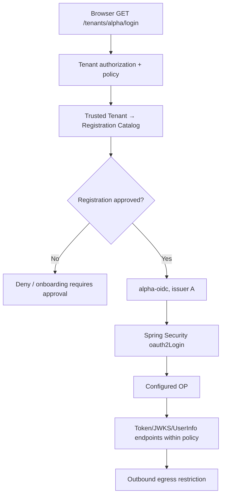
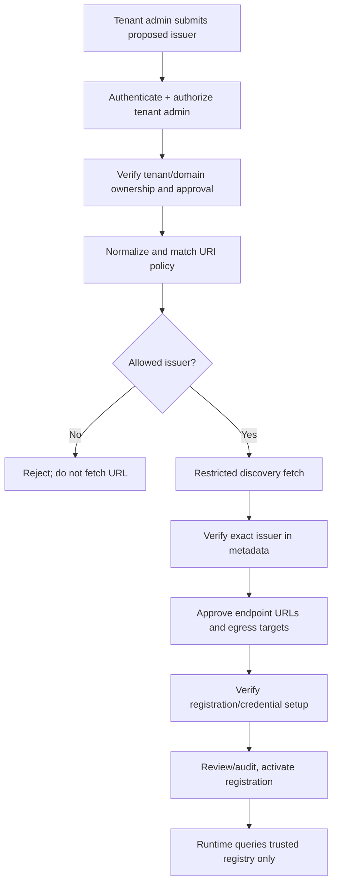

# 26.10. Restricting Discovery URLs and Preventing SSRF

In a **multi-tenant Spring Security OAuth 2.0 / OpenID Connect (OIDC) Client** application, each tenant may use its own OpenID Provider (OP). The application needs to know the **issuer**, Authorization Server endpoints, signing key URL, and other provider metadata to run `oauth2Login()` or OAuth2 Client flows.

OIDC Discovery reduces manual configuration by letting the client fetch metadata from a known issuer. However, when an application turns this operation into a "user enters any Identity Provider URL" feature, **the server actively sends HTTP requests to targets chosen by external parties**. That is the starting point of **Server-Side Request Forgery (SSRF)**.

A dangerous mistake looks like:

```text
POST /tenants/onboard-oidc
{
  "tenant": "alpha",
  "issuer": "https://some-url-from-user"
}

Backend:
  - concatenates or reads caller-supplied URL
  - calls discovery endpoint
  - extracts jwks_uri, token_endpoint, userinfo_endpoint
  - continues connecting to URLs declared in metadata
```

Without strict policies, an attacker can make the backend send requests to **loopback addresses, private networks, cloud metadata services, Kubernetes/service control planes, or attacker-controlled hosts**; in some cases, it can even **leak client credentials, authorization codes, or tokens** when the application uses metadata-declared endpoints.

This lesson builds a secure design for **tenant → provider → issuer → discovery → endpoints** in Spring Security: distinguishing provider identity from network connection URLs, allowlisting approved issuers, restricting HTTP egress, controlling redirects/DNS/IPs, validating metadata, mitigating JWKS/Refresh Token risks, and illustrating with Spring Boot Servlet, WebFlux, Java, and an operational runbook.

> **Most important principle:** users choose an **authorized tenant/provider ID**, never turning request input into an **arbitrary network URL** that the application fetches. Even an approved issuer is insufficient by itself: **every URL in metadata and every actual network connection** must obey outbound policies.

## 1. How Does OIDC Discovery Work?

An OpenID Provider normally has an **Issuer Identifier**, for example:

```text
https://id.alpha.example/realms/main
```

Clients use that issuer to retrieve metadata via OIDC Discovery and/or mechanisms supported by Spring Security. An OIDC metadata URL typically takes the form:

```text
https://id.alpha.example/realms/main/.well-known/openid-configuration
```

The returned metadata may look like:

```json
{
  "issuer": "https://id.alpha.example/realms/main",
  "authorization_endpoint": "https://id.alpha.example/realms/main/protocol/openid-connect/auth",
  "token_endpoint": "https://id.alpha.example/realms/main/protocol/openid-connect/token",
  "jwks_uri": "https://keys.alpha.example/oidc/jwks",
  "userinfo_endpoint": "https://id.alpha.example/realms/main/protocol/openid-connect/userinfo",
  "end_session_endpoint": "https://id.alpha.example/realms/main/protocol/openid-connect/logout"
}
```

This data is **illustrative** and does not represent every OP product. A provider may host JWKS or other endpoints on a separate host; therefore, **you cannot assume every endpoint shares the issuer's hostname**, nor can you **blindly trust any URL returned**.

### 1.1. Which Requests Are Sent by the Server?

During an OIDC login:

1. Browser calls `/oauth2/authorization/{registrationId}` on the RP.
2. RP needs the corresponding `ClientRegistration` and provider metadata.
3. Browser is redirected to the OP's `authorization_endpoint`.
4. RP receives the authorization code on callback.
5. **RP backend** calls `token_endpoint` to exchange the code.
6. RP or ID Token verification components may call `jwks_uri` to fetch public keys.
7. RP may call `userinfo_endpoint` when required by config/flow.
8. Later, the backend may call the token endpoint to refresh an Access Token.

**SSRF is a threat on HTTP requests sent by the backend.** Redirecting the browser to `authorization_endpoint` also carries **phishing/open redirect or rogue-OP** risks, though its mechanism differs from server-side SSRF.

### 1.2. Discovery URL Differs from Issuer

`issuer-uri` is the identity of the OP that the application intends to trust. The metadata URL is the endpoint derived/resolved from the issuer per the specific discovery mechanism.

Spring Security provides APIs like `ClientRegistrations.fromIssuerLocation(...)` to create registrations from an issuer. Depending on version, this API may probe multiple supported well-known metadata locations; **never assume only a single outbound URL will be called**.

To prevent SSRF, you must control **every URL the library might probe**, all redirects, and all metadata endpoints used afterward—not just validate the initial `issuer-uri` string.

## 2. Why Does Multi-Tenancy Increase SSRF Risk?

A single-provider application typically hardcodes its issuer in operator-controlled config:

```yaml
spring:
  security:
    oauth2:
      client:
        provider:
          company:
            issuer-uri: https://id.company.example/realms/main
```

A SaaS system may let each customer organization connect its own OP. Seeking flexibility, teams sometimes design:

```http
POST /api/tenants/alpha/identity-provider
Content-Type: application/json

{
  "issuerUrl": "https://id-customer.example"
}
```

The issue lies at the **trust boundary**: a tenant admin permitted to manage accounts in the product **does not automatically have permission to steer outbound network traffic from the product's backend**.

If the backend does not restrict URLs, an attacker may try reaching:

- `http://127.0.0.1:...` or `http://[::1]:...` — loopback services.
- `http://10.x.x.x`, `http://192.168.x.x` — private networks.
- `http://169.254.169.254` — e.g., a cloud metadata address.
- Link-local IPs or DNS names resolving only inside the cluster.
- Service management endpoints reachable by the backend but not the Internet.
- External attacker-managed hosts capable of returning malicious metadata.
- An initially valid-looking host that resolves to an internal target via redirect/DNS rebinding.

SSRF does not require returning the response body to the browser. **Merely causing the backend to emit an unintended request** can cause network side effects or leak information via timing/errors; if the response is returned to the caller, the impact escalates sharply.

### 2.1. Different Attack Entry Points

| Entry point | Risky behavior | Core defense |
|---|---|---|
| User enters `issuerUrl` directly | Backend runs discovery against arbitrary host. | Approved issuer registry; separate onboarding from normal requests. |
| User enters tenant/subdomain | Code interpolates domain into issuer. | Map tenant ID → fixed registration; never build URLs from free-form strings. |
| Discovery metadata contains `jwks_uri` | Backend fetches keys from another target. | Endpoint allowlist + egress policy. |
| Metadata contains `token_endpoint` | Backend sends authorization code/client credentials or Refresh Token. | Use only token endpoints approved per registration. |
| Metadata contains `userinfo_endpoint` | Backend sends Access Token to endpoint. | Control destination/audience and transport. |
| HTTP redirect from discovery/JWKS | Client follows `Location` to private/foreign host. | Disable auto-redirects or revalidate every hop. |
| DNS resolves to private IP | Hostname looks valid on the surface while target IP is forbidden. | Network egress + resolution/connect-time policy. |
| Token header contains `jku`/`x5u` | Library/custom code fetches URL from JWT header. | Never trust key URLs supplied by unverified tokens. |

## 3. Distinguishing Three Types of Trust

When approving an OIDC provider, make **three independent decisions**:

1. **Is the issuer identity trusted?** Is this organization/tenant allowed to use that OP to authenticate users?
2. **May the endpoints be connected to?** Is the backend permitted to send HTTP requests to those URLs/IPs?
3. **May credentials be sent to those endpoints?** May the token endpoint receive client secrets/Refresh Tokens? May the UserInfo endpoint receive Access Tokens?

A URL with a valid TLS certificate does not mean the issuer is trusted by the system; a trusted issuer does not automatically permit every `jwks_uri` or `token_endpoint` in metadata; an allowed network endpoint does not mean it may receive arbitrary credentials.

### 3.1. Issuer Is an Identity Boundary

In OIDC, `iss` in the ID Token must match the configured/approved issuer per OIDC validation rules.

```text
Approved issuer:
  https://id.alpha.example/realms/main

Metadata issuer:
  https://id.beta.example/realms/main
```

This is a **mismatch** and must be rejected, even if both hosts have valid HTTPS.

### 3.2. Network Boundary

A URL `https://id.alpha.example` might resolve to a disallowed address from the backend's network. DNS and routing sit at a different layer from issuer string comparison.

### 3.3. Credential Boundary

If metadata directs to:

```text
token_endpoint=https://receiver.attacker.example/token
```

and the client trusts metadata to run token exchange, the backend may send **client authentication and authorization codes** to an untrusted target. With refreshes, it also risks leaking Refresh Tokens.

**This is why SSRF and credential exfiltration must be addressed together**, rather than only blocking private IP addresses.

## 4. Safe Architecture: Tenants Select Registrations, Not URLs

The simplest and most controllable approach is establishing a **catalog of approved client registrations**.

```text
Tenant alpha -> registration alpha-oidc -> permitted issuer A
Tenant beta  -> registration beta-oidc  -> permitted issuer B
Tenant gamma -> not onboarded yet        -> no OAuth2 login
```

A request:

```text
GET /tenants/alpha/login
```

is mapped by the server to:

```text
/oauth2/authorization/alpha-oidc
```

**Never** infer:

```text
https://alpha/.well-known/openid-configuration
```

or take a `?issuer=...` query param to build outbound URLs.

### 4.1. Security Diagram



Benefits:

- Every login request selects only a **known key**.
- You can audit which tenant uses which issuer.
- No need to re-fetch metadata from arbitrary URLs on every request.
- Registrations, scopes, issuers, endpoints, and secrets can be scoped per tenant.
- Easy to revoke one provider without affecting other tenants.

### 4.2. Not Every Tenant Admin May Onboard an Issuer

A user with "manage tenant members" rights does not necessarily have rights to "alter the tenant's authentication system". If offering self-service enterprise SSO, require an **onboarding workflow verifying domain/tenant ownership and provider approval**.

Even legitimate customers can submit a misconfigured hostname pointing into your own private network. SSRF controls must still apply.

## 5. Spring Boot: Configuring Two Fixed Issuers

A baseline example:

```yaml
spring:
  security:
    oauth2:
      client:
        registration:
          alpha-oidc:
            provider: alpha-provider
            client-id: ${ALPHA_CLIENT_ID}
            client-secret: ${ALPHA_CLIENT_SECRET}
            client-authentication-method: client_secret_basic
            authorization-grant-type: authorization_code
            redirect-uri: "{baseUrl}/login/oauth2/code/{registrationId}"
            scope:
              - openid
              - profile
          beta-oidc:
            provider: beta-provider
            client-id: ${BETA_CLIENT_ID}
            client-secret: ${BETA_CLIENT_SECRET}
            client-authentication-method: client_secret_basic
            authorization-grant-type: authorization_code
            redirect-uri: "{baseUrl}/login/oauth2/code/{registrationId}"
            scope:
              - openid
              - profile

        provider:
          alpha-provider:
            issuer-uri: https://id.alpha.example/realms/main
          beta-provider:
            issuer-uri: https://login.beta.example/tenant/main
```

`alpha-oidc`, `beta-oidc` are **registration IDs**; `alpha-provider`, `beta-provider` are **provider keys** in Spring Boot; `issuer-uri` is the OP identity.

When the application boots and client registrations are built from metadata, Spring Security/Spring Boot may perform discovery per configuration. **This is still outbound network activity**, yet the URL originates from **controlled deployment configuration**, not a browser-chosen request.

### 5.1. Secret Management Does Not Solve SSRF

Replacing real client secrets with `${ALPHA_CLIENT_SECRET}` via a secret manager is necessary, not sufficient. If a registration is pointed at an attacker-controlled token endpoint, the secret can still be transmitted during token exchange.

Credential protection must pair with **endpoint pinning/approval, TLS, and network egress restrictions**.

### 5.2. Never Derive the Issuer from the Request Host

Wrong conceptual example:

```java
// DO NOT build the issuer URL from the browser's Host header:
String issuer = "https://" + request.getHeader("Host") + "/oidc";
```

`Host`/Forwarded headers can be influenced by clients or misconfigured proxies. They route HTTP requests; **they are not proof a tenant is permitted to use an issuer**.

Similarly, never take a tenant subdomain and concatenate `https://<tenant>.identity.example` without a trusted server-side mapping/validation.

## 6. Safe Controller: Redirecting to a Pre-Mapped Registration

Spring MVC controller example that never accepts an issuer URL directly:

```java
import java.util.Map;

import org.springframework.http.HttpStatus;
import org.springframework.stereotype.Controller;
import org.springframework.web.bind.annotation.GetMapping;
import org.springframework.web.bind.annotation.PathVariable;
import org.springframework.web.server.ResponseStatusException;

@Controller
public class TenantLoginController {

    private static final Map<String, String> LOGIN_REGISTRATIONS =
        Map.of(
            "alpha", "alpha-oidc",
            "beta",  "beta-oidc"
        );

    @GetMapping("/tenants/{tenantId}/login")
    public String login(@PathVariable String tenantId) {
        String registrationId = LOGIN_REGISTRATIONS.get(tenantId);

        if (registrationId == null) {
            throw new ResponseStatusException(
                HttpStatus.NOT_FOUND,
                "Tenant identity provider is not configured"
            );
        }

        return "redirect:/oauth2/authorization/" + registrationId;
    }
}
```

In this example:

- The client selects `tenantId`, while the **server decides** the registration.
- Registration IDs are fixed application-managed values, not taken from URL inputs.
- No outbound HTTP request is made to an arbitrary issuer inside the controller.
- Spring Security executes the Authorization Code/OIDC flow for the configured registration.

This is a **routing illustration**, not a complete authorization policy for every SaaS. In a real product, verify permission to start login for the tenant, tenant status, approved registration, and anti-abuse rules.

### 6.1. Avoid Returning User-Supplied URLs

Wrong:

```java
@GetMapping("/login")
public String login(@RequestParam String issuer) {
    return "redirect:" + issuer;
}
```

This creates an **open redirect** in the browser and often accompanies unsafe dynamic provider designs. Users should pick a **registered tenant/registration ID**, never an arbitrary redirect URL.

### 6.2. SSO Login Still Requires Binding Tenant to Issuer

Upon receiving the callback and verifying the ID Token, the application must know **which issuer this tenant accepts**. Never accept a user who logged in at any arbitrary issuer and grant access to another tenant just because email or `sub` matches.

Tenant authorization must rest on **trusted mappings** and membership/account-linking policies.

## 7. When Is Dynamic Discovery Permitted?

Enterprise SaaS platforms often need customers to connect OPs not known at deploy time. You cannot always hardcode every issuer. Instead, separate:

- **Onboarding/configuration plane**: where an authorized administrator requests connecting a new provider.
- **Runtime/login plane**: where regular users only select **approved and activated** registrations.

A secure workflow:



**Never run steps G–K synchronously every time a user submits a login request.** That widens SSRF exposure, adds latency, and lets an attacker use the login endpoint to continuously scan networks or flood OPs/JWKS.

### 7.1. Two Onboarding Stages

**Proposal stage:** data is *untrusted* and may not be used in authentication or credential transmission. Process inside a least-privilege onboarding system.

**Activation stage:** after verifying issuer, metadata/endpoints, client registration, ownership, and policy, store in the controlled catalog. Only `ACTIVE` registrations may be used for login.

### 7.2. Tenant Admins Do Not Hold Arbitrary Network Privileges

The "configure SSO" permission must be restricted to policy-compliant providers, not "control the backend HTTP client". Even an MFA-protected admin can mistype a URL or have their account compromised.

### 7.3. Change Approval Workflow

If an issuer or token endpoint changes after a registration becomes `ACTIVE`, treat it as a **security-sensitive change** requiring revalidation and auditing; never silently adopt new metadata and expand egress to unapproved hosts.

## 8. URL Policy: Allowlist Rather Than Denylist Alone

A policy relying on `String.startsWith("https://trusted.example")` is easily bypassed:

```text
https://trusted.example.attacker.example/path
```

also starts with `https://trusted.example`, yet has a **completely different hostname**.

Better:

- Parse URLs with a standard URI library.
- Require `https` scheme in production (barring explicit dev exceptions).
- Match **scheme, host, port, and issuer path** against an approved list.
- Forbid `userinfo` in the URI, e.g., `https://user@host/...`.
- Reject unexpected query strings/fragments in issuer identifiers.
- Define explicit policies for Unicode/IDN hosts, trailing dots, casing, and normalization.
- Reject IP literals or arbitrary ports unless explicitly permitted by policy.
- Never treat path prefixes as sufficient to distinguish tenants/realms.
- Treat the approved issuer as an **immutable identity** per configuration.

### 8.1. Structured URI Comparison

Example of two URLs:

```text
https://trusted.example/oidc
https://trusted.example.attacker.example/oidc
```

have different hostnames. Proper comparison checks `URI.getHost()` after parsing rather than a string prefix.

However, for OIDC issuers, **matching `issuer` in metadata/ID Tokens must follow the standard's exact matching rules**—never arbitrarily normalize two different issuers into equivalence.

### 8.2. Path Also Belongs to the Issuer Boundary

```text
https://id.example.org/realms/alpha
https://id.example.org/realms/beta
```

share a host yet are **two distinct issuer identifiers**. If tenant alpha is allowed realm alpha, allowlisting `id.example.org` alone must not automatically permit realm beta.

Therefore, allowlist issuers at the **full issuer URI** level; outbound network allowlists can use appropriate hostnames/CIDRs as a separate layer.

### 8.3. Do Not Rely on Simple Suffix Matching

Checks like:

```text
hostname.endsWith("example.org")
```

can accept `notexample.org` without exact label boundaries. Yet even label-aware suffix checks cannot prove a subdomain belongs to a trusted provider and wasn't claimed by another tenant.

For identity providers, **exact approved host/issuer** is usually far safer than wildcard subdomains unless strictly required.

## 9. Checking the URL Before Sending the Request Is Not Enough

Suppose the application checks:

```text
https://approved.example/.well-known/openid-configuration
```

and allows it because the hostname is in the allowlist. The server responds:

```http
HTTP/1.1 302 Found
Location: http://127.0.0.1:8080/admin
```

If the HTTP client follows redirects automatically, the second request can hit loopback.

Or `approved.example`'s DNS returns a public IP during validation and a private IP at connection time.

Therefore, SSRF prevention requires multiple checkpoints:

1. **Before fetch:** is the issuer/URL in the trusted catalog/policy?
2. **At DNS resolution:** are all resolved IPs within permitted networks?
3. **At connect time:** does the socket actually connect to an allowed IP?
4. **On redirect:** are redirects blocked or re-validated per hop?
5. **After reading metadata:** are newly discovered endpoints approved before use?
6. **At network infrastructure:** do egress firewalls/proxies enforce the boundary independently of code?

### 9.1. Do Not Auto-Follow Redirects

For sensitive metadata HTTP fetches, a strict policy is **do not follow HTTP redirects** unless explicitly justified. If a valid OP requires redirects, allow only verified hops and cap the hop count.

Never validate only the initial URL and delegate unconditional redirect following to the HTTP library.

### 9.2. DNS Rebinding

DNS rebinding can make an allowed hostname return different IPs over time. If code runs:

```text
resolve -> check IP -> milliseconds later HTTP library re-resolves
```

the initial check cannot guarantee which IP the socket actually connects to.

Solutions should combine **network-layer egress controls** with an HTTP transport/policy validating at **connect-time** or using proper resolver/pinning. Never rely on a pre-check `InetAddress.getAllByName(...)` before calling a separate `RestTemplate`.

### 9.3. Multi-Record DNS

A hostname can have multiple A/AAAA records. If one record is public and another is private, the app must not assume safety simply because **one** record is valid.

The transport must connect only to permitted addresses, and policies must cover both IPv4/IPv6 and DNS changes.

## 10. Networks and Addresses to Restrict

An outbound policy targeting public OIDC providers should specifically watch for:

| Group | Example | Why dangerous |
|---|---|---|
| **IPv4 loopback** | `127.0.0.0/8` | Services bound only to localhost. |
| **IPv6 loopback** | `::1/128` | Same on IPv6. |
| **Private IPv4** | `10.0.0.0/8`, `172.16.0.0/12`, `192.168.0.0/16` | Internal/VPC services. |
| **IPv4 link-local** | `169.254.0.0/16` | Cloud metadata/service endpoints in some clouds. |
| **IPv6 link-local** | `fe80::/10` | Link-local internal services. |
| **Unique-local IPv6** | `fc00::/7` | Internal IPv6 networks. |
| **Unspecified/multicast/reserved** | `0.0.0.0`, `::`, reserved blocks | Not normal public OP targets. |
| **IPv4-mapped IPv6** | `::ffff:127.0.0.1` | Can bypass checks inspecting only IPv4 literals. |
| **Cluster/service DNS** | Internal names resolving to private IPs | Can reach control plane/other services. |

This list is **not an exhaustive denylist for every infrastructure**. Other special ranges like carrier-grade NAT, benchmark ranges, or corporate internal routing may also need blocking. A system with legitimate internal OPs should apply an **explicit allowlist for that OP's network/target**, never opening all of RFC 1918.

### 10.1. Cloud Metadata Services

Many cloud environments expose metadata endpoints reachable from workloads. Exact addresses or DNS names vary by cloud and configuration.

If a discovery URL is attacker-controlled, the backend may be tricked into hitting the metadata service. Therefore:

- Block metadata access from workloads that do not require it.
- Restrict metadata endpoints using cloud-supported network/identity controls.
- Use appropriate workload identities rather than issuing unnecessary long-lived credentials.
- Never rely solely on an endpoint requiring an HTTP header or token when code could be extended later.

### 10.2. IP Literals, IPv6, and Encoding

A URL can use an IP literal instead of a hostname, bracketed IPv6 syntax, integer IPv4 notation, or encodings parsed differently by parsers vs. transports.

Never write a URL parser with a short regex; use a standard URI parser, controlled canonicalization, and network-layer policies. **A narrow hostname allowlist** avoids far more edge cases than trying to enumerate every dangerous IP encoding.

### 10.3. Internal DNS Sharing Public Names

Split-horizon DNS can return different IPs inside the backend network than on the public Internet. Seeing a public IP from an operator's laptop does not prove the app container connects to the same destination.

Investigate based on the **actual runtime's** DNS and network path, without turning the login app into an internal network scanner.

## 11. Limiting Discovery HTTP Transport

Even when private IPs are unreachable, an attacker-controlled external URL can still:

- Return huge JSON payloads exhausting RAM.
- Stall responses to tie up threads/connections.
- Loop redirects continuously.
- Stream endless chunked bodies.
- Return metadata triggering cascading JWKS/token/UserInfo calls.
- Send malformed headers breaking parsers.
- Present misconfigured TLS/certificates to tempt developers into disabling verification.

Therefore, the discovery HTTP client should enforce:

- Connect timeouts.
- Response/read timeouts and overall request deadlines.
- Redirect policies (prefer disabled; if allowed, cap hops and revalidate each hop).
- Response body size limits and JSON nesting/depth limits where supported.
- Concurrency, connection pool, and rate limits.
- TLS certificate + hostname verification.
- HTTPS only for production public providers.
- Never using a system proxy that reaches internal networks outside policy.
- Never forwarding cookies, `Authorization`, or client secrets to metadata URLs.
- Process-independent network egress allowlists.

### 11.1. A Custom Downloader Illustrating Redirect Policy

Standard Java example:

```java
import java.net.http.HttpClient;
import java.time.Duration;

HttpClient discoveryHttpClient = HttpClient.newBuilder()
    .followRedirects(HttpClient.Redirect.NEVER)
    .connectTimeout(Duration.ofSeconds(2))
    .build();
```

This snippet **only illustrates two transport options**, not a complete SSRF-safe HTTP client. It **does not restrict target IPs, body size, TLS trust policy, JSON depth, or credential handling**, and **does not automatically replace the HTTP transport Spring Security uses for discovery**.

Production requires a downloader/gateway enforcing full network policies and limits, integrated properly with the `ClientRegistration` creation flow.

### 11.2. Balanced Timeouts

For example, 2 seconds connect and 5 seconds total request may fit one environment without fitting every OP. Choose based on latency/SLAs, network infrastructure, and retry policies.

Crucially, **never let one tenant trigger unbounded outbound requests or hang the entire thread pool** via a slow discovery URL.

### 11.3. Never Retry Infinitely

A user or tenant admin could intentionally trigger registration failures. Unbounded discovery retries amplify load or turn the backend into a traffic source against external hosts.

Use bounded exponential backoff, per-tenant quotas, circuit breakers where appropriate, and caching of approved results.

## 12. Returned Metadata Must Be Treated as Untrusted Data

A JSON response is **data from an external network**. HTTPS only confirms connection to a hostname per its certificate chain—it does not prove that hostname is permitted as the tenant's issuer or that every URL in metadata is trustworthy.

Critical fields:

| Field | Purpose | Risk if uncontrolled |
|---|---|---|
| `issuer` | OP identity. | Issuer/tenant mix-up; wrong trust boundary. |
| `authorization_endpoint` | Browser redirect target for login. | Phishing or login at rogue OP. |
| `token_endpoint` | Backend exchanges code/refresh token. | Leaks client secret, code, Refresh Token. |
| `jwks_uri` | Backend fetches public keys. | SSRF, key substitution, and fetch amplification. |
| `userinfo_endpoint` | Backend sends Access Token for profile. | Leaks Access Token to wrong host. |
| `end_session_endpoint` | Browser navigates for logout. | Open redirect/phishing/misdirected logout. |
| `introspection_endpoint` | API endpoint inspecting tokens when applicable. | Leaks client credentials/tokens if uncontrolled. |
| `revocation_endpoint` | Revokes tokens if provider supports it. | Sends tokens to unapproved host. |

Not every app uses every field. Yet **even a single field used by a library** creates a network connection and credential boundary.

### 12.1. Validate `issuer` Before Trusting Metadata

If the approved issuer is:

```text
https://id.alpha.example/realms/main
```

and metadata returns:

```json
{
  "issuer": "https://id.beta.example/realms/main"
}
```

you must **fail closed**. Do not merely check if the two URLs share a parent domain or look similar.

Apply OIDC and Spring Security version issuer validation rules. Never bypass validation for compatibility with a misconfigured provider without assessing the impact on identity/token trust.

### 12.2. Valid Endpoints May Differ from the Issuer Hostname

For example:

```text
issuer:         https://login.example.org/tenant
jwks_uri:       https://keys.example-cdn.org/tenant/jwks
token_endpoint: https://token.example.org/tenant/oauth2/token
```

Legitimate providers may deploy endpoints across multiple hosts. Hence, policies need not "block every host differing from issuer". Instead:

1. Permit an **approved set of endpoints/origins** for that registration.
2. Require evidence from trusted provider docs/onboarding.
3. Bind each endpoint to the exact credential types it may receive.
4. Protect all connections with egress/TLS policies.
5. Revalidate when endpoints change unexpectedly.

Never automatically trust another host simply because it appeared in JSON fetched from an allowed issuer.

## 13. Biggest Risk: `token_endpoint` and Client Credentials

When an OAuth2 Client uses the Authorization Code Flow, the backend sends the code to the token endpoint and authenticates the client per configured method.

Conceptual example:

```http
POST /oauth2/token HTTP/1.1
Host: token.id.example.org
Authorization: Basic <redacted-client-authentication>
Content-Type: application/x-www-form-urlencoded

grant_type=authorization_code&code=<redacted>&redirect_uri=<registered-uri>
```

If the backend uses an unapproved metadata token endpoint, it can transmit:

- Client secret or client assertion per authentication method.
- The newly received authorization code.
- Refresh Tokens in subsequent grants.
- Other token-request parameters.

**This is no longer just SSRF to private IPs; it is credential exfiltration to an arbitrary host.**

### 13.1. Never Send Client Secrets in Discovery GET Requests

Normally, the client secret **is not a credential for metadata discovery GET requests**. Never attach client secrets in queries/headers just to fetch `.well-known/openid-configuration`.

However, once the token endpoint is registered, that same registration uses the secret during token exchange. Therefore, verify the **token endpoint destination before any credential is sent**.

### 13.2. Refresh Tokens Are Even More Sensitive to Endpoint Substitution

A Refresh Token may allow minting new Access Tokens over a longer lifespan than an Access Token, depending on policy. If metadata shifts to an unintended token endpoint and the manager auto-refreshes, the Refresh Token can be sent to an untrusted target.

Therefore, endpoints involved in the token lifecycle must be **pinned/allowlisted per registration**, monitored for changes, and never auto-updated from arbitrary metadata.

### 13.3. Never Guess "Same-Issuer Endpoints" by Concatenating URLs

Never construct a token endpoint by concatenating:

```text
issuer + "/token"
```

if the provider does not publish it that way. Conversely, never trust an unfamiliar `token_endpoint` merely because the JSON contains that field. Verify metadata, policy, and provider contract.

## 14. `jwks_uri`, `kid`, and Protecting Key Discovery

OIDC ID Tokens are typically signed with the OP's private key. The RP fetches the JWK Set (JWKS) to obtain **public keys** for signature verification.

A metadata field:

```json
{
  "jwks_uri": "https://keys.alpha.example/jwks.json"
}
```

causes the runtime to perform an HTTP GET to that host. If an attacker controls `jwks_uri`, two risk categories arise:

1. **SSRF**: requests to internal/cloud URLs or inducing load.
2. **Key trust confusion**: the app may verify tokens with keys unbound to a trusted issuer.

### 14.1. Never Take Key URLs from an Unverified JWT Header

A JWT header may contain parameters such as:

```json
{
  "alg": "RS256",
  "kid": "key-2026"
}
```

`kid` is a **key-selection identifier within the configured issuer's JWKS**, not a network URL. Never turn it into:

```text
GET https://keys.example.org/{kid}
```

when `kid` is uncontrolled and lacks a trusted mapping.

Some JWT/JWS formats support `jku` or `x5u` headers pointing to key/certificate URLs. **Never follow URLs from an unverified token** to pick a trust root.

### 14.2. Unknown `kid` Values Can Trigger Request Amplification

When a token carries a `kid` absent from cache, some components attempt to refresh JWKS. If an attacker sends floods of tokens with distinct `kid` values, the backend can generate heavy load against the JWKS endpoint.

Mitigations:

- JWKS cache with sensible TTL.
- Rate limiting / refresh throttling.
- Concurrency/size/timeout limits on JWKS fetches.
- Fetch strictly from the approved `jwks_uri`.
- Never skip issuer/signature/audience validation because a key wasn't found.
- Monitor abnormal refresh counts per registration.

### 14.3. JWKS Must Bind to the Issuer

With two tenants:

```text
Tenant alpha issuer A -> approved JWKS A
Tenant beta  issuer B -> approved JWKS B
```

Never merge public keys into one global pool and try every key against every token. A token from issuer B must never become valid for issuer A merely because its signature validates with a key from B.

**Verifying `iss`, `aud`, signature, algorithm, timestamps, and `nonce`/`state` in the OIDC context** remains mandatory alongside SSRF protection.

## 15. Other Endpoints Also Require Destination Policies

### 15.1. UserInfo Endpoint

An OIDC Client may send an Access Token to `userinfo_endpoint`. If that URL is swapped for an attacker host, the Access Token can be disclosed.

Therefore, a metadata approval policy must determine **whether the UserInfo endpoint is permitted to receive Access Tokens belonging to that registration**.

### 15.2. Token Introspection/Revocation

The application or Resource Server may call introspection/revocation endpoints when supported by the provider. These requests may contain tokens and client credentials. Never let these endpoints be updated with arbitrary URLs.

### 15.3. OP Logout Endpoint

`end_session_endpoint` is typically where the browser is redirected; while not necessarily backend SSRF, an untrusted URL can send the browser to a phishing site or leak `id_token_hint`.

Policies are still required for the OP logout endpoint and registered `post_logout_redirect_uri`.

### 15.4. Authorization Endpoint

`authorization_endpoint` typically receives browser navigation rather than direct backend HTTP GETs in Authorization Code login. A malicious URL here enables phishing or misdirecting users to a rogue OP, even if it isn't backend SSRF.

**Endpoint trust validation must evaluate both URLs fetched by the backend and URLs followed by the browser.**

## 16. Preferred Solution: Pre-Provisioned `ClientRegistration`s

With a finite set of tenants/providers or controlled onboarding, prefer:

- Registering issuers/`ClientRegistration` via configuration management.
- Validating each registration in deployment pipelines or onboarding.
- Activating only after OP endpoints/redirect URIs are verified.
- Rejecting any runtime request attempting to create an arbitrary new issuer.
- Using an approved `tenant → registration ID` catalog.
- Governing issuer/metadata changes via review/audit workflows.

Example:

```text
app.oidc.tenants:
  alpha:
    registrationId: alpha-oidc
    approvedIssuer: https://id.alpha.example/realms/main
  beta:
    registrationId: beta-oidc
    approvedIssuer: https://login.beta.example/tenant/main
```

This is **conceptual data** for a trusted application catalog, not a built-in Spring Boot property. The goal is never delegating issuer selection to browser HTTP input.

### 16.1. A Simple Java Registry

```java
import java.net.URI;
import java.util.Map;

public final class ApprovedTenantOidcCatalog {

    public record Provider(
        String registrationId,
        URI issuer
    ) {}

    private static final Map<String, Provider> APPROVED = Map.of(
        "alpha",
        new Provider(
            "alpha-oidc",
            URI.create("https://id.alpha.example/realms/main")
        ),
        "beta",
        new Provider(
            "beta-oidc",
            URI.create("https://login.beta.example/tenant/main")
        )
    );

    public Provider requireApproved(String tenantId) {
        Provider result = APPROVED.get(tenantId);
        if (result == null) {
            throw new IllegalArgumentException(
                "Tenant has no approved OIDC provider"
            );
        }
        return result;
    }
}
```

This example guarantees **no issuer is derived by concatenating user input**. It does not yet cover all network egress, issuer validation, account linking, or tenant authorization; those layers must be implemented in their respective places.

### 16.2. Do Not Treat an Enum as Permission

Even if a tenant exists in `APPROVED`, the caller does not necessarily have rights to log into or administer that tenant's configuration. The catalog answers "which provider does this tenant have", not "does the current user have access to this tenant".

## 17. Dynamic Registration: `ClientRegistrations.fromIssuerLocation`

Spring Security has a convenience API creating a `ClientRegistration.Builder` from an issuer location:

```java
import org.springframework.security.oauth2.client.registration.ClientRegistration;
import org.springframework.security.oauth2.client.registration.ClientRegistrations;
import org.springframework.security.oauth2.core.AuthorizationGrantType;

String approvedIssuer =
    "https://id.alpha.example/realms/main";

ClientRegistration registration =
    ClientRegistrations.fromIssuerLocation(approvedIssuer)
        .registrationId("alpha-oidc")
        .clientId("<client-id-from-secret-management>")
        .clientSecret("<client-secret-from-secret-management>")
        .authorizationGrantType(AuthorizationGrantType.AUTHORIZATION_CODE)
        .redirectUri("{baseUrl}/login/oauth2/code/{registrationId}")
        .scope("openid", "profile")
        .build();
```

**Warning about this example:** `fromIssuerLocation(...)` performs **network discovery**. This snippet is appropriate only when the issuer already comes from **trusted/approved configuration** and the runtime enforces full SSRF/egress protections. It is **not a URL validation function**.

Never pass directly:

```java
ClientRegistrations.fromIssuerLocation(
    request.getParameter("issuer")
);
```

into a public endpoint or tenant admin API without an approval workflow and outbound controls.

### 17.1. Do Not Assume the Starter Protects Against Dynamic SSRF

Spring Security verifies OAuth2/OIDC requirements per its role; never assume the discovery API includes **SaaS-specific internal network allowlists**, cloud metadata protection, or your product's tenant onboarding policies.

If you need custom outbound HTTP transport, inspect **the extension points of your exact Spring Security version** and apply network enforcement outside code. Configuring a `WebClient` for downstream APIs **does not automatically alter** the HTTP client used by `ClientRegistrations.fromIssuerLocation` to fetch metadata.

### 17.2. Dynamic Provider Onboarding Does Not Belong in Callback Paths

Some dangerous designs extract the provider/issuer from:

```text
/login/oauth2/code/{issuer-from-user}
```

or an `iss` query param sent by the browser. Callbacks must only process against a **previously initiated authorization request, `state`/nonce, and pre-determined `ClientRegistration`**.

Never create a brand-new provider solely from a callback query without a trusted registration.

## 18. Discovery URLs and Fallback Endpoints in Spring

OIDC Discovery and OAuth 2.0 Authorization Server Metadata have different well-known URI rules in some cases. A Spring Security helper may probe **multiple discovery locations** depending on version.

Conceptual illustration:

```text
Approved issuer
  |
  +-> OIDC metadata location
  |
  +-> Several other well-known locations per API/version
```

If an egress or URL guard only covers a single path while the helper probes another path, the policy may fail to block all network activity.

**Never build an SSRF policy on an unverified assumption that Spring only calls one exact URL.** Constrain by **approved origin/IP and issuer**, inspect the exact behavior of your deployed library, and keep egress controls independent of URL paths.

### 18.1. Regarding WebFinger

OIDC Discovery can pair with mechanisms like WebFinger when resolving an issuer from a user identifier. **Spring Security OAuth2 Login does not run WebFinger by default just because `issuer-uri` is configured.**

If your product adds a "user enters email → discover issuer via WebFinger" step, that is **another outbound URL and metadata source requiring vetting**. Never let an uncontrolled email/domain turn the backend into a client calling arbitrary hosts.

### 18.2. Never Use Discovery as an HTTP Proxy

An endpoint like:

```text
GET /api/oidc/discover?url=https://...
```

that returns raw JSON metadata to the user can become an **SSRF proxy**. Even if it "only reads JSON", an attacker can probe ports/networks via response codes, timing, and error messages.

Do not expose an arbitrary fetch endpoint just to power setup UIs. If onboarding previews are needed, use a restricted validation environment with allowlists, admin permissions, quotas, and responses that reveal no internal network details.

## 19. Strict Validation Does Not Mean Regex Alone

A validation policy may enforce:

| Condition | Action |
|---|---|
| URL parsing fails | Reject. |
| Scheme is not HTTPS in production | Reject, except separately managed dev exceptions. |
| `userinfo` or fragment present | Reject in issuer policy. |
| Host outside approved catalog | Reject. |
| Unapproved port | Reject. |
| Issuer path differs from registered value | Reject, even on the same host. |
| Metadata `issuer` mismatch | Reject. |
| New endpoint URL unapproved | Do not connect/use. |
| Host resolves to disallowed private/loopback IP | Block at network/connect time. |
| Redirects to another destination | Do not follow, or fully revalidate. |
| TLS certificate/hostname invalid | Reject; never disable verification. |
| Response exceeds limits | Abort safely. |

### 19.1. Careful URI Normalization

Variants like:

```text
https://id.example.org/realm
https://ID.EXAMPLE.ORG/realm
https://id.example.org:443/realm
https://id.example.org/realm/
```

may be treated differently by URL libraries at different stages. In OIDC, `issuer` in metadata/ID Tokens must be compared per the spec—never assume all URI variants represent a single issuer unless the provider states so.

Policies should store a **canonical approved issuer string** at onboarding and use it consistently during registration and verification.

### 19.2. Avoid Parser Disagreement

A URL string can be parsed differently by Java `URI`, proxies, redirect handlers, and network transports when containing encoding, `userinfo`, backslashes, or unusual characters.

Do not try to accept "every parseable URL". For production OIDC issuers, it is far safer to accept only **canonical HTTPS URIs from a small approved catalog**.

## 20. Network Egress Is an Independent Defensive Layer

For multi-tenant discovery, **network egress controls** are among the strongest defenses because they do not depend on developers remembering to validate every URL.

Infrastructure-dependent options:

- Container/Kubernetes network policies or egress gateways.
- VPC/firewall policies blocking private/cloud metadata endpoints unless explicitly required.
- HTTP CONNECT proxies allowlisting outbound domains and IP ranges.
- Controlled DNS policies/resolvers paired with connection policies.
- Segmentation between onboarding workloads and workloads holding production credentials.
- Service mesh/egress authorization where supported.
- Workload identity and IAM restricting access to cloud metadata/management APIs.

### 20.1. Deny-All-Then-Allow

An ideal conceptual policy:

```text
OIDC Client workload:
  outbound default = DENY

  ALLOW:
    - approved issuer/metadata endpoints
    - approved token endpoints
    - approved JWKS/UserInfo endpoints
    - approved Resource Servers

  DENY:
    - loopback/private/control-plane/metadata destinations
    - arbitrary Internet hosts
    - cross-tenant endpoints outside policy
```

This is a **conceptual policy**, not actual firewall syntax. Safely enforcing a domain-based allowlist must account for DNS rebinding, CDNs, proxies, and IP changes.

### 20.2. Domain-Based Egress Alone Is Sometimes Insufficient

A policy checking only TLS SNI/`Host` headers can be bypassed if transport/proxy handling of DNS, CONNECT targets, redirects, or IP literals is inconsistent. Ensure the **socket destination** also falls within permitted networks.

Never treat an application-server DNS check as a substitute for firewall/network isolation.

### 20.3. Isolating the Onboarding Worker

If tenant self-service onboarding must fetch metadata from new providers, consider running it inside a **narrowly privileged worker** holding no production client secrets, no access to DBs/token stores, and no cloud management permissions.

Only after metadata is verified and approved are results promoted into the runtime registry. This limits the blast radius if an onboarding fetch hits SSRF.

## 21. Never Automatically Widen Trust When Metadata Changes

Provider metadata and JWKS can change over an integration's lifecycle. An OP may rotate keys or move endpoints to another host.

Distinguish carefully:

- **Key rotation within an approved JWKS URI**: can be handled by policy-driven cache refreshes.
- **Metadata moving `jwks_uri` to a new origin**: can represent a security-boundary change, requiring revalidation/approval.
- **Metadata moving `token_endpoint` to a new host**: changes where client credentials are sent, requiring strict review.
- **Issuer changing**: usually an identity migration, not a harmless endpoint tweak.

### 21.1. Never Trust Cached Metadata Forever

Caching helps performance and lowers outbound requests, yet if a provider is compromised or a config is revoked, stale caches may hold invalid endpoints/keys.

Manage:

- Explicit TTL and refresh policies.
- Provider change reviews.
- Audited versions of metadata/approved endpoints.
- Emergency registration disablement.
- Key rotation/failure recovery.
- Preventing failed requests from infinitely refreshing metadata.

### 21.2. Avoid Global Caches Keyed Solely by Hostname

Two issuers can share a host with different realms/tenants. Registration, metadata, and JWKS caches must key properly by issuer/registration rather than mixing by hostname when that boundary is too coarse.

## 22. Tenant Isolation and Authorized Client Storage

Blocking SSRF is insufficient if the app can mistakenly use another tenant's token.

Spring Security's `OAuth2AuthorizedClientService` typically keys by:

```text
(clientRegistrationId, principalName)
```

With multiple providers/tenants, ensure registration IDs and principal keys **never collide**.

For example:

```text
Tenant alpha:
  registrationId = alpha-oidc
  issuer = https://id.alpha.example/main
  principal = alpha-sub-101

Tenant beta:
  registrationId = beta-oidc
  issuer = https://login.beta.example/main
  principal = beta-sub-101
```

If both used `registrationId="oidc"` and `principalName="101"` in the same DB, tokens could mix if custom dynamic registration failed to partition by tenant/issuer.

### 22.1. Connection to Discovery SSRF

When tenant A is permitted to switch the issuer of the same `registrationId` from OP A to OP B, the token store may still retain an authorized client issued by OP A. If the app keeps using the old token with the new metadata, risks include:

- Refresh Token sent to the wrong token endpoint.
- Token issuer/audience mismatch.
- Incorrect account linking results.
- Mixing principals from two issuers.
- Leaking credentials to an endpoint outside the original authorization.

Therefore, changing an issuer must be treated as a **controlled migration/reauthorization**, not merely updating a URL in the database.

### 22.2. Boundaries to Maintain Simultaneously

| Boundary | Must establish |
|---|---|
| Tenant | Tenant ID from authenticated/authorized source. |
| Registration | Unique ID bound to client/provider policy. |
| Issuer | Approved URI and exact validation. |
| Principal | Trusted identity binding, e.g., `(iss, sub)`. |
| Token store | Isolation, encryption, TTL, and per-key cleanup. |
| Outbound destination | Approved API/OP endpoints. |
| Resource Server | Audience, scopes, ownership, tenant policy. |

Never let a user supply an arbitrary `principalName`, `registrationId`, or issuer and ask the manager to load the corresponding token.

## 23. Spring Security Servlet: Restricting Input in `oauth2Login()`

A baseline `SecurityFilterChain`:

```java
import org.springframework.context.annotation.Bean;
import org.springframework.context.annotation.Configuration;
import org.springframework.security.config.Customizer;
import org.springframework.security.config.annotation.web.builders.HttpSecurity;
import org.springframework.security.web.SecurityFilterChain;

@Configuration
public class SecurityConfiguration {

    @Bean
    SecurityFilterChain securityFilterChain(HttpSecurity http)
            throws Exception {

        http
            .authorizeHttpRequests(auth -> auth
                .requestMatchers(
                    "/", "/tenants/*/login", "/public/**"
                ).permitAll()
                .anyRequest().authenticated()
            )
            .oauth2Login(Customizer.withDefaults())
            .oauth2Client(Customizer.withDefaults());

        return http.build();
    }
}
```

This security chain lets users reach the start endpoint/login route, while **permission to select tenant/provider remains governed by the catalog and onboarding policy**.

Spring OAuth2 Login starts via:

```text
GET /oauth2/authorization/{registrationId}
```

It looks up the registration in `ClientRegistrationRepository`, requiring no `issuerUrl` in the request.

### 23.1. Never Write a Controller Calling Discovery at Login Time

An anti-pattern:

```java
@GetMapping("/tenants/{tenantId}/login")
public String login(
        @PathVariable String tenantId,
        @RequestParam String issuerUrl) {

    // WRONG if uncontrolled:
    ClientRegistrations.fromIssuerLocation(issuerUrl);
    return "redirect:/oauth2/authorization/" + tenantId;
}
```

The issue is not merely syntax: the browser **controlled which URL the server fetched**, and discovery can trigger SSRF before login even finishes.

Replace with a trusted catalog and pre-provisioned registrations.

### 23.2. Callbacks Must Bind to the Original Authorization Request

The callback `/login/oauth2/code/{registrationId}` must pass through Spring Security's `state`/PKCE/nonce/session correlation. Never let a callback select a new issuer from an unverified query param to exchange codes or fetch JWKS.

If the system has multiple security filter chains, ensure login start and callback hit the chain configured with OAuth2 Login support.

## 24. WebFlux: Same Policy, Different APIs

In Spring WebFlux, the corresponding abstractions:

| Servlet | WebFlux |
|---|---|
| `HttpSecurity` | `ServerHttpSecurity` |
| `SecurityFilterChain` | `SecurityWebFilterChain` |
| `ClientRegistrationRepository` | `ReactiveClientRegistrationRepository` |
| `OAuth2AuthorizedClientRepository` | `ServerOAuth2AuthorizedClientRepository` |
| `OAuth2AuthorizedClientManager` | `ReactiveOAuth2AuthorizedClientManager` |
| `HttpSession` | `WebSession` |

Example:

```java
import org.springframework.context.annotation.Bean;
import org.springframework.context.annotation.Configuration;
import org.springframework.security.config.Customizer;
import org.springframework.security.config.annotation.web.reactive.EnableWebFluxSecurity;
import org.springframework.security.config.web.server.ServerHttpSecurity;
import org.springframework.security.web.server.SecurityWebFilterChain;

@Configuration
@EnableWebFluxSecurity
public class ReactiveSecurityConfiguration {

    @Bean
    SecurityWebFilterChain securityWebFilterChain(ServerHttpSecurity http) {
        return http
            .authorizeExchange(exchanges -> exchanges
                .pathMatchers(
                    "/", "/tenants/*/login", "/public/**"
                ).permitAll()
                .anyExchange().authenticated()
            )
            .oauth2Login(Customizer.withDefaults())
            .oauth2Client(Customizer.withDefaults())
            .build();
    }
}
```

Even though WebFlux uses non-blocking APIs, the **SSRF threat model is unchanged**: every network client must still have its destinations restricted.

### 24.1. `WebClient` Has No Built-In SSRF Allowlist

A `WebClient`:

```java
WebClient.builder().build();
```

does not automatically know which tenant is allowed to connect to which provider. If code runs:

```java
webClient.get().uri(userProvidedUrl).retrieve();
```

the SSRF risk still exists, even in WebFlux.

`ServerOAuth2AuthorizedClientExchangeFilterFunction` can also automatically attach a Bearer token if configured with a default authorized client; never use it on a `WebClient` calling arbitrary URLs.

### 24.2. Reactive Context Is Unrelated to URL Trust

`ReactiveSecurityContextHolder` carries authentication in the Reactor Context. Yet authenticating a user **does not turn a user-entered URL into a trusted destination**. Authorization to create integrations and network egress policies must stay independent.

## 25. Protecting Outbound `WebClient` Calls to Resource Servers

In multi-provider applications, besides OP endpoints there are multiple business APIs. An Access Token for tenant alpha must never be sent to beta's API host or an attacker-controlled URL.

For example:

```text
alpha-oidc -> https://api.alpha.example
beta-oidc  -> https://api.beta.example
```

Create dedicated HTTP clients per API/domain or enforce exact destination allowlists. When using the OAuth2 `ExchangeFilterFunction`:

- Select `OAuth2AuthorizedClient` explicitly for requests needing a token.
- Never enable a default token on a `WebClient` calling arbitrary URLs without destination constraints.
- Never take an absolute URL from query/body and attach a token.
- Control cross-origin redirects and TLS.
- Resource Server must verify issuer, audience, scopes, and tenant/ownership.

**Blocking discovery SSRF does not replace preventing SSRF in other HTTP clients** within the same application.

## 26. Legitimate OPs Using Private Networks

Some enterprises run OPs on private networks, VPNs, private links, or service meshes. In those cases, a blanket "block all private IPs" rule may not fit.

The safe approach is not opening the entire internal network to all tenants, but:

1. Verifying the enterprise/tenant and authority to connect a private OP.
2. Approving the exact issuer, network destination, port, and protocol.
3. Establishing a **dedicated network path or egress policy** solely to that OP.
4. Isolating tenants/workloads when high isolation is required.
5. Blocking the private OP route from reaching cloud metadata or other management endpoints.
6. Disallowing automatic redirects to arbitrary private ranges.
7. Monitoring traffic and enforcing rotation/credential policies.
8. Maintaining an emergency integration disablement mechanism.

For external public SaaS, default-deny private networks remains the baseline. Private OP exceptions must be governed as **approved partner connections**, never as free-form user URL entry.

## 27. Hostname, Port, and DNS Ownership

An issuer URL might use:

```text
https://id.customer.example:443/tenant
```

What to verify:

- Whether the domain genuinely belongs to the customer/provider.
- Matching DNS ownership and TLS certificate.
- Whether the port conforms to policy.
- Public/private routing from the workload.
- Whether the host redirects elsewhere.
- Whether the domain could be taken over after a tenant churns.
- CAA/certificate rotation and organizational controls where applicable.

### 27.1. Custom Domains Can Change Owners

If a tenant configures an OP under a custom domain and later abandons the domain, it can expire or point to a new host. A "forever approved" catalog entry can become unsafe.

Review/reauthorize whenever domain ownership/certificates/network destinations change materially; never allow credentials to flow to a new host unverified.

### 27.2. CDN IP Changes

A real provider may sit behind a CDN with rotating IPs. IP-based egress allowlists may need coordination with the provider/managed gateway and secure DNS policies.

Never drop egress restrictions completely because IPs change. Consider a domain-aware egress proxy supporting DNS pinning/connect-time checks or managed private connectivity.

## 28. Never Turn Error Responses into a Network Scanner

If an onboarding endpoint returns:

```json
{
  "error": "Connection refused on 10.0.0.4:8080"
}
```

an attacker can infer internal network topology. Even without returning metadata, detailed errors and response timings can turn the feature into a network scanner.

Do:

- Return generic error codes such as `PROVIDER_NOT_ALLOWED` or `DISCOVERY_FAILED`.
- Omit raw internal hostnames/IPs from caller messages.
- Rate-limit onboarding attempts per tenant/admin.
- Keep detailed diagnostics in well-protected logs **containing no credentials**.
- Audit proposed issuers rejected by policy.
- Never echo the full response body from unfamiliar endpoints.

### 28.1. Avoid Logging Sensitive Full URLs

Public discovery URLs may contain no tokens, yet token endpoint requests and redirect URLs can carry client credentials, codes, Refresh Tokens, or `state`.

Never log raw `Authorization` headers, token responses, client secrets, ID Tokens, Refresh Tokens, authorization codes, or full callback URLs in production.

## 29. Limiting Metadata/JWKS Size to Prevent DoS

Normal OP metadata responses are fairly small. A malicious endpoint might return hundreds of MB of JSON or a JWKS with thousands of keys.

Controls:

- HTTP response max bytes.
- JSON parse depth/property count limits if supported by the parser.
- Max keys in a JWKS per policy.
- Total request and idle read timeouts.
- Concurrency limits on simultaneous registration onboarding.
- Rate limits per tenant/IP/user.
- Caching and backoff when JWKS is unavailable.
- No unbounded retries on an unknown `kid`.
- Circuit breakers for frequently failing providers.
- Memory/CPU quotas for onboarding workers.

A small `Content-Length` check is insufficient if the server uses chunked transfer encoding or lies in the header; enforce limits while streaming actual bytes.

### 29.1. Do Not Trust Every Algorithm Listed in Metadata

Metadata may advertise `id_token_signing_alg_values_supported`, yet the application must still enforce its own accepted signing algorithm policy. Never let arbitrary metadata cause acceptance of `none` or algorithm confusion.

JWKS key selection must rely on approved issuer/JWKS, `kid`, `alg`, key type, and proper signature validation.

## 30. Handling Errors by Stage

Different errors need different handling:

| Stage | Symptom | Remediation |
|---|---|---|
| Tenant lookup | Tenant lacks registration. | Reject/suggest onboarding; never guess an issuer. |
| Issuer policy | URL absent from approved registry. | Reject before making any network call. |
| URL parse | Abnormal scheme/host/port/path. | Reject. |
| DNS/connect | Resolves private IP or egress blocked. | Never open egress blindly; review provider approval. |
| Discovery HTTP | Timeout, redirect, oversized, non-JSON. | Enforce HTTP limits; never auto-follow arbitrary redirects. |
| Metadata issuer | `issuer` differs from approved issuer. | Fail closed. |
| Metadata endpoints | `token_endpoint`/`jwks_uri` unapproved. | Never send credentials or fetch that URL. |
| Client registration | Wrong `client_id`/grant/scopes. | Fix trusted config; never accept secrets from caller. |
| Browser authorization | Redirects to wrong OP. | Check registration/authorization endpoint policy. |
| Login callback | `state`/nonce mismatch. | Check session/cookie/flow; never disable validation. |
| Token exchange | `invalid_client`, `invalid_grant`. | Inspect client credentials/token endpoint from approved registration. |
| JWKS | Unknown `kid`/timeout. | Cache/rotation; avoid fetch amplification and downgrades. |
| Downstream API | 401/403. | Check token audience/scope/tenant; never disable security. |

### 30.1. Never Fix Errors by Allowing Arbitrary URLs

An operational mistake is temporarily enabling:

```text
app.oidc.allow-any-issuer=true
```

for a demo or to unblock one customer unable to log in. If that property lets the backend fetch arbitrary URLs, it reopens SSRF across the entire product.

The right fix is approving the exact issuer/endpoints, updating DNS/egress policies, and using a secure exception workflow if an OP sits on a private network.

## 31. Runbook When Discovery SSRF Is Detected

When abnormal requests to private networks or cloud metadata appear:

1. **Isolate the untrusted fetch path:** pause dynamic onboarding/discovery if needed.
2. **Block outbound destinations** at the egress gateway/firewall, especially metadata/control-plane targets.
3. **Inspect logs** by request/tenant/registration/issuer alias, without printing raw tokens.
4. **Identify affected endpoints:** discovery, JWKS, token, UserInfo, or others.
5. **Assess credential exposure:** could a rogue token endpoint have received client secrets/codes/Refresh Tokens?
6. **Rotate/revoke credentials** if they may have been sent to an untrusted host.
7. **Audit tenant/issuer mappings** for out-of-process modifications.
8. **Inspect DNS/redirects/proxies** to locate which layer allowed the request through.
9. **Delete or disable the malicious registration**, and clean up related sessions/authorized clients.
10. **Add regression coverage and guardrails** in dedicated QA/security validation.

Never assume SSRF had no impact merely after seeing an HTTP 403 or timeout: a single GET to an internal endpoint may already have triggered side effects or leaked info via response/timing.

### 31.1. If `token_endpoint` Was Redirected to a Malicious Host

Assess immediately:

- Whether the client secret was transmitted.
- Whether authorization codes/Refresh Tokens were transmitted.
- Whether fake token responses were trusted.
- Which users/tenants logged in during the exposure window.
- Whether the authorized client store contains tokens from the wrong issuer.
- Which client credentials and authorizations need revocation/rotation.

This cannot be patched merely by adding a regex check on the issuer string after an incident.

## 32. Test Scenarios to Understand

| Scenario | Expected outcome |
|---|---|
| Tenant alpha uses approved issuer | Can start OAuth2 login with matching registration. |
| Nonexistent tenant requests login | Denied; never fetches a guessed issuer. |
| Caller submits `issuerUrl=http://127.0.0.1` | Makes no network request to loopback. |
| Caller submits `issuerUrl=http://169.254.169.254` | Makes no network request to metadata endpoint. |
| URL host starts with trusted domain string | Fails exact host/issuer match when domain differs. |
| Allowed hostname resolves to private IP | Blocked by egress/connect policy. |
| DNS returns both public and private IPs | Transport never selects forbidden private IP. |
| Discovery 302s to private host | Never follows arbitrary redirect. |
| Discovery JSON `issuer` differs from approved issuer | Metadata rejected. |
| `jwks_uri` points outside approved destinations | Not fetched; policy not relaxed. |
| `token_endpoint` points to attacker host | Never sends client secret/code/Refresh Token. |
| `userinfo_endpoint` unapproved | Never sends Access Token. |
| Metadata response exceeds size limit | Aborted without exhausting RAM. |
| JWKS sees flood of unknown `kid`s | Rate-limited/cached/throttled; never fetches infinitely. |
| OP uses custom public CDN for JWKS | Permitted only after endpoint approval. |
| Legitimate OP uses private link | Connects via approved exception/network path. |
| Issuer changes after onboarding | Revalidation/migration, no silent trust switch. |
| Tenant admin account compromised | Cannot trigger arbitrary egress to random hosts. |
| Matching email across two issuers | No auto account-linking/merging authorized clients. |
| Login callback carries unknown issuer query | Never uses query to create a new provider. |
| Provider offline | Fails safely with backoff; never falls back to another OP. |

These are expected behaviors for understanding the design; **running automated tests, Content QA, or real code audits is outside the scope of authoring this Markdown lesson**.

## 33. Anti-Patterns to Avoid

### 33.1. Using Issuer Directly from the Request

```java
ClientRegistrations.fromIssuerLocation(userSuppliedIssuer);
```

If input is unapproved, the backend can issue outbound requests to attacker-chosen endpoints.

### 33.2. Checking URLs with String Prefix

```java
url.startsWith("https://trusted.example")
```

can be bypassed with longer hostnames or URI encodings. Enforce exact approved URI/origin policies.

### 33.3. Checking Only the HTTPS Scheme

`https://attacker.example` also holds a valid TLS certificate. HTTPS is necessary yet **does not prove the OP is trusted**.

### 33.4. Validating Only the Issuer URL While Ignoring Metadata Endpoints

The initial issuer might be approved while `jwks_uri` or `token_endpoint` points to an unpermitted host. Control every destination.

### 33.5. Blocking RFC 1918 Only with Regex

Insufficient against IPv6, link-local, metadata services, DNS rebinding, internal DNS, proxy routing, and other reserved ranges.

### 33.6. Allowing Unconditional Redirects

A discovery/JWKS HTTP 302 can steer the client to a private IP or unapproved host. Disable redirects or revalidate every hop with egress enforcement.

### 33.7. Exposing a Public Metadata Proxy

`GET /discover?url=...` can act as an SSRF scanner. Never fetch arbitrary URLs on behalf of browsers.

### 33.8. Letting Tenants Enter `token_endpoint` Freely

A malicious endpoint can harvest client secrets, codes, and Refresh Tokens. Token endpoints require strict approval.

### 33.9. Sharing One `registrationId` Across All Dynamic Issuers

If the issuer varies by tenant while the token store lacks partitioning, authorized clients can collide or Refresh Tokens can be sent to the wrong place.

### 33.10. Falling Back to Another Provider on Discovery Error

A token issued by issuer A cannot substitute for issuer B's token. Never pick a "closest" provider or probe all token endpoints.

### 33.11. Skipping Issuer/ID Token Validation for Provider Compatibility

A metadata issuer mismatch is a trust-boundary failure, not a warning to ignore.

### 33.12. Letting a Default `WebClient` Attach User Tokens to Every Request

If the client hits arbitrary URLs, Access Tokens can leave valid Resource Servers. Select authorized clients explicitly for fixed destinations.

### 33.13. Logging Raw Discovery/Token Requests

Raw headers/bodies may contain codes, client secrets, Refresh Tokens, or user data. Log only safe metadata.

### 33.14. Running Full Dynamic Discovery Synchronously Inside Login Requests

Invites SSRF/DoS and network scanning. Separate approved onboarding from runtime login.

## 34. Overall Reference Architecture

```text
                     Tenant Administrator
                             |
                       Request onboarding
                             |
                             v
                   OIDC Onboarding Service
                    (limited privilege)
                             |
           +-----------------+-----------------+
           |                                   |
           v                                   v
   Tenant ownership / access              URL / URI policy
     validation / audit                    approved issuers
           |                                   |
           +-----------------+-----------------+
                             |
                             v
                 Restricted discovery fetch
                      HTTPS / timeouts
               redirect, DNS, IP and egress
                             |
                             v
                   Validate OIDC metadata
                    exact issuer match
                    approve token/JWKS/
                    UserInfo endpoints
                             |
                             v
                   Trusted Provider Catalog
                   registration + issuer
                   endpoints + tenant state
                             |
                         Activate only
                             |
                             v
                          Browser
                             |
                   /tenants/alpha/login
                             |
                             v
                    Trusted tenant mapping
                             |
                             v
                  Spring OAuth2 Client Login
                      registration alpha
                             |
                             v
                 Approved Authorization Server
                   token / JWKS / UserInfo
                             |
                             v
                    OAuth2AuthorizedClient
                 registration + principal
                             |
                             v
                   Approved Resource Server
                    audience/scope/tenant

Independent protection throughout:
  Network egress controls
  Credential/secret isolation
  TLS and certificate verification
  Metadata/endpoint change review
  Per-tenant quotas and rate limits
  Token/cache/concurrency management
  Redacted logs and incident response
```

This design supports **multiple OIDC providers** without turning the HTTP backend into an open proxy. Responsibilities are cleanly split: onboarding decides **which providers are trusted**, runtime login uses **approved registrations**, network policy decides **which destinations may be reached**, and the Resource Server decides **which tokens may access which resources**.

## 35. Practical Implementation Sequence

When building a multi-tenant OIDC Client:

1. **Resolve tenant → issuer mappings** from a trusted source, never from arbitrary host/query values.
2. **Prefer pre-provisioned client registrations** in config or an approval-gated registry.
3. **Separate onboarding permissions**; never treat regular tenant admins as having unlimited network rights.
4. **Validate the full issuer URI**, scheme/host/port/path, avoiding string prefix/suffix checks.
5. **Require HTTPS in production** barring approved private OPs with dedicated network paths.
6. **Block private/loopback/link-local/metadata destinations** via egress policies and explicit exceptions.
7. **Check DNS/connect-time**, not just a single pre-resolution.
8. **Disable auto-redirects** or revalidate every hop.
9. **Enforce timeouts, body-size, concurrency, and rate limits** for discovery/JWKS.
10. **Match metadata `issuer` exactly** against the approved issuer.
11. **Approve all endpoint URLs**, especially `token_endpoint`, `jwks_uri`, and `userinfo_endpoint`.
12. **Never send credentials to unapproved endpoints.**
13. **Keep key/JWKS binding scoped to the right issuer** and throttle unknown `kid` lookups.
14. **Scope registration IDs/authorized clients per tenant/principal** to prevent token mixing.
15. **Separate the onboarding plane from the runtime login plane**, activating registrations only after approval.
16. **Audit metadata/issuer/endpoint changes** without automatically widening trust.
17. **Never expose public arbitrary-URL fetch endpoints** for "test connection" features.
18. **Redact logs** and maintain a revoke/rotate plan when credentials may have reached the wrong host.
19. **Fail safely** when discovery is rejected: never fall back to another provider.
20. **Distinguish SSRF controls from OIDC validation**: both are required alongside Resource Server authorization.

## 36. References

- [OpenID Connect Discovery 1.0](https://openid.net/specs/openid-connect-discovery-1_0.html)
- [OpenID Connect Core 1.0](https://openid.net/specs/openid-connect-core-1_0.html)
- [OAuth 2.0 Authorization Server Metadata — RFC 8414](https://www.rfc-editor.org/rfc/rfc8414)
- [OAuth 2.0 Security Best Current Practice — RFC 9700](https://www.rfc-editor.org/rfc/rfc9700)
- [Spring Security Reference — OAuth 2.0 Client (Servlet)](https://docs.spring.io/spring-security/reference/servlet/oauth2/client/index.html)
- [Spring Security Reference — OAuth 2.0 Login](https://docs.spring.io/spring-security/reference/servlet/oauth2/login/index.html)
- [Spring Security Reference — OAuth 2.0 Client (Reactive)](https://docs.spring.io/spring-security/reference/reactive/oauth2/client/index.html)
- [Spring Security API — ClientRegistrations](https://docs.spring.io/spring-security/reference/api/java/org/springframework/security/oauth2/client/registration/ClientRegistrations.html)
- [Spring Security API — ClientRegistration](https://docs.spring.io/spring-security/reference/api/java/org/springframework/security/oauth2/client/registration/ClientRegistration.html)
- [Spring Security API — OAuth2AuthorizedClient](https://docs.spring.io/spring-security/reference/api/java/org/springframework/security/oauth2/client/OAuth2AuthorizedClient.html)
- [OWASP SSRF Prevention Cheat Sheet](https://cheatsheetseries.owasp.org/cheatsheets/Server_Side_Request_Forgery_Prevention_Cheat_Sheet.html)
- [OWASP Unvalidated Redirects and Forwards Cheat Sheet](https://cheatsheetseries.owasp.org/cheatsheets/Unvalidated_Redirects_and_Forwards_Cheat_Sheet.html)
- [RFC 6750 — OAuth 2.0 Bearer Token Usage](https://www.rfc-editor.org/rfc/rfc6750)
- [RFC 7636 — Proof Key for Code Exchange](https://www.rfc-editor.org/rfc/rfc7636)

**Conclusion:** in a multi-tenant Spring Security OAuth2/OIDC Client, **OIDC Discovery is a network trust boundary**, not a "just fetch some JSON config" feature. Never pass a browser-supplied issuer URL into `ClientRegistrations.fromIssuerLocation(...)` or fetch `/.well-known/openid-configuration` against arbitrary hosts. Instead, select **registrations from a trusted tenant catalog**, permit only **approved issuers**, verify **exact issuers and every metadata endpoint**, enforce **DNS/IP/redirect and network egress protections**, and never transmit **client credentials/Refresh Tokens/Access Tokens** to unpermitted destinations. Separate onboarding from runtime, bound metadata/JWKS fetches, and partition principal/tenant token stores. When all of these boundaries are enforced together, the application can flexibly integrate many OPs without turning the backend into an **SSRF proxy** or leaking credentials to untrusted providers.
