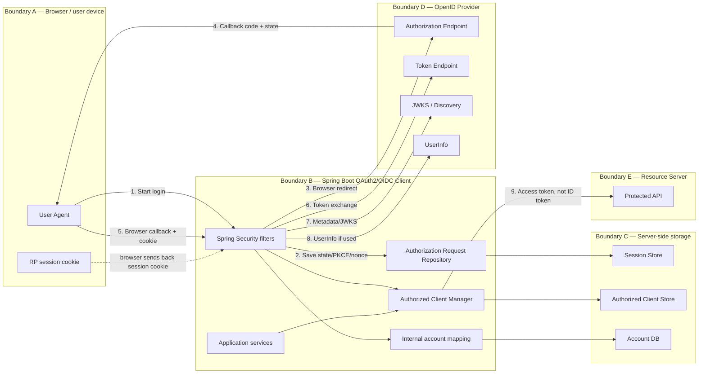
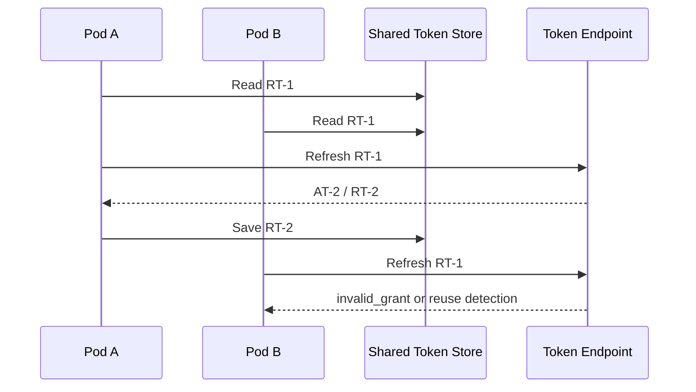
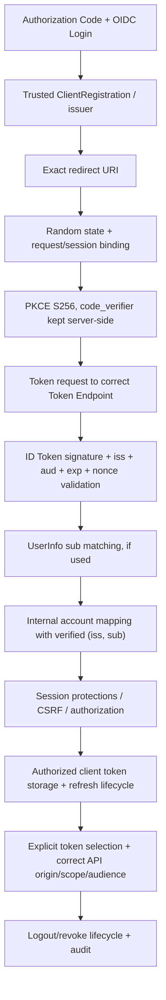

# 27.1. Threat Model for OAuth2 Client and OIDC Relying Party

In a **Spring Security OAuth 2.0/OIDC Client** application, a working login screen only proves that a functional flow succeeded; it does not prove that the system is protected against scenarios such as **login CSRF**, **authorization code injection**, **OAuth2 mix-up**, **token theft**, **wrong issuer acceptance**, **cross-provider account confusion**, or **incomplete logout**. These risks are especially critical for web applications that call APIs on behalf of users, store long-lived refresh tokens, support multiple identity providers, or serve multiple tenants.

**Threat modeling** is the process of identifying assets to protect, actors, data flows, trust boundaries, attack types, impacts, and controls. The goal is not to list every conceivable vulnerability, but to build a model **accurate enough to design, implement, and test** the application.

This lesson focuses on two roles:

- **OAuth2 Client**: an application that requests permissions, receives, and uses access tokens/refresh tokens to call a Resource Server.
- **OpenID Connect Relying Party (OIDC RP)**: an application that uses OIDC to authenticate users via an OpenID Provider (OP), validates ID Tokens, and establishes internal Authentication.

A Spring Boot application can act in both roles simultaneously. In that case, **the attack surface spans from browser redirects, callbacks, HTTP sessions, the Token Endpoint, the UserInfo Endpoint, and the authorized client store to downstream APIs**.

> **Core thesis:** No single configuration such as `oauth2Login()`, `state`, or PKCE can replace an entire threat model. Security comes from **multiple controls coordinated across the right trust boundaries** and verified through both success and failure tests.

## 1. Learning Objectives

After this lesson, you will be able to:

1. Sketch the data flow of OAuth2 Authorization Code + OIDC Login in Spring Security.
2. Classify assets and actors: browser, RP, OP, Resource Server, proxy, session store, and token store.
3. Identify trust boundaries and assumptions that must not be overlooked.
4. Use STRIDE to analyze risks at each step of the protocol.
5. Explain how `state`, PKCE, `nonce`, redirect URI, and issuer validation solve **different problems**.
6. Distinguish threats across access tokens, refresh tokens, ID Tokens, session cookies, and authorization codes.
7. Design safeguards for multi-provider, multi-tenant, account linking, and logout scenarios.
8. Build a risk prioritization table, write security tests, and define monitoring/incident response capabilities.
9. Understand the limits of Spring Security's default mechanisms and which parts the application must handle itself.

This lesson does not provide an "OAuth2 hacking recipe." The scenarios are **defensive analysis simulations** aimed at detecting and preventing configuration or implementation flaws.

## 2. Defining System Scope Before Analysis

A threat model must describe **a specific system**. Under the same label "OAuth2 Client," there are many different architectures:

| Architecture | How tokens are obtained | Key concerns |
|---|---|---|
| Spring MVC server-side web app | Authorization Code, confidential client | Session cookie, callback, server-side token store |
| Spring WebFlux server-side app | Authorization Code, reactive components | WebSession, Reactor context, non-blocking token storage |
| Backend for Frontend (BFF) | Backend holds OAuth tokens, browser holds session cookie | CSRF, SSRF, session boundary, tokens not exposed to JS |
| SPA/public client | Browser uses Authorization Code + PKCE | XSS, browser token handling, no Client secret |
| Scheduled job | `client_credentials` or user-delegated refresh | Service principal, token persistence, rotation/race |
| Multi-provider RP | Multiple OIDC OPs | Mix-up, issuer/registration binding, account linking |
| Multi-tenant client | Issuer or credentials differ per tenant | Tenant isolation, dynamic discovery, token confusion |

In this lesson, the **primary model** is a **confidential Spring Boot web app/BFF** with server-side sessions and the Authorization Code Flow. We also note the differences when using WebFlux, browser-only apps, or background jobs.

### 2.1. Assumptions That Must Be Documented

For example:

- Browsers access the RP over HTTPS; a reverse proxy may terminate TLS.
- The RP trusts an explicitly configured set of issuers/OPs.
- Client secrets/keys exist only on the backend and are protected.
- Redirect URIs are registered with exact matching at the OP.
- The RP has a database or Redis to store sessions/authorized clients.
- The OP can provide OIDC Discovery/JWKS; there may be multiple tenants.
- The Reports API is a separate Resource Server that validates access tokens.
- Users may open multiple tabs and log in/out across multiple browser sessions.
- Some users have external connections running in the background via refresh tokens.

If an assumption does not hold, the threat model and control selection must be revised. For instance, a **public SPA cannot protect a Client secret like a confidential backend**, while a service-to-service job has no OIDC browser session to rely on.

## 3. Assets to Protect

A threat model starts from **assets**, not from the name of a library.

| Asset | Value and impact if compromised | Common location |
|---|---|---|
| **Local authenticated session** | Account takeover within the application | Cookie + `HttpSession`/`WebSession` |
| **Authorization code** | Can be misused to exchange for tokens if binding/PKCE is missing | Browser callback, RP |
| **Authorization request and `state`** | Binds the response to the original flow, prevents login CSRF | Session authorization request repository |
| **PKCE `code_verifier`** | Proof required to exchange the authorization code | RP, authorization request attributes |
| **OIDC `nonce`** | Binds the ID Token to the authentication request | Authorization flow and ID Token |
| **ID Token** | Proof of identity authentication at the RP; may contain PII | OIDC Authentication |
| **Access token** | Bearer credential for calling APIs | `OAuth2AuthorizedClient`, outbound requests |
| **Refresh token** | Credential to obtain new access tokens, usually longer-lived | Authorized client store |
| **Client secret/private key** | Identifies/authenticates the confidential Client at the AS | Secret manager/backend |
| **External identity mapping** | Links `(iss, sub)` to an internal account | Account/identity database |
| **Authorization policy** | Determines which resources a user has access to | Security configuration, business service |
| **Provider metadata/JWKS** | Source for locating endpoints/keys to verify tokens | Trusted issuer metadata/cache |
| **Audit/logs/backups** | May contain PII, tokens, or forensic evidence | Logging, monitoring, backup systems |

**Especially important distinction:** An ID Token is used to verify authentication; an access token is used to call a Resource Server; a refresh token is used to obtain new tokens; a session cookie is used to restore a local session. Never assume one credential can substitute for another.

### 3.1. Security Objectives

Objectives typically include:

- **Confidentiality:** tokens/secrets/sessions are not exposed to unauthorized actors.
- **Integrity:** callbacks, issuers, claims, account bindings, and permissions cannot be tampered with.
- **Authentication correctness:** the local principal reflects the OP-verified identity.
- **Authorization correctness:** access tokens and business access do not exceed granted permissions.
- **Session isolation:** different users/tenants/providers do not have their state mixed.
- **Availability:** login/refresh/API calls resist errors, abuse, and rate exhaustion at an appropriate level.
- **Auditability:** events can be traced without logging secret credentials.

You cannot infer "secure login" merely from an ID Token having a valid signature; the system must also enforce issuer, audience, session binding, and business authorization conditions.

## 4. Drawing the Data Flow Diagram (DFD) and Trust Boundaries



A **trust boundary** is where data moves from one zone to another and requires verification/privilege limitation. For example:

- The browser is an **untrusted environment**, even when requests carry cookies.
- The OP is an external system: the RP trusts **registered issuers** and verified token results, not arbitrary URLs/JSON supplied by the browser.
- The Resource Server may be a separate system with its own audience and scopes.
- Redis/database/token stores are secret-management systems, not "all storage locations are equivalent."
- A reverse proxy can alter scheme/host, causing redirect URIs or session cookies to lose binding.

### 4.1. Questions to Ask at Each Trust Boundary

| Boundary | Questions to answer |
|---|---|
| Browser → RP | Is CSRF protected? Does the session cookie have Secure/HttpOnly/SameSite? Which routes allow anonymous access? |
| RP → Authorization Endpoint | Does the endpoint come from a trusted issuer? Are redirect URI/`state`/PKCE correct? |
| OP → Browser → RP callback | Does the callback match the stored request? Could there be mix-up, code injection, or missing state? |
| RP → Token Endpoint | Are TLS, client authentication, code_verifier, and redirect URI correct? |
| RP ↔ Discovery/JWKS | Are issuer/JWKS URIs bound and not taken from untrusted claims? |
| RP → UserInfo | Does the token belong to the right provider? Does the `sub` claim match the ID Token? |
| RP → token/session store | Keys, TTL, encryption, access controls, multi-node concurrency? |
| RP → API | Does the access token match the resource, audience, and scope? Is there SSRF/token leakage? |
| RP → browser logout | Logout CSRF, open redirect, correct `end_session_endpoint`, correct ID Token hint? |

## 5. Actors and Adversary Capabilities

A good threat model must clearly state **attacker capabilities**. For example:

1. **External web attacker:** can create malicious pages, trick a victim's browser into clicking/opening links and sending cross-site requests; cannot directly read the RP's HttpOnly cookies.
2. **Malicious authenticated user:** holds a valid account but attempts to access another user's resources or unauthorized registrations/tenants.
3. **Operator of an untrusted OP or API:** attempts to make the RP send tokens/ID Tokens to endpoints they control if the RP allows unfiltered dynamic discovery.
4. **Attacker with frontend XSS:** can execute JS within the origin, call APIs using the session cookie, and read data on the page; HttpOnly restricts cookie reading but does not eliminate XSS.
5. **Attacker with read access to logs/backups/DB:** can obtain raw refresh tokens or session state if access controls/encryption are lacking.
6. **Network attacker or misconfigured proxy:** can observe metadata/callbacks or modify forwarded headers if TLS and proxy trust are misconfigured.
7. **Buggy/compromised internal job:** may use the wrong principal/registration or retry refresh tokens uncontrollably.

Do not assume an adversary can break TLS or standard JWT signatures without evidence. Conversely, do not assume all internal services or browser inputs are trustworthy just because "they are inside the system."

### 5.1. Entry Points to Inventory

```text
GET  /oauth2/authorization/{registrationId}
GET  /login/oauth2/code/{registrationId}
POST /logout
GET  /signed-out
GET  /api/...
POST /connect/{provider}
POST /disconnect/{connectionId}
GET  /.well-known/...  (owned by OP, external to RP)
POST /oauth2/token   (owned by OP, external to RP)
GET  /userinfo        (owned by OP, external to RP)
Outbound WebClient/RestClient calls
Background jobs, queue consumers
Admin-configured issuer/provider registration
Session store / authorized-client store
Log, tracing, backups, incident tooling
```

Not every app has all of the endpoints above. Only mark the attack surface that **actually exists** in your architecture.

## 6. Applying STRIDE to an OAuth2/OIDC Client

STRIDE is a tool for prompting risk categories:

| Category | Meaning | OAuth2/OIDC example |
|---|---|---|
| **S — Spoofing** | Impersonating an actor or principal | ID Token with wrong issuer accepted; attacker-controlled principal mapping |
| **T — Tampering** | Modifying data to alter flow semantics | Authorization callback does not match `state`; tampered redirect URI |
| **R — Repudiation** | Denying an action due to missing audit trail | Unable to determine who linked a provider or revoked a connection |
| **I — Information Disclosure** | Leaking data/credentials | Access token in logs, ID Token hint in URL, refresh token DB read |
| **D — Denial of Service** | Disrupting service availability | Login storm, refresh storm, JWKS/Token Endpoint dependency outage |
| **E — Elevation of Privilege** | Gaining unauthorized privileges | Account linked to wrong user, wrong-tenant token, trusting unverified raw roles claim |

**STRIDE does not replace OWASP ASVS, RFCs, or tests.** It is a systematic way of asking questions so you don't focus solely on "token theft."

### 6.1. Writing Concrete Threat Statements

Instead of writing vaguely "OAuth can be attacked," use the template:

> **Which Actor** can **control which data/step**, exploiting **which assumption or missing control**, affecting **which asset**, with **what business impact**?

Example:

> A web attacker tricks the victim's browser into submitting an authorization callback for a flow controlled by the attacker; if the RP does not bind the callback to the original authorization request and session, the victim may be logged into the attacker's account (login CSRF), resulting in actions performed under the wrong identity.

From the threat statement, design controls: store authorization requests per session, random `state` with verification, PKCE, issuer binding, and tests for callbacks with wrong session/state.

## 7. Threat Group 1 — login CSRF and session confusion

### 7.1. What Is Login CSRF?

Not every CSRF is "change password." With **login CSRF**, an attacker wants the victim to complete an authentication flow the victim did not initiate or bind the victim's session to **another account**.

A risk pattern:

```text
Attacker initiates OAuth2 flow for attacker's account
  -> Obtains an authorization response/code

Victim is tricked into sending callback to RP
  -> If RP does not verify state + authorization request
  -> RP may treat victim as logged in as attacker
  -> Victim enters sensitive data into attacker's account
```

This is a conceptual model to understand defensive goals. Actual attack details also depend on client authentication, PKCE, session binding, callback processing, and the provider.

### 7.2. Mandatory Controls to Maintain

- Generate `state` with sufficient entropy and bind it to the pending request.
- Store `OAuth2AuthorizationRequest` in a secure repository tied to the exact browser session/context.
- On callback, verify `state` and flow correlation before using `code`.
- Do not fall back to the most recent request if `state` is wrong.
- Do not accept a callback when the request has already been consumed/expired.
- Keep CSRF protection on browser-facing state-changing endpoints per policy.
- Do not remove the authorization request repository just to become "stateless" without an equivalent security-evaluated mechanism.

### 7.3. `state` Is Not a Session ID

`state` often appears in the authorization URL and callback; it does not replace the session cookie or authorization request metadata. Conversely, a valid cookie alone does not prove that a callback `code` belongs to the right flow.

```text
Session A -> authorization state=A1
Session B -> authorization state=B1

Callback state=A1 in Session B:
  must be rejected, not "fetch A's request because state matches"
```

### 7.4. Testing

- A callback without the original session must fail.
- A callback with any `state` different from the stored request must fail.
- Replaying a processed callback must not create a new session.
- Two authorization flows in the same session are handled according to design behavior; if the repository only stores one request, callback A must not be matched to request B.
- A custom authorization request repository must not look up requests by a global user-supplied key while ignoring session ownership.

## 8. Threat Group 2 — authorization code interception and PKCE

The Authorization Code travels over the front channel (browser redirect). An attacker may attempt to **intercept, substitute, or reuse** the code if there is a vulnerability in the browser, URI handler, logs, or application routing.

PKCE (Proof Key for Code Exchange, RFC 7636) binds the code to the Client that initiated the request:

```text
Client generates random code_verifier
      |
      +--> computes code_challenge = BASE64URL(SHA256(verifier))
      |
Authorization request sends code_challenge + method S256
      |
Authorization Server binds challenge to the code
      |
Token request sends code_verifier
      |
Authorization Server verifies before issuing tokens
```

### 8.1. What Problem Does PKCE Solve?

PKCE ensures that **a leaked authorization code is not enough to exchange for tokens** if the attacker does not have the corresponding verifier. It is especially critical for public clients, and OAuth2 Security BCP recommends widespread use for the Authorization Code Flow when supported.

### 8.2. PKCE Does Not Replace `state`, `nonce`, or Issuer Validation

| Mechanism | Primary threat mitigated |
|---|---|
| `state` | Callback/login CSRF and correlating the response with the request |
| PKCE `code_verifier` | Code interception/injection and exchanging codes outside the valid flow under applied protections |
| OIDC `nonce` | Replay/substitution of the ID Token within the OIDC authentication context |
| Issuer/registration binding | Authorization Server mix-up |
| Exact redirect URI registration | Authorization response sent to an unintended URI |
| Client authentication | Restricting the Token Endpoint to confidential Clients |

Do not write a custom resolver that preserves only `state` and drops the PKCE verifier or nonce from `OAuth2AuthorizationRequest`.

### 8.3. Why Use `S256`?

With `S256`, the code challenge is the hash of the verifier. The `plain` method does not provide the same level of verifier concealment. Prefer `S256` whenever the AS supports it and in accordance with current policy.

Do not hard-code the verifier or reuse the same string across users/flows. Do not log the verifier, treat the challenge as protocol metadata, and never pass the verifier in a front-channel URL.

### 8.4. Testing and Operations

- Token exchange with a wrong verifier is rejected.
- When a custom authorization request repository is changed, the verifier is still preserved properly.
- The redirect URI on the token request must follow the protocol and match the original flow.
- An authorization code must not be processed twice after callback.
- Do not put codes or raw callback URLs containing credentials into public logs and analytics.
- For native/mobile clients, check deep-link redirect interception and PKCE.

## 9. Threat Group 3 — redirect URI, open redirect, and mix-up

### 9.1. Redirect URI Is a Critical Control Point

The Authorization Server must restrict redirect URIs to those registered. For a web app:

```text
https://portal.example.test/login/oauth2/code/corp
https://portal.example.test/login/oauth2/code/partner
```

An overly broad configuration or an open redirect on the RP can cause the authorization response to land in an unintended destination.

Principles:

- Prefer exact-match registered URIs per AS/specification rules.
- Use HTTPS for browser-facing callbacks in production.
- Never take an arbitrary redirect URI from a user query parameter.
- Restrict wildcards and dynamic redirects, especially on the host.
- Do not let untrusted `Host`/`X-Forwarded-Host` headers influence public URIs.
- Token Endpoint exchange must be bound to the original redirect URI/request per policy.

### 9.2. Authorization Server Mix-Up in Multi-Provider Setups

Suppose the RP has two providers `corp` and `partner`. An attacker tries to make a response from provider A get processed as provider B, or cause the RP to send an authorization code/token request to the wrong Authorization Server.

Elements that must be bound together:

```text
authorization request state
  -> ClientRegistration ID
  -> expected issuer
  -> Authorization Endpoint
  -> Token Endpoint
  -> redirect URI
  -> OIDC ID Token issuer
```

For OAuth2 supporting issuer identification in the authorization response, the **RFC 9207 `iss` parameter** can help clients prevent mix-up when properly implemented. For OIDC, ID Token issuer validation is also crucial, but it **does not allow skipping the earlier binding of the authorization response/token endpoint**.

### 9.3. Do Not Select a Provider Solely from the Callback Path

Conceptually wrong:

```java
// Unsafe if relying solely on a user-controlled path/parameter:
String provider = request.getParameter("provider");
String tokenEndpoint = "https://" + provider + "/token";
```

If you need to select a ClientRegistration per tenant, you must have a **verified server-side mapping**, not simply concatenate URLs/issuers from browser input.

### 9.4. Reverse Proxy and Host Confusion

```text
Browser -> https://portal.example.test
Proxy   -> http://spring-app:8080
```

If the app does not handle forwarded headers properly, the redirect URI may become `http://spring-app:8080/login/oauth2/code/corp`. Conversely, if the proxy trusts an `X-Forwarded-Host` header sent directly by an Internet client, an attacker can influence URLs generated by the RP.

**Controls:** sanitize headers at the edge proxy, trust only known proxies, configure the appropriate Spring Boot forwarded-header strategy, and test the public base URL.

## 10. Threat Group 4 — Weakened OIDC ID Token Validation

The OIDC RP relies on the ID Token to identify the user. A JWT that "looks right" does not mean authentication is valid.

### 10.1. Conditions That Must Be Checked

Depending on the flow and OP, ID Token validation includes:

1. **Signature:** uses a valid algorithm and key per trusted configuration, without trusting arbitrary headers.
2. **Issuer `iss`:** matches the issuer of the selected ClientRegistration/OP.
3. **Audience `aud`:** contains the assigned Client ID; handle `azp` when required by the specification.
4. **Expiration `exp` and issued-at/time constraints:** token is still valid per clock skew policy.
5. **`nonce`:** matches the value generated by the RP when the flow uses nonce.
6. **Token type/algorithm:** do not accept `alg=none` or algorithms disallowed by policy.
7. **Flow-related constraints** such as hash claims when present and required for verification.
8. **UserInfo subject:** when using UserInfo, `sub` must match `sub` in the ID Token per OIDC.

Never parse a JWT payload yourself and treat `email`/`groups` claims as authorization proof before signature/issuer/audience are verified.

### 10.2. `iss` and `sub` Identify an External Identity

Two ID Tokens:

```json
{"iss":"https://id.tenant-a.example.test","sub":"123"}
```

```json
{"iss":"https://id.tenant-b.example.test","sub":"123"}
```

do not represent the same external identity merely because `sub` is identical. When linking to an internal account, use **verified `(iss, sub)`**, and do not auto-merge by email.

### 10.3. Token Substitution and Audience Confusion

An ID Token issued for Client A must not be accepted at Client B merely because the signature from the same issuer is valid. `aud` must match the Client ID of the verifying RP.

Similarly, an access token issued for `userinfo` is not automatically valid for the Reports API. **Never use an ID Token as an access token** to call downstream APIs.

### 10.4. `nonce` Does Not Replace `state`

`nonce` binds the ID Token to the OIDC Authentication Request; `state` binds the authorization response/callback to the original flow. A system needs the corresponding mechanism at each step.

If a custom authentication converter, resolver, or success handler drops nonce/state, the bug must not be "fixed" by disabling validation.

### 10.5. JWT Signature Validation and Key Rotation

The OP may rotate JWKs. The RP needs to:

- Fetch JWKS only from trusted issuer/provider metadata.
- Never fetch arbitrary JWK URLs from user-controlled `jku`/`x5u` values inside the token.
- Verify the appropriate key/algorithm.
- Cache/refresh JWKS per library/policy, without caching revoked keys permanently.
- Distinguish temporary OP key rotation errors from token forgery.
- Never turn `kid` into an unvalidated path/file/database query.

Prefer Spring Security/Nimbus default OIDC token validation on supported versions; do not write your own ID Token decoder using plain Base64.

## 11. Threat Group 5 — Discovery Metadata and SSRF

OIDC Discovery helps the RP locate the Authorization Endpoint, Token Endpoint, JWKS, UserInfo, and capabilities from the issuer.

A client with fixed issuers:

```yaml
spring:
  security:
    oauth2:
      client:
        provider:
          company-op:
            issuer-uri: https://identity.company.example.test/realms/main
```

has a simpler trust boundary than a system that allows users to input arbitrary issuers.

### 11.1. Dynamic Discovery Threats

If the RP accepts:

```text
POST /register-provider
{"issuer":"http://127.0.0.1:..."}
```

and the backend automatically fetches metadata, JWKS, and the Token Endpoint without validation, SSRF and token/credential exfiltration can occur.

Treat all endpoint URLs inside metadata from an **untrusted** issuer as untrusted data until the issuer has been verified and accepted by policy.

### 11.2. Controls for Dynamic Issuers

If tenant-managed issuers must be supported:

- Use an allowlist of domains/issuer patterns per explicit policy.
- Require HTTPS and validate TLS/hostname.
- Disallow endpoints pointing to loopback, link-local, metadata services, or unnecessary internal networks.
- Control DNS rebinding and redirect chains via HTTP client policy.
- Verify metadata `issuer` matches the expected issuer.
- Limit metadata/JWKS payload size, timeouts, redirects, and key counts.
- Never send a Client secret to a Token Endpoint from an unapproved issuer.
- Restrict provider configuration permissions to authorized admins/tenant owners.
- Audit changes to issuers/ClientRegistrations.

Broad wildcard issuer matching cannot replace exact issuer binding.

### 11.3. The Token Endpoint Is Especially Sensitive

In a confidential Client, a Token Endpoint request may carry a **Client secret/private-key assertion**, authorization code, or refresh token. If the endpoint is replaced with an attacker host, the consequences are far more severe than a UI link bug.

Do not construct the Token Endpoint by string concatenation from a browser-supplied `iss` or unverified claim.

## 12. Threat Group 6 — Token Leakage in Client and Outbound HTTP

A Bearer access token allows whoever holds it to perform requests within its scope. An OAuth2 Client must prevent token leakage via:

- Browser JS/DOM, if the architecture does not require exposing tokens to the frontend.
- Query strings, inappropriate URL fragments, and redirect logs.
- `Authorization` headers sent to the wrong HTTP origin.
- Reverse proxy/access logs/APM/traces.
- Exception messages or error responses returned to the frontend.
- Token stores, backups, heap dumps, or debugging endpoints.
- Message queues containing raw tokens.
- Redirect-following HTTP clients with unsafe header-forwarding policies.

### 12.1. WebClient Explicit Authorized Client Selection

With Spring Security Servlet + WebClient:

```java
import org.springframework.context.annotation.Bean;
import org.springframework.security.oauth2.client.registration.ClientRegistrationRepository;
import org.springframework.security.oauth2.client.web.OAuth2AuthorizedClientRepository;
import org.springframework.security.oauth2.client.web.reactive.function.client.ServletOAuth2AuthorizedClientExchangeFilterFunction;
import org.springframework.web.reactive.function.client.WebClient;

@Bean
WebClient reportsWebClient(
        ClientRegistrationRepository registrations,
        OAuth2AuthorizedClientRepository authorizedClients) {

    var oauth2 = new ServletOAuth2AuthorizedClientExchangeFilterFunction(
        registrations, authorizedClients
    );

    return WebClient.builder()
        .baseUrl("https://reports-api.example.test")
        .apply(oauth2.oauth2Configuration())
        .build();
}
```

Calling the API:

```java
import static org.springframework.security.oauth2.client.web.reactive.function.client.ServletOAuth2AuthorizedClientExchangeFilterFunction.clientRegistrationId;

Mono<String> body = reportsWebClient.get()
    .uri("/v1/reports")
    .attributes(clientRegistrationId("reports"))
    .retrieve()
    .bodyToMono(String.class);
```

`reports` must be a ClientRegistration with appropriate scopes/audience and authorized by the user/service. If the login registration is `corp` while the API uses a token from `reports`, that can be the right design; do not force every API call to use the login provider.

### 12.2. Risks of the Default Authorized Client

```java
oauth2.setDefaultOAuth2AuthorizedClient(true);
```

can cause WebClient to automatically attach the current Authentication's token to requests that do not specify an authorized client. With a shared WebClient calling multiple domains, that risks sending a Bearer token to a partner that should not receive it.

**Controls:** use dedicated WebClients per downstream host, explicit registration per request, and never let the browser supply arbitrary absolute URLs.

### 12.3. SSRF Plus Token Exfiltration

Risk pattern:

```java
// Do not pass an untrusted absolute URL to an OAuth2-enabled WebClient.
webClient.get()
    .uri(userSuppliedUrl)
    .attributes(clientRegistrationId("company"))
    .retrieve();
```

An attacker does not need to read the raw token if they can make the backend send the token to a host they control. Restricting outbound destinations, DNS/network egress, and cross-origin redirects are critical controls.

### 12.4. Do Not Log Tokens, Cookies, or Raw Callback URLs

Unsafe log example:

```text
Authorization: Bearer eyJ...
refresh_token=...
id_token_hint=eyJ...
Cookie: JSESSIONID=...
GET /login/oauth2/code/company?code=...
```

A better log:

```text
event=oauth2_api_call
registrationId=reports
downstreamService=reports-api
httpStatus=401
oauthErrorCategory=invalid_token
traceId=independent-random-id
```

Do not use token values, `state`, authorization codes, or session IDs as trace IDs. Login metadata should also be limited if it contains PII or sensitive tenant information.

## 13. Threat Group 7 — Refresh Token Storage, Rotation, and Replay

A refresh token can allow obtaining new access tokens after the browser session expires. If leaked, the impact can last longer than a short-lived access token.

### 13.1. Choosing a Token Store Based on the Threat Model

| Storage | Strengths | Risks |
|---|---|---|
| `InMemoryOAuth2AuthorizedClientService` | Simple, no persistent DB | Tokens lost on restart; isolated per pod; heap dump |
| `HttpSessionOAuth2AuthorizedClientRepository` | Binds authorized client to HTTP session | Cookie/session theft; session expiry; replication |
| `JdbcOAuth2AuthorizedClientService` | Persists across restarts, shared by multiple instances | DB breach, backups, migrations, concurrency |
| Reactive session/service implementations | Fits WebFlux | Reactor context, shared store, serialization/timeout |

Choosing the right store does not automatically solve principal ownership bugs, provider mix-up, or refresh token replay.

### 13.2. Refresh Token Rotation

```text
RT-1 -> Token Endpoint -> AT-2 + RT-2
             |
             +-- RT-1 may be invalidated
```

In many systems, refresh token rotation helps detect reuse. However, if two pods concurrently use RT-1:



Do not assume a shared JDBC database provides **single-flight refresh** out of the box. You may need per-connection locking, optimistic versioning, distributed coordination, and error handling that does not overwrite a newer token with an older one.

### 13.3. Preventing Replay and Token Theft

- Protect refresh tokens with encryption at rest, least privilege, and backup controls.
- Use refresh token rotation or sender-constrained tokens if the provider supports them and the threat model requires them.
- Limit scopes and lifetime; request offline access only when necessary.
- Delete/invalidate the right authorized client when the user disconnects/revokes.
- Do not retry `invalid_grant` indefinitely with an old refresh token.
- Separate service account credentials from user-delegated tokens.
- Protect Token Endpoint Client authentication.

### 13.4. Sender-Constrained Tokens

Mechanisms like **mTLS** or **DPoP** can bind tokens to a Client key, reducing misuse of raw Bearer tokens if the provider/Resource Server supports them. This is an optional capability and does not appear automatically simply by using Spring Security OAuth2 Client.

Do not claim you have DPoP/mTLS if the Client/OP/API has not actually implemented and tested proof validation and key management.

## 14. Threat Group 8 — Session Fixation, CSRF, and Cookie Policy

After OIDC login, the RP typically establishes a local session. If the session is hijacked, an attacker can call RP endpoints as the user, even without obtaining a refresh token.

### 14.1. Cookie Protection

- **`Secure`:** browsers send the cookie only over HTTPS.
- **`HttpOnly`:** restricts JavaScript from reading the cookie, though it does not eliminate XSS.
- **`SameSite`:** reduces certain cross-site cookie transmissions; must remain compatible with the login redirect flow.
- **Path/Domain:** limits where the cookie is sent, avoiding overly broad scopes.
- **Session timeout:** balances UX against the window during which an attacker can abuse a session.
- **Session ID rotation/fixation protection:** prevents using a session identifier fixed by an attacker prior to authentication.

### 14.2. SameSite and OIDC Callbacks

The Authorization Code Flow typically uses a top-level GET callback, so `SameSite=Lax` is usually appropriate. However, if the OP uses `response_mode=form_post`, the callback is a cross-site POST and a `Lax` cookie may not be sent.

Do not switch all cookies to `SameSite=None` without evaluating CSRF, HTTPS, browser policies, and response mode support. `SameSite=None` requires `Secure` under modern browser policies.

### 14.3. Which Endpoints Does CSRF Protect?

A form POST:

```http
POST /settings/update
Cookie: SESSION=...
```

automatically includes cookies sent by the browser; if the endpoint lacks proper CSRF protection, an attacker can trick the victim's browser into submitting state changes.

A BFF or session-based RP should keep CSRF protection on browser-facing state-changing endpoints. Having an outbound WebClient use Bearer tokens **does not make browser CSRF disappear**.

### 14.4. Logout CSRF

If logout is performed via an unguarded GET, an attacker can force a victim to log out or trigger unintended disconnections. With Spring Security CSRF enabled, logout typically uses POST with the appropriate token. Do not disable CSRF just to create a simple logout link.

### 14.5. Distributed Session Store

If login starts on pod A and the callback lands on pod B, the authorization request/state must still be found in the right session; if local in-memory sessions are not shared, login can fail. Use Spring Session/Redis or appropriate routing/affinity, while also securing Redis ACLs, TLS, serializer, namespace, and TTL.

A shared session store **does not automatically** mean the authorized client service is shared; verify the exact token storage used.

## 15. Threat Group 9 — Account Linking and Multi-Provider Identity Confusion

Account linking is often riskier than "adding another login provider" because it determines **which internal account owns which external identity and tokens**.

### 15.1. Risk Scenario

1. User is logged into internal account A.
2. User clicks "Connect Partner."
3. Browser completes the OAuth2/OIDC flow with external account B.
4. The application **fails to bind the callback to a pending link context** or relies automatically on email.
5. External account B is linked to the wrong internal account, or the user is unexpectedly logged in as B.

This can become a form of account-linking CSRF/mis-binding, leading to data exposure or wrong ownership.

### 15.2. Account Linking Controls

- Require an authenticated user; for sensitive links, consider reauthentication.
- Create a server-side pending link context tied to the internal account, session, registration, and purpose.
- Preserve state/PKCE/nonce as in a standard OAuth2/OIDC flow.
- Verify the external identity `(iss, sub)` before linking.
- Do not auto-link solely by email, even with `email_verified=true`.
- Do not allow one external identity to be linked simultaneously to two internal accounts against policy.
- Use unique constraints and transactions to prevent race conditions.
- Separate **linking an external connection** from **changing the local login principal**.
- Provide auditing, notifications, unlink/revoke, and recovery paths.

### 15.3. Suggested Data Keying

```sql
-- Conceptual model; adjust schema/dialect to your real system.
CREATE TABLE external_identity (
    id BIGINT GENERATED ALWAYS AS IDENTITY PRIMARY KEY,
    internal_account_id BIGINT NOT NULL,
    issuer VARCHAR(1000) NOT NULL,
    subject VARCHAR(500) NOT NULL,
    UNIQUE (issuer, subject)
);
```

A unique constraint prevents two rows with the same external identity, but it **does not replace** verifying ownership and authorization before insert/update.

### 15.4. OAuth2 Login Registration Differs from API Registration

A user logs into the portal via `corp` and grants Calendar access via `google-calendar`:

```text
loginRegistrationId = corp
apiRegistrationId   = google-calendar
logoutProvider      = corp (when logging out of the portal)
disconnectProvider  = google-calendar (when disconnecting Calendar)
```

Do not send the Calendar token to the Corp Resource Server, do not use the Corp ID Token hint to log out of Google, and do not switch the portal principal when merely linking an API.

## 16. Threat Group 10 — Logout, Revocation, and Session Lifecycle

Logout has multiple layers:

1. **Local logout:** clears the RP's SecurityContext/session.
2. **RP-Initiated OIDC Logout:** redirects the browser to the OP's `end_session_endpoint` if the provider supports it.
3. **Token revocation:** Client asks the AS to invalidate tokens/grants via the revocation endpoint if supported.
4. **Front-/back-channel logout:** OP notifies other RPs when implemented.
5. **Business disconnect:** the application removes/manages an external connection and tokens for a service.

### 16.1. Dangerous Assumptions

- "Clearing the local session means the OP SSO session is gone."
- "Calling `end_session_endpoint` means all refresh tokens have been revoked."
- "Deleting a token from the DB means the Resource Server immediately rejects the old access token."
- "One browser logout can log out all other browsers and devices."
- "All OIDC providers have an `end_session_endpoint`."

None of these assumptions are guarantees of OIDC/OAuth2.

### 16.2. `end_session_endpoint` and `id_token_hint`

OIDC Discovery may publish `end_session_endpoint` for RP-Initiated Logout; this field is **optional**. Spring provides:

- Servlet: `OidcClientInitiatedLogoutSuccessHandler`.
- Reactive: `OidcClientInitiatedServerLogoutSuccessHandler`.

The handler must determine the correct OP from Authentication/ClientRegistration. `id_token_hint` is the **ID Token** associated with that OP; never pass an access token or an ID Token from a different issuer.

A `post_logout_redirect_uri` usually must be registered/approved. Never accept an arbitrary redirect URI from the browser, to avoid open redirects.

### 16.3. Maintain a Local Logout Fallback

If the OP does not support RP-Initiated Logout, the RP must still perform local logout properly and clearly communicate the logout scope. Never concatenate `issuer + "/logout"` or skip session cleanup waiting on the OP.

### 16.4. The Logout Threat Model Must Include Offline Access

If a user grants permission for background Calendar sync, the refresh token may still remain after local session logout. The application must define:

- Does logging out of the portal keep the API connection active?
- Must disconnecting Calendar call the revocation endpoint?
- When disabling an internal account, which jobs/tokens must stop?
- When a refresh token is revoked, does the UI show `RECONNECT_REQUIRED`?
- How long until an old access token is actually no longer accepted by the API?

## 17. What Spring Security Helps With — and What It Does Not

Spring Security provides many components that handle **protocol plumbing** correctly when configured properly:

- OAuth2 Authorization Code Login filters.
- Authorization request repositories.
- ClientRegistration metadata handling.
- OIDC ID Token validation via configured decoders/validators.
- `OAuth2AuthenticationToken` and `OidcUser`.
- `OAuth2AuthorizedClientService`/repository/manager.
- OAuth2 integration for WebClient/RestClient.
- Logout handlers for sessions and OIDC RP-Initiated Logout.

However, Spring Security **does not know on its own**:

- Whether internal account A owns Calendar connection X.
- Whether an external `(iss, sub)` is allowed to link to an internal user.
- Which audience/scopes the Reports API requires in business logic.
- Whether logout should revoke tokens for all external connections.
- Which encryption/KMS/backup retention the token store requires.
- Whether a dynamic issuer from a tenant admin is safe.
- Whether a user-entered URL is an allowed downstream host.
- Whether refresh token rotation needs distributed locking across multiple nodes.

The threat model must clearly separate **framework controls** from **application responsibilities**.

## 18. Spring Security Servlet: Safe Baseline Configuration

Spring Boot 3.x example with OIDC Login:

```yaml
spring:
  security:
    oauth2:
      client:
        registration:
          company:
            provider: company-op
            client-id: ${OIDC_CLIENT_ID}
            client-secret: ${OIDC_CLIENT_SECRET}
            client-authentication-method: client_secret_basic
            authorization-grant-type: authorization_code
            redirect-uri: "{baseUrl}/login/oauth2/code/{registrationId}"
            scope:
              - openid
              - profile
        provider:
          company-op:
            issuer-uri: https://identity.example.test/realms/company
```

Configuration:

```java
import org.springframework.context.annotation.Bean;
import org.springframework.context.annotation.Configuration;
import org.springframework.security.config.Customizer;
import org.springframework.security.config.annotation.web.builders.HttpSecurity;
import org.springframework.security.web.SecurityFilterChain;

@Configuration
public class SecurityConfiguration {

    @Bean
    SecurityFilterChain securityFilterChain(HttpSecurity http)
            throws Exception {

        return http
            .authorizeHttpRequests(authorize -> authorize
                .requestMatchers("/", "/error", "/signed-out").permitAll()
                .requestMatchers("/admin/**").hasRole("ADMIN")
                .anyRequest().authenticated()
            )
            .oauth2Login(Customizer.withDefaults())
            .oauth2Client(Customizer.withDefaults())
            .logout(logout -> logout
                .logoutSuccessUrl("/signed-out")
            )
            .build();
    }
}
```

This configuration preserves Spring's default CSRF/session controls instead of disabling them. **Do not treat this snippet as a complete production configuration:** you still need to define authorization policies, cookie settings, authorized client store, proxy trust, monitoring, and provider contracts.

### 18.1. Do Not Disable CSRF Just Because You Have OAuth2 Login

Do not reflexively add:

```java
// Not recommended as a default for a browser-session app:
http.csrf(csrf -> csrf.disable());
```

A backend receiving requests from browsers with cookies still has a CSRF attack surface. If there are genuinely stateless endpoints using Bearer tokens, you can use multiple security chains with appropriate policies rather than disabling CSRF system-wide by instinct.

### 18.2. Business Authorization Is a Separate Layer

`hasRole("ADMIN")` is a URL/method-level control, but resource ownership must still be checked.

For example, a user having permission to view reports does not mean they can access another user's `/reports/{reportId}`. Controllers/services must verify account/tenant/ownership based on the verified principal.

### 18.3. In an OIDC RP, Never Replace Verified Claims with Email

A custom `OidcUserService` can map users to internal accounts. When creating new accounts or linking identities, use `(iss, sub)` from the Spring-verified ID Token and database uniqueness constraints; never auto-link solely because emails match.

## 19. Spring WebFlux: Differences in the Threat Model

WebFlux has corresponding components:

| Servlet Spring MVC | Reactive WebFlux |
|---|---|
| `SecurityFilterChain` | `SecurityWebFilterChain` |
| `HttpSecurity` | `ServerHttpSecurity` |
| `HttpSession` | `WebSession` |
| `HttpSessionOAuth2AuthorizationRequestRepository` | `WebSessionOAuth2ServerAuthorizationRequestRepository` |
| `OAuth2AuthorizedClientRepository` | `ServerOAuth2AuthorizedClientRepository` |
| `ServletOAuth2AuthorizedClientExchangeFilterFunction` | `ServerOAuth2AuthorizedClientExchangeFilterFunction` |
| `OidcClientInitiatedLogoutSuccessHandler` | `OidcClientInitiatedServerLogoutSuccessHandler` |
| Servlet SecurityContext holder conventions | `ReactiveSecurityContextHolder` / Reactor context |

### 19.1. Reactive Security Chain

```java
import org.springframework.context.annotation.Bean;
import org.springframework.security.config.Customizer;
import org.springframework.security.config.web.server.ServerHttpSecurity;
import org.springframework.security.web.server.SecurityWebFilterChain;

@Bean
SecurityWebFilterChain reactiveSecurity(ServerHttpSecurity http) {

    return http
        .authorizeExchange(exchanges -> exchanges
            .pathMatchers("/", "/error", "/signed-out").permitAll()
            .anyExchange().authenticated()
        )
        .oauth2Login(Customizer.withDefaults())
        .oauth2Client(Customizer.withDefaults())
        .build();
}
```

### 19.2. Reactor Context Is a Boundary

Do not read ThreadLocal `SecurityContextHolder` in Servlet style and assume a user Authentication is always present across every asynchronous operation. When a background job runs outside a request, provide a dedicated trusted principal/connection context.

Also, do not call `block()` on the Netty event-loop to fetch sessions, tokens, or issuer metadata. An unwrapped blocking token store can make the entire application vulnerable to DoS under load.

### 19.3. Reactive Authorized Client Storage

`WebSession`, the reactive authorized-client service, and shared Redis/DB have different lifecycles. Losing `WebSession` at callback time can leave the flow missing its authorization request, even if the token service still holds data from an earlier session. Never fix missing state by bypassing callback validation.

## 20. Threat Registry: Actionable Risk Prioritization

To decide what to address first, you can use qualitative **likelihood × impact**. The following table is an **example for a multi-provider BFF with refresh token persistence**, not a universal conclusion for all applications.

| ID | Threat | Likelihood | Impact | Illustrative Priority | Primary Control |
|---|---|---|---|---|---|
| T01 | Login CSRF / unbound callback | Medium | High | High | `state`, session-bound authorization request, reject invalid callback |
| T02 | Authorization code leaked/exchanged outside flow | Medium | High | High | PKCE S256, exact redirect URI, one-time code |
| T03 | Mix-up across OPs | Medium | High | High | registration/issuer binding, ID Token `iss`, RFC 9207 when supported |
| T04 | ID Token validator skips `aud`/signature/nonce | Low–Medium | Very High | High | Trusted decoder/validators, negative tests |
| T05 | SSRF via dynamic discovery | Medium if dynamic issuer exists | Very High | High | Allowlist issuer/endpoints, egress controls |
| T06 | Bearer token sent to wrong API host | Medium | High | High | Explicit authorized client, base URL allowlist |
| T07 | Refresh token leaked from DB/logs | Medium | Very High | High | Encryption, access controls, redaction, rotation |
| T08 | Refresh rotation race | Medium | Medium–High | Medium/High | Single-flight/locking, storage versioning |
| T09 | Account linking by email | Medium | Very High | High | Verified `(iss, sub)`, explicit linking, ownership |
| T10 | Session cookie hijacked | Medium | High | High | Secure/HttpOnly/SameSite, fixation protection, timeout |
| T11 | Logout assumed to revoke all tokens | High if misunderstood | Medium–High | Medium/High | Distinguish logout/revocation, policy and tests |
| T12 | JWKS/Token Endpoint outage causes DoS | Medium | Medium | Medium | Timeouts, bounded retries, monitoring |
| T13 | Tenant A uses Tenant B's token | Low–Medium | Very High | High | Tenant isolation, principal ownership, tests |
| T14 | Metadata PII/credentials in telemetry | Medium | High | High | Data classification, log redaction, retention |

**How to use:** adjust likelihood and impact to your actual architecture, exposure, existing controls, and business domain. Do not use false-precision numeric scores to mask unknown assumptions.

### 20.1. Recording as a Risk Record with an Owner

A record should include:

```yaml
id: T06
title: "Bearer token sent to wrong-origin API"
asset: "user access token"
entryPoint: "WebClient outbound request"
trustBoundary: "Spring backend -> external HTTP origin"
attackerCapability: "influence outbound URL"
preconditions:
  - "OAuth2 filter auto-attaches token to shared WebClient"
impact: "token disclosure, unauthorized API calls"
controls:
  - "WebClient per trusted origin"
  - "explicit clientRegistrationId or OAuth2AuthorizedClient"
  - "egress / redirect policy"
tests:
  - "absolute untrusted URL rejected"
  - "Authorization header never reaches another origin"
owner: "API integration team"
status: "mitigation planned"
```

This is a **sample risk record**, not a system YAML file or a mandatory standard. What matters is having an owner, controls, and test evidence.

## 21. Relationships Between Controls: Don't Check One Point and Ignore the Rest

A secure OAuth2/OIDC flow requires multiple layers:



Missing one link can weaken the entire system, even when all other links are present.

For example:

- Having PKCE without verifying `state` → callback/login CSRF risk remains depending on flow.
- Having JWT signature validation without `aud` → tokens issued for another Client may be accepted.
- Having `state` while sending tokens to a wrong origin → access token still leaks.
- Having an HttpOnly session cookie while XSS exists → attacker can act using the active session.
- Having JDBC encryption at rest while logs record refresh tokens → credentials still leak.
- Having OP logout without revoking offline grants → background tokens may remain valid per policy.

## 22. Security Testing Driven by the Threat Model

Security tests need **negative scenarios**, not just asserting HTTP 302 and successful login.

### 22.1. Tests for Authorization Initiation/Callback

- A non-existent registration ID is rejected.
- A callback with a wrong or missing `state` is rejected.
- A callback from a different session cannot find the authorization request.
- An authorization code cannot be used twice.
- A wrong/missing PKCE verifier causes the flow to be rejected.
- A wrong redirect URI is detected.
- A valid code with the wrong provider/issuer is rejected.
- Replaying a callback does not create a new session.
- Multi-tab login has documented and tested behavior.

### 22.2. Tests for OIDC Tokens and UserInfo

- An ID Token with an invalid signature is rejected.
- A mismatched `iss` against the expected issuer is rejected.
- An `aud` without a valid Client ID is rejected.
- An expired token is rejected.
- A mismatched nonce is rejected in flows requiring nonce.
- `alg=none` or disallowed algorithms are rejected.
- UserInfo `sub` differing from ID Token `sub` is rejected.
- Unverified role/email claims cannot escalate privileges.
- JWKS rotation is handled per policy without skipping signature validation.

### 22.3. Tests for Session and Authorization

- Cookies have `Secure`, `HttpOnly`, and `SameSite` matching deployment.
- Login triggers session fixation protection per policy.
- State-changing POST endpoints without a CSRF token are blocked when policy requires it.
- User A cannot read User B's resources.
- Tenant A cannot use Tenant B's authorized client.
- Local logout actually clears Authentication/session as configured.
- The `/signed-out` page does not trigger an auto-login loop.

### 22.4. Tests for Token/API Integrations

- Public WebClient attaches no Bearer token.
- Token for API A is not sent to API B's host.
- API token with wrong audience/scope is rejected at the Resource Server.
- Refresh token rotation saves the new token without stale writes.
- `invalid_grant` is not retried indefinitely.
- Invalid/revoked connections transition to the appropriate reauthorize policy.
- Background jobs do not look up tokens solely from a queue-payload-supplied principal.
- Logs/traces contain no raw credentials.

### 22.5. Tests for Multi-Provider/Account Linking

- Corp login picks the right Corp Token Endpoint/issuer.
- Partner login picks the right Partner Token Endpoint/issuer.
- A Partner ID Token cannot be used at the Corp logout endpoint.
- Identical `sub` across different issuers is not auto-merged.
- Matching email does not auto-link accounts.
- An already-linked external identity cannot be attached to another account against policy.
- A linking callback with the wrong pending context is rejected.
- Switching registration ID does not reuse another Client's token.

## 23. Small Test Example with Spring Security Test

The snippet below illustrates protecting a **business endpoint** with authentication; this test does not replace OAuth2 protocol testing with a mock OP.

```java
import org.junit.jupiter.api.Test;
import org.springframework.beans.factory.annotation.Autowired;
import org.springframework.boot.test.autoconfigure.web.servlet.AutoConfigureMockMvc;
import org.springframework.boot.test.context.SpringBootTest;
import org.springframework.test.web.servlet.MockMvc;

import static org.springframework.security.test.web.servlet.request.SecurityMockMvcRequestPostProcessors.oidcLogin;
import static org.springframework.test.web.servlet.request.MockMvcRequestBuilders.get;
import static org.springframework.test.web.servlet.result.MockMvcResultMatchers.status;

@SpringBootTest
@AutoConfigureMockMvc
class PortalAuthorizationTest {

    @Autowired
    MockMvc mvc;

    @Test
    void anonymousCannotReadPrivateReports() throws Exception {
        mvc.perform(get("/reports/private"))
            .andExpect(status().is3xxRedirection());
    }

    @Test
    void authenticatedUserCanReachReportsController() throws Exception {
        mvc.perform(get("/reports/private").with(oidcLogin()))
            .andExpect(status().isOk());
    }
}
```

**This is an illustrative structure assuming the endpoint exists, not an executed test.** Actual endpoints, rules, and response codes may differ; `oidcLogin()` creates a mock authenticated principal and **does not** test real ID Token signatures, issuer, `state`, PKCE, or the Token Endpoint.

To test those protocol mechanisms, you need a controlled mock/stub OP/JWKS/Token Endpoint or end-to-end integration tests against a test tenant.

### 23.1. Why Mock Login Tests Are Not Enough

`oidcLogin()` in Spring Security Test is very useful for simulating a principal for controller/method authorization. However, it does not execute browser redirects, authorization code exchange, or full default ID Token validation. A threat model requires **both unit/method security tests and protocol-flow tests**.

### 23.2. How to Test Callbacks at the Integration Level

A workflow:

1. Call the authorization initiation endpoint.
2. Capture the test session cookie and `state`.
3. Mock the OP returning an authorization response/code.
4. Mock a valid Token Endpoint/JWKS/ID Token for the success case.
5. Verify login creates an Authentication for the right issuer/sub/registration.
6. Create negative cases: state mismatch, wrong issuer, wrong audience, nonce mismatch, missing session.
7. Never use real tokens/secrets in fixtures or logs.

## 24. Monitoring, Audit, and Incident Response

A system needs early detection of misconfiguration or misuse:

| Signal | What it may indicate |
|---|---|
| Spike in `invalid_state` | Session loss, multi-tab contention, or callback abuse |
| Frequent `invalid_grant` on refresh | Expired/revoked token, rotation race, or reuse |
| Frequent `invalid_token` at API | Wrong audience/issuer, token lifetime, credential misuse |
| Login redirect mismatch | Wrong proxy/public URL or registration drift |
| Multiple accounts linked to same external identity | Race condition/policy violation |
| Sudden provider metadata change | Configuration drift or issuer compromise |
| Repeated JWKS fetch failures | OP outage, DNS/TLS issue, or bad cache |
| Token Endpoint request spike | Retry storm, unauthorized clients, or rate exhaustion |
| Logout failure/SSO re-login loop | Session/OP mismatch or signed-out routing issue |
| Bearer token ever logged | Credential leak requiring incident response |

### 24.1. Auditing Without Logging Secrets

Logs may contain:

```text
event=oidc_login_success
registrationId=corp
issuerCategory=enterprise-op
accountResolution=existing
flowCorrelationId=internal-random-uuid

event=oauth2_refresh_failure
registrationId=calendar
errorCategory=invalid_grant
connectionState=RECONNECT_REQUIRED

event=oidc_logout_started
loginRegistrationId=corp
opRedirectPrepared=true
```

Never store full authorization callback URLs, refresh tokens, access tokens, ID Tokens, session cookies, or `code_verifier` in audit logs.

### 24.2. Suspected Refresh Token Exposure Incident

A defensive playbook:

1. Restrict access and preserve evidence securely.
2. Identify which tokens/Clients/issuers/connections are affected, **without putting tokens into tickets**.
3. Revoke tokens/grants at the OP when supported; check refresh-token family policy.
4. Delete/invalidate local authorized clients for the affected connections.
5. Rotate Client credentials if a Client secret was exposed.
6. Inspect API access logs at the metadata level to detect anomalous access.
7. Notify users/admins per policy.
8. Patch the leak source: log redaction, storage ACLs, outbound URL policy, proxy config.
9. Re-test protective controls and monitoring.
10. Review backups/traces/caches where credentials may still exist.

**Do not treat deleting a DB row as the sole revocation measure**, because a copied token may still be accepted by the AS/API until revoked or expired.

## 25. Workshop: Building a Threat Model for a Three-Provider Portal

Suppose the portal has:

```text
Portal:
  Spring Boot MVC, confidential OAuth2 Client
  Corp OIDC Login
  Partner OIDC Login
  Local sessions in Redis

Integrations:
  Calendar API (user-delegated offline access)
  Reports API (client_credentials job)
  Authorized client store in PostgreSQL

Infrastructure:
  Reverse proxy terminating TLS
  3 app pods
  External OPs and APIs
```

### 25.1. Step A — Classify Assets

Record:

- RP sessions.
- External identity mappings.
- Client secrets and KMS keys.
- ID Tokens, access/refresh tokens.
- API/tenant data.
- Authorization policy and audit logs.

### 25.2. Step B — Draw Trust Boundaries

Select five zones:

1. Browser.
2. Proxy/Spring app.
3. Redis/PostgreSQL.
4. Corp/Partner OPs.
5. Calendar/Reports APIs.

### 25.3. Step C — Formulate Threat Statements

Examples:

- T1: Browser callback with wrong session/state.
- T2: Partner ID Token accepted under Corp registration.
- T3: User A links a Calendar external account already belonging to User B.
- T4: Calendar refresh token appears in SQL logs.
- T5: Two pods refresh the same RT-1 and trigger rotation reuse.
- T6: WebClient sends the Calendar token to a browser-supplied URL.
- T7: Local logout leaves offline jobs running contrary to user-consented policy.
- T8: Proxy trusts external forwarded host, producing wrong redirect URLs.

### 25.4. Step D — Build the Risk Register

Each threat has:

```text
ID
Asset/Impact
Threat actor/capability
Entry point/trust boundary
Preconditions
Existing control
Residual risk
Mitigation/owner
Test evidence
Monitoring signal
```

### 25.5. Step E — Define "Done"

A threat should only be considered controlled when:

- There is a concrete configuration/implementation.
- There is a negative test or equivalent evidence.
- There is an owner/residual risk assessment.
- There is monitoring where needed.
- There is a fallback plan when the provider/storage fails.

Do not mark something "resolved" just because Spring Security has a class with a fitting name.

## 26. Self-Check Exercises

### Exercise 1: How Do State and PKCE Differ?

A developer says "since PKCE is enabled, we can drop `state`."

**Hint:** PKCE protects the code exchange with the verifier, whereas `state` binds the authorization response to the client request/browser flow and prevents login CSRF. Do not drop correlation just because PKCE is present.

### Exercise 2: Two Providers with the Same `sub`

Corp OP and Partner OP both issue an ID Token with `sub=123`.

**Hint:** The two identities are not automatically equivalent; you must evaluate verified issuer + subject and the account linking policy.

### Exercise 3: JWT with Valid Signature but Wrong `aud`

An ID Token is signed by a trusted OP, but `aud` specifies a different Client.

**Hint:** Do not accept the ID Token for the current RP. A valid signature does not replace audience validation.

### Exercise 4: UserInfo with Different `sub`

The ID Token has `sub=A`, while the UserInfo response returns `sub=B`.

**Hint:** Do not use that UserInfo response as the user identity for ID Token A. Subject matching must be enforced.

### Exercise 5: Bearer Token Sent to Wrong Domain

WebClient uses `setDefaultOAuth2AuthorizedClient(true)` and accepts a URL from the browser.

**Hint:** SSRF/token exfiltration risk. Split WebClients by trusted origins, use explicit token selection, and control redirects.

### Exercise 6: Refresh Token Leaked via SQL Logs

The database has encryption at rest, but SQL binder logs record plaintext tokens.

**Hint:** Encryption at rest does not prevent log leaks. Redaction, log permissions, and rotation/revocation if exposed are required.

### Exercise 7: Missing `end_session_endpoint`

The OP supports OIDC Login, but discovery has no logout endpoint.

**Hint:** This is a realistic scenario. Local logout must still work; do not guess `issuer + "/logout"`.

### Exercise 8: Session Cookie Blocked on POST Callback

The provider uses `response_mode=form_post`, so the browser does not send a `SameSite=Lax` cookie.

**Hint:** Review callback response mode, SameSite/HTTPS/CSRF, and browser policy. Do not remove state/session validation just to make the flow run.

### Exercise 9: Calendar Sync After Logout

The user logs out of the Portal, yet the Calendar background job keeps refreshing tokens.

**Hint:** Distinguish local logout from offline consent and disconnect/revocation policy; align with the behavior the user consented to.

### Exercise 10: Dynamic Issuer and SSRF

A tenant admin enters an issuer pointing to a private IP, and the backend automatically fetches JWKS.

**Hint:** Require issuer allowlist/validation, HTTPS, DNS/egress controls, timeouts, and metadata issuer checks. Never let untrusted endpoints reach internal networks.

### Exercise 11: Two-Pod Refresh Race

Two pods read RT-1 simultaneously; one receives RT-2, while the other hits `invalid_grant`.

**Hint:** This is a refresh rotation race; implement coordination/optimistic versioning and do not retry RT-1 indefinitely.

### Exercise 12: OIDC Logout Wrong Issuer

A user logged in via Partner, but the handler picks the Corp end-session endpoint.

**Hint:** OP metadata must be bound to the verified login registration; never send a Partner ID Token hint to Corp.

### Exercise 13: BFF Cookie and CSRF

The browser does not hold the access token because the BFF stores it server-side. The developer concludes CSRF no longer applies.

**Hint:** The browser still automatically sends the session cookie; state-changing endpoints need CSRF protection per architecture.

### Exercise 14: Are Mock OIDC Login Tests Enough?

A test uses `oidcLogin()` and sees the controller return 200.

**Hint:** That test proves the controller works with a mock principal; it does not test authorization code, state, PKCE, JWKS, or ID Token validation.

### Exercise 15: API 403 `insufficient_scope`

A service wants to try different ClientRegistrations one by one to find a token that gets past 403.

**Hint:** Do not probe permissions by cycling through tokens. Use proper scope/consent/authorization for the API and ownership/tenant checks, not policy bypass.

## 27. Pre-Production Threat Model Checklist

- [ ] Architecture defined: Servlet/WebFlux, BFF/SPA, session/stateless, service jobs.
- [ ] DFD and boundaries drawn for browser, RP, OP, stores, API, and proxy.
- [ ] Assets classified: authorization code, state, verifier, nonce, ID/access/refresh tokens, session, secrets.
- [ ] Only trusted issuers/ClientRegistrations allowed; no endpoint discovery from untrusted user input.
- [ ] Redirect URIs registered with exact matching; proxy headers sanitized.
- [ ] Authorization requests stored per exact session/flow and consumed safely.
- [ ] `state`, PKCE S256, and OIDC `nonce` applied/verified appropriately per flow.
- [ ] Authorization Server/registration mix-up reviewed.
- [ ] ID Token signature, issuer, audience, expiry, and nonce verified.
- [ ] UserInfo `sub` compared against ID Token `sub`.
- [ ] External identity mapping uses verified `(iss, sub)`, without email auto-linking.
- [ ] Session cookies have appropriate Secure/HttpOnly/SameSite and fixation protection.
- [ ] Browser session endpoints have CSRF protection and business authorization.
- [ ] Authorized client store has least privilege, encryption, TTL/retention, and backup controls.
- [ ] Refresh token rotation/replay/concurrency policies and tests are in place.
- [ ] WebClient/RestClient selects registration explicitly and calls only trusted API origins.
- [ ] Access token audience/scope and tenant authorization are checked by the Resource Server.
- [ ] ID Tokens are never used as access tokens.
- [ ] Logging/tracing never includes tokens, codes, verifiers, nonces, or session cookies.
- [ ] OIDC logout selects the right OP, with fallback if `end_session_endpoint` is absent.
- [ ] Logout, disconnect, revocation, and global session termination are clearly distinguished.
- [ ] Background jobs do not take arbitrary user principals from queue payloads.
- [ ] Negative security tests cover callbacks, tokens, sessions, storage, and account linking.
- [ ] Owners, risk registry, monitoring, and incident response playbook are established.
- [ ] Unverified assumptions are documented explicitly rather than treated as safe by default.

## 28. References

1. [OAuth 2.0 Security Best Current Practice — RFC 9700](https://www.rfc-editor.org/rfc/rfc9700): modern OAuth2 security requirements and recommendations, PKCE, mix-up, refresh token protection.
2. [OAuth 2.0 Authorization Framework — RFC 6749](https://www.rfc-editor.org/rfc/rfc6749): roles, authorization code, and token grants.
3. [Proof Key for Code Exchange — RFC 7636](https://www.rfc-editor.org/rfc/rfc7636): PKCE code verifier/challenge.
4. [OAuth 2.0 Authorization Server Issuer Identification — RFC 9207](https://www.rfc-editor.org/rfc/rfc9207): issuer identifier in authorization response, mitigating mix-up.
5. [OAuth 2.0 Bearer Token Usage — RFC 6750](https://www.rfc-editor.org/rfc/rfc6750): Bearer tokens, `invalid_token`, `insufficient_scope`.
6. [OAuth 2.0 Token Revocation — RFC 7009](https://www.rfc-editor.org/rfc/rfc7009): revoking access/refresh tokens.
7. [OAuth 2.0 Mutual-TLS Client Authentication — RFC 8705](https://www.rfc-editor.org/rfc/rfc8705): mTLS and certificate-bound access tokens.
8. [OAuth 2.0 Demonstrating Proof of Possession (DPoP) — RFC 9449](https://www.rfc-editor.org/rfc/rfc9449): sender-constrained tokens using DPoP.
9. [OpenID Connect Core 1.0](https://openid.net/specs/openid-connect-core-1_0.html): ID Token validation, nonce, UserInfo, and subject.
10. [OpenID Connect Discovery 1.0](https://openid.net/specs/openid-connect-discovery-1_0.html): issuer/provider metadata.
11. [OpenID Connect RP-Initiated Logout 1.0](https://openid.net/specs/openid-connect-rpinitiated-1_0.html): `end_session_endpoint`, ID Token hint, and post-logout redirect.
12. [Spring Security Reference — OAuth2 Login (Servlet)](https://docs.spring.io/spring-security/reference/servlet/oauth2/login/index.html): authorization code + OIDC login pipeline.
13. [Spring Security Reference — OAuth2 Client (Servlet)](https://docs.spring.io/spring-security/reference/servlet/oauth2/client/index.html): authorized clients, managers, and downstream calls.
14. [Spring Security Reference — OAuth2 Client (Reactive)](https://docs.spring.io/spring-security/reference/reactive/oauth2/client/index.html): Reactive client infrastructure.
15. [Spring Security Reference — CSRF](https://docs.spring.io/spring-security/reference/servlet/exploits/csrf.html): browser-session CSRF defense.
16. [OWASP Application Security Verification Standard (ASVS)](https://owasp.org/www-project-application-security-verification-standard/): security controls and verification criteria.
17. [OWASP Threat Modeling Cheat Sheet](https://cheatsheetseries.owasp.org/cheatsheets/Threat_Modeling_Cheat_Sheet.html): threat modeling process and risk identification.

## 29. Summary

A **threat model for an OAuth2 Client and OIDC Relying Party** must thoroughly describe assets, actors, and trust boundaries from the browser to the Spring app, OP, token/session stores, and Resource Server. Major risks lie not only in a JWT with an invalid signature, but also in **callbacks unbound to sessions, authorization-code injection, mix-up across providers, tokens sent to the wrong host, ID Tokens with the wrong issuer/audience, misbound account linking, refresh token rotation races, and misunderstood logout scope**.

Spring Security provides vital building blocks for Authorization Code/OIDC Login, token validation, and the authorized-client lifecycle. Yet the application must proactively design **issuer trust, account ownership, business authorization, storage encryption, egress policy, refresh concurrency, and logout/revoke semantics**.

Treat the threat model as a living document: whenever you add a provider, external API, tenant, logout flow, token store, or background job, update **DFD → threat statements → controls → negative tests → risk owner**. That way, OAuth2/OIDC integration does not merely "let users log in"—it controls **exactly who**, **with which credential**, **to which resource**, and **under what conditions**.
