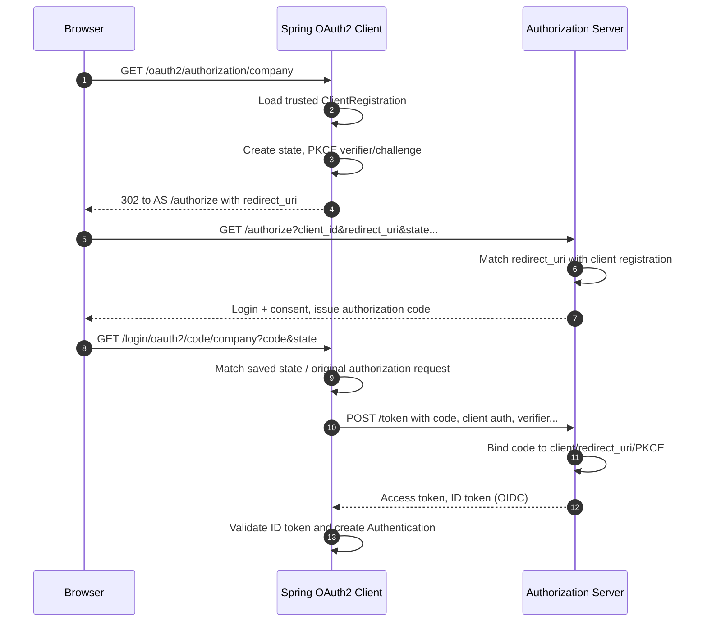
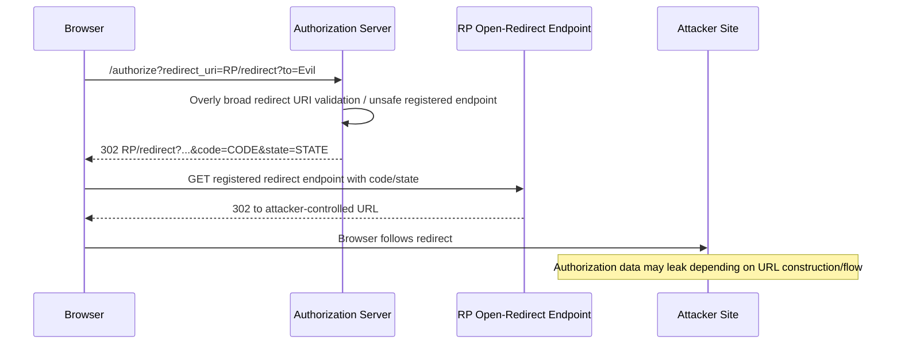
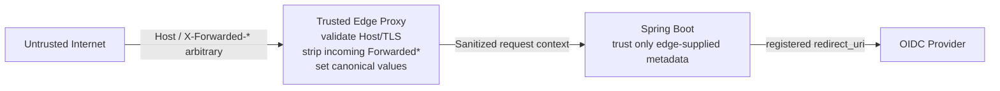
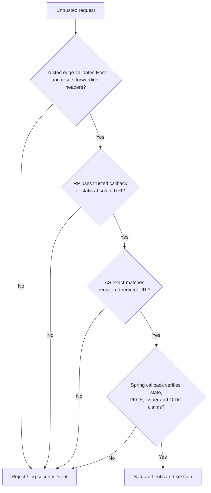

# 27.4. Redirect URI Matching, Open Redirect, and Spoofed Proxy Headers

In a **Spring Security OAuth 2.0/OIDC Client**, the Authorization Code Flow typically begins by redirecting the browser to an Authorization Server (AS) or OpenID Provider (OP), then receiving the authorization code back through a **registered redirect URI**.

Example:

```text
https://portal.example.org/oauth2/authorization/company
    |
    v
https://login.example.org/authorize
    ?client_id=portal-web
    &redirect_uri=https%3A%2F%2Fportal.example.org%2Flogin%2Foauth2%2Fcode%2Fcompany
    &state=...
    |
    v
https://portal.example.org/login/oauth2/code/company
    ?code=...
    &state=...
```

There are three closely related yet distinct risk categories:

1. **Incorrect redirect URI matching**: the AS accepts a callback that does not match registration, or the client uses a callback with the wrong origin/path, potentially sending the authorization response to an unintended destination.
2. **Open redirect**: an endpoint on the RP or AS allows an attacker to control the redirect destination; this endpoint can be abused to steal authorization codes/tokens in certain configurations, or for phishing and login-flow confusion.
3. **Spoofed proxy headers**: an application behind a reverse proxy builds URLs from untrusted `Host`, `Forwarded`, or `X-Forwarded-*` headers; an attacker can cause `{baseUrl}`, `redirect_uri`, or other absolute URLs to carry a host/scheme they control.

These three issues frequently appear together because Spring Security can build callbacks using a template:

```yaml
redirect-uri: "{baseUrl}/login/oauth2/code/{registrationId}"
```

`{baseUrl}` depends on the application's view of the current public URL. If the reverse proxy is not configured consistently or the application trusts forwarding headers from untrusted callers, the callback can suffer from **host poisoning**, wrong `https/http`, or wrong path prefixes.

This lesson covers redirect URI trust boundaries, how Spring Security performs OAuth2 Login, reverse proxy configuration patterns, blocking open redirects, multi-tenant/custom-domain variants, and verification via network traces without disabling `state`, PKCE, or OIDC validation.

---

## 1. Objectives and Core Principles

After this lesson, you should be able to:

- Distinguish the **OAuth redirect URI**, authorization initiation URL, post-login URL, and OpenID Provider logout redirect.
- Understand why the AS must match the redirect URI against the registered list using strict rules.
- Understand how the callback is bound to `client_id`, `state`, PKCE, and issuer.
- Recognize open redirects at the **callback endpoint** and in **post-login redirect URLs**.
- Identify when Spring expands `{baseUrl}` from request/proxy metadata.
- Never trust `Forwarded`, `X-Forwarded-Host`, or `X-Forwarded-Proto` from browsers.
- Configure the reverse proxy, Spring Boot, and `ClientRegistration` with the same trusted public origin.
- Verify applications running behind ingress, multiple load balancers, or custom domains.
- Preserve trust boundaries when customizing callback URLs.

**Design rule:** The AS sends authorization responses only to **registered callbacks matching the right client**; the RP builds/accepts callbacks solely from **trusted configuration and request context**; every post-login redirect must be restricted to **safe destinations**.

## 2. Types of Redirect URLs to Distinguish

An OIDC Login application involves several URLs associated with "redirect":

| URL Type | Example | Purpose | Who controls it? |
|---|---|---|---|
| Authorization start URL | `/oauth2/authorization/company` | Starts authorization at the RP | Spring Security RP |
| Authorization Endpoint | `https://login.example.org/authorize` | OP authentication/consent | OP/AS |
| **OAuth redirect URI** | `https://portal.example.org/login/oauth2/code/company` | Receives authorization code/state | Registered at AS, handled by RP |
| Token Endpoint | `https://login.example.org/token` | Backend exchanges code for tokens | OP/AS |
| Success/default target | `/app` | RP page shown after login | RP, may involve input needing validation |
| Saved request target | `/orders/42` | Returns to RP page requested before login | RP/session, must be constrained |
| OP post-logout redirect | `https://portal.example.org/logged-out` | Returns to RP after logout | RP/OP registration |
| Front-channel logout URI | `/oidc/front-channel-logout` | Receives SLO notice via iframe | RP/OP registration |

Two URLs are very commonly confused:

```text
/oauth2/authorization/company
/login/oauth2/code/company
```

The first URL **initiates** the flow; the second is the **callback**. The callback is not where users navigate directly to start logging in.

### 2.1. Redirect URI Is Not "returnTo"

`redirect_uri` in an OAuth authorization request is a protocol parameter verified by the AS.

`returnTo=/dashboard` or `next=/orders` is the **application destination** to visit after the callback completes. It must never alter where the AS sends the authorization code.

Do not use:

```text
redirect_uri = request.getParameter("returnTo")
```

If a request supplies `returnTo=https://attacker.example`, the app turns a UX parameter into a security-critical callback.

## 3. Redirect URI Matching at the Authorization Server

### 3.1. Pre-Register Callbacks

When creating an OAuth client at the OP, developers register one or more redirect URIs, for example:

```text
https://portal.example.org/login/oauth2/code/company
https://staging.portal.example.org/login/oauth2/code/company
```

The AS must only send authorization responses to callbacks satisfying matching rules against the registered set.

For modern web OAuth clients, security best practices require **exact redirect URI matching**; a standardized exception for native app loopback IP redirect URIs allows different ports per RFC 8252. Never use that native-app exception to justify wildcard web callbacks.

### 3.2. Differences That Must Not Be Ignored

Registered:

```text
https://portal.example.org/login/oauth2/code/company
```

Comparison:

| Value in authorization request | Can it be treated as the same URI? | Reason |
|---|---|---|
| Exact registered URL | **Yes** | Matches registration |
| `http://portal.example.org/...` | **No** | Different scheme, downgrades HTTPS |
| `https://portal.example.org.evil.test/...` | **No** | Different host |
| `https://evil.test/login/oauth2/code/company` | **No** | Attacker-controlled host |
| `https://portal.example.org/login/oauth2/code/other` | **No** | Different path/registration |
| `https://portal.example.org/login/oauth2/code/company?next=...` | **No**, unless full URI is registered per policy | Query changes the URI |
| `https://portal.example.org/login/oauth2/code/company/#x` | **Inappropriate** | Fragment is not part of a valid authorization request callback |
| `https://portal.example.org/callback/../login/oauth2/code/company` | Do not rely on arbitrary path normalization | Prone to parser/proxy discrepancies |
| `https://PORTAL.example.org/login/oauth2/code/company` | Do not rely on case normalization to bypass exact-match policy | Must follow AS matching rules |

This table reflects the desired policy for web registrations. Real AS implementations may normalize URLs under their own rules; **do not depend on loose exceptions** or how browsers normalize URLs.

### 3.3. Why Are Wildcards Dangerous?

A registration like:

```text
https://*.example.org/*
```

can inadvertently allow:

- Uncontrolled or taken-over subdomains.
- Secondary applications with open redirects.
- Callbacks on temporary test-environment hosts.
- Paths controlled by another tenant.
- Endpoints lacking state/session correlation.

If the AS accepts an attacker-controlled redirect URI, the authorization code can be sent to the wrong place right at the redirect step.

### 3.4. "Same Domain" Is Not Enough

`https://portal.example.org/login/oauth2/code/company` and `https://portal.example.org/redirect?next=...` share the same domain but serve different purposes. If the second URI is registered, an open redirect on it can turn into a relay for the authorization response.

**Exact matching only guarantees the URI is sent to the registered address; it does not prove the registered endpoint is free of open redirects.**

## 4. Why Does the Authorization Code Flow Bind the Redirect URI?

A typical flow:



Each safeguard has its own responsibility:

- **Registered redirect URI:** the AS never sends the code to an unauthorized destination.
- **`client_id` and client authentication:** the AS knows which client is using the grant.
- **`state`:** the RP binds the callback to the initiated authorization request, protecting against login CSRF/correlation mix-ups.
- **PKCE:** a stolen code is hard to exchange for tokens if the attacker lacks the verifier.
- **Issuer binding:** the RP uses the right OP/AS for the transaction, preventing Token Endpoint substitution.
- **OIDC ID Token validation:** checks issuer, signature, audience, expiration, and nonce when used.

### 4.1. Do Not Use PKCE as an Excuse to Relax Redirect Matching

PKCE is an important protection layer, yet it does not solve:

- Phishing via open redirect.
- Leakage of authorization response metadata.
- Flows/providers that do not properly support PKCE.
- Token or session confusion due to wrong issuer/registration.
- Post-login open redirects.
- Compromise of the verifier via XSS/session compromise.

Never claim "since we have PKCE, the callback can be any arbitrary URL."

### 4.2. The Token Endpoint Must Also Verify Binding

The authorization code must be bound by the AS to the client and relevant parameters. If `redirect_uri` was sent in the authorization request, the token request must comply with OAuth and AS requirements; the AS must verify there is no code substitution.

If the RP changes the redirect URI during code exchange (for example, due to a differing proxy host), the Token Endpoint may return:

```json
{
  "error": "invalid_grant"
}
```

Never "fix" this by disabling redirect validation at the AS. Fix the public URL/proxy configuration or client registration.

## 5. Where Does Spring Security Get the Redirect URI?

In Spring Boot OAuth2 Client, a registration can be declared as:

```yaml
spring:
  security:
    oauth2:
      client:
        registration:
          company:
            provider: company
            client-id: ${OIDC_CLIENT_ID}
            client-secret: ${OIDC_CLIENT_SECRET}
            client-authentication-method: client_secret_basic
            authorization-grant-type: authorization_code
            redirect-uri: "{baseUrl}/login/oauth2/code/{registrationId}"
            scope:
              - openid
              - profile
              - email
        provider:
          company:
            issuer-uri: https://login.example.org
```

Here:

- `company` is the `registrationId`.
- `{registrationId}` is replaced with `company`.
- `{baseUrl}` is expanded based on the public URL Spring observes for the request.
- `/login/oauth2/code/{registrationId}` is the default callback handled by Spring Security.
- The provider's `issuer-uri` determines OIDC discovery/trust, not the application's public host.

### 5.1. Normal Expansion Example

Browser visits:

```http
GET /oauth2/authorization/company HTTP/1.1
Host: portal.example.org
```

When the app receives the right scheme/host/port/context path, the callback becomes:

```text
https://portal.example.org/login/oauth2/code/company
```

### 5.2. Wrong When Seeing an Internal Host

Behind a proxy, the app might see:

```text
http://app-service:8080
```

and generate:

```text
http://app-service:8080/login/oauth2/code/company
```

The OP may reject it because that URI is unregistered, or the browser cannot reach the internal hostname.

### 5.3. Wrong When Trusting Spoofed Host/Forwarded Headers

If an attacker influences the request context:

```http
GET /oauth2/authorization/company HTTP/1.1
Host: attacker.example
X-Forwarded-Host: attacker.example
X-Forwarded-Proto: https
```

a configuration without proper trust boundaries may generate:

```text
https://attacker.example/login/oauth2/code/company
```

An AS with proper exact matching will reject the unregistered URI. However, if the AS has a wildcard registration or a misconfigured callback host is accepted, the consequences are more severe. Additionally, the app may suffer **host-header poisoning** in redirect links, emails, and other absolute URLs.

## 6. What Is an Open Redirect?

An **open redirect** occurs when an endpoint redirects the browser to a caller-controlled URL without proper restrictions.

Buggy example:

```java
@GetMapping("/go")
public String go(@RequestParam String next) {
    return "redirect:" + next;
}
```

Attacker calls:

```text
https://portal.example.org/go?next=https://attacker.example
```

and receives:

```http
HTTP/1.1 302 Found
Location: https://attacker.example
```

This endpoint lives on a trusted domain yet sends the browser to an unintended origin.

### 6.1. How Can Open Redirects Cause Harm?

- Phishing: users initially see a URL belonging to a reputable site.
- OAuth authorization code leakage when an endpoint receives `code`/`state` and forwards them.
- Information leakage via URL/query/referrer in certain flows.
- Bypassing host allowlists via redirect chains.
- Session/login flow confusion.
- Abusing URL allowlists in integrations or email links.

Not every open redirect immediately steals an access token, yet **risk should never be judged solely by whether PKCE is enabled**.

## 7. Open Redirect at a Registered Redirect URI

Suppose the OP registers:

```text
https://portal.example.org/redirect
```

and the RP has an endpoint:

```java
@GetMapping("/redirect")
public String unsafeRedirect(
        @RequestParam(name = "to") String destination) {
    return "redirect:" + destination;
}
```

An attacker tries to craft an authorization request with callback:

```text
https://portal.example.org/redirect?to=https://attacker.example
```

If the AS accepts arbitrary query strings instead of exact matching, or registered a URL that permits a dangerous redirect parameter, the authorization response could be forwarded outside the RP.

### 7.1. Dangerous Path Example



A redirect does not automatically **always** forward the `code` query parameter to the attacker: that depends on the handler, URL construction, and browser behavior. However, combining **a broad redirect URI or a callback endpoint with arbitrary redirection** creates an unnecessary attack surface.

### 7.2. Defensive Measures

- Register a **dedicated callback**, never an open redirect endpoint.
- Exact-match the redirect URI at the AS.
- Let Spring Security's OAuth2 filter handle the callback, not a generic controller.
- Never forward `code`, `state`, ID Tokens, or token responses into `returnTo`.
- If post-login navigation is needed, do it **only after** the callback is verified and token exchange succeeds.
- Restrict post-login redirects to internal paths/allowlisted origins.

## 8. Open Redirect After Successful Login

Another dangerous pattern appears in applications:

```java
@GetMapping("/login/success")
public String success(
        @RequestParam(name = "next", required = false) String next) {
    return "redirect:" + (next == null ? "/app" : next);
}
```

Suppose a user completes OIDC Login and is routed to:

```text
/login/success?next=https://attacker.example/fake-portal
```

Even though Spring already processed the authorization code, the user can still be redirected to a phishing page. Depending on the design, referrers/navigation may also leak tokens mistakenly placed in query parameters.

### 8.1. Never Use a Caller-Supplied URL as the OAuth Redirect URI

```text
?next=/reports
```

should only be a business return target and must be validated/allowlisted.

```text
?redirect_uri=https://attacker.example
```

must never override `ClientRegistration.redirectUri` from outside.

### 8.2. List of Targets That "Look Relative" but Are Dangerous

| Input | Risk |
|---|---|
| `https://attacker.example` | Absolute external URL |
| `//attacker.example/path` | Scheme-relative redirect; browser reuses current scheme |
| `\\attacker.example\path` | Some browsers/parsers normalize backslashes as a URL authority |
| `/%2f%2fattacker.example` | Encoded slash/double decoding under inconsistent handling |
| `/redirect?to=https://attacker.example` | Internal path that chains to an external redirect |
| `https://portal.example.org@attacker.example` | Userinfo trick: real host is attacker |
| `https://portal.example.org.attacker.example` | Suffix confusion |
| `https://portal.example.org.evil.test` | Host is not portal.example.org |
| `/%0d%0aLocation:%20...` | Potential header injection if framework/stack does not block it |

Do not validate with:

```java
next.startsWith("/")
```

because `//evil.example` also starts with a slash.

### 8.3. Simplest Approach: Route Key Allowlist

Do not accept arbitrary URLs. Accept only **destination names** defined by the backend:

```java
import java.util.Map;

public final class LoginDestinationPolicy {

    private static final Map<String, String> DESTINATIONS = Map.of(
        "home", "/app",
        "orders", "/orders",
        "reports", "/reports",
        "profile", "/profile"
    );

    public String resolve(String key) {
        return DESTINATIONS.getOrDefault(key, "/app");
    }
}
```

Input:

```text
?destination=reports
```

Result:

```text
/reports
```

The browser cannot switch the target to an external origin simply by passing another URL string. This is typically far easier to audit than trying to safely support arbitrary relative URLs.

### 8.4. When Dynamic Return Paths Are Needed

You can allow only a set of internal routes, e.g. `/orders/{id}`, validate the **ID/path segment** separately, and build the path with a safe route builder. Never feed raw user URLs into `Location`.

If arbitrary relative paths must be supported:

- Parse using a proper URL/URI parser.
- Reject schemes, authorities, control characters, backslashes, and unexpected fragments.
- Forbid leading `//`.
- Normalize/compare after all decoding passes consistent with the framework.
- Ensure paths cannot pass through known open-redirect endpoints.
- Enforce route-level authorization after authentication.
- Add tests for encoded/double-encoded variants.

Even then, a **destination key allowlist** is usually simpler and safer.

## 9. Spring Security Login Success Handling

Spring Security typically uses saved-request logic to return users to the URL they tried to access before login.

A simple configuration with minimal open-redirect surface:

```java
import org.springframework.context.annotation.Bean;
import org.springframework.context.annotation.Configuration;
import org.springframework.security.config.annotation.web.builders.HttpSecurity;
import org.springframework.security.config.Customizer;
import org.springframework.security.web.SecurityFilterChain;

@Configuration
public class SecurityConfig {

    @Bean
    SecurityFilterChain webSecurity(HttpSecurity http) throws Exception {
        http
            .authorizeHttpRequests(auth -> auth
                .requestMatchers("/", "/error", "/assets/**").permitAll()
                .anyRequest().authenticated())
            .oauth2Login(oauth2 -> oauth2
                .defaultSuccessUrl("/app", true));

        return http.build();
    }
}
```

`true` forces the default success URL to take precedence over saved requests in that handler type. This is a UX choice; an app may want saved requests, in which case it must verify where URLs are built and enforce a trusted host policy.

### 9.1. `SavedRequest` Does Not Eliminate All Host Poisoning Risks

Even when the app has no `next` parameter, a saved request can reflect the request context. If a reverse proxy permits forged `Host` or forwarded host headers, the stored/redirected absolute URL can still be wrong.

Restrict hosts at the **edge and application request context**, not just by swapping a custom success handler.

### 9.2. Avoid Arbitrary `targetUrlParameter`

Some success handlers let you configure `targetUrlParameter` so a client request picks the destination. If used, enforce an allowlist and handle securely per security requirements.

Never configure an arbitrary parameter such as:

```text
targetUrl=https://attacker.example
```

and let the handler redirect directly.

### 9.3. Do Not Echo the Authorization Code in `Location`

After callback:

```text
/login/oauth2/code/company?code=abc&state=xyz
```

the success handler must never copy the raw callback query onto the destination URL. The authorization code and `state` are transaction data, not application redirect metadata.

## 10. Spring Security OAuth2 Login: Correct Start and Callback Endpoints

Standard configuration:

```yaml
spring:
  security:
    oauth2:
      client:
        registration:
          company:
            provider: company
            client-id: ${OIDC_CLIENT_ID}
            client-secret: ${OIDC_CLIENT_SECRET}
            authorization-grant-type: authorization_code
            redirect-uri: "{baseUrl}/login/oauth2/code/{registrationId}"
            scope: openid,profile,email
        provider:
          company:
            issuer-uri: https://login.example.org
```

Browser starts:

```text
GET /oauth2/authorization/company
```

Callback:

```text
GET /login/oauth2/code/company?code=...&state=...
```

### 10.1. Customizing the Callback Path on Both Sides

If you want:

```text
https://portal.example.org/auth/callback/company
```

you must update both the registration and Spring Security's redirection endpoint:

```yaml
spring:
  security:
    oauth2:
      client:
        registration:
          company:
            redirect-uri: "{baseUrl}/auth/callback/{registrationId}"
```

```java
http.oauth2Login(oauth2 -> oauth2
    .redirectionEndpoint(redirection ->
        redirection.baseUri("/auth/callback/*")));
```

And register the exact URI at the OP. This snippet shows **only the DSL change**, not a complete `SecurityFilterChain`.

If you only change `redirect-uri` without updating the corresponding authentication filter matcher, Spring will not process the callback.

### 10.2. Do Not Replace the Callback Security Filter with a Custom Controller

A controller like:

```java
@GetMapping("/auth/callback/company")
public String callback(@RequestParam String code) {
    // manually exchange code for token...
}
```

risks bypassing `state`/PKCE/`nonce`/issuer validations. Unless you have a specialized requirement and deeply understand framework extension points, let Spring Security handle callbacks.

### 10.3. Multiple `SecurityFilterChain`s

If an API chain is ordered before the web login chain, ensure the callback URL matches **the chain with `oauth2Login`**. A dedicated `/api/**` matcher must not intercept `/login/oauth2/code/**`.

Never fix routing by permitting all on the callback while skipping the filter that processes authorization responses.

## 11. How Does a Reverse Proxy Alter the URL View?

Deployment example:

```text
Browser
   |
   | https://portal.example.org
   v
Load Balancer / Ingress (TLS termination)
   |
   | http://spring-app:8080
   v
Spring Boot MVC app
```

From the browser, the public URL is HTTPS on `portal.example.org`. Yet the internal connection the app sees may be HTTP on host `spring-app:8080`.

Without proper reverse proxy handling:

```text
Spring sees:
  scheme=http
  host=spring-app
  port=8080

Correct external view:
  scheme=https
  host=portal.example.org
  port=443
```

As a result, `{baseUrl}` and the redirect URI can be wrong.

### 11.1. Common Forwarding Headers

```http
Forwarded: for=192.0.2.20;proto=https;host=portal.example.org
```

or de facto headers:

```http
X-Forwarded-Proto: https
X-Forwarded-Host: portal.example.org
X-Forwarded-Port: 443
X-Forwarded-Prefix: /portal
```

Meaning:

| Header | Common meaning | Risk when untrusted |
|---|---|---|
| `Forwarded` | RFC 7239 standard containing host/proto/for | Fake public host/scheme/client address |
| `X-Forwarded-Host` | Public host accessed by client | Host poisoning, forged callbacks |
| `X-Forwarded-Proto` | Public scheme `http/https` | Downgrade or malformed URLs |
| `X-Forwarded-Port` | Public port | Redirect URI mismatch from wrong port |
| `X-Forwarded-Prefix` | Path prefix rewritten by proxy | Wrong callback path, bypassing path/routing assumptions |
| `X-Forwarded-For` | Client IP chain | IP spoofing/rate limit bypass when trusted wrongly |

**Headers are data any HTTP caller can send** unless a proxy boundary strips/overwrites them. The mere presence of `X-Forwarded-Host` does not mean a trusted load balancer added it.

## 12. Proxy Header Spoofing: A Concrete Example

Suppose the app enables forwarded headers for all request origins, and ingress passes browser-sent headers through unmodified.

Attacker sends:

```http
GET /oauth2/authorization/company HTTP/1.1
Host: portal.example.org
X-Forwarded-Host: attacker.example
X-Forwarded-Proto: https
```

If Spring trusts `X-Forwarded-Host` in the request context, it may generate:

```text
redirect_uri=https://attacker.example/login/oauth2/code/company
```

### 12.1. First Defense: AS Exact Matching

If the OP only registered:

```text
https://portal.example.org/login/oauth2/code/company
```

then an authorization request with the attacker's host must be rejected. To the user this appears as `redirect_uri_mismatch` or `invalid_request`.

However, that is the **AS's defense layer**, not a reason for the RP to keep trusting forged proxy headers. Other redirects, password-reset links, logout links, and canonical URLs can still be poisoned.

### 12.2. More Dangerous When the OP Allows Wildcards

If the AS uses:

```text
https://*.example.org/*
```

and the attacker controls a matching subdomain, or a callback is registered on an endpoint/host with an open redirect, the AS could allow the response to go to the wrong destination.

### 12.3. Not Every Forged-Header Request Is Exploitable

Exploitability depends on:

- Whether the proxy overwrites inbound forwarding headers.
- Which `forward-headers-strategy` Spring Boot enables.
- Whether the app uses a static absolute callback or the `{baseUrl}` template.
- Whether the AS enforces exact-match redirect URIs.
- Whether host validation exists at the edge/app.
- How proxy path rewriting and client registration are configured.

Describe exploits based on the **specific configuration**, rather than claiming a single forged header always leaks authorization codes.

## 13. Trust Boundary at the Reverse Proxy

A common secure design:



### 13.1. The Edge Must Block Hosts Outside the Allowlist

For example, allow only:

```text
portal.example.org
```

Do not accept arbitrary `Host` values and leave the decision to the backend. In multi-domain systems, the allowlist must reflect onboarded/verified domains.

### 13.2. The Edge Must Strip or Overwrite Inbound Forwarding Headers

If a browser sends:

```text
X-Forwarded-Host: attacker.example
```

the proxy must not leave it intact and append a new value such that the app accidentally reads the attacker-controlled portion first.

Define a clear **trusted proxy chain** and header reset/append rules. Edge proxies must strip client-supplied headers; downstream proxies must trust only managed upstreams.

### 13.3. The Backend Must Not Be Directly Exposed Outside the Proxy

If Spring Boot is configured to trust `X-Forwarded-Host` from a trusted edge, yet internal port `8080` is exposed directly to the Internet, an attacker can call the backend directly with forged forwarding headers.

Network policy/firewalls must restrict backend access solely to the edge or trusted network.

### 13.4. Forwarded Metadata Is for Routing Only, Not Authorization

Even when `Host=alpha.example` has been verified by the proxy, the user must still authenticate via OIDC and domain policy must verify tenant membership.

A `Host` header is not a bearer proof and never replaces access control.

## 14. Illustrative Nginx Configuration for a Single Public Origin

Assume Nginx is the trusted TLS termination point for:

```text
https://portal.example.org
```

And the backend runs at:

```text
http://spring-app:8080
```

Conceptual configuration:

```nginx
# Default vhost: reject unknown hosts.
server {
    listen 443 ssl default_server;
    server_name _;
    # TLS certificate configuration omitted.
    return 421;
}

server {
    listen 443 ssl;
    server_name portal.example.org;

    # TLS certificate/key and security configuration omitted.

    location / {
        proxy_pass http://spring-app:8080;

        # Fixed public origin for this vhost:
        proxy_set_header Host portal.example.org;
        proxy_set_header X-Forwarded-Host portal.example.org;
        proxy_set_header X-Forwarded-Proto https;
        proxy_set_header X-Forwarded-Port 443;

        # Do not pass an untrusted RFC 7239 value through.
        proxy_set_header Forwarded "";

        # Only set a prefix if proxy actually rewrites it.
        proxy_set_header X-Forwarded-Prefix "";
    }
}
```

**This is an illustrative template**, not a complete production Nginx config: TLS, HTTP→HTTPS redirects, upstream timeouts, WebSockets, real client IP chains, port 80, SNI/default vhosts, and network isolation must all be configured separately.

### 14.1. Why Use a Literal Host?

For a fixed public vhost, `portal.example.org` is the trusted canonical host. By contrast:

```nginx
proxy_set_header X-Forwarded-Host $http_x_forwarded_host;
```

passes a browser-spoofed header straight through to the backend.

Even `$host` derived from the request `Host` is not guaranteed safe for OAuth callbacks unless virtual hosts/host allowlists are strictly enforced.

### 14.2. Multiple Custom Domains

If tenants bring their own domains, you cannot hard-code a single host. That does not mean allowing every host.

You must:

1. Verify domain ownership during tenant onboarding.
2. Provision/manage TLS certificates for the domain.
3. Map the domain to the tenant/registration server-side.
4. Accept only domains present in the active registry.
5. Feed the verified canonical public origin into the OAuth redirect design.
6. Register the corresponding exact redirect URI at the OP.
7. Synchronize routing across all replicas.

## 15. Spring Boot Forwarded Headers Strategy

In Spring Boot, a commonly used property is:

```yaml
server:
  forward-headers-strategy: framework
```

Common options:

| Value | General meaning | Caveat |
|---|---|---|
| `none` | Do not apply forwarded headers via this strategy | App may see internal scheme/host |
| `native` | Let the HTTP server/container handle forwarding headers | Must configure trusted proxies/behavior accordingly |
| `framework` | Use framework support such as `ForwardedHeaderFilter` in Servlet | **Does not validate header origin by itself** |

Support and defaults vary by platform/Spring Boot version; verify against your actual runtime and deployment.

### 15.1. `framework` Does Not Mean "Trust Only Reputable Proxies"

Enabling:

```yaml
server:
  forward-headers-strategy: framework
```

allows Spring to use `Forwarded` or `X-Forwarded-*` to reconstruct public URLs. However, **the framework cannot know on its own whether a request came from a trusted edge** unless the infrastructure enforces that boundary.

Therefore:

- The proxy must sanitize forwarding metadata.
- The backend must not be exposed to untrusted callers.
- A host allowlist must be enforced.
- Multiple proxies must not emit conflicting host/proto values that the app reads in the wrong order.

### 15.2. `native` Requires Server-Specific Configuration

Embedded Tomcat/Jetty/Undertow or Reactor Netty each have different native behaviors. When using `native`, know which headers your container processes for forwarded protocol/host/port and the associated trusted-proxy patterns.

Do not copy a Tomcat property into Netty and expect the same behavior.

### 15.3. When You Do Not Want to Trust Forwarding Headers

If the app has one fixed public origin and uses a **static absolute redirect URI**, it may not need proxy metadata to build OAuth callbacks.

However, other URLs generated by the app may still need the right public origin. Pick one consistent strategy rather than mixing static callbacks with unvalidated dynamic links.

## 16. `ForwardedHeaderFilter` and `removeOnly`

Spring Framework provides `ForwardedHeaderFilter` for Servlet to process forwarded headers in request wrappers once the trust boundary is established.

In some cases, you want to strip those headers instead of honoring them:

```java
import org.springframework.web.filter.ForwardedHeaderFilter;

ForwardedHeaderFilter filter = new ForwardedHeaderFilter();
filter.setRemoveOnly(true);
```

`removeOnly` **removes forwarded headers** from the request context without applying their values to alter the public URL.

### 16.1. When Is `removeOnly` Useful?

- The app does not use proxy-derived public URLs.
- The backend has an explicitly configured base URL.
- You want to prevent application components from accidentally consuming untrusted forwarded metadata.
- No valid trusted proxy chain exists yet.

### 16.2. Do Not Enable Two Conflicting Strategies

If Boot already auto-configures forwarded header processing and you manually register another filter with different semantics, results depend on filter order. Choose a single strategy or explicitly control filter ordering.

### 16.3. `removeOnly` Does Not Replace `Host` Validation

`Host` is a standard HTTP header, not `X-Forwarded-Host`. Stripping forwarding headers **does not block requests with a spoofed `Host` header**. Enforce a host allowlist at the proxy or app.

## 17. Static Absolute Redirect URI: The Simplest Strategy for a Single Domain

For a production app using a single public origin:

```yaml
spring:
  security:
    oauth2:
      client:
        registration:
          company:
            redirect-uri: "https://portal.example.org/login/oauth2/code/company"
```

Benefits:

- Redirect URI does not directly depend on request `Host`/`Forwarded` headers.
- Matches the URI registered at the OP.
- Easy to verify under reverse proxy TLS termination.
- Easy to audit changes and limits host poisoning at OAuth callback construction.

### 17.1. Trade-offs

- Staging/prod differences need environment-specific configs.
- Multi-tenant custom domains need per-registration mapping.
- If the app runs under a different context path, the URI must match actual routing.
- Other application links can still be affected by `Host` poisoning.

### 17.2. Using an Environment Variable for the Public Origin

Example:

```yaml
app:
  public-base-url: "https://portal.example.org"

spring:
  security:
    oauth2:
      client:
        registration:
          company:
            redirect-uri: "https://portal.example.org/login/oauth2/code/company"
```

`app.public-base-url` is an application-defined property. Both values can be managed from the same deployment configuration source via binding/placeholders; what matters is using **trusted server config**, never request queries.

### 17.3. Never Let Users Choose an Absolute Callback

Do not allow:

```text
?callback=https://somewhere.example
```

to override `ClientRegistration.redirectUri`. If the app needs multiple callback domains, pre-create approved registrations and routing policies.

## 18. Dynamic Public Origins for Custom Domains and Multi-Tenant Apps

Some SaaS platforms serve:

```text
https://alpha.login.example.org
https://beta.login.example.org
https://sso.customer-domain.example
```

If a single `ClientRegistration` needs callbacks varying by origin, verify whether the OP supports registering multiple exact redirect URIs and how Spring selects the URI.

### 18.1. Preferred Architecture: Per-Trusted-Origin Registrations When Needed

```text
Tenant alpha:
  registrationId=alpha-oidc
  publicOrigin=https://alpha.login.example.org
  redirectUri=https://alpha.login.example.org/login/oauth2/code/alpha-oidc

Tenant beta:
  registrationId=beta-oidc
  publicOrigin=https://beta.login.example.org
  redirectUri=https://beta.login.example.org/login/oauth2/code/beta-oidc
```

The public origin comes from an approved tenant/registration registry, never from raw `Host`/`X-Forwarded-Host`.

### 18.2. Allowed Origins Set

A registry might store:

```text
registrationId: alpha-oidc
issuer: https://id.alpha.example
allowedCallbackOrigin:
  https://alpha.login.example.org
registeredRedirectUri:
  https://alpha.login.example.org/login/oauth2/code/alpha-oidc
status: ACTIVE
```

When a user arrives via a custom domain, the edge maps the domain to the tenant, and the RP selects the allowlisted registration and registered callback.

### 18.3. Never Concatenate Strings from Raw Hostnames

Wrong:

```java
String redirect = "https://" + request.getHeader("Host")
    + "/login/oauth2/code/" + registrationId;
```

Conceptually right:

```java
String redirect = trustedTenantRegistry
    .getRegisteredRedirectUri(registrationId);
```

`trustedTenantRegistry` is an illustrative application abstraction, not a built-in Spring Security class. Registry values must be validated and modifiable only by admins/trusted onboarding flows.

### 18.4. Centralized Callback Domain

Some SaaS platforms choose:

```text
https://auth.saas.example/login/oauth2/code/{registrationId}
```

for all tenants, then redirect back to the tenant domain via a **validated return target** after login.

This reduces the number of redirect origins registered at the OP, but requires managing:

- Cross-domain session/cookie strategy.
- State/tenant intent correlation.
- Safe final redirect allowlist.
- Never putting tokens in query strings.
- Trust boundary between the auth domain and app domains.
- `SameSite`/browser constraints.
- Multi-tab and logout behavior.

Never treat a centralized callback domain as an excuse to allow arbitrary final redirects.

## 19. Redirect URI and Reverse Proxy Path Prefixes

A deployment may expose the public URL:

```text
https://portal.example.org/app
```

while the proxy forwards:

```text
/app/* -> backend /*
```

If Spring sees:

```text
contextPath = ""
```

yet the public path actually includes `/app`, the callback may lack the prefix.

### 19.1. Example

Desired public callback:

```text
https://portal.example.org/app/login/oauth2/code/company
```

Backend receives:

```text
http://spring-app:8080/login/oauth2/code/company
```

A reverse proxy may send:

```http
X-Forwarded-Proto: https
X-Forwarded-Host: portal.example.org
X-Forwarded-Prefix: /app
```

If Spring consumes trusted headers properly, `{baseUrl}` can reflect the prefix. However, behavior depends on proxy rewrite patterns, framework version, and app context path.

### 19.2. Two Common Bugs

**Missing prefix:**

```text
https://portal.example.org/login/oauth2/code/company
```

**Duplicated prefix:**

```text
https://portal.example.org/app/app/login/oauth2/code/company
```

Both can cause `redirect_uri` mismatches or 404 callbacks.

### 19.3. Never Fix with a Wildcard Redirect URI

Registering:

```text
https://portal.example.org/*
```

only masks misconfiguration and increases security risk. Define one explicit public callback and align proxy, context path, registration, and OP.

## 20. Application-Level Host Validation

Ideally, the edge blocks unknown hosts. To add defense-in-depth at the RP, the app can enforce a host allowlist.

### 20.1. Validation Principles

- Compare the host against a **set of registered names**, not loose suffixes.
- Validate scheme and port per deployment.
- Canonicalize internationalized domains/IDNA consistently.
- Do not let trailing dots, casing, or Unicode variants bypass due to parser inconsistencies.
- Check both forwarded host and raw `Host` according to the chosen trust strategy.
- Avoid overly broad wildcard regexes.

Example for a fixed deployment:

```text
allowed public origin = https://portal.example.org
```

An attacker host:

```text
portal.example.org.attacker.example
```

must not pass simply because it contains the substring `portal.example.org`.

### 20.2. Illustrative Servlet Filter Example

```java
import jakarta.servlet.FilterChain;
import jakarta.servlet.ServletException;
import jakarta.servlet.http.HttpServletRequest;
import jakarta.servlet.http.HttpServletResponse;

import java.io.IOException;
import java.util.Set;

import org.springframework.web.filter.OncePerRequestFilter;

public final class AllowedHostFilter extends OncePerRequestFilter {

    private static final Set<String> ALLOWED_HOSTS =
        Set.of("portal.example.org");

    @Override
    protected void doFilterInternal(
            HttpServletRequest request,
            HttpServletResponse response,
            FilterChain chain)
            throws ServletException, IOException {

        String host = request.getServerName();

        if (!ALLOWED_HOSTS.contains(host)) {
            response.sendError(421, "Unexpected Host");
            return;
        }

        chain.doFilter(request, response);
    }
}
```

This is a **policy illustration**, not a complete production security filter:

- `request.getServerName()` may already be altered by a forwarding filter depending on ordering.
- If the filter runs **before** forwarded headers are applied, it sees the raw internal host.
- If it runs **after** yet forwarding headers are untrusted, it may see a forged host.
- You must also handle scheme/port, canonicalization, and trusted proxy routing.
- Register the filter at the proper position in the filter chain.
- With multiple custom domains, the allowlist must come from a trusted registry.
- HTTP 421 is an illustrative status for misdirected requests; proxy/app policy may choose another status.

**Do not merely drop in this filter and assume proxy spoofing is solved.** The trust boundary at the edge remains primary.

### 20.3. `Host` and SNI

TLS SNI lets the edge select a certificate/vhost; HTTP `Host` remains a separate value. A caller may send mismatched SNI/`Host`. The edge should define explicit behavior for mismatches instead of routing to a default tenant.

## 21. Distinguishing `Forwarded`, `X-Forwarded`, and `Host` Headers

### 21.1. `Forwarded` (RFC 7239)

```http
Forwarded: for=192.0.2.20;proto=https;host=portal.example.org
```

A proxy chain can produce multiple elements:

```http
Forwarded: for=192.0.2.20;proto=https;host=portal.example.org,
           for=10.1.1.4;proto=http;host=internal.example
```

If an attacker can inject the first element, the app must know which proxy added which element and apply trust rules. Never pick an arbitrary element as the canonical public host.

### 21.2. `X-Forwarded-Host`

```http
X-Forwarded-Host: portal.example.org
```

Use only when a trusted proxy overwrote any incoming value. If the app trusts forwarded host from any request, a custom header injection can alter absolute URLs.

### 21.3. `X-Forwarded-Proto`

```http
X-Forwarded-Proto: https
```

When the proxy terminates TLS properly, this tells the app the public scheme is HTTPS. If unsanitized, an attacker can spoof `http` or `https`, affecting security redirects and cookie metadata.

### 21.4. `X-Forwarded-Prefix`

This header is especially risky in apps using path-based tenancy if untrusted input can alter the prefix.

Never use:

```text
X-Forwarded-Prefix: /other-tenant
```

for tenant authorization or to bypass route checks. Path rewriting must be enforced/defined at a trusted proxy.

### 21.5. `X-Forwarded-For`

Beyond redirect URIs, the IP chain affects login rate limiting, anomaly detection, and auditing. Reading an attacker-controlled IP in the wrong order can bypass brute-force controls. Still, IP is not identity proof; never use IP alone for tenant or user authorization.

## 22. Response/Redirect Cases Requiring Caution

### 22.1. `Location` Header Containing a Spoofed Host

```http
HTTP/1.1 302 Found
Location: https://attacker.example/login
```

If produced by a poisoned `Host`/`Forwarded` header, users can be redirected externally even without any `next` query parameter in the request.

### 22.2. Email Links

Systems sometimes use `request.getRequestURL()` to generate invitation/password-reset links. If a spoofed host enters an email, reset URLs can point to an attacker domain. OAuth callbacks are an obvious example, but **Host poisoning has a broader blast radius**.

### 22.3. Absolute vs. Relative Redirects

A relative redirect:

```http
Location: /app
```

generally reduces reliance on the request host for same-origin navigation.

However, certain OAuth/OP integrations require absolute callback URIs. When constructing absolute URLs, prefer a trusted canonical origin rather than assembling from raw `Host`.

### 22.4. 301/302/303/307/308

Authorization Code browser redirects typically use 302 or 303 depending on endpoint and protocol behavior. Never replace callback processing with complex redirect chains. Be especially careful with 307/308 when redirecting from endpoints receiving POST credentials, as browsers may replay the request body to the new target.

## 23. OIDC Issuer Binding and Redirect URI Are Two Different Layers

Example:

```text
Issuer:
  https://login.example.org

Client ID:
  portal-web

Callback:
  https://portal.example.org/login/oauth2/code/company
```

Post-login ID Token:

```json
{
  "iss": "https://login.example.org",
  "sub": "user-725",
  "aud": "portal-web",
  "exp": 1794803600,
  "iat": 1794800000
}
```

The RP must validate the ID Token per OIDC Core and registration.

### 23.1. The AS Issuer Is Not the Callback Host

`login.example.org` is the OP. `portal.example.org` is the RP. Having two different hosts is completely normal.

Do not force `redirect_uri` onto the issuer's host; it must belong to the **registered RP origin**.

### 23.2. A Valid Redirect URI Alone Is Not Enough to Authenticate an ID Token

Even when the authorization code arrives at the right callback, the RP must still verify:

- ID Token signature.
- `iss` matches the provider.
- `aud` includes the right client ID.
- `azp` when applicable.
- `exp`, `iat`, and time bounds.
- `nonce` if used.
- UserInfo `sub` matches ID Token `sub` when used.

Never treat the callback URL as a substitute for token validation.

### 23.3. Mix-Up Attacks in Multi-Issuer Clients

When an RP configures multiple OPs, an authorization response bound to the wrong registration can send the code to the wrong token endpoint or log in under the wrong issuer.

`state` binding, callback/registration mapping, issuer identification (if the AS supports RFC 9207), and ID Token validation are complementary protection layers.

**Never use an arbitrary `iss` query parameter from a callback to pick an unregistered issuer**.

## 24. CSRF, `state`, and Callback Sessions

`state` is generated/verified by Spring Security to correlate the authorization response with the initiated request.

### 24.1. `state` Is Not a Return URL

Wrong:

```text
state=https://attacker.example
```

or:

```text
state=/orders?user=...
```

when used as an insufficiently random correlation value. `state` should not carry secrets or raw browser-defined redirect targets.

### 24.2. Session/Cookie Lost on Callback

When the browser returns from the OP to the RP, the session may fail to restore if:

- Cookie settings are incompatible with the redirect flow.
- The public hostname changed.
- There is a callback `http`/`https` mismatch.
- The reverse proxy path prefix is wrong.
- The RP uses distributed sessions, yet the callback hits a node without access to `state`.
- The user took too long and the session/state expired.

A `state` error never justifies disabling `state` validation.

### 24.3. `SameSite`

Browser cookie behavior depends on `SameSite`, the callback HTTP method, and cross-site navigation. For Authorization Code Flow using a top-level GET callback, `SameSite=Lax` is usually more appropriate than for a cross-site POST callback, though you should test against your provider/response mode.

Never apply `SameSite=None` to all cookies just to patch a misconfigured callback host.

### 24.4. Multi-Tab Logins

If multiple authorization requests coexist, return targets and registrations must be bound to the exact `state`/authorization request. Never use a single session field like `currentRedirectUri` that another tab can overwrite.

## 25. Multi-Tenant and Custom Domains: Which Redirect URI Is Right?

Suppose a SaaS has:

```text
alpha.portal.example.org
beta.portal.example.org
```

and each tenant has its own issuer.

One model:

```text
tenant alpha
  registrationId=alpha-oidc
  issuer=https://id.alpha.example
  redirectUri=https://alpha.portal.example.org/login/oauth2/code/alpha-oidc

tenant beta
  registrationId=beta-oidc
  issuer=https://id.beta.example
  redirectUri=https://beta.portal.example.org/login/oauth2/code/beta-oidc
```

### 25.1. Do Not Treat the Request Hostname as Proof of Tenant

A user can send raw HTTP:

```http
Host: alpha.portal.example.org
```

That header alone does not grant access to `alpha`. The edge may route, yet after OIDC authentication the app still needs local tenant membership authorization.

### 25.2. Do Not Enable Wildcards to Reduce Redirect URI Onboarding

Instead of:

```text
https://*.portal.example.org/*
```

register exact URIs for approved tenants/clients. If the count is large, consider a centralized callback domain with trusted tenant state correlation.

### 25.3. Domain Ownership and Redirect URI Lifecycle

When a tenant is deleted or a custom domain changes ownership:

- Remove the domain from the allowlist.
- Remove the redirect URI from OP registration per process.
- Revoke/rotate client credentials if needed.
- Invalidate related pending authorization requests.
- Clean up/stabilize authorized client sessions per policy.
- Prevent domain takeover from directing callbacks/links to a third-party domain.

Never assume current DNS ownership remains with the same customer forever.

## 26. Customizing `OAuth2AuthorizationRequestResolver`

Spring Security provides `OAuth2AuthorizationRequestResolver` and implementations such as `DefaultOAuth2AuthorizationRequestResolver` to build authorization requests.

When adding a tenant hint, `prompt`, `login_hint`, or provider-specific parameters, customize the resolver via the proper extension point.

### 26.1. Keep the Redirect URI Determined by the Trusted Registration

Never do:

```java
String redirectUri = request.getParameter("redirect_uri");
builder.redirectUri(redirectUri);
```

with a browser-controlled request parameter.

### 26.2. Extension Point Concept Example

```java
import org.springframework.security.oauth2.client.registration.ClientRegistrationRepository;
import org.springframework.security.oauth2.client.web.DefaultOAuth2AuthorizationRequestResolver;

public final class ResolverFactory {

    public DefaultOAuth2AuthorizationRequestResolver create(
            ClientRegistrationRepository registrations) {

        var resolver = new DefaultOAuth2AuthorizationRequestResolver(
            registrations, "/oauth2/authorization");

        resolver.setAuthorizationRequestCustomizer(builder -> {
            // Only add parameters permitted by server policy.
            // NEVER read raw request parameters to override redirectUri.
        });

        return resolver;
    }
}
```

This snippet illustrates how to create/configure a resolver; it does not yet wire the resolver bean into `oauth2Login().authorizationEndpoint(...)` or add any parameters. In a real integration, preserve default `state`/PKCE/`nonce` behavior and keep callback matchers aligned.

### 26.3. Tenant Intent Must Be Bound by `state`

If a registration is selected per tenant, store the tenant intent server-side alongside the authorization request. On callback, verify the active tenant/allowed registration/membership instead of reading a fresh `tenant` from the query string.

### 26.4. Never Repurpose `redirect_uri` as a Generic Custom Field

To return to `/orders` after login, use a saved request or a validated server-side return target. Never repurpose OAuth `redirect_uri` because it is a **registered callback**, not a UI navigation target.

## 27. Safe Spring Security Configuration Behind a Trusted Reverse Proxy

Suppose:

- Fixed public URL: `https://portal.example.org`.
- Trusted TLS edge enforces Host allowlist and strips/sets forwarded headers.
- Backend is not public.
- AS has the exact callback registered.
- Client secret comes from environment/secret manager.

```yaml
server:
  forward-headers-strategy: framework

spring:
  security:
    oauth2:
      client:
        registration:
          company:
            provider: company
            client-id: ${OIDC_CLIENT_ID}
            client-secret: ${OIDC_CLIENT_SECRET}
            client-authentication-method: client_secret_basic
            authorization-grant-type: authorization_code
            redirect-uri: "https://portal.example.org/login/oauth2/code/company"
            scope:
              - openid
              - profile
              - email
        provider:
          company:
            issuer-uri: https://login.example.org
```

Java:

```java
@Configuration
public class OidcSecurityConfig {

    @Bean
    SecurityFilterChain webSecurity(HttpSecurity http) throws Exception {
        http
            .authorizeHttpRequests(auth -> auth
                .requestMatchers("/", "/error", "/assets/**").permitAll()
                .anyRequest().authenticated())
            .oauth2Login(oauth2 -> oauth2
                .defaultSuccessUrl("/app", true));

        return http.build();
    }
}
```

The imports for `@Configuration`, `@Bean`, `HttpSecurity`, and `SecurityFilterChain` are the same types illustrated earlier.

### 27.1. Why Use Both a Static Redirect URI and Forwarded Headers Processing?

A static redirect URI shields **one OAuth callback URL** from depending on `Host`. Yet the app may still generate other links and cookie semantics based on public scheme/host.

Enable a forwarded strategy **only when** the proxy trust boundary is in place. There is no requirement to enable the strategy just because you have a static redirect URI.

### 27.2. Equivalent Scenario Without Forwarded Headers

An app can set:

```yaml
server:
  forward-headers-strategy: none
```

and configure all public absolute URLs from trusted deployment properties. This reduces reliance on forwarded headers, though you must ensure routing, redirects, cookies, and frameworks never accidentally fall back to internal URLs.

### 27.3. Never Copy Demo Secrets to Production

Never commit:

```yaml
client-secret: my-production-secret
```

to source control. Host/redirect protections do not replace secrets management and TLS.

## 28. When Proxy Header Spoofing Meets Open Redirect

A risk chain might look like:

```text
1. Attacker controls X-Forwarded-Host in the request.
2. RP trusts header and generates an absolute URL to attacker host.
3. RP redirects user to that URL or embeds it in login info.
4. AS has wildcard/flawed matching so it accepts the callback.
5. Authorization response is sent to an unintended destination.
```

Not every system meets all 5 conditions. There are two key defense models:

### 28.1. Layered Defenses



In practice, not every request passes through every step in a single HTTP exchange, yet these layers must exist across the full flow.

### 28.2. Never Rely on a Single Control

Even if the OP has strong exact matching, the RP must still fix Host spoofing.

Even if the RP uses a static redirect URI, the OP must still enforce exact matching.

Even with strong PKCE, the RP must still block open redirects.

Even after sanitizing forwarded headers, the final success URL must still be allowlisted.

**Defense in depth** is a design requirement, not a substitute for per-layer policy.

## 29. HTTP Host Poisoning Beyond OAuth2 Login

This lesson focuses on callbacks, yet the same flaw can affect:

- Password reset links.
- Email verification links.
- Invitation URLs.
- OIDC RP-Initiated Logout `post_logout_redirect_uri`.
- Canonical `Location` headers.
- API pagination links.
- WebSocket endpoint URLs.
- Tenant discovery links.
- CORS allowlists built from the request host.
- Cookie domain calculations if the application customizes cookies.

Never write a `buildAbsoluteUrl(request)` utility reading raw `Host` across all features without a canonical origin policy.

### 29.1. Password Reset

If an app generates:

```text
https://attacker.example/reset?token=...
```

from a spoofed `Host` in the request, user emails can point to the attacker's domain and leak reset tokens.

### 29.2. Logout Redirects

A `post_logout_redirect_uri` with the wrong origin can send users to an external site after logout or be rejected by the OP as an unregistered redirect. Apply the same trusted-origin/exact-registration rules as callbacks, while remembering this is a **logout parameter distinct from OAuth `redirect_uri`**.

### 29.3. CORS Does Not Fix Redirect URI Mismatch

Enabling:

```http
Access-Control-Allow-Origin: *
```

does not solve AS redirect URI matching. An OAuth2 browser authorization redirect is not a standard CORS XHR request. Never relax CORS/CSRF to "let the OP redirect back."

## 30. Troubleshooting: `redirect_uri_mismatch`

Symptom:

```text
invalid_request: redirect_uri_mismatch
```

or a provider error screen stating the callback URI does not match.

### 30.1. Compare Three Values

1. The URI **registered at the OP**.
2. The `redirect_uri` **actually present in the authorization request** the browser was redirected with.
3. The URI **the RP actually processes as the callback** after proxy rewrites.

Example:

```text
Registered:
  https://portal.example.org/login/oauth2/code/company

Sent:
  http://spring-app:8080/login/oauth2/code/company

Public callback:
  https://portal.example.org/login/oauth2/code/company
```

The issue lies in URL expansion/proxy configuration.

### 30.2. Check Every Component

- `http` vs `https` scheme.
- Public host vs internal host.
- Port `443`/`8443`/`8080`.
- Trailing slash.
- Path prefix `/app`.
- `registrationId`.
- Case/path characters.
- Query parameters.
- Percent-encoding differences.
- Registered environment (staging/prod).
- Multi-hop reverse proxies.
- Container context path.
- OP admin console client ID/registration mismatch.

### 30.3. Never Register a Wildcard as a Quick Fix

A dangerous temporary workaround is widening the callback allowlist to every subdomain/path. The right fix is correcting the public origin or registering exact redirects per environment.

## 31. Troubleshooting: Callback Does Not Reach Spring Security

Symptoms:

- GET callback returns 404.
- Callback goes to login page and loops.
- `state`/authorization request not found.
- Token exchange never executes.
- API chain returns 401 JSON for the OAuth callback.

Check:

1. `redirect-uri` in `ClientRegistration` matches OP registration.
2. Spring `oauth2Login().redirectionEndpoint().baseUri(...)` matcher matches the path.
3. Reverse proxy rewrites path/prefix properly.
4. Security filter chain includes the OAuth2 Login filter for callbacks.
5. Browser sends the right session cookie/`state` correlation.
6. Shared session store or sticky routing matches architecture.
7. Callback is not intercepted by a custom controller.
8. `state` has not expired and matches the original request.

### 31.1. Redirect Loop

If `/login` itself is protected and redirects back to `/login`, an infinite loop occurs. Permit the appropriate public pages/login start endpoints via config rather than disabling authorization across the whole app.

### 31.2. Lost Session Is Not a Redirect URI Exploit

A request returning from the OP to the right callback with missing session/`state` is usually a cookie/proxy/session store issue. Never "fix" it by skipping `state` verification.

## 32. Troubleshooting: `Host`/`Forwarded` Spoofing

Symptoms:

- `Location` contains an attacker host or internal hostname.
- Email links point to an unexpected host.
- OAuth authorization URL has a `redirect_uri` with the wrong host.
- Some requests succeed while others fail depending on the load balancer.
- Only started occurring after adding a new proxy.
- Browser sees redirects from HTTPS to HTTP.

### 32.1. Ask the Right Questions

- Is the backend directly reachable?
- Does the first internet-facing proxy strip inbound forwarding headers?
- How many proxy hops exist?
- Which proxy sets `Forwarded`, and which sets `X-Forwarded-*`?
- Which `server.forward-headers-strategy` is enabled?
- What do `request.getScheme()`, `getServerName()`, and `getServerPort()` return in Spring **after trusted processing**?
- Is a host allowlist enforced before requests reach the app?
- Is the callback static or using `{baseUrl}`?
- Does any custom code read raw `Host` or `X-Forwarded-Host` directly?

### 32.2. Never Log Raw Credentials While Debugging

When tracing browser logins, `code`/`state` appear on callback URLs. Never write raw callback query strings, access tokens, refresh tokens, client secrets, or ID Tokens into shared logs.

Safe to log:

```text
event=oauth2_authorization_redirect_created
registrationId=company
publicOrigin=portal.example.org
redirectUriMatchedConfig=true
proxyConfigVersion=7
correlationId=<non-secret-id>
```

Never log:

```text
authorization_code=...
access_token=...
refresh_token=...
id_token=...
client_secret=...
```

## 33. Security Test Scenarios Table

| Scenario | Expected secure behavior |
|---|---|
| Exact registered URI | AS permits the flow to continue |
| URI using attacker host | AS rejects |
| Wildcard-like subdomain URI | AS rejects unless exact-registered |
| URI with extra `next=...` query | Cannot alter callback outside registration |
| Authorization response with wrong `state` | RP rejects |
| Authorization code sent to another registration's callback | RP/AS rejects per binding |
| ID Token with wrong issuer | RP rejects |
| ID Token with wrong audience | RP rejects |
| Wrong PKCE verifier | AS rejects token exchange |
| `Host: attacker.example` | Edge/app rejects or never uses it to build public redirects |
| `X-Forwarded-Host: attacker.example` | Proxy sanitizes/overwrites; RP does not use forged host |
| `Forwarded: proto=http;host=attacker.example` | Proxy sanitizes/overwrites |
| `X-Forwarded-Prefix: /evil` | Cannot control callback path when untrusted |
| Browser hits unknown custom domain | Edge rejects |
| `next=https://attacker.example` | App blocks/falls back to internal |
| `next=//attacker.example` | App blocks |
| Encoded/double-encoded redirect payloads | Cannot bypass allowlist |
| Known internal route key | Redirects to defined internal path |
| Login through TLS reverse proxy | Public callback stays HTTPS/right host |
| 2 proxy hops and duplicate forwarded headers | Only trusted canonical values take effect |
| Direct access to app backend port | Blocked by firewall/network policy |
| OP redirect URI mismatch | Clear error without loosening OP allowlist |
| Callback after session/state expiry | Safely rejected without dropping correlation |
| Tenant custom domain changes hands | Callback/registration disabled/migrated |
| Multi-tab OIDC logins | `state` and return targets never mixed |
| Post-login redirect to internal route | No `code`/tokens leaked in query string |
| Staging and production registrations | Callbacks match each environment |

## 34. Illustrative Controlled Manual Test Requests

The requests below target an environment you own or are authorized to test. The purpose is to verify **defenses**, not attack third parties.

### 34.1. Testing `Host` at the Edge

```bash
curl -i \
  -H 'Host: attacker.invalid' \
  https://portal.example.org/oauth2/authorization/company
```

A trusted edge should reject unknown `Host` values or never allow the application to generate redirects using `attacker.invalid`.

Note: TLS SNI and HTTP `Host` can differ; results depend on frontend TLS/vhost routing. Test in a controlled environment.

### 34.2. Testing Forwarded Host

```bash
curl -i \
  -H 'X-Forwarded-Host: attacker.invalid' \
  -H 'X-Forwarded-Proto: http' \
  https://portal.example.org/oauth2/authorization/company
```

Inspect the `Location` header toward the OP and the `redirect_uri` inside it after URL decoding. It must remain the registered callback:

```text
https://portal.example.org/login/oauth2/code/company
```

It must never be:

```text
http://attacker.invalid/login/oauth2/code/company
```

### 34.3. Testing `Forwarded` (RFC 7239)

```bash
curl -i \
  -H 'Forwarded: for=192.0.2.1;proto=http;host=attacker.invalid' \
  https://portal.example.org/oauth2/authorization/company
```

If the edge normalizes properly, forged values in the request cannot change the canonical callback.

### 34.4. Testing Open Redirect Return Targets

```bash
curl -i \
  'https://portal.example.org/login/success?next=https%3A%2F%2Fattacker.invalid'
```

If such an endpoint exists, the response must never send the browser to the attacker. In an app using a destination-key allowlist, invalid targets fall back to `/app` or return an error.

### 34.5. A Test Result Alone Does Not Prove Exploitability

A single `curl` returning 302 is inconclusive. Inspect `Location`, how the OP validates registered callbacks, browser semantics, proxy path rewriting, and OAuth transaction integrity.

Never disable `state`, PKCE, or client authentication just to test an out-of-contract response.

## 35. Per-Environment Configuration: Dev, Staging, and Prod

A common setup:

| Environment | Public origin | Callback |
|---|---|---|
| Local | `http://localhost:8080` | `http://localhost:8080/login/oauth2/code/company` |
| Staging | `https://staging.portal.example.org` | `https://staging.portal.example.org/login/oauth2/code/company` |
| Production | `https://portal.example.org` | `https://portal.example.org/login/oauth2/code/company` |

### 35.1. Do Not Arbitrarily Mix Dev/Prod Redirect Origins

Ideally use **separate OAuth clients** for staging/prod to limit blast radius:

```text
portal-staging-client
portal-production-client
```

If one client holds both localhost and production callbacks, accept the configuration risk explicitly and strictly control who can use client credentials/redirects.

### 35.2. Localhost Is Not a Reason to Enable Production Wildcards

Some native apps have exceptions for loopback redirect URIs. A local Spring Boot web confidential client demo using `localhost` is a separate environment; never carry that pattern into public production callback registrations.

### 35.3. Prevent Staging from Receiving Production Tokens

Do not check only hostnames; client ID/secret, issuer, scopes, resource audiences, and authorized client stores should be separated by environment when the security model requires it.

## 36. Proxy Header Spoofing and OIDC Logout

If the RP supports RP-Initiated Logout, Spring can build `post_logout_redirect_uri` from configuration:

```text
https://portal.example.org/logged-out
```

Host poisoning could produce:

```text
https://attacker.example/logged-out
```

The OP should accept only registered post-logout redirect URIs, and the RP must still build them from a trusted public origin.

### 36.1. Logout Callback Does Not Replace OAuth Callback

`post_logout_redirect_uri` is the post-OP-logout URL; `redirect_uri` is the callback receiving the authorization code. Both URI types have their own registration/validation rules.

### 36.2. Do Not Respond to Logout with an Open Redirect

An endpoint like `/logout/success?next=...` also needs a destination allowlist. Just because a user logged out does not mean they can be redirected to any arbitrary host.

## 37. Dangerous Assumptions

### 37.1. "The OP will block everything, so the RP doesn't need to care."

AS exact redirect matching is vital, yet the RP must still prevent open redirects and Host poisoning across other links/navigation.

### 37.2. "`SameSite` or PKCE makes open redirects harmless."

Neither prevents phishing or all forms of URL leakage/confusion.

### 37.3. "`X-Forwarded-Host` is always created by the load balancer."

A browser can send this HTTP header itself unless the edge strips it. Establish a trusted proxy chain.

### 37.4. "Setting `server.forward-headers-strategy=framework` is enough."

The framework processes header semantics; it does not guarantee the values are trusted.

### 37.5. "Checking `next.startsWith('/')` is safe."

`//attacker.example` and encoded/backslash variants can bypass naive logic.

### 37.6. "Allowing `*.example.org` stays within the same company."

Subdomains may belong to other apps/tenants/vendors, suffer subdomain takeover, or host open redirects.

### 37.7. "Host and issuer must match."

OP and RP are normally two distinct domains. Validate each role appropriately.

### 37.8. "`registrationId` equals `clientId`."

Registration ID is a local Spring key; OAuth client ID is the client's identity at the AS. Do not conflate them in callback/audience validation.

### 37.9. "Changing `redirect-uri` in YAML is enough."

Spring Security's callback matcher and the URI registered at the OP must also match.

### 37.10. "`HttpSession` has `state`, so a spoofed host doesn't matter."

A spoofed host can cause authorization requests to be rejected, misdirect links, or contribute to an exploit chain even when `state` is strong.

### 37.11. "Getting 401/403 on callback? Relax the entire security matcher."

Check filter chains, state/session, proxy paths, and registrations first; never permit-all on every route to work around a callback error.

### 37.12. "CORS enables redirects from the OP."

OIDC browser redirects do not require wildcard CORS. Opening CORS will not fix a callback mismatch.

## 38. Production Deployment Checklist

1. **Does the AS enforce exact-match redirect URIs?** No wildcard web callbacks.
2. **Does each client have an explicit redirect URI?** Matching scheme, host, port, and path.
3. **Are OAuth callbacks clearly separated from `returnTo`/success URLs?**
4. **Does Spring's callback matcher align with the `redirect-uri` configuration?**
5. **Does the Authorization Code Flow enforce `state` + PKCE and proper OIDC validation?**
6. **Are issuer, audience, and token endpoint selected from trusted registrations rather than user input?**
7. **Does the outermost proxy reject unknown `Host`/SNI mismatches?**
8. **Are inbound `Forwarded`/`X-Forwarded` headers stripped/overwritten?**
9. **Is the backend blocked from direct internet access?**
10. **Does Boot's `forward-headers-strategy` match the proxy/container runtime?**
11. **Does `{baseUrl}` produce the right public scheme/host/path prefix?**
12. **For fixed-origin deployments, should a static absolute callback be used?**
13. **Are custom domains verified/onboarded and exact-registered?**
14. **Does the success handler enforce a redirect destination allowlist?**
15. **Are `//`, backslashes, encoded URL tricks, and redirect chaining blocked?**
16. **Are `code`/`state`/tokens kept out of final redirect URLs and logs?**
17. **Do multi-tab/tenant logins bind `state` to the right registration/return target?**
18. **Do session cookies match HTTPS/custom-domain/OP callback methods?**
19. **Across multiple nodes, are authorization request state and configuration consistent?**
20. **Are proxy path prefixes tested for missing/double prefixes?**
21. **Are staging/prod credentials, callbacks, and stores properly isolated?**
22. **Do post-logout redirects use canonical origins and valid OP registrations?**
23. **Have forged-header variations been tested in a controlled environment?**
24. **Is observability tracking redirect mismatches, state mismatches, and invalid hosts?**
25. **Has host poisoning been evaluated for email/reset/invitation links too?**

## 39. Conclusion

**Redirect URI matching, open redirects, and proxy header spoofing** all affect where browsers and authorization responses are directed, yet they occur at different layers.

- **Authorization Server** is responsible for accepting only **registered redirect URIs for the right client** and binding the authorization code to the request.
- **Spring Security OAuth2 Client** is responsible for initiating/restoring the authorization transaction, verifying `state`, PKCE, issuer, ID Token, and processing callbacks in the right filter chain.
- **Reverse proxy/ingress** is responsible for establishing a trusted public origin, constraining `Host`, and never forwarding attacker-supplied headers as authoritative metadata.
- **RP application** is responsible for constraining all post-login redirects, preventing phishing/URL leakage, and distinguishing final return targets from protocol `redirect_uri`.

For a fixed public domain, a **static absolute redirect URI** is easy to audit. For multiple tenants/custom domains, use a **trusted registry and exact registered callbacks**—never build URIs arbitrarily from raw `Host`/`Forwarded`/issuer URLs supplied by the browser.

When encountering `redirect_uri_mismatch` or callback failures, fix **configuration and trust boundaries**—never remove `state`/PKCE, never open wildcards at the OP, never disable OIDC validation, and never trust forwarding headers merely because they are named "Forwarded."

## 40. References

- [RFC 6749 — OAuth 2.0 Authorization Framework](https://www.rfc-editor.org/rfc/rfc6749): redirect URI registration, authorization request, and token endpoint binding.
- [RFC 9700 — Best Current Practice for OAuth 2.0 Security](https://www.rfc-editor.org/rfc/rfc9700): exact redirect URI matching, mix-up, and open redirect risks.
- [RFC 7636 — Proof Key for Code Exchange](https://www.rfc-editor.org/rfc/rfc7636): PKCE protection for authorization codes.
- [RFC 8252 — OAuth 2.0 for Native Apps](https://www.rfc-editor.org/rfc/rfc8252): loopback redirect URIs and port exceptions for native clients.
- [RFC 9207 — OAuth 2.0 Authorization Server Issuer Identification](https://www.rfc-editor.org/rfc/rfc9207): mitigating authorization server mix-up.
- [RFC 7239 — Forwarded HTTP Extension](https://www.rfc-editor.org/rfc/rfc7239): format and semantics of the `Forwarded` header.
- [OpenID Connect Core 1.0](https://openid.net/specs/openid-connect-core-1_0.html): OIDC ID Token issuer/audience/`nonce` validation.
- [Spring Security — OAuth 2.0 Login](https://docs.spring.io/spring-security/reference/servlet/oauth2/login/index.html): authorization endpoint, redirection endpoint, and login flow.
- [Spring Security — OAuth 2.0 Client](https://docs.spring.io/spring-security/reference/servlet/oauth2/client/index.html): `ClientRegistration.redirectUri` and authorized clients.
- [Spring Security — OAuth 2.0 Login (Reactive)](https://docs.spring.io/spring-security/reference/reactive/oauth2/login/index.html): callbacks in WebFlux.
- [Spring Framework — Forwarded Headers](https://docs.spring.io/spring-framework/reference/web/webmvc/filters.html): `ForwardedHeaderFilter` and request wrappers.
- [Spring Boot — Embedded Web Servers / Proxy Settings](https://docs.spring.io/spring-boot/reference/web/servlet.html): forwarded headers strategy and reverse proxy deployment.
- [OWASP — Unvalidated Redirects and Forwards Cheat Sheet](https://cheatsheetseries.owasp.org/cheatsheets/Unvalidated_Redirects_and_Forwards_Cheat_Sheet.html): identifying and preventing open redirects.
- [OWASP — HTTP Headers / Host Header Injection](https://owasp.org/www-project-web-security-testing-guide/): testing Host headers and security boundaries.
