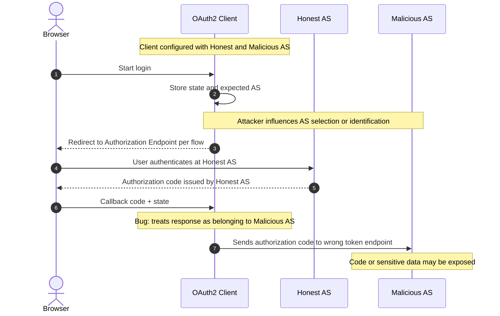
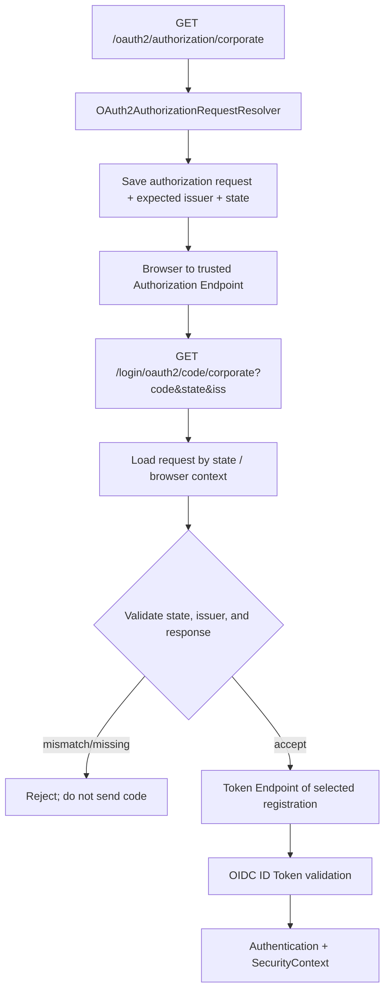

# 27.5. Authorization Server Mix-Up and Issuer Enforcement

## 1. Why Does an OAuth2 Client Supporting Multiple Login Providers Need Extra Protection?

A Spring Security OAuth 2.0/OIDC Client application may allow users to log in via multiple **Authorization Servers (AS)** or **OpenID Providers (OP)**:

```text
Workspace Portal
    ├── Corporate SSO: https://id.corporate.example/realms/staff
    ├── Partner SSO:   https://login.partner.example/oidc
    └── Customer SSO:  https://auth.customer.example/tenant-42
```

In the Authorization Code Flow, the browser is sent to the AS's Authorization Endpoint, then returns with an **authorization code** and **state** to the application's **redirect URI**. The OAuth2 Client must know **which AS actually issued the authorization response** so it sends the code and client credentials solely to **that same AS's Token Endpoint**.

When two or more ASs are involved, a mismatch between the **original request**, the **expected AS**, the **received callback**, and the **Token Endpoint** can lead to an **Authorization Server Mix-Up Attack**. In this scenario, a malicious AS or an untrusted configuration causes the client to misidentify the AS that issued the response, sending the authorization code or credentials to the wrong endpoint.

This is an **integration security** problem, not just a login-routing bug. It arises in multi-provider systems, multi-tenant SaaS, partner IdP integrations, and dynamic provider onboarding flows.

**Core principle:**

> Before exchanging an authorization code for tokens, the OAuth2 Client must be certain the authorization response belongs to the **exact issuer** selected when initiating the request. Never select a Token Endpoint solely from an untrusted callback parameter.

[RFC 9700, Section 4.4](https://www.rfc-editor.org/rfc/rfc9700#section-4.4) requires clients interacting with multiple ASs to **implement mix-up defenses**. The preferred solution is **issuer identification** via `iss` in the authorization response per [RFC 9207](https://www.rfc-editor.org/rfc/rfc9207). When response-based issuer identification is unavailable, **distinct redirect URIs** with validation may be used, subject to the limitations noted in the standard.

### 1.1. Learning Objectives

After this lesson, you will be able to:

1. Describe AS mix-up and the misbound trust boundary.
2. Distinguish **`registrationId`**, **`clientId`**, **authorization endpoint**, **token endpoint**, and **issuer**.
3. Explain why `state`, PKCE, and verifying the ID Token after code exchange **do not by themselves replace** mix-up defense.
4. Understand RFC 9207's **authorization response `iss`** parameter.
5. Validate `iss` via simple string comparison against the expected issuer, and reject missing/mismatched values per provider policy.
6. Understand the limitations of the distinct redirect URI fallback and of JARM.
7. Design trusted `ClientRegistration`/provider metadata in Spring Boot Servlet and WebFlux.
8. Bind the expected issuer to each authorization request rather than reading it from arbitrary query/`Host` headers.
9. Distinguish issuer validation **before the Token Endpoint** from validating `iss` inside the **OIDC ID Token** afterward.
10. Build a test matrix covering wrong issuer, alias issuer, lost state, stale metadata, multi-pod, and malicious providers.
11. Diagnose real failures without leaking authorization codes, access tokens, ID Tokens, or client secrets.

## 2. Similar-Looking Names That Are Not Synonymous

| Property | Meaning | Example |
| --- | --- | --- |
| `registrationId` | Spring Security's internal key to look up a `ClientRegistration` | `corporate` |
| `clientId` | OAuth2 Client identifier registered at the AS | `portal-web` |
| `issuer` | Unique logical identity of the Authorization Server | `https://id.corporate.example/realms/staff` |
| `authorizationUri` | Endpoint to which the browser is redirected to authorize | `.../protocol/openid-connect/auth` |
| `tokenUri` | Endpoint where the backend sends the authorization code for tokens | `.../protocol/openid-connect/token` |
| `jwkSetUri` | JWKS endpoint for verifying token signatures when needed | `.../protocol/openid-connect/certs` |
| `redirectUri` | Client URI where the AS returns the authorization response | `https://portal.example.com/login/oauth2/code/corporate` |
| `state` | Correlation value binding the authorization request to the callback | A random, unpredictable string |
| `nonce` | OIDC value binding the ID Token to an authentication request | Another random string |
| PKCE `code_verifier` | Proof of the party that initiated the authorization request | Secret value bound to the code challenge |

Key distinctions:

- **Issuer** is the identifier of the AS, **not** the URL of the Token Endpoint.
- The same AS may have multiple registrations/client IDs while sharing **the same issuer**.
- Two different ASs must never **pretend to share the same issuer** in a client configuration using RFC 9207.
- A valid Authorization Endpoint URL alone is not enough: metadata could point the Token Endpoint to a different host. Thus **storing only the Authorization Endpoint URL** is insufficient to detect mix-up.
- Spring Security's `registrationId` selects a client configuration, but by itself it **does not verify the origin of an AS response**.

### 2.1. An Easily Confused Configuration Example

```text
registrationId = company
clientId       = portal-prod
issuer         = https://login.company.example/realms/workforce
authorization  = https://login.company.example/realms/workforce/auth
tokenEndpoint  = https://login.company.example/realms/workforce/token
```

In practice, endpoints depend on provider metadata; never assume `tokenEndpoint` can be derived by appending `/token` to the issuer.

If the browser callback for that flow is instead processed as though it came from:

```text
issuer         = https://partner.example/oidc
tokenEndpoint  = https://partner.example/oauth2/token
```

then the client is using the wrong **Authorization Endpoint–Token Endpoint pair**. This is a fundamental condition that mix-up defenses must prevent.

## 3. Threat Model: What Is Authorization Server Mix-Up?

### 3.1. Typical Conditions

Mix-up attacks are especially relevant when:

1. The Client is designed to work with **multiple Authorization Servers**.
2. An attacker can control at least one AS or cause the client to trust an injected AS/metadata.
3. The Client does not enforce that the authorization response matches the **AS selected when the flow started**.
4. The Client may send the code, token request, or credentials to a Token Endpoint belonging to an AS other than the one that issued the response.

The attacker could be a malicious provider added via self-service dynamic provider registration, a compromised IdP, or an inadequately controlled tenant configuration.

You do not need to assume the attacker broke the victim's server or TLS. An AS/Token Endpoint selection flaw in a multi-provider design is enough to create the attack surface.

### 3.2. Conceptual Diagram of a Mixed-Up Flow



This is a **failure-modeling diagram**, not a single literal transcript of every mix-up variant. Many concrete variants exist, yet the common security outcome is **confusing the response issuer with the endpoint receiving the code/token**.

### 3.3. Possible Consequences

- **Authorization code leakage** to an attacker-controlled Token Endpoint.
- **Client credential leakage** if client authentication is mistakenly sent to a malicious endpoint.
- **PKCE `code_verifier` leakage** if the token request is sent to the wrong endpoint with the verifier.
- **Token substitution/issuer confusion** when a token from one AS is attached to another AS's context.
- **Wrong tenant/IdP login** or post-authentication authorization bugs.
- **Login loops**, token exchange failures, and difficult investigations when logs only show valid `state`.

PKCE reduces an attacker's ability to use an authorization code without the verifier, yet **that is no reason to send codes or verifiers to an untrusted endpoint**. Wrong endpoint selection must be prevented upfront.

## 4. Why Is `state` Insufficient to Identify the Issuer?

In the Authorization Code flow, `state` is typically a random value saved before redirecting and compared when the callback returns:

```text
Authorization request:
  state = S123
  selectedRegistration = corporate
  selectedIssuer = https://id.corporate.example/realms/staff

Authorization response:
  code = C456
  state = S123
```

`state` shows the callback correlates with an authorization request initiated by the client. However, if the implementation allows **changing or re-reading the issuer from an untrusted source** after checking `state`, the wrong Token Endpoint can still be chosen.

In other words:

```text
state matches
    ≠
authorization response definitely came from the right AS
```

The stored state must include the **expected issuer**, and the callback must verify the actual issuer via one of the valid mix-up defenses.

### 4.1. `state` Must Be Bound to the Browser and Transaction

A secure design stores:

```text
PendingAuthorization {
    state
    registrationId
    expectedIssuer
    expectedRedirectUri
    codeVerifier (if PKCE)
    nonce (if OIDC)
    createdAt/expiresAt
}
```

The record above is an **application model**, not a built-in Spring Security class. Spring Security provides `OAuth2AuthorizationRequest` and authorization request repositories that persist flow data; if adding a dedicated issuer guard, integrate it cleanly with that storage/callback lifecycle.

Crucially, `expectedIssuer` **must come from the approved `ClientRegistration`/metadata at initiation time**, never from the browser callback.

### 4.2. What About PKCE and OIDC `nonce`?

| Mechanism | Primary goal | Replaces pre-exchange issuer check by itself? |
| --- | --- | --- |
| OAuth2 `state` | Request/response correlation and CSRF protection | **Not automatically** |
| PKCE | Binds authorization code to the initiator's code verifier | **No** |
| OIDC `nonce` | Binds ID Token to the authentication request | **No in code-only callbacks** |
| Authorization response `iss` | Confirms response issuer before token exchange | **Yes, when validated per RFC 9207** |
| Distinct redirect URI per issuer | Binds issuer by chosen callback URI | Possibly, if strictly matched and RFC 9700 conditions met |
| OIDC ID Token `iss` after Token Endpoint | Verifies issuer in returned token | **Too late to stop sending code to wrong endpoint** |
| JARM/JWT response `iss` | Issuer inside signed authorization response JWT | Possibly, if response is verified **before token exchange** |

These mechanisms should be **combined**; never use one as an excuse to turn off the others.

## 5. RFC 9207: Authorization Server Issuer Identification

[RFC 9207](https://www.rfc-editor.org/rfc/rfc9207) defines the **`iss`** parameter in the **authorization response**.

When an AS supports RFC 9207, it sends `iss` in the response to the client, **including authorization error responses**. The `iss` value is the issuer identifier of the AS that generated the response.

### 5.1. Success Response with `code`, `state`, and `iss`

Example:

```http
HTTP/1.1 302 Found
Location: https://portal.example.com/login/oauth2/code/corporate?code=FAKE_CODE&state=OPAQUE_STATE&iss=https%3A%2F%2Fid.corporate.example%2Frealms%2Fstaff
```

After form query decoding:

```text
code  = FAKE_CODE
state = OPAQUE_STATE
iss   = https://id.corporate.example/realms/staff
```

The client **must compare** the received issuer with the expected issuer in the pending authorization request before exchanging the code.

### 5.2. Authorization Errors Can Also Contain `iss`

Example:

```http
HTTP/1.1 302 Found
Location: https://portal.example.com/login/oauth2/code/corporate?error=access_denied&state=OPAQUE_STATE&iss=https%3A%2F%2Fid.corporate.example%2Frealms%2Fstaff
```

If the AS advertises RFC 9207 support, the client must process/validate `iss` on both success and error responses. On error callbacks, **do not assume** `error_description` came from the expected AS before verifying the issuer.

A response with `error=access_denied` and an unexpected `iss` may still be evidence of a mixed-up/injected request. Do not exchange a code since the flow errored, and do not write untrusted raw error descriptions into logs or UI.

### 5.3. Issuer Format Requirements

Per RFC 9207, `iss`:

- Is a URL with the **`https`** scheme.
- Contains **no** query component.
- Contains **no** fragment component.
- Identifies the **AS generating the authorization response**.
- Must match `issuer` in metadata per RFC 8414 when metadata is used.
- Must be compared via **simple string comparison** after form decoding.

Never strip an issuer down to its hostname and drop the path. For example, all of the following are **distinct**:

```text
https://sso.example.com/tenant/a
https://sso.example.com/tenant/b
https://sso.example.com/tenant/a/
https://sso.example.com
```

**One hostname can serve multiple issuers** via realm/tenant paths. Comparing only the host easily causes **cross-realm/cross-tenant confusion**.

### 5.4. `iss` Comparison Policy

RFC 9207 specifies **simple string comparison** per RFC 3986 §6.2.1; conceptually in Java:

```java
if (!expectedIssuer.equals(receivedIssuer)) {
    throw new IssuerMismatchException();
}
```

`receivedIssuer` must be the string **after `application/x-www-form-urlencoded` decoding exactly once**. Servlet/WebFlux frameworks normally parse/decode request parameters already; do not call `URLDecoder.decode()` a second time on an already-decoded value.

**Do not** "fix" differences by:

- Lowercasing all URIs.
- Stripping all trailing slashes.
- Dropping realm/path segments and comparing only `host`.
- Automatically following redirects to a new issuer.
- Trusting `iss` and **picking a different registration** from it.
- Ignoring an issuer mismatch because client IDs look similar.

If OP metadata and callbacks differ due to a slash/case/path misconfiguration, **fix the provider/issuer configuration** and check the AS documentation; never relax comparison logic.

## 6. Where Must the Expected Issuer Come From?

This is the core of mix-up defense.

### 6.1. Before Redirecting the Browser

A client has approved registrations:

```text
corporate:
    issuer = https://id.corporate.example/realms/staff

partner:
    issuer = https://login.partner.example/oidc
```

The user chooses to log in via Corporate. The client looks up `ClientRegistration("corporate")`, reads the expected issuer from trusted provider metadata/config, builds the Authorization Request, and stores:

```text
state=S1
registrationId=corporate
expectedIssuer=https://id.corporate.example/realms/staff
```

What matters is not just saving the issuer string, but **binding** it to the same flow/browser that generated `state`.

### 6.2. When the Callback Returns

The client:

1. Loads the pending authorization request matching `state` and bound to the browser.
2. Reads the expected issuer stored in the request context.
3. Reads the issuer returned by the AS via `iss` or another valid mechanism.
4. Validates the issuer per policy **before sending any code/token request**.
5. Uses the Token Endpoint strictly from the **selected and trusted registration/issuer**.
6. On mismatch, rejects—never "adapting" by switching the issuer to match the response.

Never do:

```java
String issuer = request.getParameter("iss");
ClientRegistration selected =
    dynamicRepository.findByIssuer(issuer);
```

and then use that registration to exchange the code. `iss` from the callback is a value **to be verified**, not a command routing the code to a new Token Endpoint.

### 6.3. Do Not Store Only the Authorization Endpoint URL

RFC 9700 warns that saving only `authorizationUri` is **not enough**. A malicious AS could advertise an **honest AS's Authorization Endpoint** paired with an **attacker's Token Endpoint**. Looking solely at the URL the browser visited will not catch the swapped endpoint pair.

The issuer is the identifier tied to the **trusted Authorization/Token Endpoint metadata bundle**. In environments without issuer metadata, use a deployment-specific identifier **unique per trusted endpoint bundle** alongside strict correlation such as distinct redirect URIs.

## 7. Metadata `authorization_response_iss_parameter_supported`

[RFC 9207 §3](https://www.rfc-editor.org/rfc/rfc9207#section-3) adds a metadata field:

```json
{
  "issuer": "https://id.corporate.example/realms/staff",
  "authorization_endpoint": "https://id.corporate.example/realms/staff/auth",
  "token_endpoint": "https://id.corporate.example/realms/staff/token",
  "authorization_response_iss_parameter_supported": true
}
```

This is **sample JSON**, not an endpoint template for every OP.

When an AS announces RFC 9207 support, it advertises:

```json
"authorization_response_iss_parameter_supported": true
```

Per RFC 9207, if the field is omitted in metadata, it defaults to **false**. That **does not prove** responses can never contain `iss`: some providers emit `iss` without accurately advertising the metadata flag.

### 7.1. Policy for Providers Advertising `true`

When verified configuration/metadata indicates the provider supports RFC 9207:

- Callback has a single valid `iss` matching the expected issuer → proceed with flow.
- Callback is **missing** `iss` → **reject**.
- Callback `iss` differs from expected issuer → **reject**.
- Callback `iss` is malformed/duplicated → reject per request validation policy.
- Even on error responses → validate issuer before trusting the error's origin.

Do not arbitrarily "fall back to another AS" when `iss` is missing.

### 7.2. For Legacy Providers Not Advertising `iss`

RFC 9207 permits deployment-appropriate policies when a client integrates with both modern and legacy ASs.

Distinguish:

1. **Advertises `iss=true`:** missing `iss` must be rejected.
2. **Does not advertise `iss` and is genuinely legacy:** the client still needs **another mix-up defense** when supporting multiple ASs, such as validated distinct redirect URIs.
3. **Does not advertise `iss` yet sends `iss` anyway:** RFC 9207 recommends rejecting the response or accepting it only under a controlled local policy. Never trust arbitrary values automatically.
4. **Project mandates `iss` for all providers:** fail closed and do not onboard legacy providers until they comply.

**Never do:**

```text
if (iss missing) {
    skip issuer check;
    send code to any configured token endpoint;
}
```

in a multi-AS system lacking an independent fallback defense.

### 7.3. Never Let Two Authorization Servers Declare the Same Issuer

RFC 9207 requires clients **not to allow distinct ASs to share the same issuer identifier**.

Dangerous example:

```text
Provider A:
    issuer=https://issuer.example.com
    authorization=https://issuer.example.com/auth
    token=https://issuer.example.com/token

Provider B:
    issuer=https://issuer.example.com
    authorization=https://another-provider.example/auth
    token=https://malicious.example/token
```

These two providers cannot be treated as two valid ASs merely because their `registrationId` differs.

**Nuance to understand properly:** multiple `ClientRegistration`s (different client IDs) **can share the same real AS/issuer** if they trust the same AS metadata and are cleanly organized. The uniqueness requirement applies **across distinct ASs**, not against registering multiple clients with one AS.

## 8. Distinct Redirect URIs: An Alternative with Limitations

When issuer identification in the authorization response cannot be used, [RFC 9700 §4.4.2.2](https://www.rfc-editor.org/rfc/rfc9700#section-4.4.2.2) describes **distinct redirect URIs**.

Example:

```text
AS Corporate:
  redirect_uri=https://portal.example.com/oauth2/callback/corporate

AS Partner:
  redirect_uri=https://portal.example.com/oauth2/callback/partner
```

Under this approach:

1. The client **must** use a distinct redirect URI per issuer.
2. The client stores the expected issuer/redirect URI when initiating the flow.
3. Upon receiving the response, the client compares the **actual received callback URI** against the URI bound to the expected issuer.
4. On mismatch → abort, **do not exchange the code**.

This is **not** a rule saying "if the callback path contains `corporate`, trust Corporate." You must match the callback URI against the **original transaction's issuer**, and mappings must be accurately configured/registered.

### 8.1. Why Are Distinct Redirect URIs Less Preferred?

RFC 9700 notes several limitations:

- Requires a **separate redirect URI per issuer**.
- May be impractical if one client registration must work with many issuers.
- Operational complexity with dynamic registration and large tenant counts.
- Attack variants exist where an attacker registers another client at an honest AS using the redirect URI the client intended for a malicious AS.
- Therefore, **issuer identification** is preferred whenever the AS supports it.

### 8.2. Is Spring Security's Default Callback with `registrationId` Enough?

With Spring Security OAuth2 Login, callbacks normally take the form:

```text
/login/oauth2/code/{registrationId}
```

If `registrationId` is **unique per issuer**, paths differ per provider:

```text
/login/oauth2/code/corporate
/login/oauth2/code/partner
```

Yet that alone **is not sufficient to claim full RFC 9700 compliance**. Verify:

- Each issuer actually has a **distinct registered redirect URI**, not a shared callback alias.
- Request state/registration mapping cannot be altered.
- The actual callback endpoint matches the URI bound to the expected issuer.
- Forged `Host`/`X-Forwarded-*` headers are never accepted as proof of URI.
- No dynamic issuer setup allows uncontrolled reuse of callback paths/`registrationId`s.
- Token Endpoints are never chosen purely from the callback path while ignoring the pending transaction.

When the provider supports `iss`, **validating RFC 9207** is cleaner and stronger than relying solely on callback routing.

## 9. Comparing Three Ways the Issuer Reaches the Client

| Mechanism | Where the issuer reaches the client | When the client checks | Notes |
| --- | --- | --- | --- |
| RFC 9207 `iss` | Query/form parameter in authorization response | **Before token exchange** | Preferred for multi-AS |
| OIDC front-channel ID Token | `iss` claim in ID Token appearing **directly in authorization response** in supported flows | **Before token exchange** | Valid only if ID Token is truly in front channel and validated |
| JARM | `iss` claim of **signed authorization response JWT** | **Before token exchange** | Requires JARM support and JWT validation |
| OIDC ID Token from Token Endpoint | `iss` claim in ID Token received **after code exchange** | **After token exchange** | Essential for OIDC Login, but cannot stop codes already sent to wrong endpoint |
| Distinct redirect URI | Chosen callback URI per issuer | Before token exchange | Limited fallback, must match per issuer |

### 9.1. Pure OIDC Authorization Code Case

For the common `query` response mode of Authorization Code, the browser carries:

```text
code=...
state=...
iss=... (if provider supports RFC 9207)
```

**The ID Token arrives later** after the backend sends the code to the Token Endpoint. Thus checking `id_token.iss` afterward is an important identity safeguard, yet it **cannot undo** sending a code to a malicious AS before tokens were returned.

### 9.2. When an OIDC Flow Returns the ID Token in the Front Channel

Certain response types/modes return an ID Token directly in the authorization response. In those cases, the ID Token's `iss` claim **can** provide mix-up protection **if the client verifies it before token exchange** and applies RFC 9207 semantics.

Never assume every `oauth2Login()` is an OIDC hybrid/front-channel flow.

### 9.3. JARM and Signed Authorization Responses

**JWT Secured Authorization Response Mode (JARM)** wraps authorization response parameters in a signed JWT, including `iss`. If the client validates the JWT/signature/issuer/audience/expiry per contract **before using the code**, it can provide mix-up protection without an external `iss` parameter.

JARM is **not automatically enabled** just by setting `scope=openid`. Both client and AS must support the response mode and verification flow.

## 10. Configuring Multiple OIDC Registrations in Spring Boot

An example with two approved issuers:

```yaml
spring:
  security:
    oauth2:
      client:
        registration:
          corporate:
            provider: corporate-oidc
            client-id: ${CORPORATE_CLIENT_ID}
            client-secret: ${CORPORATE_CLIENT_SECRET}
            authorization-grant-type: authorization_code
            client-authentication-method: client_secret_basic
            redirect-uri: "{baseUrl}/login/oauth2/code/{registrationId}"
            scope:
              - openid
              - profile
              - email

          partner:
            provider: partner-oidc
            client-id: ${PARTNER_CLIENT_ID}
            client-secret: ${PARTNER_CLIENT_SECRET}
            authorization-grant-type: authorization_code
            client-authentication-method: client_secret_basic
            redirect-uri: "{baseUrl}/login/oauth2/code/{registrationId}"
            scope:
              - openid
              - profile

        provider:
          corporate-oidc:
            issuer-uri: https://id.corporate.example/realms/staff

          partner-oidc:
            issuer-uri: https://login.partner.example/oidc
```

When issuer discovery is supported, Spring Boot/Spring Security can load Authorization/Token/JWKS endpoints from metadata.

**Separate two kinds of guarantees:**

1. **Registration/metadata trust:** `issuer-uri` in config is approved, discovery runs over HTTPS/TLS, and metadata is bound to the expected issuer.
2. **Authorization response issuer binding:** the client validates the returned issuer **before token exchange**, using RFC 9207/JARM/front-channel issuer or a validated distinct URI fallback.

Declaring `issuer-uri` in YAML **does not by itself prove** every version/customization of Spring Security OAuth2 Login enforces **full** RFC 9207 response `iss` validation. Verify your actual dependency version's behavior and write integration tests confirming codes are never sent to the wrong Token Endpoint.

### 10.1. The `provider` Label Is Not the Issuer Either

```text
registration.corporate.provider = corporate-oidc
provider.corporate-oidc.issuer-uri = ...
```

`corporate-oidc` is a **Spring Boot configuration key**, not an issuer signed/confirmed by the AS. The expected issuer is the URL value inside approved metadata.

### 10.2. Never Build a Token Endpoint from Callback `iss`

Strictly avoid:

```java
String issuerFromCallback = request.getParameter("iss");
String tokenEndpoint = issuerFromCallback + "/token";
```

This is a severe anti-pattern:

- `iss` is unverified.
- Token Endpoint paths are not standardized universally.
- Introduces SSRF and code/client-secret leakage risks.
- Breaks registration/`clientId`/PKCE binding.

Always use the trusted `ClientRegistration` selected when the authorization request was initiated.

## 11. `ClientRegistration` and Issuer Metadata in Java

Spring Security models a provider via:

```java
ClientRegistration registration = ...;

String registrationId = registration.getRegistrationId();

String clientId = registration.getClientId();

String expectedIssuer =
    registration.getProviderDetails().getIssuerUri();

String authorizationUri =
    registration.getProviderDetails().getAuthorizationUri();

String tokenUri =
    registration.getProviderDetails().getTokenUri();
```

Additional metadata can be read from:

```java
Map<String, Object> metadata =
    registration.getProviderDetails().getConfigurationMetadata();
```

Example reading the RFC 9207 capability:

```java
Object flag =
    metadata.get("authorization_response_iss_parameter_supported");

boolean supportsResponseIssuer =
    Boolean.TRUE.equals(flag);
```

**Notes:**

- `getIssuerUri()` may be empty if the registration was manually built for a non-metadata OAuth2 provider; multi-AS systems must define a **deployment-specific trusted identifier** and appropriate defenses.
- Do not assume `issuer-uri` is populated automatically if you only configure authorization/token URLs without an issuer.
- `authorization_response_iss_parameter_supported` is a flag from verified/approved metadata, **not** something to trust if fetched from an arbitrary user-supplied URL.
- Exact APIs depend on the Spring Security version; this example focuses on reading the **configured issuer**, without claiming a given version ships a built-in RFC 9207 validator.

### 11.1. Discovery Must Be Verified

An example of trusted metadata:

```json
{
  "issuer": "https://login.partner.example/oidc",
  "authorization_endpoint": "https://login.partner.example/oidc/authorize",
  "token_endpoint": "https://login.partner.example/oidc/token",
  "jwks_uri": "https://login.partner.example/oidc/jwks",
  "authorization_response_iss_parameter_supported": true
}
```

Metadata must be rejected if:

- `issuer` does not match the onboarded issuer.
- Endpoints point to forbidden hostnames/IPs or violate trust policy.
- TLS certificate/hostname validation fails.
- Metadata redirects to an unapproved origin.
- A provider attempts to reuse an issuer already assigned to another AS.
- Discovery results are inconsistent across pods or refreshes.

**Especially for multi-tenant:** paths like `/oidc`, `/realms/staff`, `/tenant/42` can be part of the issuer identity. Never compare only the domain and assume two realms are the same AS.

## 12. Spring Security Servlet: Where to Place the Issuer Guard

The Servlet stack uses:

```text
HttpSecurity
SecurityFilterChain
ClientRegistrationRepository
OAuth2AuthorizationRequestResolver
AuthorizationRequestRepository<OAuth2AuthorizationRequest>
OAuth2LoginAuthenticationFilter
```

A typical flow:



**Security-critical point:** issuer validation must run **before** `OAuth2LoginAuthenticationFilter` or its collaborators issue the **token request**.

Never place the issuer check inside:

- `AuthenticationSuccessHandler` after login.
- `OidcUserService` after tokens are already fetched.
- An MVC controller running only after `SecurityContext` succeeds.
- A log/audit listener receiving events after token exchange.

At any of those points, the code may already have been sent to the wrong Token Endpoint.

### 12.1. Storing the Issuer with the Authorization Request

If your framework/version already provides official RFC 9207 checks, use the standard configuration and test it. Otherwise, one customization approach stores the approved issuer in the **transaction record** when creating the authorization request, e.g., inside `OAuth2AuthorizationRequest` attributes:

```java
OAuth2AuthorizationRequest original = ...;

OAuth2AuthorizationRequest withIssuer =
    OAuth2AuthorizationRequest.from(original)
        .attributes(attributes -> {
            attributes.put(
                "expected_issuer",
                "https://id.corporate.example/realms/staff");
            attributes.put(
                "expected_registration_id",
                "corporate");
        })
        .build();
```

This **illustrates the attributes mechanism**, not a complete `OAuth2AuthorizationRequestResolver`. In production, both values must come from the selected `ClientRegistration`, never hard-coded and never from callback query parameters.

Ensure attributes are persisted by the request repository Spring Security actually uses and **restored intact** on callback. Never attach attributes to the initial HTTP request and expect them to survive a browser redirect through the OP.

### 12.2. Do Not Consume `state` Twice

A bug when adding a custom servlet filter before the login filter:

```text
Custom Issuer Filter:
    removeAuthorizationRequest() -> deletes record

OAuth2LoginAuthenticationFilter:
    removeAuthorizationRequest() -> record gone
    state validation fails
```

If adding a custom guard, integrate with **the same transaction/repository lifecycle** used by the login filter. Use framework extension points or a wrapper/resolver with full callback tests; never place a filter that calls `removeAuthorizationRequest` while letting the default filter remove it too.

**Never work around this bug by disabling `state` validation or allowing callbacks without a pending authorization request.**

## 13. Spring Security WebFlux: Guards Must Preserve the Reactor Flow

The reactive stack has corresponding components:

```text
ServerHttpSecurity
SecurityWebFilterChain
ReactiveClientRegistrationRepository
ServerOAuth2AuthorizationRequestResolver
ServerAuthorizationRequestRepository<OAuth2AuthorizationRequest>
OAuth2LoginAuthenticationWebFilter
```

Key differences:

- Repositories and token clients return `Mono`/`Flux` depending on the API.
- Data flow uses `ServerWebExchange`, not `HttpServletRequest`.
- Authentication flows through Reactor Context and security filters.
- Never `.block()` on the event loop to read issuers/catalogs or look up transactions.
- The callback must be validated before the token client starts an HTTP request.
- Correlation data must survive the browser redirect, have a TTL, and remain accessible if the callback lands on another pod.

A conceptual skeleton:

```java
Mono<Void> handleCallback(ServerWebExchange exchange) {
    return pendingAuthorizations.load(exchange)
        .switchIfEmpty(Mono.error(
            new IllegalStateException(
                "No pending authorization transaction")))
        .flatMap(pending -> {
            String receivedIssuer =
                exchange.getRequest()
                    .getQueryParams()
                    .getFirst("iss");

            issuerGuard.validate(
                pending.expectedIssuer(),
                receivedIssuer,
                pending.issuerMode(),
                pending.expectedRedirectUri(),
                approvedCallbackUri(exchange));

            return continueFrameworkOAuth2Callback(exchange);
        });
}
```

`pendingAuthorizations`, `issuerGuard`, `approvedCallbackUri`, and `continueFrameworkOAuth2Callback` are **pseudocode interfaces/steps**, not built-in Spring beans and not a controller to paste verbatim into an app. A real implementation must **hook in before token exchange and never consume the authorization request twice**.

If using `form_post` response mode, the issuer arrives in **form parameters**, not query parameters. Custom validators must read according to the configured response mode and enforce proper parsing/size/content-type limits.

## 14. A Pure Java Issuer Guard for Unit Testing

To separate **validation policy** from **wiring into Spring callbacks**, you can define a class that solely performs the comparisons.

### 14.1. Data Types

```java
enum IssuerDefenseMode {
    RFC9207,
    DISTINCT_REDIRECT_URI
}

record PendingOAuth2Flow(
    String registrationId,
    String expectedIssuer,
    String expectedRedirectUri,
    IssuerDefenseMode defenseMode
) {}

final class IssuerMixUpRejectedException
        extends RuntimeException {

    IssuerMixUpRejectedException(String message) {
        super(message);
    }
}
```

`PendingOAuth2Flow` is an **application-defined record**, not a Spring Security class. `expectedIssuer` and `expectedRedirectUri` are stored/derived at **flow initiation** from approved configuration.

### 14.2. Validator

```java
final class IssuerMixUpGuard {

    void validate(
            PendingOAuth2Flow pending,
            String receivedIssuer,
            String actualRedirectUri) {

        if (pending == null
                || pending.expectedIssuer() == null
                || pending.expectedIssuer().isBlank()) {
            throw new IssuerMixUpRejectedException(
                "Missing trusted issuer context");
        }

        if (receivedIssuer != null) {
            if (!pending.expectedIssuer().equals(receivedIssuer)) {
                throw new IssuerMixUpRejectedException(
                    "Issuer mismatch");
            }
        }

        if (pending.defenseMode() == IssuerDefenseMode.RFC9207) {
            if (receivedIssuer == null) {
                throw new IssuerMixUpRejectedException(
                    "Required authorization response issuer missing");
            }
            return;
        }

        if (pending.defenseMode()
                == IssuerDefenseMode.DISTINCT_REDIRECT_URI) {

            if (!pending.expectedRedirectUri()
                    .equals(actualRedirectUri)) {
                throw new IssuerMixUpRejectedException(
                    "Unexpected redirect URI for issuer");
            }
            return;
        }

        throw new IssuerMixUpRejectedException(
            "No approved mix-up defense");
    }
}
```

**Important limitations of this example:**

- This is the **policy core**, not a complete Spring Security filter.
- The caller must verify `state`/browser binding and resolve the right pending flow **before** invoking the validator.
- In `RFC9207` mode, `receivedIssuer` must be form-decoded **once** and have **exactly one** value.
- In `DISTINCT_REDIRECT_URI` mode, `actualRedirectUri` must come from the **trusted public URI** of the callback, never directly from attacker-controlled `Host`/`X-Forwarded-*`.
- Never silently allow a legacy fallback just because `iss` is absent; the mode is a **pre-approved policy**.
- Never choose a Token Endpoint based on `receivedIssuer`.
- After validation, the framework must still validate authorization code/`state`/PKCE and OIDC tokens.
- If using JARM, implement a dedicated JWT response validation path instead of `getQueryParam("iss")`.
- Custom validation must execute **before any Token Endpoint request**.

### 14.3. Never Turn Error Messages into an Information Leak

Exceptions should return a generic message to the browser and an internal error code to logs. Do not print:

```text
expectedIssuer=...
receivedIssuer=<raw-user-controlled>
authorizationCode=...
clientSecret=...
```

into HTTP responses or application logs. `receivedIssuer` can be attacker-controlled input; prevent log injection and internal configuration disclosure.

## 15. URI Comparison: Why Is Arbitrary Normalization Dangerous?

Examples:

| Expected issuer | Received issuer | RFC 9207 result |
| --- | --- | --- |
| `https://id.example.com/realms/a` | Same string | Match |
| `https://id.example.com/realms/a` | `https://id.example.com/realms/b` | Mismatch |
| `https://id.example.com/realms/a` | `https://id.example.com/realms/a/` | Mismatch |
| `https://id.example.com/realms/a` | `http://id.example.com/realms/a` | Mismatch |
| `https://id.example.com/realms/a` | `https://id.example.com` | Mismatch |
| `https://id.example.com/realms/a` | `https://other.example.com/realms/a` | Mismatch |
| `https://id.example.com/realms/a` | `https://id.example.com/realms/a?x=1` | Invalid per issuer rules |
| `https://id.example.com/realms/a` | `https://id.example.com/realms/a#part` | Invalid per issuer rules |

During **onboarding/configuration**, you may canonicalize issuers so systems agree, but **never turn canonicalization into permissive matching of arbitrary variants at callback time**. The standard requires comparing the trusted configured issuer and response issuer via simple string comparison.

If an OP accidentally changes a slash/path in metadata during a deployment:

- Raise a configuration/compatibility incident.
- Confirm the change with the OP owner.
- Synchronize client registrations and pending flows per policy.
- Never try all issuers in a loop until a token exchange succeeds.

## 16. From Issuer to Token Endpoint: The Trust Chain

An issuer is the identifier used to look up metadata, including:

```text
issuer
authorization_endpoint
token_endpoint
jwks_uri
userinfo_endpoint
revocation_endpoint (if present)
end_session_endpoint (if present)
```

Policy:

1. Admin/control plane registers the **expected issuer**.
2. Client fetches metadata through a trusted discovery process.
3. Verify metadata `issuer` equals expected issuer.
4. Approve endpoint URLs/certificates/egress/trust policy.
5. Build the complete `ClientRegistration`.
6. When a user starts a flow, store registration/issuer/version.
7. On callback, verify the response issuer per defense mode.
8. Once past the guard, use the **approved Token Endpoint** from the original registration.
9. When an ID Token is returned, validate it for issuer/audience/nonce/signature.
10. Only then create the authenticated principal and authorized-client record.

### 16.1. Do Not Give Dynamic Metadata Unchecked Routing Control

A malicious provider could try publishing in metadata:

```json
{
  "issuer": "https://trusted.example/oidc",
  "authorization_endpoint": "https://trusted.example/authorize",
  "token_endpoint": "https://malicious.example/collect"
}
```

This is **untrusted data** if it comes from an attacker-owned or unverified endpoint. Seeing the Authorization Endpoint point to `trusted.example` **does not make** the Token Endpoint trustworthy.

Mitigations:

- Never let users submit arbitrary issuer/discovery URLs to auto-create registrations.
- Enforce allowlists/approvals on provider endpoints.
- Enforce TLS hostname/certificate validation.
- Enforce SSRF/egress protections.
- Require metadata `issuer` match.
- Never send secrets/codes/verifiers to a token endpoint outside approved trust policy.

## 17. Multi-Tenant: The Issuer Path Is Part of Identity

For example, one IdP hosts multiple realms:

```text
https://sso.example.com/realms/acme
https://sso.example.com/realms/beta
https://sso.example.com/realms/gamma
```

All three share the same hostname, yet their **issuer identifiers differ**.

If a custom repository only stores:

```text
issuerHost = sso.example.com
```

and compares hosts, users can be misidentified across realms/tenants. This often accompanies bugs like:

- Colliding `sub` values across different issuers.
- Token `aud` targeting another client ID.
- Authorities/roles from one tenant applied to another.
- Shared token/authorized-client storage keys.
- Token exchange sent to the wrong realm's endpoint.

A safer design:

```text
registrationId = acme__oidc
expectedIssuer = https://sso.example.com/realms/acme

registrationId = beta__oidc
expectedIssuer = https://sso.example.com/realms/beta
```

And post-login, use the identity key:

```text
(issuer, subject)
```

to prevent conflating two users from two issuers. Tenant authorization remains a separate step: authenticating via the right issuer **does not automatically grant access** to all data in that tenant.

### 17.1. One AS, Multiple Client Registrations

A company has two applications:

```text
registrationId = acme-web
clientId       = acme-web-client
issuer         = https://sso.example.com/realms/acme

registrationId = acme-worker
clientId       = acme-worker-client
issuer         = https://sso.example.com/realms/acme
```

These can belong to **the same real AS** serving two clients, rather than two distinct ASs spoofing an issuer. Still, authorization codes must bind strictly to **client ID, redirect URI, PKCE, and registration context**.

Issuer-based mix-up defense does not replace client binding and token audience validation.

### 17.2. Tenant-Configured SSO Providers

If a SaaS allows tenant administrators to register providers:

- Verify the administrator truly has permission to manage that tenant.
- Never trust an issuer URL simply because "an admin submitted it."
- Enforce an approval/verification process and allowlist/network policy.
- Validate metadata issuer and endpoints.
- Reject an issuer matching an already-registered AS if metadata endpoints/trust differ.
- Maintain config versioning/rollback/rotation.
- Provide a mechanism to disable a compromised provider.
- Never use callback `iss` to auto-create a new provider.

## 18. Authorization Request State Repository and Persistence Across Callbacks

In Spring Security Servlet, authorization requests can be stored via:

```text
HttpSessionOAuth2AuthorizationRequestRepository
```

In Reactive WebFlux:

```text
WebSessionOAuth2ServerAuthorizationRequestRepository
```

These repositories preserve authorization request/state data for callback verification. If adding expected issuer data, preserve it in the same transaction record or a correlation store with proper keying and browser binding.

### 18.1. Lost Session Is Not a Reason to Skip Issuer Validation

Scenario:

```text
10:00 GET /oauth2/authorization/corporate
      pending state/issuer saved in session

10:03 User finishes MFA at OP

10:04 GET /login/oauth2/code/corporate?code&state&iss
      session has expired
```

When the pending authorization request cannot be found:

- **Reject the callback**.
- Do not pick an issuer from callback `iss`.
- Do not treat the registration in the callback URL as sufficient proof.
- Do not send the code to any Token Endpoint.
- Display a generic message and let the user start a new login flow.

### 18.2. Multi-Pod Deployment

```text
Login initiation  -> Pod A
OIDC callback     -> Pod B
```

If Pod B lacks the session/correlation state from Pod A, the callback cannot verify the expected issuer. Use a shared session store (Spring Session/Redis), bounded sticky sessions, or a properly designed correlation backend.

Even with shared sessions, **metadata/registration snapshots** across pods must be consistent enough not to switch issuers or token endpoints mid-flow.

### 18.3. Do Not Consume the Request Record Before the Validator Finishes

A custom filter can cause:

```text
Issuer filter: remove request
Login filter:  no state left to validate
```

Integrate cleanly with the filter/provider/repository lifecycle to avoid double removal. Your exact Spring Security version determines available extension points. Never disable `state` checks to hide this bug.

## 19. Identity Validation After Token Exchange Remains Mandatory

Once the response issuer is valid and the token request hits the trusted Token Endpoint, an OIDC client must still validate the **ID Token**.

Typical checks:

| Check | Purpose |
| --- | --- |
| Signature/alg/JWKS | Token was genuinely signed by a trusted AS key |
| `iss` claim | Token belongs to the expected issuer |
| `aud` claim | Token was issued for the appropriate client |
| `azp` when needed | Authorized party complies with OIDC rules |
| `exp`, `iat` | Token is within valid time bounds |
| `nonce` when sent | ID Token is bound to the authentication request |
| `sub` | Identifies subject within the issuer |
| UserInfo `sub` if used | UserInfo response matches ID Token subject |

These checks **complement** RFC 9207; they do not replace it.

### 19.1. Two Moments of Issuer Verification

```text
T1 — Browser callback:
  received authorization response iss
  compare with expected issuer
  reject before code exchange if mismatch

T2 — Token Response:
  received ID Token iss
  compare with expected issuer
  validate signature/audience/nonce/expiry
  reject authentication if mismatch
```

If you only perform T2, the code has already gone to the Token Endpoint at T1. In a mix-up attack, step T1 is the critical boundary stopping credential leakage.

### 19.2. OAuth2 Login Without an OIDC ID Token

A pure OAuth2 provider without OIDC may return an access token and userinfo API without **any ID Token**. In multi-AS setups, RFC 9207 `iss` or the distinct redirect URI fallback remains essential. Do not require `OidcUser.getIdToken()` on a pure OAuth2 provider, and do not omit mix-up protection just because there is no ID Token.

### 19.3. Resource Server Issuer/Audience Differs from Client Issuer Checks

A backend API acting as a Resource Server may configure:

```yaml
spring:
  security:
    oauth2:
      resourceserver:
        jwt:
          issuer-uri: https://id.corporate.example/realms/staff
```

This lets the API validate JWT `iss` and other claims on incoming access tokens, yet **it does not protect the OAuth2 Client's authorization callback** in the portal app.

Client and Resource Server occupy different trust boundaries. Never treat a `JwtDecoder` on the API as proof that the portal prevents mix-up.

## 20. What Protections Do `registrationId` and the Callback Path Provide?

In Spring Security, two standard URLs are:

```text
Start login:
  /oauth2/authorization/{registrationId}

Callback:
  /login/oauth2/code/{registrationId}
```

The path segments carry `registrationId`. With multiple ASs, distinct IDs help **route the flow**.

Understand the limits, however:

- `registrationId` is a **client-managed** identifier, not a signed statement from the AS.
- The callback path is simply **the address the browser is calling**; an attacker can send HTTP requests to that path directly.
- `state` must bind the callback to the pending transaction.
- RFC 9207 `iss` must match the stored issuer if required by mode.
- Never allow a custom filter/resolver to pick another issuer from a `provider` query param.
- Never let a registration ID point to a new token endpoint based on callback `iss`.
- If using the distinct URI defense, ensure URIs are genuinely distinct **per issuer** and verified.

**Never write a custom handler that merely checks:**

```java
if (request.getRequestURI().contains("corporate")) {
    useCorporateTokenEndpoint();
}
```

That does not replace proper correlation and issuer validation.

## 21. Reverse Proxies and Trust in `Host`/`Forwarded` Headers

An app may sit behind ingress:

```text
Browser:
    https://portal.example.com

Ingress:
    https://portal.example.com -> http://portal-service:8080

Spring app:
    http://portal-service:8080
```

The `redirectUri` template:

```text
{baseUrl}/login/oauth2/code/{registrationId}
```

must resolve to the right **public HTTPS URL**, not the internal host. Spring Boot can use:

```yaml
server:
  forward-headers-strategy: framework
```

Yet you must **trust forwarded headers only from a controlled proxy/ingress**. Ingress must strip/overwrite client-supplied `Forwarded`, `X-Forwarded-Host`, and `X-Forwarded-Proto`.

If an attacker can trick the app into trusting a spoofed `Host`:

- The redirect URI can point to an untrusted domain.
- Distinct redirect URI checks can be fooled if the actual URI is built from an untrusted `Host`.
- Browser session cookies/domains break.
- Login loops or authorization code leaks via open redirects can occur.

For mix-up defense:

- Expected issuer comes from the **approved registration**, never forwarded headers.
- Expected callback URI comes from the **approved public URL**, never attacker-controlled request headers.
- When comparing the callback against distinct URIs, use a **verified** host/scheme/path.
- Never weaken issuer checks to compensate for proxy bugs.

## 22. Pitfall to Avoid: Dynamically Updating the Issuer Between Redirect and Callback

Suppose a tenant switches OPs:

```text
Version 10:
    registrationId = tenant42
    issuer = https://old-id.example/tenant42
    tokenUri = https://old-id.example/token

Version 11:
    registrationId = tenant42
    issuer = https://new-id.example/tenant42
    tokenUri = https://new-id.example/token
```

While the user started login on version 10, the callback hits a pod running version 11. If the implementation fetches the **current** registration unaware that the transaction used version 10, the token request might go to the **new Token Endpoint**.

Architectural safeguards:

1. Store expected issuer + registration identity/version when the flow starts.
2. For breaking changes to issuer/client ID/endpoints, consider a **new `registrationId`/version**.
3. Retain the old registration during a grace window if policy allows.
4. Synchronize config publication across pods.
5. Check issuer mismatches and fail closed; never fall back to another provider.
6. Let users restart login if the pending flow cannot complete safely.
7. Never "try token endpoints one by one" with the same authorization code.

### 22.1. Secret Rotation Differs from an Issuer Change

Rotating `client_secret` on **the same AS/`clientId`** can use overlapping secrets per provider policy. Changing the issuer/Token Endpoint is a **trust boundary change** requiring stricter controls. Never treat both as the same harmless cache refresh.

## 23. Unit Testing the Validator with JUnit 5

Assuming `IssuerMixUpGuard` and `PendingOAuth2Flow` from Section 14.

### 23.1. RFC 9207 Happy and Negative Paths

```java
class IssuerMixUpGuardTest {

    private final IssuerMixUpGuard guard =
        new IssuerMixUpGuard();

    private PendingOAuth2Flow corporate() {
        return new PendingOAuth2Flow(
            "corporate",
            "https://id.corporate.example/realms/staff",
            "https://portal.example.com/login/oauth2/code/corporate",
            IssuerDefenseMode.RFC9207);
    }

    @Test
    void acceptsMatchingResponseIssuer() {
        assertDoesNotThrow(() -> guard.validate(
            corporate(),
            "https://id.corporate.example/realms/staff",
            "https://portal.example.com/login/oauth2/code/corporate"));
    }

    @Test
    void rejectsMissingIssuerWhenRequired() {
        assertThrows(
            IssuerMixUpRejectedException.class,
            () -> guard.validate(
                corporate(),
                null,
                "https://portal.example.com/login/oauth2/code/corporate"));
    }

    @Test
    void rejectsWrongIssuerBeforeTokenExchange() {
        assertThrows(
            IssuerMixUpRejectedException.class,
            () -> guard.validate(
                corporate(),
                "https://login.partner.example/oidc",
                "https://portal.example.com/login/oauth2/code/corporate"));
    }
}
```

These tests verify the **policy core**. Integration tests must still prove the guard runs **before** Spring Security executes any token request.

### 23.2. Testing Trailing Slash / Tenant Path

```java
@Test
void rejectsIssuerWithExtraTrailingSlash() {
    assertThrows(
        IssuerMixUpRejectedException.class,
        () -> guard.validate(
            corporate(),
            "https://id.corporate.example/realms/staff/",
            "https://portal.example.com/login/oauth2/code/corporate"));
}

@Test
void rejectsAnotherRealmOnSameHost() {
    assertThrows(
        IssuerMixUpRejectedException.class,
        () -> guard.validate(
            corporate(),
            "https://id.corporate.example/realms/other",
            "https://portal.example.com/login/oauth2/code/corporate"));
}
```

Never "fix" a test by comparing hostnames and ignoring paths. If a real AS returns an issuer differing from config, align the canonical issuer with provider metadata.

### 23.3. Testing Legacy Distinct Redirect URI

```java
@Test
void rejectsWrongRedirectUriForLegacyIssuer() {
    PendingOAuth2Flow legacy = new PendingOAuth2Flow(
        "partner",
        "https://login.partner.example/oidc",
        "https://portal.example.com/oauth2/callback/partner",
        IssuerDefenseMode.DISTINCT_REDIRECT_URI);

    assertThrows(
        IssuerMixUpRejectedException.class,
        () -> guard.validate(
            legacy,
            null,
            "https://portal.example.com/oauth2/callback/corporate"));
}
```

In a real system, ensure callback URI and pending issuer mappings are bound **per transaction**. Policy unit tests alone do not prove external redirect URI registrations are right.

### 23.4. Testing a Response with `iss` Even in Fallback Mode

If a provider has not advertised support yet still returns `iss`, the app needs an approved policy. In the guard example, a **present yet wrong** `receivedIssuer` always rejects. This matters: a distinct-URI fallback must never ignore an explicit issuer signal showing a mismatch.

## 24. Integration Tests: Must Prove **Zero Token Endpoint Requests**

A good security test does more than assert `HTTP 401`/`302 /login?error`. It must prove **an authorization code from another issuer is never sent over the network**.

### 24.1. Test Setup

Use:

- Spring Security Test + **MockMvc** for Servlet, or **WebTestClient** for WebFlux.
- Two test `ClientRegistration`s with distinct issuers.
- A real authorization request/session store or test store matching production lifecycle.
- A fake/HTTP mock Token Endpoint for Corporate.
- A fake/HTTP mock Token Endpoint for Partner.
- A fake authorization response with `code`, `state`, `iss`.
- A fake OIDC test issuer/JWKS for cases needing ID Token verification.

### 24.2. Most Critical Case: Issuer Mismatch

Given:

```text
Pending authorization:
    state=S1
    registrationId=corporate
    expectedIssuer=https://id.corporate.example/realms/staff
```

When browser callback:

```text
code=FAKE_CODE_FROM_OTHER_AS
state=S1
iss=https://login.partner.example/oidc
```

Then:

```text
Callback rejected.
Corporate Token Endpoint calls = 0.
Partner Token Endpoint calls   = 0.
No OAuth2AuthorizedClient saved.
No authenticated SecurityContext created.
No raw code/secret exposed in logs.
```

**Asserting zero Token Endpoint calls** is far more valuable than merely checking the user sees an error page.

### 24.3. Success Case

Given valid issuer/`state`/code and approved configuration.

Then:

```text
Callback issuer guard passes.
Exactly intended token endpoint receives token request.
ID Token from expected issuer is verified (OIDC).
Authentication is created only after all checks pass.
No request goes to other registered token endpoint.
```

### 24.4. Missing Issuer When Provider Advertises Support

Given provider metadata:

```json
"authorization_response_iss_parameter_supported": true
```

When the callback has only `code` and `state`, missing `iss`.

Then:

```text
Reject callback before token request.
No fallback to unknown issuer.
Security event emitted without secrets.
```

### 24.5. Legacy Provider Case

Given a provider not supporting `iss`, the app has approved the **distinct redirect URI defense**.

When the callback hits the **wrong** URI of another issuer.

Then reject **before** the Token Endpoint.

When the callback hits the right URI, `state`/browser correlation must also pass. Never rely only on path text `partner` while skipping `state`.

### 24.6. Error Callback Case

When the AS sends:

```text
error=access_denied
state=S1
iss=https://unexpected.example
```

The client must **not trust** that the error came from the expected AS, must not exchange any code, and must not display attacker-supplied error messages as verified notices.

### 24.7. Duplicate/Malformed Parameters

Test:

```text
?code=C&state=S1&iss=https://issuer-a&iss=https://issuer-b
?code=C&state=S1&iss=
?code=C&state=S1&iss=not-a-url
?code=C&state=S1&iss=double-encoded-value
```

If a parser/framework arbitrarily picks one value on duplicates, HTTP parameter pollution can occur. An integration guard should enforce **exact parameter cardinality and encoding** per contract before comparing.

Never decode `iss` twice: `%252F` can turn into `%2F` and then `/` in buggy handlers, creating two conflicting interpretations.

## 25. Security Test Matrix

| ID | Scenario | Expected outcome |
| --- | --- | --- |
| S01 | Response issuer matches expected, `state` valid | Passes issuer guard |
| S02 | Issuer has different host | Aborts before token request |
| S03 | Issuer has different realm/path on same host | Aborts |
| S04 | Issuer has extra trailing slash | Aborts per simple string match |
| S05 | Issuer uses `http` instead of `https` | Aborts |
| S06 | Issuer contains query/fragment | Invalid, aborts |
| S07 | Missing `iss` when metadata is `true` | Aborts |
| S08 | `iss` present when metadata did not advertise it | Apply explicit local policy, do not trust blindly |
| S09 | Legacy AS, wrong distinct callback URI | Aborts |
| S10 | Wrong/missing/expired `state` | Aborts |
| S11 | Valid `state` but wrong issuer | Aborts |
| S12 | Valid PKCE but wrong issuer | Aborts |
| S13 | Valid OIDC nonce but wrong issuer | Aborts before code exchange |
| S14 | Token Endpoint outside issuer approval | Never sends code/secret |
| S15 | Duplicated `iss` | Rejects per parameter validation policy |
| S16 | Double-encoded `iss` | Rejects mismatch |
| S17 | Error response with wrong issuer | Distrust origin/error description |
| S18 | Two ASs share issuer identifier | Reject tenant/provider catalog publication |
| S19 | Same AS, two client registrations | Allowed if sharing approved metadata and proper client binding |
| S20 | Host spoofing at ingress | Never alters expected issuer/callback URI |
| S21 | Dynamic issuer points to localhost/metadata service | SSRF guard blocks onboarding |
| S22 | Metadata `issuer` differs from expected issuer | Rejects discovery |
| S23 | Metadata token endpoint malicious | Never publishes registration |
| S24 | Wrong ID Token issuer after token exchange | Rejects OIDC authentication |
| S25 | Wrong ID Token audience | Rejects |
| S26 | User T1 logs in at issuer T2 | Tenant membership policy denies if disallowed |
| S27 | Callback lands on another pod | Shared state/metadata consistency |
| S28 | Rotation changes issuer between redirect/callback | Fails closed/versioned registration |
| S29 | Logs contain raw code/ID token/client secret | Security test fails |
| S30 | Resource Server receives JWT from different issuer | Rejects API token at API validator |
| S31 | JARM response has invalid signature/issuer | Rejects before token request |
| S32 | Query alters `registrationId` while `state` stays fixed | Does not pick new endpoint |
| S33 | Unknown registration at callback | No fallback to arbitrary AS |
| S34 | Provider advertises RFC9207 yet omits `iss` on errors | Rejects/untrusted error |

## 26. Common Operational Failures and Investigation

### 26.1. `iss mismatch` After an IdP Upgrade

Example:

```text
Expected:
  https://id.example.com/realms/staff

Received:
  https://id.example.com/realms/staff/
```

The two strings differ. The IdP may have changed its canonical issuer or metadata drifted out of sync. Check:

- Current OP Discovery/RFC 8414 metadata issuer.
- `issuer-uri` on the app's registration.
- Authorization response `iss` (log only sanitized match/mismatch status).
- Reverse proxy path rewrites on the IdP.
- Whether multiple issuer aliases exist in the environment.
- Which config versions pods are running.

Never "fix" this with `startsWith()` or stripping all slashes in the validator.

### 26.2. `iss missing` for One Provider Only

The provider may:

- Not support RFC 9207.
- Support it without having enabled the response parameter.
- Advertise inaccurate metadata.
- Use a different response mode/JARM.
- Have a proxy/filter stripping query/form parameters.
- Have a client integration reading the wrong response mode.

If provider metadata declared `authorization_response_iss_parameter_supported=true`, **do not relax strictness** to let logins pass. Work with the provider or adopt another RFC 9700-approved mix-up defense through proper design—never toggle it mid-callback.

### 26.3. Identical Issuer Across Two Clients

If two `ClientRegistration`s share an issuer yet have different client IDs, **this can be normal** when both belong to the same AS. Verify:

```text
issuer same?
authorization/token metadata belong to same trusted AS?
clientId, redirectUri, scopes bound separately?
```

Conversely, if they share an issuer while Token Endpoints point to two domains across different trust boundaries, investigate registration mix-up, metadata poisoning, or misconfiguration.

### 26.4. Fails Only with Multiple Pods

One pod uses a new metadata version, another uses an old version. Browser starts login redirect on Pod A, callback lands on Pod B. The incident may be misreported as `invalid_grant` or `state mismatch`.

Check:

- `catalogVersion`.
- Session/state store sharing.
- Registration snapshots.
- Secret rotation.
- Issuer alias/realm paths.
- Token Endpoint routing.
- Config deployment windows.

Never resolve this by removing issuer binding.

### 26.5. Callback Automatically Switches to Another Provider's Login

Possible causes:

- Saved request/redirect chain after login.
- Authorization mapping picked the wrong registration.
- Callback lacks `state`.
- Tenant resolver misreads `Host` or query parameters.
- Login failure falls back to a default provider.
- Inconsistent multiple security filter chains.

Log a **non-sensitive correlation ID**, `registrationId`, internal expected issuer ID, and validation outcome; never log raw state/codes/tokens.

## 27. Observability: Measure the Right Places Without Exposing Credentials

Suggested events:

```text
event=oauth2_authorization_started
registrationId=corporate
issuerAlias=corp-staff
defenseMode=RFC9207
transactionCreated=true
```

```text
event=oauth2_authorization_callback
registrationId=corporate
stateMatch=true
issuerPresent=true
issuerMatch=false
tokenRequestSent=false
result=mix_up_rejected
```

```text
event=oauth2_token_exchange
registrationId=corporate
expectedIssuerAlias=corp-staff
selectedEndpointAlias=corp-token
result=success
```

**Never log**:

```text
authorizationCode=<raw-code>
codeVerifier=<raw-verifier>
state=<raw-state>
id_token=<raw-token>
access_token=<raw-token>
refresh_token=<raw-token>
client_secret=<raw-secret>
```

Metrics to track:

- Rate of callbacks missing `iss` on providers advertising support.
- Rate of issuer mismatches by registration/issuer alias.
- Rate of `state` mismatches and missing authorization requests.
- Metadata discovery failures and metadata issuer mismatches.
- Number of active config versions/pods.
- Token Endpoint requests to destinations outside the allowlist (**target is 0**).
- Count of unknown provider registrations.
- Changes to issuers/Token Endpoints in the tenant catalog.
- TLS/egress/SSRF alerts.

`issuerAlias` is a non-sensitive internal code; if raw issuer URLs contain tenant/customer identifiers, consider privacy and metric cardinality.

## 28. Practical Scenarios

### Scenario A — Two Providers, One Shared Login Callback

The portal has Corporate and Partner, both returning to `/oauth2/callback`. Without `iss` and without distinct redirect URIs, the client lacks sufficient mix-up defense per RFC 9700.

**Handling:** prefer `iss` support per RFC 9207; if unavailable, configure distinct redirect URIs per issuer with proper callback validation.

### Scenario B — Provider Configured with a Wrong Token Endpoint

Partner is entered into the catalog:

```text
issuer=https://login.partner.example/oidc
authorizationUri=https://login.partner.example/authorize
tokenUri=https://thirdparty.example/collect
```

**Risk:** sending codes/secrets to an unapproved destination. Do not check only `authorizationUri`; verify issuer/metadata/endpoint policies before publishing.

### Scenario C — Valid ID Token Issuer, Yet the Code Already Leaked

The app only validates `id_token.iss` inside `OidcUserService` after exchanging the code. If the code went to the wrong Token Endpoint, a post-exchange ID Token check cannot undo the outbound request.

**Handling:** enforce an issuer response guard **before code exchange**, while keeping ID Token validation afterward.

### Scenario D — Callback Has Valid `state`, Wrong `iss`

Callback has a matching `state` but `iss=https://login.partner.example/oidc` when Corporate was expected.

**Handling:** abort, send the code to **no Token Endpoint at all**, and log a sanitized security incident.

### Scenario E — Legacy Provider Does Not Send `iss`

A partner implements only basic OAuth2 without RFC 9207.

**Handling:** in a multi-AS system, use separately registered distinct redirect URIs validated against the pending issuer, while accounting for that method's limitations. Never accept arbitrary callbacks lacking an issuer.

### Scenario F — `iss` Present, Differs by Trailing Slash

Expected issuer:

```text
https://sso.example.com/realm-a
```

Received issuer:

```text
https://sso.example.com/realm-a/
```

**Handling:** reject per simple string comparison; investigate canonical issuer metadata and configuration. Never use `.replaceAll("/", "")`.

### Scenario G — One Shared IdP, Multiple Tenants

Acme and Beta share the same host but use different realms.

**Handling:** compare the **entire issuer URL**, not just the host. After login, check `(issuer, sub)` and tenant membership.

### Scenario H — Attack via Dynamic Issuer URL

An attacker submits issuer `https://my-idp.example` in a self-service form whose metadata points the Token Endpoint to an attacker-controlled server.

**Handling:** approved tenant catalog, egress restrictions, TLS, metadata issuer validation, and publish only when endpoint trust policy passes.

### Scenario I — Multi-Pod Metadata Version Skew

Pod A stores expected issuer version 1; Pod B handles the callback with registration version 2.

**Handling:** versioned snapshots/compatibility and shared transaction state. Never try Token Endpoints sequentially with the same code.

### Scenario J — User Chooses Wrong Tenant via URL

Browser starts `/oauth2/authorization/beta` when the user intended to access Acme.

**Handling:** authentication belongs to Beta, yet **domain authorization** must still check which tenant the user belongs to. Selecting a registration does not grant data permissions.

### Scenario K — API Resource Server Accepts Tokens from Another Issuer

Portal stops mix-up well, but the API only verifies JWT signatures from a shared JWKS without validating issuer/audience.

**Handling:** Resource Server issuer/audience validation is a separate trust boundary. Configure, test, and monitor it independently.

### Scenario L — Provider Uses JARM

The AS returns a signed JWT authorization response containing the issuer.

**Handling:** the client must validate the JWT and issuer **before the token request**; never decode the JWT payload without signature verification and trust the `iss` claim.

### Scenario M — Unexpected `iss` in an Error Callback

Provider issues no code, returning only `error=access_denied`, `state`, `iss`.

**Handling:** validate the issuer per policy, do not blindly trust the error source, and do not display unverified raw error descriptions.

### Scenario N — Spring Security Upgrade

Support for handling authorization response parameters can evolve across versions.

**Handling:** do not rely solely on class names or assume RFC 9207 support is always present/absent; run **integration tests verifying Token Endpoint call count = 0 on issuer mismatch**, inspect actual filter/provider behavior, and review metadata policy.

## 29. Roadmap to Implement a Secure Multi-AS System

### Step 1 — Inventory Issuers

List:

```text
Issuer → Approved metadata → Authorization Endpoint
       → Token Endpoint → JWKS → Registrations
       → Redirect URI → Response issuer capability
```

Never allow two genuinely distinct ASs to share an issuer identifier.

### Step 2 — Choose a Defense per Issuer

Priority order:

1. **RFC 9207 authorization response `iss`**, strictly validated.
2. If using **JARM/front-channel ID Token**, validate `iss` in the authorization response before the token request.
3. If unavailable, **distinct redirect URIs** with validation per RFC 9700, understanding the caveats.
4. Never use **no defense** when the client interacts with multiple ASs.

### Step 3 — Bind Pending Requests

At flow initiation, store:

```text
registrationId
expectedIssuer
defenseMode
expectedRedirectUri
state/browser binding
PKCE verifier if present
OIDC nonce if present
configVersion or stable registration identity
```

### Step 4 — Fail Closed at Callback

Before token exchange:

```text
Find pending transaction.
Validate state/browser context.
Validate issuer response or distinct redirect URI.
If mismatch/missing required field: abort.
Never route code based on untrusted iss/provider/Host.
```

### Step 5 — Keep OIDC/Token Validation

After token exchange to the **right endpoint**, validate ID Token issuer, audience, signature, expiry, nonce, and domain authorization.

### Step 6 — Test the Security Boundary

Mandatory checks:

```text
Wrong iss → zero Token Endpoint requests.
Missing iss when required → zero Token Endpoint requests.
Wrong callback for distinct URI → zero Token Endpoint requests.
State mismatch → zero Token Endpoint requests.
Correct callback → only intended Token Endpoint request.
```

### Step 7 — Monitoring and Rotation

Monitor config versions, metadata changes, issuer mismatches, `state` failures, session/cookie issues, TLS/proxy errors, and incident handling; never log raw credentials.

## 30. Review Questions

**1. What is AS mix-up?**

A flaw/attack where an OAuth2 Client misidentifies which Authorization Server issued an authorization response and may send the code/credentials to the wrong Token Endpoint.

**2. When is mix-up defense mandatory per RFC 9700?**

Whenever an OAuth Client can interact with **two or more Authorization Servers**.

**3. Which RFC defines the authorization response `iss` parameter?**

RFC 9207.

**4. At what step must `iss` be checked?**

**Before** the client uses the authorization code in a Token Endpoint request.

**5. How does authorization response `iss` differ from ID Token `iss`?**

One arrives **before code exchange**; an ID Token received from the Token Endpoint is only verified **after code exchange** in the standard Authorization Code flow.

**6. Can `state` replace the issuer check?**

Not automatically. `state` correlates request/response but is insufficient to identify the AS response origin in multi-AS setups lacking another defense.

**7. Does PKCE solve mix-up on its own?**

No. PKCE protects code redemption but does not make sending codes/verifiers to the wrong Token Endpoint safe.

**8. Does OIDC `nonce` replace RFC 9207 in code-only responses?**

No. `nonce` is verified inside the ID Token after token exchange; it provides no early issuer signal in a code-only callback.

**9. In RFC 9207, how is `iss` compared?**

Form-decode once and use **simple string comparison** against the trusted expected issuer.

**10. May trailing slashes be stripped before comparing?**

Not arbitrarily. The standard requires comparing issuer strings via simple string comparison.

**11. Can an issuer contain a path?**

Yes. A realm/tenant path can be an essential part of the issuer identity.

**12. May an RFC 9207 issuer use HTTP or a fragment?**

No. The value must be an HTTPS URL with no query or fragment.

**13. Which metadata flag advertises RFC 9207?**

`authorization_response_iss_parameter_supported: true`.

**14. If a provider advertises `true` yet the callback omits `iss`, what must happen?**

Reject the callback per RFC 9207; never skip the check to continue login.

**15. Should `iss` be validated on authorization error responses too?**

Yes when the provider supports RFC 9207; never trust an error's origin without checking.

**16. Why not store only the Authorization Endpoint URL?**

An attacker can advertise an honest Authorization Endpoint paired with a malicious Token Endpoint. Issuer/trusted metadata binding is needed.

**17. How does the distinct redirect URI defense work?**

Each issuer gets a separate redirect URI; the callback is compared against the URI bound to the pending request's issuer; mismatches abort.

**18. Is distinct URI the preferred option?**

No. RFC 9700 prefers issuer-based defenses; distinct URIs are a fallback with limitations.

**19. Does having `registrationId` in Spring Security's default callback guarantee mix-up protection?**

You cannot conclude that from the path alone. Verify `state`/issuer binding, response validation, and actual Token Endpoint behavior.

**20. How does JARM help?**

It places the issuer inside a signed authorization response JWT; the client must validate the JWT/issuer before using the code.

**21. What does `ClientRegistration.getProviderDetails().getIssuerUri()` represent?**

The configured/discovered issuer for the registration; it can serve as the expected issuer source when trusted and bound to the flow.

**22. Should callback `iss` ever choose a new Token Endpoint?**

No. The received issuer is strictly to **compare** against the expected issuer, never to switch endpoints from input.

**23. Can two clients share the same issuer?**

Yes, if both belong to **one real AS**, with separate registrations/client IDs and proper bindings.

**24. Can two independent ASs declare the same issuer?**

They must not be accepted as two distinct ASs in a client supporting RFC 9207.

**25. Why test the count of Token Endpoint calls?**

Because the core goal of mix-up defense is **preventing codes/secrets from being sent to the wrong endpoint**, not merely showing an error page.

**26. What must multi-tenant issuers sharing a host but differing in path do?**

Compare the entire issuer, key identity on `(issuer, sub)`, and authorize tenant membership separately.

**27. Why does self-registered issuer onboarding risk SSRF?**

The app might fetch discovery/Token Endpoints from attacker-controlled hostnames or IPs; an approved catalog and egress policy are required.

**28. After checking RFC 9207, can ID Token validation be skipped?**

No. OIDC ID Tokens must still be verified for signature, issuer, audience, nonce, and expiry.

**29. What can go wrong when callbacks hit a different pod?**

Pending transactions may be lost or registration versions may drift. Shared session/config coordination is required.

**30. On an `iss` mismatch, should token exchange be retried against another AS?**

No. Abort, log a sanitized event, and allow the user to restart login.

## 31. References

- [RFC 9207 — OAuth 2.0 Authorization Server Issuer Identification](https://www.rfc-editor.org/rfc/rfc9207)
- [RFC 9700 — Best Current Practice for OAuth 2.0 Security, §4.4 Mix-Up Attacks](https://www.rfc-editor.org/rfc/rfc9700#section-4.4)
- [RFC 8414 — OAuth 2.0 Authorization Server Metadata](https://www.rfc-editor.org/rfc/rfc8414)
- [RFC 6749 — OAuth 2.0 Authorization Framework](https://www.rfc-editor.org/rfc/rfc6749)
- [RFC 7636 — Proof Key for Code Exchange](https://www.rfc-editor.org/rfc/rfc7636)
- [OpenID Connect Core 1.0](https://openid.net/specs/openid-connect-core-1_0.html)
- [OpenID Connect Discovery 1.0](https://openid.net/specs/openid-connect-discovery-1_0.html)
- [JWT Secured Authorization Response Mode for OAuth 2.0 (JARM)](https://openid.net/specs/oauth-v2-jarm-final.html)
- [OWASP OAuth 2.0 Cheat Sheet](https://cheatsheetseries.owasp.org/cheatsheets/OAuth2_Cheat_Sheet.html)
- [Spring Security — OAuth 2.0 Login, Servlet](https://docs.spring.io/spring-security/reference/servlet/oauth2/login/index.html)
- [Spring Security — OAuth 2.0 Login Advanced Configuration, Servlet](https://docs.spring.io/spring-security/reference/servlet/oauth2/login/advanced.html)
- [Spring Security — OAuth 2.0 Login, Reactive](https://docs.spring.io/spring-security/reference/reactive/oauth2/login/index.html)
- [Spring Security — OAuth 2.0 Login Advanced Configuration, Reactive](https://docs.spring.io/spring-security/reference/reactive/oauth2/login/advanced.html)
- [Spring Security — OAuth2 Client Core Interfaces](https://docs.spring.io/spring-security/reference/servlet/oauth2/client/core.html)
- [Spring Security — Reactive OAuth2 Client Core Interfaces](https://docs.spring.io/spring-security/reference/reactive/oauth2/client/core.html)
- [Spring Boot — OAuth2 Client Configuration](https://docs.spring.io/spring-boot/reference/security/oauth2.html)
- [Spring Security API — ClientRegistration](https://docs.spring.io/spring-security/reference/api/java/org/springframework/security/oauth2/client/registration/ClientRegistration.html)

**Remember:** **Authorization Server Mix-Up** happens when an OAuth2 Client misidentifies the AS that issued an authorization response and risks sending authorization codes/client credentials to the wrong Token Endpoint. With multiple ASs, [RFC 9700](https://www.rfc-editor.org/rfc/rfc9700#section-4.4) requires a defense: prefer **RFC 9207 `iss` in the authorization response**, matched precisely against the flow's stored issuer **before code exchange**; use **distinct redirect URIs** only with complete policy and validation. `state`, PKCE, and OIDC ID Token validation are all important, yet **none replaces early issuer binding** in the standard code flow. In Spring Security, bind `ClientRegistration`, issuer, Authorization/Token Endpoints, callback, and session state via approved metadata; test **issuer mismatch → zero Token Endpoint requests**, maintain tenant isolation, and never switch token endpoints using callback-supplied `iss`.
