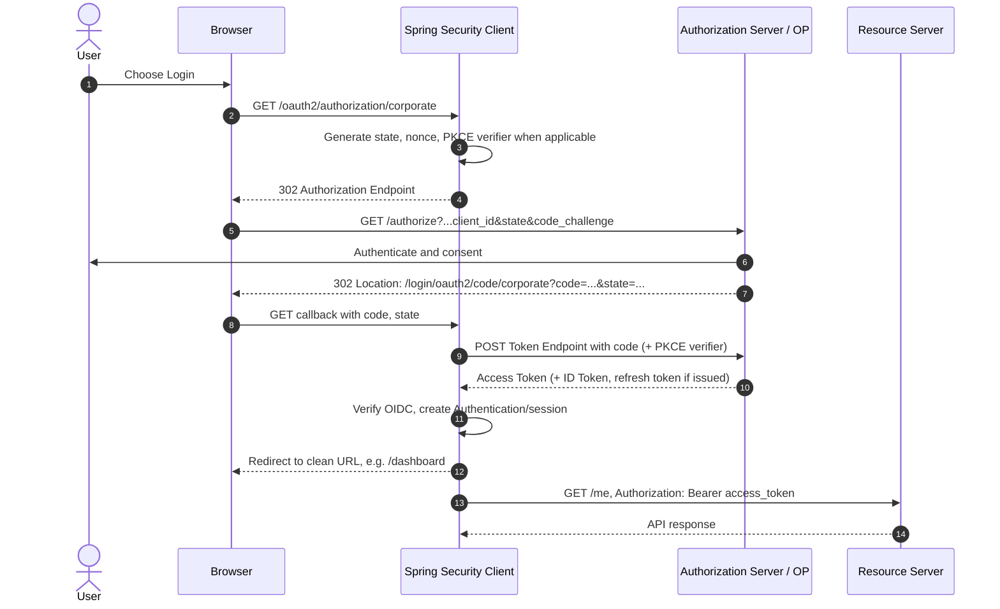

# 27.6. Authorization Code or Token Leakage via URLs, Logs, and Referrers

> **Module:** Spring Security OAuth 2.0 OIDC Client  
> **Chapter:** 27. Integration Security  
> **Scope:** Spring Security OAuth 2.0 Client, OpenID Connect Login, browser redirects, HTTP gateways, application logs, observability, and credential protection across the entire Authorization Code Flow.

OAuth 2.0 and OpenID Connect (OIDC) rely on several sensitive artifacts: authorization codes, access tokens, refresh tokens, ID tokens, `state`, `nonce`, PKCE `code_verifier`, and Client credentials. Even when a system verifies ID Token signatures properly and enforces HTTPS, data can still leak if placed in URLs, written to access logs, sent via referrers, captured by analytics, or stored in APM traces.

There is an easy point of confusion: **the standard Authorization Code Flow genuinely puts `code` into the query string of the redirect callback**. That is expected by the protocol. However, that code must be short-lived, single-use, bound to the Client/redirect URI, and protected by PKCE where appropriate. Applications must avoid storing or spreading URLs containing `code` beyond what is strictly necessary.

Conversely, **access tokens and refresh tokens must never be placed in URLs to call APIs, redirect, or share links**. Bearer tokens are credentials: anyone holding the token who satisfies the Resource Server's acceptance checks can exercise that token's permissions without knowing the user's password.

This lesson focuses on identifying each leakage channel, its severity, preventive controls in Spring Security/Servlet/WebFlux, proxy infrastructure and logging systems, and how to respond once an incident occurs.

---

## 1. Learning Objectives

After this lesson, you will be able to:

1. Explain the differences among authorization codes, access tokens, refresh tokens, ID tokens, `state`, and PKCE `code_verifier`.
2. Identify where authorization codes legitimately appear in Authorization Code Flow redirects.
3. Understand why tokens in URL query strings, paths, or fragments can leak across multiple systems.
4. Distinguish the `Referer` HTTP header from the `Referrer-Policy` response header.
5. Understand the limits of modern default referrer policies and why leakage surfaces must still be minimized.
6. Recognize sensitive logs across NGINX, ingress, API gateways, Spring Boot, Servlet containers, APM, tracing, and browser analytics.
7. Apply Authorization Code + PKCE S256, `state`, OIDC `nonce`, and redirect URI validation in their proper roles.
8. Configure `Referrer-Policy`, cache headers, and post-callback redirects according to your threat model.
9. Call Resource Servers using `Authorization: Bearer ...` instead of query parameters.
10. Avoid credential leaks via exception messages, DEBUG/wiretap logging, and HTTP body/header logging.
11. Understand the specific risks of `id_token_hint` in OIDC RP-Initiated Logout.
12. Design sensitive-logging reduction while maintaining error observability.
13. Plan tests for URL/log/referrer protections without using production tokens.
14. Triage incidents, revoke/rotate credentials, and manage data already collected in logs/backups.

## 2. Map of Commonly Confused Credentials

| Artifact | Purpose | Where it belongs | If leaked |
|---|---|---|---|
| **Authorization code** | Exchanged by Client for tokens at the Token Endpoint | Callback redirect in Authorization Code Flow; subsequently in the token request | Could be raced for token exchange if other bindings are also bypassed |
| **Access token** | Grants API access | HTTP `Authorization: Bearer ...` to the matching-audience Resource Server | Can be replayed until expiry/revocation, depending on sender constraints |
| **Refresh token** | Obtains new access tokens | Protected Client storage; refresh grant request body to AS | Long-lived access risk, rotation/replay issues, and grant revocation |
| **ID token** | Delivers OIDC authentication result to Client | Token response and OIDC principal/server-side state per design | May leak personal claims and session context; not a generic Bearer API token |
| **`state`** | Correlates authorization request/response; prevents CSRF/mix-up per contract | Authorization Request and callback, bound to a secure transaction | Exposure weakens defenses if other flaws exist; does not replace an access token |
| **`nonce`** | Binds ID Token to an OIDC authentication request | Authorization Request and ID Token validation | Mishandling creates replay/mix-up risks |
| **PKCE `code_verifier`** | Proves the Client initiated the Authorization Request | Kept secret by Client as scoped, sent to **Token Endpoint** | If leaked alongside code, defeats PKCE's benefit |
| **Client secret/private key** | Authenticates confidential Client | Secret manager, Token Endpoint authentication | Enables Client impersonation; requires rotation |

**Do not equate the severity of these values.** Seeing `state` in a callback does not mean an attacker immediately holds an access token; nevertheless, collecting `state`/callback URLs reveals information useful for chaining attacks and must be minimized.

### 2.1. An ID Token Is Not Equivalent to an Access Token

An ID Token lets the OIDC Client verify authentication. A standard Resource Server must receive an appropriate **access token** and check issuer/audience/claims per its protocol. Never use an ID Token to call APIs in place of an access token, and never treat logging an ID Token as harmless because "it isn't an API token": an ID Token can contain email, subject, groups, and other sensitive claims.

## 3. Path of the Authorization Code Flow

Example of a browser login via OIDC:



The natural point where a sensitive URL appears is the callback:

```http
GET /login/oauth2/code/corporate?code=<redacted>&state=<redacted> HTTP/1.1
Host: app.example.test
```

This is not evidence of misconfiguration. The mistake is **allowing callback URLs to propagate into logs, HTML UIs, analytics, third-party requests, or uncontrolled redirects**.

## 4. Is an Authorization Code a Bearer Token?

An authorization code is a transactional credential, not an access token. It is typically:

- Short-lived.
- Single-use.
- Bound to the Client/authorization request.
- Bound to the redirect URI and token request semantics.
- Paired with a PKCE verifier when the flow uses PKCE.
- Protected by Client authentication for confidential Clients.

That **reduces** the chance that an unintended recipient can exchange the code for tokens, yet **does not make leaking the code harmless**.

### 4.1. When a Leaked Code Still Matters

- A public Client does not implement PKCE or implements PKCE incorrectly.
- `code_verifier` is also logged/leaked alongside the code.
- A Client secret is leaked alongside code/redirect details.
- Attackers control the callback or exploit a token-exchange/confused-deputy flaw.
- The Authorization Server fails to enforce one-time use or proper redirect/PKCE binding.
- APM/analytics capture `code`, `state`, and session-tracing artifacts.

Treat authorization codes as sensitive data, even though their impact is often lower than a refresh token.

## 5. Why Are URLs an Especially Exposed Leakage Surface?

URLs are copied and observed by far more components than request bodies or headers:

1. Browser address bar and history.
2. Bookmarks, clipboard, and link sharing.
3. Browser extensions.
4. Reverse proxy/ingress access logs.
5. API gateways, WAFs, CDNs, and load balancers.
6. Servlet container access logs.
7. APM HTTP transaction names and tracing attributes.
8. Error reports, screenshots, and bug-report attachments.
9. Analytics scripts, RUM SDKs, and third-party trackers.
10. The `Referer` header when a page at a sensitive URL loads resources or navigates.
11. Logged HTTP redirect `Location` headers.
12. Misconfigured caches and monitoring systems.

HTTPS protects data in transit between trusted endpoints; it **does not stop** URLs from being saved in browser history, TLS-terminating proxies, application logs, APM, or analytics.

### 5.1. URL Query, Path, and Fragment Differ

| Location | Illustrative example | Sent in HTTP request to server? | Risk |
|---|---|---|---|
| Query | `/callback?code=<redacted>` | Yes | Access logs, proxies, referrer, browser history |
| Path | `/token/<redacted>` | Yes | Logs, routing, tracing, referrer, bookmarks |
| Fragment | `/callback#access_token=<redacted>` | Not sent in standard HTTP requests | Browser history/JS/extensions, client-side analytics |
| Header | `Authorization: Bearer <redacted>` | Yes, in header | Leaks if HTTP header logging is on; not in URL by default |
| Form/JSON body | Token request body | Yes, in body | Leaks if body logging is on; does not appear in URL |

**Do not interpret "fragments aren't sent to the server" as "fragments are safe."** JavaScript on the page can read `location.hash`, extensions can inspect URLs, and frontend telemetry can inadvertently capture fragments. The legacy Implicit Flow used fragments to deliver access tokens, which is not recommended for new architectures.

## 6. Referrer and `Referer`: Spelled Differently, Closely Related

The historical HTTP header is named **`Referer`** (not `Referrer`). It reports the source URL of a navigation/resource request per browser policy.

The response header controlling that behavior is **`Referrer-Policy`**.

Suppose an uncleaned callback page has the URL:

```text
https://app.example.test/login/oauth2/code/corporate?code=SECRET&state=VALUE
```

If the page at that URL loads:

```text
https://analytics.example.net/collect
```

then the referrer may disclose source URL information depending on browser policy, scheme, and navigation direction.

**Do not claim every modern browser always sends the full query string to third-party sites.** Today's common default is `strict-origin-when-cross-origin`, which sends only the origin on many cross-origin HTTPS requests; however, same-origin navigation can still include path/query, other policies can allow more, and analytics SDKs can independently read `window.location.href`.

### 6.1. A Same-Origin Example

The callback page has a `code` query parameter and loads:

```http
GET /assets/app.js HTTP/1.1
Host: app.example.test
Referer: https://app.example.test/login/oauth2/code/corporate?code=<redacted>&state=<redacted>
```

Under several referrer policies, **same-origin** requests send the full URL including query parameters, and the asset server may record it in access logs.

### 6.2. A Cross-Origin Example

Under `strict-origin-when-cross-origin`, a request from an HTTPS RP to a cross-origin HTTPS analytics server usually carries only:

```http
Referer: https://app.example.test/
```

yet that is no excuse to drop controls: policies can vary on older clients/custom setups, redirects can change behavior, and an analytics SDK can still send the full URL inside its **own payload**.

## 7. Common `Referrer-Policy` Values

| Policy | General effect | Suitable for OAuth2 callback pages? |
|---|---|---|
| `no-referrer` | Sends no `Referer` | **Highly suitable** to reduce callback URL exposure |
| `same-origin` | Sends referrer only on same-origin requests | Can still leak queries in same-origin logs |
| `strict-origin-when-cross-origin` | Full URL same-origin, origin only on cross-origin HTTPS→HTTPS | Useful default, but does not eliminate all leaks |
| `origin` | Sends origin without path/query | Reduces query leakage, still reveals origin |
| `origin-when-cross-origin` | Full URL same-origin, origin cross-origin | Same-origin risk remains |
| `unsafe-url` | May send full URL broadly | **Never use** on pages handling OAuth credentials |

Exact behavior also depends on browsers, protocol downgrades, and overall policy. If the threat model requires preventing callback URL dissemination, apply `Referrer-Policy: no-referrer` on sensitive endpoints/flows or as a strict global policy.

### 7.1. A Referrer Policy Does Not Solve All Logging

Even with `no-referrer`, the callback URL can still appear in:

- RP ingress/access logs;
- browser history;
- reverse proxies;
- APM transaction attributes;
- Spring filter logs;
- HTTP request telemetry.

Therefore, **clean URLs and redact at every layer**, rather than relying on a single HTTP header.

## 8. Configuring `Referrer-Policy` in Spring Security Servlet

Example response header configuration in Spring Security:

```java
package example.security;

import org.springframework.context.annotation.Bean;
import org.springframework.context.annotation.Configuration;
import org.springframework.security.config.Customizer;
import org.springframework.security.config.annotation.web.builders.HttpSecurity;
import org.springframework.security.web.SecurityFilterChain;
import org.springframework.security.web.header.writers.ReferrerPolicyHeaderWriter.ReferrerPolicy;

@Configuration
public class BrowserSecurityConfig {

    @Bean
    SecurityFilterChain securityFilterChain(HttpSecurity http)
            throws Exception {

        return http
            .authorizeHttpRequests(auth -> auth
                .requestMatchers("/", "/error", "/signed-out").permitAll()
                .anyRequest().authenticated()
            )
            .oauth2Login(Customizer.withDefaults())
            .headers(headers -> headers
                .referrerPolicy(referrer -> referrer
                    .policy(ReferrerPolicy.NO_REFERRER)
                )
            )
            .build();
    }
}
```

This snippet uses the standard Spring Security Servlet 6.x DSL. Check the exact API for your project/version.

### 8.1. Why Set `no-referrer` Globally?

A global policy reduces the risk of forgetting a callback, logout, or diagnostic page. However, it can affect analytics or flows that rely on referrers. If the product needs a different policy on regular pages, apply the strict policy to sensitive route groups and verify response headers on every redirect/error branch.

### 8.2. Remember Proxies/CDNs Can Overwrite Headers

If an ingress/CDN adds or modifies `Referrer-Policy`, the final header reaching the browser may differ from Spring's config. Inspect the **actual HTTP responses** at the internet edge, not just the source code.

### 8.3. Browser Referrer Policy Is Not CSRF Protection

`Referrer-Policy: no-referrer` does not replace OAuth2 `state`, OIDC `nonce`, or CSRF tokens on state-changing endpoints. Each mechanism solves a different problem.

## 9. Redirect Immediately to a Clean URL After Callback

A key control is letting Spring Security process the callback and immediately send the browser to a URL free of `code`/`state`:

```text
/login/oauth2/code/corporate?code=<redacted>&state=<redacted>
    |
    v
Spring Security processes authorization response
    |
    v
HTTP 302/303 to /dashboard
    |
    v
Browser displays clean URL /dashboard
```

In normal OAuth2 Login, Spring Security processes the callback in the filter, creates the Authentication/session, and redirects via the success handler. There is no need to render HTML at the callback URL containing `code`.

### 9.1. Do Not Render a Callback Page Loaded with Third-Party Assets

Avoid:

```html
<!-- ANTI-PATTERN for callback architecture -->
<script src="https://analytics.example.net/tag.js"></script>
<script>
  sendAnalytics({ currentUrl: window.location.href });
</script>
```

If the callback URL still holds `code`/`state`, telemetry can capture them. Keep the callback strictly as a protocol-processing endpoint that **redirects quickly to a clean URL** before loading scripts or analytics.

### 9.2. History Can Still Record Navigations

Redirecting minimizes the window a sensitive URL is visible and avoids rendering a page with `code`, yet it does not guarantee browser history, browser telemetry, or network logs are free of the callback. Keep all other protections intact.

### 9.3. Never Trust a Return URL from Query Parameters

If a success handler accepts `?next=https://attacker.example` and redirects without an allowlist, it creates an open redirect that can expose session context or lead users off the trusted origin.

Return-to URLs should be relative internal paths or allowlisted targets, securely tied to the authorization transaction and free of tokens.

## 10. `Cache-Control` on Callbacks and Credential-Bearing Responses

Browser/proxy caching can retain sensitive data, especially if the app emits HTML/JSON at the callback.

A typical policy on sensitive responses:

```http
Cache-Control: no-store
Pragma: no-cache
Referrer-Policy: no-referrer
```

`no-store` instructs caches not to persist the response per HTTP semantics. It does not prevent browser history, access logs, or APM from recording URLs or request metadata.

### 10.1. Cache Headers Do Not Hide Query Strings

If the request URL is:

```text
/login/oauth2/code/corporate?code=<redacted>
```

and the proxy already logged `request_uri` before returning the response, `Cache-Control: no-store` **does not erase that log entry**.

### 10.2. Never Return Tokens in HTML or Redirect `Location` Headers

Never allow access tokens to appear in:

- Redirect URLs, queries, or paths;
- HTML responses/screenshots/debug pages;
- Inline JavaScript containing tokens;
- Cookies with inappropriate attributes;
- Widely logged response headers unless required.

For server-side OAuth2 Clients, store authorized clients/tokens in protected server-side storage rather than sending tokens to the frontend just for routing.

## 11. Authorization Code + PKCE S256

**PKCE** (Proof Key for Code Exchange) mitigates the risk of a third party capturing an authorization code and exchanging it for tokens.

Flow:

```text
Client randomly generates code_verifier
  |
  +-> Computes code_challenge = BASE64URL(SHA256(code_verifier))
  |
  +-> Authorization Request:
  |     code_challenge=...
  |     code_challenge_method=S256
  |
  +-> Callback receives code
  |
  +-> Token Request:
        code=...
        code_verifier=<original value, sent only to Token Endpoint>
```

The AS verifies the verifier hashes to the challenge bound to the authorization request. If an attacker only steals the authorization code **without** the verifier, they cannot exchange it for tokens at a PKCE-compliant AS.

### 11.1. PKCE Does Not Make Authorization Codes Public

PKCE does not protect you if:

- The verifier is logged/leaked along with the code;
- An implementation disables validation;
- An attacker compromises Client storage/processes;
- The Authorization Request/redirect flow has other flaws.

You still need PKCE, `state`, trusted redirect URIs, TLS, and proper secret handling together.

### 11.2. Why Use `S256` Instead of `plain` Whenever Possible?

`S256` does not reveal the verifier directly through the challenge. `plain` sets the challenge equal to the verifier, reducing protection against code interception wherever the authorization request is observed. Prefer `S256` per security best practices and OP capabilities.

## 12. PKCE in Spring Security Client

Spring Security includes PKCE generation/verifier handling for appropriate flows. With Servlet `DefaultOAuth2AuthorizationRequestResolver`, you can apply the framework's customizer in supported versions:

```java
import org.springframework.security.oauth2.client.web.DefaultOAuth2AuthorizationRequestResolver;
import org.springframework.security.oauth2.client.web.OAuth2AuthorizationRequestCustomizers;

DefaultOAuth2AuthorizationRequestResolver resolver =
    new DefaultOAuth2AuthorizationRequestResolver(
        clientRegistrationRepository,
        "/oauth2/authorization"
    );

resolver.setAuthorizationRequestCustomizer(
    OAuth2AuthorizationRequestCustomizers.withPkce()
);
```

**Note:** Spring Security's default PKCE policy varies by client type/version and ClientRegistration properties. When enforcing PKCE for confidential Clients, verify actual runtime behavior for your version and OP support rather than guessing from `client-secret` config alone.

### 12.1. What to Verify in Tests

In the authorization redirect:

```text
code_challenge=...
code_challenge_method=S256
```

In the Token Endpoint request:

```text
code_verifier=...
```

Never **print real values in production test logs**. Use synthetic test fixtures or assert presence/structure only. If using a custom resolver, preserve the original authorization request attributes so the Token Request still receives the verifier.

## 13. `state` and OIDC `nonce` Do Not Replace PKCE

Three mechanisms:

| Mechanism | Question it answers |
|---|---|
| `state` | Does the authorization response correlate with a request we initiated, preventing CSRF/mix-up per contract? |
| `nonce` | Does the ID Token belong to the current OIDC authentication request? |
| PKCE | Can the Client exchanging the authorization code prove it generated the matching challenge? |

An application can use all three. Never:

- Replace `state` with a predictable tenant name or user ID.
- Let the browser pick `nonce` and skip verification.
- Put `code_verifier` in a query URL to "debug."
- Disable PKCE solely because you have a Client secret.
- Skip `state` verification because callbacks seem to work in the lab.

### 13.1. Multi-Tab Transactions

Two tabs may start two OAuth2 logins simultaneously. If the app stores a single session field `currentState` and overwrites it, the earlier flow can fail or get mixed up. Use Spring Security's authorization request repository/correlation and test concurrent attempts.

## 14. Redirect URIs Must Be Controlled

An authorization code is typically bound to the Client and redirect URI per OAuth2 requirements, preventing third parties from redeeming codes at another endpoint.

Required:

- Register exact redirect URIs with the AS.
- Avoid uncontrolled wildcard redirects.
- Never derive redirect URIs from unverified `Host`/forwarded headers.
- Never let a query param `redirect_uri=https://evil.example` override the registration.
- Handle `{baseUrl}` properly behind reverse proxies.
- Never confuse post-login redirect URLs with the OAuth2 redirect URI.

### 14.1. Open Redirect on the RP

Suppose the RP has:

```text
https://app.example.test/redirect?next=https://attacker.example
```

and the AS accepts that URI as a redirect target. An open redirect can send codes or transaction data off the trusted origin depending on the flow. Validate URLs against an allowlist, prefer relative paths, and never use an open redirector as an OAuth2 callback.

## 15. Never Put Access Tokens in Query Parameters

Anti-pattern:

```http
GET /api/reports?access_token=<redacted> HTTP/1.1
Host: api.example.test
```

Even if the server accepts it, this URL can be logged, copied, bookmarked, cached, or shared.

Proper way for Bearer tokens:

```http
GET /api/reports HTTP/1.1
Host: api.example.test
Authorization: Bearer <redacted>
Accept: application/json
```

RFC 6750 describes Bearer token transmission methods, including the `Authorization` header and other forms; however, the URI query method **is not recommended** due to security risks. In new integrations, use the `Authorization` header over HTTPS.

### 15.1. Headers Still Need Protection

`Authorization: Bearer ...` reduces leakage via URLs/referrers, yet if an APM/proxy enables full HTTP header logging, tokens can still leak.

**Using headers does not replace redaction.**

## 16. Calling APIs Properly with `WebClient`

Example API call once an appropriate `OAuth2AuthorizedClient` is obtained:

```java
import org.springframework.web.reactive.function.client.WebClient;
import org.springframework.security.oauth2.client.OAuth2AuthorizedClient;
import reactor.core.publisher.Mono;

Mono<Report> loadReport(
        WebClient webClient,
        OAuth2AuthorizedClient authorizedClient) {

    String accessToken =
        authorizedClient.getAccessToken().getTokenValue();

    return webClient.get()
        .uri("https://api.example.test/reports/current")
        .headers(headers -> headers.setBearerAuth(accessToken))
        .retrieve()
        .bodyToMono(Report.class);
}
```

Here:

- The token travels in the `Authorization` header.
- The URL contains no token.
- The Client must ensure the API destination/audience/scopes are right.
- Never log `accessToken` or include it in exception messages.
- Never forward tokens across redirects to untrusted hostnames.

In reactive Spring Security apps, you can integrate the OAuth2-aware `WebClient` filter/authorized client manager instead of manually reading the token, provided registrations and API targets are controlled.

### 16.1. Avoid Tokens in `WebClient` `baseUrl`

Never write:

```java
// ANTI-PATTERN:
WebClient client = WebClient.create(
    "https://api.example.test?access_token=" + token
);
```

Because that URL is preserved in logs/tracing and request URIs. Never place tokens as path segments either, even if URL-encoded.

## 17. Access Tokens in URL Fragments: Lessons from the Implicit Flow

The legacy OAuth2 Implicit Flow could return an access token in the URL fragment:

```text
https://spa.example.test/callback#access_token=<redacted>
```

Fragments are not sent in normal HTTP requests to the server, yet risks remain:

- JavaScript can read `window.location.hash`.
- Third-party scripts and XSS can steal the token.
- Browser extensions/telemetry observe URLs.
- Tokens sit in browser history/copied/shared links.
- There is no Authorization Code + PKCE token exchange.
- Safe token lifecycle/refresh management in the browser is difficult.

For modern apps, prefer **Authorization Code + PKCE** for browser/public clients and BFF/server-side architectures where appropriate. Do not build new integrations relying on access tokens in URL fragments.

### 17.1. URL Fragments Are Not Sent in Standard `Referer` Headers

Per browser referrer semantics, fragments are stripped from the `Referer` header, yet that does not stop JavaScript/analytics from reading the URL and exfiltrating it separately. Distinguish **referrer header leakage** from **client-side data exfiltration**.

## 18. Refresh Tokens in URLs Are Even More Dangerous

A refresh token can mint new access tokens repeatedly, subject to AS policy, expiry, rotation, and sender constraints.

Never put a refresh token in:

- Web page query strings.
- QR codes acting as login URLs.
- Redirect `Location` headers.
- Local browser links/bookmarks.
- JavaScript error reports.
- Access logs or APM spans.
- Client-side analytics.
- Plaintext session cookies readable by JavaScript.

Store them server-side with proper encryption/access controls/retention, or in storage suited to the OAuth2 Client type. If a refresh token leaks, evaluate revocation, rotation, token families, and affected sessions/connections.

## 19. OIDC `id_token_hint` in Logout URLs

OIDC RP-Initiated Logout may pass `id_token_hint` to the OP's end-session endpoint. Depending on the OP, this parameter can appear in the browser redirect's URL query:

```text
https://login.example.test/logout?id_token_hint=<redacted>&post_logout_redirect_uri=...
```

This differs from putting an access token in an API query, yet **an ID Token can still contain sensitive identity claims**, and the URL can enter history, referrers, or logs.

### 19.1. Necessary Precautions

- Use Spring Security's OIDC logout handler where applicable rather than assembling logout URLs manually.
- Redirect only to the end-session endpoint published/approved by the OP.
- Use HTTPS.
- Enforce strict `Referrer-Policy` on the RP and coordinate with the OP if possible.
- Never log full `Location` headers containing `id_token_hint`.
- Never send ID Tokens to third-party websites other than the OP.
- Retain ID Tokens only as needed and per retention policy.

### 19.2. You Cannot Guarantee the OP Doesn't Log It

The RP can minimize exposure in its own logs, yet cannot directly govern all OP systems. When using a protocol that sends a token to the OP, review the provider's logging/retention policies and capabilities.

## 20. Leakage via Reverse Proxies, NGINX, and Ingress

A common NGINX config:

```nginx
log_format risky '$remote_addr "$request" $status';
```

`$request` contains the full request line, which includes the query:

```text
GET /login/oauth2/code/corporate?code=<redacted>&state=<redacted> HTTP/1.1
```

`$request_uri` typically includes the query string as well. For OAuth2 callbacks, this is an obvious leak.

### 20.1. A Log Format Avoiding Query Strings

Illustrative example:

```nginx
log_format oauth_safe
    '$remote_addr "$request_method $uri" $status '
    'request_time=$request_time';
access_log /var/log/nginx/access.log oauth_safe;
```

In NGINX, `$uri` represents the normalized URI path in server context **without the query string**, unlike `$request_uri` and `$args`.

Note, however:

- If the app puts tokens in the **path**, this pattern still leaks them.
- If paths contain sensitive PII, separate masking is needed.
- Proxy error logs/tracing/WAFs/CDNs may still log queries.
- Not every deployment uses NGINX; inspect your specific load balancer and ingress controller.
- Ensure logs retain enough HTTP metrics for observability without keeping credentials.

### 20.2. Do Not Fix One Access Log and Forget WAF/APM

In a stack with CDN → WAF → ingress → service mesh → Spring Boot, each layer may log requests independently. Changing NGINX alone does not secure the pipeline:

```text
CDN request log
WAF event log
Ingress access log
Service mesh trace
Servlet container access log
Application filter log
APM transaction span
Error reporter
```

Map the callback request path and every point that could record `queryString` or `fullUrl`.

## 21. Servlet Container Access Logs

Tomcat, Jetty, or Undertow can log request targets using their own patterns. In Tomcat access logs, patterns printing the request line include query strings; distinguish request URI, query string, and request line fields.

### 21.1. Config Points to Audit

- Does the pattern include the raw request line?
- Is the query string appended to the URI?
- Is cookie/header logging enabled?
- Do container error logs print full URLs on 4xx/5xx?
- Are access logs forwarded to a SIEM?
- What is log retention and who has access?
- Are callback paths like `/login/oauth2/code/*` filtered specifically?

Never assume the framework redacts `code`/`state` at the container layer. Behavior depends on actual logging configuration.

## 22. Where Is Spring Boot Request Logging Dangerous?

Common logging/debug mechanisms that can leak credentials:

- `CommonsRequestLoggingFilter` with query string enabled.
- Custom `OncePerRequestFilter` printing `request.getRequestURL() + "?" + request.getQueryString()`.
- `HandlerInterceptor` or exception handler logging the full URI.
- Access-denied/authentication-failure loggers attaching the raw request.
- HTTP tracing with full URLs.
- Controllers logging `Authorization` headers or `OAuth2AuthorizedClient`.
- HTTP client DEBUG/wiretap logs.

Anti-pattern:

```java
// ANTI-PATTERN: writes code/state into application logs.
log.info("incoming URL: {}?{}",
    request.getRequestURL(),
    request.getQueryString());
```

A better log record:

```text
event=oauth2_callback
route=/login/oauth2/code/{registrationId}
registrationId=corporate
result=success
durationMs=240
correlationId=opaque-event-123
authorizationCode=[not-logged]
state=[not-logged]
```

**Never** log raw `state` or full session IDs just for correlation. Use a separate opaque server-generated log correlation ID under a privacy policy.

## 23. Structured Logging and Field Allowlists

Regex-based redaction can help, yet has drawbacks:

- Tokens can appear under keys like `id_token`, `refresh_token`, `auth_code`, or `authorization`.
- URL-encoded values may miss regexes.
- Tokens can sit inside nested JSON, exception causes, or response headers.
- APMs may capture raw values before the redaction layer.
- Custom APIs use varying token field names.

**Prefer field allowlists**: log only fields explicitly evaluated as safe.

Example:

```java
log.info("oauth_login_result registrationId={} outcome={} traceId={}",
    registrationId,
    "success",
    safeCorrelationId);
```

Instead of:

```java
// ANTI-PATTERN:
log.info("callback request={} principal={} token={}",
    request, authentication, authorizedClient);
```

### 23.1. Never Blindly Log Entire Exception Objects

Some HTTP client exceptions embed URLs, headers, or token values in their messages or bodies. When logging exceptions, understand the exception types and library formatting.

Keep stack traces for troubleshooting, but strip credentials from messages/tags and enforce access controls/retention. Do not swing to "log nothing," which makes incidents impossible to investigate.

## 24. APM, Tracing, and Analytics

APM agents frequently capture:

- Full HTTP URLs.
- Paths and query strings.
- Request/response headers.
- HTTP bodies.
- Baggage, tags, and span attributes.
- Exception messages.
- Browser RUM `window.location.href`.
- Session replay recordings.

SDKs and configurations differ, so there is no single universal redaction API across vendors.

### 24.1. General Rules

1. **Avoid capturing raw query strings** on OAuth callbacks, logout, and the Token Endpoint.
2. Never capture `Authorization`/`Cookie`/`Set-Cookie` or Client credentials.
3. Sanitize URLs in span names and attributes.
4. Never attach access tokens, `code`, `state`, or `code_verifier` as trace tags.
5. Disable or restrict session replay on login/callback pages.
6. Separate needed operational telemetry from secrets.
7. Restrict viewer permissions and telemetry retention.
8. Audit exporters and downstream dashboards, not just the source agent.

### 24.2. Analytics JavaScript Reading the URL Directly

Even with `Referrer-Policy: no-referrer`, a script can send:

```javascript
// ANTI-PATTERN: analytics sends full callback URL to third party.
analytics.track("page_view", {
  url: window.location.href
});
```

Hence a header policy never replaces the decision **not to render/run analytics on callback URLs containing `code`**. Redirect to a clean page first, then invoke analytics if appropriate.

## 25. Error Pages and Debugging Tools

An app might handle a callback failure by rendering:

```text
OAuth2 login failed: /login/oauth2/code/corporate?code=...&state=...
```

If that error lands in HTML, screenshots, support tickets, or session replay tools, credentials travel far beyond the original request.

Error pages should display a safe message:

```text
Unable to complete login. Please try again.
Support reference code: EVT-42C7
```

And the server logs safe metadata such as `registrationId`, failure category, and correlation ID.

### 25.1. Do Not Let Users Paste Raw Callback URLs into Tickets

When troubleshooting, ask users for the error code/correlation ID or a screenshot with the URL cropped/redacted—**never** ask them to paste a callback link containing `code`/`state`/ID Token. Support agents need training on handling sensitive artifacts.

## 26. Token Leakage via HTTP Redirects

A Bearer token can go to the wrong target if an HTTP client automatically follows cross-domain redirects while forwarding sensitive headers.

Example:

```text
Client calls https://api-a.example.test/data
Authorization: Bearer token-for-A
API A returns 302 to https://api-b.example.test/data
```

HTTP libraries differ on whether they preserve or strip `Authorization` across cross-origin redirects. Never assume a client is safe on all redirects by default.

### 26.1. Protections

- Send tokens only to configured API hosts and audiences.
- Do not follow redirects to arbitrary destinations when carrying credentials.
- Check the redirect policy of `WebClient`/Reactor Netty or your specific HTTP client.
- Never take a target URI from a browser query and attach a Bearer token.
- Enforce host/domain allowlists, HTTPS, and TLS validation.
- Log redirect targets at a safe origin/route level without logging tokens.

### 26.2. Do Not Use Another Registration's Access Token

With multiple OPs/ASs/Resource Servers, API A's access token must never be sent to API B. Select `OAuth2AuthorizedClient` for the right registration/principal/target and verify audience. This is a confused-deputy/token-leakage issue, not merely an HTTP error.

## 27. Referrer Leakage and Third-Party Resources on Callbacks

A common hazard is rendering HTML on the callback and loading:

- External CDN fonts.
- Tag managers.
- Analytics pixels.
- Customer support widgets.
- Social media trackers.
- Error reporter scripts.
- Ad/marketing scripts.

With a permissive policy, `Referer` can reveal the URL containing `code`. Even under a strict policy, third-party scripts executing in the page's origin can read `location.href` and exfiltrate it directly.

**Architectural rule:** the callback processes the protocol and redirects to a clean URL; avoid executing third-party scripts on URLs containing `code`.

### 27.1. CSP Complements but Does Not Replace `Referrer-Policy`

`Content-Security-Policy` restricts script/resource origins and reduces XSS/exfiltration risks, yet does not stop proxy logs from recording callback codes. Referrer policy, CSP, logging controls, and clean redirects are complementary layers.

## 28. Token-Bearing URLs in Deep Links and Email

A frequent flawed design:

```text
https://app.example.test/open?access_token=<redacted>
```

sent via email or chat for "auto-login." Such links can be:

- Pre-opened by email security scanners.
- Prefetched by browser/chat link previews.
- Forwarded/shared.
- Recorded in proxy logs and analytics.
- Saved in browser history.

Never embed OAuth access/refresh tokens in deep links. If a product needs a one-time login link, build a separate protocol: high-entropy random token, narrow scope, short TTL, single-use, replay protection, handling for scanner prefetches, and never treat that link as an OAuth API token. Sensitive actions require additional identity/device checks.

## 29. URL Encoding Is Not Redaction

URL encoding:

```text
access_token=eyJ...
access_token=eyJ%2E...
```

does not make a credential secret. Proxies/servers/analytics decode it; anyone with logs can recover it.

Similarly, Base64 is not encryption. Never put tokens in paths, queries, or fragments and claim safety because they are encoded or partially hashed.

### 29.1. Can You Hash Tokens for Correlation?

If you need to identify duplicate tokens in security telemetry, use a security-reviewed fingerprint design such as HMAC with a separately managed secret, without logging the raw token. Consider length, token type distinctions, and user-correlation privacy. Never rely on a raw unsalted hash of uncertain-entropy tokens as a substitute for fixing logging.

## 30. Authorization Request URLs Also Contain Sensitive Data

An Authorization Request to the OP:

```text
/authorize?client_id=...&redirect_uri=...&scope=...&state=...&nonce=...&code_challenge=...
```

does not normally carry access tokens, yet still holds sensitive values:

- `state` and `nonce` bind the transaction.
- `login_hint` may contain an email or personal identifier.
- `acr_values`/`prompt` reveal security intent.
- `redirect_uri` can expose host/tenant details.
- `request`/`request_uri` in advanced profiles carry privacy implications.

Avoid dumping full Authorization Endpoint URLs into support logs. Especially avoid logging PKCE verifiers if an app ever misplaced them into custom params.

## 31. Token Endpoint Logging

Token Requests are typically POST forms:

```http
POST /oauth2/token HTTP/1.1
Host: login.example.test
Content-Type: application/x-www-form-urlencoded
Authorization: Basic <redacted-client-authentication>

grant_type=authorization_code&code=<redacted>&redirect_uri=<encoded>&code_verifier=<redacted>
```

The token response can contain:

```json
{
  "access_token": "<redacted>",
  "token_type": "Bearer",
  "expires_in": 300,
  "refresh_token": "<redacted>",
  "id_token": "<redacted>"
}
```

**Never enable HTTP body logging on the Token Endpoint** just to debug 400/401 errors. Request bodies contain authorization codes, PKCE verifiers, or refresh tokens; responses contain live token values.

### 31.1. How to Log Errors Safely

You can log:

```text
event=oauth2_token_exchange
registrationId=corporate
grantType=authorization_code
httpStatus=400
oauthError=invalid_grant
durationMs=180
correlationId=trace-72c
```

while excluding raw request/response bodies, Client secrets, and `Authorization` headers. `invalid_grant` has multiple causes (expired/reused code, redirect mismatch, PKCE failure); investigate via a mock/test OP and safe metadata.

## 32. HTTP Client Wiretap and DEBUG Logs

Several libraries allow:

- Dumping HTTP request/response headers.
- Dumping full bodies.
- Printing URLs/queries.
- Logging TLS/session/network traces.

For example, Reactor Netty `wiretap` or a custom `ExchangeFilterFunction` can log sensitive data if left unrestricted.

### 32.1. Rules When Debugging

- Enable only in test environments using synthetic credentials.
- In production, enforce approval policies and redaction prior to logging.
- Never send raw headers/bodies of Token Endpoint or UserInfo calls to logs.
- Never leave temporary incident DEBUG mode enabled indefinitely.
- Audit APM exporters and log forwarding pipelines.
- Limit retention and access permissions.
- Scan logs after disabling debug to detect any leaked secrets.

## 33. Spring Security Authorized Client Storage

After OIDC Login, the app may store `OAuth2AuthorizedClient` in:

- HTTP session/repository.
- `InMemoryOAuth2AuthorizedClientService`.
- `JdbcOAuth2AuthorizedClientService`.
- A custom encrypted token store.

The authorized client lifecycle is separate from displaying a user profile. Never return raw `OAuth2AuthorizedClient` objects from controllers or let JSON serializers output raw token values.

### 33.1. Safe Controller Example

```java
import java.util.Map;
import org.springframework.security.core.annotation.AuthenticationPrincipal;
import org.springframework.security.oauth2.core.oidc.user.OidcUser;
import org.springframework.web.bind.annotation.GetMapping;
import org.springframework.web.bind.annotation.RestController;

@RestController
class CurrentUserController {

    @GetMapping("/me")
    Map<String, String> me(@AuthenticationPrincipal OidcUser user) {
        return Map.of(
            "subject", user.getSubject(),
            "issuer", user.getIdToken().getIssuer().toString()
        );
    }
}
```

This snippet assumes the endpoint only serves OIDC principals; apps with multiple authentication methods must handle each principal type accordingly. Depending on privacy policy, **even `issuer`/`sub`** may not need to be exposed to the frontend; return only minimal required data.

## 34. Practical Assessment of `Referrer-Policy` on Pages with Authorization Codes

Consider three paths:

**A. Callback renders no HTML and redirects immediately.**

Referrer risk from the callback page drops significantly; access logs and redirect metadata still require protection.

**B. Callback renders HTML with same-origin assets.**

Same-origin requests may send the full callback URL under some policies; asset server logs can see `code`/`state`.

**C. Callback renders third-party scripts.**

Even if HTTP `Referer` sends only the origin, third-party JavaScript running on the page can read the URL and send `code` in telemetry. CSP and callback architecture are crucial.

Do not inspect `Referrer-Policy` only on `/dashboard`; verify **redirect/error responses** and the actual callback route too.

## 35. Connecting OAuth2 to Other Data Leakage Channels

Do not limit credential scanning to `access_token=`:

| Location | Data that can leak | Mitigation |
|---|---|---|
| OAuth2 callback query | Code, state, error details | Clean redirect, PKCE/state, query-free logs |
| OAuth2 Authorization Request | State, nonce, `login_hint` | Never log full URLs, privacy controls |
| Token Endpoint request body | Code, verifier, refresh token | No body logging, TLS, Client auth |
| Token Endpoint response | Access/refresh/ID tokens | No body logging, encrypted storage |
| Resource Server request header | Access token | Redact `Authorization`, destination allowlist |
| OIDC UserInfo HTTP | Access token + PII response | No header/body logging, data minimization |
| OIDC RP-Initiated Logout | `id_token_hint`, redirect URI | Trusted OP, `Referrer-Policy`, `Location` redaction |
| Browser history/analytics | Full callback URL, URL fragment | Clean redirect, no analytics on callback |
| APM/errors | Raw URL, headers, body, stack traces | Field allowlist, sanitization |
| Support tickets | Copied callback URL/screenshot | Guidance to mask data and use correlation IDs |

## 36. Testing `Referrer-Policy` and Cache Headers

With Spring Security Servlet and MockMvc:

```java
import static org.springframework.test.web.servlet.request.MockMvcRequestBuilders.get;
import static org.springframework.test.web.servlet.result.MockMvcResultMatchers.header;
import static org.springframework.test.web.servlet.result.MockMvcResultMatchers.status;

mockMvc.perform(get("/"))
    .andExpect(status().isOk())
    .andExpect(header().string("Referrer-Policy", "no-referrer"));
```

This tests the HTTP header on an illustrative endpoint. Verify callback/redirect/error paths in integration tests, since filter chains/header writers can differ.

### 36.1. Checking Headers Alone Is Not Enough

A test asserting `Referrer-Policy: no-referrer` does not prove proxies/CDNs/APMs omit callback queries from logs. Test every logging layer and observe real browser behavior under the policy.

## 37. Testing Authorization Redirects and PKCE

An initiation test can verify the redirect to the OP without exposing access tokens:

```java
import static org.springframework.test.web.servlet.request.MockMvcRequestBuilders.get;
import static org.springframework.test.web.servlet.result.MockMvcResultMatchers.status;
import static org.springframework.test.web.servlet.result.MockMvcResultMatchers.header;
import static org.hamcrest.Matchers.startsWith;

mockMvc.perform(get("/oauth2/authorization/corporate"))
    .andExpect(status().is3xxRedirection())
    .andExpect(header().string(
        "Location",
        startsWith("https://login.example.test/")
    ));
```

In deeper tests, parse the Authorization Request to verify:

- `response_type=code`.
- `state` is non-empty and unpredictable per contract.
- `code_challenge_method=S256` when PKCE is enabled.
- `redirect_uri` matches `ClientRegistration`.
- `client_id`, scopes, and issuer are right.
- No `access_token` or `refresh_token` appears on the authorization URL.
- No `code_verifier` appears on the Authorization Request URL.

### 37.1. Mock Login Does Not Replace Protocol Tests

`oauth2Login()`/`oidcLogin()` test helpers create mock `Authentication` objects for controller/authorization tests. They do not verify callback `code`/`state`, Token Endpoint calls, PKCE, or URL logging. Use integration tests with a mock OP to verify the full flow.

## 38. Testing That Proxy Access Logs Exclude Queries

An infrastructure test strategy:

1. Use a fake Authorization Server issuing synthetic authorization codes.
2. Route the browser/test client through the test environment's real ingress.
3. Callback carries synthetic random `code`/`state`.
4. Send requests and record a trace ID.
5. Inspect access logs, WAF logs, APM spans, and error reports across layers.
6. Confirm synthetic `code`/`state` do not appear in inspected logs.
7. Confirm route/status/duration remain available for observability.
8. Never use real credentials in tests.

### 38.1. Canary Markers for Testing

You can use a synthetic non-production canary marker in a test server to detect raw query logging. Never try to "craft production-like tokens" and never push real refresh tokens into search indexes to test detection.

## 39. Testing `Referer` in the Browser

A browser test can:

1. Serve a test page at a URL with a synthetic marker in the query string.
2. Configure `Referrer-Policy: no-referrer`.
3. Include a same-origin image/resource and a cross-origin resource in a test domain.
4. Observe the actual HTTP `Referer` sent.
5. Switch to `strict-origin-when-cross-origin` to compare.
6. Verify same-origin requests can carry the full URL when permitted by policy.
7. Enable a test analytics script sending `location.href` to a test receiver to demonstrate that a referrer header policy does not stop JS URL reading.
8. Restore the strict policy and remove the test script.

Crucially: never use real authorization codes in browser/referrer tests.

## 40. Signs That a Credential Has Leaked

Indicators include:

- Regex/secret scanners find JWTs/access tokens or refresh tokens in logs.
- Callback query `code=...` appears in NGINX/ingress/access logs.
- APM spans have `http.url` containing queries.
- Browser analytics `page_location` contains callback URLs.
- A support ticket contains a full callback URL.
- Token response DEBUG logging was enabled.
- SIEM exports or backups contain `Authorization: Bearer ...`.
- Unauthorized API calls appear after the log exposure timestamp.
- Refresh token rotation/replay detection flags anomalies.

Do not wait for proof of attacker exploitation before containing exposure; any credential outside its intended storage boundary is an incident requiring triage.

## 41. Responding When an Authorization Code Leaks

Distinguish:

**Code expired/exchanged once:** reuse risk may be low if the AS enforces one-time use.

**Code still valid with weak PKCE/Client binding:** higher risk.

**Code and verifier/Client secret leaked together:** enables unauthorized token exchange.

Steps:

1. Identify Client registration, AS, timestamp, and exposure channel.
2. Never paste the real code into new investigation tickets/logs.
3. Inspect AS audit logs safely: was the code exchanged, by which Client, were there replay errors?
4. Assess impact on related sessions/tokens; revoke or force re-login per policy.
5. Fix the leak source (access logs, analytics, `Referer`, redirects).
6. Scan/clean copies across logs, traces, and exports per retention/security policy.
7. Verify PKCE S256 and Client authentication were enforced properly.
8. Notify and execute incident response per organizational process if user data/credentials were impacted.

Never conclude "an authorization code is harmless because it only lives 60 seconds" without verifying all complementary controls.

## 42. Responding When an Access Token Leaks

An access token may remain valid until:

- It expires;
- The AS/RS rejects it via revocation/denylist/introspection;
- Sender constraints fail;
- Client/resource policy changes.

Response steps:

1. Identify issuer, audience, scopes, subject, and expiry safely.
2. Assess which APIs the token can reach.
3. Revoke the token/grant if supported by the AS/Resource Server and required by policy.
4. Consider blocking at the RS via introspection/denylist/versioning if immediate effect is needed.
5. Inspect API audit logs for anomalous usage.
6. Never send the token back to a user to "test if it still works."
7. Scrub logs/APM and fix the leak mechanism.
8. Monitor revocation effectiveness, since offline JWTs may remain accepted until expiry if the RS lacks immediate revocation.

## 43. Responding When a Refresh Token Leaks

Refresh tokens typically carry high severity because they can mint new access tokens.

Actions to consider:

- Revoke the refresh token or authorization grant at the AS.
- Check the token family if the AS uses refresh token rotation.
- Inspect reuse/replay/`invalid_grant` events.
- Identify authorized client storage, copies, and affected users/tenants.
- Pause background jobs using the suspected connection.
- Delete/reprovision local authorized client records per policy.
- Require user reauthorization/re-login as needed.
- If a Client secret/private key also leaked, rotate it independently.
- Investigate log/backup/APM exposure scope and audit trails.

Never merely delete a row from JDBC and declare all tokens invalidated at the AS/RS. Local deletion and remote revocation have different effects.

## 44. Risk Assessment by Leaked Artifact Type

| Leaked data | Typical abuse potential | Priority action |
|---|---|---|
| Standalone authorization code | Could be raced for token exchange if defenses are missing/bypassed | Check PKCE, one-time use, session/grant, and exposure |
| Authorization code + verifier | Token exchange risk rises sharply | Check AS, revoke related grants, investigate |
| Access token | API access per audience/scopes until expiry/revocation | Revoke/deny and audit APIs |
| Refresh token | Long-lived minting of new tokens | Revoke/rotate family/grant, check replay |
| ID token | Exposes identity claims and session context | Privacy incident assessment; never treat as harmless |
| Client secret | Confidential Client impersonation | Rotate secret, audit token events |
| Full `Authorization` header | May carry access token/Client auth | Disable header logging, rotate/revoke as appropriate |
| Callback URL + `state` | Login transaction observable | Check correlation, logging, and policy |
| Session cookie | RP session takeover depending on other guards | Invalidate sessions, check cookie/CSRF/session controls |

Exact severity depends on token type, sender constraints, TTL, AS/RS policy, and who had access to the exposed location.

## 45. Data Lifecycle After a Token Hits Logs

Once a token is accidentally logged, it can propagate to:

```text
Application stdout
  -> Container log collector
  -> Aggregation service
  -> Search index
  -> Dashboard
  -> Alerting webhook
  -> Export/snapshot
  -> Backup
```

Deleting a log line at the source does not erase downstream copies.

Required steps:

- Stop new log generation first.
- Inventory everywhere the data traveled.
- Revoke active credentials.
- Restrict access/quarantine affected datasets.
- Apply deletion/redaction where supported.
- Handle backup and export retention.
- Check other services for the same leak pattern.
- Document the incident without putting raw tokens back into the report.
- Update secret-scanning and alerting rules.

### 45.1. Do Not Blindly Wipe Audit Trails at All Costs

Certain security/audit records must be retained for organizational or legal compliance, yet risk can be reduced via token redaction, restricted access, encryption, and proper retention. Decisions belong in data governance policy, not solely in Controller code.

## 46. Lab A — Where Does the Callback Code Appear?

**Objective:** observe a valid flow and leakage surfaces.

**Setup:** Spring Boot OAuth2 Client, a test OP, synthetic authorization codes.

Steps:

1. Initiate `/oauth2/authorization/corporate`.
2. Observe the 302 to the test OP's Authorization Endpoint.
3. Have the OP return a callback with synthetic `code`/`state`.
4. Spring Security processes the callback and redirects to a clean URL.
5. Inspect browser history/network tab.
6. Check whether access log patterns record queries.
7. Enable `Referrer-Policy: no-referrer` and evaluate the difference.
8. Document areas still needing masking.

**Expected outcome:** `code` in the callback query is part of the protocol, yet that URL must never spread to logs/analytics.

## 47. Lab B — PKCE S256 and Code Interception

**Objective:** understand why a standalone code is insufficient when PKCE is enforced properly.

Steps:

1. Configure a test Client using Authorization Code + PKCE S256.
2. Observe `code_challenge` in the authorization request.
3. Inspect the Token Endpoint request sending the verifier.
4. In the mock OP, test a code with missing/wrong verifier: rejected.
5. Test valid code + valid verifier in the test flow: tokens issued.
6. Attempt to reuse the code: rejected per one-time use.
7. Do not log real verifiers/codes.
8. Verify Client authentication per client type.

**Expected outcome:** PKCE reduces code interception risk, yet does not replace secure storage/logging.

## 48. Lab C — Referrer and Analytics

**Objective:** compare browser `Referrer-Policy` with JavaScript URL collection.

Steps:

1. Create a test page at a URL with a fake marker.
2. Test `strict-origin-when-cross-origin`.
3. Record `Referer` sent to same-origin and cross-origin test endpoints.
4. Test `no-referrer`.
5. Enable a test script sending `location.href` to a test receiver.
6. Confirm `no-referrer` does not stop JS from sending the full URL.
7. Remove the script and switch callbacks to immediate clean redirects.
8. Never use real OAuth tokens.

**Expected outcome:** `Referrer-Policy` governs only the `Referer` header, not every SDK/script able to read the URL.

## 49. Lab D — NGINX Access Logs and Spring Request Logging

**Objective:** ensure callback queries never reach logs.

Steps:

1. Use a mock callback URL with synthetic `code`/`state`.
2. In test NGINX, try a pattern using `$request`.
3. Observe the query appearing in the access log.
4. Switch to an allowlist log format using `$uri` and required metadata.
5. Briefly enable a custom Spring filter logging raw `getQueryString()` in the lab to see the risk.
6. Remove the unsafe filter/logging.
7. Inspect other ingress/APM layers.
8. Write a regression test/canary to catch raw query logging.

**Expected outcome:** proxies and apps log sufficient metadata without recording authorization codes/`state`.

## 50. Lab E — Access Token in Query vs. `Authorization` Header

**Objective:** observe logging surfaces and reduce risk.

Steps:

1. Use a test API with fake tokens/fixtures.
2. Send a GET request carrying a fake token in the query string.
3. Inspect the test proxy's access log.
4. Send an equivalent request using the `Authorization` header.
5. Check whether the proxy's query-free log contains the fake token.
6. Verify header logging does not accidentally print the token.
7. Trigger a redirect on the test API to another host and inspect header-forwarding policy.
8. Never use production access tokens in the lab.

**Expected outcome:** the `Authorization` header is the standard choice for Bearer API requests, provided headers and redirects are protected.

## 51. Lab F — OIDC Logout `id_token_hint`

**Objective:** identify sensitive data in logout redirects.

Steps:

1. Log in using an OIDC test OP.
2. Configure RP-Initiated Logout via Spring Security's handler.
3. Perform logout.
4. Inspect the `Location` header with the test ID Token hint if required by the OP.
5. Check whether proxy/APM logs the full `Location`.
6. Configure logging redaction.
7. Check `Referrer-Policy`/redirect behavior.
8. Never treat an ID Token as an access token or skip protecting it just because it isn't used to call APIs.

**Expected outcome:** OIDC logout can produce its own sensitive URL requiring log and browser protection.

## 52. Lab G — Incident Response When a Token Appears in APM

**Objective:** practice incident response without spreading the secret further.

Steps:

1. Use a fake token and insert it into a mock APM record.
2. Detect the record via a synthetic secret scanner.
3. Identify downstream destinations/exporters.
4. Disable the source of raw URL/header logging.
5. Simulate revoking/rotating the token in a mock AS.
6. Quarantine/redact records and exports per test policy.
7. Write an incident summary containing only metadata/correlation IDs.
8. Add a regression test to prevent recurrence.

**Expected outcome:** address credential validity, data lifecycle, and root technical cause simultaneously.

## 53. Security Test Matrix

| Scenario | Expected outcome |
|---|---|
| Normal Authorization Code callback | Code/`state` correlated and single-use |
| Reused callback code | Rejected by AS |
| Wrong PKCE verifier | Token request rejected |
| Tampered `state` | Callback rejected |
| Wrong OIDC `nonce` | ID Token rejected per policy |
| Redirect URI mismatch | Authorization/Token flow fails safely |
| Access token in URL query | Absent from new API integrations |
| Bearer API call | Token sent in `Authorization` header |
| `Referrer-Policy: no-referrer` | Browser sends no `Referer` from policy-covered pages |
| Same-origin resource from query-bearing URL | No query leakage via policy/architecture |
| Analytics `page_location` | Does not send callback `code`/`state` |
| NGINX `$request` log | Replaced with safe fields in production |
| Servlet request logging | Never logs raw query/headers/body |
| APM `http.url` attribute | Sanitized |
| HTTP exceptions | Never print code/verifier/token values |
| Token Endpoint request/response | Never logs body/Client secrets |
| WebClient cross-host redirect | Never forwards tokens to untrusted hosts |
| OIDC `id_token_hint` logout | Trusted OP, redacted `Location`/logging |
| Client credentials in logs | Absent; rotation policy in place |
| Refresh token in storage | Encrypted/access-controlled per policy |
| Multiple OP registrations | Never sends one provider's tokens/secrets to another AS/API |
| Browser history/support screenshots | No links with credentials exposed |
| Security incident simulation | Proper revoke/cleanup/telemetry response |

## 54. Common Troubleshooting Table

| Symptom | Likely cause | Remediation |
|---|---|---|
| `code=...` appears in ingress logs | Log pattern captures `$request`/`request_uri` | Switch to query-free logging, clean copies |
| Callback URL sent to analytics | RUM/`page_location` captures full URL | Skip analytics on callback, redirect cleanly |
| `Referer` contains `code` on asset requests | Same-origin policy sends full URL | Use `no-referrer` on sensitive flows |
| Strict referrer policy yet still leaks | JS manually sends `location.href` | Audit scripts/telemetry, CSP, callback architecture |
| PKCE missing challenge | Config/version/client type does not enable it | Enforce PKCE S256 and test |
| Wrong `state` yet login succeeds | Custom filter/correlation bypass | Restore framework validation |
| Token in API URL | Manually appended query token | Use `Authorization: Bearer` header |
| Token in logs despite clean URLs | Header/body logging, wiretap | Redact `Authorization`/body, disable wiretap |
| ID Token in logout `Location` logs | Full redirect header logging | Redact `Location`, trusted OP |
| APM stores full token request | HTTP body collection | Exclude Token Endpoint/sanitize |
| 401 response triggers debug token dump | Unsafe error handler | Log safe error metadata |
| Token sent to wrong issuer/audience API | Wrong authorized client/redirect | Select right registration/destination |
| Lost visibility after disabling URL logs | No safe telemetry | Log route/status/error code/correlation ID |
| Callback remains in browser history | `code` in query per protocol | Redirect fast, limit logs, PKCE |
| Refresh token leaked from DB snapshot | Weak storage/backup controls | Revoke token, encryption/ACL/retention |
| Support ticket contains callback link | Poor debugging guidance | Use correlation ID, scrub/mask credentials |

## 55. Misconceptions to Avoid

| Misconception | Accurate understanding |
|---|---|
| "Having an authorization code in the callback query is a protocol bug." | It is a normal part of Authorization Code Flow; minimize dissemination. |
| "Codes are short-lived so they can be logged publicly." | Still a transactional credential; risky when PKCE/Client binding is weak or leaked with other data. |
| "HTTPS stops URLs from appearing in logs." | HTTPS does not stop TLS-terminating proxies, server logs, APM, or browser history. |
| "`no-referrer` stops all JavaScript from seeing the URL." | JS on the same page can still read `location.href`. |
| "Default referrer policy hides queries on all requests." | Same-origin can retain the full URL; browsers/configs vary. |
| "Fragments aren't sent via HTTP, so access tokens there are safe." | JS/extensions/history can still observe fragments. |
| "Bearer tokens in query params are fine if URL-encoded." | URL encoding is not security; use the `Authorization` header. |
| "`Authorization` headers are never logged." | Header/body logging can expose them. |
| "One regex redaction rule catches every token." | Tokens vary in keys and formats; prefer allowlist logging. |
| "`Cache-Control: no-store` stops proxy access logging." | It only affects caching, not request logs. |
| "PKCE replaces `state` and `nonce`." | All three mechanisms serve distinct purposes. |
| "With a Client secret, PKCE isn't needed." | PKCE still adds value against code interception depending on security policy. |
| "An ID token isn't an access token, so log it freely." | ID Tokens contain sensitive claims and session context. |
| "A clean callback redirect erases all traces in browser/history." | It does not erase already-written logs/history. |
| "Default Spring Security stops all APM leaks." | Proxies/agents/analytics sit outside the security filter chain. |
| "A successful revocation call means every RS immediately rejects the JWT." | Offline JWT validation/caching lag may delay rejection. |
| "Logging full exceptions is always safe if you don't print tokens explicitly." | Exception messages/bodies can contain sensitive data. |
| "You can use production tokens to test logging." | Tests must use synthetic fixtures and mock ASs. |

## 56. Self-Check Questions

**Question 1.** Why can an authorization code appear in the OIDC callback query string while remaining protocol-compliant?

*Hint:* Authorization Code Flow redirects from the Authorization Endpoint to the registered redirect URI with `code` and `state`.

**Question 2.** Why should callback queries not be stored in NGINX logs?

*Hint:* They can contain `code`/`state` and get forwarded to SIEMs/backups.

**Question 3.** How do `Referer` and `Referrer-Policy` differ?

*Hint:* One is a request header, the other is a response policy.

**Question 4.** Does `strict-origin-when-cross-origin` always stop query leakage on same-origin requests?

*Hint:* No; same-origin requests can still carry the full URL.

**Question 5.** With `Referrer-Policy: no-referrer` enabled, what can analytics JavaScript still read?

*Hint:* `window.location.href`.

**Question 6.** What does PKCE protect against?

*Hint:* Reduces the chance someone who steals only the code can exchange it for tokens without the verifier.

**Question 7.** If both `code` and `code_verifier` are logged, how much protection does PKCE still provide?

*Hint:* PKCE's defense against code interception is severely compromised.

**Question 8.** How should an access token be sent to an API?

*Hint:* HTTP `Authorization: Bearer` header to the right API over HTTPS.

**Question 9.** Why is `/api/data#access_token=...` still dangerous even though fragments aren't sent to HTTP servers?

*Hint:* JS, browser history, and telemetry can access it.

**Question 10.** Where must an ID Token in `id_token_hint` be protected?

*Hint:* Logout redirect `Location`, logs, referrers, and ensuring a trusted OP.

**Question 11.** Does `Cache-Control: no-store` delete an access log that already recorded the URL?

*Hint:* No.

**Question 12.** Why does an app using authorization code + PKCE still need `state` and OIDC `nonce`?

*Hint:* They handle correlation/CSRF and ID Token binding.

**Question 13.** What logging leaks can remain even after removing queries from NGINX access logs?

*Hint:* APM `fullUrl`, other ingress layers, application filters, and header/body logging.

**Question 14.** When a refresh token leaks, is deleting the JDBC row at the RP enough?

*Hint:* Not enough; consider remote revocation/rotation and RS/API impact.

**Question 15.** Why use a mock OP and synthetic tokens when testing?

*Hint:* Avoids real incidents and enables testing all edge cases proactively.

## 57. Production Deployment Checklist

1. **Flow:** Using Authorization Code + PKCE S256 per client type/OP policy, avoiding Implicit Flow for new designs?
2. **`state`/`nonce`:** Spring Security `state`/`nonce` validations intact and never bypassed?
3. **Redirect URI:** Registered, exact/allowlisted, and immune to `Host` injection?
4. **Callback:** Redirecting fast to a clean URL without rendering third-party scripts?
5. **Referrer:** Sufficiently strict policy applied on callbacks, logout, and error pages?
6. **Cache:** Sensitive responses include `Cache-Control: no-store` where appropriate?
7. **Token transport:** No access/refresh tokens in URL queries/paths/fragments?
8. **Headers:** Bearer tokens sent only to the right API audience/host over HTTPS?
9. **Proxies:** CDN/WAF/ingress/load balancer access logs omit raw queries?
10. **Container:** Servlet/server access patterns omit full request lines containing codes?
11. **Spring logs:** Never log raw queries/headers/bodies or `OAuth2AuthorizedClient`?
12. **APM:** Full URLs, bodies, and `Authorization`/`Cookie`/`Location` headers sanitized?
13. **Analytics:** Never transmit callback URLs with `code` or fragments with tokens?
14. **Logout:** `id_token_hint` sent only to trusted OPs and redacted in logs?
15. **Debug:** Wiretap/DEBUG disabled in production for the Token Endpoint?
16. **Storage:** Authorized clients/refresh tokens have proper encryption/ACLs/retention?
17. **Incidents:** Playbook ready to revoke/rotate, locate downstream copies, and notify?
18. **Tests:** Browser `Referer` tests, PKCE integration tests, and fake-token log scans executed?
19. **Multi-provider:** Provider A credentials never sent to AS/API B?
20. **Data lifecycle:** Logs, SIEM, backups, and support tickets follow secret-cleanup policies?

## 58. References

- [Spring Security Reference — OAuth 2.0 Login](https://docs.spring.io/spring-security/reference/servlet/oauth2/login/index.html): OAuth2/OIDC Authorization Code Login on Servlet.
- [Spring Security Reference — Advanced OAuth 2.0 Login](https://docs.spring.io/spring-security/reference/servlet/oauth2/login/advanced.html): Authorization Request Resolver, PKCE customizer, and extensibility.
- [Spring Security Reference — Security HTTP Response Headers](https://docs.spring.io/spring-security/reference/servlet/exploits/headers.html): `Referrer-Policy`, cache control, and browser protections.
- [Spring Security Reference — Reactive OAuth2 Client](https://docs.spring.io/spring-security/reference/reactive/oauth2/client/index.html): WebFlux authorized clients and `WebClient` integration.
- [Spring Security API — OAuth2AuthorizationRequestCustomizers](https://docs.spring.io/spring-security/reference/api/java/org/springframework/security/oauth2/client/web/OAuth2AuthorizationRequestCustomizers.html): PKCE extension.
- [Spring Security API — OAuth2AuthorizedClient](https://docs.spring.io/spring-security/reference/api/java/org/springframework/security/oauth2/client/OAuth2AuthorizedClient.html): storing access/refresh tokens.
- [RFC 6749 — OAuth 2.0 Authorization Framework](https://www.rfc-editor.org/rfc/rfc6749): authorization code, redirect, token request, and `state`.
- [RFC 6750 — OAuth 2.0 Bearer Token Usage](https://www.rfc-editor.org/rfc/rfc6750): Bearer header and risks of tokens in URI queries.
- [RFC 7636 — PKCE](https://www.rfc-editor.org/rfc/rfc7636): code challenge/verifier, `S256`.
- [RFC 9700 — OAuth 2.0 Security Best Current Practice](https://www.rfc-editor.org/rfc/rfc9700): code interception, token protection, redirect/callback risks.
- [RFC 7009 — OAuth 2.0 Token Revocation](https://www.rfc-editor.org/rfc/rfc7009): token revocation endpoint.
- [OpenID Connect Core 1.0](https://openid.net/specs/openid-connect-core-1_0.html): ID Token, `nonce`, issuer/audience, and login.
- [OpenID Connect RP-Initiated Logout 1.0](https://openid.net/specs/openid-connect-rpinitiated-1_0.html): `id_token_hint` and end-session.
- [MDN — Referrer-Policy](https://developer.mozilla.org/en-US/docs/Web/HTTP/Headers/Referrer-Policy): policy directives and referrer disclosure levels.
- [MDN — Referer](https://developer.mozilla.org/en-US/docs/Web/HTTP/Headers/Referer): HTTP request header.
- [MDN — Cache-Control](https://developer.mozilla.org/en-US/docs/Web/HTTP/Headers/Cache-Control): `no-store` and HTTP caching.
- [OWASP Logging Cheat Sheet](https://cheatsheetseries.owasp.org/cheatsheets/Logging_Cheat_Sheet.html): what not to log, log protection, and retention.
- [OWASP OAuth2 Cheat Sheet](https://cheatsheetseries.owasp.org/cheatsheets/OAuth2_Cheat_Sheet.html): practical OAuth2 security controls.

**Conclusion:** Having an authorization code in the callback query is normal behavior in the OAuth2 Authorization Code Flow, yet **URLs containing codes must be treated as sensitive and never disseminated**. Access/refresh tokens belong even less in URLs; use the `Authorization` header toward the right Resource Server and protect Client storage. In Spring Security, combining **Authorization Code + PKCE S256 + `state` + OIDC `nonce` + trusted redirect URI + clean post-callback URL + `Referrer-Policy`** reduces code interception and browser leakage risks. At the same time, close leakage channels across proxies, access logs, APM, analytics, HTTP header/body logging, and logout `id_token_hint`. Once credentials have been captured, prioritize revoking/rotating where appropriate, investigating API impact, and scrubbing all copies across telemetry systems—not just deleting a single log line.
