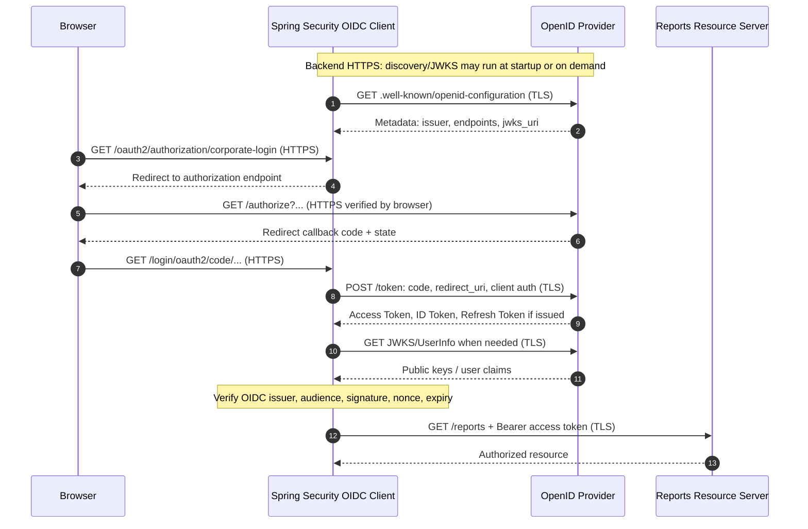
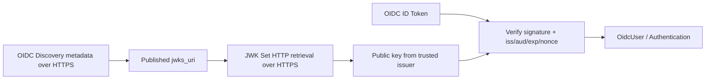
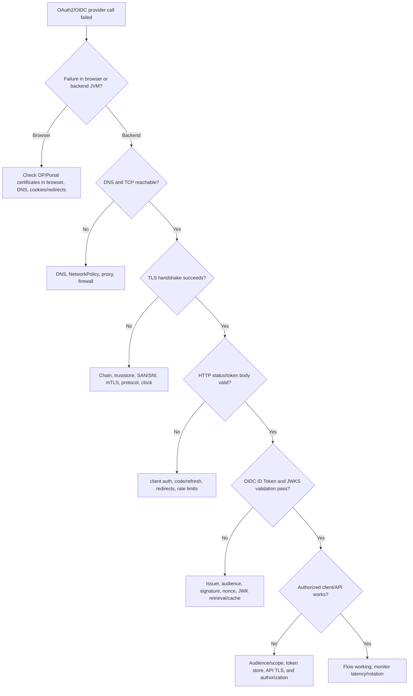

# 27.7. TLS, Certificate Trust, and Managing Provider Connections

In a **Spring Security OAuth 2.0 / OpenID Connect (OIDC) Client**, a single login can involve multiple HTTPS connections: the browser redirects to the Authorization Server, the backend exchanges the authorization code at the token endpoint, the app reads discovery documents, fetches JWKS to verify ID Token signatures, calls UserInfo, and occasionally performs token revocation or OIDC Logout. These connections carry **authorization codes, access tokens, refresh tokens, client credentials, or public key documents used to verify identity**. Consequently, TLS protection and **certificate trust** configuration are part of the trust boundary, not merely a network option.

A common mistake is "fixing" `SSLHandshakeException` by disabling certificate or hostname verification. That may get a test login flow running, yet it opens the door for attackers to impersonate the provider, steal tokens/client secrets, or serve untrusted metadata/JWKs. The right approach is **identifying which connection failed, why PKIX/hostname validation failed, and then fixing the trust chain, certificate, DNS, proxy, or HTTP client configuration accordingly**.

Lesson **"27.7. TLS, Certificate Trust, and Managing Provider Connections"** in Chapter *27. Integration Security* covers everything from concepts to Spring Boot, Java JSSE, Servlet, WebFlux/Reactor Netty, mutual TLS (mTLS), connection pooling, timeouts, retries, certificate rotation, and testing.

> **Core rule:** For trusted OAuth2/OIDC endpoints, the app must verify **the right server via TLS** and **the right issuer/client registration via OAuth2/OIDC**. TLS does not replace OIDC validation, and ID Token signature verification does not replace TLS on token/discovery/UserInfo endpoints.

## 1. Learning Objectives

After this lesson, you will be able to:

1. List browser → provider, backend → provider, and backend → Resource Server connections in OAuth2/OIDC Login.
2. Distinguish HTTPS/TLS, certificate chains, root/intermediate CAs, trust anchors, Subject Alternative Names (SAN), SNI, and hostname verification.
3. Distinguish a **truststore** (trusting servers) from a **keystore/client identity** (certificate/private key proving the client in mTLS).
4. Use the Java default truststore, dedicated truststores, and Spring Boot SSL bundles within their proper scope.
5. Understand why a TLS client configured for the token endpoint **is not guaranteed** to be used for discovery, JWKS, UserInfo, or revocation.
6. Build TLS policies for Servlet HTTP clients and Reactive `WebClient`/Reactor Netty.
7. Explain OAuth2 mutual-TLS client authentication and certificate-bound access tokens per RFC 8705.
8. Design connect/handshake/response timeouts, connection pools, retries, cancellation, and safe egress policies.
9. Plan certificate/CA rotation, expiration monitoring, and recovery when providers rotate certificates.
10. Diagnose `PKIX path building failed`, SAN mismatches, proxy/hostname errors, mTLS handshakes, and token endpoint failures without disabling TLS verification.

## 2. TLS Connection Diagram in an OIDC Login

Suppose Portal uses registration `corporate-login` with OP at `https://idp.example.org` and calls the Reports API.



The diagram contains at least **three connection groups**:

- **Browser ↔ Portal/OP:** TLS is established by the browser. Portal's backend `WebClient` does not control the browser's truststore.
- **Portal ↔ OP:** the application's JVM establishes TLS for discovery, token endpoint, JWKS, UserInfo, and optional endpoints.
- **Portal ↔ API:** an independent HTTPS connection; the API has its own certificate/trust policy, audience, and scopes.

Changing Java's truststore **does not automatically** make the browser trust the OP's certificate, and changing Portal's certificate **does not automatically** make the backend trust the OP's issuer certificate.

### 2.1. Endpoints and Sensitive Materials Table

| Endpoint | Connection initiator | Contents/sensitivity | TLS control |
|---|---|---|---|
| `/oauth2/authorization/{registrationId}` | Browser → Portal | Authorization initiation, session/cookie | Portal's TLS |
| OP's Authorization endpoint | Browser → OP | Login/consent, `state`, PKCE challenge | Browser verifies OP certificate |
| `/.well-known/openid-configuration` | Portal JVM → OP | Published issuer and endpoint URLs | JVM outbound TLS/trust |
| Token endpoint | Portal JVM → OP | Authorization code, client auth, refresh token | Outbound TLS, possibly mTLS |
| JWKS endpoint | Portal JVM → OP | Public keys for verifying ID Tokens | Outbound TLS + issuer/key validation |
| UserInfo endpoint | Portal JVM → OP | Bearer access token and user info | Outbound TLS + OIDC UserInfo validation |
| Revocation/introspection endpoint | Portal JVM → AS | Token/client authentication | Outbound TLS, provider policy |
| `end_session_endpoint` | Usually browser → OP via redirect | Logout request, may contain `id_token_hint` | Browser verifies OP certificate |
| Reports API | Portal JVM → Resource Server | Bearer access token and business data | Outbound TLS + Resource Server validation |

Never conclude "OAuth2 Login uses HTTPS" solely by looking at `redirect-uri` in `application.yml`. These TLS connections use **different HTTP client libraries, different trust material, and execute at different times**.

## 3. What Does TLS Protect—and What Does It Not?

HTTPS/TLS on a client–server connection guarantees three essential properties within the connection session:

1. **Server authentication:** the caller verifies the connected server holds a valid certificate for the expected domain with a valid trust chain.
2. **Confidentiality:** data in transit is encrypted; network eavesdroppers cannot read a valid TLS session's contents.
3. **Integrity:** exchanged data cannot be silently tampered with in transit.

TLS **does not automatically** guarantee:

- That the chosen OP issuer is a provider the app actually intends to trust.
- That the ID Token has a valid signature and right `iss`/`aud`/`nonce`/`exp`.
- That the access token has the right audience, scopes, or resource permissions.
- That the backend won't send tokens to another host due to SSRF/misconfiguration.
- That JSON from UserInfo doesn't contain spoofed data from another application.
- That an intermediary proxy is properly governed.

For example, an attacker owns a domain with a valid public CA certificate. If the app lets the browser pass `issuer-uri=https://attacker.example` and automatically runs discovery, **TLS will succeed completely**. The vulnerability still exists because the app trusted an attacker-chosen issuer. Hence both **hostname/certificate validation** and **issuer/registration allowlists** are needed.

### 3.1. TLS Versions and Cipher Suites

For modern applications, prefer TLS 1.3 and TLS 1.2 when compatibility is needed, per organizational/vendor security policy and JDK capabilities. Avoid deprecated protocols like SSLv3, TLS 1.0, and TLS 1.1.

Never enable legacy cipher suites just because a legacy provider hasn't upgraded. If a mismatch occurs, coordinate with the provider and security team for a controlled solution. Never turn on `trust-all` to address TLS protocol errors—those are completely separate issues.

## 4. X.509 Certificate Trust: The PKIX Trust Chain

When Portal connects to `https://idp.example.org`, the server typically presents:

```text
Leaf/server certificate
  Subject Alternative Name: DNS:idp.example.org
  Public key and validity interval
          |
          v
Intermediate CA certificate(s)
          |
          v
Root CA (trust anchor trusted by client)
```

The Java TLS client must find a valid certification path from leaf through intermediates to a root/trust anchor trusted by the truststore, while satisfying hostname, key usage, validity, and algorithm policy checks.

### 4.1. Root CA, Intermediate CA, and Leaf

| Certificate type | Role | Should you manually add it to truststore? |
|---|---|---|
| Root CA | Trust anchor | Only when CA is approved; usually already in JDK truststore or managed store |
| Intermediate CA | Issues leaf, bridges trust chain | Server should send full chain; configurable per PKI policy |
| Leaf/server certificate | Authenticates specific endpoint | Should not pin leaf long-term by default just to patch chain errors |
| Client certificate | Authenticates client to server in mTLS | Lives alongside **private key** in keystore/client identity, not as a root trust anchor |

Some systems use an internal CA. If Java does not yet trust that CA, `PKIX path building failed` can occur even if corporate browsers are configured to trust the certificate.

### 4.2. SAN Matters More Than Common Name

When connecting to `idp.example.org`, the certificate must contain a matching identity in **Subject Alternative Name**, such as `DNS:idp.example.org`. Do not rely on Common Name substrings or disable hostname verification to get past mismatches.

Example:

```text
URL: https://idp.example.org/token
Certificate SAN: DNS:login.example.org
Result: TLS hostname verification failure
```

A certificate with a valid CA chain yet the **wrong hostname** must still be rejected.

### 4.3. Validity and System Clocks

Certificates carry `Not Before` and `Not After`. Skewed application server clocks can make valid certificates appear "not yet valid" or "expired."

Time also affects OIDC `exp`, `iat`, `auth_time`, and token lifetimes. Sync NTP and monitor clock skew, but **never arbitrarily alter system clocks** to pass certificate checks.

### 4.4. Chain Errors vs. Hostname Errors

| Error | Common cause |
|---|---|
| `PKIX path building failed` | Cannot find trust path to a trusted CA |
| `unable to find valid certification path` | Missing root/intermediate or wrong truststore |
| `No subject alternative DNS name matching` | SAN does not include the target hostname |
| `CertificateExpiredException` | Leaf/intermediate expired or skewed clock |
| `CertificateNotYetValidException` | Certificate before `Not Before`, or skewed clock |
| `handshake_failure` | TLS version/cipher/client certificate/SNI or server policy |

The fix must match the root cause; **there is no universal "disable SSL check" option that is safe**.

## 5. Truststore, Keystore, and Client Secret Are Distinct

Easily confused terms:

| Artifact | Purpose | Secret? |
|---|---|---|
| **Truststore** holding trusted CAs/certificates | Verifies OP/API servers during TLS connection | Public certificates themselves are not secrets, yet trust config must be protected from unauthorized edits |
| **Keystore** holding client certificate chain + private key | Proves client identity in mTLS | **Private key is secret** |
| OAuth2 `client-secret` | Client authentication at token endpoint via `client_secret_basic`/`client_secret_post` | **Secret** |
| `private_key_jwt` key | Signs client assertion JWTs | **Private key is secret**; not synonymous with mTLS key |
| OP's ID Token signing key | OP signs ID Token; RP verifies via JWKS/public key | Public JWK is usually non-secret; private key stays solely at OP |
| Access/refresh token | Credential for API access/refresh | **Secret**, never place in logs/queries/cert stores |

An app can use **HTTPS server authentication** without **mTLS**. It can also use both an mTLS client certificate **and** a client secret per provider policy, yet the two mechanisms must be clearly distinguished.

### 5.1. Standard HTTPS

```text
Portal ---- TLS ----> OP
   |
   +-- Portal verifies OP's server certificate
   +-- OP does not necessarily require a client certificate
   +-- Client may authenticate via client_secret_basic at /token
```

### 5.2. Mutual TLS

```text
Portal ---- mTLS ----> OP
   |
   +-- Portal verifies OP's server certificate
   +-- OP verifies Portal's client certificate
   +-- Client must hold the matching private key
```

Never call an HTTPS connection "mTLS" just because `client-secret` is configured in `application.yml`. Client secret is HTTP/OAuth2 client authentication, not TLS client certificate authentication.

## 6. Java Default Truststore and Configuration Scope

A Java HTTPS client typically relies on JSSE and trust anchors configured for the JDK/truststore. Depending on the JDK, environment, and organizational security, root certificates reside in `cacerts` or a dedicated trust material path.

Common JVM system properties:

```properties
javax.net.ssl.trustStore=/etc/ssl/portal/provider-trust.p12
javax.net.ssl.trustStorePassword=<SECRET_FROM_RUNTIME>
javax.net.ssl.trustStoreType=PKCS12
```

When applied to **a JVM**, this global setting can affect **every HTTP client in the same process**, not only the OIDC client. Furthermore, if you build a custom truststore containing only an internal CA and **replace** the default truststore, public CAs previously trusted may no longer be available in that JVM.

**Never replace the global JVM truststore just to fix one connection without considering other HTTPS clients** such as database proxies, payment gateways, telemetry, email/webhooks, and Resource Servers.

### 6.1. Per-Provider Truststores

In systems integrating multiple providers with different CA requirements:

```text
Corporate OP -> corporate trust bundle
Partner OP   -> system CA / partner-approved CA
Reports API  -> separate per API trust policy
```

Isolating TLS configuration per target reduces the blast radius of CA rotations or certificate changes and avoids expanding trust anchors unnecessarily across the entire JVM.

### 6.2. Should You Import a Leaf Certificate?

Do not treat importing a leaf certificate directly into a truststore as a default quick fix. When the leaf renews, the truststore stops trusting it, causing an outage. If certificate/public-key pinning is required by a specific threat model, design **backup pins, lifetimes, rotation, and emergency recovery procedures**.

For internal PKI, it is usually better to trust the approved **private CA** and require the provider to serve a valid leaf+intermediate chain, provided PKI policies are sufficiently strict.

### 6.3. KMS/Secret Manager and File Permissions

PKCS12 passwords and private keys must never be committed to Git, baked into public Docker images, or printed in build logs. In containers/Kubernetes, mount trust material/keystores via secret volumes or runtime secret mechanisms with restricted permissions.

Public CA certificates may be less sensitive than private keys, yet **permission to modify the truststore** is a critical security privilege: if an attacker adds their own CA, the app can trust a rogue provider.

## 7. Spring Boot SSL Bundles: Managing Trust Material

Modern Spring Boot versions offer **SSL bundles** to declare truststores/keystores by name instead of scattering file paths and passwords across classes. Example using a PKCS12 truststore:

```yaml
spring:
  ssl:
    bundle:
      jks:
        corporate-op:
          truststore:
            location: "file:/etc/portal/tls/corporate-trust.p12"
            password: "${CORPORATE_TRUSTSTORE_PASSWORD}"
            type: PKCS12
```

For a PEM CA certificate, on Spring Boot versions supporting PEM bundles:

```yaml
spring:
  ssl:
    bundle:
      pem:
        corporate-op-ca:
          truststore:
            certificate: "file:/etc/portal/tls/corporate-ca.pem"
```

This configures **trust material**, not a guarantee that **every HTTP call made by Spring Security automatically uses that bundle**. Check which client actually executes the request and wire the bundle/`SSLContext` into the exact HTTP client.

### 7.1. Retrieving a Bundle via `SslBundles`

Example in a Java bean:

```java
import javax.net.ssl.SSLContext;
import org.springframework.boot.ssl.SslBundle;
import org.springframework.boot.ssl.SslBundles;

final class ProviderTlsMaterial {

    private final SslBundles bundles;

    ProviderTlsMaterial(SslBundles bundles) {
        this.bundles = bundles;
    }

    SSLContext corporateSslContext() {
        SslBundle bundle = bundles.getBundle("corporate-op");
        return bundle.createSslContext();
    }
}
```

APIs/extension points can vary across major Spring Boot versions. In a real project, match the exact Spring Boot/Spring Security/Reactor Netty versions in use.

### 7.2. An SSL Bundle Does Not Replace the OIDC Issuer

`SslBundle` describes **transport trust/client identity**. `ClientRegistration` describes **OAuth2/OIDC provider, client, and grant**. Both must work together, yet neither replaces the other:

```text
corporate-op SSL bundle:
  -> which CA to trust on TLS connections?

corporate-login ClientRegistration:
  -> which issuer, authorizationUri/tokenUri,
     clientId, redirectUri, scopes?
```

A valid certificate on another domain **does not** make that domain an approved issuer.

### 7.3. Beware of Overwriting General Trust Material

If an SSL bundle trusts only an internal CA, connections to hosts using public CAs may fail if that client reuses the bundle. That may be **intentional per policy**, yet you must understand the consequence.

Never build a single arbitrary `SSLContext` and assign it to all outbound requests. Group trusted targets cleanly and actively verify which endpoints are accessed.

## 8. Java JSSE: Building `SSLContext` with `TrustManagerFactory`

Without SSL bundles, an app can build an `SSLContext` from a PKCS12 truststore using JSSE. Skeleton:

```java
import java.io.InputStream;
import java.nio.file.Files;
import java.nio.file.Path;
import java.security.KeyStore;
import javax.net.ssl.SSLContext;
import javax.net.ssl.TrustManagerFactory;

final class TlsContexts {

    static SSLContext fromPkcs12Truststore(
            Path file,
            char[] password) throws Exception {

        KeyStore store = KeyStore.getInstance("PKCS12");
        try (InputStream input = Files.newInputStream(file)) {
            store.load(input, password);
        }

        TrustManagerFactory trustManagers =
                TrustManagerFactory.getInstance(
                        TrustManagerFactory.getDefaultAlgorithm());
        trustManagers.init(store);

        SSLContext sslContext = SSLContext.getInstance("TLS");
        sslContext.init(
                null,                   // Client keys not configured here
                trustManagers.getTrustManagers(),
                null);

        return sslContext;
    }
}
```

This is a **server-trust HTTPS** example. For mTLS, supply `KeyManager[]` from the client keystore to `sslContext.init(...)`; having only a truststore will never send a client certificate to the OP.

### 8.1. `SSLContext` and Hostname Verification Are Two Parts

An `SSLContext` with valid trust managers does not guarantee every HTTP stack automatically verifies hostnames as expected. With standard HTTP clients, keep **endpoint identification/hostname verification enabled**; avoid custom trust managers, hostname verifiers, or Netty configs that disable it.

Never do:

```java
// ANTI-PATTERN: Never implement a TrustManager that accepts all certificates.
// Never use a HostnameVerifier returning true for all hostnames.
// Never use Netty InsecureTrustManagerFactory in production.
```

If TLS handshakes fail, inspect certificate chain, SAN, truststore, SNI, protocol, and proxies before touching security checks.

### 8.2. Risks of Changing the Global Default `SSLContext`

Java provides an API to set the process-wide default `SSLContext`, yet using it to "fix OIDC" alters the behavior of every other HTTPS client in the JVM. Prefer creating a dedicated HTTP client with its own `SSLContext` for the target provider while leaving default trust intact for everything else.

## 9. Servlet Connections: Token Endpoint, Discovery, and JWKS Differ

In Spring MVC Servlet, different steps use different HTTP stacks depending on version/config:

1. **Discovery**: when `issuer-uri` is configured, Spring Boot/Spring Security can read OP metadata when creating `ClientRegistration`, often during application startup.
2. **Token endpoint**: an `OAuth2AccessTokenResponseClient` performs the code exchange or refresh-token grant.
3. **JWKS/ID Token validation**: decoder/JWK retriever fetches the issuer's public keys, with its own cache and refresh policy.
4. **UserInfo**: `OAuth2UserService`/`OidcUserService` uses an HTTP client to call the UserInfo endpoint when applicable.
5. **Revocation/other endpoints**: dedicated services or custom handlers have their own HTTP clients.

Therefore, configuring TLS on the token response client **does not ensure discovery and JWKS also use the same `SSLContext`**.

### 9.1. Responsibility Table

| Task | Spring Security concept | What to verify |
|---|---|---|
| Build authorization redirect | `OAuth2AuthorizationRequestResolver` | Exact URI/issuer, `state`/`nonce`/PKCE |
| Exchange code for token | `OAuth2AccessTokenResponseClient` | HTTP client TLS, client auth, timeouts |
| Fetch user profile | `OAuth2UserService`/`OidcUserService` | Bearer token sent only to valid UserInfo host |
| Verify OIDC ID Token | OIDC ID Token decoder/JWK retrieval | Issuer, signature, audience, JWKS transport |
| Maintain authorized client | `OAuth2AuthorizedClientManager` | Token lifecycle/refresh, storage, and error handling |
| Call API | `RestClient`/`WebClient` OAuth2 integration | TLS to Resource Server, right audience/token |

`OAuth2AuthorizationRequestResolver` is not where you configure JSSE for the token endpoint; it builds the URL for the browser redirect.

### 9.2. Customizing the HTTP Client for Servlet Token Exchange

In Spring Security versions using `RestClientAuthorizationCodeTokenResponseClient`, you can configure a `RestClient` built with a request factory carrying a dedicated `SSLContext` and timeouts.

Example creating a JDK HTTP client for **one target provider**:

```java
import java.net.http.HttpClient;
import java.time.Duration;
import javax.net.ssl.SSLContext;
import org.springframework.http.client
        .JdkClientHttpRequestFactory;
import org.springframework.web.client.RestClient;

SSLContext providerSslContext = tlsContexts.fromPkcs12Truststore(
        providerTruststorePath,
        truststorePassword);

HttpClient jdkHttpClient = HttpClient.newBuilder()
        .sslContext(providerSslContext)
        .connectTimeout(Duration.ofSeconds(3))
        .followRedirects(HttpClient.Redirect.NEVER)
        .build();

JdkClientHttpRequestFactory factory =
        new JdkClientHttpRequestFactory(jdkHttpClient);
factory.setReadTimeout(Duration.ofSeconds(8));

RestClient providerRestClient = RestClient.builder()
        .requestFactory(factory)
        .build();
```

`tlsContexts`/`providerTruststorePath`/`truststorePassword` are application-supplied; this snippet illustrates **HTTP transport**, not a complete Spring Security token client. When integrating with `RestClientAuthorizationCodeTokenResponseClient`, preserve the message converters/HTTP body parsers and error handlers required by your version's OAuth2 token response contract.

### 9.3. Example Registering the Token Client in Servlet

Spring Security provides the extension point:

```java
http.oauth2Login(oauth2 -> oauth2
        .tokenEndpoint(tokenEndpoint ->
                tokenEndpoint.accessTokenResponseClient(
                        authorizationCodeTokenClient)));
```

Here `authorizationCodeTokenClient` is an **`OAuth2AccessTokenResponseClient<OAuth2AuthorizationCodeGrantRequest>`** implementation configured with the right HTTP transport. It is **not** a raw `RestClient`; adapt it to the API/version in use.

For the refresh token grant, the client/provider may use a different HTTP implementation; configure **the refresh path as well** if special CA/mTLS/timeout requirements apply. If you attach a custom token client only to code exchange and forget refresh, initial login succeeds while subsequent refreshes fail.

### 9.4. When Errors Occur Before Token Exchange

If the app fails at startup during `issuer-uri` discovery, a token HTTP client wired into `oauth2Login().tokenEndpoint(...)` may **never even have been invoked**. Configure TLS on the **discovery HTTP client** or supply verified endpoint metadata per architecture/version.

Never work around it by dropping issuer validation or changing the issuer to a non-TLS HTTP URL. If an internal OP uses a private CA, supply the proper trust anchors to the metadata channel with hostname enforcement.

## 10. Spring WebFlux: `WebClient` and Reactor Netty TLS

In the Reactive stack, Spring Security uses Reactive OAuth2 Client components and non-blocking HTTP transport. A `WebClient` backed by Reactor Netty can be configured with:

- TLS trust manager / client certificate.
- Connection pool.
- TCP connect timeout.
- TLS handshake timeout.
- HTTP response timeout.
- Read/write deadlines and resource limits.

### 10.1. Creating a Provider-Specific `WebClient`

Example configuring Reactor Netty to trust an approved PEM CA:

```java
import io.netty.channel.ChannelOption;
import io.netty.handler.ssl.SslContext;
import io.netty.handler.ssl.SslContextBuilder;
import java.io.File;
import java.time.Duration;
import org.springframework.http.client.reactive
        .ReactorClientHttpConnector;
import org.springframework.web.reactive.function.client.WebClient;
import reactor.netty.http.client.HttpClient;
import reactor.netty.resources.ConnectionProvider;

SslContext providerSsl = SslContextBuilder.forClient()
        .trustManager(new File("/etc/portal/tls/corporate-ca.pem"))
        .protocols("TLSv1.3", "TLSv1.2")
        .build();

ConnectionProvider connectionPool = ConnectionProvider
        .builder("corporate-op")
        .maxConnections(24)
        .pendingAcquireMaxCount(100)
        .pendingAcquireTimeout(Duration.ofSeconds(2))
        .maxIdleTime(Duration.ofSeconds(30))
        .maxLifeTime(Duration.ofMinutes(5))
        .build();

HttpClient nettyHttpClient = HttpClient.create(connectionPool)
        .secure(ssl -> ssl.sslContext(providerSsl)
                .handshakeTimeout(Duration.ofSeconds(5)))
        .option(ChannelOption.CONNECT_TIMEOUT_MILLIS, 3000)
        .responseTimeout(Duration.ofSeconds(10))
        .followRedirect(false);

WebClient corporateProviderWebClient = WebClient.builder()
        .clientConnector(new ReactorClientHttpConnector(nettyHttpClient))
        .build();
```

This is a **transport example for `WebClient`**; it does not automatically replace HTTP clients used by every Spring Security component. Pool/timeout numbers are illustrative; base them on real latency/SLAs and concurrency.

Notes:

- `trustManager(caFile)` trusts CAs/certificates from the specified file. Verify it is the right provider CA; misconfiguring it can drop other trust anchors.
- `SslContextBuilder.forClient()` configures client-side TLS; it sends no client certificate unless `keyManager(...)` is configured.
- `handshakeTimeout` bounds the TLS handshake; `responseTimeout` bounds waiting for an HTTP response after connecting.
- A shared `WebClient` allowed to send bearer tokens to arbitrary targets risks leakage; bind base URIs/egress allowlists.
- Never recreate `ConnectionProvider` per request; pools are lifecycle-managed resources to reuse and dispose on shutdown.

### 10.2. Wiring `WebClient` into the Reactive Token Response Client

Spring Security Reactive provides dedicated token response clients, such as `WebClientReactiveAuthorizationCodeTokenResponseClient` on supported versions. An integration can supply its transport:

```java
import org.springframework.security.oauth2.client.endpoint
        .WebClientReactiveAuthorizationCodeTokenResponseClient;

var codeTokenClient =
        new WebClientReactiveAuthorizationCodeTokenResponseClient();

codeTokenClient.setWebClient(corporateProviderWebClient);
```

This is **token client initialization**, not a full `SecurityWebFilterChain`. How the token client attaches to `ReactiveOAuth2AuthorizedClientProvider` or the OAuth2 Login authentication manager depends on API version. Verify the runtime actually invokes your instance rather than **merely creating a bean and assuming auto-configuration picks it up**.

Other grants like `refresh_token` or `client_credentials` may use separate token response clients. Apply TLS policy across all active grant types, including refreshes after user login.

### 10.3. Never Call `block()` in Reactive TLS Code

Building SSL contexts from files and loading trust material typically happens **at startup configuration**, not per request. Inside the Reactive request path, avoid:

```java
// DO NOT DO THIS: blocking the Reactor event loop while calling the provider.
String response = corporateProviderWebClient.get()
        .uri("https://idp.example.org/userinfo")
        .retrieve()
        .bodyToMono(String.class)
        .block();
```

Compose `Mono`/`Flux` with proper timeouts and error mapping instead of blocking the event loop. Slow TLS handshakes are never a reason to turn an entire handler synchronous.

### 10.4. Do Not Confuse the API `WebClient` with the OP `WebClient`

```text
OIDC token client WebClient
  -> https://idp.example.org/token
  -> client secret / code / refresh token

Reports API WebClient
  -> https://reports.example.org/api
  -> Bearer access token
```

Each HTTP client should have its own host allowlist, TLS, pool, and timeouts. Never pass a `WebClient` pre-configured with an API `Authorization: Bearer ...` filter to the token endpoint or third-party URLs.

## 11. JWKS and OIDC ID Token Validation Also Require TLS

OIDC ID Tokens are typically JWTs signed by the OP. Spring Security needs public keys to verify signatures, usually fetched from `jwks_uri` in provider metadata.



If the token endpoint's truststore was fixed while the JWK retriever still uses the default JVM CAs, the first login may:

1. Exchange the code for tokens successfully.
2. Fail to fetch JWKS due to an internal certificate chain.
3. Fail during ID Token validation.

This is not a token endpoint failure, even though the user only sees "Login failed."

### 11.1. TLS Alone Is Not Enough to Trust Arbitrary JWKS

Never let the browser pick `jwks_uri` or the issuer per request. Metadata/JWK Sets must come from a registered/approved provider. An attacker's domain can easily hold its own valid certificate.

Signature validation must also bind JWKs/ID Tokens to the issuer, algorithm allowlist, audience, `nonce`, expiry, and required contract claims. **Never disable signature verification to work around JWKS fetch errors**.

### 11.2. Caching the JWK Set

JWK retrieval can be cached to cut latency and load, yet it must handle OP **key rotation**:

```text
OP is signing with key K1
OP publishes additional key K2 on JWKS
OP begins signing ID Tokens with K2
RP cache refreshes upon seeing new key ID / TTL per policy
OP retires K1 after transition period
```

JWK signing-key rotation **differs from** TLS server certificate renewal. Public keys in JWKS verify JWTs; TLS certificates authenticate HTTPS connections to endpoints.

### 11.3. Do Not Conflate Key Pinning with CA Trust

An OP may rotate its leaf TLS certificate while keeping its JWK signing key, or rotate JWK signing keys without changing its TLS certificate. Unconditionally pinning a TLS cert or JWK `kid` leaves the app prone to outages when providers rotate.

Base your strategy on the OP's contract and cache/rotation mechanics, never hardcoding a single key ID as an immutable constant.

## 12. Mutual TLS (mTLS) and OAuth2 Client Authentication

OAuth 2.0 Mutual-TLS Client Authentication and Certificate-Bound Access Tokens are specified in **RFC 8705**. Keep two concepts separate:

1. **Client authentication via TLS certificate:** the Authorization Server verifies the client certificate during the TLS handshake/token endpoint per registration.
2. **Certificate-bound access token:** the access token is bound to the client's certificate (sender-constrained), and the Resource Server requires the client to prove possession of the matching private key when presenting the token.

Not every system enabling mTLS uses certificate-bound access tokens. Exact behavior depends on the AS/RS.

### 12.1. mTLS Requires a Keystore Containing the Private Key

Conceptual configuration example:

```text
Provider trust:
  corporate-ca.pem  -> used to trust OP server certificate

Client identity:
  portal-client.crt  -> Portal's public certificate
  portal-client.key  -> Portal's secret private key
```

In Reactor Netty, using a PEM identity:

```java
SslContext mtlsSsl = SslContextBuilder.forClient()
        .trustManager(new File("/etc/portal/tls/provider-ca.pem"))
        .keyManager(
                new File("/etc/portal/tls/portal-client.crt"),
                new File("/etc/portal/tls/portal-client.key"))
        .protocols("TLSv1.3", "TLSv1.2")
        .build();
```

This example omits encrypted private keys or provider-specific authentication methods; protect key files via OS permissions and runtime secrets. Never commit private keys to Git, public ConfigMaps, or logs.

### 12.2. TLS Client Certificate vs. `client_secret_basic`

```text
client_secret_basic:
  Authorization: Basic <base64(client_id:client_secret)>
  travels inside HTTPS

tls_client_auth:
  client proves private key during TLS handshake
  AS maps certificate identity to OAuth2 client registration
```

A client secret is not sent in plaintext on the wire under valid HTTPS, yet it remains a secret in app/runtime config. `tls_client_auth` requires certificate/trust policies on the AS and client identity configuration, distinct from simply setting `client-id`/`client-secret`.

### 12.3. RFC 8705 Certificate-Bound Access Tokens

With sender-constrained tokens, the AS can bind the access token to the client certificate (e.g., confirmation claim `cnf` with `x5t#S256` thumbprint, depending on token format and profile). The Resource Server verifies:

1. The access token is valid with the right audience/scopes.
2. The client is connecting over mTLS with an appropriate certificate.
3. The certificate thumbprint/confirmation in the token matches the presented certificate.

Never use a certificate-bound access token as a **plain bearer token** over an HTTP client lacking the client certificate. The Resource Server can and should reject it when proof-of-possession is absent.

### 12.4. Dedicated mTLS Endpoints

An Authorization Server may advertise mTLS-specific endpoint aliases in metadata. If a provider requires `mtls_endpoint_aliases`, the client must use the proper token/revocation/introspection endpoints rather than hitting another URL just because plain TLS works there.

Never construct mTLS paths via string manipulation; rely on trusted provider metadata contracts and proper registration configuration.

### 12.5. Certificate Rotation for mTLS

When Portal rotates its client certificate:

- The OP must accept the new identity per registration/rotation policy.
- Instances need the new private key and safe reload/restart capability.
- With certificate-bound tokens, older tokens may remain bound to the old cert; swapping certificates between token issuance and API calls can cause RS rejections.
- Plan an overlap/rollout window supported by the OP and verify issuance/usage across both certificate generations.

Never work around rotation issues by disabling certificate checks at the AS/RS or turning off token binding.

## 13. Proxies, DNS, SNI, and Network Egress

In enterprise environments, outbound requests often traverse a proxy or service mesh:

```text
Spring Boot JVM
   |
   +-- HTTPS direct -> OP
   |
   +-- HTTP CONNECT proxy -> TLS to OP
   |
   +-- Service mesh sidecar -> egress gateway -> OP
```

You must know **where TLS terminates** and which entity the JVM is authenticating.

### 13.1. End-to-End TLS vs. TLS Interception

With a standard HTTP CONNECT proxy, TLS from the JVM to the OP passes straight through the tunnel. With TLS interception/inspection, the proxy may present a certificate on the OP's behalf signed by an internal CA.

This changes the **trust boundary**:

- The app may have to trust a corporate inspection CA.
- The proxy can observe authorization codes, client secrets, and access/refresh tokens in the decrypted HTTPS stream.
- The organization must evaluate access controls, retention, and appropriateness of inspecting identity traffic.

Never add a corporate inspection CA just to silence a proxy handshake error without confirming that inspection is approved for OAuth2 token endpoints. For sensitive authentication traffic, many organizations bypass interception and enforce an egress allowlist instead.

### 13.2. Server Name Indication (SNI)

SNI tells the server which TLS hostname the client intends to reach. When multiple virtual hosts share an IP, a wrong or missing SNI can cause the server to return another host's certificate:

```text
URL: https://idp.example.org
DNS: 203.0.113.10
SNI: idp.example.org
Server certificate SAN: idp.example.org
```

Replacing the URL with `https://203.0.113.10` while expecting the `idp.example.org` certificate to pass triggers hostname mismatch and SNI errors. Never fix this by disabling hostname verification; use the canonical hostname with proper DNS.

### 13.3. DNS and Connection Reuse

A long-lived connection pool can keep connections pinned to an old IP after a provider shifts infrastructure. DNS TTL, TCP keep-alive, max connection lifetime, and stale connections must be tuned alongside provider SLAs.

Never set infinite pool timeouts just to "save handshakes": overly long-lived connections can cling to old routes/targets and obstruct load balancing and certificate rotation.

### 13.4. Egress Allowlist

Applications should connect only to approved hosts/endpoints:

```text
https://idp.example.org:443
https://reports.example.org:443
```

`issuer-uri`, `authorization-uri`, `token-uri`, `jwk-set-uri`, and `user-info-uri` must come from trusted configuration, never request parameters.

If an app accepts dynamic user-supplied issuers, implement a rigorous onboarding/trust review to prevent SSRF (internal metadata services, loopback/private ranges, redirects to unknown hosts) and provider impersonation. Valid TLS on a host **does not mean the app is permitted to connect to that host**.

## 14. HTTPS Redirect URIs and Reverse Proxies

Spring Security OAuth2 Login typically configures:

```yaml
redirect-uri: "{baseUrl}/login/oauth2/code/{registrationId}"
```

For a public portal:

```text
Browser: https://portal.example.org
Proxy:   https://portal.example.org -> http://portal-service:8080
```

if the app sees the internal base URL `http://portal-service:8080`, the Authorization Request may generate the wrong redirect URI, causing `redirect_uri_mismatch` at the OP.

### 14.1. Trust Forwarded Headers Only from Controlled Proxies

Spring Boot offers:

```yaml
server:
  forward-headers-strategy: framework
```

Depending on deployment, `native` proxy strategy or `ForwardedHeaderFilter` may apply. **Enable this only after ingress/proxy strips or overwrites external client-supplied `Forwarded`/`X-Forwarded-*` headers**; otherwise, attackers can influence the `redirect_uri` hostname/scheme and cause host header injection.

### 14.2. TLS from Browser to Portal and from Portal to OP

| Connection | Certificate to verify |
|---|---|
| Browser → Portal | Portal's certificate for its public hostname |
| Browser → OP | OP's certificate for OP's hostname |
| Portal → OP token/JWKS | OP's certificate via JVM HTTP client trust |
| Portal → Reports API | Reports API's certificate |

Having public HTTPS on Portal's frontend does not ensure outbound traffic to the OP is configured properly. Conversely, a working backend truststore does not fix Portal's public certificate or `Secure` cookies.

### 14.3. `Secure` and `SameSite` Cookies

OIDC redirects/callbacks rely on the browser preserving session/authorization-request correlation. HTTPS, `Secure`, `HttpOnly`, `SameSite`, and cookie domain/path must align with browser redirects and the threat model.

An overly strict `SameSite` cookie may be withheld on certain callback flows, causing `invalid_state`. **Never disable `state` verification** to fix it; design compatible cookie/session behavior, enforce HTTPS, and inspect request correlation.

## 15. Connection Pooling: More Than Just Performance

Spring Security OAuth2 Client can call the token endpoint during:

- Login bursts when many users start work.
- Near-expiry refresh token renewals.
- Batch jobs using `client_credentials`.
- JWKS refreshes when the OP rotates signing keys.
- UserInfo calls upon OIDC Login completion.

Too small a pool causes long waits; too large a pool overwhelms the OP, socket limits, and token endpoint rate limits.

### 15.1. Key Parameters

| Parameter | Effect | Risk when misconfigured |
|---|---|---|
| Maximum connections | Caps active sockets | Too low causes queuing; too high overloads OP |
| Pending acquire timeout | Wait time to borrow from pool | Unbounded waits cause cascading request timeouts |
| TCP connect timeout | Caps socket establishment time | Prolonged outages hang requests |
| TLS handshake timeout | Caps TLS negotiation time | Handshakes hang when route/proxy/OP stalls |
| Response timeout | Caps waiting for HTTP response | Causes backlogs if token endpoint hangs |
| Max idle time | Evicts idle connections | Too long leaves stale connections |
| Max lifetime | Periodically recycles connections | Too short adds TLS handshakes; too long delays route updates |
| Retry budget | Caps retry attempts | Retry storms during OP outages |
| Bulkhead/concurrency limit | Isolates per-provider workload | One failing provider takes down the whole app |

These values are **operational policy**; never copy a "standard 5-second / 20-connection config" blindly across enterprises. Measure p95/p99, RPS, bursts, OP quotas, cache hit ratios, and infrastructure limits.

### 15.2. Separate Pools per Provider/Endpoint When Needed

If Corporate OP and Partner OP differ in infrastructure or SLAs, use separate pools/circuit boundaries:

```text
Corporate token HTTP client -> Corporate pool, CA, timeout
Partner token HTTP client   -> Partner pool, CA, timeout
Reports API HTTP client     -> API pool, CA, timeout
```

Do not let requests to a failing Partner OP exhaust Corporate OP resources when the two systems should be isolated.

### 15.3. Pools and Certificate Renewal

An already-open TLS connection can continue running on the TLS session established before the server replaced its certificate; the new server certificate is typically observed on a **new handshake**. Therefore:

- Never treat "existing requests still succeed" as proof the new certificate works.
- Run synthetic **new-connection handshake checks** during rotation windows.
- Review pool max lifetime/idle times when updating CAs/certs.
- With mTLS client certs, an old pool may keep presenting the old certificate until connections recycle.

## 16. Timeouts, Retries, and Token Endpoint Semantics

Setting timeouts is essential, yet retrying OAuth2 token requests requires far more care than retrying static HTTP GETs.

### 16.1. Authorization Codes Are Single-Use Credentials

`authorization_code` can be used only once. If the token endpoint **received and consumed the code** but the network response was lost, retrying the POST with the same code can return `invalid_grant`.

```text
Portal POST code=C1
        |
        v
OP exchanges code C1 -> tokens (success)
        |
        x network response timeout
        |
Portal retries code=C1 -> invalid_grant
```

Never assume a timeout means the OP did not process the request. The right response is reporting a controlled login failure and initiating a fresh authorization flow per provider contract; never retry codes indefinitely.

### 16.2. Refresh Token Rotation

With refresh token rotation:

```text
RT1 -> OP -> AT2/RT2
        response may be lost
Retry RT1 -> reuse/invalid_grant, may revoke entire token family
```

Therefore:

- Never enable a generic `retryWhen(...)` across all `POST /token` calls.
- Distinguish connect failures **guaranteed before sending the request** from timeouts/unknown outcomes.
- Use single-flight/concurrency control per authorized client if concurrent requests trigger refreshes.
- On `invalid_grant`, trigger reauthorization and update/clear versioned state carefully so you don't delete a newly saved `RT2`.
- Emit appropriate metrics and notifications during provider outages.

### 16.3. Client Credentials

`client_credentials` can request new access tokens upon expiry, yet still needs rate limits, caching, and a retry budget. A job creating a distinct principal name on every run can spawn excessive authorized clients and unnecessary token requests.

Token endpoint connection failures must never send the system into an infinite token-request loop. Pools, backoff, and failure handlers must respect provider quotas.

### 16.4. HTTP Client Redirects

For credential-bearing token endpoint POSTs, **avoid automatically following HTTP redirects to other hosts**. A 3xx redirect from misconfiguration or attacker control could leak client auth/token requests depending on HTTP client behavior. Prefer fixed token endpoints and a policy rejecting unexpected redirects.

For discovery/JWKS/UserInfo as well, govern redirects, host allowlists, and response bodies. Never let a trusted endpoint redirect to arbitrary internal/external hosts while continuing to attach bearer tokens.

## 17. TLS Handshakes and Application Errors Are Different Layers

An HTTPS call can fail at distinct stages:

```text
A. DNS/TCP unreachable
B. TLS handshake failed
C. TLS handshake succeeded, HTTP 401 invalid_client
D. TLS handshake succeeded, HTTP 400 invalid_grant
E. Token response succeeded, ID Token validation failed
F. Token valid, Reports API returned 403
```

Identify which stage failed before fixing. For example:

- `SSLHandshakeException` at `/token`: investigate TLS chain/SAN/protocol/mTLS.
- `invalid_client`: investigate client ID/secret, client auth method, mTLS certificate identity, or client policy; TLS likely already succeeded.
- `invalid_grant`: investigate code/state/redirect URI/reuse/refresh token; not necessarily certificate-related.
- `invalid_state` in browser callback: investigate authorization request repository/session/cookie/CSRF; do not change the truststore.
- `JwtValidationException` issuer mismatch: inspect registration/issuer validation; never skip OIDC checks to force login.

### 17.1. A Trust Failure Is Not an Access Token Expiration

Access tokens have `expiresAt`; TLS server certificates have `NotAfter`. The two clocks are independent. When a token expires, the manager can refresh; when a certificate expires, a new connection to the OP cannot complete the TLS handshake to refresh. Thus certificate expiration monitoring directly affects session and API availability.

## 18. Certificate Rotation and Truststore Rollout

An OP may change:

- Leaf certificate under the same CA.
- Intermediate CA.
- Root CA/trust anchor.
- Hostname/SAN or TLS infrastructure.
- Client certificate requirements for mTLS.
- OIDC signing keys in JWKS (independent of TLS certs).

A safe rotation plan includes:

1. **Inventory:** list all active HTTPS endpoints and their certificate chains, issuers, and truststores.
2. **Notification:** obtain CA/cert change schedules from providers and assess impact.
3. **Preparation:** load new trust anchors before the provider switches leaf/chain if the CA changes.
4. **Overlap:** keep both old and new CAs as needed during the transition window per policy.
5. **Canary:** test new TLS handshakes from the actual production runtime/network segment.
6. **Rollout:** update SSL bundles/truststores/client identities in a controlled rollout.
7. **Monitoring:** watch SSL handshake failures, logins, refreshes, JWKS, and UserInfo.
8. **Cleanup:** remove old CAs/keys after overlap ends and confirm no dependencies remain.

### 18.1. TLS Cert Renewal Normally Does Not Require Changing the Issuer

`issuer-uri` is the OP's identifier, not an encoding of the leaf certificate. If the OP simply renews a certificate for the same hostname/issuer using a trusted CA, the app typically needs no registration issuer change. Never point the issuer URL at a different domain during certificate renewal; that changes the trust domain.

### 18.2. Reloading Trust Material in the JVM

Not every HTTP client automatically detects truststore files replaced on disk. Already-constructed `SSLContext` and Netty `SslContext` instances may retain old trust material until **the client reloads/recreates or the application restarts**, depending on implementation.

A rotation plan must specify:

- When bundle files are reloaded.
- Whether hot-reload APIs are supported by the framework and client.
- Whether connections or connection pools must be drained/replaced.
- Whether a rolling restart/canary is required.
- How to roll back if a new trust anchor is wrong.

Never assume "copying a new PEM file into a volume" makes all HTTPS calls switch to the new file immediately.

### 18.3. mTLS Client Certificates Require Their Own Rotation

With mTLS, both the provider and the application have certificate lifecycles. Expiring client certificates must be rotated per OP/AS requirements; when certificate-bound tokens are active, verify both new and old tokens with their corresponding certificates.

A system may have:

```text
Provider server certificate expires: T1
Portal mTLS client certificate expires: T2
OIDC JWKS signing key rotation: T3
OAuth2 refresh token expiration: T4
```

T1/T2/T3/T4 are **four distinct lifecycles**; monitor each separately.

## 19. Diagnostics with `openssl`, `keytool`, and JSSE

The commands below use **hypothetical hostnames/certificates**. Run them only in environments you are authorized to access, and avoid exposing sensitive metadata in shared logs.

### 19.1. Inspecting Server Certificate and Chain

```bash
openssl s_client \
  -connect idp.example.org:443 \
  -servername idp.example.org \
  -showcerts
```

`-servername` sends SNI so the server returns the certificate for the right virtual host. `-showcerts` displays the chain sent by the server. Check the **verify return code**; simple inspection does not prove your JVM truststore matches.

To verify against a specific PEM CA:

```bash
openssl s_client \
  -connect idp.example.org:443 \
  -servername idp.example.org \
  -CAfile /etc/portal/tls/corporate-ca.pem \
  -verify_return_error
```

OpenSSL results do not guarantee identical Java JSSE behavior due to differing truststores and algorithm policies. Use it to isolate network and certificate-chain issues.

### 19.2. Reading Certificate Validity and SAN

```bash
openssl s_client \
  -connect idp.example.org:443 \
  -servername idp.example.org \
  </dev/null 2>/dev/null | \
openssl x509 -noout -subject -issuer -dates -ext subjectAltName
```

Verify `notBefore`/`notAfter`, issuer, and SAN. Do not use this command to extract private keys; TLS server certificate data is normally public.

### 19.3. Inspecting the Application's Truststore

```bash
keytool -list -v \
  -keystore /etc/portal/tls/corporate-trust.p12 \
  -storetype PKCS12
```

`keytool` may prompt interactively for a password. Never pass real passwords on the command line if shell history, process listings, or CI logs could record them. Never paste output containing sensitive internal names/metadata into public issue trackers if restricted by policy.

### 19.4. Debugging Java TLS Handshakes

In a controlled test environment, JSSE provides debug flags such as:

```text
-Djavax.net.debug=ssl,handshake
```

Enable only when necessary and briefly. TLS debug/HTTP wire logs can expose certificate metadata, endpoint details, or sensitive session info; **never log full request headers/bodies of token endpoints in production**.

### 19.5. Testing from the Right Network Namespace

A command succeeding from a laptop can fail inside a Kubernetes pod due to:

- Different truststore/JDK.
- Different DNS.
- Different egress gateway/proxy.
- `NetworkPolicy` or firewall rules.
- Dedicated SNI/TLS interception.
- Unmounted certificate files or wrong permissions.

To diagnose accurately, test from **the same runtime/network path** as the app or an approved diagnostic pod in the same namespace/egress policy, not solely from a personal machine.

## 20. Common Error Reference Table

| Symptom | Likely cause | Safe diagnostic direction |
|---|---|---|
| `PKIX path building failed` at token endpoint | JVM doesn't trust CA, missing intermediate, wrong truststore | Server chain, actual CA/truststore, JSSE logs |
| `PKIX` only at startup | `issuer-uri` discovery uses another HTTP client | Bootstrap metadata client, default trust, not just token client |
| Login exchanges code yet ID Token validation fails TLS | JWKS retriever doesn't trust certificate | Dedicated HTTPS/JWK client, CA, issuer |
| `No subject alternative name matching` | SAN misses hostname, calling IP instead of DNS, wrong proxy host | URL, certificate SAN, SNI |
| `certificate expired` | OP server/intermediate cert expired or app clock skewed | Certificate validity, NTP, provider rotation |
| `handshake_failure` after enabling mTLS | OP demands different cert, client lacks key, algorithm mismatch | Client cert chain/private key, AS registration, protocol |
| `bad_certificate` from provider | Client certificate rejected | Key usage, expiry, registered subject/thumbprint |
| HTTPS succeeds yet `invalid_client` | Wrong OAuth2 client auth, client policy, or mTLS identity | `ClientRegistration`, client-secret/method, provider config |
| `invalid_grant` after timeout | Authorization code already consumed or refresh token rotation | Never blindly retry POST; inspect flow/correlation |
| Login starts fine yet OP shows browser TLS error | Browser doesn't trust OP certificate | Browser/OP TLS; JVM truststore cannot help browsers |
| `redirect_uri_mismatch` | Wrong base URL/scheme/host behind proxy | Forwarded header trust, exact URI registration |
| `invalid_state` | Session/cookie/authorization request repository issue | Cookie `SameSite`/`Secure`, session, `state` correlation |
| JWKS signed with new `kid` fails | JWK cache hasn't refreshed or provider rollout bug | JWKS cache/rotation, never pin fixed `kid` |
| Handshake fails after CA change | Runtime truststore not reloaded | Bundle/`SSLContext`/client recreation, rolling restart |
| Widespread API token request timeouts | Pool starvation, OP outage, proxy/DNS | Pool metrics, connect/handshake/response timeouts |
| One provider failure slows another | Unbounded shared pool/queue | Per-provider pool/bulkhead |
| Access token sent to unknown host | `WebClient` URI from input or HTTP redirect | Host allowlist, disable redirects, no tokens to arbitrary URLs |
| mTLS token received yet RS returns 401 | Sender-constrained token sent with wrong client cert | Certificate-bound token/RS proof-of-possession |
| Only refresh fails TLS | Refresh token HTTP client lacks the same trust config | Provider/manager refresh path |

### 20.1. Never Fix with Trust-All

The following "workarounds" merely mask failures and open vulnerabilities:

```text
TrustManager accepting all certificates
HostnameVerifier always returning true
InsecureTrustManagerFactory.INSTANCE
Disabling ID Token signature checks to avoid JWKS errors
Switching HTTPS to HTTP so the token endpoint works
Following token endpoint redirects to arbitrary hosts
```

These shortcuts are especially dangerous in OAuth2/OIDC because attackers can capture authorization codes, client credentials, or access/refresh tokens.

## 21. Layered Diagnostic Workflow



Each branch isolates the right component. If DNS cannot resolve a host, adding a CA won't help. If `invalid_client` occurs, disabling TLS won't fix client authentication. If issuer validation fails, tweaking certificate trust won't resolve an OIDC trust mismatch.

## 22. Testing TLS and Certificate Trust

Tests should verify **rejection of untrusted connections**, not merely "connecting with a test certificate."

### 22.1. Test Matrix

| Scenario | Expected result |
|---|---|
| Valid OP server cert, matching SAN, trusted CA | TLS handshake succeeds |
| Cert issued by untrusted CA | Rejected |
| Valid cert chain but SAN mismatches hostname | Rejected |
| Expired leaf cert | Rejected |
| Server supports only policy-forbidden TLS protocol | Rejected |
| OP requires mTLS yet client lacks cert/key | Rejected |
| Valid mTLS client cert yet wrong OAuth2 client ID | TLS may succeed; OAuth2 `invalid_client` |
| OP swaps CA during configured overlap window | Connections continue succeeding per plan |
| JWKS endpoint has different trust chain from token endpoint | Client handles both properly or fails cleanly |
| Token endpoint returns 302 to unknown host | Never sends credentials to redirected host |
| Refresh token POST times out after OP processes it | Never blindly retried |
| Proxy presents unexpected certificate | Rejected, or accepted only if approved inspection CA |

### 22.2. Local HTTPS Server Tests

You can run an HTTPS test server with a self-signed certificate **strictly in test environments**, then:

1. Build a test truststore trusting that exact test CA.
2. Configure the HTTP client under test with that truststore.
3. Test handshaking to the matching hostname.
4. Verify wrong hostnames and untrusted CAs are rejected.
5. For mTLS, require a test client cert and confirm missing certs are rejected.
6. Never use disable-verification as a test fixture; that defeats the test's purpose.

When using WireMock/MockWebServer or similar HTTP test servers, configure dedicated HTTPS and certificates; never call production providers from unit tests just to test TLS clients.

### 22.3. Testing Spring OAuth2 Grants Individually

With a mocked token endpoint:

```text
POST /token
  - authorization_code grant -> valid mock token response
  - client_credentials grant -> mock token response
  - refresh_token grant -> rotation/invalid_grant mock
```

Verify the HTTP client actually applies TLS/trust config for each grant. A test that mocks `OAuth2AccessTokenResponseClient` completely never exercises its TLS transport; write integration tests at the HTTP transport boundary.

### 22.4. Testing Discovery, JWKS, and UserInfo

If the app uses an internal CA, test:

- Startup/discovery metadata over HTTPS.
- Token exchange over HTTPS.
- Fetching JWKS on cold cache and after key rotation.
- UserInfo retrieval when the provider exposes the endpoint.
- Optional revocation/introspection if used by the app.

Never test only a successful `/token` call and assume the whole OIDC integration is safe.

### 22.5. Multi-Instance Rollout Tests

In a rolling deployment:

```text
Pod A: old trust bundle
Pod B: new trust bundle (trusts both old/new CA during overlap)
Provider: rotating certificate
Pod C: old bundle not yet restarted
```

Canary tests should open **fresh TLS connections** from both old/new configurations, verifying handshakes and login/refresh operations. After switching CAs, ensure no stale pod becomes a random login failure point.

## 23. Production Monitoring

Operational signals to monitor:

- Days remaining until TLS server certificate expiration.
- Deployed truststore/SSL bundle version and last update timestamp.
- TLS handshake failures by **provider registration/endpoint class**.
- DNS/TCP connect failures, TLS handshake latency, and HTTP response latency.
- HTTP 4xx/5xx, `invalid_client`, `invalid_grant`, rate limiting, and retry counts.
- Connection pool active/idle/pending/timeouts.
- JWK cache misses/refreshes and OIDC issuer/key validation failures.
- Token refresh success/failure, login failure rates, and certificate rotation windows.

### 23.1. Log Minimal Information Sufficient for Investigation

Example application-designed event schema:

```text
event=oidc_provider_tls_failure
registrationId=corporate-login
endpointType=token
providerHost=idp.example.org
errorType=PKIX_PATH_BUILDING_FAILED
connectionPhase=TLS_HANDSHAKE
correlationId=server-generated-id
```

**Never log**:

- Client secrets/private keys, truststore passwords.
- Raw access/refresh/ID tokens, token request/response bodies.
- Authorization codes, PKCE code verifiers, session cookies.
- HTTP `Authorization` headers or full callback URLs.
- Arbitrary certificate/private-key dumps or unredacted JSSE debug logs.

Registration ID and endpoint type have low cardinality and make far better metric labels than principals/emails/session IDs.

### 23.2. Synthetic Checks

A health check can verify DNS, TLS handshakes, and certificate expiry against approved endpoints. For critical systems, consider a **dedicated** synthetic OAuth2 login/refresh test account with least privilege and controlled secret lifecycle—never use production user credentials.

Never expose a health check endpoint that prints private keys, tokens, or full internal issuer metadata to unauthorized callers.

## 24. Comprehensive Scenario: Corporate OP Using an Internal CA

Suppose an app runs in Kubernetes:

- Public Portal: `https://portal.example.org`, browser trusts public CAs.
- Corporate OP: `https://idp.corp.example.org`, certificate issued by Corporate CA.
- Corporate OIDC discovery and token/JWKS/UserInfo all run over backend HTTPS.
- Backend calls Reports API at `https://reports.example.org`.
- Provider uses `client_secret_basic` (no mTLS).
- App runs multiple replicas and refreshes tokens on demand.

A design:

```text
Browser
  |
  | HTTPS: portal.example.org
  v
Trusted Ingress
  |
  v
Spring Boot Portal (JVM)
  |
  +-- Corporate OIDC HTTP clients
  |      -> corporate-op SSL bundle / CA trust
  |      -> bounded timeouts + pool
  |      -> discovery / token / JWKS / UserInfo
  |      -> issuer-uri = trusted Corporate OP
  |
  +-- Reports API HTTP client
  |      -> HTTPS trust for reports.example.org
  |      -> Bearer token only to Reports API
  |
  +-- Authorized Client Store
         -> encrypted access/refresh tokens
         -> concurrency control for refresh rotation
```

Deployment workflow:

1. Operations supplies the approved corporate root/intermediate CAs and OP metadata.
2. Truststores/SSL bundles are mounted via dedicated secrets/configs without committing private material.
3. The app applies corporate trust to the exact **HTTP clients** used for discovery, token, JWKS, and UserInfo.
4. `ClientRegistration` holds fixed issuer/token endpoints; never accept issuer URLs from user queries.
5. Browsers access Portal over HTTPS; reverse proxy forwarded headers are accepted only from trusted sources.
6. Connect/handshake/response timeouts and pool limits are tuned to OP SLAs.
7. OIDC login validates ID Token, issuer/audience/nonce, never inferring user identity from TLS certificates.
8. Authorized client manager refreshes per grant without blindly retrying refresh-token POSTs.
9. Reports API client sends bearer tokens strictly to controlled hosts with dedicated TLS trust.
10. Periodically check certificate expiry/CA rotation and canary new handshakes from the production namespace.

### 24.1. When Failures Hit on CA Rotation Day

```text
Browser login redirect to OP: OK
POST /token from Portal: PKIX path building failed
```

This indicates a **backend TLS trust** issue, not a browser URL bug. Check:

- Which pod is failing and what trust bundle version it runs.
- Current OP certificate chain/SAN via SNI.
- The truststore the app actually loads at runtime, not the CA file on a laptop.
- Whether the token HTTP client uses the right bundle.
- Whether the truststore was reloaded/recreated.
- Whether a proxy/mesh altered the certificate chain.

Never switch `token-uri` to HTTP or enable an insecure `TrustManager` to cut outage time.

### 24.2. When Only JWKS Fails

```text
Startup discovery: OK
Token exchange: OK
ID Token validation: fails fetching jwks_uri
```

Inspect the JWK retrieval HTTP client/host/chain, cache, and issuer metadata. The JWKS host or proxy may differ from the token host, or the token client had custom TLS configured while the JWK retriever still used default trust. Never skip JWT signature validation.

### 24.3. When Only Refresh Fails

```text
Initial OIDC Login: OK
Minutes later: access token expires -> refresh request fails TLS
```

The token refresh provider may use a different HTTP client/path than authorization-code exchange, or the pool/new trust material wasn't picked up. Inspect the exact refresh grant path and runtime client rather than assuming "initial login worked so all token requests work."

## 25. Pre-Production Connection Security Checklist

| Question | What to verify |
|---|---|
| Do OP/AS endpoints use HTTPS? | Issuer, token, JWKS, UserInfo, revocation, and introspection |
| Do endpoint URLs come from trusted sources? | Static registration/discovery allowlist, SSRF prevention |
| Do certificate hostnames match? | SAN, SNI, canonical host |
| Is the chain trusted per PKIX? | Root/intermediate CAs, right runtime truststore |
| Is hostname/certificate verification disabled anywhere? | No trust-all/ignore-hostname |
| Is mTLS required? | Client cert/key, OP registration, alias endpoints |
| Are certificate-bound access tokens used? | RS proves client certificate, proper key lifecycle |
| Does the discovery HTTP client have proper trust? | Startup/metadata retrieval |
| Are token response clients configured for all grant types? | Code, refresh, `client_credentials` |
| Do JWKS/UserInfo clients have proper trust? | Fetch and cache/rotation |
| Is outbound API TLS isolated? | Egress allowlist, audience, and token routing |
| Is there a proxy/mesh? | CONNECT/inspection, forwarded headers, TLS termination |
| Are connect/handshake/response timeouts reasonable? | SLA, P95/P99, quotas, concurrency |
| Are pools properly bounded? | Max connections, pending acquire, idle/life, cleanup |
| Are token POSTs blindly retried? | No; distinguish unknown outcomes and rotation |
| Is certificate/CA rotation planned? | Overlap, canary, reload/restart, rollback |
| Are secrets protected? | Not in Git/logs, secret volumes, IAM/KMS |
| Are negative TLS test cases thorough? | Untrusted CA, SAN mismatch, expiry, missing mTLS |
| Does monitoring surface errors by endpoint type? | TLS phase, provider, HTTP status, timing |
| Are tenant/provider boundaries enforced? | Issuer, registration, API target, token audience |

## 26. Design Mistakes to Avoid

1. **Disabling certificate/hostname verification** upon seeing `SSLHandshakeException`.
2. **Letting users supply issuer/token endpoints** and running discovery without an allowlist.
3. **Configuring only the token HTTP client** while forgetting discovery/JWKS/UserInfo.
4. **Confusing truststore and mTLS client keystore**, resulting in missing private keys or wrong CA trust.
5. **Treating `client-secret` as a TLS client certificate**, misunderstanding the two authentication layers.
6. **Importing leaf certificates as a quick fix** with no renewal/rotation plan.
7. **Replacing the global truststore** and breaking unrelated public HTTPS dependencies.
8. **Putting truststore passwords/private keys in Git, images, or logs**.
9. **Disabling issuer/signature/`nonce` checks** to bypass JWKS HTTPS errors.
10. **Following token endpoint redirects** to hosts outside policy.
11. **Passing browser-supplied URLs to a token-enabled `WebClient`**, causing SSRF and bearer token leakage.
12. **Defining an SSL bundle and assuming every Spring Security client uses it automatically** without verifying wiring.
13. **Trusting a proxy inspection CA unconditionally** without evaluating who can read token requests.
14. **Setting infinite timeouts/pools**, letting a provider outage take down the entire app.
15. **Blindly retrying authorization code/refresh token POSTs**, causing `invalid_grant`/replay issues.
16. **Ignoring refresh token rotation/concurrent requests** across multiple replicas.
17. **Ignoring SNI/SAN**, connecting by IP or alias hostname and disabling validation.
18. **Neglecting certificate rotation**, lacking overlap/canary/reload plans.
19. **Equating a valid OP TLS certificate with a valid ID Token**, skipping OIDC checks.
20. **Confusing TLS signing certificates with JWK signing keys**, leading to wrong pinning configs.
21. **Mistaking OAuth2 grant errors for TLS errors**, fixing the wrong layer.
22. **Testing only on a laptop** without verifying truststores/egress paths in production runtimes.
23. **Sharing one unbounded pool and truststore across all providers**, widening blast radius.
24. **Writing raw TLS debug/token bodies to production logs**, leaking secrets.

## 27. Review Questions

1. Why does OIDC Login involve multiple TLS connections instead of a single HTTPS connection?
2. Which connections have certificates verified by the browser vs. by the JVM?
3. What does TLS protect, and why doesn't TLS replace OIDC `iss`/`aud`/signature checks?
4. What roles do Root CA, Intermediate CA, leaf certificate, and SAN play in PKIX validation?
5. Why can a valid certificate chain still fail hostname verification?
6. How does a truststore differ from a keystore/client private key?
7. At which protocol layer do `client_secret_basic` and `tls_client_auth` differ?
8. Why might configuring an `SSLContext` for `POST /token` not fix JWKS or discovery errors?
9. What does a Spring Boot SSL bundle solve—and what does it not solve automatically for OAuth2 Client?
10. When should you use a per-provider truststore instead of replacing the JVM global truststore?
11. What risks arise from pinning a leaf certificate when a provider renews certificates?
12. What role does SNI play when multiple HTTPS virtual hosts share one IP?
13. Why can calling an OP by IP fail TLS when the certificate is issued for a DNS name?
14. How does a TLS interception proxy change the OAuth2 trust boundary?
15. Why can misconfigured forwarded headers cause `redirect_uri_mismatch` even when OP TLS is completely valid?
16. Why must access/refresh tokens never be logged even while debugging TLS?
17. How do max connections, pending acquire, TLS handshake timeout, and response timeout differ?
18. Why can retrying an authorization code grant after a timeout produce `invalid_grant`?
19. Why does refresh token rotation make generic retries on the token endpoint dangerous?
20. What extra check does an RFC 8705 certificate-bound access token require at the Resource Server?
21. How can rotating an mTLS client certificate affect already-issued tokens?
22. How does JWK signing-key rotation differ from TLS certificate renewal?
23. When should you expect `SSLHandshakeException` versus HTTP `invalid_client`?
24. When OpenSSL succeeds on a laptop yet the JVM in a pod fails, what should you inspect?
25. How can you test hostname mismatch/untrusted CAs without disabling TLS verification?
26. In a rolling deployment, why must you test fresh TLS handshakes rather than reusing existing connections?
27. How can you catch a refresh token path using an HTTP client without the configured truststore?
28. Why must HTTPS and issuer/target-host allowlists be enforced together?

## References

- [Spring Security Reference — OAuth2 Client Core](https://docs.spring.io/spring-security/reference/servlet/oauth2/client/core.html)
- [Spring Security Reference — OAuth2 Login Advanced Configuration](https://docs.spring.io/spring-security/reference/servlet/oauth2/login/advanced.html)
- [Spring Security Reference — OAuth2 Client Authorization Grants](https://docs.spring.io/spring-security/reference/servlet/oauth2/client/authorization-grants.html)
- [Spring Security Reference — Reactive OAuth2 Client](https://docs.spring.io/spring-security/reference/reactive/oauth2/client/index.html)
- [Spring Security Reference — Reactive OAuth2 Login](https://docs.spring.io/spring-security/reference/reactive/oauth2/login/index.html)
- [Spring Security Reference — OIDC Logout](https://docs.spring.io/spring-security/reference/servlet/oauth2/login/logout.html)
- [Spring Boot Reference — SSL Bundles](https://docs.spring.io/spring-boot/reference/features/ssl.html)
- [Spring Framework Reference — REST Clients](https://docs.spring.io/spring-framework/reference/integration/rest-clients.html)
- [Spring Framework Reference — WebClient](https://docs.spring.io/spring-framework/reference/web/webflux-webclient.html)
- [Reactor Netty Reference — HTTP Client SSL/TLS](https://projectreactor.io/docs/netty/release/reference/http-client.html)
- [Java JSSE Reference Guide](https://docs.oracle.com/en/java/javase/21/security/java-secure-socket-extension-jsse-reference-guide.html)
- [Java keytool Command Reference](https://docs.oracle.com/en/java/javase/21/docs/specs/man/keytool.html)
- [RFC 8705 — OAuth 2.0 Mutual-TLS Client Authentication and Certificate-Bound Access Tokens](https://www.rfc-editor.org/rfc/rfc8705)
- [RFC 9700 — OAuth 2.0 Security Best Current Practice](https://www.rfc-editor.org/rfc/rfc9700.html)
- [RFC 8414 — OAuth 2.0 Authorization Server Metadata](https://www.rfc-editor.org/rfc/rfc8414)
- [OpenID Connect Discovery 1.0](https://openid.net/specs/openid-connect-discovery-1_0.html)
- [OpenID Connect Core 1.0](https://openid.net/specs/openid-connect-core-1_0.html)
- [OWASP Transport Layer Security Cheat Sheet](https://cheatsheetseries.owasp.org/cheatsheets/Transport_Layer_Security_Cheat_Sheet.html)
