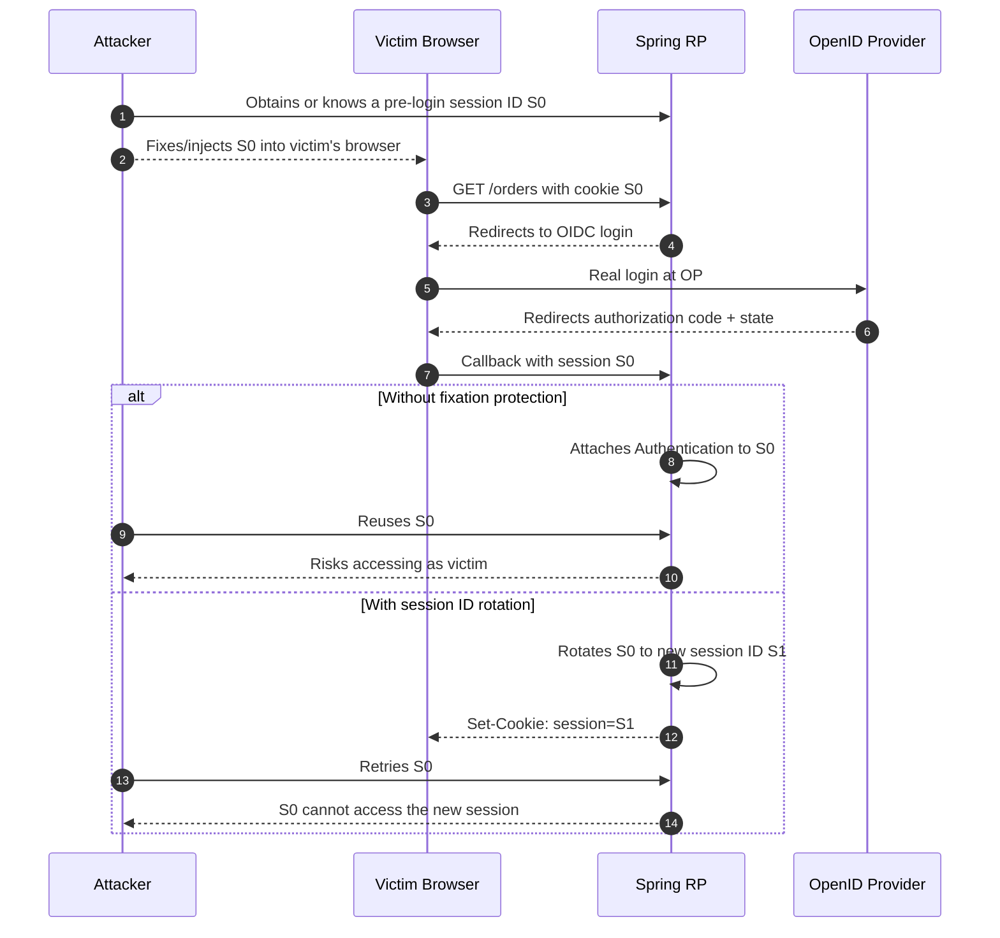
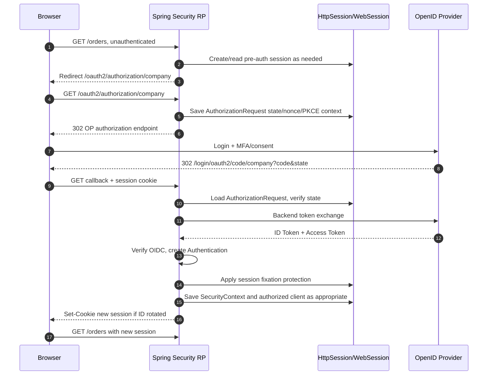
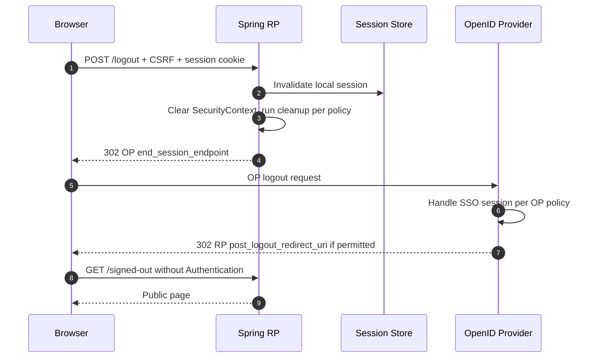
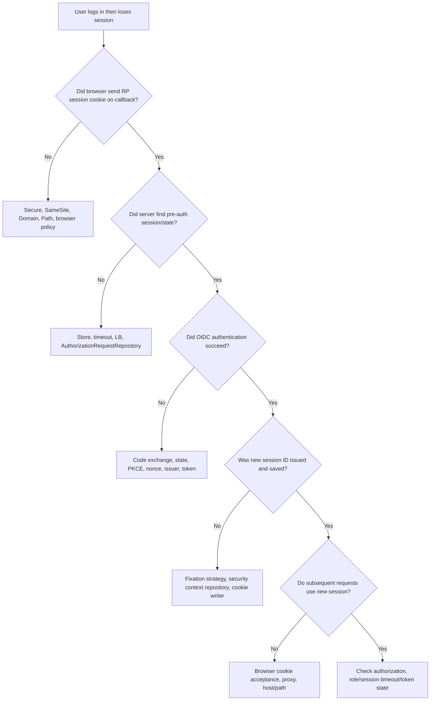

# 27.10. Session Fixation, Session Hijacking, and Cookie Protection

In a **Spring Security OAuth 2.0 / OpenID Connect (OIDC) Client** application, users typically log in via an **OpenID Provider (OP)**, yet once the Authorization Code Flow completes, the **Relying Party (RP)** application still has to maintain its own authentication state. In traditional web architectures, that state is typically stored in **`HttpSession`** (Servlet) or **`WebSession`** (WebFlux), with the browser holding a corresponding **session cookie**.

Protecting OAuth2 `state`, OIDC `nonce`, PKCE, and ID Tokens is essential, yet **does not replace** protecting the application's session. If the session ID is controlled by an attacker prior to login or stolen after login, a system can validate OIDC tokens flawlessly and still allow the attacker to take over the user's session.

This lesson focuses on three related security layers:

1. **Session fixation**: an attacker tries to make the post-login session keep using a session ID they already know or control.
2. **Session hijacking**: an attacker steals and reuses a valid session credential to impersonate the user.
3. **Cookie protection**: controls reducing the risk of cookies being read, sent to unintended scopes, overwritten, abused via CSRF, or leaked over networks/infrastructure.

The material is framed for **Spring Security OAuth2/OIDC Client**, covering OP redirect flows, post-authentication session rotation, Servlet/WebFlux, `Secure`/`HttpOnly`/`SameSite`, `Domain`/`Path`, the `__Host-` prefix, CSRF, XSS, logout, reverse proxies, distributed sessions, token stores, multi-tenancy, and incident troubleshooting.

> **Foundational principle:** **a session ID is a credential**. Never put session IDs in URLs/logs, never trust a cookie merely because the browser sent it, never let a session ID known to an unauthenticated party represent a newly logged-in user, and never treat the OIDC SSO session as the same session as the RP session.

## 1. Two Distinct Sessions in an OIDC Login

An OIDC login flow normally involves at least two independent sessions:

| Session | Manager | Browser artifact | Role |
|---|---|---|---|
| **OP SSO session** | OpenID Provider | Cookie under the OP's domain | Lets the OP know the user is logged in and enforce SSO/MFA policies. |
| **RP application session** | Spring Boot application | `JSESSIONID`, `SESSION`, or another RP cookie | Lets the RP restore `SecurityContext` on business requests. |

Example:

```text
Browser
  |
  | app.example.org cookie: JSESSIONID=...
  v
Spring Boot RP
  |
  | Redirect to id.example.org
  v
OpenID Provider
  |
  | id.example.org cookie: <OP SSO cookie>
  v
Browser returns to RP via callback
```

The RP must not read or directly reuse the OP's cookie in place of the application's session. Likewise, the OP does not manage the RP's `HttpSession`.

### 1.1. Which Session Holds Authentication?

In a standard Servlet app, Spring Security stores `SecurityContext` in the session so subsequent requests restore `Authentication`:

```text
HttpSession
  └── SPRING_SECURITY_CONTEXT
          └── Authentication
                  └── OAuth2AuthenticationToken / OidcUser
```

This is a conceptual model. Attribute names and repository mechanics can vary if you replace `SecurityContextRepository`, use stateless sessions, Spring Session, or custom authentication.

A system may also store `OAuth2AuthorizedClient` in the session or in a separate service/database. That object contains Access Tokens and potentially Refresh Tokens, **distinct** from the session ID and `SecurityContext`.

### 1.2. A Session Cookie Is Not an Access Token

The browser may call:

```http
GET /orders HTTP/1.1
Host: app.example.org
Cookie: JSESSIONID=<session-id>
```

After authenticating the session, the RP may call an API:

```http
GET /api/orders HTTP/1.1
Host: api.example.org
Authorization: Bearer <access-token>
```

- `JSESSIONID`: credential for the RP to identify the browser session.
- Access Token: credential for the Resource Server to authorize an API request within granted scopes/audience.
- Refresh Token: credential for the OAuth2 Client to obtain new Access Tokens from the Authorization Server.
- OP cookie: credential belonging to the OP's SSO session.

These four credentials have **different storage locations, access permissions, and lifecycles**.

## 2. What Is Session Fixation?

**Session fixation** occurs when an attacker forces or tricks a victim into using a session identifier the attacker **already knows beforehand**. If the app **fails to rotate the identifier after authentication**, the same session ID gets promoted from anonymous to authenticated.

Conceptual scenario:



This diagram explains the threat model, **not an exploitation guide**. For fixation to succeed, the attacker needs a mechanism to plant/know the session ID sent by the victim's browser, and the app must lack or misconfigure post-authentication session protection.

### 2.1. Fixation Differs from Stealing a Cookie After Login

The distinction is **when the attacker learns the credential**:

- **Fixation**: the attacker knows/sets the session ID **before** the victim logs in, hoping that ID remains trusted **after** login.
- **Hijacking**: the attacker captures an **already valid** user session credential, e.g., via log leaks, XSS, insecure transport, or debug endpoints.

Both lead to session takeover, yet their primary defenses differ: **rotating at authentication boundaries** for fixation; **preventing leaks, constraining, and revoking sessions** for hijacking.

### 2.2. Session Fixation Is Not Login CSRF

A **login CSRF** variant tries to force the victim's browser into a session authenticated as the attacker's account. OAuth2 `state` and request/callback binding defend against forged/injected authorization responses.

Conversely, fixation targets the **session identifier** used before and after the victim authenticates. Protecting `state` while **failing to rotate the session ID** still leaves fixation risk at the RP.

## 3. What Is Session Hijacking?

**Session hijacking** occurs when an attacker steals or reuses an active session identifier to be recognized by the RP as the authenticated user.

Leakage sources include:

- Unencrypted HTTP or redirects to insecure connections.
- Cookies missing `Secure` in deployments requiring HTTPS.
- Session IDs appearing in URLs, `Referer`, analytics, error pages, or reverse proxy logs.
- XSS or malicious scripts reading cookies lacking `HttpOnly`.
- Browser extensions, malware, compromised devices, or devtools/clipboard leaks.
- Database/session-store dumps, backups, crash dumps, or debug endpoints.
- Cookie overwriting / cookie tossing from a compromised subdomain.
- A custom endpoint returning session IDs or raw headers to clients.
- Session credentials written to tracing/APM/HTTP wiretaps readable by too many people.

Never assume every hijacking comes from XSS; trace **every component the cookie passes through and who can view it**.

### 3.1. A Session ID Is a Bearer Credential

In principle, if an RP relies solely on a valid session cookie value to restore authentication, anyone holding that cookie can reuse it from another browser or HTTP client. The server needs additional layers such as expiration, anomaly alerting, session revocation, and business authorization.

**`HttpOnly` does not render a session cookie unusable if stolen elsewhere.** It only restricts JavaScript from reading the cookie in supporting browsers.

### 3.2. Do Not Mechanically Pin Sessions to an IP Address

Rigidly binding a session to one IP breaks legitimate users switching between cellular and Wi-Fi, traversing corporate proxies, or changing egress IPs.

You can use IP/User-Agent shifts as **risk signals** for alerting or step-up authentication; never treat IP or User-Agent as identity proof. User-Agents are trivial to spoof, and many users share IPs.

## 4. Comparing Session-Related Threats

| Threat | Attacker's goal | Primary control |
|---|---|---|
| **Session fixation** | Keep a pre-known session ID alive after authentication. | Rotate session ID upon successful authentication; block cookie injection. |
| **Session hijacking** | Reuse an exposed valid session ID. | HTTPS, `Secure`, `HttpOnly`, session timeouts, log redaction, revocation, XSS defense. |
| **Session replay** | Reuse copied session credentials. | Server-side invalidation/expiry and risk controls. |
| **CSRF** | Force logged-in browser to send state-changing requests. | CSRF tokens, `SameSite`, Origin/Fetch Metadata checks where appropriate, endpoint authorization. |
| **XSS** | Execute script in the app's origin. | Output encoding, CSP, input handling; `HttpOnly` limits cookie reads. |
| **Cookie tossing/overwriting** | Plant same-named cookie from subdomain or broader scope. | Host-only cookies, avoid broad `Domain`; `__Host-` where feasible. |
| **Login CSRF/OAuth2 callback injection** | Attach callback/authorization from another request. | `state`, session correlation, PKCE/`nonce`, and callback validation. |
| **Open redirect** | Steer users/tokens through disallowed hosts. | Fixed/allowlisted redirect URIs, destination validation. |
| **Session exhaustion** | Flood sessions/requests or prolong lifetimes. | Rate limits, TTLs, quotas, cleanup, session store capacity. |

No single cookie flag solves all rows above. Security must be enforced across **browser, application, Spring Security, proxies, and session stores**.

## 5. OIDC Login Transitions a Session from Anonymous to Authenticated

A typical Authorization Code/OIDC flow:



The exact moment of **successful authentication** is the boundary requiring session fixation protection. Before it, the session may hold only `OAuth2AuthorizationRequest`, `SavedRequest`, or CSRF context; afterward, it holds an authenticated principal.

### 5.1. Why Does OAuth2 `state` Need a Pre-Login Session?

Spring Security normally preserves the pending authorization request via `AuthorizationRequestRepository`, defaulting to `HttpSession` in Servlet or `WebSession` in WebFlux.

The callback carries `code`/`state` yet must correlate with the **original request started in this browser**. Thus the **pre-auth cookie** must survive the redirect between RP and OP, and **the session ID must be safely rotated once the user becomes authenticated**.

### 5.2. Do Not Rotate Session IDs Too Early and Break Callback Correlation

If custom code invalidates the session **between starting authorization and receiving the callback**, Spring Security cannot locate the original request:

```text
authorization_request_not_found
invalid_state_parameter
```

Rotating the session ID at the proper authentication lifecycle boundary differs from wiping session state prematurely before the callback runs. Never write a "rotate session ID on every request" filter thinking more rotation is always safer.

### 5.3. OIDC `state`/`nonce` Differ from Session IDs

| Value | Created/managed by | Purpose |
|---|---|---|
| `state` | Created by OAuth2 client for authorization request | Binds authorization response to original request. |
| `nonce` | Created by OIDC client when needed | Binds ID Token to authentication request. |
| PKCE `code_verifier` | Created by OAuth2 client for PKCE flow | Protects authorization code during token exchange. |
| `JSESSIONID`/`SESSION` | App/server/session implementation | Links browser HTTP requests to server session. |
| `id_token_hint` | OIDC logout flow if used | Helps OP identify logout context; not a session ID. |

**Never use `state` as a session ID**, never embed the session ID inside `state`/`nonce`, and never disable those checks to "fix" lost session cookies.

## 6. Spring Security Servlet: Session Fixation Protection

In Spring MVC/Servlet apps, Spring Security provides **session fixation protection** via appropriate `SessionAuthenticationStrategy` implementations.

On Servlet containers supporting `HttpServletRequest.changeSessionId()` (Servlet 3.1+), the standard protection **changes the session ID upon successful authentication** while preserving necessary session attributes.

You can configure it explicitly:

```java
import org.springframework.context.annotation.Bean;
import org.springframework.context.annotation.Configuration;
import org.springframework.security.config.Customizer;
import org.springframework.security.config.annotation.web.builders.HttpSecurity;
import org.springframework.security.web.SecurityFilterChain;

@Configuration
public class SessionFixationSecurityConfiguration {

    @Bean
    SecurityFilterChain securityFilterChain(HttpSecurity http)
            throws Exception {

        http
            .authorizeHttpRequests(auth -> auth
                .requestMatchers(
                    "/", "/login", "/public/**", "/assets/**"
                ).permitAll()
                .anyRequest().authenticated()
            )
            .oauth2Login(Customizer.withDefaults())
            .sessionManagement(session -> session
                .sessionFixation(fixation -> fixation.changeSessionId())
            );

        return http.build();
    }
}
```

**`changeSessionId()`** is the appropriate session fixation defense on modern Servlet containers. When customizing authentication flows, verify the fixation strategy still executes rather than sitting in a filter chain that doesn't handle callbacks.

### 6.1. Rotate the ID, Not Just an Attribute

Before login:

```text
Session S0:
  id = preauth-opaque-ID
  attributes = pending OAuth2AuthorizationRequest, saved request, ...
```

After login:

```text
Session S1:
  id = new-opaque-ID
  attributes = SecurityContext, valid authorized client/session data, ...
```

The crucial point is that **an attacker knowing S0 cannot use S0 to access S1**. Keeping attributes lets Spring Security retain internal state cleanly; copying/clearing attributes depends on the strategy.

### 6.2. Session Fixation Strategies

| Strategy | Meaning | Notes |
|---|---|---|
| `changeSessionId()` | Calls the Servlet container API to rotate the existing session's ID. | Fits Servlet 3.1+ and is the modern default choice. |
| `migrateSession()` | Creates a new session and copies/migrates attributes per strategy. | May affect session listeners/objects and lifecycles. |
| `newSession()` | Creates a new session without copying all application attributes from the old session; may keep certain security attributes per implementation. | Can drop business state if relying on pre-login attributes. |
| `none()` | Disables session fixation protection. | Not recommended for browser-session auth unless justified by a specific threat model. |

Never choose `none()` to work around a callback failure without diagnosing the root cause. `state`/session failures typically stem from cookies, proxies, repositories, or custom auth—not fixation protection being "unnecessary."

### 6.3. Spring Security May Already Protect Against Fixation by Default

With standard configurations, Spring Security enables default session fixation protections. Still, **never declare production safe just because you don't see `sessionFixation(...)` written explicitly**. Verify:

- Which Spring Security/Servlet version is running.
- Which authentication mechanism is actually invoked.
- Which `SecurityFilterChain` processes the OAuth2 callback.
- Whether any custom filter/handler sets `Authentication` outside the flow.
- Whether the session ID actually rotates on successful login.
- Whether Spring Session/the container needs additional hooks configured.

This is a runtime property; reading a config snippet alone does not prove browser cookies updated properly.

## 7. With Custom Authentication: Never Skip Session Strategy

A system may combine:

- OIDC `oauth2Login()`.
- Form login.
- Custom authentication filters.
- SAML login.
- API token authentication.
- Admin-authorized account switching or impersonation.

If custom code constructs `Authentication` and drops it straight into `SecurityContext`, **the default session fixation strategy and authentication success lifecycle may not run**.

Dangerous concept example:

```java
// Incomplete way to log in manually:
// Setting Authentication directly while skipping session strategy
// leaves persistence and security controls weaker than a real
// successful authentication through Spring Security filters.
SecurityContextHolder.getContext().setAuthentication(authentication);
```

For authentication extensions, use the right framework components and integrate `SessionAuthenticationStrategy`/`SecurityContextRepository` matching your version and architecture.

### 7.1. Re-Logging In Within the Same Session

If a user logged into account A switches to account B, that is also an **identity/privilege boundary change**. Never let the session keep A's tokens or `SecurityContext` while the UI/API operates for B.

Required:

1. Verify the user is permitted to switch accounts.
2. Rotate/invalidate the session ID per the authentication lifecycle.
3. Clear state/caches tied to the previous account.
4. Establish new authentication via a trusted flow.
5. Never carry over A's Access/Refresh Tokens to B.
6. Emit an audit log without logging raw session IDs.

### 7.2. Should You Rotate After Step-Up/MFA?

If the app elevates privileges (e.g., passing MFA before a sensitive action), consider rotating the session or issuing short-lived step-up state/credentials per policy. Coordinate carefully with session storage, pending OAuth2 requests, and UX; not every verification step should wipe the whole session.

## 8. What Is a Cookie in Session Context?

A cookie is data stored by the browser per origin/domain/path and sent back according to HTTP rules. For server-side sessions, the cookie usually carries **a random identifier**, not the full `Authentication` or tokens.

Example:

```http
HTTP/1.1 302 Found
Location: /dashboard
Set-Cookie: JSESSIONID=<opaque-id>; Path=/; Secure; HttpOnly; SameSite=Lax
```

Browser sends:

```http
GET /dashboard HTTP/1.1
Host: app.example.org
Cookie: JSESSIONID=<opaque-id>
```

`<opaque-id>` must have sufficient entropy and be managed by the session implementation. Never use emails, numeric user IDs, timestamps, or predictable strings as session identifiers.

### 8.1. Cookie Attributes Do Not Encrypt the Session ID

`Secure`, `HttpOnly`, and `SameSite` **constrain how browsers store/send/access cookies**. They are not encryption of the cookie value.

If a cookie leaks from an unprotected log, those flags do not render the copied session ID unusable.

### 8.2. Cookies Must Have Lifetimes and Sessions Need Server-Side Expiry

Browsers may keep cookies until browser close or `Max-Age`/`Expires`. Yet the app also needs server-side session timeouts, invalidation, and lifetime policies.

A cookie expiring in the browser does not prove the server-side session was deleted; conversely, an expired server session leaves the browser sending an old cookie that is no longer authenticated.

## 9. `Secure`: Send Cookies Only Over Secure Channels

A `Secure` cookie is sent by browsers only over connections considered secure—normally HTTPS, with certain browser exceptions for localhost/development.

Production example:

```http
Set-Cookie: JSESSIONID=<opaque>; Path=/; Secure; HttpOnly; SameSite=Lax
```

Without `Secure`, browsers may transmit the cookie on plain HTTP requests to hosts/paths within scope, increasing exposure in transit or via misdirected requests.

### 9.1. TLS Termination at a Reverse Proxy

Common architecture:

```text
Browser --HTTPS--> Trusted Reverse Proxy --internal HTTP--> Spring App
```

Even though the backend sees HTTP on its internal socket, the browser speaks HTTPS. Configure `Secure` cookies according to **public transport**, never turning off `Secure` just because the internal upstream hop is HTTP.

Spring Boot Servlet example:

```yaml
server:
  servlet:
    session:
      cookie:
        secure: true
```

Coordinate this setting with the proxy/gateway so the app sees the right public scheme/host. Crucially, forwarded headers must come only from **trusted proxies**, never trusting `X-Forwarded-Proto` sent directly by internet clients.

### 9.2. HTTPS and HSTS Have Different Roles

HTTPS encrypts requests/responses in transit. HTTP Strict Transport Security (HSTS) instructs browsers that already know the policy to prefer HTTPS for that host, mitigating downgrade risks in eligible scenarios.

HSTS does not replace the `Secure` cookie flag; nor does it recover sessions leaked via logs or XSS.

### 9.3. Never Disable Certificate Verification

When calling OP token endpoints/JWKS/UserInfo or downstream APIs, Spring OAuth2 Client must verify TLS servers. Never disable hostname/certificate verification to silence staging errors: an impersonated endpoint could capture authorization codes, client secrets, or Refresh Tokens.

## 10. `HttpOnly`: Reducing JavaScript Cookie Access

An `HttpOnly` cookie is hidden from the page's `document.cookie` JavaScript API in supporting browsers.

Example:

```http
Set-Cookie: JSESSIONID=<opaque>; Path=/; HttpOnly; Secure; SameSite=Lax
```

This limits an XSS script's ability to **read raw session cookies** and exfiltrate them.

### 10.1. `HttpOnly` Does Not Stop All XSS Impact

A script running inside the valid origin can still call `fetch("/api/transfer", ...)` or manipulate the DOM; the browser still attaches cookies per policy. Therefore:

- `HttpOnly` helps protect the **confidentiality of the cookie value**.
- It **does not replace** input/output escaping, CSP, sanitization, CSRF, and authorization.
- A same-origin script can still abuse the active session to fire authorized user actions without knowing the raw ID.

Never describe `HttpOnly` as "complete XSS protection."

### 10.2. XSS Defense Is an Indispensable Layer

Ensure:

- Context-aware output encoding for HTML/attributes/JavaScript/URLs.
- Avoid inserting raw user data into `innerHTML`.
- Enforce a controlled Content Security Policy (CSP).
- Restrict inline scripts and third-party code.
- Enforce dependency/script integrity where appropriate.
- Never return Access/Refresh Tokens from a BFF to the frontend needlessly.
- Enforce API authorization on sensitive actions.

## 11. `SameSite`: Direct Impact on OIDC Redirect Flows

`SameSite` is a browser policy deciding when cookies are sent in **cross-site contexts**.

Common values:

| Value | Typical meaning | Impact on OIDC |
|---|---|---|
| `Strict` | Sent only on same-site requests per browser rules. | Can drop the session cookie when returning to the RP from a cross-site OP. |
| `Lax` | Sent on many top-level navigations using safe methods like GET. | Usually fits Authorization Code GET callbacks. |
| `None` | Allows cookies in cross-site contexts when other rules are met. | Often needed for cross-site POST/iframe flows; must pair with `Secure`. |
| Unspecified | Browser applies its own default, often Lax-like with nuances/exceptions. | Never rely implicitly on defaults when designing auth flows. |

This describes general browser behavior; exact outcomes depend on site scheme, browser version, request method, and current cookie policies.

### 11.1. OIDC Authorization Code GET Callback

A standard flow:

```text
1. Browser is on https://app.example.org
2. RP redirects to https://id.example.net
3. OP authenticates user
4. OP redirects browser to:
   https://app.example.org/login/oauth2/code/company?code=...&state=...
5. Browser sends RP's session cookie
6. Spring Security locates original AuthorizationRequest by state/session
```

Because steps 4–5 are typically a **top-level GET navigation**, `SameSite=Lax` generally allows the browser to send the RP cookie. With `Strict`, the cross-site callback may omit the session cookie, breaking `state` correlation.

### 11.2. Why Not Always Use `Strict`?

`Strict` may sound "more secure," yet if it breaks OIDC callbacks and leads teams to disable `state` or skip session validation as a workaround, overall security drops sharply.

**Pick `SameSite` to fit the flow architecture**, not mechanically from the word "Strict."

### 11.3. OIDC `response_mode=form_post`

Some providers/flows use a **cross-site POST** from the OP to the RP callback instead of a query-bearing GET. Under `SameSite=Lax`, cookies are usually **withheld** on cross-site POSTs; `SameSite=None; Secure` may be required.

Never just flip the cookie to `None` assuming the flow will work: verify **Spring Security/version/provider** support for the response mode and POST body handling, alongside CSRF policy and browser constraints.

### 11.4. `SameSite=None` Has a Security Cost

Allowing cookies in more cross-site contexts increases cross-site requests carrying cookies. Enforce CSRF protection, Origin/Fetch Metadata checks where suitable, and limit side-effecting endpoints.

`SameSite=None` **must never replace CSRF tokens**. Modern browsers also require `Secure` alongside `SameSite=None`.

### 11.5. Same-Site Differs from Same-Origin

Two URLs:

```text
https://app.example.org
https://billing.example.org
```

may share the same **site** (registrable domain + scheme), yet have **different origins** due to differing hostnames.

Thus `SameSite` does not guarantee a cookie stays confined to one specific origin. `Domain`, host-only cookies, CORS, CSRF, and browser policies must all be considered separately.

## 12. `Domain`: Limiting Which Hosts Receive Cookies

If a server sets:

```http
Set-Cookie: SESSION=<opaque>; Domain=example.org; Path=/; Secure; HttpOnly
```

the cookie can be sent to subdomains across that domain per browser rules. This widens the attack surface if your organization has:

- Tenant-controlled subdomains.
- Hosting/preview domains.
- Forgotten subdomains vulnerable to takeover.
- Separate applications under the same registrable domain.
- Hosts with weaker log/cookie hygiene.

For an RP running at `app.example.org`, usually **omit `Domain`** so browsers issue a **host-only cookie** scoped strictly to the issuing hostname.

### 12.1. Host-Only Is Default When `Domain` Is Omitted

Example:

```http
Set-Cookie: JSESSIONID=<opaque>; Path=/; Secure; HttpOnly; SameSite=Lax
```

Omitting `Domain` scopes the cookie strictly to the issuing host instead of sharing it across all subdomains.

This is especially vital in multi-tenant SaaS: Tenant Alpha's cookie must never leak to Tenant Beta.

### 12.2. Never Use a Shared Session Cookie for Cross-App SSO

A dangerous idea is setting `Domain=.example.org` so independent apps share one session ID. This can:

- Allow less-trusted subdomains to cause cookie collisions.
- Widen where cookies are sent and logged.
- Mix different session stores under the same cookie name.
- Complicate logout/invalidation across apps.

For Single Sign-On, use **OIDC/OAuth2 login via the OP**, never raw shared RP session cookies across apps.

### 12.3. Watch Out for Cookie Tossing

A compromised subdomain can attempt to set a same-named cookie scoped to the parent domain that browsers accept. If an app parses/prioritizes duplicate cookie names inconsistently, session confusion or fixation risks arise.

Mitigations include:

- Host-only cookies without `Domain`.
- Distinct cookie names per app if sharing a hostname/path.
- Subdomain takeover prevention.
- Considering the `__Host-` prefix.
- Never deriving cookie names from arbitrary input.
- Testing behavior when duplicate cookies appear across paths/domains.

## 13. `Path`: Scoping Cookie Transmission by URL Path

A cookie:

```http
Set-Cookie: SESSION=<opaque>; Path=/app; Secure; HttpOnly; SameSite=Lax
```

is sent on requests matching `/app`, not every path on the host.

`Path` helps narrow cookie transmission, yet **is not a strong security isolation boundary between apps on the same origin**. Same-origin scripts and cookie precedence/path conflicts still apply.

### 13.1. The OIDC Callback Must Fall Within the Cookie `Path`

Suppose login starts at:

```text
/app/oauth2/authorization/company
```

while the public callback is:

```text
/login/oauth2/code/company
```

and the session cookie has `Path=/app`. The browser may **omit the cookie** at the callback, preventing Spring Security from finding the saved `OAuth2AuthorizationRequest`.

Ensure the cookie `Path` covers **both the initiation endpoint and the callback** received by the app, accounting for reverse proxy rewrites.

### 13.2. Do Not Open `Path=/` Unconditionally Without Reviewing Host Isolation

`Path=/` may be needed when an app serves routes from the root hostname. Yet if independent apps share that host, `Path=/` sends the cookie to all of them.

A cleaner design is **isolating sensitive apps on separate hostnames** and using host-only `Path=/` cookies per host, rather than sharing paths on one origin and hoping `Path` provides isolation.

## 14. The `__Host-` and `__Secure-` Prefixes

Modern browsers enforce cookie prefix rules as defense-in-depth.

| Prefix | Key requirements for supporting browsers | Benefit |
|---|---|---|
| `__Secure-` | Cookie set over a secure context and includes `Secure`. | Prevents setting the cookie over insecure channels. |
| `__Host-` | `Secure`, `Path=/`, **no `Domain`**, set from a secure origin. | Enforces host-only scope and prevents subdomain cookie overwriting. |

Example when running at root hostname:

```http
Set-Cookie: __Host-SESSION=<opaque>; Path=/; Secure; HttpOnly; SameSite=Lax
```

Avoid:

```http
Set-Cookie: __Host-SESSION=<opaque>; Domain=example.org; Path=/; Secure
```

because it violates the `__Host-` rule (`Domain` must be omitted).

### 14.1. Prefixes Are Not Enforced Identically by Legacy Clients

Older browsers or custom HTTP clients may ignore prefix semantics. Therefore `__Host-` is **defense-in-depth**, not a replacement for host configuration, cookie policies, high-entropy session IDs, or session rotation.

### 14.2. When Can `__Host-` Not Be Used?

If an application genuinely requires `Path=/app`, `__Host-` demands `Path=/` and won't work as-is. In that case:

- Consider deploying the app on its own hostname at root path.
- Otherwise, still enforce `Secure`, `HttpOnly`, host-only cookies, and the narrowest valid `Path`.
- Never name a cookie `__Host-` while violating prefix requirements.

### 14.3. Never Use `__Host-` as a Substitute for TLS

Browsers require a secure origin and `Secure`; HSTS/TLS must still be right. Prefixes cannot protect session IDs logged to application logs or leaked from compromised endpoints.

## 15. Spring Boot Servlet: Configuring Cookies/Sessions

Example for a Spring Boot Servlet app exposed publicly over HTTPS at root path:

```yaml
server:
  servlet:
    session:
      timeout: 30m
      cookie:
        name: __Host-SESSION
        http-only: true
        secure: true
        same-site: lax
        path: /
```

**Do not set `domain`** so the cookie stays host-only. Prefix-aware browsers require `Secure` and `Path=/` as configured.

This config is illustrative. When using Spring Session, another container, custom `CookieSerializer`, or a reverse proxy injecting cookies, verify **which component actually emits `Set-Cookie`** and which properties take effect.

### 15.1. Do Not Just Read YAML—Inspect the Actual Response

After login, the browser must receive a `Set-Cookie` matching the public hostname/scheme. If the final response emits:

```http
Set-Cookie: SESSION=<id>; Path=/; HttpOnly
```

then the `Secure` or `SameSite` flags you thought you configured may not have been applied by the active session implementation.

Identify whether cookies are emitted by:

- The Servlet container.
- Spring Session.
- Reverse proxy/gateway.
- Custom filters/cookie writers.
- Another middleware layer.

Some systems emit **duplicate `Set-Cookie` headers with the same name** due to overlapping configs; resolve that immediately.

### 15.2. `server.servlet.session.timeout` Is an Idle Timeout, Not an Absolute Lifetime

Servlet's default session timeout is normally an **inactivity timeout**. An active user can keep a session alive far longer than the configured duration.

If the product requires an **absolute session lifetime**, implement a dedicated policy:

```text
createdAt = 09:00
absoluteExpiry = 17:00
idleExpiry = lastActivity + 30 minutes
effectiveExpiry = min(absoluteExpiry, idleExpiry)
```

Never assume `timeout: 30m` means "forced logout 30 minutes after login."

### 15.3. TTL Values Depend on Your Threat Model

Banking apps, admin dashboards, and low-sensitivity document viewers require different timeouts. Weigh:

- Data and action sensitivity.
- MFA/step-up requirements.
- Personal vs. shared devices.
- UX and SSO policy.
- Behavior when the OP session remains active.
- Session store capacity.
- Idle timeout vs. absolute lifetime.

Never copy a single timeout number as a "universal standard" across all products.

## 16. Reverse Proxies, `Host`/`Forwarded` Headers, and Cookie Flags

A deployment:

```text
Browser: https://app.example.org
    |
    v
TLS Reverse Proxy / Load Balancer
    |
    v
Spring Boot: http://app-internal:8080
```

Spring Boot may use:

```yaml
server:
  forward-headers-strategy: framework
```

in appropriate environments to derive public scheme/host/path from forwarded headers **controlled by a trusted proxy**.

### 16.1. `Secure` Cookies Must Follow Public HTTPS

When a proxy terminates TLS, do not let internal upstream HTTP cause the app to emit session cookies missing `Secure`. Set `secure: true` explicitly in production.

### 16.2. Never Trust Forwarded Headers from the Internet

An attacker can send:

```http
X-Forwarded-Proto: http
X-Forwarded-Host: attacker.example
```

If the app trusts these headers directly, it may build wrong redirect URIs, wrong base URLs, or unsafe cookie/transport behavior.

Edge proxies must **strip/overwrite** externally supplied forwarded headers and insert only proxy-determined values. Across multi-hop proxies, define strictly which hop is trusted.

### 16.3. Path Rewrites Affect Callbacks and Cookies

The public URL may be:

```text
https://app.example.org/portal/login/oauth2/code/company
```

while the backend sees:

```text
/login/oauth2/code/company
```

after the gateway strips the prefix. Session cookie `Path`, forwarded prefixes, OIDC `redirect_uri`, and callback matchers must align. If the browser withholds the session cookie at the **public callback path**, Spring Security cannot correlate `state` even if the token endpoint works fine.

### 16.4. Never Put Cookies in Access Logs

Reverse proxies may log:

```http
Cookie: __Host-SESSION=<opaque>
Set-Cookie: __Host-SESSION=<opaque>; ...
```

Redact them and restrict access. Load balancer logs containing session cookies can be a worse hijacking vector than application code bugs.

## 17. CSRF Protection Remains Necessary Even with `SameSite`

Applications using session cookies automatically receive cookies from browsers on policy-allowed requests. This makes **Cross-Site Request Forgery** possible when an attacker induces a logged-in browser to submit state-changing requests.

`SameSite=Lax` mitigates certain cross-site contexts, yet does not replace full CSRF defenses—especially for same-site cross-origin interactions, browser quirks, legacy clients, and `None` configs.

Spring Security Servlet enables CSRF protection in standard web configs. Never disable CSRF globally just because OIDC uses `state`.

### 17.1. OAuth2 `state` and Application CSRF Tokens Are Different

- OAuth2 `state`: protects authorization request/callback correlation in the login flow.
- Application CSRF token: protects unsafe HTTP methods/actions on cookie-session endpoints.

Example:

```http
POST /account/email HTTP/1.1
Host: app.example.org
Cookie: __Host-SESSION=<id>
Content-Type: application/x-www-form-urlencoded

email=new@example.org&_csrf=<csrf-token>
```

**`state` in OIDC login does not protect `POST /account/email`.**

### 17.2. CSRF Tokens Have Their Own Lifecycle

When a session ID rotates or `SecurityContext` changes, the CSRF token strategy may affect previously opened forms. Spring Security rotates/invalidates CSRF tokens around authentication/logout depending on config.

If a UI holds an old token after login and gets 403, never "fix" it by disabling CSRF. Synchronize how the frontend retrieves fresh tokens with your Spring Security version's repository/deferred-token behavior.

### 17.3. Never Use GET for State-Changing Logout

A link:

```html
<a href="/logout">Log out</a>
```

that logs out via GET without CSRF protection can be triggered by external sites or browser prefetches.

In Servlet apps with default CSRF, logout normally requires **POST with a CSRF token**. In SPAs/BFFs, design a matching POST logout and CSRF strategy.

## 18. OIDC Callbacks and Session Cookie `SameSite`

In `oauth2Login()`, the browser returns to the RP at:

```text
GET /login/oauth2/code/{registrationId}?code=...&state=...
```

The framework must locate the **original authorization request** typically stored in the session. Symptoms of missing cookies:

```text
authorization_request_not_found
invalid_state_parameter
OAuth2 authorization request not found
```

Possible causes:

- `SameSite=Strict` cookie withheld when returning from a cross-site OP.
- Cookie `Path` misses the callback.
- Cookie `Domain` doesn't match the public host.
- `Secure` cookie rejected by browser on HTTP dev URLs.
- Session timed out while the user completed MFA/consent.
- Browser blocked/dropped cookies due to privacy settings.
- Load balancer routed the callback to a node without the session.
- Buggy custom authorization request repository.
- Callback routed to the wrong `SecurityFilterChain`.

**Never drop `state` or accept callbacks without a saved authorization request just to make login "work."** That tears down callback-injection protection.

### 18.1. Old Cookie vs. New Cookie Across Login

During debugging, you may observe:

```text
Pre-login session ID = S0
Post-login session ID = S1
S0 != S1
```

This is normally **session fixation protection working properly**, not a bug. Ensure the user uses cookie S1 afterward and S0 can no longer reach the authenticated session.

### 18.2. Multiple Concurrent Tabs

Two tabs may launch parallel logins with two distinct `state` values. Both share the session cookie, so the authorization request repository must handle concurrent flows cleanly.

Never rotate/clear the session mid-flow without understanding repository semantics; one completing flow could disrupt the other. Where strong multi-tab support is needed, choose a compatible repository/flow while keeping `state`/`nonce` verification intact.

## 19. Spring Security Logout and Session Invalidation

A secure local logout typically requires:

- Identifying the right authentication/session.
- Clearing `SecurityContext`.
- Invalidating `HttpSession`/`WebSession` per policy.
- Expiring matching cookies or forcing browsers to drop the session ID.
- Cleaning up remember-me/authorized clients if product policy demands.
- Ensuring old sessions cannot be reused.
- Never logging session ID values in logout audit logs.

Servlet example:

```java
import org.springframework.context.annotation.Bean;
import org.springframework.context.annotation.Configuration;
import org.springframework.security.config.Customizer;
import org.springframework.security.config.annotation.web.builders.HttpSecurity;
import org.springframework.security.web.SecurityFilterChain;

@Configuration
public class LogoutSecurityConfiguration {

    @Bean
    SecurityFilterChain securityFilterChain(HttpSecurity http)
            throws Exception {

        http
            .authorizeHttpRequests(auth -> auth
                .requestMatchers("/", "/signed-out", "/assets/**").permitAll()
                .anyRequest().authenticated()
            )
            .oauth2Login(Customizer.withDefaults())
            .logout(logout -> logout
                .logoutUrl("/logout")
                .invalidateHttpSession(true)
                .clearAuthentication(true)
                .deleteCookies("__Host-SESSION")
                .logoutSuccessUrl("/signed-out")
            );

        return http.build();
    }
}
```

This illustrates local logout. When using **OIDC RP-Initiated Logout**, configure the logout success handler to send the browser to the OP where supported; never register conflicting logout success handlers.

### 19.1. `deleteCookies(...)` Does Not Guarantee Clearing Every Cookie Variant

For browsers to delete a cookie, the response must match the **exact name, domain, and path** of the existing cookie. If a proxy/session layer issued `__Host-SESSION` or a different path, `deleteCookies("JSESSIONID")` will not clear it.

Inspect actual `Set-Cookie` headers. Server-side session invalidation remains primary; deleting cookies never replaces invalidating the session ID on the server.

### 19.2. `Clear-Site-Data` Has Broad Impact

The `Clear-Site-Data` header asks supporting browsers to wipe origin/site data per directive (e.g., cookies/storage). However, it can impact other apps sharing the site/domain and behaves differently across browsers.

Use it only when you understand its scope, browser rules, and UX. Never treat it as the sole way to invalidate server-side sessions or OP SSO.

### 19.3. OIDC Logout Does Not Automatically Revoke Access/Refresh Tokens

An OIDC logout success handler can send the browser to the OP's `end_session_endpoint` with `id_token_hint` and `post_logout_redirect_uri`. That **differs** from:

- Deleting the RP session.
- Deleting `OAuth2AuthorizedClient` from the token store.
- Revoking Access/Refresh Tokens via the token revocation endpoint.
- Terminating sessions in other apps or devices.

If policy requires stopping delegated access at logout, build explicit token cleanup/revocation. Never treat the browser landing on `/signed-out` as proof all tokens are revoked.

## 20. Limiting Concurrent Sessions

A user may hold sessions across laptops, phones, and browsers. Sensitive apps may cap concurrent sessions or offer "sign out other devices."

Spring Security Servlet supports concurrent session control via session management components and `SessionRegistry`.

Illustrative configuration capping at one session with proper wiring/session tracking:

```java
http
    .sessionManagement(session -> session
        .sessionFixation(fixation -> fixation.changeSessionId())
        .maximumSessions(1)
            .maxSessionsPreventsLogin(false)
            .expiredUrl("/session-expired")
    );
```

This is a fragment inside `HttpSecurity`. Ensure `/session-expired` is public and session event tracking/registry works in your deployment.

### 20.1. Two Different Policies

- `maxSessionsPreventsLogin(true)`: blocks new logins once the session limit is reached.
- `maxSessionsPreventsLogin(false)`: permits the new login and invalidates the oldest session via concurrency control.

Choose per product requirements; travelers switching devices can get locked out if `true` is used without a way to revoke old sessions.

### 20.2. `SessionRegistry` and Distributed Deployments

Across multiple replicas, a local in-memory `SessionRegistry` cannot enforce "one session across the entire cluster." Use a session registry/store visible across all instances.

In Servlet apps, some setups need `HttpSessionEventPublisher` so `SessionRegistry` stays updated on session destruction; with Spring Session, verify its distributed `SessionRegistry` integration.

**Never assume calling `maximumSessions(1)` on one node limits sessions cluster-wide**.

### 20.3. Concurrency Control Does Not Completely Prevent Session Theft

If an attacker already holds a valid session cookie, capping session counts won't necessarily detect a second device; two HTTP clients can present the same session ID. Combine risk detection, logout/revocation, TTLs, and session integrity.

## 21. Session Timeouts: Idle vs. Absolute Lifetime

Two distinct limits:

| Type | Meaning | Example |
|---|---|---|
| **Idle timeout** | Session expires after a period with no valid activity. | 30 minutes without requests. |
| **Absolute timeout** | Session expires after a hard maximum duration since authentication/session start, even if active. | 8 hours since login. |

In sensitive systems, absolute timeouts stop a session from staying alive forever through continuous activity.

### 21.1. Sessions Must Not Outlive Account Policy

If a user is disabled or loses a role, an existing session may still hold stale authorities. Design for:

- Checking account status before sensitive operations.
- Revalidation/authorization versioning on role/policy changes where needed.
- Session revocation when an account is locked.
- Never relying purely on timeouts when immediate revocation is required.
- Ensuring Resource Servers enforce matching policies.

### 21.2. Sliding Expiration Must Be Bounded

A cookie/session with sliding idle timeout can survive indefinitely if a user or attacker keeps polling. For admin accounts, enforce an **absolute max age** and step-up/MFA on high-risk actions.

### 21.3. Never Use Refresh Token Expiry as Session Expiry

Access Tokens, Refresh Tokens, RP sessions, and OP SSO sessions have independent lifecycles. A valid Refresh Token does not prove a browser session is still authenticated; a live RP session does not prove the Access Token is unexpired.

## 22. Session Hijacking Detection Signals

Useful signals include:

- The same session appearing from vastly different regions/ASNs/devices in a short interval.
- Significant User-Agent shifts.
- Spikes in CSRF failures or security events.
- Session usage after the user triggered logout.
- Numerous requests from anomalous network sources on one session.
- Unusual administrative API usage.
- Rapid creation and rotation of many sessions.
- Anomalous token/API calls after a web session was revoked.

Signals alone do not prove hijacking: VPNs, mobile handoffs, corporate proxies, and browser auto-updates can trigger false positives.

### 22.1. Log Metadata, Never Raw Session IDs

Log:

```text
event=session.authenticated
principalRef=internal-opaque-user-key
sessionEventId=<random-audit-id>
clientRegistration=company
riskLevel=low
```

Never log:

```text
JSESSIONID=...
Cookie: ...
Authorization: Bearer ...
RefreshToken=...
```

To correlate session events, generate a separate **audit correlation ID independent of credentials**. Even hashing raw session IDs as log identifiers requires care so weak/unsalted hashes don't become long-lived fingerprints; never use raw cookie values as metric labels.

### 22.2. Responding to Suspected Session Compromise

Depending on severity:

1. Flag the session for re-verification.
2. Require MFA/step-up for sensitive actions.
3. Revoke/invalidate the session server-side.
4. Notify the user when appropriate.
5. Evaluate token revocation if OAuth2 tokens may also be exposed.
6. Investigate leak paths in logs, proxies, browsers, XSS, or session stores.

Never permanently lock an account solely because an IP changed once.

## 23. Session Stores: Database, Redis, and Spring Session

Spring Session replaces container-local storage with Redis/JDBC or similar backends. This enables sharing state across instances, while creating another **sensitive credential store**.

The store may contain:

- Session IDs and timestamps.
- `SecurityContext`, authentication principals/authorities.
- Pending `OAuth2AuthorizationRequest`s awaiting callbacks.
- `OAuth2AuthorizedClient`s or associated tokens if stored in session.
- CSRF tokens and saved requests.
- Application attributes potentially holding PII.

### 23.1. Protecting Store Access

Apply:

- Least-privilege database/Redis credentials.
- Network isolation, TLS, and authentication for the store.
- Encryption at rest and encrypted backups per threat model.
- Strict access controls on who can inspect snapshots/keys/session attributes.
- Auditing of read/admin access.
- Proper TTL/expiration cleanup.
- Never expose session data via admin/debug APIs.
- Isolate dev/staging/prod and tenants per policy.

Disk encryption does not stop a DB admin who can query all session rows. If your threat model defends against store-read leaks, add application-layer encryption and strict key permissions.

### 23.2. Shared Stores and Session Fixation Protection

When `changeSessionId()` or equivalent rotates the ID, the session store must accurately handle old and new key lifecycles. With custom stores, ensure:

- The old session ID can no longer restore the newly authenticated session.
- Two active keys do not inadvertently point to the same authenticated state.
- Replication/TTL lags do not create dangerous reuse windows.
- Session lifecycle events fire consistently.
- Custom middleware does not cache stale credentials.

### 23.3. Never Share One Session Namespace Across Environments

If staging and production share a Redis prefix/namespace or misconfigure cookie hosts/scopes, session ID collisions, cross-environment data leaks, and confusing bugs occur.

Isolate session stores, cookie names, hostnames, encryption keys, and credentials by environment.

## 24. Multi-Tenant: Cookies and Sessions Must Not Mix

A SaaS may use:

```text
alpha.example.org
beta.example.org
```

If all tenants set cookies with:

```http
Set-Cookie: SESSION=<id>; Domain=example.org; Path=/
```

browsers send the same cookie across subdomains, widening scope and risking session confusion or cross-app collisions.

Better when tenants are isolated by hostname:

```text
alpha.example.org -> host-only session cookie alpha
beta.example.org  -> host-only session cookie beta
```

Combine with:

- Resolving tenants from trusted hosts/paths and controlled mappings.
- Binding sessions strictly to the right tenant/account.
- Preventing users from switching tenant IDs via query params on another tenant's session.
- Partitioning authorized-client token stores by registration/principal/tenant/issuer as needed.
- Ensuring cookie `Domain` never spans across tenant hosts.
- Enforcing resource authorization on every request.

### 24.1. Same Email Does Not Mean Same Identity

If OP A and OP B return the same email, never auto-merge sessions or authorized clients. Base OIDC identity on verified `(issuer,sub)` and authorized account linking.

### 24.2. The `Host` Header Is Not Unconditional Tenant Proof

When selecting tenants by hostname, reverse proxies must validate `Host` and forward only allowed hosts. Never let an arbitrary browser-sent `X-Forwarded-Host` choose a tenant or alter cookie domains.

## 25. Spring Security WebFlux: `WebSession` and Session Cookies

On the **WebFlux/Reactive stack**, apps use `WebSession` and reactive security context repositories instead of `HttpSession` and `HttpServletRequest`.

Key equivalents:

| Servlet | Reactive/WebFlux |
|---|---|
| `HttpSecurity` | `ServerHttpSecurity` |
| `SecurityFilterChain` | `SecurityWebFilterChain` |
| `HttpSession` | `WebSession` |
| `HttpServletRequest` | `ServerWebExchange` |
| `HttpSessionSecurityContextRepository` | `WebSessionServerSecurityContextRepository` when session-backed |
| Container/Spring Session cookie | Cookie via `WebSessionIdResolver` / session infrastructure |
| `HttpServletRequest.changeSessionId()` | `WebSession.changeSessionId()` |

Never copy `server.servlet.session.*` properties assuming they control a WebFlux server's cookies. Use reactive session configuration and verify which component emits the cookie.

### 25.1. Basic WebFlux Security Configuration

```java
import org.springframework.context.annotation.Bean;
import org.springframework.context.annotation.Configuration;
import org.springframework.security.config.Customizer;
import org.springframework.security.config.annotation.web.reactive.EnableWebFluxSecurity;
import org.springframework.security.config.web.server.ServerHttpSecurity;
import org.springframework.security.web.server.SecurityWebFilterChain;

@Configuration
@EnableWebFluxSecurity
public class ReactiveSecurityConfiguration {

    @Bean
    SecurityWebFilterChain securityWebFilterChain(ServerHttpSecurity http) {
        return http
            .authorizeExchange(exchanges -> exchanges
                .pathMatchers(
                    "/", "/public/**", "/signed-out"
                ).permitAll()
                .anyExchange().authenticated()
            )
            .oauth2Login(Customizer.withDefaults())
            .oauth2Client(Customizer.withDefaults())
            .build();
    }
}
```

This handles OIDC login in the reactive stack. Evaluate session fixation, `WebSession` ID rotation, and cookie properties for your **Spring Security/Spring Framework version and custom handlers**.

### 25.2. `WebSession.changeSessionId()`

WebFlux offers:

```java
import org.springframework.web.server.ServerWebExchange;
import reactor.core.publisher.Mono;

public Mono<Void> rotateWebSessionId(ServerWebExchange exchange) {
    return exchange.getSession()
        .flatMap(session -> session.changeSessionId());
}
```

This **illustrates rotating the ID given a `ServerWebExchange`**, not a complete WebFlux authentication success handler. Never invoke it on **every request** or before callback correlation runs.

When writing a custom OIDC authentication success flow, compose rotation with security-context persistence and success redirects in the proper order. Never replace a default handler with this snippet and lose persistence, response handling, or `state` validation.

### 25.3. `CookieWebSessionIdResolver`

A WebFlux app can customize cookies via `CookieWebSessionIdResolver`:

```java
import org.springframework.context.annotation.Bean;
import org.springframework.context.annotation.Configuration;
import org.springframework.web.server.session.CookieWebSessionIdResolver;
import org.springframework.web.server.session.WebSessionIdResolver;

@Configuration
public class ReactiveSessionCookieConfiguration {

    @Bean
    WebSessionIdResolver webSessionIdResolver() {
        CookieWebSessionIdResolver resolver =
            new CookieWebSessionIdResolver();

        resolver.setCookieName("__Host-SESSION");

        resolver.addCookieInitializer(builder -> builder
            .path("/")
            .secure(true)
            .httpOnly(true)
            .sameSite("Lax")
        );

        return resolver;
    }
}
```

This assumes production HTTPS, root hostname deployment, and no `Domain` attribute. When using Spring Session or other Boot reactive setups, avoid registering duplicate resolvers and verify which bean/property takes precedence.

### 25.4. Do Not Confuse Servlet Session Timeouts with WebFlux

Spring Boot provides dedicated reactive session properties per version. Custom `WebSessionManager` or Spring Session setups can override TTLs and cookie behavior.

Verify your actual stack and storage rather than assuming `server.servlet.session.timeout` applies to WebFlux.

## 26. Stateless APIs and Browser OIDC Login

Some projects combine:

- Browser-facing pages: OIDC `oauth2Login()` + session cookies.
- REST APIs: Resource Server JWT Bearer Tokens with no browser session.

These are two separate use cases. On Servlet, use **multiple `SecurityFilterChain`s**:

```text
/api/**  -> Resource Server JWT, typically stateless
/web/**  -> oauth2Login, session-based
/oauth2/authorization/** and /login/oauth2/code/** -> belong to login chain
```

Never set the entire application to `SessionCreationPolicy.STATELESS` and assume Authorization Code/OIDC login will still work with a session-backed authorization request repository. Designing **stateless OAuth2 login** requires dedicated secure repository/state correlation, not flipping one enum.

### 26.1. Bearer-Token APIs Do Not Use Session Cookies

When an API authenticates via Bearer tokens in the `Authorization` header, the threat model differs from browser sessions:

- Browser-cookie CSRF is less relevant since browsers do not attach Bearer headers automatically.
- Access Token theft/replay and audience validation become central.
- APIs should not silently accept browser session cookies when intended as stateless resource servers.

Do not accidentally mix both auth styles so an API accepts both session cookies and Bearer Tokens with unpredictable precedence.

### 26.2. OIDC Login Callbacks Must Belong to the Right Chain

If the OIDC chain matches only `/web/**` while initiation/callback live at `/oauth2/authorization/**` and `/login/oauth2/code/**`, the login filter will not handle them. Callback failures then look like `SameSite` problems even though chain routing is at fault.

## 27. Remember-Me, Persistent Login, and Non-Session Cookies

Apps may use remember-me or persistent authentication cookies, which are distinct from session cookies.

When a local session expires, remember-me can re-authenticate the user on the next request per config—making users think logout failed if the remember-me token wasn't cleared.

Distinguish:

- Session ID cookie.
- Remember-me authentication cookie.
- OIDC OP SSO cookie.
- CSRF cookie when using a cookie-based CSRF repository.
- Browser preference cookies.
- Backend Access/Refresh Tokens.

### 27.1. Logout Must Account for All Related Credentials

Deleting only `JSESSIONID` may leave remember-me intact. Invalidating the RP session does not clear the OP SSO session. Calling OP logout does not automatically revoke Refresh Tokens in backend storage.

Define logout semantics and cleanup explicitly for your product.

### 27.2. CSRF Cookies Are Often Not `HttpOnly` in Some SPA Patterns

If a frontend reads a CSRF token from a cookie like `XSRF-TOKEN` to send in a header, that **CSRF token cookie** may use `HttpOnly=false` per that pattern. That **never justifies turning off `HttpOnly` on the session cookie**.

Never apply identical flags to all cookies indiscriminately. Session cookies and CSRF token cookies have different threat models.

## 28. Session Lifecycle Across OIDC Logout

An RP-Initiated Logout flow:



**Never use `GET /signed-out` as proof the user logged out at the OP**: anyone can visit that URL directly.

### 28.1. Logout Does Not Terminate All Devices by Default

A user may have sessions across multiple browsers or devices. Local logout does not automatically invalidate those other sessions.

To implement "Sign out everywhere," design:

- A session registry / distributed session store.
- User/admin permissions to revoke sessions.
- Token stores / Refresh Token families.
- OP logout / back-channel logout capabilities.
- Timing and notifications to remaining devices.

### 28.2. What If the Tab Closes Mid-OP-Logout?

The RP session may already be destroyed while the browser never reached the OP `end_session_endpoint`, leaving the OP SSO session alive. Never rely solely on browser redirects to guarantee all sessions/tokens are revoked.

## 29. When a Session Cookie Leaks: Proper Response

Suppose monitoring detects a raw `JSESSIONID` in an overly shared log.

Conceptual response workflow:

1. **Scope** the affected app, environment, timeframe, and log sinks.
2. **Stop ongoing leaks**: disable raw `Cookie`/`Set-Cookie` logging and restrict log/trace access.
3. **Assess affected sessions** within the retention window.
4. **Invalidate/revoke** exposed sessions on the server per policy.
5. **Trace the leak source**: proxy, APM, exceptions, debuggers, browser, XSS, or session store.
6. **Review OAuth2 tokens** if token stores or raw Access/Refresh Tokens were also exposed.
7. **Notify users or force re-login** as needed.
8. **Audit cookie flags, timeouts, and session ID rotation**.
9. **Check backups, exports, and log mirrors** for lingering cookies.
10. **Add prevention/monitoring** to prevent recurrence.

**Simply renaming the cookie from `JSESSIONID` to `SESSION` does not revoke exposed session IDs.** Server-side invalidation and fixing the leak source are required.

### 29.1. Never Paste Raw Session IDs into Investigation Tickets

Use internal event IDs or policy-compliant hashed diagnostics to trace logs, never pasting raw cookie values into chat/email/tickets.

If secret evidence must be handled during forensics, use approved secure channels with strict access control.

## 30. Troubleshooting: Login and Session Errors

| Symptom | Likely causes | Remediation |
|---|---|---|
| OIDC callback reports `authorization_request_not_found`. | Browser didn't send session cookie, session expired, wrong repository/chain. | Inspect `SameSite`/`Path`/`Domain`/proxy and session store. |
| Callback returns from OP yet user sees login page again. | `Authentication` not saved, new cookie rejected, wrong chain. | Check `SecurityContext` persistence and post-login `Set-Cookie`. |
| Cookie ID differs before and after login. | Session fixation protection working. | Usually expected secure behavior; do not disable rotation. |
| Cookie ID identical before and after login. | Missing fixation protection or custom flow bypassed strategy. | Verify authentication flow/session strategy; don't infer from one request alone. |
| Cookie not saved on HTTP `localhost`. | `Secure` cookie incompatible with browser/dev scheme. | Use HTTPS in dev or safe local-specific config. |
| `SameSite=Strict` cookie drops session on GET callback. | Cross-site navigation withholds cookie. | Evaluate `Lax` and `state` checks; never drop `state`. |
| `form_post` callback lacks session cookie. | Cross-site POST with `SameSite`. | Evaluate `None; Secure` and response mode support. |
| Cookie sent to every subdomain. | Overly broad `Domain=example.org`. | Use host-only cookies or proper OIDC SSO via OP. |
| `__Host-SESSION` rejected by browser. | `Domain` present, `Path` not `/`, missing `Secure`, or plain HTTP. | Satisfy every prefix requirement. |
| Old cookie still grants access after logout. | Session not invalidated or stale store/proxy cache. | Invalidate server-side; inspect cluster/session lifecycle. |
| User gets immediately logged back in after logout. | OP SSO session still active, remember-me, or frontend auto-login. | Distinguish local logout, OP logout, and remember-me. |
| Fails only when scaling to multiple replicas. | Unshared sessions, inconsistent replication/TTL. | Use Spring Session/distributed store or proper routing. |
| Browser Back shows stale data. | History/bfcache or HTTP caching. | Configure cache headers and re-verify permissions on new requests. |
| Admin role revoked yet active session keeps privileges. | Stale authorities snapshot in `SecurityContext`. | Revalidate authorization or revoke sessions. |
| Session ID appears in APM logs. | Middleware/wiretap captures raw `Cookie`/`Set-Cookie`. | Redact, restrict access, run incident response. |
| Duplicate same-named cookies cause wrong session lookup. | `Path`/`Domain` collisions, subdomain cookie injection. | Host-only cookies, unique names, prefix enforcement. |
| API Resource Server receives unwanted session cookies. | Web client/proxy forwards headers too broadly. | Do not forward browser `Cookie` headers downstream needlessly. |
| `maximumSessions(1)` fails across cluster. | Local `SessionRegistry` or missing event tracking. | Use distributed registry/session integration. |
| CSRF error immediately after login. | Stale token/deferred token strategy/session rotation. | Fetch fresh CSRF token per framework; never disable CSRF. |

### 30.1. Layered Failure Isolation



Never "fix" missing-state errors by disabling CSRF or session fixation protection. Find the exact layer losing the state/cookie.

## 31. Anti-Patterns to Avoid

### 31.1. Disabling Fixation Protection to Keep the Same ID

```java
.sessionManagement(session ->
    session.sessionFixation(fixation -> fixation.none())
)
```

Doing this merely because an integration assumes an unchanging session ID opens fixation vulnerabilities. Fix the integration to tolerate session rotation instead of lowering app security.

### 31.2. Putting Session IDs in URLs

```text
https://app.example.org/dashboard?sessionId=<opaque-id>
```

URLs leak via logs, `Referer`, and browser history. Use protected cookie/session transport and never enable URL rewriting unless driven by an extraordinary threat-modeled need.

### 31.3. Disabling `HttpOnly` So an SPA Can Read the Session Cookie

In a BFF, the frontend **does not need to read the raw session ID** to call same-origin APIs; browsers attach cookies automatically per policy. If the SPA needs a CSRF token, use a dedicated CSRF mechanism instead of exposing the session cookie.

### 31.4. Setting `Domain=.example.org` Across All Tenants

Widening cookies across subdomains increases session hijacking and cookie injection risk. Use host-only cookies and OIDC SSO instead of raw session sharing.

### 31.5. Using `SameSite=Strict` Without Testing OIDC Callbacks

It can drop the session during top-level cross-site redirects. Choose `SameSite` based on the flow and real browser behavior.

### 31.6. Using `SameSite=None` with CSRF Disabled

Allowing cookies across broad cross-site contexts while removing CSRF protection is dangerous for state-changing endpoints.

### 31.7. Putting Session IDs in Callback URLs

Never place session IDs or Refresh Tokens in `redirect_uri`, `state`, success redirect queries, or post-logout redirect URIs.

### 31.8. Assuming a `Secure` Cookie Cannot Be Stolen

`Secure` protects transit over insecure HTTP, not logs, heap dumps, XSS-driven requests, or compromised browsers.

### 31.9. Assuming `HttpOnly` Prevents All XSS

XSS can still issue actions inside the authenticated origin. Enforce CSP, output encoding, and API authorization.

### 31.10. Clearing Only the Cookie on Logout Without Invalidating the Server Session

An attacker may already have copied the cookie. Server-side invalidation is required to render stolen copies useless.

### 31.11. Dumping All Tokens Unchecked into the HTTP Session

Session stores/backups can leak `OAuth2AuthorizedClient`s/Refresh Tokens. Classify credentials, encrypt, and enforce RBAC and retention policies.

### 31.12. Hard-Pinning Sessions to IP Addresses

Causes false positives on network changes and does not prove identity. Use IP/UA as risk signals, not sole authentication factors.

### 31.13. Using One Local `SessionRegistry` for an Entire Cluster

Misses sessions on other nodes. Use a distributed session registry/integration.

### 31.14. Assuming OIDC Logout Revokes Every Token

Local sessions, OP SSO sessions, OAuth2 authorized clients, and Resource Server tokens all have distinct lifecycles.

## 32. Secure Architecture Model

```text
                         Browser
                            |
           Host-only session cookie:
           Secure + HttpOnly + SameSite=Lax
           (Valid Path, no Domain)
                            |
                            v
                       HTTPS / HSTS
                            |
                            v
                 Trusted Reverse Proxy
             sanitize Forwarded/Host headers
             no raw Cookie/Set-Cookie logs
                            |
                            v
                    Spring Security RP
                 oauth2Login + CSRF policy
                            |
         +------------------+------------------+
         |                                     |
         v                                     v
    OIDC callback                         Business API
    state/nonce/PKCE                      Authentication
    validation                            Authorization
         |                                     |
         v                                     |
   Auth success                                |
   session ID rotation                         |
         |                                     |
         +------------------+------------------+
                            |
                            v
                   Session/SecurityContext
                   HttpSession / WebSession
                            |
                      Shared store
               TTL + revocation + RBAC
                            |
                +-----------+----------+
                |                      |
                v                      v
       OAuth2AuthorizedClient      Audit events
       Access/Refresh Tokens       no session ID
       encrypted/isolated          no raw tokens
                |
                v
             WebClient
         Access Token to correct
         Resource Server only

Parallel security boundaries:
  OP SSO cookie is not RP session cookie
  Logout local is not token revocation
  Session ID is not OIDC state
  Account role changes need revalidation
  Cookie attributes do not replace CSRF/XSS defenses
```

Good design never relies on a single flag, instead maintaining together:

- High-entropy session IDs issued solely by server/session infrastructure.
- Session rotation when authentication/privilege boundaries change.
- Host-only cookies with `Secure`, `HttpOnly`, and flow-compatible `SameSite`.
- HTTPS and trusted proxy headers.
- OIDC `state`/`nonce`/PKCE and callback correlation.
- Independent CSRF/XSS defenses.
- Session stores with TTLs, RBAC, auditing, and revocation.
- No raw cookie sharing across providers/tenants.
- Clear separation of duties between token stores and RP sessions.
- Local logout/invalidation and OP/token cleanup per policy.

## 33. Recommended Implementation Sequence

When hardening a Spring Security OIDC Client against session fixation and hijacking:

1. **Identify the stack**—Servlet/MVC vs. WebFlux/Reactive; never mix session configs across the two.
2. **Inventory cookies** for RP, OP, remember-me, and CSRF; clarify which holds the session ID.
3. **Enable production HTTPS** and appropriate HSTS; configure trusted reverse proxies.
4. **Ensure session cookies have `Secure` and `HttpOnly`**, with unpredictable IDs.
5. **Choose `SameSite` to fit OIDC callbacks** (GET vs. `form_post`) and your CSRF threat model.
6. **Restrict `Domain`/`Path`**, preferring host-only; consider `__Host-` when root path/HTTPS allow.
7. **Keep session fixation protection active** on successful authentication; never set `none()` just to retain old IDs.
8. **Preserve `state`/`nonce`/PKCE** and the right `AuthorizationRequestRepository` for login callbacks.
9. **Never replace the authentication pipeline** while dropping security context persistence/session strategy.
10. **Maintain CSRF protection** on cookie-authenticated endpoints.
11. **Mitigate XSS** via encoding/CSP/secure frontend patterns; never return tokens/session IDs to UI.
12. **Choose idle/absolute session lifetimes** and step-up/MFA policies for sensitive actions.
13. **Design local logout/invalidation** and cookie cleanup matching exact name/path/domain.
14. **Distinguish OP SSO logout, RP logout, and token revocation**; implement each layer as required.
15. **Across multiple instances**, ensure shared session infrastructure/session registry/consistent TTLs.
16. **Never log raw `Cookie`/`Set-Cookie`**, and protect session dumps/backups and operator access.
17. **Add anomaly detection** using safe metadata, with session revocation capabilities.
18. **Verify tenant/registration isolation** so cookies and tokens cannot cross boundaries.
19. **Test callbacks and cookie paths through the reverse proxy** rather than inspecting internal config alone.
20. **Maintain a session-exposure incident runbook** and evaluate real risks against your architecture.

## 34. References

- [Spring Security Reference — Session Management (Servlet)](https://docs.spring.io/spring-security/reference/servlet/authentication/session-management.html)
- [Spring Security Reference — Session Fixation Attacks](https://docs.spring.io/spring-security/reference/servlet/authentication/session-management.html#authentication-session-fixation)
- [Spring Security Reference — Concurrent Sessions Control](https://docs.spring.io/spring-security/reference/servlet/authentication/session-management.html#authentication-concurrent-sessions)
- [Spring Security Reference — OAuth2 Login](https://docs.spring.io/spring-security/reference/servlet/oauth2/login/index.html)
- [Spring Security Reference — OIDC Logout](https://docs.spring.io/spring-security/reference/servlet/oauth2/login/logout.html)
- [Spring Security Reference — CSRF (Servlet)](https://docs.spring.io/spring-security/reference/servlet/exploits/csrf.html)
- [Spring Security Reference — Reactive OAuth2 Login](https://docs.spring.io/spring-security/reference/reactive/oauth2/login/index.html)
- [Spring Security Reference — WebFlux Security](https://docs.spring.io/spring-security/reference/reactive/configuration/webflux.html)
- [Spring Framework Reference — WebFlux Web Sessions](https://docs.spring.io/spring-framework/reference/web/webflux/session-management.html)
- [Spring Boot Reference — Spring Session](https://docs.spring.io/spring-boot/reference/web/spring-session.html)
- [Spring Boot Reference — Embedded Web Servers](https://docs.spring.io/spring-boot/reference/web/servlet.html)
- [MDN — Set-Cookie](https://developer.mozilla.org/en-US/docs/Web/HTTP/Headers/Set-Cookie)
- [MDN — SameSite Cookies](https://developer.mozilla.org/en-US/docs/Web/HTTP/Guides/Cookies)
- [OWASP Session Management Cheat Sheet](https://cheatsheetseries.owasp.org/cheatsheets/Session_Management_Cheat_Sheet.html)
- [OWASP Cross-Site Request Forgery Prevention Cheat Sheet](https://cheatsheetseries.owasp.org/cheatsheets/Cross_Site_Request_Forgery_Prevention_Cheat_Sheet.html)
- [OWASP Cross-Site Scripting Prevention Cheat Sheet](https://cheatsheetseries.owasp.org/cheatsheets/Cross_Site_Scripting_Prevention_Cheat_Sheet.html)
- [OpenID Connect Core 1.0](https://openid.net/specs/openid-connect-core-1_0.html)
- [OAuth 2.0 Security Best Current Practice — RFC 9700](https://www.rfc-editor.org/rfc/rfc9700)

**Conclusion:** in a Spring Security OAuth2/OIDC Client, **validating an ID Token correctly does not mean the RP session is safe**. To stop **session fixation**, ensure the session ID is rotated when transitioning from anonymous to authenticated, especially with custom authentication. To reduce **session hijacking**, protect cookies with HTTPS, `Secure`, `HttpOnly`, flow-compatible `SameSite`, host-only `Domain`, exact `Path`, and `__Host-` prefixes where possible; concurrently mitigate XSS/CSRF, keep sessions out of logs, and secure session stores. In OIDC redirect flows, browsers must send cookies cleanly at the callback so `state`/`nonce`/PKCE correlation works. Finally, **the RP session, OP SSO session, and OAuth2 Access/Refresh Tokens are three distinct lifecycles**: rotation, logout, revocation, and account authorization must be designed in sync without conflating them.
