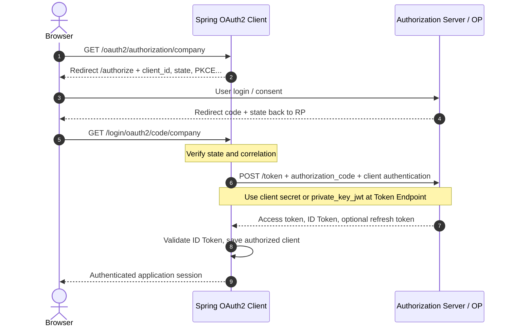
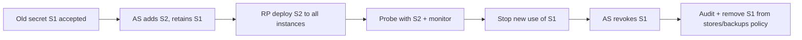
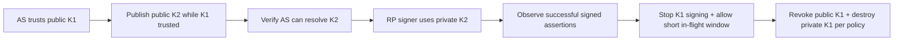
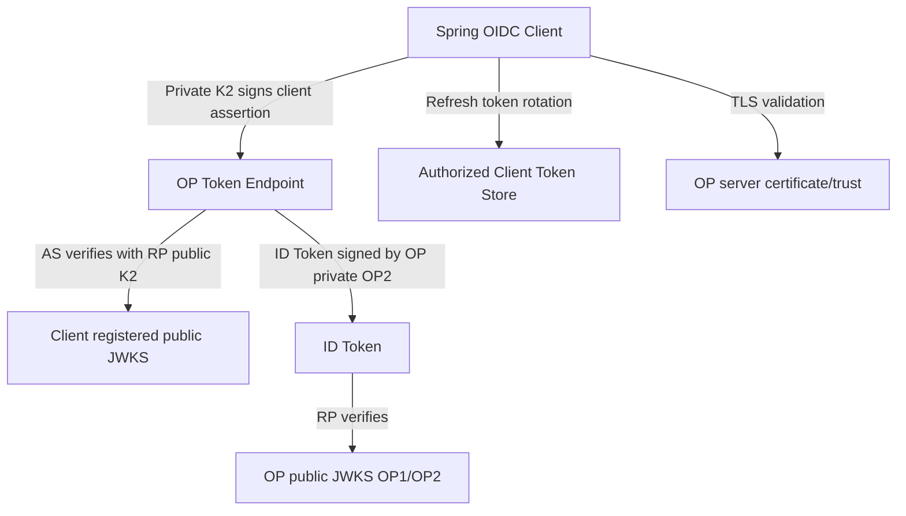
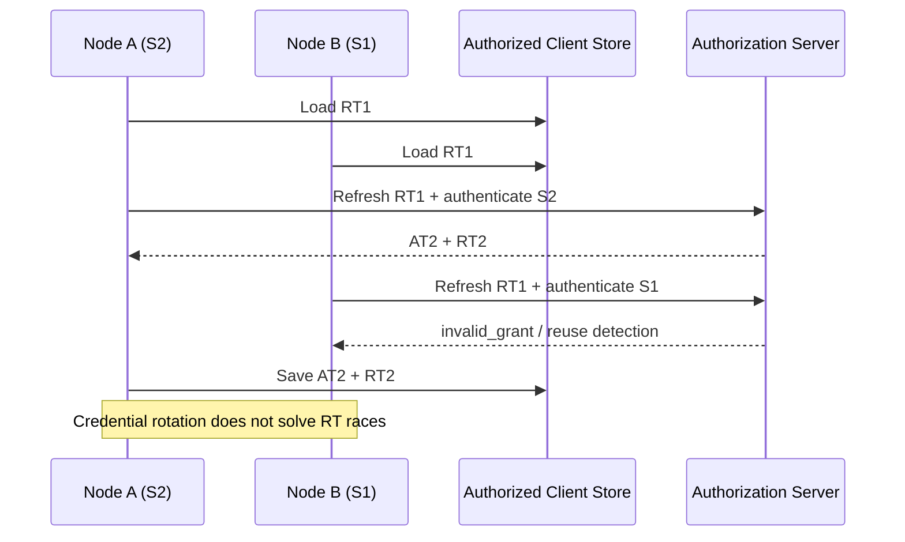

# 27.11. Client Secret Rotation and Private Key Rotation

In **Spring Security OAuth 2.0 / OpenID Connect (OIDC) Client**, an application can hold a **client secret** to authenticate with the Authorization Server (AS), or use a **private key** to sign a JWT client assertion (`private_key_jwt`), authenticate with an mTLS certificate, or fulfill another security profile. When a credential is leaked, reaches its scheduled expiration, or the organization raises its security level, the application must perform **credential rotation**.

Rotation is not just editing an environment variable and restarting. During deployment, multiple instances may be running concurrently; browsers are executing the Authorization Code Flow; the backend is refreshing access tokens; some connections have already been established using the old certificate; and the AS may be caching the client's public key. If you remove the old credential too early, the service fails with `invalid_client`. If you keep the old credential too long, a compromised credential can continue to be abused.

This lesson focuses on **27.11. Client Secret Rotation and Private Key Rotation** in chapter **27. Integration Security**, within the scope of **Spring Security OAuth 2.0 OIDC Client** on **Spring Boot 3.x / Spring Security 6.x**, covering both **Servlet** and **WebFlux**. Code snippets and URLs are illustrative only. APIs supporting `private_key_jwt` and Token Endpoint customization may vary by Spring Security version; consult the Javadoc/reference for the **exact version pinned in your project** before integrating.

> **Important Principle:** Safe rotation requires a **controlled transition period** between the old credential and the new credential, but that period must not be prolonged when a credential has been compromised. Distinguish **client authentication credentials**, **OP signing keys/JWKS**, **refresh tokens**, and **session cookies**: they do not share the same lifecycle, storage location, or revocation mechanism.

## 1. Learning Objectives

After this lesson, you will be able to:

1. Distinguish `client_secret_basic`, `client_secret_post`, `client_secret_jwt`, `private_key_jwt`, mTLS client authentication, and the OP's JWK signing keys.
2. Explain where credentials are used in the Authorization Code, Refresh Token, and Client Credentials grants.
3. Design **overlapping client secret rotation**: create the new secret → deploy → test → revoke the old secret.
4. Recognize the limitations when the AS **supports only one active secret** and cannot guarantee zero-downtime through configuration alone.
5. Manage a **private key ring**, `kid`, public JWK registration, JWT assertion `iss`/`sub`/`aud`/`exp`/`jti`, and signing algorithms.
6. Plan **private key rotation for `private_key_jwt`** and distinguish it from rotating mTLS certificates.
7. Update `ClientRegistration` by version and roll out configuration changes consistently across multiple instances.
8. Keep in-flight Authorization Code callbacks, token refreshes, and existing authorized clients safe.
9. Build processes for secret management, rollout, rollback, revocation, and credential compromise response.
10. Test negative cases, multi-tenant isolation, concurrency, observability, and failure handling without leaking credentials.

## 2. Context: When Does an Application Use Client Credentials?

Suppose the application portal `https://portal.example.com` has an OIDC registration:

```text
registrationId     = company
client_id          = portal-web
issuer             = https://id.company.example
grant              = authorization_code
client_auth_method = client_secret_basic
```

The user logs in via a browser:



**The client secret/private key is normally not sent in the browser authorization redirect**. They are used by the backend to prove client identity at the **Token Endpoint**, and sometimes at PAR/Revocation/Introspection endpoints depending on the AS profile.

If the access token expires, the backend can use a refresh token. In that case, **client authentication may still be required**:

```text
POST /token
grant_type=refresh_token
refresh_token=<refresh-token>
client authentication=<secret or signed assertion>
```

Therefore, a broken credential rotation may not affect all requests immediately; it only surfaces when users perform a new login or when a token must be refreshed.

### 2.1. Four Easily Confused Types of Rotation

| Type | What changes? | Party holding private material | Primary impact |
| --- | --- | --- | --- |
| **Client secret rotation** | Secret used for `client_secret_basic/post` or secret-based client auth | RP and AS | Token Endpoint client authentication |
| **Client private key rotation** | Private key signing `private_key_jwt`/JWT request, or another key auth method | RP; AS trusts the public key | Signed client assertion, key registration |
| **OP signing key/JWKS rotation** | OP rotates its private signing key and publishes its public JWK | OP | RP verifies ID Token signatures |
| **Refresh token rotation** | AS issues a new RT when the client refreshes | AS and RP's token store | User/workload authorization lifecycle |

We can also add **mTLS client certificate/private key rotation** and **session ID rotation**; neither of those is synonymous with the four types in the table above.

### 2.2. A Typical Security Mistake

The OP rotates its ID Token signing key (`kid=op-K2`), yet the integration team rotates `client-secret` and restarts the app. As a result, errors persist because the decoder/JWKS cache has not received the new OP key.

Conversely, an expired client secret causes `invalid_client` at the Token Endpoint; clearing the OP JWKS cache will not resolve the issue.

Always identify **which side** holds the credential and **which protocol step** uses it before rotating.

## 3. OAuth2 Client Authentication Methods

### 3.1. `client_secret_basic`

The RP sends credentials via the HTTP Basic Authorization header to the Token Endpoint:

```http
POST /oauth2/token HTTP/1.1
Host: id.company.example
Content-Type: application/x-www-form-urlencoded
Authorization: Basic <redacted-base64-client-id-and-secret>

grant_type=authorization_code&
code=<authorization-code>&
redirect_uri=https%3A%2F%2Fportal.example.com%2Flogin%2Foauth2%2Fcode%2Fcompany
```

`Basic` is only **encoding**, not encryption; HTTPS/TLS remains mandatory. Do not log the `Authorization` header.

### 3.2. `client_secret_post`

The RP sends `client_id` and `client_secret` in the Token Endpoint request form body:

```http
POST /oauth2/token HTTP/1.1
Host: id.company.example
Content-Type: application/x-www-form-urlencoded

grant_type=client_credentials&
client_id=portal-worker&
client_secret=<redacted-secret>
```

The body contains highly sensitive credentials; request-body logging/APM must redact it. **Do not switch from `client_secret_basic` to `client_secret_post` on your own just to work around a rotation failure**: the AS must support it and the client registration must be configured with the proper method.

### 3.3. `client_secret_jwt`

The RP signs a client assertion using an HMAC algorithm based on the shared secret; the AS verifies it using that secret. It is still **secret-based client authentication**, though its HTTP representation differs from Basic/Post.

Secret rotation can affect both how the JWT assertion is generated and AS policy. The secret needs appropriate entropy/length for the MAC algorithm; do not use short password strings as HMAC keys.

### 3.4. `private_key_jwt`

The RP signs a **client assertion JWT** with its own private key. The AS receives the public key through registration (a static JWK/JWKS or a configured `jwks_uri`) to verify it. A shared `client_secret` is not needed for this authentication step.

Typical JWT claims include:

```json
{
  "iss": "portal-web",
  "sub": "portal-web",
  "aud": "https://id.company.example/oauth2/token",
  "iat": 1794800000,
  "exp": 1794800060,
  "jti": "unique-assertion-id"
}
```

Timestamps are illustrative only. **`aud` must follow the AS profile**, usually the token endpoint URL or an audience mandated by the AS; do not pick one arbitrarily. The assertion must have a short lifetime and a `jti` for replay protection per the provider contract.

### 3.5. mTLS Client Authentication

The RP proves possession of a **client certificate's** private key during the TLS handshake. How the AS validates the certificate, certificate chain, subject DN, or SAN, and how tokens are bound to the certificate depend on RFC 8705/profile.

Certificate/private key rotation **is not the same operation as rotating `private_key_jwt`**. Both use asymmetric cryptography, but one proves possession at the TLS layer while the other signs a JWT at the application layer.

### 3.6. Method Comparison Table

| Client authentication method | Data the RP must protect | What must be registered at the AS? | Coordination needed for rotation |
| --- | --- | --- | --- |
| `client_secret_basic` | Shared client secret | Client ID + secret + method | Active secrets at AS, config deployment |
| `client_secret_post` | Shared client secret | Same as above, different method | AS/RP and body redaction |
| `client_secret_jwt` | Shared HMAC secret | Secret + alg/profile | Assertion signing + AS verification |
| `private_key_jwt` | Private signing key | Public JWK/JWKS or `jwks_uri`, alg | Key overlap/JWKS propagation/`kid` |
| mTLS | Client certificate private key | Trust/certificate binding policy | Cert enrollment, TLS pools, token binding |

**No mechanism exempts you from protecting keys/secrets, TLS, token storage, and authorization policy.**

## 4. Secret Rotation Is an Operational Protocol, Not Just a Config Change

A well-planned scheduled rotation usually has an **overlap period**: the AS accepts both the old secret and the new secret for a window long enough to complete the rollout.



### 4.1. Invariants That Must Be Preserved

- `client_id` and the AS issuer remain tied to the correct registration (unless migrating clients).
- The new secret is **generated with a CSPRNG** meeting the AS entropy policy.
- All client Token Endpoint calls remain authenticated throughout the rollout.
- The OP only accepts secrets within the approved active set.
- Never fall back to another tenant's secret if the current secret fails.
- Never print raw secrets in deployment logs, CI outputs, or metrics.
- Track an owner, revision, and retirement date for the old secret.
- Rollback must use a still-valid credential and must not weaken TLS/grant policies.

### 4.2. A Practical Timeline

| Milestone | AS accepts | RP instance A | RP instance B | Goal |
| --- | --- | --- | --- | --- |
| T0 | S1 | S1 | S1 | Normal operation |
| T1 | **S1, S2** | S1 | S1 | Create S2, traffic unchanged |
| T2 | **S1, S2** | **S2** | S1 | Rolling deployment |
| T3 | **S1, S2** | S2 | **S2** | All instances use S2 |
| T4 | **S1, S2** | S2 | S2 | Probe, monitor, and settle |
| T5 | **S2** | S2 | S2 | Revoke S1 at AS |

There is no single "standard number of minutes" for T1–T4. It depends on rollout duration, replica count, token refresh intervals, rollback requirements, AS propagation latency, and detecting stale workers.

### 4.3. Which Secret Is Used While Both Are Valid?

Spring Security normally holds **one selected `clientSecret` inside `ClientRegistration`** at a time; it does not maintain a list of secrets to try sequentially. Overlap is an **acceptance policy on the AS**: during the transition, each RP instance may send S1 or S2, and the AS accepts both.

**Do not design an interceptor that "tries every secret in Vault if `invalid_client` occurs."** That can leak credentials, mask misconfigurations, and trigger retry storms. If a special fallback is genuinely required, it must be strictly scoped by version, operation, and security review.

## 5. Conditions for Near-Zero-Downtime Rotation

### 5.1. Authorization Server Allows Two Active Secrets Simultaneously

This is the most favorable scenario. Steps:

1. Create the new secret in the AS; **do not revoke S1 immediately**.
2. Store S2 in the secret manager under a distinct version/reference.
3. Deploy S2 to a canary RP instance or an appropriate test OAuth2 client path.
4. Verify real Token Endpoint authentication using S2.
5. Roll out to all replicas/workers.
6. Verify no client is still using S1 (via AS audit logs and deployment inventory).
7. Revoke S1.
8. Verify all token issuances/refreshes after revocation succeed using S2.

Zero-downtime still depends on application rollout, AS policy, caching, and networking; the fact that "the AS supports two secrets" **does not automatically guarantee** an error-free transition.

### 5.2. AS Allows Only One Secret

If generating S2 **immediately invalidates S1**, a multi-instance rollout can encounter:

```text
AS accepts only S2
Node A has S2 -> token requests succeed
Node B has S1 -> invalid_client
```

For customer-facing APIs with strict continuity requirements, you must **agree on an approach with the AS**:

- Does it support versioned client credentials/secondary secrets?
- Can you create **a new OAuth2 client registration** (new client ID) and cut over?
- Can token issuance be paused briefly with advance notice?
- Can you do a blue-green deployment with only one active backend route?
- Is there an almost atomic coordinated cutover mechanism across both AS and RP?
- Can in-flight authorization code callbacks still use the old client?

**You cannot promise zero-downtime simply by changing an environment variable** if the AS does not support overlap and there is no coordination. You must disclose the risk or migrate to a new client, which carries its own redirect/callback/consent/authorized-client consequences.

### 5.3. When Client ID Also Changes

If you have to create a new OAuth2 client B:

```text
company-v1: client_id=portal-old, secret=S1
company-v2: client_id=portal-new, secret=S2
```

This is no longer purely secret rotation. The ID Token `aud`, redirect URI registration, and authorized client storage may differ.

Use **versioned registration IDs** (where appropriate) so in-flight Authorization Code callbacks for V1 are routed to the right client while new login requests route to V2. Do not treat a client V1 refresh token as belonging to client V2.

## 6. Configuring `client_secret_basic` in Spring Boot

A Servlet/Reactive OIDC registration:

```yaml
spring:
  security:
    oauth2:
      client:
        registration:
          company:
            provider: company-op
            client-id: ${OIDC_COMPANY_CLIENT_ID}
            client-secret: ${OIDC_COMPANY_CLIENT_SECRET}
            client-authentication-method: client_secret_basic
            authorization-grant-type: authorization_code
            redirect-uri: "{baseUrl}/login/oauth2/code/{registrationId}"
            scope:
              - openid
              - profile
        provider:
          company-op:
            issuer-uri: https://id.company.example/oidc
```

Only use **one currently selected secret** in the `client-secret` property. Its value must come from a secret manager or an equivalent secure configuration source appropriate for the deployment.

### 6.1. Equivalent `application.properties`

```properties
spring.security.oauth2.client.registration.company.provider=company-op
spring.security.oauth2.client.registration.company.client-id=${OIDC_COMPANY_CLIENT_ID}
spring.security.oauth2.client.registration.company.client-secret=${OIDC_COMPANY_CLIENT_SECRET}
spring.security.oauth2.client.registration.company.client-authentication-method=client_secret_basic
spring.security.oauth2.client.registration.company.authorization-grant-type=authorization_code
spring.security.oauth2.client.registration.company.redirect-uri={baseUrl}/login/oauth2/code/{registrationId}
spring.security.oauth2.client.registration.company.scope=openid,profile
spring.security.oauth2.client.provider.company-op.issuer-uri=https://id.company.example/oidc
```

Never commit real secrets to YAML/properties or Docker images. Environment variables also carry exposure surfaces; restrict read permissions, process inspection, deployment manifests, and CI logs.

### 6.2. Does Changing a Secret in Vault Automatically Update `ClientRegistration`?

Normally **no**. Spring Boot may build `ClientRegistration` during application context startup and keep the object in the repository. If the secret manager updates S1 → S2, an app instance may continue using S1 until:

- The context/repository is recreated via restart or controlled refresh, or
- You have designed a **dynamic/reloadable registration repository** and safely published a new snapshot.

Do not assume a secret store automatically patches every `ClientRegistration` inside the JVM. Confirm how your integration resolves and invalidates secrets and beans.

### 6.3. When Does Spring Security Use the Secret?

- Authorization Code Flow: client authentication when the backend exchanges the code at the Token Endpoint.
- Refresh Token Flow: the AS may require client authentication during refresh.
- Client Credentials Flow: client authentication when requesting an access token.
- Other endpoints depending on provider: PAR, Token Revocation, Introspection, etc.

**A login that succeeded before rotation does not prove the new credential works**, because existing access tokens/sessions can still function without calling the Token Endpoint.

## 7. Updating Registrations via Snapshots Instead of Mutating State

If a project needs to rotate secrets without restarting the entire cluster, you can implement **immutable snapshots** of `ClientRegistration` and publish them after the new secret is approved.

### 7.1. Servlet Repository Example

```java
import java.util.Map;
import java.util.Objects;
import java.util.concurrent.atomic.AtomicReference;

import org.springframework.security.oauth2.client.registration
        .ClientRegistration;
import org.springframework.security.oauth2.client.registration
        .ClientRegistrationRepository;

public final class ReloadableClientRegistrationRepository
        implements ClientRegistrationRepository {

    public record Snapshot(
            long revision,
            Map<String, ClientRegistration> clients) {

        public Snapshot {
            clients = Map.copyOf(
                    Objects.requireNonNull(clients));
        }
    }

    private final AtomicReference<Snapshot> current;

    public ReloadableClientRegistrationRepository(
            Snapshot initial) {
        this.current = new AtomicReference<>(
                Objects.requireNonNull(initial));
    }

    @Override
    public ClientRegistration findByRegistrationId(String id) {
        return current.get().clients().get(id);
    }

    // Must only be called by a trusted admin/config workflow.
    public void publishValidated(Snapshot next) {
        current.updateAndGet(previous -> {
            if (next.revision() <= previous.revision()) {
                throw new IllegalArgumentException(
                        "Stale configuration revision");
            }
            return next;
        });
    }
}
```

Given an existing `ClientRegistration`, create a **new object** rather than mutating it in place:

```java
// Illustrative code for building configuration in a trusted workflow.
ClientRegistration updated =
        ClientRegistration.withClientRegistration(previous)
                .clientSecret(newSecretFromVault)
                .build();
```

`newSecretFromVault` is an application variable fetched from the secret manager; it is not a Spring-provided method. When publishing a snapshot:

- Validate the revision and tenant ownership.
- Retain other registrations in the map.
- Never log the raw `ClientRegistration` or new secret.
- If there are multiple publishers, revisions should be issued by an authoritative config store.
- Account for in-flight callbacks and session/token stores.
- Never let a browser trigger a publish or select a secret.

### 7.2. Notes on Boot Auto-Configuration and the Login Page

Defining a custom `ClientRegistrationRepository` bean can prevent Spring Boot from creating the default YAML-backed repository. Ensure your custom repository **contains all valid registrations**, not just `company`.

Because the repository above only implements lookup and not `Iterable<ClientRegistration>`, a default login page relying on listing registrations may not display all providers. If the application has a multi-provider UI, maintain login options from a managed allowlist.

### 7.3. When a Callback Uses an Old Snapshot

An Authorization Code Flow starts before secret rotation:

```text
T0: /authorize uses client_id = portal-web
T1: AS accepts S1, S2
T2: RP switches secret S1 -> S2
T3: Callback brings authorization code for the same client_id = portal-web
T4: RP uses S2 at Token Endpoint
```

If the AS accepts S2 **for the same client ID**, the flow can usually complete; an authorization code is not bound to the **old secret value itself**. However, if the AS changes the client ID or redirect URI at the same time, the callback may fail. Separate secret rotation from client identity migration whenever possible.

A snapshot swap also does not guarantee that every in-flight provider call uses the exact same revision; policy must be verified when hot reload runs across multiple nodes.

## 8. Reactive/WebFlux: Lookups Must Not Block the Event Loop

In WebFlux, use `ReactiveClientRegistrationRepository`:

```java
import java.util.Map;
import java.util.concurrent.atomic.AtomicReference;

import org.springframework.security.oauth2.client.registration
        .ClientRegistration;
import org.springframework.security.oauth2.client.registration
        .ReactiveClientRegistrationRepository;

import reactor.core.publisher.Mono;

public final class ReloadableReactiveClientRegistrationRepository
        implements ReactiveClientRegistrationRepository {

    private final AtomicReference<Map<String, ClientRegistration>> snapshot;

    public ReloadableReactiveClientRegistrationRepository(
            Map<String, ClientRegistration> approved) {
        this.snapshot = new AtomicReference<>(
                Map.copyOf(approved));
    }

    @Override
    public Mono<ClientRegistration> findByRegistrationId(
            String registrationId) {

        return Mono.defer(() ->
                Mono.justOrEmpty(
                        snapshot.get().get(registrationId)));
    }

    // Called after loading/validating configuration from the control plane.
    public void publishApproved(
            Map<String, ClientRegistration> approved) {

        snapshot.set(Map.copyOf(approved));
    }
}
```

This is an **in-memory nonblocking lookup** example without a revision guard; production code should add revision/atomicity checks and lifecycle management for old registrations.

**Do not do this:**

```java
// WRONG: A Vault HTTP call can block the event-loop.
return Mono.just(vaultBlockingClient.getLatestSecret());
```

**Instead, do this:**

```text
Trusted rotation event
   -> secret manager lookup with appropriate I/O
   -> validate secret version/client registration
   -> build immutable snapshot
   -> publish atomically
   -> WebFlux lookup returns Mono<ClientRegistration>
```

If the secret manager SDK only offers a blocking API, execute it on a dedicated bounded scheduler/worker with timeouts and concurrency limits; never invoke a blocking SDK on the request path.

### 8.1. Managers and Token Response Clients Still Must Match the Stack

| Servlet | WebFlux |
| --- | --- |
| `ClientRegistrationRepository` | `ReactiveClientRegistrationRepository` |
| `OAuth2AuthorizedClientManager` | `ReactiveOAuth2AuthorizedClientManager` |
| `OAuth2AuthorizedClientService` | `ReactiveOAuth2AuthorizedClientService` |
| `RestClient` or equivalent client | `WebClient` |
| `HttpSecurity` / `SecurityFilterChain` | `ServerHttpSecurity` / `SecurityWebFilterChain` |
| `HttpSession` | `WebSession` |

A reactive repository does not turn a **synchronous custom Token Endpoint HTTP client** into nonblocking code. When using `private_key_jwt` in WebFlux, signing may require key vault/HSM operations; ensure they do not block the event loop.

## 9. Relationship with `OAuth2AuthorizedClientManager` and Token Cache

Changing a client credential does not immediately expire all currently active access tokens.

```text
ClientRegistration(company, secret=S2)
                  |
                  v
OAuth2AuthorizedClientManager
                  |
          +-------+--------+
          |                |
   Token still valid    Needs new token / refresh
          |                |
          v                v
      Use old AT      Token Endpoint uses S2
                              |
                              v
                         New AT/RT
```

### 9.1. Why Can a Canary Test Give a False Positive?

A canary that only calls a downstream API using an **unexpired** access token will not trigger a Token Endpoint request. Even if S2 is misconfigured, the API still returns 200.

A solid probe plan must verify **client authentication with S2 at the AS** in an appropriate test flow:

- Use a dedicated sandbox/canary OAuth2 client when possible.
- Acquire a new token with an allowed grant and an appropriate test identity.
- Do not expire or revoke production user tokens just to run a test.
- Do not generate large bursts of browser authorization flows that add load.
- Check AS audit logs to confirm the expected client credential version/key ID if the provider supports it.

### 9.2. Are Refresh Tokens Invalidated When the Secret Changes?

**There is no universal rule.** It depends on the AS/provider:

- An RT bound to the same `client_id` may remain valid and work with the new secret.
- The AS may force re-consent or reauthorization.
- A security incident rotation may revoke the refresh token family.
- Changing the client ID typically does not transfer old RTs to the new client.

Rely on the **provider contract and testing**, not guesswork based on whether the secret update succeeded. Handle `invalid_grant` separately from `invalid_client`.

### 9.3. Avoid Unbounded Secret Retries

If the Token Endpoint returns `invalid_client`, that signals a **client authentication/configuration error**, not a transient failure by default. A retry loop with the same secret rarely helps and can cause lockouts or rate limiting.

Alert the right owner/config version and perform a controlled rollback if the old secret is still accepted by the AS; when a credential has been compromised, never roll back to the leaked secret.

## 10. What Is `private_key_jwt` and Why Manage a Key Ring?

With `private_key_jwt`, the RP does not place a shared secret in a Basic header. Instead, the RP builds a **JWT client assertion**, signs it with a private key, and sends it to the Token Endpoint.

```http
POST /oauth2/token HTTP/1.1
Host: id.company.example
Content-Type: application/x-www-form-urlencoded

grant_type=client_credentials&
client_id=portal-worker&
client_assertion_type=urn%3Aietf%3Aparams%3Aoauth%3Aclient-assertion-type%3Ajwt-bearer&
client_assertion=<signed-client-assertion>
```

The body is redacted. `client_assertion_type` and its value follow the OAuth2 JWT Client Authentication profile. Different profiles may impose additional requirements.

### 10.1. Protected JWS Header

```json
{
  "alg": "PS256",
  "kid": "portal-client-key-2026-11",
  "typ": "JWT"
}
```

- `alg`: signing algorithm permitted by AS policy, e.g., RS256/PS256/ES256 where allowed.
- `kid`: key identifier telling the AS which registered **client public key** to select.
- `typ`: profile-dependent; do not rely on this field alone to distinguish token types.

**`kid` does not contain the private key** and is not independent proof of trust. The AS must restrict public keys by **client registration**; an attacker cannot supply an arbitrary new key via a JWT header.

### 10.2. Important JWT Claims

| Claim | Common role | Rotation-related requirements |
| --- | --- | --- |
| `iss` | Issuer of the client assertion, usually the client ID | Do not change arbitrarily during key rotation |
| `sub` | Subject, usually equal to client ID | Binds client identity |
| `aud` | Audience required by the AS, usually the Token Endpoint | Do not use an arbitrary URL |
| `exp` | Short-lived assertion expiration | Tight enough to limit clock skew and replay |
| `iat` | Issued-at timestamp | Clocks synchronized |
| `nbf` | Optional not-before per profile | Avoid unintended time skew rejections |
| `jti` | Unique assertion ID for replay protection | Do not reuse on retry |
| `kid` (header) | Signing key version | AS must already know the public key |

`private_key_jwt` is **client authentication**, not the `urn:ietf:params:oauth:grant-type:jwt-bearer` authorization grant. You can use `private_key_jwt` to authenticate in either the `authorization_code` or `client_credentials` grant.

### 10.3. Do Not Configure `private_key_jwt` with Just One Line of YAML

```yaml
spring:
  security:
    oauth2:
      client:
        registration:
          company:
            client-authentication-method: private_key_jwt
```

This property states the **intended method**, but does not automatically provide a private key, signer, key resolver, assertion generator, or compatible Token Endpoint client.

Check support in your exact Spring Security version, configure the token response client/JWT converter or provided adapter, and register the key with the AS. Do not copy a `client_secret_basic` example, remove `client-secret`, and expect signing to appear automatically.

## 11. Private Key Rotation: Four Key Conditions

A standard private key rotation proceeds in order:

1. **Generate key pair K2** in an HSM/KMS/keystore or an approved CSPRNG source.
2. **Register public key K2 at the AS** alongside the active public key K1; wait for AS/JWKS cache propagation.
3. **Switch the RP signer to private key K2**, sending `kid=K2`; test token requests.
4. **Revoke public key K1 at the AS and retire private key K1** once the allowed transition window has elapsed.



### 11.1. Why Must the Public Key Be Published First?

If the RP begins signing with K2 before the AS loads public K2, the Token Endpoint can return:

```json
{
  "error": "invalid_client"
}
```

Never resolve this by disabling assertion signature verification. Inspect public key registration, `jwks_uri`, `kid`, JWS algorithm, and AS cache refresh instead.

### 11.2. Why Keep K1 Briefly?

Client assertions signed with K1 may still be **in flight** or delayed at the AS. If the AS removes K1 the instant the RP switches signers, some requests may fail.

However, assertion `exp` should be short; there is no need to keep K1 for weeks just for an already-issued assertion. Overlap duration should reflect token endpoint latency, clock skew, rollout speed, AS cache TTL, and policy.

### 11.3. What If K1 Has Been Compromised?

When a private key is suspected of compromise, **do not blindly apply normal overlap**. You may need to revoke K1 immediately, accept controlled downtime, change the public key registration, assess forged assertions, revoke issued tokens, and investigate audit logs.

"Zero-downtime" must never outrank removing a compromised signing key.

## 12. Client JWKS vs. OP JWKS

This is the most common point of confusion when discussing "private key rotation" in an OIDC Client.

### 12.1. OP Signing Keys — OP Signs ID Tokens

```text
OP private key (held at the Authorization Server)
        |
        v
Sign ID Token
        |
        v
RP fetches OP public JWKS from provider jwks_uri
        |
        v
RP verifies ID Token signature + iss/aud/nonce
```

### 12.2. Client Authentication Keys — RP Signs `private_key_jwt`

```text
RP private key (held in secret manager/HSM)
        |
        v
Sign client assertion
        |
        v
AS Token Endpoint
        |
        v
AS loads/knows registered CLIENT public JWK/JWKS
        |
        v
AS verifies client assertion signature + claims
```

| Comparison | OP JWKS | Client authentication JWKS |
| --- | --- | --- |
| Who holds the private key? | OP | RP/client |
| Who verifies the signature? | RP | AS |
| Which token/JWT is signed? | ID Token (and other OP JWTs) | `private_key_jwt` client assertion |
| Where is the public key located? | `providerDetails.jwkSetUri` / OP metadata | Client registration at AS (static JWKS or client `jwks_uri`) |
| What does rotation affect? | RP login token verification | AS Token Endpoint client authentication |
| Does `client-secret` need changing? | No | Shared secret is normally unused |

**Do not treat `ClientRegistration.getProviderDetails().getJwkSetUri()` as the place where the RP publishes its own public key.** That field points to the **OP public JWKS**, used in the opposite verification direction.

## 13. Managing a Private Key Ring Safely

A key ring model for an OAuth2 client:

```text
Client = portal-web
Approved alg = PS256
Keys:
  K1: RETIRING, public registered at AS, private available short grace
  K2: ACTIVE, public registered at AS, private used for new assertions
  K3: PREPARED, public registration pending / not used
```

These key states represent an **application design**, not a built-in Spring Security enum.

### 13.1. Suggested Metadata Structure

```yaml
clientAuth:
  registrationId: company
  method: private_key_jwt
  algorithm: PS256
  activeKeyId: portal-client-key-2026-11
  keys:
    - kid: portal-client-key-2026-08
      status: RETIRING
      privateKeyRef: kms://client-auth/company/2026-08
    - kid: portal-client-key-2026-11
      status: ACTIVE
      privateKeyRef: kms://client-auth/company/2026-11
  configRevision: 42
```

This is an **illustrative config model**, not direct Spring Boot properties. `privateKeyRef` is only a reference, never a raw PEM or PKCS#8 private key.

### 13.2. Security Requirements for the Key Ring

- Keys are generated by CSPRNG/HSM/KMS and comply with algorithm policy.
- Enforce **client/tenant scoping**; avoid sharing a private key across unrelated tenants whenever possible.
- Private keys must never appear in application logs, config dumps, tracing, or browser responses.
- Only the signing service is authorized to use the key.
- An active key is selected via an explicit revision, with its public key already registered at the AS.
- Key retirement has a deadline and is audited.
- Never take `kid` from HTTP input to sign with an arbitrary key.
- Never keep old keys indefinitely for rollback.
- Destroy/revoke keys according to legal, backup, and incident response policies.
- Maintain synchronized clocks and never reuse assertion `jti` values.

### 13.3. HSM/KMS Signing Can Add Latency

If the signer calls an HSM/KMS over the network, requests can be slow or fail. In WebFlux, never call a blocking HSM SDK on the Reactor event loop. Place signing behind an abstraction with timeouts, concurrency limits, cancellation semantics, and retry behavior aligned with `jti`/assertion replay policy.

On a signer timeout, the HSM may have already signed the assertion even though the client did not receive the response. Do not resend the exact same `jti` repeatedly or issue unbounded assertions to "retry."

## 14. Example: Creating a JWT Client Assertion with Nimbus JOSE (Educational)

In real projects, prefer Spring Security's official **JWT client authentication converter/token client** if your version and AS profile support it. To understand what is being signed, the example below uses Nimbus JOSE directly with a test RSA private key. It **only creates the assertion**, without building the full HTTP client, grant logic, or error handling.

```java
import java.security.interfaces.RSAPrivateKey;
import java.time.Instant;
import java.util.Date;
import java.util.UUID;

import com.nimbusds.jose.JOSEException;
import com.nimbusds.jose.JWSAlgorithm;
import com.nimbusds.jose.JWSHeader;
import com.nimbusds.jose.crypto.RSASSASigner;
import com.nimbusds.jwt.JWTClaimsSet;
import com.nimbusds.jwt.SignedJWT;

public final class ExampleClientAssertionSigner {

    public String sign(
            String clientId,
            String approvedTokenEndpoint,
            String activeKeyId,
            RSAPrivateKey privateKey) throws JOSEException {

        Instant now = Instant.now();

        JWTClaimsSet claims = new JWTClaimsSet.Builder()
                .issuer(clientId)
                .subject(clientId)
                .audience(approvedTokenEndpoint)
                .issueTime(Date.from(now))
                .expirationTime(
                        Date.from(now.plusSeconds(60)))
                .jwtID(UUID.randomUUID().toString())
                .build();

        SignedJWT signed = new SignedJWT(
                new JWSHeader.Builder(JWSAlgorithm.PS256)
                        .keyID(activeKeyId)
                        .build(),
                claims);

        signed.sign(new RSASSASigner(privateKey));
        return signed.serialize();
    }
}
```

**Limitations to understand:**

- `approvedTokenEndpoint` must come from a **trusted ClientRegistration/AS policy**, never from browser input.
- `activeKeyId` must belong to the approved key ring.
- `privateKey` here is an in-memory key for illustration; production may use a keystore/HSM/KMS and must not export the key if policy forbids it.
- Use `PS256` only if approved by the OP/AS; never choose the algorithm from an untrusted JWT header.
- `UUID` serves as a random `jti` in this illustration; the AS requires appropriate replay protection and may mandate a different format or uniqueness policy.
- `exp=60s` is only an example; the AS profile may require another limit.
- The Token Endpoint must receive `client_assertion_type` and `client_assertion` in the expected form and verify the signature, claims, and key registration.
- This is **not an ID Token**, contains no OIDC login `nonce`, and must not be used as a Bearer access token for a Resource Server.
- Never log the output of `signed.serialize()`. A leaked client assertion can be used to impersonate the client during its short lifetime if not yet replay-blocked.

### 14.1. Does Nimbus Provide a Built-In Rotation Strategy?

No. Nimbus provides JOSE/JWT building blocks. Managing active keys, public JWKS registration, rollout, AS cache propagation, and key retirement belongs to the **application and the AS**.

### 14.2. Integrate with Spring Security Instead of Rewriting Grants

Spring Security components to check in your project version include:

- `OAuth2AccessTokenResponseClient` for each grant (Servlet).
- Implementations/token clients supporting `RestClient` or the appropriate HTTP client.
- JWT client authentication converters, such as `NimbusJwtClientAuthenticationParametersConverter` in versions providing that API.
- `OAuth2AuthorizedClientManager` and `OAuth2AuthorizedClientProvider`.
- Reactive token response clients / `ReactiveOAuth2AuthorizedClientManager` in WebFlux.

Architectural pattern:

```text
ClientRegistration(clientAuthenticationMethod=private_key_jwt)
            |
            v
Authorized Client Manager / OAuth2 Login Token Client
            |
            v
Client Assertion Converter/Signer
            |
            +--> Approved client key ring: active kid
            +--> Issuer/client ID/token endpoint policy
            |
            v
Token Endpoint request:
  client_assertion_type
  client_assertion
            |
            v
AS validates client assertion and grant
            |
            v
Spring handles token response and authorized client persistence
```

**Do not assume merely adding the Nimbus dependency makes every Spring grant use `private_key_jwt` automatically.** You must configure the JWT converter/token client for the right scope and version; if your project uses Authorization Code, Refresh Token, and Client Credentials, ensure **all grant paths** requiring client authentication are covered.

## 15. Client Public JWKS and Authorization Server Caching

When a client uses `private_key_jwt`, the AS needs public keys K1/K2. Two models are common:

### 15.1. Static Public JWK/JWKS in Client Registration at the AS

An administrator or Dynamic Client Registration workflow updates the client's public keys at the AS.

Pros: the AS does not have to fetch an external URL on each verification. Cons: rotation requires an API/procedure to update client registration, and propagation delays may exist between AS nodes.

### 15.2. Client `jwks_uri` Registered at the AS

The AS fetches the public JWKS from a URL hosted by the client, for example:

```text
https://portal.example.com/.well-known/client-jwks.json
```

Example **public JWKS** (shortened public modulus placeholders, not functional JWKs):

```json
{
  "keys": [
    {
      "kty": "RSA",
      "kid": "portal-client-key-2026-08",
      "use": "sig",
      "alg": "PS256",
      "n": "<public-modulus-K1>",
      "e": "AQAB"
    },
    {
      "kty": "RSA",
      "kid": "portal-client-key-2026-11",
      "use": "sig",
      "alg": "PS256",
      "n": "<public-modulus-K2>",
      "e": "AQAB"
    }
  ]
}
```

**Never include `d`, `p`, `q`, or other RSA private key components in a public JWKS.** For EC keys, never include the private scalar `d`. Publish public keys only.

### 15.3. AS JWKS Caching Can Slow Rollout

Even after the client JWKS endpoint serves K2, the AS may still cache a snapshot containing only K1. Signing with K2 too early will trigger `invalid_client`.

Confirm the following:

- What cache TTL/ETag/refetch policy does the AS use?
- Does the AS refresh upon seeing a new `kid`?
- Is there an API to invalidate the client JWKS cache?
- Do multiple Token Endpoint instances hold separate caches?
- Can you probe authentication using K2?
- After removing K1, how long until the AS stops accepting K1?

**Do not infer from HTTP 200 on the JWKS endpoint that every AS node has picked up K2.** Require a canary Token Endpoint request or AS operational confirmation.

### 15.4. Do Not Cache or Scope `kid` Globally

Two OAuth2 clients might both use `kid="K2"` with different public keys. The AS must scope JWK lookups to the **specific client registration**; the RP key ring must also key entries by client/tenant + version, not by `kid` alone.

## 16. Rotating Client Key and OP Signing Key Simultaneously: Two-Way Control

A deployment might concurrently observe:

- Client switching K1 → K2 for signing `private_key_jwt`.
- OP switching OP1 → OP2 for signing ID Tokens.
- AS replacing its TLS certificate.
- Backend rotating refresh token RT1 → RT2.

These are **four independent changes**:



**Do not clear the OP JWKS cache just because the client rotated its private key**, unless the OP signing key actually changed too. Likewise, do not change the client assertion signer key just because the RP sees an ID Token with a new `kid`.

## 17. mTLS Certificate/Private Key Rotation

With mTLS client authentication, the RP owns a certificate and private key used in the TLS handshake with the AS. Certificate-bound access tokens may be tied to the certificate fingerprint.

### 17.1. Why Is mTLS More Complex Than Swapping a PEM File?

An HTTP client may maintain a **TLS connection pool** authenticated with certificate K1. When the secret manager updates certificate K2:

- Existing connections may keep using the old TLS session/identity.
- The HTTP client only adopts K2 if its TLS context/client factory reloads properly.
- The AS may need to trust both the old and new certificates.
- Already-issued access tokens may be bound to the **old certificate**.
- A token bound to K1 may fail when sent over a request using certificate K2.

### 17.2. A Timeline for mTLS-Bound Tokens

```text
Phase A:
  AS/RS accept cert C1
  RP uses TLS cert C1, token AT1 bound to C1

Phase B:
  AS/RS accept C1 + C2
  RP provisions TLS context for C2

Phase C:
  New token AT2 bound to C2
  New API traffic uses C2 with AT2
  Existing AT1 traffic may require C1 until expiry/revocation

Phase D:
  Drain C1 connections and tokens according to policy
  Revoke/retire C1
```

If policy mandates accepting only C2 immediately due to a C1 compromise, you may need to revoke AT1 and accept controlled reauthorization/retries.

### 17.3. Do Not Share One WebClient/RestClient Pool Across Every Tenant Certificate

An HTTP client with a fixed TLS identity must not serve multiple tenants with distinct certificates without strict routing/pool isolation. Design client factories scoped by client/tenant credential generation, and close old pools properly.

Test against a real AS and Resource Server per RFC 8705/profile, not merely "TLS handshake succeeded."

## 18. Multi-Tenant: Separate Credential Lifecycles per Client

In a multi-tenant system:

```text
tenant-alpha:
  registrationId = alpha-login
  clientId = alpha-web
  clientSecretRef = vault://oauth/alpha/v3

tenant-beta:
  registrationId = beta-login
  clientId = beta-web
  privateKeyRef = kms://oauth/beta/key-2026-11
```

There is no valid reason to fall back to Alpha's secret when Beta returns `invalid_client`. Credential rotation schedules can differ across tenants.

### 18.1. Minimum Fields in a Registry

```yaml
tenantCredential:
  tenantId: alpha
  registrationId: alpha-login
  issuerAlias: approved-alpha-op
  clientId: alpha-web
  authenticationMethod: client_secret_basic
  activeCredentialRef: vault://oauth/alpha/v3
  revision: 19
  state: ACTIVE
  previousCredentialRef: vault://oauth/alpha/v2
  previousCredentialRetireAt: "<approved-deadline>"
```

This is an **illustrative domain schema**, not Spring Boot properties. `previousCredentialRef` exists only while overlap is valid; do not grant every application instance blanket access to fetch both S1 and S2 by default.

### 18.2. Changing Credentials Does Not Change the Issuer

If Client Alpha keeps its issuer and client ID, only the secret changes. The user's identity key `(issuer, subject)` does not change.

If a tenant moves to a new OP/issuer, that is **identity migration**: it requires dedicated account linking, token/session handling, and security review. Do not treat it as "private key rotation."

### 18.3. Never Select Credentials from User Input

Do not do this:

```java
// ANTI-PATTERN:
String secretRef = request.getParameter("secretRef");
String tokenEndpoint = request.getParameter("tokenEndpoint");
useSecretAndCallTokenEndpoint(secretRef, tokenEndpoint);
```

The browser must never dictate key rings, secret versions, or the Token Endpoint. Tenant selection must resolve through a **trusted server-side registry and authorization policy**.

### 18.4. Tenant Disabled During Rotation

If a tenant is `SUSPENDED` due to compromise, a "secret S2 ready" event must not automatically flip the tenant back to ACTIVE. Credential state and business authorization state are separate. When using new or cached tokens, check current tenant status per policy.

## 19. Multi-Instance Deployment and Ensuring Consistency

During a rolling rollout:

```text
AS accepts S1 + S2
                   |
           +-------+-------+
           |               |
        Node A           Node B
        secret S2        secret S1
           |               |
           +-------+-------+
                   |
                Token Endpoint
```

With overlap, both can run temporarily. Still, the system must know **whether every instance has finished switching**.

### 19.1. Versioned Configuration Events

A control plane can emit an event:

```json
{
  "eventType": "CLIENT_CREDENTIAL_ACTIVATED",
  "registrationId": "company",
  "revision": 43,
  "activeCredentialVersion": "S2",
  "occurredAt": "2026-11-16T03:00:00Z"
}
```

The event **must not contain the raw secret/private key**. Instances receive the event, fetch the approved secret/reference over an authorized channel, construct the new object/config, and publish it atomically.

### 19.2. Do Not Rely on a Single Event Delivery

Message brokers can delay or drop events; run scheduled reconciliation against the authoritative store:

- Instances report their current revision.
- Compare against the desired revision.
- Reject stale events.
- Publish only validated configuration.
- Do not overwrite a newer credential with an older one after restart.
- Alert if any node stays outdated past the deadline.
- Drain nodes that fail to reach the target revision before the AS revokes S1.
- Avoid relying solely on local timestamps for ordering if clocks can skew.

### 19.3. Revoking the Old Credential Requires Evidence

Never revoke S1 merely because "the deployment pipeline finished." Verify:

1. All serving replicas are running the new revision.
2. Background workers/schedulers have also switched.
3. No old standby pods/blue-green environments are about to be routed back into traffic.
4. Canary Token Endpoint requests with S2 succeed.
5. No remaining requests use S1 according to AS logs/telemetry if provided.
6. Rollback plans do not rely on a credential that is revoked or about to be revoked.
7. Owners have been notified and the cutover timestamp is explicit.

## 20. In-Flight Authorization Code Callbacks During Credential Changes

An OIDC flow spans multiple steps:

```text
Browser /authorize (client_id, redirect_uri, state, PKCE)
        |
        |  While user authenticates:
        |  RP's client secret or private key is rotated
        v
Browser callback (?code=...&state=...)
        |
        v
Backend Token Endpoint client authentication
```

### 20.1. Changing Only the Secret/Active Key While Keeping Client ID

If the AS accepts the new credential for the **same client registration**, older callbacks can complete successfully. This is why overlap minimizes disruption.

### 20.2. Changing Client ID or Redirect URI

If `client_id` or redirect URI changes, the authorization code is bound to the old client/request. Do not use another client ID's credentials to redeem that code without explicit AS contract support.

One strategy:

```text
company-v1 (old client): RETIRING, kept for the callback window
company-v2 (new client): ACTIVE, used for new logins
```

Keep `state`, PKCE, nonce, and registration binding per flow. Do not store a mutable `currentClientId` session variable that gets overwritten across browser tabs.

### 20.3. Do Not Log Authorization Codes When Debugging Errors

The callback `code` is a short-lived credential. Never log raw `code`, `state`, PKCE verifier, or ID Tokens while diagnosing `invalid_client`. Log a correlation ID and registration/credential revision instead.

## 21. Concurrent Secret Rotation and Refresh Token Rotation

Suppose two browser tabs or two instances concurrently refresh RT1:



There are two **independent** issues here:

1. Is the **client credential version** (S1/S2) accepted by the AS?
2. Is the **refresh token generation** (RT1/RT2) experiencing reuse?

Do not try to fix `invalid_grant` by haphazardly rotating secrets. Use single-flight locking/conditional persistence where needed, reload the authorized client after acquiring the lock, and avoid reusing RT1 once it may have been rotated.

### 21.1. Does Changing a Secret Automatically Revoke Tokens?

There is no universal rule. The AS determines token revocation policies. Already-issued access tokens may continue to be accepted by the Resource Server while refresh tokens must authenticate with S2 to request new tokens. For compromise incidents, revoking authorized clients/tokens as well may be required depending on exposure severity.

## 22. Rotation Must Never Lower Protocol Security

All protections must remain active:

| Mechanism | What must be preserved during rotation? |
| --- | --- |
| TLS | Certificate/hostname verification, never `trustAll` |
| OAuth2 `state` | Authorization request/callback correlation |
| PKCE | `code_challenge`/`code_verifier` within the flow |
| OIDC `nonce` | Binding the ID Token to the authentication request |
| ID Token validation | Signature, `iss`, `aud`, `exp`, `azp` where applicable |
| `private_key_jwt` | Signed assertion with `aud`, `exp`, `jti`, approved `alg` |
| Token Endpoint | Correct issuer/client/method, no unbounded retries |
| Authorized client store | Principal/registration isolation and RT rotation |
| Tenant authorization | Never automatically widen permissions on credential change |
| Logout/revocation | Distinguish session clearing, token revocation, and OP logout |

**Never take any of the following actions to rescue a rollout:** disabling signature verification, accepting `alg=none`, dropping HTTPS, allowing arbitrary token endpoints, using wildcard redirect URIs, disabling CSRF, or bypassing audience validation.

## 23. Observability During Rotation

An `invalid_client` incident often appears only during new logins or token refreshes, so metrics must track **Token Endpoint authorization attempts**, not just downstream API HTTP 200 responses.

### 23.1. Useful Metrics

| Metric/Alert | Meaning |
| --- | --- |
| Token Endpoint `invalid_client` by registration | Wrong secret/key/cert or AS not yet updated |
| Token Endpoint success rate by credential revision | Measures whether rollout truly succeeded |
| Credential version adoption by instance | Identifies nodes/workers still using S1 |
| JWT assertion signing failures | Key/HSM/algorithm/clock errors |
| Assertion replay/`jti` rejections | Duplicate assertions or unsafe retries |
| AS unknown client `kid` errors | Public key not published or stale AS cache |
| mTLS handshake/certificate failures | Trust or certificate rotation errors |
| Token refresh `invalid_grant` | RT lifecycle/race, distinct from credential errors |
| Callback token exchange failures | In-flight login or registration migration issues |
| Time since old secret last seen | Evidence for policy-compliant revocation |
| Secret manager availability/latency | Credential fetch and reload reliability |
| Rollout revision drift | Nodes not yet on the new snapshot |
| Unauthorized tenant credential use | Cross-tenant attempt or config bug |
| Revocation completion status | Whether the old credential is revoked at the AS |

Never place secrets/raw JWTs, arbitrary `jti` values, client assertions, access tokens, or user emails in metric labels.

### 23.2. Safe Logging

```text
event=oauth_client_authentication
registrationId=company
credentialVersion=S2
clientAuthMethod=client_secret_basic
outcome=success
requestId=opaque-correlation-id
```

On failure:

```text
event=oauth_client_authentication
registrationId=company
credentialVersion=K2
clientAuthMethod=private_key_jwt
outcome=invalid_client
category=key_not_propagated_or_claim_invalid
```

**A version marker is not a secret** when designed as a non-sensitive public alias. Do not log the SHA-256 hash of a guessable secret: hashes can facilitate offline brute-forcing. Prefer the secret manager version ID or an opaque deployment revision.

### 23.3. Things That Must Never Be Logged

- `client_secret`, Basic Authorization headers.
- `client_assertion` JWTs.
- Private key PEM/PKCS#8 material or keystore passwords.
- Unnecessary mTLS private key/certificate material.
- Access/refresh/ID Tokens.
- Authorization codes, `state`, `nonce`, and PKCE verifiers.
- Cookies/session IDs.
- Full HTTP Token Endpoint request/response bodies.
- Serialized environment variables or `ClientRegistration` objects containing credentials.

## 24. Testing Rotation Against an AS Sandbox

Do not merely unit test that a config class receives the new secret. Test that the **AS accepts the credential** across **all grant paths**.

### 24.1. Client Secret Test Matrix

| Test | Context | Expectation |
| --- | --- | --- |
| S1 baseline | AS accepts S1 only, RP uses S1 | Token Endpoint succeeds |
| Add S2 | AS accepts S1 and S2 | Requests with both succeed |
| Canary S2 | RP canary uses S2 | Real token exchange succeeds |
| Mixed nodes | A uses S2, B uses S1 during overlap | Both can acquire tokens |
| Revoke S1 | AS accepts S2 only | S2 succeeds, S1 receives `invalid_client` |
| Wrong secret | RP uses unregistered S3 | `invalid_client`, no fallback |
| Wrong client ID | S2 belongs to client A, sent as client B | Rejected |
| Wrong method | `client_secret_post` when AS only allows Basic | Rejected |
| Login callback in flight | Started under S1, callback after S2 active | Succeeds if same client ID and AS overlap |
| Refresh token | RT issued before rotation | Behavior matches AS policy, not assumptions |
| Client Credentials | Cached token still valid | Probe must genuinely hit Token Endpoint |
| Node rollback | One node reverts to S1 after revoke | Revision drift detected, not serving traffic |
| Secret manager unavailable | Cannot fetch S2 | Controlled failure; do not revert to revoked secret |
| Sensitive logging | Token request test fixture | No raw secret emitted |
| Multi-tenant | Alpha rotates, Beta unchanged | Secrets are never cross-used |

### 24.2. `private_key_jwt` Test Matrix

| Test | Input/condition | Expectation |
| --- | --- | --- |
| K1 baseline | AS knows public K1, RP signs with K1 | Succeeds |
| Publish K2 | AS knows public K1+K2 | Both K1/K2 assertions accepted per policy |
| AS cache stale | RP signs K2 before AS sees K2 | `invalid_client`, verification stays on |
| Switch signer | RP uses K2, AS accepts K2 | Succeeds |
| Revoke K1 | AS keeps K2 only | K1 assertions rejected |
| Wrong `kid` | Header names unregistered K3 | Rejected |
| Wrong `alg` | PS256 expected, token signed with disallowed alg | Rejected |
| Wrong `aud` | Assertion targets another endpoint | Rejected |
| Wrong `iss`/`sub` | Mismatches client ID | Rejected |
| Expired assertion | `exp` in the past | Rejected |
| Future `iat`/`nbf` | Exceeds clock policy | Rejected |
| Replay `jti` | Reused assertion | Rejected per AS policy |
| Key compromise | Emergency K1 revoke | K1 unused even if service degrades |
| HSM unavailable | Signing fails | Fail closed; never send unsigned assertion |
| Multi-tenant key mix | Alpha key signs Beta request | Rejected |
| Secret exfiltration | Log/APM/exception output | No private key or assertion leaked |
| Concurrent rollout | Instances switch signers at different times | Smooth overlap/cutover |

### 24.3. Testing mTLS

- AS accepts C1 and C2 during overlap.
- Token Endpoint succeeds with C2 after TLS context reload.
- Old HTTP connection pools drain properly.
- Certificate-bound token AT1 is only sent with its matching bound certificate.
- Resource Server rejects tokens bound to a different certificate.
- Expired/revoked certificates are rejected.
- Proxies/service meshes do not inadvertently strip the client cert.
- No `trustAllCertificates` or hostname bypass exists.

### 24.4. End-to-End OIDC Login Testing

A reliable test suite:

```text
Given: OP test double, S1/S2 or K1/K2, trusted issuer,
       signed test ID Token, client registration snapshot

When:  Browser initiates Authorization Code + PKCE
And:   Rotation happens between authorization and callback
Then:  Token exchange uses valid client credential
And:   state/PKCE/nonce/issuer/audience verification remains intact
And:   Authentication maps to correct account/tenant
And:   no credential appears in logs or browser payload
```

A test that merely mocks `OAuth2AuthorizedClientManager` to return a fake token does not prove the Token Endpoint authenticated the new credential.

## 25. Testing Spring Configuration with Test Fixtures

When unit testing the snapshot repository, no real OP is needed:

```java
import static org.junit.jupiter.api.Assertions.assertEquals;

import java.util.Map;
import org.junit.jupiter.api.Test;
import org.springframework.security.oauth2.client.registration
        .ClientRegistration;

class ReloadableRegistrationTest {

    @Test
    void newSecretRevisionIsVisibleToLaterLookups() {
        ClientRegistration original = fixtureRegistration(
                "company", "S1-TEST");

        var repo = new ReloadableClientRegistrationRepository(
                new ReloadableClientRegistrationRepository.Snapshot(
                        1, Map.of("company", original)));

        ClientRegistration updated =
                ClientRegistration.withClientRegistration(original)
                        .clientSecret("S2-TEST")
                        .build();

        repo.publishValidated(
                new ReloadableClientRegistrationRepository.Snapshot(
                        2, Map.of("company", updated)));

        assertEquals("S2-TEST",
                repo.findByRegistrationId("company")
                        .getClientSecret());
    }

    // fixtureRegistration(...) is a test helper building a ClientRegistration
    // with fake issuer/endpoints and NON-production credentials.
}
```

This test only verifies **lookup after publish**. It does not prove the AS accepts S2, that in-flight callbacks are safe, or that secrets are unlogged.

**Do not write production tests asserting raw secrets**; `S1-TEST`/`S2-TEST` here are fake fixtures. Integration tests should assert responses and behavior without emitting real tokens in test reports.

## 26. Failure Handling: Distinguishing Credential Errors from Grant Errors

### 26.1. `invalid_client`

Likely causes:

- Wrong or expired secret.
- Unregistered `kid` or stale AS cache.
- Invalid client assertion signature.
- Wrong `iss`/`sub`/`aud` in assertion.
- Client auth method mismatch.
- mTLS certificate rejected by AS.
- Client ID disabled or unauthorized for the grant/profile.

Action: check registration, active version, AS logs, algorithm, secret manager, and Token Endpoint method. **Do not retry indefinitely** and do not send credentials to another host.

### 26.2. `invalid_grant`

Usually indicates an authorization code, refresh token, or assertion grant that is invalid, expired, already used, or paired with the wrong client/redirect URI. It **does not prove** that secret rotation failed.

With refresh token rotation, RT reuse can cause `invalid_grant` even when client authentication succeeded completely.

### 26.3. HTTP 401/403 from the Resource Server

A downstream API returning `401 invalid_token` or `403 insufficient_scope` differs from a Token Endpoint `invalid_client`. Do not trigger secret rotation every time an API returns 401.

| Layer | Error code | Troubleshooting direction |
| --- | --- | --- |
| AS Token Endpoint | `invalid_client` | Credential/client auth/configuration |
| AS Token Endpoint | `invalid_grant` | Code/RT/grant state and policy |
| AS Token Endpoint | `invalid_scope` | Scope/consent/registration |
| Resource Server | `401 invalid_token` | AT expiry, issuer/audience/revocation |
| Resource Server | `403 insufficient_scope` | Authorization/scope; do not infinitely retry the same token |
| OIDC ID Token decoder | Signature/issuer/audience error | OP JWKS or claims policy, not client secret by default |
| TLS layer | Handshake/certificate error | Truststore, mTLS cert, connection pool |
| Secret manager | Permission/timeout | Credential fetch/reload, no silent downgrade |

### 26.4. Should You Retry on Timeout?

An HTTP timeout at the Token Endpoint does not tell you whether the AS already processed the request. With client assertion `jti` or refresh token rotation, retrying the exact same request can be treated as replay. Apply grant-specific error/replay policies, bounded retries, and reauthorization when needed.

Never install a global HTTP interceptor that automatically retries all Token Endpoint `POST` calls, especially under rotating RTs or `private_key_jwt` assertions.

## 27. Runbook: Scheduled Client Secret Rotation

This is an organizational procedure you can standardize:

### Phase A — Preparation

1. Confirm owner, deadline, and scope of affected registrations/tenants.
2. Record `client_id`, issuer, client auth method, and AS dual-secret capability.
3. Audit every consumer using the secret: web nodes, workers, canaries, DR standby.
4. Check access/refresh token behavior to avoid false-positive canaries.
5. Prepare secret manager version S2, RBAC, and auditing.
6. Prepare `invalid_client`, deployment revision, and rollback metrics.
7. Confirm no pending security incident mandates immediate revocation.

### Phase B — Publish New Credential

8. Generate S2 at the AS via the official procedure; retain S1 during overlap if allowed.
9. Save S2 in the secret manager; never paste it in tickets, chat, or CI logs.
10. Use a controlled client auth probe to verify the AS accepts S2.

### Phase C — Rollout

11. Update `ClientRegistration` or restart/redeploy instances.
12. Canary appropriate traffic and inspect Token Endpoint calls, not just cached API hits.
13. Roll out to all instances and scheduled workers.
14. Verify no node still uses S1 and there is no `invalid_client` spike.
15. Check in-flight callbacks and refresh token paths.

### Phase D — Retire

16. Close rollback to S1; prepare a validated rollout artifact using S2.
17. Revoke S1 at the AS.
18. Verify S1 is rejected while S2 remains operational.
19. Purge S1 from active secret stores, old configs, and backups per retention policy.
20. Record the revision, rotation outcome, owner, and completion time.

Never consider "pushed new YAML" as complete. Rotation is complete when **S1 is no longer accepted by the AS and the system runs stably on S2**.

## 28. Runbook: `private_key_jwt` Key Rotation

### Phase A — Prepare K2

1. Confirm the algorithm and key size/type accepted by the AS.
2. Generate K2 in an HSM/KMS or approved environment.
3. Assign a `kid` unique within the client/key ring scope.
4. Keep private K2 in protected storage; do not export if policy forbids it.
5. Update the public JWKS/AS registration to publish K2 while keeping K1.

### Phase B — Verify AS Propagation

6. Verify the public JWKS endpoint exposes only public material over HTTPS with proper cache policy.
7. Have the AS re-fetch or wait for propagation per the provider contract.
8. Probe with a signed K2 client assertion using an appropriate test grant/context.
9. Verify `kid`, `alg`, `iss`/`sub`/`aud`, `iat`/`exp`/`jti`.
10. Do not shift full traffic until the AS accepts K2.

### Phase C — Cutover

11. Publish active key ID K2 in trusted configuration.
12. Roll out the signer to K2 by revision.
13. Verify no K1 signing remains on nodes or workers.
14. Monitor Token Endpoint success rates and error distribution.

### Phase D — Retire K1

15. Wait for the bounded in-flight JWT assertion window.
16. Revoke public K1 at the AS / remove it from the client JWKS once policy allows.
17. Verify K1 assertions are rejected.
18. Destroy/retire private K1 per key management policy and handle backups.
19. Record audit trails and update incident/recovery documentation.

If K1 is compromised: shorten or eliminate overlap per the security incident procedure, prioritizing revocation and token issuance analysis.

## 29. Emergency Rotation on Credential Compromise

Scheduled rotation and compromise rotation have different goals.

| Topic | Scheduled rotation | Emergency compromise |
| --- | --- | --- |
| Goal | Reduce credential age, maintain stability | Stop abuse immediately |
| Overlap | Can span the rollout | Overlap may be **disallowed** |
| Old revocation | After deployment and verification | As soon as possible per incident owner |
| Availability | Prioritize near-zero-downtime | Outage may have to be accepted |
| Token revocation | Per AS policy | Evaluate revoking issued tokens |
| Logging | Operational metrics | Preserve controlled security evidence |
| Key reuse | No | Never roll back to a compromised key |
| Communication | Change window | Incident response/security escalation |

### 29.1. Incident Steps

1. Scope the leaked secret/key: registration, tenant, environment, timeframe.
2. Contain the leak path: repositories, CI logs, chat/tickets, telemetry, container images, or backups.
3. Generate new credentials in a trusted environment.
4. Coordinate with the AS to revoke the old credential immediately based on risk severity.
5. Update RP instances and verify client authentication.
6. Review AS audit logs for malicious token issuance, consent, or authorization.
7. Where needed, revoke affected refresh/access tokens and sessions.
8. Preserve forensic evidence without spreading raw credentials further.
9. Rotate any other credentials that may have been exposed through the same channel.
10. Close the incident only after verifying the old credential is rejected and anomalous access is remediated.

**Never place a compromised secret into staging to "re-test it,"** never paste it into task reports, and never retain it as a rollback option.

## 30. Anti-Patterns to Avoid

### 30.1. Changing the Secret at the AS First Without Overlap

If the AS immediately invalidates S1, every node still using S1 receives `invalid_client`. Plan a coordinated cutover or secondary secret support beforehand.

### 30.2. Changing `client_id` and Secret Together While Keeping the Old Callback Registration ID

In-flight Authorization Code Flows may fail or attempt redemption under the wrong client. Use versioning/migration and maintain accurate client binding.

### 30.3. Assuming Updating Vault Automatically Reloads Spring

`ClientRegistration` is typically built at startup. Restart/redeploy or perform an explicit snapshot refresh.

### 30.4. Placing the Private Key in the Public Client JWKS

A public JWKS must never contain private parameters (`d`, private RSA/EC components). Only public keys are served for the AS to fetch.

### 30.5. Rotating Client Keys by Clearing the OP JWKS Cache

These represent opposite verification directions. OP JWKS lets the RP verify ID Tokens; the client key lets the AS verify client assertions.

### 30.6. Letting the JWT Header Arbitrarily Pick Algorithm and Public Key URL

This leads to algorithm confusion and attacker-controlled JWK/SSRF issues. The client signer selects key/alg from an approved key ring; the AS verifier resolves public keys from registered client metadata.

### 30.7. Reusing `jti` When Retrying a Client Assertion

This creates replays that the AS may reject. Design retries/timeouts according to profile instead of resending signed assertions without limit.

### 30.8. Disabling Signature Verification Because the AS Cache Has Not Seen K2

Never do this. Wait for propagation, fix the client JWKS, or roll the signer back to K1 **only if K1 remains uncompromised and allowed**.

### 30.9. Treating Every 401 as a Secret Failure

Resource Server 401 and Token Endpoint `invalid_client` are distinct. Triage by layer first.

### 30.10. Skipping Token Acquisition Tests Because Cached Access Tokens Are Valid

API 200 responses do not prove the new secret works. Probe real client authentication.

### 30.11. Sharing One Private Key Across All Tenants

This expands blast radius on compromise and invites key/issuer confusion. Isolate key rings along appropriate trust boundaries.

### 30.12. Keeping Secret Version S1 as an Indefinite Fallback

Without a retirement deadline, rotation is never truly finished. During compromise, fallback is unacceptable.

### 30.13. Printing `ClientRegistration.toString()` or Token Request Bodies in Logs

This can expose secrets, assertions, or tokens. Log minimal metadata and apply strict redaction.

### 30.14. Sending a New Key/Cert with an Old Certificate-Bound Access Token

This violates confirmation binding. Partition tokens by certificate generation or obtain fresh tokens as appropriate.

### 30.15. Assuming Spring Security Defaults Manage KMS or JWKS Publishing

Configuring an OAuth2 client authentication method does not create key rings, secret manager rotations, public JWKS publishing, AS cache invalidation, or incident procedures. Those require dedicated architecture and operations.

## 31. Practice Exercises

**Exercise 1 — Distinguishing Key Direction.** The OP rotates the `kid` signing ID Tokens. Do you need to rotate the RP's `private_key_jwt` private key?

> Not by default. The OP signing key and the client assertion signing key belong to opposite sides. Inspect OP JWKS/key sources first.

**Exercise 2 — Dual Secret.** The AS accepts S1 and S2 for three days. The RP has deployed S2 to 90% of instances. Should you revoke S1 immediately?

> Not yet. Handle the remaining 10%, standby nodes, and workers, verify canaries and rollback policy, and revoke S1 only once rollout is complete per deadline unless S1 is compromised.

**Exercise 3 — Single Secret Only.** The AS does not permit two active secrets. The project team still promises zero-downtime via rolling deployment.

> That promise lacks a technical basis. You need a coordinated cutover, blue-green/client migration, or maintenance window, plus confirmation of AS support.

**Exercise 4 — `private_key_jwt`.** `iss=portal-web`, `sub=portal-web`, but `aud` points to the API Resource Server.

> Incorrect if the AS requires the Token Endpoint as audience. The assertion must use the exact `aud` mandated by the registered AS profile.

**Exercise 5 — `kid`.** The client starts signing with K2 before public K2 appears in the AS cache.

> The Token Endpoint can return `invalid_client`. Publish public K2 first, wait for propagation/probing, then switch the signer.

**Exercise 6 — JWKS.** A developer wants to put the RSA private `d` field into `/.well-known/client-jwks.json` so the AS can verify more easily.

> Absolutely not. A public JWKS must contain public key fields only.

**Exercise 7 — Spring Boot.** The secret changed in Vault, yet the backend keeps sending S1 in the Basic header.

> `ClientRegistration` may still hold the startup configuration. Perform a controlled reload, redeploy, or snapshot publication.

**Exercise 8 — Token Cache.** After deploying S2, a downstream GET returns 200. Does that prove S2 works?

> No. The API call may be using a cached access token. Canary real Token Endpoint client authentication.

**Exercise 9 — Callback.** A user starts logging in under client ID A, and before the callback arrives, an admin switches the config to client ID B.

> Preserve A for in-flight flows or design versioned registrations. Do not arbitrarily exchange the code using B.

**Exercise 10 — Refresh.** The Token Endpoint returns `invalid_grant` after two concurrent requests even though secret S2 is valid.

> Check refresh token rotation/races. `invalid_grant` does not mean `invalid_client`.

**Exercise 11 — mTLS.** AT1 is bound to certificate C1, yet the service sends the request with certificate C2.

> The Resource Server may reject the request due to a certificate binding mismatch. Use an AT bound to C2 or retain C1 under control for AT1 until expiry.

**Exercise 12 — Multi-Tenant.** Alpha rotates its secret and Beta gets `invalid_client`. Can we try Alpha's secret for Beta?

> No. Client credentials belong to separate registrations and trust boundaries; investigate Beta's configuration.

**Exercise 13 — Emergency.** S1 was pushed to a public Git repo. The team wants to keep S1 for seven more days for easy rollback.

> Inappropriate if risk assessment mandates early revocation. Trigger incident response, rotate/revoke immediately, and evaluate issued tokens.

**Exercise 14 — Algorithm.** The AS expects PS256, and the client switches the JWT header to `none` when the HSM fails.

> Forbidden. Fail closed; never send unsigned client assertions.

**Exercise 15 — Retry.** An HTTP timeout occurs after sending an assertion with `jti=abc`; the client resends the exact same assertion 100 times.

> Risks replay rejections, lockouts, and rate limiting. Use bounded retries per AS policy and assertion lifetime without reusing credentials that may already have been processed.

**Exercise 16 — Public JWKS.** The RP published K2 on its HTTPS endpoint, yet the AS still rejects K2.

> Inspect AS registration, JWKS cache/propagation, algorithm, `kid`, and assertion claims; HTTP 200 on the RP does not prove the AS ingested the key.

**Exercise 17 — Role.** After secret rotation, could an employee user gain admin privileges because the registration changed?

> No. Credential rotation does not alter authentication or authorization policy. Roles must derive from verified identity and internal tenant membership.

**Exercise 18 — Unit Test.** A test for `ClientRegistration.withClientRegistration(...).clientSecret(S2)` passes. Is it ready for production?

> Not yet. You still need AS contract tests, multi-node rollout checks, callbacks, refresh flows, negative tests, and logging checks.

**Exercise 19 — Spring WebFlux.** A blocking HSM SDK signs JWTs on the Reactor event loop.

> Can cause stalls and timeouts. Use an asynchronous signer or isolate blocking calls onto a bounded resource pool with controlled concurrency.

**Exercise 20 — Old Key Removal.** K2 is live, yet K1 is still registered at the AS a year later.

> Rotation is incomplete. Retire/revoke K1 by deadline, confirm no active signing uses it, and check backup/incident implications.

## 32. Decision Summary

```text
Need to rotate an OAuth2 Client credential
                      |
                      v
        Identify credential type and usage
                      |
         +------------+-------------------+
         |                                |
   Shared secret                   Private key/certificate
         |                                |
         v                                v
 Does AS support dual-secret?     private_key_jwt or mTLS?
         |                                |
    +----+----+                   +-------+-------+
    |         |                   |               |
   Yes        No             private_key_jwt     mTLS
    |         |                   |               |
    v         v                   v               v
 Add S2     Coordinated      Publish public K2  Register/trust C2
 keep S1    cutover /        before signer       before TLS switch
    |       new client            |               |
    v         |                   v               v
 Deploy S2    v              Switch signer K2    Drain pools and
 all nodes  Manage V1/V2          |              cert-bound tokens
    |         |                   v               |
    +----+----+              Verify assertions     |
         |                        |                |
         v                        +----------------+
 Check Token Endpoint success            |
         |                               v
         v                        Retire old key/cert
 Revoke S1 and remove stale config
         |
         v
 Audit, tests, alerts, owner, next rotation date

Always:
  - No token/secret/key leakage
  - No TLS/JWS validation bypass
  - Preserve state/PKCE/nonce/issuer/audience
  - Correct client/tenant and grant binding
  - Controlled rollback; fail closed when compromise occurs
```

### Key Takeaways

1. **Client secret rotation** changes the RP's authentication credential at the Token Endpoint; **it is not OP JWKS rotation**.
2. **`private_key_jwt` rotation** requires publishing the new public key at the AS before using the new private key to sign assertions.
3. **AS overlap support largely determines low-disruption rotation capability**; if only one active secret is supported, never promise zero-downtime unilaterally.
4. **Spring Boot `client-secret` is typically resolved when `ClientRegistration` is built**; secret manager updates do not automatically update running app instances.
5. **Immutable/versioned registration snapshots** make hot reload safer, but do not replace AS coordination or in-flight callback handling.
6. **`kid`, `alg`, `iss`, `sub`, `aud`, `exp`, and `jti`** on a client assertion must adhere to the registered client profile; never take keys, algorithms, or token endpoints from untrusted input.
7. **Public client JWKS and OP JWKS serve opposite verification directions**. Never publish private keys, and never use OP JWKS to verify client assertions.
8. **mTLS certificate rotation** also involves TLS connection pools and certificate-bound access tokens; it is more than swapping a cert file.
9. **Access/refresh tokens, browser sessions, and client credentials have separate lifecycles**; rotating a secret does not automatically revoke tokens or end SSO.
10. **Canaries must genuinely hit the Token Endpoint**. An API 200 served from a cached access token proves nothing about the new credential.
11. **Multi-instance, multi-tenant, and background worker setups** need revision tracking, reconciliation, credential isolation, and evidence before retiring old credentials.
12. **Credential compromise incidents differ from scheduled rotation**: prioritize revocation, incident response, and fail-closed behavior over maintaining availability with a leaked secret/key.

### References

- [Spring Security Reference — OAuth2 Client (Servlet)](https://docs.spring.io/spring-security/reference/servlet/oauth2/client/index.html).
- [Spring Security Reference — OAuth2 Client (Reactive)](https://docs.spring.io/spring-security/reference/reactive/oauth2/client/index.html).
- [Spring Security Reference — OAuth2 Login (Servlet)](https://docs.spring.io/spring-security/reference/servlet/oauth2/login/index.html).
- [Spring Security Reference — OAuth2 Login (Reactive)](https://docs.spring.io/spring-security/reference/reactive/oauth2/login/index.html).
- [Spring Security API — ClientRegistration](https://docs.spring.io/spring-security/reference/api/java/org/springframework/security/oauth2/client/registration/ClientRegistration.html).
- [Spring Security API — OAuth2AuthorizedClientManager](https://docs.spring.io/spring-security/reference/api/java/org/springframework/security/oauth2/client/OAuth2AuthorizedClientManager.html).
- [Spring Security API — ReactiveOAuth2AuthorizedClientManager](https://docs.spring.io/spring-security/reference/api/java/org/springframework/security/oauth2/client/ReactiveOAuth2AuthorizedClientManager.html).
- [RFC 6749 — The OAuth 2.0 Authorization Framework](https://www.rfc-editor.org/rfc/rfc6749).
- [RFC 7523 — JWT Profile for OAuth 2.0 Client Authentication and Authorization Grants](https://www.rfc-editor.org/rfc/rfc7523).
- [OpenID Connect Core 1.0 — Client Authentication and ID Token Validation](https://openid.net/specs/openid-connect-core-1_0.html).
- [RFC 7515 — JSON Web Signature (JWS)](https://www.rfc-editor.org/rfc/rfc7515).
- [RFC 7517 — JSON Web Key (JWK)](https://www.rfc-editor.org/rfc/rfc7517).
- [RFC 7518 — JSON Web Algorithms (JWA)](https://www.rfc-editor.org/rfc/rfc7518).
- [RFC 7519 — JSON Web Token (JWT)](https://www.rfc-editor.org/rfc/rfc7519).
- [RFC 8725 — JWT Best Current Practices](https://www.rfc-editor.org/rfc/rfc8725).
- [RFC 8705 — OAuth 2.0 Mutual-TLS Client Authentication and Certificate-Bound Access Tokens](https://www.rfc-editor.org/rfc/rfc8705).
- [RFC 7009 — OAuth 2.0 Token Revocation](https://www.rfc-editor.org/rfc/rfc7009).
- [RFC 9700 — OAuth 2.0 Security Best Current Practice](https://www.rfc-editor.org/rfc/rfc9700).
- [OWASP Secrets Management Cheat Sheet](https://cheatsheetseries.owasp.org/cheatsheets/Secrets_Management_Cheat_Sheet.html).
- [OWASP Key Management Cheat Sheet](https://cheatsheetseries.owasp.org/cheatsheets/Key_Management_Cheat_Sheet.html).
- [OWASP OAuth2 Cheat Sheet](https://cheatsheetseries.owasp.org/cheatsheets/OAuth2_Cheat_Sheet.html).
