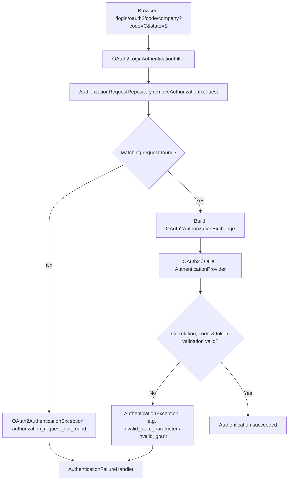

# 28.3. authorization_request_not_found, State Mismatch, and Session Expiration

In Spring Security OAuth 2.0 / OpenID Connect (OIDC) Client, a login error that is very easy to misunderstand is:

```text
[authorization_request_not_found]
```

The user was redirected to the identity provider, entered their credentials successfully, and returned to the application, yet instead of having a login session, they see a failure message. In another environment, the logs show:

```text
[invalid_state_parameter]
```

Both are usually related to **the application being unable to correlate the authorization response back to a previously initiated authorization request**. However, the error name alone is not enough to conclude immediately that the OP (OpenID Provider) failed, Spring Security has a bug, or the user is under attack.

This lesson belongs to chapter **28. Errors and Observability** and focuses on three questions:

1. **What does `authorization_request_not_found` actually mean in Spring Security?** A repository not finding the saved transaction, a callback missing state, a lost session, or an invalid state can all produce a similar symptom.
2. **Where is state mismatch checked, and why is there sometimes no separate `invalid_state_parameter` error?** This depends on the path through the filter, repository, and authentication provider.
3. **Which session expired?** The application's HTTP session, the pending authorization request, the OP's authorization code, the access token, and the refresh token have different lifecycles and symptoms.

The practical goal is to diagnose the exact **error layer**, protect correlation/CSRF, recover via a new authorization flow when needed, and write useful logs **without leaking authorization codes, `state`, PKCE verifiers, or tokens**.

> **Reference versions:** Java 17+, Spring Boot 3.x, Spring Security 6.x on Servlet/Spring MVC. Examples focus on Spring Security 6.5 APIs; WebFlux is contrasted separately. The `example.test` URLs, session IDs, and state values below are for illustration only. Do not use debug examples to write real login credentials to logs.

---

## 1. Understanding the Problem Through a Scenario

Suppose a Portal supports OIDC sign-in with Company SSO.

```text
GET https://app.example.test/dashboard
       |
       v
Not logged in
       |
       v
GET /oauth2/authorization/company
       |
       v
Spring Security:
  - Creates OAuth2AuthorizationRequest
  - Generates unpredictable state
  - Saves request in HttpSession
  - 302 to Authorization Server
       |
       v
OP displays login page, authenticates user
       |
       v
302 https://app.example.test/login/oauth2/code/company
       ?code=REDACTED
       &state=EXPECTED_STATE
       |
       v
Spring Security:
  - Looks up saved authorization request in session
  - Verifies state / request context
  - If valid, exchanges code for tokens and validates OIDC
```

When everything works normally, the browser **preserves the application's session cookie** between login initiation and the callback. Spring Security finds the saved authorization request matching `state` and proceeds with the code exchange.

If the session cookie does not come back, the session has expired, or another authorization request overwrote the old one, the callback may fail to find a matching request:

```text
Callback:
    code=C1
    state=S1

Current HttpSession:
    no OAuth2AuthorizationRequest
    or only contains request with state=S2

=> No trustworthy authorization transaction exists
=> Reject login
```

**Never "fix" this by removing state validation.** State and authorization-request binding form a defense layer against login CSRF/authorization response injection. When correlation is lost, the safe reaction is **do not create an Authentication**, send the user back to the login page with an understandable message, and allow starting a **new flow**.

## 2. What Is an Authorization Request and Where Is It Stored?

`OAuth2AuthorizationRequest` is the object describing the request that the OAuth2 Client sends to the authorization endpoint. It may contain:

- Authorization URI and response type;
- Client ID;
- Redirect URI;
- Scopes;
- **`state`**;
- Additional parameters such as `code_challenge`, `code_challenge_method`, and OIDC `nonce` when applicable;
- Internal attributes for the PKCE `code_verifier` and registration/context binding.

In Spring Security Servlet, the abstraction for storing requests is:

```java
AuthorizationRequestRepository<OAuth2AuthorizationRequest>
```

The default implementation is typically:

```java
HttpSessionOAuth2AuthorizationRequestRepository
```

**AuthorizationRequestRepository is not `ClientRegistrationRepository` or `OAuth2AuthorizedClientRepository`.**

| Repository / store | What does it hold? | When is it used? |
| --- | --- | --- |
| `ClientRegistrationRepository` | Client ID, issuer, token/authorization endpoints, scopes, grant | Provider configuration |
| **`AuthorizationRequestRepository<OAuth2AuthorizationRequest>`** | Pending authorization request: state, redirect, PKCE/nonce context | From login start until callback |
| `SecurityContextRepository` | Authentication/SecurityContext after authentication | Authenticated requests/sessions |
| `OAuth2AuthorizedClientRepository` | Access token and possibly refresh token per client/principal | API calls, refresh |
| `HttpSession` / Spring Session | Browser session data | Holds correlation, security context, and application data |

An OAuth2 callback failing **before login completes** is usually related to the **authorization request repository**, even though the user does not have an `OAuth2AuthorizedClient` yet.

### 2.1. A Short-Lived Transaction

```text
Initiation:
    OAuth2AuthorizationRequest(state=S1) -> save

Through browser/OP:
    RP waits for response

Callback:
    load/remove OAuth2AuthorizationRequest using S1
    verify state and registration
    proceed with token exchange if valid

After callback:
    pending request is consumed
```

Having the repository **remove** the request upon receiving a valid callback prevents an authorization response from being reused on the same client. However, the AS must still ensure the authorization code is **short-lived and single-use**; deleting the request does not replace that requirement.

---

## 3. Critical Spring Security Servlet Execution Flow

Key components:

| Component | Responsibility |
| --- | --- |
| `OAuth2AuthorizationRequestRedirectFilter` | Intercepts OAuth2 login start request and sends browser to OP |
| `OAuth2AuthorizationRequestResolver` | Builds authorization request, state, PKCE context |
| `HttpSessionOAuth2AuthorizationRequestRepository` | Saves, loads, and removes authorization request in session |
| **`OAuth2LoginAuthenticationFilter`** | Receives Authorization Code callback and starts authentication |
| `OAuth2LoginAuthenticationProvider` | Handles OAuth2 authorization code exchange |
| `OidcAuthorizationCodeAuthenticationProvider` | Handles OIDC code flow, ID Token validation |
| `AuthenticationFailureHandler` | Handles failures within the OAuth2 Login authentication filter scope |
| `ClientRegistrationRepository` | Resolves the right registration for the flow |
| `SecurityContextRepository` | Saves SecurityContext when login succeeds |

The default paths are typically:

```text
Start:
  GET /oauth2/authorization/{registrationId}

Callback:
  GET /login/oauth2/code/{registrationId}
```

If you change the base URI on the authorization endpoint or redirection endpoint, **links, ClientRegistration.redirectUri, OP allowed redirect URIs, and filter matchers must stay in sync**.

### 3.1. Path When a Callback Arrives

Conceptual diagram:



**Technical note:** the `authorization_request_not_found` error is usually created **early inside `OAuth2LoginAuthenticationFilter`** when the repository returns `null`. Execution does not always reach the provider to produce `invalid_state_parameter`.

### 3.2. A Commonly Confused Distinction

With the **default `HttpSessionOAuth2AuthorizationRequestRepository`**, `loadAuthorizationRequest(request)` only returns the authorization request when the **callback's `state` matches the saved request's state**. If state does not match, the repository may return `null`.

When `OAuth2LoginAuthenticationFilter` calls remove/load and gets `null`, it reports `authorization_request_not_found` — **even if the session actually holds a request whose state does not match**.

Therefore:

```text
Session holds request state=S1
Callback returns state=S2

Default repository:
    loadAuthorizationRequest(callback state=S2)
    => null (mismatch)

OAuth2LoginAuthenticationFilter:
    no authorization request
    => authorization_request_not_found
```

**The error code alone does not pinpoint a single root cause.** It does not necessarily mean the session is completely empty; it could be a state mismatch filtered out by the repository before reaching the authentication provider.

### 3.3. So When Does invalid_state_parameter Appear?

If the authorization exchange reaches the authentication provider with an **authorization request** and **authorization response** that have different states, the provider can reject it with an error like `invalid_state_parameter` per Spring Security 6.x logic.

This can happen with another repository/custom flow or other execution paths. However, **with the default repository**, a callback mismatch may already be turned into `authorization_request_not_found` earlier.

Do not design alerts assuming:

```text
authorization_request_not_found = definitely lost session
invalid_state_parameter         = definitely under attack
```

Both require examining the **filter/repository path**, browser session, callback URL, and exact version configuration.

---

## 4. Why Must State Be Verified?

In the OAuth2 Authorization Code Flow, `state` allows the client to bind the authorization response to the authorization request initiated by **that same client/browser context**.

### 4.1. Login CSRF Attack

An attacker can initiate a login with their own account and then try to feed the corresponding callback/authorization response into someone else's browser.

```text
Attacker browser:
    Start login -> state=S_attacker, code=C_attacker

Victim browser:
    No authorization request corresponding to S_attacker

Attacker sends victim:
    /login/oauth2/code/company?code=C_attacker&state=S_attacker

Safe RP:
    No matching authorization request found in victim session
    -> Reject login
```

If the RP accepts the callback just because the code looks valid, the victim's browser can be logged into the attacker's account or linked to the wrong account.

### 4.2. State Is Not a Decorative Parameter

State must:
- Be unpredictable;
- Be bound to the original request/correlation context;
- Be returned unchanged from the OP;
- Be compared accurately on callback;
- Be short-lived;
- Be consumed once the flow completes;
- Never allow the callback to specify a session or pick another user's stored request.

Do not write:

```java
if (request.getParameter("state") != null) {
    // Allow code exchange just because state is present?
}
```

Checking **mere presence** is insufficient; you must verify the **exact value bound to the prior transaction**.

### 4.3. State Differs from PKCE and Nonce

| Mechanism | Where Is It Verified? | Primary Purpose |
| --- | --- | --- |
| **`state`** | OAuth2 Client on callback | Authorization response correlation/login CSRF |
| **PKCE `code_verifier`** | AS token endpoint during code exchange | Authorization code interception |
| **OIDC `nonce`** | RP when validating ID Token | Binds ID Token to authentication request |
| ID Token `iss` / `aud` / signature | RP | Trust issuer/client/token |
| Access token audience/scope/expiry | Resource Server | API authorization |

**Enabling PKCE is not a reason to skip state validation in a flow/repository that uses state.** Conversely, a valid state does not guarantee that the code verifier, OIDC nonce, or ID Token signature is valid.

## 5. Authorization_request_not_found: Real-World Causes

Below are groups to investigate in order, **not relying on the error name alone**.

| Cause | Description | Indicator |
| --- | --- | --- |
| Session cookie not returned | Callback lacks the initiating session's cookie | Browser has a new session or no session |
| Session expired | User stayed on OP too long; app idle timeout elapsed | Long gap between start→callback |
| Session invalidated | Logout, other code, or app cleanup cleared session | Session ID changed/lost between the two requests |
| Wrong/missing state | Callback state does not match saved request | Session exists, but no matching request found |
| Multi-tab overwrite | A newer flow replaced the pending request | Older tab's callback fails after another tab starts |
| Callback replay | Request already consumed; browser refreshed/went back | First attempt may succeed, subsequent fail |
| Callback from another tab/browser | Browser lacks the original session | Missing session binding |
| Incompatible cookie SameSite | Cross-site form POST does not send cookie | Fails only with response_mode=form_post |
| Wrong Secure/Domain/Path | Callback host/scheme/path differs from cookie scope | Fails only in staging/behind proxy |
| Non-shared session store | Started on pod A, callback hit pod B | Intermittent failures under load balancing |
| Broken custom repository | Save/load/remove out of sync | Fails after adding a custom repository |
| Wrong Base URI/callback | Filter receives callback on different route or key | Fails after changing redirect URI |
| Provider returns mismatched state | OP/proxy/custom request altered state | Callback response differs from request |
| Cluster redeploy lost state | In-memory sessions lost on restart | Failures coincide with rolling deployments |

### 5.1. Lost Session Is Common, Not the Only Conclusion

When seeing `authorization_request_not_found`, ask:

> In the **HTTP session receiving the callback**, is there an authorization request with the matching state?

If not, verify cookie/TTL/store next. If there is a request with a different state, check multi-tab behavior and state mismatch.

### 5.2. Why Can the Error Appear After the User Logged In at the OP Successfully?

The OP may have authenticated completely fine. However, **the RP still must verify that the callback belongs to a transaction the RP initiated**. Not finding the original request means the RP lacks trustworthy data to proceed.

Therefore, never treat "OP login succeeded" as proof that Spring Security can ignore state.

---

## 6. State Mismatch: User, System, or Attack?

A mismatched callback can be:
- **Normal user behavior:** user refreshes the callback, opens two tabs, uses an old link;
- **Operational issue:** session timeout, wrong cookie, reverse proxy, server node change;
- **Integration bug:** custom resolver/repository drops or alters state;
- **Security signal:** injected callback, replay, login CSRF, or AS mix-up.

Because multiple causes exist, the system must **fail closed** while **maintaining observability** for diagnosis.

### 6.1. Do Not Tell the User "State Mismatch = Hacker Attacking"

A safe message without overclaiming:

> Your login session is no longer valid. Please start signing in again.

Application logs can record category `oauth2_callback_correlation_failed`, without declaring a security incident from a single attempt.

### 6.2. Do Not Create a Session from Callback State

Wrong:

```java
String state = request.getParameter("state");
session.setAttribute("oauth2_state", state); // Wrong: taking callback input as source of truth
```

When the callback arrives, the expected state must **already exist from when the authorization request was created**. Taking the untrusted value from the callback, storing it in the session, and then comparing makes the check meaningless.

### 6.3. Do Not Infer Registration from State

State is normally an opaque value. If there are multiple providers:

```text
company -> authorization request state=S_A, issuer=OP_A
partner -> authorization request state=S_B, issuer=OP_B
```

Do not treat state alone as proof of issuer. Registration, authorization endpoint, token endpoint, redirect URI, PKCE verifier, and OIDC nonce must come from the **saved transaction/trusted metadata**.

### 6.4. Missing State Can Become Not Found

With the default repository, a callback **without state** usually cannot match any saved request. This can lead to `authorization_request_not_found` rather than a separate `missing_state` error.

Do not "fill in state from the session" on the callback to keep going: if the OP did not return the right correlation, the flow must be rejected.

---

## 7. Session Expiration: Distinguish Different Lifecycles

The phrase "session expired" can refer to several objects.

| Object | Managed By? | What Happens on Expiry? | Does It Cause `authorization_request_not_found`? |
| --- | --- | --- | --- |
| **RP HTTP session** | Servlet container / Spring Session | Pending request and security context in session may be lost | **Possibly** |
| **Pending authorization request** | AuthorizationRequestRepository | Callback no longer has a transaction to match | **Possibly** |
| **Authorization code** | Authorization Server | Token endpoint rejects expired/used code | Usually **no**; may yield `invalid_grant` if state is still found |
| **OP SSO browser session** | OpenID Provider | User must re-authenticate or OP returns login error | Not necessarily |
| **Access token** | Authorization Server/Resource Server | API rejects token or client refreshes | Not directly |
| **Refresh token** | Authorization Server | Token refresh fails, e.g. `invalid_grant` | Not directly |
| **OIDC ID Token** | Issued by OP, verified by RP | OIDC validation fails due to `exp` | Not a repository-not-found cause |

### 7.1. HTTP Session Expiration Example

```text
09:00 Browser starts OAuth2 Login
      RP session=S1; authorization request state=A1

09:30 User is still on OP login page
      RP idle timeout elapsed; server removes session S1

09:32 OP redirects to callback code=C1, state=A1
      Browser sends old session ID, but server no longer has S1
      AuthorizationRequestRepository cannot find A1

=> authorization_request_not_found
```

The solution is to tune session timeout appropriately for UX/security policy and handle the **login timeout** state clearly. Do not raise the timeout indefinitely just to make the error disappear.

### 7.2. Authorization Code Expiration Example

```text
09:00 RP creates request state=A1
09:05 OP returns code=C1, state=A1
09:20 RP tries to exchange C1 (if request still exists)

RP state matches A1
OP token endpoint:
    invalid_grant (code expired)
```

This is a token endpoint error, distinct from the authorization request repository. Do not lump it into "state mismatch" and do not retry the old code multiple times.

### 7.3. Refresh Token Expiration After Login Example

The user logged in successfully yesterday; today an API call needs to refresh the access token, but the refresh token was revoked.

```text
OAuth2AuthorizedClientManager
    -> grant_type=refresh_token
    -> invalid_grant
```

This belongs to the **authorized client lifecycle**, not callback correlation. The user may need to reauthorize, not because an authorization request from the old login is missing.

### 7.4. Two Timeouts to Manage Separately

- **Session idle timeout:** how long the server keeps a session usable by requests.
- **Login transaction TTL:** how long a pending authorization request remains valid.

A specific framework/repository may tie pending request lifetime to the session lifecycle. If building a custom multi-tab repository, add a dedicated TTL rather than assuming an authorization request stays valid for as long as the HttpSession lives.

---

## 8. Sample Spring Boot OAuth2 Login Configuration

### 8.1. Dependencies

```xml
<dependencies>
    <dependency>
        <groupId>org.springframework.boot</groupId>
        <artifactId>spring-boot-starter-web</artifactId>
    </dependency>
    <dependency>
        <groupId>org.springframework.boot</groupId>
        <artifactId>spring-boot-starter-security</artifactId>
    </dependency>
    <dependency>
        <groupId>org.springframework.boot</groupId>
        <artifactId>spring-boot-starter-oauth2-client</artifactId>
    </dependency>
</dependencies>
```

This example is Servlet. Do not add `spring-boot-starter-webflux` just for OAuth2 login when the application is actually MVC.

### 8.2. application.yml

```yaml
spring:
  security:
    oauth2:
      client:
        registration:
          company:
            provider: company
            client-id: ${OIDC_CLIENT_ID}
            client-secret: ${OIDC_CLIENT_SECRET}
            authorization-grant-type: authorization_code
            client-authentication-method: client_secret_basic
            redirect-uri: "{baseUrl}/login/oauth2/code/{registrationId}"
            scope:
              - openid
              - profile
              - email
        provider:
          company:
            issuer-uri: https://id.example.test/realms/company

server:
  servlet:
    session:
      timeout: 20m
      cookie:
        http-only: true
        secure: true
        same-site: lax
```

**Read the semantics carefully:**
- `server.servlet.session.timeout` controls the Servlet application's HTTP session lifecycle; it does not extend the OP's authorization code lifetime.
- `Secure=true` cookies are only appropriate when the public URL is HTTPS; for HTTP localhost development, use a controlled local profile.
- `SameSite=Lax` generally works for **top-level GET** browser callbacks in the Authorization Code Flow; cross-site `form_post` requires different consideration.
- `issuer-uri`/`redirect-uri` must match the registered provider.
- Never commit real client secrets.

### 8.3. SecurityFilterChain

```java
package example.security;

import org.springframework.context.annotation.Bean;
import org.springframework.context.annotation.Configuration;
import org.springframework.security.config.Customizer;
import org.springframework.security.config.annotation.web.builders.HttpSecurity;
import org.springframework.security.web.SecurityFilterChain;

@Configuration
class OAuth2SecurityConfig {

    @Bean
    SecurityFilterChain securityFilterChain(HttpSecurity http) throws Exception {
        return http
            .authorizeHttpRequests(auth -> auth
                .requestMatchers(
                    "/", "/login", "/error", "/css/**", "/js/**")
                .permitAll()
                .anyRequest().authenticated())
            .oauth2Login(Customizer.withDefaults())
            .build();
    }
}
```

This is the **default** configuration, already including the filter, request resolver, and HttpSession authorization request repository suitable for common cases. **Do not build a custom AuthorizationRequestRepository just to work around an error whose root cause has not been identified.**

---

## 9. Using AuthenticationFailureHandler to Display Errors Safely

When `OAuth2LoginAuthenticationFilter` emits an `AuthenticationException`, a configured `AuthenticationFailureHandler` can classify the error and redirect to an RP-served login page.

### 9.1. Illustrative Configuration

```java
package example.security;

import java.io.IOException;

import jakarta.servlet.http.HttpServletRequest;
import jakarta.servlet.http.HttpServletResponse;

import org.slf4j.Logger;
import org.slf4j.LoggerFactory;
import org.springframework.context.annotation.Bean;
import org.springframework.context.annotation.Configuration;
import org.springframework.security.core.AuthenticationException;
import org.springframework.security.oauth2.core.OAuth2AuthenticationException;
import org.springframework.security.web.authentication.AuthenticationFailureHandler;

@Configuration
class LoginFailureConfiguration {

    private static final Logger log =
        LoggerFactory.getLogger(LoginFailureConfiguration.class);

    @Bean
    AuthenticationFailureHandler oauth2FailureHandler() {
        return new AuthenticationFailureHandler() {

            @Override
            public void onAuthenticationFailure(
                    HttpServletRequest request,
                    HttpServletResponse response,
                    AuthenticationException exception)
                    throws IOException {

                String code = safeCategory(exception);

                // Do not log exception.getMessage() or callback query:
                // they may contain code, state, tokens, or PII.
                log.warn("oauth2_login_failed category={}", code);

                String target = request.getContextPath()
                    + "/login?reason=" + code;

                response.sendRedirect(
                    response.encodeRedirectURL(target));
            }
        };
    }

    private String safeCategory(AuthenticationException exception) {
        if (exception instanceof OAuth2AuthenticationException oauth2) {
            String error = oauth2.getError().getErrorCode();

            return switch (error) {
                case "authorization_request_not_found",
                     "invalid_state_parameter" -> "expired";
                case "access_denied" -> "cancelled";
                case "temporarily_unavailable",
                     "server_error" -> "unavailable";
                default -> "failed";
            };
        }
        return "failed";
    }
}
```

**Note:** in this snippet, the `expired` category is a **user-friendly UX message**, not a technical conclusion that the HTTP session definitely expired. Correlation failures can also stem from state mismatch, cookies, or replay; use an internal `correlation_failed` category if detailed analysis is needed.

### 9.2. Attaching the Handler to OAuth2 Login

```java
@Bean
SecurityFilterChain securityFilterChain(
        HttpSecurity http,
        AuthenticationFailureHandler oauth2FailureHandler)
        throws Exception {

    return http
        .authorizeHttpRequests(auth -> auth
            .requestMatchers("/login", "/", "/error").permitAll()
            .anyRequest().authenticated())
        .oauth2Login(oauth2 -> oauth2
            .loginPage("/login")
            .failureHandler(oauth2FailureHandler))
        .build();
}
```

When using `loginPage("/login")`, the application must provide its own login page and initiation link, for example:

```text
GET /oauth2/authorization/company
```

Do not automatically redirect users from `/login?reason=expired` back to the OP in an infinite loop. Let the user click **Sign in again** to start a request with a new state and PKCE verifier.

### 9.3. Login Page with Fixed Messages

```java
package example.web;

import org.springframework.stereotype.Controller;
import org.springframework.ui.Model;
import org.springframework.web.bind.annotation.GetMapping;
import org.springframework.web.bind.annotation.RequestParam;

@Controller
class LoginPageController {

    @GetMapping("/login")
    String login(
            @RequestParam(name = "reason", required = false) String reason,
            Model model) {

        String safeMessage = switch (reason == null ? "" : reason) {
            case "expired" ->
                "Your login session is no longer valid. Please start again.";
            case "cancelled" ->
                "You did not grant sign-in permission. You can try again.";
            case "unavailable" ->
                "The sign-in provider is temporarily unavailable.";
            case "failed" ->
                "Unable to complete sign-in. Please try again.";
            default -> "";
        };

        model.addAttribute("errorMessage", safeMessage);
        return "login";
    }
}
```

This example assumes a `login.html` view template exists. Never render raw `exception.getMessage()` or `error_description` from the OP directly.

### 9.4. Why Doesn't the Handler Catch Every OAuth2 Error?

It handles errors within the **authentication flow** belonging to the OAuth2 Login filter. If:
- The OP authorization endpoint hangs in the browser;
- The application fails at startup when issuer discovery fails;
- The frontend does not send the cookie or the callback hits the wrong domain;
- An error occurs when a scheduled job refreshes a token;
- An error comes from a Resource Server after login;

then this failure handler **is unlikely to be invoked**. Layer your monitoring and exception handling based on where errors occur.

---

## 10. HTTP Session Cookie: The Most Common Root Cause Group

Spring Security Servlet stores the authorization request in **HttpSession** by default, and the browser only receives the session ID cookie (e.g. `JSESSIONID` or `SESSION` when using Spring Session).

Two key requests:

```text
Start:
  GET /oauth2/authorization/company
  Cookie: JSESSIONID=<existing-if-any>

Response:
  Set-Cookie: JSESSIONID=<opaque-session-id>; Path=/; ...

Callback:
  GET /login/oauth2/code/company?code=...&state=...
  Cookie: JSESSIONID=<same-session-identity>
```

In practice there may be session rotation/renewal, but the pending request must be accessible from the appropriate storage context. Do not debug by comparing raw cookie values and writing them to logs; use local DevTools and non-sensitive metadata.

### 10.1. Cookie Is Not Sent to the Callback

Causes:
- Callback host differs from the host that set the cookie;
- Cookie `Path` does not cover the callback;
- Wrong cookie `Domain`;
- `Secure` on an HTTP callback;
- `SameSite` incompatible with response mode;
- Browser blocks third-party/cross-site cookies conditionally;
- Frontend opens the callback in a different browser profile/webview;
- Session cookie expired/deleted.

**How to handle:** fix the public origin, redirect URI, and cookie config; do not fix by disabling state validation.

### 10.2. SameSite=Lax with Top-Level GET

In the common flow:

```text
RP app.example.test -> OP id.example.test
OP -> top-level GET app.example.test/login/oauth2/code/company
```

A `SameSite=Lax` cookie is normally sent on top-level cross-site GET navigations (subject to browser policy). Thus, Lax is usually sufficient for Authorization Code Flow GET callbacks.

However, if the OP uses **`response_mode=form_post`** and the browser performs a cross-site POST back to the RP, Lax may omit the session cookie. The callback then fails to find the authorization request.

### 10.3. SameSite=None Is Not the Default Choice for Every App

`SameSite=None` normally requires the `Secure` attribute in modern browsers and widens cross-site cookie transmission.

Only choose None if the flow truly requires it (e.g., form_post) and you have reviewed the CSRF/cookie threat model. **Do not switch all session cookies to None just to resolve an error you have not understood yet.**

### 10.4. Cookie Consent/ITP/Browser Restrictions

Some browsers, webviews, or extensions block/partition cookies. In those cases:
- Inspect browser network DevTools;
- Compare start and callback using the same browser profile;
- Check cross-domain redirects and cookie policies;
- Avoid placing login initiation inside an iframe if the OP/browser does not support it;
- Use top-level browser navigation where appropriate.

---

## 11. Reverse Proxy: Wrong baseUrl Breaks Correlation

A typical deployment:

```text
Browser:
    https://app.example.test

Ingress / Reverse Proxy:
    TLS termination

Spring Boot:
    http://app-internal:8080
```

If the application generates the wrong redirect URI:

```text
http://app-internal:8080/login/oauth2/code/company
```

instead of:

```text
https://app.example.test/login/oauth2/code/company
```

the OP may reject the redirect URI, the browser may return to a different host, or the RP cookie may not match.

### 11.1. Forwarded Headers

When behind a trusted proxy, Spring Boot can use:

```yaml
server:
  forward-headers-strategy: framework
```

However, **only trust `Forwarded` / `X-Forwarded-*` headers set by a trusted proxy**. The proxy must strip or overwrite headers sent directly by internet clients; otherwise there is a risk of host header injection and wrong authorization redirect URIs.

### 11.2. Values That Must Stay Synchronized

| Value | Where Declared/Observed |
| --- | --- |
| RP public scheme/host/context path | Browser URL and trusted proxy |
| `ClientRegistration.redirectUri` | application.yml / configuration |
| Allowed redirect URIs | OP client registration |
| Callback filter matcher | Spring Security redirectionEndpoint |
| Cookie Path/Domain/Secure | Servlet container/Spring Session |
| Session store | Local session or distributed storage |

If these values mismatch, errors can occur:

```text
redirect_uri_mismatch
authorization_request_not_found
session cookie missing
callback handler not matched
```

Do not treat these errors as identical. For instance, `redirect_uri_mismatch` can occur **at the OP before the callback**, whereas `authorization_request_not_found` typically occurs **after the callback reaches the RP**.

---

## 12. Session Timeout and OP Behavior

A user may spend several minutes completing MFA, consent, or password reset at the OP. Meanwhile, the HTTP session at the RP is still subject to **idle timeout**.

### 12.1. Balancing Security and Experience

Too short a timeout causes logins to fail during lengthy MFA. Too long a timeout extends the lifetime of session data and pending flows.

Consider:
- Realistic time needed to complete MFA/consent;
- Mobile/webview modes and network latency;
- Session timeout vs. separate TTL for pending requests;
- Ability to detect/clean up pending requests;
- Session store capacity and cleanup;
- Cookie security;
- Separate OP authorization code lifetime;
- Enterprise authentication/session policies.

### 12.2. Do Not Let Users Continue with an Old Callback

When a session has expired, recovery is:

```text
GET /login?reason=expired
    -> User clicks Login
    -> GET /oauth2/authorization/company
    -> New state S2
    -> New PKCE verifier V2
    -> New OIDC nonce N2 (when used)
    -> New authorization code C2
```

**Do not take code C1/state S1 from an old URL** and bind it to a new session yourself.

### 12.3. OP Session and RP Session Have Independent Lifetimes

The OP may still have an active SSO session even after the RP session expired. When the user starts a new flow, the OP authenticates without prompting for a password, and the RP creates a new session after a valid callback. That is normal SSO behavior, not a "replay", provided the new state/code correlation is valid.

---

## 13. Multi-Tab and the Default AuthorizationRequestRepository

A real-world scenario:

```text
Tab 1:
    GET /oauth2/authorization/company
    session=SESSION-A, state=S1
    repository stores request S1

Tab 2:
    GET /oauth2/authorization/partner
    session=SESSION-A, state=S2
    repository now stores request S2

Tab 1 callback:
    state=S1
    repository sees request S2
    => no matching request
    => authorization_request_not_found
```

In many Spring Security 6.x versions, **the default `HttpSessionOAuth2AuthorizationRequestRepository` stores one authorization request in a single session attribute**, so you must not assume unlimited parallel pending flows.

This **does not mean you should skip state validation**. If the product needs parallel login flows, design an appropriate repository.

### 13.1. Safe Multi-Tab Design

A custom repository can store by:

```text
session S:
    pending[S1] = OAuth2AuthorizationRequest for company
    pending[S2] = OAuth2AuthorizationRequest for partner
```

Requirements:
- Each state is bound to the **session/browser context**;
- State leaks no sensitive data;
- Save/load/remove follow the exact same key contract;
- A callback with the wrong state must never retrieve another request;
- Each entry has its own TTL;
- Maximum number of pending requests is bounded;
- Removing one entry does not accidentally delete another;
- Concurrency-safe, including multi-instance/distributed sessions;
- Avoid logout/session invalidation races;
- Never leak PKCE verifier/nonce attributes to the browser.

### 13.2. Repository Interface Skeleton

```java
import jakarta.servlet.http.HttpServletRequest;
import jakarta.servlet.http.HttpServletResponse;

import org.springframework.security.oauth2.client.web.AuthorizationRequestRepository;
import org.springframework.security.oauth2.core.endpoint.OAuth2AuthorizationRequest;

public final class PendingLoginRepository
        implements AuthorizationRequestRepository<OAuth2AuthorizationRequest> {

    @Override
    public OAuth2AuthorizationRequest loadAuthorizationRequest(
            HttpServletRequest request) {
        // 1. Read session, do not create a session on callback.
        // 2. Extract callback state.
        // 3. Lookup entry keyed by (session, state).
        // 4. Return null if no exact match.
        return null; // Skeleton, not a production implementation.
    }

    @Override
    public void saveAuthorizationRequest(
            OAuth2AuthorizationRequest authorizationRequest,
            HttpServletRequest request,
            HttpServletResponse response) {
        // Save with TTL and bounded number of pending states.
        // When authorizationRequest == null, remove current entry
        // according to repository contract.
    }

    @Override
    public OAuth2AuthorizationRequest removeAuthorizationRequest(
            HttpServletRequest request,
            HttpServletResponse response) {
        // Atomically retrieve + remove exactly the matched entry.
        return null; // Skeleton.
    }
}
```

**Warning:** this class is a **skeleton to explain the contract**; it returns `null`, so **do not use it directly in an application**, or every callback will report `authorization_request_not_found`.

A real implementation must store objects by session+state, handle TTL/concurrency, and verify the callback was not shifted to another session. In multi-instance deployments, `synchronized(session)` within one JVM alone **is not enough** to guarantee atomicity in distributed storage.

### 13.3. Wiring a Custom Repository into Servlet OAuth2 Login

Once a production repository is properly implemented:

```java
@Bean
SecurityFilterChain securityFilterChain(
        HttpSecurity http,
        AuthorizationRequestRepository<OAuth2AuthorizationRequest> repository)
        throws Exception {

    return http
        .authorizeHttpRequests(auth -> auth
            .requestMatchers("/", "/login").permitAll()
            .anyRequest().authenticated())
        .oauth2Login(oauth2 -> oauth2
            .authorizationEndpoint(endpoint ->
                endpoint.authorizationRequestRepository(repository)))
        .build();
}
```

**Important:** configure the repository consistently for both authorization initiation and callback. Do not customize the save path on the request resolver while forgetting the remove path on the login filter. Check the DSL/version to ensure both components actually use the same repository.

### 13.4. Do Not Use a Custom Repository to Fix Cookie Errors

If the session cookie does not come back due to `SameSite` or wrong domain, storing multiple pending states in the session **will not solve** the root cause. Fix cookies/public origin first.

---

## 14. Multi-Instance and Spring Session

A system running multiple replicas:

```text
Browser start login:
    Node A saves authorization request in local HttpSession A

Callback:
    Load balancer forwards to Node B
    Node B cannot find A's local session data

=> authorization_request_not_found
```

If sessions are only stored in each node's local RAM, errors can occur **intermittently**, proportional to how the load balancer distributes requests.

### 14.1. Two Common Strategies

**Sticky sessions:** the load balancer tries to route the callback back to the node that created the session.

- Quick to deploy in some environments;
- Can fail when a node dies/restarts/undergoes rolling deploy;
- Does not solve session loss during scaling or failover.

**Distributed session store**, such as **Spring Session + Redis**:

- All nodes read the same session data by session ID;
- Preserves correlation across load balancing;
- Requires securing Redis, TTL, serialization, namespace, and concurrency;
- Does not fix multi-tab races on its own if the repository still holds only one pending request.

### 14.2. Example Dependencies for Spring Session Redis

```xml
<dependencies>
    <dependency>
        <groupId>org.springframework.session</groupId>
        <artifactId>spring-session-data-redis</artifactId>
    </dependency>
    <dependency>
        <groupId>org.springframework.boot</groupId>
        <artifactId>spring-boot-starter-data-redis</artifactId>
    </dependency>
</dependencies>
```

Example configuration (varies by Spring Boot version and Redis deployment):

```yaml
spring:
  data:
    redis:
      host: redis.internal.example.test
      port: 6379
  session:
    redis:
      namespace: portal:sessions

server:
  servlet:
    session:
      timeout: 20m
      cookie:
        http-only: true
        secure: true
        same-site: lax
```

**Do not treat this YAML as a complete deployment.** Production Redis needs authentication/TLS/network isolation, HA, session serialization strategy, and access controls. Verify your Boot version and that the Spring Session store is actually active.

### 14.3. Check Serialization

`OAuth2AuthorizationRequest` holds pending flow data. With custom Redis/session serialization, incompatible class metadata or serializers after a deploy can cause loading the request to fail.

Do not serialize the object into raw JSON yourself and drop:
- `state`;
- PKCE verifier attributes;
- OIDC nonce context;
- Registration/redirect data.

Losing attributes can let state pass while causing token exchange or ID Token validation to fail.

### 14.4. Do Not Treat a Distributed Store as Magic

Using Spring Session can solve **cross-node session visibility**, but it does not automatically:
- Synchronize multiple pending flows in a custom map if saves suffer lost updates;
- Merge cookies across two domains;
- Recover a request after its TTL expires;
- Accept a callback with a wrong state;
- Bypass the AS's code lifetime limits.

---

## 15. Reactive WebFlux: Similar Errors, Different Repository

On **Reactive WebFlux**, Spring Security uses:

```java
ServerAuthorizationRequestRepository<OAuth2AuthorizationRequest>
```

The common default implementation is:

```java
WebSessionOAuth2ServerAuthorizationRequestRepository
```

It stores the authorization request in **`WebSession`**, which differs from Servlet `HttpSession`.

| Servlet | Reactive WebFlux |
| --- | --- |
| `HttpSecurity` | `ServerHttpSecurity` |
| `SecurityFilterChain` | `SecurityWebFilterChain` |
| `HttpServletRequest` | `ServerWebExchange` |
| `AuthorizationRequestRepository` | `ServerAuthorizationRequestRepository` |
| `HttpSessionOAuth2AuthorizationRequestRepository` | `WebSessionOAuth2ServerAuthorizationRequestRepository` |
| Blocking repository methods | Reactor `Mono` operations |

### 15.1. Reactive Save/Load/Remove Must Compose Publishers

```java
Mono<Void> stored =
    authorizationRequestRepository.saveAuthorizationRequest(
        authorizationRequest, exchange);
```

In Reactor, merely creating a `Mono` and ignoring it does not guarantee the operation runs. The standard framework composes it before redirecting or processing callbacks.

A conceptual example:

```java
return authorizationRequestRepository
    .saveAuthorizationRequest(authorizationRequest, exchange)
    .then(redirectToProvider());
```

`redirectToProvider()` is application-defined pseudocode, not a Spring Security API. Never call `.block()` on the event loop.

### 15.2. Do Not Mix Servlet and Reactive Repositories

An MVC custom `HttpSessionOAuth2AuthorizationRequestRepository` cannot be injected into `ServerHttpSecurity`. Conversely, a WebSession repository cannot be used with Servlet `OAuth2LoginAuthenticationFilter`.

### 15.3. WebSession Timeout and Session Store

If the browser does not send the WebSession cookie on callback or the session expired, WebFlux will also reject the authorization response. Use proper WebSession configuration/shared session store when deploying multiple nodes.

### 15.4. Displayed Error Types May Differ

Reactive authentication failures have different error names/logging depending on the WebFlux filter and version. **Do not blindly copy Servlet `OAuth2LoginAuthenticationFilter` stack traces into WebFlux expectations.** What matters is the correlation contract: no matching authorization request ⇒ reject the callback.

---

## 16. CSRF, State, and response_mode=form_post

Not every `403 Forbidden` at the callback is `authorization_request_not_found`.

If the OP returns the authorization response via **form POST**:

```http
POST /login/oauth2/code/company
Content-Type: application/x-www-form-urlencoded
Cookie: JSESSIONID=<opaque>

code=REDACTED&state=REDACTED
```

two separate issues can occur:

1. Servlet RP **CSRF protection** may reject the POST before the OAuth2 Login filter handles it, depending on matchers/configuration.
2. **SameSite=Lax** may prevent the browser from sending the RP cookie in a cross-site POST, causing the authorization request repository to miss the transaction.

### 16.1. Do Not Disable CSRF Application-Wide

Wrong:

```java
http.csrf(csrf -> csrf.disable()); // Do not use as a blanket workaround.
```

Enabling/disabling CSRF must follow the threat model and endpoints. If a provider requires `form_post`:
- Verify whether the Spring Security filter matcher supports that response mode;
- If a CSRF exception is needed, restrict it **strictly to the callback route** by method/path and evaluate state/correlation protections;
- Do not open CSRF bypasses for `/api/**` or `/logout`;
- Configure cookie SameSite/Secure appropriately for browsers;
- Verify session binding and OP responses;
- Do not treat `state` as a replacement for all application CSRF protections.

### 16.2. 403 Differs from Not Found

```text
CSRF filter rejects POST
    -> HTTP 403
    -> OAuth2LoginAuthenticationFilter may not have run yet

OAuth2LoginAuthenticationFilter receives callback
    -> repository cannot load request
    -> authorization_request_not_found
```

Distinguish the location using request tracing and redacted category logs, not just by seeing the browser report "login failed".

---

## 17. Difference Between Callback Replay and an Active OP Session

A user may:
- Refresh an old callback URL;
- Click Back then Forward;
- Reopen a callback URL saved in browser history;
- Click login again while the OP still has an SSO session.

### 17.1. Replaying an Old Callback

```text
Attempt 1:
  Callback state=S1
  Repository removes request S1
  Code C1 is exchanged once
  Login succeeds

Attempt 2:
  Browser refreshes callback URL state=S1, code=C1
  Repository no longer has S1
  => authorization_request_not_found
```

This may be **proper replay-protection behavior**. Do not allow the second attempt through or infinitely auto-redirect to login. You can return a session/callback expired page with a button to go to the Dashboard or Login.

### 17.2. OP SSO Is Still Active, Yet a New Authorization Flow Is Valid

```text
User clicks "Sign in again"
   -> New state=S2
   -> Browser visits OP
   -> OP already has SSO cookie, returns code=C2 quickly
   -> Callback state=S2, code=C2
   -> RP restores request S2
   -> Login succeeds
```

This is not a replay; it is **a new authorization transaction**, even though the OP does not ask for a password again.

### 17.3. Do Not Reuse an Authorization Code on Retry

OAuth2 authorization codes must be short-lived and single-use. If the token endpoint times out after receiving the code, the client cannot be sure whether the OP already consumed the code; retrying the same code may return `invalid_grant`.

The simple, safe recovery in a login flow is to start a new authorization request initiated by the user.

---

## 18. AuthenticationFailureHandler Should Not Recover Dangerously

A handler that shows a friendly error is good; a handler that tries to "push past" a correlation failure is risky.

### 18.1. Do Not Turn a State Mismatch into a Successful Authentication

Wrong:

```java
try {
    return authenticateOAuth2Callback(request);
} catch (OAuth2AuthenticationException ex) {
    // ANTI-PATTERN: take old email or subject from query and log in.
    return createAuthenticationWithoutVerification();
}
```

This is an **authentication bypass**. Without a matching authorization request, the client lacks proof that the current flow is trustworthy.

### 18.2. Do Not Look Up Requests Globally by State Regardless of Session

Bad architecture:

```text
GLOBAL_MAP[state] -> OAuth2AuthorizationRequest

A callback from any browser can look up by state
without confirming same browser/session binding
```

A store keyed by state can be useful, but it also needs **session/browser binding**, TTL, access isolation, integrity, and injection protection. Never treat a state seen on a URL as proof of transaction ownership.

### 18.3. Do Not Skip PKCE/Nonce When State Fails

If state mismatches:
- Do not grab a code verifier from another flow;
- Do not fabricate an `OAuth2AuthorizationRequest` from the callback;
- Do not skip the OIDC nonce check;
- Do not try the code against another provider's token endpoint;
- Do not grant login merely because the ID Token signature is valid.

### 18.4. Do Not Retry Indefinitely Against the Authorization Server

A redirect loop:

```text
/login?error
    -> /oauth2/authorization/company
    -> OP
    -> callback fails
    -> /login?error
    -> ...
```

while cookies/sessions are still broken creates an endless loop. The error page should provide a clear action for the user to **manually start a new flow**, rather than auto-retrying infinitely.

---

## 19. Safe Observability: What Should Be Logged?

Because this lesson belongs to **Errors and Observability**, we need a telemetry model capable of distinguishing **state mismatch**, **lost session**, **timeout**, **token endpoint**, and **OIDC validation**.

An example event:

```json
{
  "event": "oauth2_login_failure",
  "registration_id": "company",
  "phase": "callback",
  "category": "authorization_request_not_found",
  "session_present": true,
  "pending_request_present": false,
  "trace_id": "internal-safe-trace-id"
}
```

This is an **application-defined schema**, not fields that Spring Security logs automatically by default.

### 19.1. Useful Fields

- Allowlisted `registrationId`;
- Phase: `authorization_start`, `callback`, `token_exchange`, `id_token_validation`;
- Normalized error category;
- Booleans `session_present` or `pending_request_present` (if safely measurable);
- Request age bucket, without needing exact timestamps/correlation secrets;
- Browser method GET/POST, response mode if known;
- Allowlisted public host/category, without logging query strings;
- RP instance/region ID;
- Session store type and lookup outcome;
- Internal Trace ID carrying no tokens;
- Latency and HTTP status category.

### 19.2. Fields That Must Never Be Logged

- Raw `state`;
- Raw authorization code;
- PKCE `code_verifier`;
- OIDC `nonce`;
- Access token, refresh token, ID Token;
- Client secret;
- Session ID cookie;
- Full callback URL containing `code`/`state`;
- Authorization/Cookie headers;
- Raw OAuth2 `error_description` from the OP;
- The entire `OAuth2AuthorizationRequest` (because it contains sensitive attributes).

### 19.3. Why Not Log State Even Though It Is Front-Channel?

State travels through the browser, yet it remains **correlation data** for an authentication transaction. Recording raw state in APMs, CDN logs, or support tickets increases exposure and replay/injection risk when combined with other flaws.

To correlate two request legs, use an **independent trace/session-safe correlation ID** generated by the application, or a security-reviewed hash/HMAC strategy—never use OAuth2 state directly as a public trace ID.

### 19.4. Separate Original Error Code from UX Category

| Technical Error | Internal Category | UX Message |
| --- | --- | --- |
| `authorization_request_not_found` | `callback_correlation_missing` | "Your login session is no longer valid. Please try again." |
| `invalid_state_parameter` | `callback_state_mismatch` | Same; do not disclose details |
| `invalid_grant` | `token_exchange_failed` | "Could not complete sign-in. Please start again." |
| `access_denied` | `user_cancelled` | "You did not grant sign-in permission." |
| `temporarily_unavailable` | `op_unavailable` | "The sign-in provider is temporarily unavailable." |
| OIDC signature/issuer/nonce invalid | `id_token_validation_failed` | "Unable to verify sign-in identity." |
| HTTP 403 at CSRF filter | `csrf_rejected` | "Invalid sign-in request." |

Do not map `invalid_state_parameter` = "attack detected" in every case; nor map `authorization_request_not_found` = "server definitely expired session".

### 19.5. Metrics by Phase

Example metrics:

```text
oauth2_login_start_total{registration="company"}
oauth2_callback_total{registration="company",outcome="success"}
oauth2_callback_total{registration="company",outcome="correlation_failed"}
oauth2_token_exchange_failures_total{registration="company",error="invalid_grant"}
oauth2_login_correlation_failures_total{region="hcm",method="GET"}
```

Use **labels with finite cardinality**. Never put raw state, user email, session ID, or exception message into metric labels.

---

## 20. How to Reproduce Errors Safely in a Test Environment

Several integration test scenarios can help pinpoint root causes. These are **suggested exercises/tests**, not a requirement to run project tests while authoring Markdown.

### 20.1. Happy Path

1. Send `GET /oauth2/authorization/company` with browser session A.
2. Verify a request was saved in the repo (log only boolean/trace).
3. Test OP returns `code=C1` and `state=S1`.
4. Browser sends callback with the same session A.
5. Repository returns the matching request.
6. Token exchange/ID Token validation completes.

**Result:** Authentication succeeds, pending request is consumed.

### 20.2. Lost Session

1. Start login in session A.
2. Invalidate session A in the test environment.
3. Send callback with `state=S1`.

**Result:** Callback is rejected, possibly as `authorization_request_not_found`. No Authentication is created.

### 20.3. State Mismatch

1. Start flow with `state=S1`.
2. Send callback `state=S2` in the same session.

**Result:** Callback is rejected. With the default repository, the error may be `authorization_request_not_found` instead of `invalid_state_parameter` because the repository returned null.

### 20.4. Callback Replay

1. Complete a valid callback once.
2. Resend the exact same callback URL.

**Result:** A second login cannot complete from the same code/state; client/AS rejects it.

### 20.5. Multi-Tab

1. Start Company login in tab 1.
2. Start Partner login in tab 2 in the same browser/session.
3. Complete tab 1 then tab 2.

**Result:** Verify repository behavior: does it hold multiple pending states, or does one tab fail safely? If supporting both is required, use a proven production multi-state repository.

### 20.6. Cross-Node

1. Node A saves request in session store.
2. Callback is routed to node B.

**Result:** With a shared session store, node B reads the request properly; with local-only sessions and no stickiness, the callback can fail. Do not fix by removing state matching.

### 20.7. SameSite form_post

1. Use a test OP with response_mode=form_post.
2. Session cookie uses SameSite=Lax.
3. Observe browser sending cross-site POST callback.

**Result:** Cookie may be dropped or rejected by CSRF filter; distinguish via network/status/cookie observations.

---

## 21. Quick Comparison Table of Related Errors

| Symptom | Possible Interpretation | Layer to Check First |
| --- | --- | --- |
| **`authorization_request_not_found`** | Repository did not return a matching request | Session, cookie, state, multi-tab, load/remove |
| **`invalid_state_parameter`** | Response state did not match original request at provider layer | Flow correlation, custom repo, response |
| **`invalid_grant`** | Code/refresh token invalid/expired/reused, PKCE/redirect mismatch | Token endpoint & grant |
| `redirect_uri_mismatch` | Redirect URI not registered/matched at OP | ClientRegistration, OP console, proxy |
| `invalid_client` | Wrong client authentication | Client ID/secret/cert/AS config |
| `access_denied` | User or AS denied authorization | Authorization endpoint/user consent |
| `temporarily_unavailable` | OP temporarily unable to serve | AS/OP availability |
| OIDC `nonce` mismatch | ID Token does not belong to expected auth request | OIDC validation/nonce context |
| ID Token issuer mismatch | Wrong OP/trust boundary | ClientRegistration/JWKS/issuer |
| `403` on POST callback | CSRF filter or authorization rules | Filter chain/CSRF matcher |
| API 401 `invalid_token` | Access token rejected by Resource Server | Resource Server/authorized client |
| Refresh `invalid_grant` after login | Refresh token expired/revoked/rotated | Authorized client manager/storage |

**Rule:** **never fix an error in layer A by disabling validation in layer B**.

---

## 22. Symptom-Based Troubleshooting

| Real-World Symptom | Common Cause | How to Handle |
| --- | --- | --- |
| OAuth2 Login fails only after 15-minute MFA wait | Short HttpSession timeout | Adjust timeout/TTL carefully, re-login UX |
| Fails only on Safari/webview | Cookie/ITP/SameSite restriction | Inspect cookie network traffic and top-level navigation |
| Fails only with response_mode=form_post | Cross-site POST omits Lax cookie; CSRF | Configure SameSite/CSRF endpoint for flow |
| Fails after switching from HTTP to HTTPS | Cookie Secure, scheme, redirect URI | Align public origin and proxy headers |
| Fails after enabling ingress | Wrong forwarded host/scheme or session routing | Trusted proxy config, callback URL, session store |
| Intermittent failures on Kubernetes | Local sessions not shared across pods | Spring Session / sticky session tradeoff |
| Fails after rolling deployment | In-memory sessions lost or serialization changed | Distributed session, compatibility/migration |
| Tab 1 fails when Tab 2 starts login | One pending auth request per session | Multi-state repository if required |
| Refreshing callback URL gives not found | Request already consumed | Safe behavior; do not retry old callback |
| Opening callback link in another browser | No original session | Start flow in current browser |
| Callback has mismatched state | Mixed flows, tampered callback, stale state | Fail closed, check session/repository |
| Error alternates between not_found and invalid_state | Different repositories/providers | Check implementation and call path |
| Company login works, Partner fails | Separate registration/issuer/cookie/path | Compare flows; do not share tokens/keys across them |
| Mismatch after writing custom resolver | State/request rebuilt without saving properly | Keep original request and compatible repo |
| Every callback fails after custom repo | Save/load/remove violates contract | Check null handling and callback state lookup |
| Token endpoint invalid_grant | Code expired/reused, wrong verifier | Do not retry code; new flow, check PKCE |
| OP login succeeded, RP shows error | RP callback correlation failed | Investigate RP session/cookie/state |
| OP authorization page fails to open | OP availability/network | Not callback not found |
| 403 before callback filter runs | CSRF chain/matcher | Narrow CSRF route config; do not disable globally |
| Callback hits wrong path | Redirect URI or redirectionEndpoint mismatch | Sync URIs at RP/OP |
| Reverse proxy logs leak code/state | Query string not redacted | Mask logs/APM; do not share raw URLs |
| Session cookie domain mismatch | Wrong host/cookie Domain/Path | Use proper public URL and cookie scope |
| Session store entry exists, object fails to load | Serialization/class mismatch | Check Redis serializer, version compatibility |
| Fails only during rapid consecutive logins | Session overwrite, stale response | Avoid auto-loop; check single/multi-state behavior |
| OIDC nonce mismatch after custom state handling | Mixed-up OIDC context | Do not alter nonce arbitrarily; use framework validation |
| API access token expired | Separate token lifecycle | Refresh/re-authorize properly; do not touch login state |
| Login page redirects to OP in infinite loop | Failure UX lacks stop condition | Let user choose retry with a new flow |
| App has both Servlet and WebFlux starters | Actual web app type differs from expected | Confirm actual stack/filter/repo |

---

## 23. Scenario Exercises

### Exercise 1 — Callback Has Valid Code, Session Lost

A user starts login in session A. After prolonged MFA, the callback has a valid code/state, but session A was invalidated.

**Question:** Should we still exchange the code to log the user in?

> **No.** The client no longer has the original authorization request to bind the callback to the browser session. Reject the callback and start a new flow when the user requests it.

### Exercise 2 — Wrong State While Session Still Holds a Request

The session stores S1; the callback returns S2. With the default HttpSession repository, logs show `authorization_request_not_found`.

**Question:** Is this contradictory?

> **No.** The default repository may only return the request when the callback state matches. A mismatch causes load to return `null`, the filter sees no matching request, and emits `authorization_request_not_found`.

### Exercise 3 — invalid_state_parameter

A custom repository returns authorization request S1 for callback S2. The provider receives both the original request and the response and rejects it.

**Question:** Can the error code differ from the default?

> Yes. The provider can emit `invalid_state_parameter` upon detecting a mismatch. Do not build diagnostic logic around a single error name.

### Exercise 4 — Refreshing the Callback URL

After logging in, the user refreshes `/login/oauth2/code/company?code=...&state=...` and gets an error.

**Explanation:** The pending authorization request was already consumed, and the code is single-use. This can be replay protection working properly.

### Exercise 5 — Browser Omits Cookie on form_post

OP uses a cross-site POST callback; RP cookie is SameSite=Lax.

**Question:** Why was the session lost?

> The browser may omit Lax cookies on cross-site POSTs. Review response mode/cookie/CSRF policy; do not disable state validation.

### Exercise 6 — Kubernetes with Two Replicas

Login starts on pod A; callback lands on pod B. Each pod keeps a local HttpSession.

**Question:** Which error commonly occurs?

> Pod B lacks the original authorization request, likely producing `authorization_request_not_found`. Use shared session storage or appropriate routing/session design.

### Exercise 7 — Two OAuth2 Login Tabs

Tab A stores state S1, tab B stores S2 in the same session. Tab A's callback gets not found.

**Question:** Is Company SSO broken?

> Not necessarily. The default repository may hold only one pending request per session. If multi-tab is needed, build a repository keyed by session+state with TTL/concurrency handling.

### Exercise 8 — PKCE Mismatch

Callback state matches, but the token endpoint returns `invalid_grant` due to a wrong verifier.

**Question:** Is this authorization_request_not_found?

> Not in the normal path. The repository already found the request; the failure happened **later** at the token endpoint. Check PKCE state/verifier.

### Exercise 9 — Login Timeout vs. OP SSO Timeout

RP session is 15 minutes; OP SSO session is 8 hours.

**Question:** When the RP pending auth request expires, does the active OP SSO session still help?

> The OP can authenticate quickly in a **new flow**; however, the old callback cannot be trusted once the state request is lost.

### Exercise 10 — Reverse Proxy Rewrites Host

Login starts at `app.example.test`, callback returns to `app-internal.example.test`.

**Risk:** RP cookie does not apply to the callback host; redirect URI may fail to match OP registration. Fix proxy/public URL.

### Exercise 11 — User Says "Provider Already Let Me Log In"

The user shares a screenshot showing MFA completed at the OP, yet the RP still shows an error.

**Diagnosis:** OP authentication may have succeeded, while the RP lost correlation. Check browser cookies, callback/session/TTL before blaming the OP.

### Exercise 12 — Custom Repo Load Returns Null When Callback Lacks State

**Question:** Should you grab the state from Session yourself and proceed?

> No. A callback missing state does not prove the response belongs to that transaction. Reject it and ask for a new login.

### Exercise 13 — Raw exception.getMessage() in URL

Handler redirects to `/login?error=...` with the exception message.

**Risk:** May leak code/state, provider data, cause XSS when rendered, and enter query logs. Map to a fixed category.

### Exercise 14 — Provider B Works, Provider A Callback Fails

**Question:** Can you use Provider B's token to authenticate a user belonging to Provider A?

> No. Each ClientRegistration/issuer is a trust boundary; never link accounts by email or switch token endpoints arbitrarily.

### Exercise 15 — Error Code Is invalid_client

**Question:** Should you increase session timeout because of a token endpoint `invalid_client`?

> No. `invalid_client` relates to client authentication/registration, unlike a missing authorization request.

### Exercise 16 — POST Callback Gets CSRF 403

**Question:** Why didn't the oauth2Login failure handler run?

> The CSRF filter may reject the request before the authentication filter processes it. Identify the filter stage rather than assuming every 403 is a state mismatch.

### Exercise 17 — Supporting Multiple Pending Requests

**Question:** Is a map keyed by state in a global static cache without session binding sufficient?

> No. It must bind to browser/session, have TTL, access isolation, and atomic one-time removal. Raw state in the callback alone does not prove authorization to access the transaction.

### Exercise 18 — User Caught in Auto-Login Loop

**Question:** Should you auto-redirect to the OP immediately after every correlation failure?

> No. If the cause is a cookie/store issue, the loop will repeat endlessly. Stop on the error page and let the user manually initiate a new flow after guidance.

### Exercise 19 — Monitoring Wants to Count State Mismatches

**Question:** Is counting only `invalid_state_parameter` sufficient?

> No. The default repository can report `authorization_request_not_found` for state mismatches; collect telemetry on repository lookup failures and safe session/cookie metadata.

### Exercise 20 — ID Token Nonce Mismatch

**Question:** Is this the same as a state mismatch?

> No. Nonce is checked during ID Token validation, after correlation/code exchange in applicable flows. Inspect OIDC context, issuer, and ID Token validation; do not disable nonce.

---

## 24. Quick Production Investigation Guide

When seeing `authorization_request_not_found`, follow this sequence:

1. **Identify the stack:** Servlet `HttpSecurity` or Reactive `ServerHttpSecurity`?
2. **Identify the provider:** which registration ID, which callback path? Use an allowlist.
3. **Confirm the failure point:** did the callback reach the RP, or did the OP browser page never redirect?
4. **Confirm method/response mode:** GET query or form POST?
5. **Check cookies:** does the callback carry the appropriate RP cookie? Inspect browser DevTools without saving raw cookies.
6. **Check session:** is the callback hitting the existing session or a brand-new session?
7. **Check timing:** did start→callback exceed session timeout/transaction TTL?
8. **Check repository:** default or custom? Do save/load/remove share the exact same contract?
9. **Check state:** does the callback have state, and is there a matching request in the same browser context? Measure only booleans/categories.
10. **Check multi-tab:** did a newer login flow overwrite the pending request?
11. **Check cluster:** did start and callback hit different nodes, and is the session store shared?
12. **Check proxy:** public scheme/host/path, allowed redirect URI, and forwarded headers.
13. **Check CSRF:** if a POST callback returned 403, which filter rejected it before OAuth2 Login?
14. **If the repository found the request:** check token endpoint errors such as `invalid_grant` and PKCE verifier.
15. **If an OIDC token was returned:** check signature/issuer/audience/nonce; do not lump into state mismatch.
16. **Inspect telemetry by phase:** avoid logging code/state/token or raw error_description.
17. **Recover safely:** guide the user to start a new authorization flow instead of replaying an old callback.
18. **If recurring:** fix cookie/session/proxy/repository before extending timeouts or altering security behavior.

---

## 25. Final Decision Flowchart

```text
Browser callback /login/oauth2/code/company?code=C&state=S
                         |
                         v
Does the OAuth2 Login filter receive the request?
                         |
            +------------+-----------+
            |                        |
           NO                       YES
            |                        |
     Check redirect URI,             v
     matcher, CSRF, proxy     Is there a matching session/binding?
                                     |
                         +-----------+----------+
                         |                      |
                        NO                     YES
                         |                      |
                  Cookie/session/TTL            v
                  node/store failure     Does repository find matching request?
                                                |
                                    +-----------+-----------+
                                    |                       |
                                   NO                      YES
                                    |                       |
                             authorization_                v
                             request_not_found      Is state/context valid?
                                    |                       |
                             Possible causes:           +-- NO --> Reject mismatch
                             - missing state            |
                             - state mismatch           +-- YES
                             - multi-tab overwrite               |
                             - request consumed                  v
                             - session expired             Token endpoint
                                                              |
                                                       +------+------+
                                                       |             |
                                                  invalid_grant     Token OK
                                                       |             |
                                               Separate code/PKCE/    v
                                               redirect issue     OIDC ID Token
                                                                     |
                                                              iss/aud/nonce
                                                              signature/expiry
                                                                     |
                                                            +--------+--------+
                                                            |                 |
                                                           FAIL              PASS
                                                            |                 |
                                                         Reject         Authentication
                                                                           succeeded

When correlation is no longer valid:
   -> Do not skip state
   -> Do not fabricate a new request from the callback
   -> Do not reuse old code or another token/provider
   -> Return to a safe login page, allowing a new flow to begin
```

### Key Takeaways

1. **`authorization_request_not_found` means the OAuth2 Login filter could not retrieve a matching authorization request**. Never infer solely that "HttpSession is empty".
2. **A state mismatch can surface as `authorization_request_not_found` with the default repository**, because the repository only returns the request when state matches; there is not always a separate `invalid_state_parameter` error.
3. **HTTP session expiration, consumed pending requests, missing cookies, and multi-tab overwrites** can all leave callbacks without correlation.
4. **Expired authorization codes** usually cause token endpoint errors like `invalid_grant`, distinct from the repository layer; **expired refresh tokens** belong to the post-login authorized client lifecycle.
5. **Never bypass state, PKCE, OIDC nonce, or issuer validation** to "fix" login errors.
6. **Servlet uses the HttpSession authorization request repository; WebFlux uses the WebSession reactive repository.**
7. **SameSite, Secure, cookie Domain/Path, reverse proxies, and distributed sessions** are critical operational checkpoints.
8. **Multi-tab requires a repository supporting multiple pending flows if the product demands it**, with session binding, TTL, and atomic removal.
9. **Telemetry should record category/phase/registration ID**, never raw state, authorization codes, verifiers, tokens, or session IDs.
10. **Safe recovery is starting a new authorization flow**. Never replay old callbacks or silently switch the user to another provider.

### References

- [Spring Security 6.5 — OAuth 2.0 Login Core](https://docs.spring.io/spring-security/reference/6.5/servlet/oauth2/login/core.html)
- [Spring Security 6.5 — OAuth 2.0 Login Advanced Configuration](https://docs.spring.io/spring-security/reference/6.5/servlet/oauth2/login/advanced.html)
- [Spring Security API — OAuth2LoginAuthenticationFilter](https://docs.spring.io/spring-security/reference/6.5/api/java/org/springframework/security/oauth2/client/web/OAuth2LoginAuthenticationFilter.html)
- [Spring Security API — HttpSessionOAuth2AuthorizationRequestRepository](https://docs.spring.io/spring-security/reference/6.5/api/java/org/springframework/security/oauth2/client/web/HttpSessionOAuth2AuthorizationRequestRepository.html)
- [Spring Security API — AuthorizationRequestRepository](https://docs.spring.io/spring-security/reference/6.5/api/java/org/springframework/security/oauth2/client/web/AuthorizationRequestRepository.html)
- [Spring Security — Session Management](https://docs.spring.io/spring-security/reference/6.5/servlet/authentication/session-management.html)
- [Spring Session — Redis Sessions](https://docs.spring.io/spring-session/reference/configuration/redis.html)
- [Spring Security 6.5 — Reactive OAuth 2.0 Login](https://docs.spring.io/spring-security/reference/6.5/reactive/oauth2/login/index.html)
- [RFC 6749 — OAuth 2.0 Authorization Framework](https://www.rfc-editor.org/rfc/rfc6749)
- [RFC 7636 — Proof Key for Code Exchange (PKCE)](https://www.rfc-editor.org/rfc/rfc7636)
- [RFC 9700 — OAuth 2.0 Security Best Current Practice](https://www.rfc-editor.org/rfc/rfc9700)
- [OpenID Connect Core 1.0](https://openid.net/specs/openid-connect-core-1_0.html)
