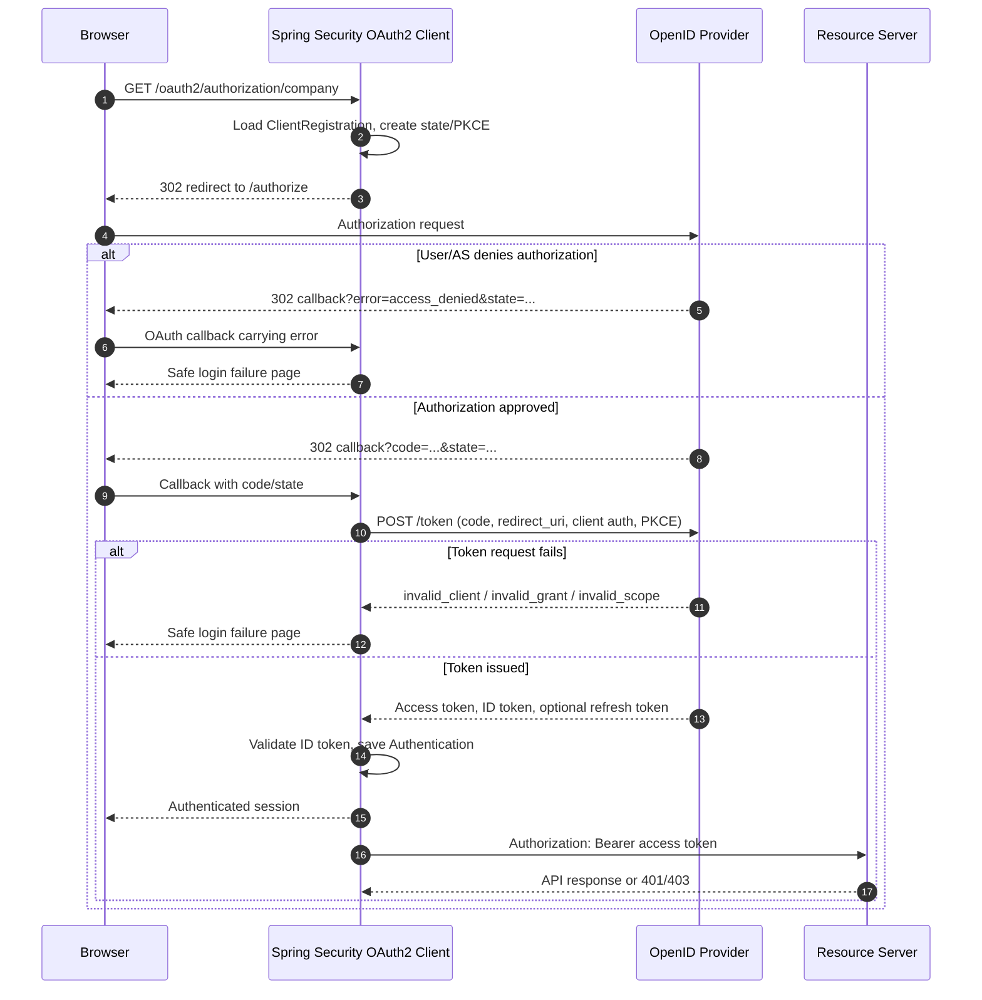

# 28.4. invalid_client, invalid_grant, invalid_scope, and access_denied

In **Spring Security OAuth 2.0/OIDC Client**, a failed login does not necessarily mean "wrong password". The error can occur as soon as the application builds the authorization request, when the user makes a consent decision, when the OpenID Provider (OP) sends the authorization code back to the callback, during code-for-token exchange, or hours later when the application uses a refresh token to renew an access token.

Four common error codes are:

- `invalid_client` — the Authorization Server (AS) rejects the authentication or identification of the **OAuth client**.
- `invalid_grant` — the authorization grant presented at the Token Endpoint is **invalid, expired, revoked, or violates required bindings**.
- `invalid_scope` — the requested scope (`scope`) is **invalid, unknown, malformed, or exceeds what is permitted**.
- `access_denied` — the resource owner or AS **denied the authorization request**; in OIDC Login, this is typically an error returned via browser redirect.

You cannot fix all four errors with a generic "clear cookies and log in again". `invalid_client` may come from secret rotation or the wrong client authentication method; `invalid_grant` may come from an authorization code used twice or refresh token rotation; `invalid_scope` may come from the client not being permitted to request a scope; `access_denied` may simply mean the user clicked Deny on consent.

This lesson explains precisely **where errors originate**, **how to read HTTP/OAuth responses**, **how Spring Security represents errors**, **how to classify errors before retrying**, and **how to observe them in production without exposing authorization codes, access tokens, refresh tokens, or client secrets**.

---

## 1. Lesson Objectives

After this lesson, you will be able to:

1. Distinguish **Authorization Endpoint errors**, **Token Endpoint errors**, and **Resource Server/API errors**.
2. Correctly read `error`, `error_description`, `error_uri`, `state`, and HTTP statuses.
3. Diagnose `invalid_client` by client ID, client secret, `client_secret_basic`, `private_key_jwt`, or mTLS.
4. Diagnose `invalid_grant` by code lifecycle, redirect URI, PKCE, and refresh token rotation.
5. Diagnose `invalid_scope` by requested scope, consent, client policy, and actual granted scopes.
6. Understand how `access_denied` at the OP differs from HTTP 403 in an application or API.
7. Use `OAuth2Error`, `OAuth2AuthenticationException`, and `OAuth2AuthorizationException` at the right layers in Spring Security.
8. Avoid automatically retrying requests that consume single-use authorization codes/refresh tokens.
9. Design error screens and operational runbooks by error category.
10. Build logging, metrics, tracing, and tests that protect authentication secrets.

## 2. Illustrative Scenario: A Standard OIDC Login

Suppose an application has:

```text
Relying Party:
  https://portal.example.org

OpenID Provider:
  https://login.example.org

Client registration ID:
  company

OAuth client ID:
  portal-web-prod

Callback:
  https://portal.example.org/login/oauth2/code/company

Scopes:
  openid profile email
```

Login flow:



**Key point:** an error arriving on the browser callback does not have the same format as an error returned by `POST /token` on the backend. The same error code can carry additional meaning depending on the endpoint, and **you cannot deduce the error layer from the HTTP status code alone**.

## 3. OAuth2 Error Layers and Formats

### 3.1. Authorization Endpoint: Redirecting Errors Back to the RP

In the Authorization Code Flow, if the AS has verified a valid redirect URI and can safely return an error, it may redirect the browser:

```http
HTTP/1.1 302 Found
Location: https://portal.example.org/login/oauth2/code/company?error=access_denied&state=RANDOM_STATE
Cache-Control: no-store
```

Here, the error is carried in the callback **query parameters** for the standard Authorization Code Flow response mode.

`state`, if sent by the client, must be returned as required by the protocol. The RP needs to verify it matches the initial transaction.

A valid `code` **should not** accompany an authorization error response. When the AS denies authorization, the RP receives no code to exchange for tokens.

### 3.2. Token Endpoint: JSON Error Response

When the backend calls `POST /token`, an error usually looks like:

```http
HTTP/1.1 400 Bad Request
Content-Type: application/json
Cache-Control: no-store
Pragma: no-cache

{
  "error": "invalid_grant",
  "error_description": "Authorization code is invalid"
}
```

Basic fields:

| Field | Required? | Meaning |
|---|---|---|
| `error` | Yes | Protocol error code |
| `error_description` | No | Human-readable description for client/developer |
| `error_uri` | No | Reference URI explaining the error |
| `state` | In authorization response when client sent state | Correlate with the initial request |
| `trace_id` or custom fields | Provider-dependent | Metadata outside RFC required fields |

Do not assume providers always return identical descriptions. **`error` is the primary classification signal**; `error_description` can vary across environments, versions, and languages.

### 3.3. Resource Server: HTTP 401/403 and WWW-Authenticate

When an API receives a Bearer access token, errors may look like:

```http
HTTP/1.1 401 Unauthorized
WWW-Authenticate: Bearer error="invalid_token"
```

or:

```http
HTTP/1.1 403 Forbidden
WWW-Authenticate: Bearer error="insufficient_scope", scope="orders.read"
```

`invalid_token` and `insufficient_scope` belong to **Bearer Token Usage** at the Resource Server, **not** the four primary error codes of this lesson.

Do not call every 401 `invalid_client` or every 403 `access_denied`.

## 4. Quick Diagnostic Table for the Four Errors

| Error Code | Where Commonly Seen | What Is Rejected | First Clue |
|---|---|---|---|
| `invalid_client` | Token Endpoint | OAuth client authentication/identity | Client ID/secret, auth method, key/certificate |
| `invalid_grant` | Token Endpoint | Authorization code, refresh token, or other grant | Code used/expired, PKCE, redirect binding, rotation |
| `invalid_scope` | Authorization or Token Endpoint | Requested scope | Misspelled scope, unregistered/unapproved |
| `access_denied` | Authorization Endpoint/callback | Authorization request | User denied consent, policy/OP denied |

A note on HTTP statuses:

- The Token Endpoint usually uses **400** for `invalid_grant` and `invalid_scope`.
- `invalid_client` may use **401**. Per RFC 6749, when the client attempted authentication using the HTTP `Authorization` header, the AS must return 401 with the matching `WWW-Authenticate` header on authentication failure.
- The Authorization Endpoint usually returns errors via **browser redirect**, so the browser sees status 302 before the RP receives the error callback.
- Vendor implementations may add custom statuses or error subcodes; never build a system relying solely on HTTP status codes.

## 5. invalid_client: AS Rejects the OAuth Client

According to OAuth2, `invalid_client` indicates client authentication failed—for example, **unknown client, missing authentication credentials, unsupported authentication method, or invalid credentials**.

### 5.1. Example Token Request

```http
POST /oauth2/token HTTP/1.1
Host: login.example.org
Authorization: Basic <base64-encoded-client-credentials>
Content-Type: application/x-www-form-urlencoded
Accept: application/json

grant_type=authorization_code&
code=<one-time-code>&
redirect_uri=https%3A%2F%2Fportal.example.org%2Flogin%2Foauth2%2Fcode%2Fcompany
```

If the client secret is wrong:

```http
HTTP/1.1 401 Unauthorized
WWW-Authenticate: Basic realm="oauth2"
Content-Type: application/json

{
  "error": "invalid_client"
}
```

`Authorization: Basic` in the example carries client credentials, **not a Bearer access token**. Never record real header values in logs, tickets, or screenshots.

### 5.2. Common Causes

1. `client-id` is mistyped, deleted, or belongs to a different environment.
2. `client-secret` expired/was rotated, yet the app still uses the old version.
3. The app sends `client_secret_post` while the AS requires `client_secret_basic`.
4. The AS is registered with `private_key_jwt`, yet the app sends Basic auth.
5. JWT client assertion has the wrong `iss`, `sub`, `aud`, `exp`, `jti`, or signature.
6. Client mTLS certificate is wrong, expired, or does not match registration.
7. The client is disabled or not permitted to use the endpoint/authentication method.
8. One application replica has not yet received the secret/key rotation.
9. A reverse proxy/gateway strips or alters the `Authorization` header on the backend request.
10. The token request is sent to the wrong AS/tenant/realm.
11. Client credentials are encoded incorrectly per OAuth2 client authentication rules.
12. Clock skew affects JWT-based client assertions.

### 5.3. Do Not Confuse Client ID with registrationId

In Spring:

```yaml
spring:
  security:
    oauth2:
      client:
        registration:
          company:
            client-id: portal-web-prod
```

- `company` is Spring Security's local `registrationId`.
- `portal-web-prod` is the `client_id` registered at the OP.

If the AS reports it does not recognize the client ID, do not rename `registrationId` to match `client_id` expecting it to fix the issue.

## 6. invalid_client and ClientAuthenticationMethod

Spring Security distinguishes several client authentication methods. It is not merely "is the client secret right or wrong?".

| Method | How Client Proves Identity | Common Issues |
|---|---|---|
| `client_secret_basic` | HTTP Basic at Token Endpoint | Wrong secret, header stripped by gateway |
| `client_secret_post` | `client_id`/`client_secret` in form body | AS disallows method, body/logs leak secret |
| `private_key_jwt` | Client-signed JWT assertion | Wrong key/`kid`/`aud`/`exp` |
| `client_secret_jwt` | HMAC JWT using shared secret | Wrong algorithm, claims, or secret |
| mTLS client authentication | Client TLS certificate | Certificate mapping, chain, rotation |
| `none` | Public client without client secret | Grant/client type configuration mismatches AS policy |

### 6.1. Configuring client_secret_basic

```yaml
spring:
  security:
    oauth2:
      client:
        registration:
          company:
            provider: company
            client-id: ${OIDC_CLIENT_ID}
            client-secret: ${OIDC_CLIENT_SECRET}
            client-authentication-method: client_secret_basic
            authorization-grant-type: authorization_code
            redirect-uri: "{baseUrl}/login/oauth2/code/{registrationId}"
            scope:
              - openid
              - profile
              - email
        provider:
          company:
            issuer-uri: https://login.example.org
```

All values in `OIDC_CLIENT_SECRET` are server-side secrets. If the provider requires another method, update the configuration and token response client integration accordingly; **do not try all methods by scattering secrets across multiple places**.

### 6.2. private_key_jwt Is Not JWT Bearer Grant

When using `private_key_jwt`, the Token Endpoint receives:

```text
client_assertion_type=
  urn:ietf:params:oauth:client-assertion-type:jwt-bearer

client_assertion=<signed-client-authentication-JWT>
```

That is **client authentication**, not `grant_type=urn:ietf:params:oauth:grant-type:jwt-bearer`.

If the client assertion has the wrong audience or expiration, the AS may return `invalid_client` even when the authorization code is valid.

### 6.3. The AS May Intentionally Hide Details

Do not expect `error_description` to say "secret was wrong at character 9". A secure AS generally avoids revealing whether a client ID exists or exactly why credentials failed.

Runbooks must rely on **authorized configuration access**, server-side correlation IDs, and operator-facing AS logs rather than trying to infer secrets from public messages.

## 7. Diagnosing invalid_client in Order

An effective workflow:

1. Identify the **registrationId** in use.
2. Identify the **issuer/token endpoint** actually selected from trusted configuration.
3. Verify the exact client ID for the environment, tenant, and registration.
4. Compare the app's client authentication method against the AS client registration.
5. Confirm the active credential in the secret manager — without printing its value.
6. Check recent rotations and consistency across replicas.
7. Check whether HTTP intermediaries preserve the `Authorization` header properly.
8. For JWT assertions, check metadata `kid`, algorithm allowlist, issuer/subject/audience/expiration, and clock sync.
9. For mTLS, check certificate mapping, chain, and expiry.
10. Cross-check AS audit logs using a correlation ID.

Never automatically do:

```text
invalid_client -> retry 100 times per second
```

With wrong credentials, retrying the exact same request will not fix the secret. Fail fast, raise an incident, and fix the configuration.

## 8. invalid_grant: Presented Grant Is Invalid

`invalid_grant` is one of the errors with the most varied causes.

In the Authorization Code Flow, the authorization grant is the **authorization code**. In the Refresh Token Grant, the grant is the **refresh token**.

The specification covers cases such as: the grant is invalid, expired, revoked, does not match the redirect URI used in authorization, or was issued to another client.

### 8.1. Authorization Code Token Request

```http
POST /oauth2/token HTTP/1.1
Host: login.example.org
Authorization: Basic <encoded-client-credentials>
Content-Type: application/x-www-form-urlencoded

grant_type=authorization_code&
code=<authorization-code>&
redirect_uri=https%3A%2F%2Fportal.example.org%2Flogin%2Foauth2%2Fcode%2Fcompany&
code_verifier=<original-pkce-verifier>
```

Error:

```http
HTTP/1.1 400 Bad Request
Content-Type: application/json

{
  "error": "invalid_grant",
  "error_description": "The authorization code is no longer valid"
}
```

The description is just an example. An AS may avoid distinguishing "already used", "expired", or "belongs to another client" to prevent information leakage.

### 8.2. Authorization Code-Related Causes

- The authorization code has **already been used**.
- The code expired because the browser/application waited too long.
- The code was revoked or rejected by policy.
- `redirect_uri` in the token request does not match the authorization request.
- The code was issued to a different client than the one exchanging it.
- PKCE `code_verifier` does not match the original `code_challenge`.
- The app used a `code_verifier` from a different tab/login attempt.
- The callback was executed **twice** by handlers, or a load balancer/retry triggered duplicate exchanges.
- A code from one issuer/realm was sent to another issuer's token endpoint.
- The OP has a custom policy invalidating codes after login state changes.

### 8.3. invalid_grant Does Not Mean Wrong Password

By the time the authorization code is exchanged, the OP may have already authenticated the user successfully. The error occurs at the **grant exchange** step. Never display "wrong password" without evidence of that.

### 8.4. State Mismatch Differs from invalid_grant

If the browser callback has a `state` that does not match the authorization request stored at the RP, Spring Security may reject it **directly at the RP**, before sending any Token Endpoint request.

That is a client correlation/security rejection. Do not default to calling it an `invalid_grant` returned by the AS.

## 9. PKCE, Redirect URI, and invalid_grant

### 9.1. How Does PKCE Participate?

When starting login:

```text
code_verifier = high-entropy random secret
code_challenge = BASE64URL(SHA256(code_verifier))
code_challenge_method = S256
```

The authorization request sends `code_challenge`; the token request sends the original `code_verifier`.

If the token request sends a different verifier or omits it when required, the AS rejects it. The error is usually `invalid_grant`.

### 9.2. Multi-Tab Failure Pattern

```text
Tab A: state=A, code_verifier=VERIFIER_A
Tab B: state=B, code_verifier=VERIFIER_B

Callback A arrives:
  code=CODE_A
  state=A

Wrong:
  using VERIFIER_B -> Token Endpoint invalid_grant
```

Applications must not store a single shared `currentCodeVerifier` across all login transactions if multiple concurrent authorization flows are allowed.

### 9.3. Redirect URI Mismatch at Two Moments

**Moment 1 — Authorization Endpoint:**

The AS checks whether `redirect_uri` in the initial request matches a registered redirect URI. If not, the AS normally refuses to redirect a code to that URI.

**Moment 2 — Token Endpoint:**

The AS verifies the code is exchanged by the right client and, when applicable, with the same redirect URI used during authorization. A binding mismatch can return `invalid_grant`.

Do not confuse "redirect_uri_mismatch on the OP page" with "invalid_grant during backend code exchange".

### 9.4. Do Not Fix by Disabling PKCE

If the app encounters `invalid_grant` due to a lost verifier, fix session/authorization request persistence or flow concurrency. **Never disable PKCE** to hide a correlation bug.

## 10. Authorization Codes Are Single-Use

The Authorization Code Flow relies on short-lived authorization codes that must never be reused.

A successful request:

```text
CODE-1 --POST /token--> AT-1 + ID-Token-1
```

Sending it a second time:

```text
CODE-1 --POST /token--> invalid_grant
```

### 10.1. What Causes Duplicate Token Exchanges?

- The callback endpoint was retried by a proxy with incorrect semantics.
- Custom application code processed the code outside the Spring filter, and the Spring filter processed it again.
- The user refreshed a callback URL containing `code`.
- Two consumers read the same authorization code.
- A retry policy automatically re-sent the entire `POST /token` after a timeout.
- A reverse proxy/load balancer routed callbacks inconsistently with state handling.

### 10.2. A Timeout Does Not Prove the Code Was Not Exchanged

If the RP calls the Token Endpoint and times out, the AS **may have already processed it successfully** while the response failed to reach the RP. Blindly retrying the same code may return `invalid_grant`.

The safe solution is usually to **initiate a new authorization transaction** via controlled UX rather than endlessly resending the old code.

### 10.3. Do Not Log Authorization Codes to "Check for Duplicates"

An authorization code is a short-lived credential. Never log raw:

```text
code=...
code_verifier=...
Authorization: Basic ...
```

If you need to debug duplicate exchanges, use a **non-secret** correlation ID/session transaction ID, or an HMAC-based token/code fingerprint with strict retention policies if truly necessary.

## 11. invalid_grant When Using Refresh Token Grant

After sign-in, the application may store an `OAuth2AuthorizedClient` holding a refresh token. When the access token expires or nears expiry, it calls:

```http
POST /oauth2/token HTTP/1.1
Host: login.example.org
Authorization: Basic <encoded-client-credentials>
Content-Type: application/x-www-form-urlencoded

grant_type=refresh_token&
refresh_token=<existing-refresh-token>
```

The AS may return:

```json
{
  "error": "invalid_grant",
  "error_description": "Refresh token is invalid or expired"
}
```

### 11.1. Common Causes

1. The refresh token expired.
2. The user or admin revoked consent.
3. The OP/AS revoked the refresh token due to logout/policy.
4. The refresh token was **rotated**; the old token is no longer valid.
5. Another request already used the refresh token first.
6. The token belongs to another client.
7. The token was saved under the wrong principal/registration or issuer.
8. The refresh token family was revoked due to reuse detection.
9. The persistent token store holds an old token due to a lost update.
10. The rotation response included a new refresh token, but the app failed to persist it.
11. User/tenant/account status changed, making the grant invalid under AS policy.

### 11.2. Do Not Automatically Treat Every invalid_grant as "User Session Expired"

If a web session still holds a valid Authentication while the refresh token is invalid, the application may need to **reauthorize** to obtain a new authorized client. That does not automatically require destroying the entire web session immediately in every architecture.

However, if business logic relies on a valid token to confirm access, the application must never use a failed token or bypass security checks just to keep UX smooth.

## 12. Refresh Token Rotation and Race Conditions

This is a case very frequently misunderstood as a "random" error.

Suppose the RP stores:

```text
access_token = AT-1 (expired)
refresh_token = RT-1
version = 5
```

Two requests load the authorized client concurrently.

```mermaid
sequenceDiagram
    participant A as Request A
    participant B as Request B
    participant DB as Authorized Client Store
    participant AS as Authorization Server

    A->>DB: Load RT-1, version=5
    B->>DB: Load RT-1, version=5
    A->>AS: grant_type=refresh_token, RT-1
    AS-->>A: AT-2, RT-2
    A->>DB: Save AT-2, RT-2, version=6
    B->>AS: grant_type=refresh_token, RT-1
    AS-->>B: invalid_grant
    Note over B,DB: B is the stale request; must not delete the newer record
```

### 12.1. Why Is Retrying Dangerous?

If B sees `invalid_grant` and retries `RT-1` multiple times, the AS may treat that as **reuse** or replay, potentially revoking the entire refresh token family depending on policy.

### 12.2. The Stale Delete Problem

If B's failure handler deletes the authorized client by `(registrationId, principalName)` **without checking version**, it can delete `RT-2` that A just saved.

Consequence: the user is forced to log in again even though one refresh request succeeded.

### 12.3. Mitigations to Consider

- **Single-flight/per-key coordination** before calling the Token Endpoint.
- For multi-node setups, distributed coordination if strict rotation requires it.
- Optimistic locking/CAS when saving token state.
- **Conditional delete** using the version observed prior to refresh.
- Reload the latest authorized client when a concurrent update is detected.
- Never automatically retry an old token after `invalid_grant`.
- Handle AS reuse-detection/family revocation according to policy.
- Monitor refresh request counts per principal/registration without logging secrets.

### 12.4. CAS Alone Does Not Prevent Duplicate Refreshes

CAS only protects database writes. If both A and B already sent `RT-1` to the AS before CAS runs, token reuse has already occurred.

Therefore, with strict rotation, you must handle **both coordination before the Token Endpoint call and persistence versioning**.

## 13. Invalid Grant and Transaction Persistence

A successful refresh may issue:

```text
AT-2, RT-2
```

but the app crashes before saving, leaving the DB with:

```text
AT-1, RT-1
```

The Token Endpoint already rotated `RT-1`; a DB transaction cannot roll back state at the AS.

**No simple `@Transactional` wraps both the database and an HTTPS Token Endpoint into an atomic transaction.**

### 13.1. Cases to Distinguish

| Condition | Should You Retry the Same Refresh Token? | Handling Direction |
|---|---|---|
| AS returns deterministic `invalid_grant` | **No** | Check rotation/revocation; reauthorize or recover per AS contract |
| Timeout before knowing whether AS processed it | Not by default | Treat as an **ambiguous** outcome |
| CAS update failed, DB already has newer token | Do not retry old RT | Reload and evaluate the latest token |
| AS returns transient 5xx | Only if policy allows safely | Backoff, cap retries, and review rotation semantics |
| Wrong client secret | No | Fix `invalid_client`; do not probe with other refresh tokens |

### 13.2. Do Not Delete a Newer Token Because of a Stale Failure

If the application customizes `OAuth2AuthorizedClientService`, the failure handler must know the version of the token state that the failed request used. `removeAuthorizedClient(registrationId, principalName)` does not carry a version in its standard API signature, so a custom CAS/conditional-delete strategy must be explicitly designed.

**Do not assume Spring Security's default storage automatically provides distributed refresh locking.** Handler/mapping behavior also depends on Spring Security version and manager configuration.

## 14. invalid_scope: Requested Scope Is Invalid

OAuth `scope` is a space-delimited string of values whose semantics and permissions are defined by the AS.

Example:

```text
openid profile email orders.read
```

The AS may reject the request when a client sends:

```text
openid profile platform.superadmin
```

if the client is not authorized to request `platform.superadmin`.

### 14.1. Common Causes

- Scope name is misspelled or unknown to the AS.
- Scope is not allowed for that client registration.
- Scope does not exist in the API/resource contract.
- Requested scope exceeds grant/consent policy.
- Wrong delimiter, such as using commas instead of spaces at the raw protocol layer.
- Scope contains disallowed characters per profile or is improperly encoded.
- Requesting a scope belonging to another AS/tenant.
- Client credentials requesting a user-delegated-only scope, or vice versa.
- Resource/audience parameter is incompatible with the requested scope.
- OP does not support an OIDC-specific or provider-specific scope.
- Policy changes rendered a previously allowed scope invalid.

### 14.2. The Error Can Occur Right at the Authorization Endpoint

Authorization request:

```http
GET /authorize?response_type=code&
    client_id=portal-web-prod&
    scope=openid%20profile%20not-permitted&
    redirect_uri=...&
    state=... HTTP/1.1
Host: login.example.org
```

The OP may return via a valid callback:

```text
https://portal.example.org/login/oauth2/code/company
  ?error=invalid_scope
  &state=RANDOM_STATE
```

### 14.3. The Error Can Also Occur at the Token Endpoint

Especially with Client Credentials, Refresh Token, or extension grants, requested scopes may be sent to the Token Endpoint:

```http
POST /oauth2/token HTTP/1.1
Host: login.example.org
Authorization: Basic <encoded-client-credentials>
Content-Type: application/x-www-form-urlencoded

grant_type=client_credentials&
scope=orders.read%20orders.admin
```

If `orders.admin` is invalid/disallowed, the AS may return:

```json
{
  "error": "invalid_scope"
}
```

## 15. Requested Scopes Differ from Granted Scopes

Do not conflate three sets of scopes:

1. **Configured scopes** in `ClientRegistration`.
2. **Requested scopes** actually sent to the AS in the authorization/token request.
3. **Granted scopes** actually issued by the AS on the access token.

Example:

```text
Configured: openid profile email orders.read
Requested:  openid profile email orders.read
Granted:    openid profile
```

Depending on the profile, the AS may return a token with narrower scopes instead of failing. When granted scopes differ from requested scopes, the OAuth token response must reflect the granted scope per protocol rules.

### 15.1. Do Not Infer Granted Scopes from YAML

Wrong:

```java
boolean canReadOrders =
    clientRegistration.getScopes().contains("orders.read");
```

That only checks the **configured scope to request**, not whether the access token actually carries the scope or whether domain authorization permits the operation.

### 15.2. The Resource Server Still Enforces Permissions

Even if an access token has `orders.read`, the API still checks user/tenant/object permissions.

`invalid_scope` from the AS is not the same as:

```http
HTTP/1.1 403 Forbidden
WWW-Authenticate: Bearer error="insufficient_scope"
```

at the API. One is **the token request was rejected**, while the other is **the current token lacks sufficient scope for the API operation**.

### 15.3. Scope and OIDC Login

In OIDC, `openid` is a critical scope identifying the request as OIDC authentication. Without `openid`, a provider may treat the request as plain OAuth2 authorization instead of OIDC and omit the ID Token.

Do not treat a missing ID Token as `invalid_scope` in every case; inspect the AS response, configured scopes, and actual flow.

## 16. Resolving invalid_scope

An ordered runbook:

1. Determine whether the error appeared at the **Authorization Endpoint** or **Token Endpoint**.
2. Retrieve `registrationId` and issuer alias from safe configuration/tracing.
3. Compare requested scope names against the provider's supported list.
4. Verify the client is authorized to request those scopes.
5. Check delimiters and form URL encoding.
6. For OIDC Login, verify `openid` is present when needed.
7. Check tenant/realm/resource policies.
8. If the scope relates to an API, verify the audience/resource indicator contract.
9. If user consent is restricted, distinguish it from `access_denied`.
10. Request only the scopes needed under the principle of least privilege.

### 16.1. Do Not Trial-and-Error Privileged Scopes

When encountering an error, do not try sending:

```text
scope=admin root superuser *
```

to find a scope that "works". That will not solve policy mapping and needlessly expands the requested privilege surface.

### 16.2. Do Not Blindly Remove Required Security Scopes

For example, removing `openid` to make an error go away can turn OIDC Login into an OAuth2-only flow, depriving the app of an ID Token. Understand the provider contract before changing scopes.

## 17. access_denied: Authorization Request Rejected

`access_denied` typically happens during the **authorization step**, before the RP receives an authorization code.

For example, the user sees a consent screen:

```text
Portal application requests:
  - View profile
  - Read email
  - Access Orders API

[Allow] [Deny]
```

If the user chooses **Deny**, the OP may redirect:

```http
HTTP/1.1 302 Found
Location: https://portal.example.org/login/oauth2/code/company?error=access_denied&state=RANDOM_STATE
```

### 17.1. Not Only Caused by the User Clicking Deny

The AS can proactively reject an authorization request by policy:

- User is not eligible for the application.
- Client has not been assigned to the user/organization.
- Tenant/organization blocked the application.
- Admin approval is required and not yet granted.
- Consent was denied or revoked.
- OP enforced a conditional access policy.
- User account or session fails policy requirements.
- Provider-specific authentication/authorization policies.

**Do not assume and display "You clicked Deny"** merely because the code is `access_denied`. It may be an OP/AS policy decision.

### 17.2. Authorization Errors Must Return Safely to Callback

If the AS validates a legitimate redirect URI, the error is usually sent back to the RP along with `state`. If the request has an invalid `redirect_uri` or the client cannot be reliably identified, the AS must never redirect the error to an unapproved URI just to report it.

Consequence: some authorization errors appear on the **OP's own page** without ever calling back to the RP. Operations must distinguish these two cases.

### 17.3. access_denied Is Not API HTTP 403

A Controller with:

```java
@PreAuthorize("hasRole('ADMIN')")
@GetMapping("/admin")
public String admin() { return "admin"; }
```

may return HTTP 403 when an authenticated user lacks permissions. That is an **application authorization failure**.

It is not automatically an OAuth Authorization Endpoint `access_denied` error. Despite similar names, the code paths and decision makers differ.

## 18. User Experience on access_denied

A reasonable UX:

- Inform the user that sign-in/authorization **was not completed**.
- Let the user choose **Try again** (starting a new authorization request).
- Let the user choose **Return to home** or pick another account/tenant if supported.
- Do not assume the denial is a technical bug that must be forced into a retry.
- If an organization/admin policy applies, advise contacting an administrator.
- Never display raw `error_description` without validation/escaping.
- Never reveal whether an account exists or sensitive policy details.

Example message:

> Sign-in was not completed because the permission request was not accepted. You can try again or contact your administrator if your account needs access to this application.

Avoid UX that continuously auto-redirects straight back to the OP, because the user may have just intentionally declined consent.

## 19. Do Not Confuse OAuth2 Error Codes with HTTP Statuses

Common—though not absolute—mappings:

| Code or Symptom | Endpoint | Typical HTTP Status | Meaning |
|---|---|---|---|
| `invalid_client` | Token Endpoint | 401 or 400 per method/profile; 401/WWW-Authenticate rules apply | Client authentication failed |
| `invalid_grant` | Token Endpoint | 400 | Invalid grant |
| `invalid_scope` | Authorization Endpoint | 302 to valid redirect URI, or matching OP response | Scope request rejected |
| `invalid_scope` | Token Endpoint | 400 | Invalid scope request |
| `access_denied` | Authorization Endpoint | 302 to valid redirect URI | Authorization denied |
| `invalid_token` | Resource Server | 401 | Bearer token rejected |
| `insufficient_scope` | Resource Server | 403 | Token lacks sufficient scope |
| Local Spring `AccessDeniedException` | RP or Resource Server | Usually 403 | App authorization failed |
| Local OAuth `state` validation error | RP callback | Depends on failure handler | Callback does not match transaction |

**Do not build a classifier like `if (status == 403) error = access_denied`.** That can be completely wrong for API responses.

## 20. OAuth2 Token Responses and Error Details Must Be Handled Safely

### 20.1. Do Not Trust error_description as Sanitized Text

A provider might return:

```json
{
  "error": "invalid_scope",
  "error_description": "Scope <script>...</script> is not allowed"
}
```

If the app inserts the raw string into HTML without escaping, there is a risk of reflected XSS.

Spring/templating engines usually provide output escaping; when customizing, never use raw HTML insertion.

### 20.2. error_uri Is Not an Automatic Redirect Target

`error_uri` is a URI that may point to error documentation. Never automatically redirect the browser to a URI supplied by the response without a trust policy, as it can be abused for open redirect/phishing if a provider is spoofed or misconfigured.

### 20.3. Error Descriptions Can Contain Sensitive Data

An AS may embed subjects, client IDs, or policy details in error descriptions. Logging the entire response leaks metadata and occasionally even token-like values due to provider bugs.

Log **error code**, **registration alias**, **phase**, **request correlation ID**, and latency; descriptions should only be recorded redacted and under strict control when genuinely needed.

## 21. How Does Spring Security Represent OAuth2 Errors?

Common classes:

| Java type | Role |
|---|---|
| `OAuth2Error` | Error code, description, URI |
| `OAuth2AuthenticationException` | OAuth2 error tied to authentication |
| `OAuth2AuthorizationException` | Authorization/token acquisition error in OAuth2 Client |
| `AuthenticationException` | Exception hierarchy for authentication failures |
| `OAuth2AuthenticationToken` | Successful Authentication in OAuth2 Login |
| `OAuth2AuthorizedClient` | Client registration + access/refresh tokens |
| `OAuth2AuthorizedClientManager` | Coordinates authorize/reauthorize and token lifecycle |
| `OAuth2AuthorizationFailureHandler` | Hook handling failures during manager authorization |
| `OAuth2AuthorizationSuccessHandler` | Hook handling successes during manager authorization |

### 21.1. OAuth2Error

Example:

```java
import org.springframework.security.oauth2.core.OAuth2Error;

OAuth2Error error = new OAuth2Error(
    "invalid_grant",
    "The authorization code is invalid",
    null
);

String code = error.getErrorCode();
String description = error.getDescription();
String uri = error.getUri();
```

`OAuth2Error` stores error data; logging/display must still be sanitized.

### 21.2. Login vs. Authorized Client

**Interactive OIDC Login:** errors can enter the Spring Security authentication failure pipeline. An `AuthenticationFailureHandler` can route to a safe UI.

**Refreshing/calling API:** errors when `OAuth2AuthorizedClientManager` reauthorizes can surface as `OAuth2AuthorizationException` or through the manager's failure handler, depending on the manager/provider/configuration.

Do not assume an `oauth2Login()` handler will always catch an `invalid_grant` occurring **hours later in a background job**.

## 22. Safe AuthenticationFailureHandler Example for Servlet Login

Goals:

- Do not show raw provider descriptions to users.
- Record allowlisted error codes.
- Do not log authorization codes/refresh tokens/ID Tokens.
- Redirect to a fixed RP page after login failure.

```java
import jakarta.servlet.ServletException;
import jakarta.servlet.http.HttpServletRequest;
import jakarta.servlet.http.HttpServletResponse;

import java.io.IOException;
import java.util.Set;

import org.slf4j.Logger;
import org.slf4j.LoggerFactory;
import org.springframework.security.core.AuthenticationException;
import org.springframework.security.oauth2.core.OAuth2AuthenticationException;
import org.springframework.security.web.authentication.AuthenticationFailureHandler;
import org.springframework.security.web.authentication.SimpleUrlAuthenticationFailureHandler;

public final class SafeOidcFailureHandler
        implements AuthenticationFailureHandler {

    private static final Logger log =
        LoggerFactory.getLogger(SafeOidcFailureHandler.class);

    private static final Set<String> KNOWN_CODES = Set.of(
        "invalid_client",
        "invalid_grant",
        "invalid_scope",
        "access_denied"
    );

    private final AuthenticationFailureHandler delegate =
        new SimpleUrlAuthenticationFailureHandler("/login?error");

    @Override
    public void onAuthenticationFailure(
            HttpServletRequest request,
            HttpServletResponse response,
            AuthenticationException exception)
            throws IOException, ServletException {

        String classified = "authentication_failed";

        if (exception instanceof OAuth2AuthenticationException oauthError) {
            String rawCode = oauthError.getError().getErrorCode();

            if (KNOWN_CODES.contains(rawCode)) {
                classified = rawCode;
            }
        }

        log.warn("OIDC login failure: category={}", classified);

        // Do not put provider description, code, or state into Location.
        delegate.onAuthenticationFailure(request, response, exception);
    }
}
```

The illustrative code logs only a safe error category. In production, you can add a correlation ID and registration alias from **trusted server-side context**, without relying on raw queries to identify credential owners or outputting PII.

### 22.1. Wiring into Spring Security

```java
import org.springframework.context.annotation.Bean;
import org.springframework.context.annotation.Configuration;
import org.springframework.security.config.annotation.web.builders.HttpSecurity;
import org.springframework.security.web.SecurityFilterChain;

@Configuration
public class SecurityConfiguration {

    @Bean
    SecurityFilterChain security(
            HttpSecurity http,
            SafeOidcFailureHandler failureHandler)
            throws Exception {

        http
            .authorizeHttpRequests(auth -> auth
                .requestMatchers("/", "/login", "/error").permitAll()
                .anyRequest().authenticated())
            .oauth2Login(oauth2 -> oauth2
                .failureHandler(failureHandler));

        return http.build();
    }

    @Bean
    SafeOidcFailureHandler safeOidcFailureHandler() {
        return new SafeOidcFailureHandler();
    }
}
```

This is a typical Servlet configuration with Spring Security 6+ DSL. Logging categories does not replace ensuring `state`, redirect matching, ID Token validation, or a proper security filter chain.

### 22.2. Login Page Does Not Need to Display Raw Codes

The URL:

```text
/login?error
```

can display a neutral message:

> Unable to complete sign-in. Please try again or contact support if the problem persists.

If the product wants to distinguish `access_denied` from configuration errors, use **server-side mapped UI state** or application-approved messages rather than passing raw provider descriptions in redirect queries.

### 22.3. Errors Without OAuth2AuthenticationException?

A failure may be represented by another `AuthenticationException` subtype depending on where it arose and the Spring version. Therefore, the handler should have **fallback classification** rather than casting every exception to `OAuth2AuthenticationException`.

## 23. OAuth2AuthorizedClientManager and Refresh Token Errors

For service-based authorization (e.g., a scheduled job), the application may use:

```java
import org.springframework.security.oauth2.client.OAuth2AuthorizeRequest;
import org.springframework.security.oauth2.client.OAuth2AuthorizedClient;
import org.springframework.security.oauth2.client.OAuth2AuthorizedClientManager;

public final class DownstreamTokenService {

    private final OAuth2AuthorizedClientManager manager;

    public DownstreamTokenService(
            OAuth2AuthorizedClientManager manager) {
        this.manager = manager;
    }

    public OAuth2AuthorizedClient authorize(
            String registrationId,
            String principalName) {

        OAuth2AuthorizeRequest request =
            OAuth2AuthorizeRequest
                .withClientRegistrationId(registrationId)
                .principal(principalName)
                .build();

        OAuth2AuthorizedClient client = manager.authorize(request);

        if (client == null) {
            throw new IllegalStateException(
                "No authorized client available");
        }

        return client;
    }
}
```

This code only illustrates calling the manager. `principalName` must be a trusted identity in the application context—**never taken arbitrarily from a caller's query** to access another user's token. For user-delegated flows, always use the proper authenticated principal/authorized client ownership.

### 23.1. Manager Errors Do Not Necessarily Reach the Login Failure Handler

Example:

```text
08:00 User completes OIDC login successfully.
09:00 Access token expires.
09:00 Scheduled service calls manager to refresh.
09:00 Token Endpoint returns invalid_grant.
```

There is no browser login callback at 09:00. The handler for `oauth2Login()` is not enough to handle this failure.

Set policies on the manager/failure handler and caller to decide:

- Reload the current authorized client.
- Re-authorize when user interaction is possible.
- Halt background jobs relying on the delegated credential.
- Stop using invalid credentials.
- Avoid deleting a newer token version just saved by another request.

### 23.2. Understanding Default Failure Cleanup

Some manager/failure-handler combinations in Spring Security have a mechanism to **remove the authorized client** upon encountering `invalid_grant`. This usually makes sense when the refresh token is genuinely invalid.

However, under concurrent refresh token rotation, unconditional deletion can cause a **stale delete**. If the system uses strict rotation, multiple instances, and a persistent token store, design dedicated version-aware cleanup/coordination. Do not treat `@Transactional` around `saveAuthorizedClient` as a sufficient solution.

### 23.3. Do Not Self-Authorize When Refresh Fails

An anti-pattern:

```java
try {
    return manager.authorize(request);
} catch (RuntimeException e) {
    return loadSomeoneElsesCachedToken();
}
```

Never use a token from another principal, tenant, or registration "just to call the API". That is a severe security flaw.

## 24. Classify Errors by Phase Before Handling

A useful internal model:

```text
AUTHORIZATION_START
AUTHORIZATION_CALLBACK
TOKEN_EXCHANGE
TOKEN_REFRESH
RESOURCE_API_CALL
LOCAL_OIDC_VALIDATION
LOCAL_TENANT_AUTHORIZATION
```

Paired with the OAuth code:

```text
error_code = invalid_grant
phase = TOKEN_REFRESH
registration_id = company
```

is far more actionable than:

```text
login_failed=true
```

### 24.1. Same invalid_grant, Two Different Causes

| Phase | Primary Data | Investigation Direction |
|---|---|---|
| `TOKEN_EXCHANGE` | Authorization code, redirect binding, PKCE | Code reuse, expiry, callback, issuer/client mismatch |
| `TOKEN_REFRESH` | Refresh token and authorized client state | Rotation, revocation, concurrent requests, stale storage |

Do not apply "wipe the refresh token store" to an initial token exchange error when no refresh token ever existed.

### 24.2. access_denied Can Be UX, Not an Outage

If a user intentionally clicked Deny, `access_denied` is a **valid protocol outcome**, not an OP availability failure.

Metrics should separate authorization denials from token endpoint infrastructure failures.

## 25. Reactive WebFlux: Same Error Codes, Different Programming Model

In WebFlux:

- `ServerHttpSecurity` and `SecurityWebFilterChain` replace the Servlet security chain.
- `ReactiveClientRegistrationRepository` manages registrations.
- `ReactiveOAuth2AuthorizedClientManager` coordinates authorized clients.
- Error propagation typically flows through `Mono.error(...)`.
- Do not use Servlet `AuthenticationFailureHandler` in a reactive filter chain.

### 25.1. Do Not Block in the Reactive Failure Path

Wrong:

```java
return webClient.post()
    .retrieve()
    .bodyToMono(TokenResponse.class)
    .map(this::processResponse)
    .block();
```

If running on the Reactor Netty event-loop, `block()` can throw exceptions or stall threads. Retry/error handling must also be reactive.

### 25.2. A Reactive Service Demonstrating Error Classification

```java
import reactor.core.publisher.Mono;

import org.springframework.security.oauth2.core.OAuth2AuthorizationException;

public final class ReactiveTokenErrorClassifier {

    public <T> Mono<T> classify(Mono<T> tokenOperation) {
        return tokenOperation.onErrorMap(
            OAuth2AuthorizationException.class,
            error -> new TokenAcquisitionFailure(
                error.getError().getErrorCode(),
                error
            )
        );
    }

    public static final class TokenAcquisitionFailure
            extends RuntimeException {

        private final String oauthCode;

        public TokenAcquisitionFailure(
                String oauthCode,
                Throwable cause) {
            super("OAuth token acquisition failed", cause);
            this.oauthCode = oauthCode;
        }

        public String oauthCode() {
            return oauthCode;
        }
    }
}
```

The code only classifies exceptions **if upstream emits `OAuth2AuthorizationException`**. Not every WebClient error automatically belongs to that class; an HTTP 400 from a custom WebClient may emit `WebClientResponseException` and require parsing the OAuth error body according to the client integration.

### 25.3. Do Not Use onErrorResume to Grant Fake Permissions

Wrong:

```java
return tokenService.authorize()
    .onErrorResume(error ->
        Mono.just(fakeAdminAccessToken()));
```

Right is choosing actions by error:

```text
invalid_grant -> stop/re-auth/reload according to policy
invalid_client -> config incident
invalid_scope -> scope config fix
access_denied -> user/OP authorization outcome
```

Fallbacks may only return non-security-sensitive data such as UI messages—**never fabricate or borrow tokens**.

## 26. OIDC Validation Errors Are Not Always One of the Four Codes

After the Token Endpoint returns success, Spring Security still validates the ID Token and sometimes UserInfo.

Issues that can occur:

- ID Token signature invalid.
- Issuer `iss` mismatch.
- Audience `aud` has wrong client ID.
- `azp` mismatch where required.
- `exp` expired or abnormal `iat`.
- `nonce` does not match the authorization request.
- Unable to fetch JWKs from the trusted issuer.
- UserInfo `sub` differs from ID Token `sub`.
- Incorrect discovery metadata issuer.

These errors can produce `OAuth2AuthenticationException` or another exception **at the RP**, not necessarily `invalid_grant` returned by the AS.

### 26.1. Do Not Substitute a Similar Error Name and Change the Cause

If token exchange returned 200 but ID Token validation failed, classify as:

```text
phase=LOCAL_OIDC_VALIDATION
cause=issuer_mismatch
```

instead of logging:

```text
oauth_error=invalid_grant
```

when there was no corresponding Token Endpoint error response.

### 26.2. Distinguish state and nonce

- `state` binds the authorization response to the transaction.
- `nonce` (when used) binds the ID Token to the authentication request.

Do not remove either check simply because logins fail intermittently in multi-tab or session-store deployments.

## 27. Why Does access_denied Differ from Spring AccessDeniedException?

Both contain the words "access denied", yet they do not share the same semantics.

### 27.1. OP access_denied

```text
Browser -> OP /authorize
OP decides user/client authorization denied
OP -> RP callback?error=access_denied&state=...
```

Consequence: OIDC Login is incomplete; the RP has no Authentication from that flow.

### 27.2. Spring AccessDeniedException

```text
Authenticated user -> RP /admin
Spring authorization rule rejects
HTTP 403
```

Consequence: the user may still be logged in, but lacks permission for the action.

### 27.3. Resource Server insufficient_scope

```text
RP -> API with access token
API checks token scopes
HTTP 403 / Bearer insufficient_scope
```

Consequence: the token lacks sufficient scope for the API; an authorized client with valid scopes may be needed, without self-escalating scopes or bypassing policy.

### 27.4. Separate Metrics

```text
oauth2_authorization_denial_total
application_authorization_denial_total
resource_server_insufficient_scope_total
```

Metric names are illustrative. Do not merge all three into a single "access_denied" counter and conclude the OP is having an outage.

## 28. Tenants and Issuers Change Diagnosis

A SaaS application has:

```text
tenant alpha -> registration alpha-oidc -> issuer A
tenant beta  -> registration beta-oidc  -> issuer B
```

An `invalid_client` error occurring only for tenant beta may be due to secret B; not every user on the platform has broken client configuration.

### 28.1. Same Error Code, Different Provider Policy

- Issuer A returns `invalid_scope` for unsupported scopes.
- Issuer B returns `access_denied` at authorization when an admin has not granted consent.
- Issuer C returns `invalid_grant` on refresh token reuse.
- Issuer D has custom subcodes for token policies.

Runbooks must group by **registrationId and trusted issuer alias**, never choosing a dynamic issuer from a browser-supplied error payload.

### 28.2. Client Registration Changes Between Login and Callback

If dynamic config changes client ID/secret/Token Endpoint while an authorization code is still live, the callback may receive `invalid_client` or `invalid_grant`.

Use versioned registration snapshots or a compatibility policy for in-flight transactions.

### 28.3. Do Not Take a Raw Issuer from an Error to Establish Trust

If a callback/query says:

```text
issuer=https://attacker.example
```

never fetch metadata/JWKS/token endpoints from that URL. Issuer trust comes from the selected `ClientRegistration` and authorization request correlation.

## 29. Safe Logging for OAuth2 Errors

Data that **must never be logged verbatim**:

```text
authorization_code
code_verifier
state (raw)
nonce (raw)
access_token
refresh_token
id_token
client_secret
client_assertion
Authorization header
session cookie
raw OAuth2AuthorizedClient
```

Some values like `state` are not access tokens yet can still aid correlation abuse or expose transaction metadata. Use an application-generated non-secret correlation ID.

### 29.1. What Structured Logs Should Include

```json
{
  "event": "oauth2_token_request_failed",
  "phase": "TOKEN_EXCHANGE",
  "registrationId": "company",
  "issuerAlias": "corporate-sso",
  "grantType": "authorization_code",
  "oauthErrorCode": "invalid_grant",
  "outcome": "failed",
  "elapsedMs": 183,
  "correlationId": "c86e0e4f"
}
```

`elapsedMs` and `correlationId` are example values only.

### 29.2. Do Not Log Full Error Descriptions Unconditionally

Wrong:

```java
log.error("Token error body: {}", responseBody);
```

If the provider errors and returns a body containing sensitive data, all of it flows into central logs.

Prefer extracting an allowlisted `error` code, logging HTTP status and correlation ID. For diagnostic details, apply dedicated redaction, access control, and retention policies.

### 29.3. Do Not Log Provider Responses via Default HTTP Wire Logging

An HTTP client DEBUG interceptor can log Basic credentials, refresh token bodies, or access token JSON. When enabling troubleshooting, ensure sensitive headers and bodies are masked.

Never ask staff to paste token responses into an issue tracker to diagnose `invalid_grant`.

## 30. Metrics by Error Code and Phase

Sample metrics:

```text
oauth2_authorization_errors_total{
  registration_id="company",
  error_code="access_denied"
}

oauth2_token_errors_total{
  registration_id="company",
  grant_type="authorization_code",
  error_code="invalid_grant"
}

oauth2_token_errors_total{
  registration_id="company",
  grant_type="refresh_token",
  error_code="invalid_grant"
}

oauth2_token_errors_total{
  registration_id="company",
  grant_type="client_credentials",
  error_code="invalid_client"
}
```

### 30.1. Do Not Put User IDs in Metric Labels

Avoid:

```text
user_email="someone@example.org"
sub="employee-725"
refresh_token="..."
```

These labels both leak PII and cause high cardinality. If there are tens of thousands of registrations, apply cardinality limits/aggregation by provider class, environment, or product tier.

### 30.2. Measuring Token Endpoint Latency

Observe:

- Token exchange latency p50/p95/p99.
- Refresh token latency.
- `invalid_client` count per registration.
- `invalid_grant` split by authorization_code vs. refresh_token.
- `access_denied` rate at browser callback.
- Scope-denial ratio.
- Retry attempts and retry-exhausted events.
- Concurrent refresh attempts/CAS conflicts.
- OP unavailability/5xx separated from OAuth protocol errors.

**Do not treat user-initiated `access_denied` as a backend outage**. Conversely, a sharp jump in `invalid_client` after a deployment may be a configuration incident requiring immediate investigation.

## 31. Tracing and Correlation Across Multiple Systems

A flow may traverse:

```text
Browser
  -> RP /oauth2/authorization/company
  -> OP /authorize
  -> RP /login/oauth2/code/company
  -> RP backend /token
  -> DB authorized client store
  -> Resource Server API
```

Never place raw tokens or OAuth `state` into tracing baggage just to stitch spans together.

### 31.1. Internal Correlation ID

The RP can generate a random **internal login attempt ID** in a server-side store, securely linked to the authorization request. It can be logged at start/callback/token exchange.

Do not use `code` or `code_verifier` themselves as correlation IDs.

### 31.2. Provider Request ID

The AS may return a request ID in a header or operator logs. If recorded safely, this value helps coordinate with OP administrators to find `invalid_client`/`invalid_grant` without sharing secrets.

### 31.3. Sampled Traces Must Not Capture Raw URL Queries

Callback URLs contain `code`/`state`. HTTP auto-instrumentation tracing may capture raw request targets. Enforce policies to scrub/redact query params and authentication headers.

## 32. Retry Policy by Error

| Error/Condition | Auto-Retry Same Request? | Reasonable Action |
|---|---|---|
| `invalid_client` | **No** | Fix credential/auth method/rotation |
| `invalid_grant` — authorization code | **No** | Start a new authorization flow |
| `invalid_grant` — refresh token | **No** with old token | Check concurrent refresh; reauthorize/recover |
| `invalid_scope` | **No** | Fix scope request/client policy |
| `access_denied` | **No automatic retry** | Respect consent/policy; offer user retry option |
| Token Endpoint timeout on code exchange | Do not blindly retry | Code may already be consumed |
| Token Endpoint timeout on refresh | Do not blindly retry | Rotation may already have occurred |
| AS 429 | Possibly with backoff, only when operation is safe | Rate limits, retry-after, idempotency |
| AS 5xx | Depends on grant and ambiguity state | Bounded retry if policy/operation permits |
| API 401 `invalid_token` | Not indefinitely | Reauthorize/refresh per policy; prevent replay |
| API 403 `insufficient_scope` | Do not retry same token indefinitely | Request appropriate scope and policy/consent |
| Network error before sending any request | Possibly | Only with evidence request never reached AS and policy permits |

### 32.1. Every Retry Must Be Bounded

When retrying is valid:

- Small, explicit retry cap.
- Exponential backoff/jitter.
- Timeout/deadline.
- Transient error classification.
- Never reuse single-use grants when state is ambiguous.
- Limit concurrency.
- Use circuit breaker/bulkhead if downstream is unstable.
- Never trap users in a login loop.

### 32.2. Do Not Retry access_denied Without Asking the User

If the user just declined consent, auto-redirecting back to the same consent screen creates an annoying loop. Provide UX that lets the user choose intentionally.

## 33. What Errors Should Be Shown to Users?

Do not pass raw provider error descriptions to the UI. Use safe categories instead.

| Internal Category | Suggested UI Message | Action |
|---|---|---|
| `access_denied` | "The sign-in or permission request was not accepted." | Try again or contact administrator |
| `invalid_client` | "The sign-in service is experiencing a configuration issue." | Technical support; do not ask user to change password |
| `invalid_grant` on code exchange | "Your sign-in session expired or did not complete." | Start sign-in again |
| `invalid_grant` on token refresh | "Your connected sign-in needs to be re-verified." | Reconnect/reauthorize per policy |
| `invalid_scope` | "The application has not been granted the required permissions." | Check scope/app approval |
| OP network error | "Unable to connect to the sign-in service." | Retry later with proper timeout/retry |
| Local ID Token validation failure | "Unable to verify your sign-in session." | Do not grant authenticated session |

### 33.1. Do Not Expose Unnecessary Internal Policy Details

Do not show:

```text
Client secret expired at 2026-11-01 03:15
Key ID abc-private-key was rejected
Refresh token for employee-725 was revoked
```

to the browser. Those details belong in controlled operator logs if appropriate.

### 33.2. Do Not Turn access_denied into an App-Wide 403

A denied login does not mean the user has a valid `Authentication` but lacks `ROLE_USER`. UI routes can redirect to login?error with an appropriate message; specific HTTP status depends on the failure handler/UX without mimicking API 403s.

## 34. Incident Classification and Investigation Priority

| Symptom | Typical Issue Level | Primary Owner |
|---|---|---|
| Single user gets `access_denied` | User consent/policy outcome | User support/IdP admin |
| All users on a registration get `invalid_client` after deploy | Credentials/configuration incident | App operator/IdP operator |
| `invalid_scope` right after adding a new scope | Authorization policy/configuration | OAuth client admin |
| `invalid_grant` spikes with multiple tabs or replica scaling | Refresh concurrency | Client token lifecycle owner |
| `invalid_grant` spikes after changing callback proxy | Redirect URI/PKCE/state binding | App/proxy team |
| Many API 401s while token requests succeed | Audience/issuer/expiry validation | Resource Server team |
| ID Token `iss` mismatch for one tenant | Registration/issuer trust | SSO integration owner |
| System-wide network 5xx/timeouts spike | OP/API availability | Infrastructure/IdP operations |

These are triage guidelines, not rigid rules. Always use actual phase/error evidence to determine the cause.

## 35. Testing the Four Error Codes

Integration scenarios should be tested in authorized environments using a fake OP/token endpoint or test registration, **without exposing production secrets**.

### 35.1. invalid_client

- Use a non-existent test client ID.
- Use an incorrect secret in the test environment.
- Configure `client_secret_post` when the test AS accepts only Basic.
- Create a `private_key_jwt` with wrong audience/key (if supported).
- Observe classification and UI/metrics without logging credentials.

Expectation: Token Endpoint error is classified as `invalid_client`, no automatic retry occurs, and the application grants no authenticated session.

### 35.2. invalid_grant — code

- Exchange an already-used authorization code.
- Exchange an expired code.
- Send a redirect URI different from the authorization request.
- Send a wrong PKCE verifier.
- Use a code belonging to another client.
- Send duplicate callbacks in the test environment.

Expectation: rejected, code not reused, no session created from invalid responses.

### 35.3. invalid_grant — refresh

- Test AS revokes the test refresh token.
- Test AS rotates RT-1 to RT-2; resend RT-1.
- Two concurrent refresh requests to test single-flight.
- Simulate a failure handler arriving after a successful update.
- Simulate a network timeout after AS rotation.

Expectation: no stale token overwrite/delete, no infinite retries, and proper recovery/reauthorization policy.

### 35.4. invalid_scope

- Request an unknown scope.
- Request a scope not granted to the client.
- Send scopes with wrong delimiter/encoding in a custom token request.
- Simulate AS issuing a token with fewer scopes than requested.

Expectation: accurate classification; authorization checks rely on actual granted scopes rather than requested configuration.

### 35.5. access_denied

- Test user clicks Deny consent.
- Test OP policy denies user/client.
- Error callback carries valid `state`.
- Error callback carries wrong or missing `state` when required.
- Provider does not redirect when redirect URI is invalid.

Expectation: no successful login, no code exchange for denied authorization, and error callback is correlated safely.

### 35.6. Test Not Confusing with API Errors

- API returns 401 `invalid_token`.
- API returns 403 `insufficient_scope`.
- RP method security throws `AccessDeniedException`.

Expectation: none of the three is mislabeled as `invalid_client`/`invalid_scope`/`access_denied` at the OP.

## 36. Token Endpoint Response Test Fixtures

You can mock JSON responses to verify error mapping without using real credentials.

Example `invalid_client`:

```http
HTTP/1.1 401 Unauthorized
Content-Type: application/json
WWW-Authenticate: Basic realm="oauth2"

{"error":"invalid_client"}
```

Example `invalid_grant`:

```http
HTTP/1.1 400 Bad Request
Content-Type: application/json

{"error":"invalid_grant","error_description":"Grant rejected"}
```

Example `invalid_scope`:

```http
HTTP/1.1 400 Bad Request
Content-Type: application/json

{"error":"invalid_scope"}
```

Example OP callback `access_denied`:

```http
HTTP/1.1 302 Found
Location: https://portal.example.org/login/oauth2/code/company?error=access_denied&state=known-test-state
```

Notes:

- Test `state` must match the pending authorization request fixture when testing normal callback error handling.
- To test CSRF protection, use a mismatched `state` and expect rejection.
- If using a mock server, verify client authentication on the test fixture with safe assertions—never print raw secrets.

## 37. Operational Runbook: From Symptom to Root Cause

### 37.1. Step 1 — Identify the Phase

Ask:

```text
Did the error occur while the browser was at the OP?
At the RP callback?
When the backend called POST /token?
Later during token refresh?
When calling a downstream API with a Bearer token?
```

This decision matters far more than immediately rotating secrets or clearing cookies.

### 37.2. Step 2 — Identify Trusted Registration

From server-side context:

```text
registrationId
issuerAlias
client authentication method
grant type
environment
configuration version
```

Never take client ID, secret, or issuer URL from browser-supplied inputs as trusted configuration for diagnosis.

### 37.3. Step 3 — Read the OAuth Error Code

If the Token Endpoint returns:

```text
invalid_client
```

focus on client authentication first.

If it returns:

```text
invalid_grant
```

distinguish `authorization_code` from `refresh_token`.

If it returns:

```text
invalid_scope
```

check requested scopes and policy.

If the authorization callback carries:

```text
access_denied
```

check user consent or AS policy; do not jump to "OP is down".

### 37.4. Step 4 — Check Config and Change Timestamps

Look for:

- Client secret/key rotation.
- Provider/realm migration.
- Redirect URI modified after a proxy change.
- Scope list changes.
- PKCE/authorization request resolver changes.
- Session store/cookie SameSite changes.
- Replica scaling introducing concurrent refreshes.
- New tenant policies.
- Changed OP consent configuration.

### 37.5. Step 5 — Correlate Logs with OP Operator

Use:

```text
non-secret correlation ID
registration ID
trusted issuer alias
timestamp
HTTP status
OAuth error code
grant type
```

Never share raw tokens/codes to look up logs.

### 37.6. Step 6 — Choose a Recoverable Action

- `invalid_client`: fix client configuration, then issue a fresh request.
- `invalid_grant` code: start a new authorization flow; never reuse code.
- `invalid_grant` refresh: assess rotation/concurrency and reauthorize when needed.
- `invalid_scope`: fix scope/client policy; never grant fake permissions.
- `access_denied`: support user/admin decision; never force consent retries.

## 38. Anti-Patterns to Avoid

### 38.1. Catching Every Error and Retrying the Token Endpoint

```java
while (true) {
    try {
        return exchangeToken();
    } catch (Exception ignored) {
        // retry forever
    }
}
```

With single-use codes/refresh tokens, retrying can worsen failures and trigger replay detection.

### 38.2. Treating invalid_client as User Entering Wrong Password

The issue lies in OAuth **client authentication**, not necessarily user authentication.

### 38.3. Treating invalid_grant as Always a Bad Authorization Code

After login, it frequently appears in the **refresh token flow** with completely different causes.

### 38.4. Treating invalid_scope as API 403

`invalid_scope` is a requested scope rejected by the AS; an API missing a scope usually reports `insufficient_scope`.

### 38.5. Treating access_denied as Always Spring HTTP 403

`access_denied` at the Authorization Endpoint is an OAuth error response, not a method security exception.

### 38.6. Rendering Unescaped error_description

Can cause XSS or leak provider/policy internals.

### 38.7. Logging Raw Token Endpoint Requests/Responses

May contain client secrets, authorization codes, refresh tokens, and access tokens.

### 38.8. Disabling PKCE, State, or Redirect Validation to Eliminate invalid_grant

This weakens the Authorization Code Flow and OIDC Login.

### 38.9. Retrying a Rotated Refresh Token

May be treated as reuse, potentially revoking the entire token family.

### 38.10. Deleting a Newer Authorized Client Due to a Stale invalid_grant

Requires concurrency/version-aware handling.

### 38.11. Self-Adding Scopes When Requests Fail with invalid_scope

The client has no authority to grant itself extra scopes; the AS and policy decide.

### 38.12. Auto-Looping Back to the OP After access_denied

The user may have deliberately declined consent; auto-looping creates poor UX and does not resolve policy blocks.

### 38.13. Determining OAuth Errors Solely by HTTP Status

The same HTTP 400 covers multiple OAuth codes; the same 403 covers different resource/application authorization failures.

### 38.14. Treating a Downstream API 401 as invalid_client

`invalid_client` belongs to client authentication at the AS; Bearer API 401 usually requires checking `WWW-Authenticate` and token validation.

### 38.15. Using Provider Errors to Arbitrarily Redirect Browsers to error_uri

`error_uri` is not a trusted success/redirect target.

### 38.16. Borrowing Another User/Tenant's Token When the Current Token Fails

This is a critical cross-principal authorization vulnerability.

### 38.17. Using Email as a Metric Tag

Leaks PII and creates high cardinality; use trusted low-cardinality labels.

### 38.18. Automatically Clearing All Sessions When One Background Refresh Gets invalid_grant

Proper behavior depends on app/AS policy; distinguish user-delegated tokens, refresh families, active sessions, and concurrent updates.

## 39. Checklist Before Handling Production OAuth2 Errors

1. **Have you identified the endpoint/phase?** Authorization, Token, Resource API, or local validation?
2. **Are you reading the `error` code instead of just HTTP status?**
3. **Are you distinguishing `invalid_client` from user credentials?**
4. **Have you compared the client auth method against AS registration?**
5. **Is client secret/key rotation synchronized across replicas?**
6. **Do Token Endpoint and issuer come from a trusted ClientRegistration?**
7. **Does code exchange have the right redirect URI, client binding, and PKCE?**
8. **Are state/nonce still fully verified?**
9. **Are duplicate code exchanges prevented?**
10. **Does refresh token rotation have a single-flight/concurrency policy?**
11. **Could the failure handler delete a newer version on a stale failure?**
12. **Are ambiguous timeouts after token requests handled?**
13. **Are requested scopes distinguished from granted scopes?**
14. **Is `invalid_scope` distinguished from API `insufficient_scope`?**
15. **Is user/AS `access_denied` respected?**
16. **Are automatic redirects into consent/login loops avoided?**
17. **Are provider error descriptions escaped/redacted?**
18. **Do logs/traces hide codes, verifiers, tokens, secrets, and headers?**
19. **Do metrics use low-cardinality registration/error/phase labels?**
20. **Do reactive services avoid `block()` during error handling?**
21. **Does multi-tenant routing pick the right registration and issuer?**
22. **Do tests cover code reuse, rotation races, secret mismatches, and scope errors?**
23. **Are there separate runbooks for user denials, config incidents, and provider outages?**
24. **Does the UI show safe messages without leaking config/credentials?**
25. **Is there a clear reauthorization policy after an invalid refresh token?**

## 40. Summary

The four OAuth2 error codes must be understood in their **exact protocol stage**:

```text
invalid_client
  -> OAuth client authentication/identity failed
  -> inspect client ID, secret, auth method, key/mTLS

invalid_grant
  -> presented authorization code/refresh token/grant rejected
  -> inspect expiry, reuse, PKCE, redirect/client binding,
     refresh rotation and concurrent requests

invalid_scope
  -> requested scope invalid/unknown/not allowed
  -> inspect configured/requested/granted scopes and policy

access_denied
  -> authorization request rejected by resource owner/AS
  -> inspect consent and OP policy; do not force retry
```

In Spring Security OAuth2/OIDC Client, interactive login errors flow through the authentication failure pipeline; token refresh errors flow through authorized client management; API 401/403 responses are a separate layer. The best observability attaches **error code + grant type + phase + registration/issuer alias + correlation ID**, without recording raw credentials.

**A proper fix does not just make the error vanish. It preserves OAuth/OIDC safeguards, never reuses consumed grants, never escalates beyond granted scopes, and never loses newer tokens during concurrent refreshes.**

## 41. References

- [RFC 6749 — OAuth 2.0 Authorization Framework](https://www.rfc-editor.org/rfc/rfc6749): Authorization Endpoint error response (`4.1.2.1`), Token Endpoint error response (`5.2`), and error codes.
- [RFC 6750 — Bearer Token Usage](https://www.rfc-editor.org/rfc/rfc6750): `invalid_token`, `insufficient_scope`, and `WWW-Authenticate` at Resource Servers.
- [RFC 7636 — Proof Key for Code Exchange](https://www.rfc-editor.org/rfc/rfc7636): PKCE `code_challenge`/`code_verifier` and code exchange failures.
- [RFC 9700 — Best Current Practice for OAuth 2.0 Security](https://www.rfc-editor.org/rfc/rfc9700): refresh token rotation, client security, redirect/mix-up protections.
- [RFC 9207 — Authorization Server Issuer Identification](https://www.rfc-editor.org/rfc/rfc9207): `iss` in authorization responses to mitigate mix-up.
- [OpenID Connect Core 1.0](https://openid.net/specs/openid-connect-core-1_0.html): OIDC Login, ID Token validation, `nonce`, Authorization Code Flow.
- [Spring Security — OAuth 2.0 Login](https://docs.spring.io/spring-security/reference/servlet/oauth2/login/index.html): authentication callbacks and OAuth2 Login customization.
- [Spring Security — OAuth 2.0 Client](https://docs.spring.io/spring-security/reference/servlet/oauth2/client/index.html): `OAuth2AuthorizedClientManager`, client registration, and token lifecycle.
- [Spring Security — Reactive OAuth 2.0 Client](https://docs.spring.io/spring-security/reference/reactive/oauth2/client/index.html): reactive authorized clients and error handling.
- [Spring Security — OAuth2Error API](https://docs.spring.io/spring-security/site/docs/current/api/org/springframework/security/oauth2/core/OAuth2Error.html): OAuth2 error data type.
- [Spring Security — OAuth2AuthenticationException API](https://docs.spring.io/spring-security/site/docs/current/api/org/springframework/security/oauth2/core/OAuth2AuthenticationException.html): OAuth2 authentication failures.
- [Spring Security — OAuth2AuthorizationException API](https://docs.spring.io/spring-security/site/docs/current/api/org/springframework/security/oauth2/core/OAuth2AuthorizationException.html): OAuth2 authorization failures.
- [Spring Security — OAuth2AuthorizationFailureHandler API](https://docs.spring.io/spring-security/site/docs/current/api/org/springframework/security/oauth2/client/OAuth2AuthorizationFailureHandler.html): handling errors when authorized client manager fails.
- [OWASP — Logging Cheat Sheet](https://cheatsheetseries.owasp.org/cheatsheets/Logging_Cheat_Sheet.html): safe logging without leaking credentials or sensitive data.
