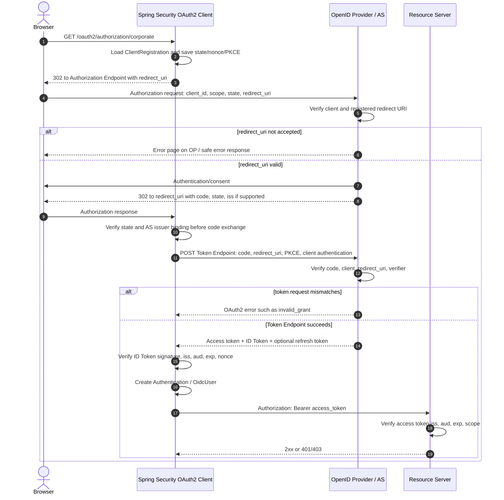
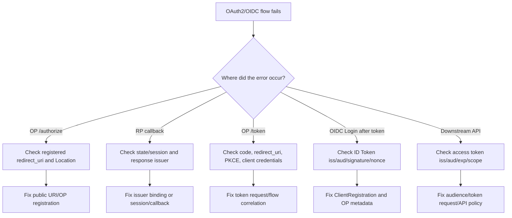

# 28.5. Redirect URI Mismatch, Wrong Issuer, and Wrong Audience

## 1. Identify the Exact Error Before Changing Configuration

In **Spring Security OAuth 2.0/OIDC Client**, a successful Authorization Code/OIDC login flow requires multiple systems to agree on identities and URIs:

- **OAuth2 Client / Relying Party (RP):** the Spring Boot application receiving browser callbacks.
- **Authorization Server (AS) / OpenID Provider (OP):** authenticates the user and issues authorization codes and tokens.
- **Browser:** follows the redirects.
- **Resource Server:** the downstream API validating access tokens, if the application calls APIs after login.
- **Reverse proxy / ingress / gateway:** may alter the scheme, hostname, port, or path seen by the application.

The three errors in the title can all produce a "login failed" message, yet they actually occur at **different steps**:

| Error | Core Question | Usually Detected By | Indicators |
| --- | --- | --- | --- |
| **Redirect URI mismatch** | Did the browser/code return to the exact redirect URI registered and used in the flow? | AS at Authorization Endpoint or Token Endpoint | `invalid_redirect_uri`, `redirect_uri_mismatch`, sometimes `invalid_grant` |
| **Issuer mismatch** | Did the authorization response/ID Token come from the expected AS/OP? | OAuth2/OIDC Client | `iss` mismatch, OIDC validation failure, mix-up rejected |
| **Audience mismatch** | **Who** was the token issued for, and is the intended recipient using it? | OIDC Client (ID Token) or Resource Server (access token) | `aud` lacks expected client/API, `401 invalid_token` |

**Never fix these by disabling signature, issuer, audience, state, nonce, PKCE, or CSRF validation.** These three errors usually reveal a **trust/configuration mismatch**, not "security settings being too strict".

### 1.1. Lesson Objectives

After this lesson, the reader will be able to:

1. Trace the Authorization Code/OIDC flow and mark where each error can arise.
2. Distinguish `redirect_uri` in the authorization request from the value sent during code exchange.
3. Analyze wrong hostnames/schemes/ports/paths caused by reverse proxies or context paths.
4. Distinguish **issuer in metadata**, **RFC 9207 authorization response `iss`**, and **ID Token `iss` claim**.
5. Distinguish the `aud` of an **ID Token** from the `aud` of an **access token** used at a downstream API.
6. Diagnose login failures separately from API `401/403` errors.
7. Design Spring Security Servlet/WebFlux configurations aligned with public URLs.
8. Add audience validation to a JWT Resource Server without weakening issuer/signature validation.
9. Produce logs, metrics, and correlation IDs **without leaking codes/tokens/secrets**.
10. Build a test matrix covering URI, issuer, audience, and multi-provider errors.
11. Understand remediation in multi-tenant, multi-pod, and metadata-rotation environments.
12. Know when to fix IdP configuration, application configuration, reverse proxies, or Resource Servers.

## 2. Full Map of OIDC Login and API Calls



Each arrow has its own **contract**:

1. The Authorization Endpoint verifies the OAuth client and **redirect URI**.
2. The Client verifies callback `state` and **which AS actually issued the response**.
3. The Token Endpoint verifies the code issued to the client, PKCE, and redirect URI.
4. The OIDC Client verifies the **ID Token issuer and audience**.
5. The Resource Server verifies the **access token issuer, audience, and permissions**.

An error at step 5 **does not mean** steps 1–4 were wrong. Conversely, a successful login **does not prove** the access token fits every downstream API.

### 2.1. Error Location Table by Timing

| When Does the Error Appear? | Where to Start? | What to Check |
| --- | --- | --- |
| Browser leaves RP and OP immediately shows an error page | Authorization Endpoint | `client_id`, registered `redirect_uri`, scheme/host/path |
| OP authenticates, then callback hits the wrong endpoint | Browser → RP | Public callback URL, proxy rewrite, context path |
| Callback reaches RP, but state is missing/mismatched | RP before token exchange | Authorization request store, cookie/session, callback URI, CSRF state |
| Callback has wrong `iss` | RP before token exchange | Expected AS/issuer for transaction, RFC 9207 |
| Token Endpoint returns `invalid_grant` | RP → AS token exchange | Code TTL/reuse, redirect_uri, PKCE verifier, client binding |
| ID Token rejected due to `iss` | RP after token exchange | OIDC issuer discovery/config, tenant/realm, metadata |
| ID Token rejected due to `aud`/`azp` | RP after token exchange | Expected `client_id` and OIDC audience rules |
| Login succeeds, yet API returns 401 | RP → Resource Server | Access token `iss`, `aud`, signature/introspection, expiry |
| API returns 403 | Resource Server authorization | Scope/roles/entitlements; do not jump to issuer/redirect errors |

## 3. What Is a Redirect URI and Why Must It Match?

**`redirect_uri`** is the OAuth2 Client endpoint to which the AS sends the authorization response after authentication. In the Authorization Code flow you may see:

```text
https://portal.example.com/login/oauth2/code/corporate
```

This value is different from:

```text
https://login.example.com/realms/staff/authorize
https://login.example.com/realms/staff/token
```

The last two URLs belong to the Authorization Server; `redirect_uri` belongs to the OAuth2 Client.

### 3.1. Three Places That Must Be Consistent

There are three values to compare:

**(A) Registered redirect URI at the OP/AS**

```text
https://portal.example.com/login/oauth2/code/corporate
```

**(B) Redirect URI the RP sends in the Authorization Request**

```text
GET /authorize?...&
redirect_uri=https%3A%2F%2Fportal.example.com%2Flogin%2Foauth2%2Fcode%2Fcorporate
```

**(C) Redirect URI the RP sends in the Token Request (when present)**

```text
POST /token
Content-Type: application/x-www-form-urlencoded

grant_type=authorization_code&
code=FAKE_CODE&
redirect_uri=https%3A%2F%2Fportal.example.com%2Flogin%2Foauth2%2Fcode%2Fcorporate
```

For the Authorization Code Grant, if `redirect_uri` was included in the authorization request, **the Token Endpoint requires that the exact same value be sent**. This binds the code to the right client/callback. Providers may enforce additional rules or exact values per client registration.

If A ≠ B, the AS typically rejects at the Authorization Endpoint. If B ≠ C, the AS typically rejects at the Token Endpoint, sometimes with `invalid_grant`.

### 3.2. Exact Matching: Off by One Character Means a Different URI

| Registered URI | Actually Sent URI | Issue |
| --- | --- | --- |
| `https://portal.example.com/login/oauth2/code/corporate` | Same value | Valid |
| URI above | `http://portal.example.com/login/oauth2/code/corporate` | Scheme differs |
| URI above | `https://portal.example.com:8443/login/oauth2/code/corporate` | Port differs |
| URI above | `https://portal.example.com/login/oauth2/code/corporate/` | Trailing slash differs |
| URI above | `https://portal.example.com/app/login/oauth2/code/corporate` | Context path differs |
| URI above | `https://internal-svc:8080/login/oauth2/code/corporate` | Internal host |
| URI above | `https://portal.example.com/login/oauth2/code/partner` | Different registration ID |
| URI above | `https://portal.example.com/login/oauth2/code/corporate?foo=1` | Query differs |
| URI above | `https://PORTAL.example.com/login/oauth2/code/corporate` | Provider comparison/canonicalization must be verified; do not rely on assumptions |

OAuth 2.0 Security BCP (RFC 9700) requires ASs to use **exact redirect URI matching**, except for a narrow exception for **native app loopback redirects**. That exception is **not** a justification for Spring web apps to use wildcards, prefix matching, or arbitrary callbacks.

**Do not register `https://*.example.com/*` carelessly** just to avoid errors; it widens the surface for code leakage/open redirects.

### 3.3. A URL-Encoded `redirect_uri` Does Not Mean It Differs

In the Authorization Request:

```text
redirect_uri=https%3A%2F%2Fportal.example.com%2Flogin%2Foauth2%2Fcode%2Fcorporate
```

After form-query decoding, the value is:

```text
https://portal.example.com/login/oauth2/code/corporate
```

Do not naively compare the **raw encoded string** against the registered URI, and do not call `URLDecoder.decode()` **twice** on a request parameter already parsed by Servlet/WebFlux.

Common encoding mistakes:

- Using double-encoded paths: `%252F` instead of `%2F`.
- Building queries via string concatenation without encoding `&`/`?`.
- Encoding the entire URL in a URI builder and then encoding it a second time.
- Appending routes with an extra trailing slash.
- Dropping `basePath` when the app runs under context path `/app`.

## 4. Spring Boot Configuration for Authorization Code/OIDC Login

Example configuration of a registration:

```yaml
spring:
  security:
    oauth2:
      client:
        registration:
          corporate:
            provider: corporate-oidc
            client-id: ${CORPORATE_CLIENT_ID}
            client-secret: ${CORPORATE_CLIENT_SECRET}
            client-authentication-method: client_secret_basic
            authorization-grant-type: authorization_code
            redirect-uri: "{baseUrl}/login/oauth2/code/{registrationId}"
            scope:
              - openid
              - profile
              - email

        provider:
          corporate-oidc:
            issuer-uri: https://login.example.com/realms/staff
```

Where:

- `registrationId` is `corporate`; it becomes the path segment of the default callback.
- `redirect-uri` is a template, **not** a hardcoded absolute URL.
- `{baseUrl}` is the public base URL derived from the request/context; it can be wrong if a proxy is misconfigured.
- `{registrationId}` expands to `corporate`.
- `issuer-uri` is the OP's issuer, **not a callback or API URL**.
- Client ID/secret must match the RP's registration at the OP.
- The `openid` scope turns the flow into OpenID Connect authentication when supported by the provider.

If the deployment has public URL:

```text
https://portal.example.com
```

then the expected callback is:

```text
https://portal.example.com/login/oauth2/code/corporate
```

Register **this exact URI** at the OP and inspect the actual request sent out.

### 4.1. Spring Security Servlet Config

```java
@Configuration
class OidcLoginSecurityConfig {

    @Bean
    SecurityFilterChain securityFilterChain(HttpSecurity http)
            throws Exception {

        http
            .authorizeHttpRequests(authorize -> authorize
                .requestMatchers("/", "/assets/**", "/login")
                    .permitAll()
                .anyRequest().authenticated())
            .oauth2Login(Customizer.withDefaults())
            .oauth2Client(Customizer.withDefaults());

        return http.build();
    }
}
```

This is a Servlet configuration (`spring-boot-starter-web`). Using the default callback, Spring Security handles:

```text
/login/oauth2/code/{registrationId}
```

**Never change the path on only one side.** If you alter the callback endpoint in security config, synchronize it with `ClientRegistration.redirectUri`, public ingress routes, and the URI registered at the OP.

### 4.2. Spring Security WebFlux Config

```java
@Configuration
@EnableWebFluxSecurity
class ReactiveOidcLoginSecurityConfig {

    @Bean
    SecurityWebFilterChain securityWebFilterChain(
            ServerHttpSecurity http) {

        return http
            .authorizeExchange(exchanges -> exchanges
                .pathMatchers("/", "/assets/**", "/login")
                    .permitAll()
                .anyExchange().authenticated())
            .oauth2Login(Customizer.withDefaults())
            .oauth2Client(Customizer.withDefaults())
            .build();
    }
}
```

In WebFlux (`spring-boot-starter-webflux`), callbacks and authorization request processing use **Reactive** security infrastructure, not `HttpServletRequest` or Servlet `OAuth2LoginAuthenticationFilter`.

**Note:** YAML client registration may look identical between Servlet and WebFlux, but the Java security chain, session, and repository APIs differ. Do not mix blocking `ClientRegistrationRepository` with `ReactiveClientRegistrationRepository` arbitrarily.

## 5. Reverse Proxy, Ingress, and `redirect_uri` Turning Into an Internal URL

A common production scenario:

```text
Browser:
  https://portal.example.com

Nginx/Ingress:
  https://portal.example.com -> http://portal-svc:8080

Spring Boot:
  http://portal-svc:8080
```

If Spring does not know the public scheme/host, `{baseUrl}` can become:

```text
http://portal-svc:8080
```

and the RP sends:

```text
http://portal-svc:8080/login/oauth2/code/corporate
```

while the OP only registered:

```text
https://portal.example.com/login/oauth2/code/corporate
```

### 5.1. Proxy Factors Affecting the Callback

| Factor | External | Internal | Risk |
| --- | --- | --- | --- |
| Scheme | `https` | `http` | `http://...` rejected by OP |
| Host | `portal.example.com` | `portal-svc` | Internal host mismatch |
| Port | `443` | `8080` | `:8080` appears in callback |
| Path prefix | `/app` | `/` | `/app` lost when building URI |
| Context path | Public `/portal` | Different Spring context | Callback route 404 |
| Proxy headers | Trusted forwarded values | Untrusted client headers | Host spoofing/open redirect |

Spring Boot can use:

```yaml
server:
  forward-headers-strategy: framework
```

This helps when the ingress supplies accurate forwarded headers. However, **only enable trusting forwarded headers when the ingress is a trusted source**: the proxy must strip/overwrite `Forwarded`, `X-Forwarded-Proto`, `X-Forwarded-Host`, `X-Forwarded-Port`, and `X-Forwarded-Prefix` sent by untrusted clients.

### 5.2. An Illustrative Proxy Configuration

Example Nginx reverse proxy (must be adapted to your actual topology):

```nginx
location / {
    proxy_pass http://portal-svc:8080;

    proxy_set_header Host portal.example.com;
    proxy_set_header X-Forwarded-Proto https;
    proxy_set_header X-Forwarded-Host portal.example.com;
    proxy_set_header X-Forwarded-Port 443;
}
```

This is **not** a complete Nginx config; production needs TLS, upstream settings, DNS, access controls, and header sanitization. Do not copy blindly when the app serves multiple public hosts.

### 5.3. Verifying the Actual Public URL

Recommended procedure:

1. Call the public login initiation route:

   ```text
   https://portal.example.com/oauth2/authorization/corporate
   ```

2. Inspect the **`Location`** header of the 302 response from the RP (via controlled HTTP/network logs).
3. Parse the query of the Authorization Endpoint URL.
4. Extract the **decoded** value of `redirect_uri`.
5. Compare it against the **allowed redirect URI at the OP** and `ClientRegistration.redirectUri`.
6. Verify the ingress callback path routes to the right Spring handler.
7. Never log raw `state`, authorization codes, PKCE verifiers, or URLs containing tokens.

A debug tool may show a long Location; output only safely sanitized fields such as scheme, host, port, path, and `registrationId`.

### 5.4. When Should You Use a Fixed Redirect URI?

If the public host is static, you can configure:

```yaml
spring:
  security:
    oauth2:
      client:
        registration:
          corporate:
            redirect-uri: https://portal.example.com/login/oauth2/code/corporate
```

Pros: less reliance on `X-Forwarded-*`. Cons:

- Requires separate config for dev/staging/production.
- If the public URL changes, both config and OP registration must be updated.
- Dynamic tenants/domains cannot simply share a single fixed URL.
- The callback handler still must listen on the right path, and the proxy still must route properly.

Never hardcode a production URL in test/staging environments expecting redirect URI to auto-adapt per environment.

## 6. Redirect URI Mismatch Occurs at Two Different Moments

### 6.1. Moment 1: Authorization Endpoint Rejects

The browser goes to:

```http
GET /authorize?response_type=code
  &client_id=portal-web
  &redirect_uri=http%3A%2F%2Fportal-svc%3A8080%2Flogin%2Foauth2%2Fcode%2Fcorporate
  &scope=openid%20profile
  &state=FAKE_STATE
```

Yet the client registration at the OP only allows:

```text
https://portal.example.com/login/oauth2/code/corporate
```

The OP may render an error page such as:

```text
invalid redirect_uri
redirect_uri_mismatch
Invalid parameter: redirect_uri
```

**The exact error name and HTTP status depend on the provider.** An AS must not redirect errors back to an invalid `redirect_uri` because doing so can create an open redirect or leak authorization information.

**Fix:** fix the URI sent by the RP or update the OP registered URI to the approved public URL; never widen the allowlist indiscriminately.

### 6.2. Moment 2: Token Endpoint Rejects Code Exchange

The Authorization Request used:

```text
redirect_uri=https://portal.example.com/login/oauth2/code/corporate
```

But the Token Request accidentally sent:

```text
redirect_uri=http://portal-svc:8080/login/oauth2/code/corporate
```

The AS may return:

```http
HTTP/1.1 400 Bad Request
Content-Type: application/json

{
  "error": "invalid_grant"
}
```

`invalid_grant` **has more than one possible cause**; it can also stem from an expired/reused code, a code issued to another client, a wrong PKCE verifier, or a mismatched redirect URI.

Compare the **URI values sent in both requests** rather than immediately assuming code reuse.

### 6.3. Do Not Misdiagnose `state` Mismatch as URI Mismatch

If the callback reaches the RP but loses its session or state:

```text
authorization_request_not_found
invalid_state
OAuth2AuthenticationException
```

the cause may be:

- Cookie/session lost across browser redirects.
- Multiple pods not sharing authorization requests/sessions.
- `SameSite` cookie incompatible with response mode.
- Session expired because the user took a long time on MFA.
- Callback redirected to a different domain so the RP did not receive the cookie.
- Custom code deleted the authorization request before the login filter read it.

A callback having the right URI **does not guarantee** state is still valid. Never fix state errors by disabling state/PKCE validation.

## 7. `redirect_uri` Differs from `post_logout_redirect_uri`

A common source of confusion in OIDC:

```text
Login callback:
    redirect_uri=https://portal.example.com/login/oauth2/code/corporate

OIDC RP-Initiated Logout:
    post_logout_redirect_uri=https://portal.example.com/signed-out
```

The two URIs have different lifecycles:

| Property | Login `redirect_uri` | Logout `post_logout_redirect_uri` |
| --- | --- | --- |
| When? | Authorization request and code exchange | RP requests OP logout |
| What does the browser return with? | Authorization code, state, sometimes `iss` | Optional logout `state` |
| Handler | Spring OAuth2 Login callback | Landing page or logout callback |
| Registered at OP? | Yes, OAuth client redirect URIs | Yes, post-logout redirects list |
| Code exchange? | Yes | No |
| User session after callback? | Session is being created | Session has usually been cleared |

**Registering `/signed-out` under OAuth2 login redirects will not fix a login `redirect_uri_mismatch`.** Conversely, fixing the login callback will not fix a post-logout redirect error.

## 8. What Is the Issuer (`iss`)?

**Issuer** identifies the Authorization Server/OpenID Provider that issues a token or authorization response. A common issuer:

```text
https://login.example.com/realms/staff
```

Do not confuse the issuer with:

```text
https://login.example.com/realms/staff/protocol/openid-connect/token
```

The Token Endpoint may sit under the same hostname, yet it is **not** the issuer identifier.

An illustrative OP metadata document:

```json
{
  "issuer": "https://login.example.com/realms/staff",
  "authorization_endpoint": "https://login.example.com/realms/staff/authorize",
  "token_endpoint": "https://login.example.com/realms/staff/token",
  "jwks_uri": "https://login.example.com/realms/staff/certs",
  "authorization_response_iss_parameter_supported": true
}
```

The paths are **examples only**; do not build endpoints by concatenating strings onto the issuer if the provider publishes metadata.

### 8.1. Multiple Issuer Verification Points

| Step | Issuer Inspected | Verified By | Goal |
| --- | --- | --- | --- |
| Discovery/onboarding | `issuer` in metadata | Client/config control plane | Metadata matches the trusted OP |
| Authorization response | `iss` query/form per RFC 9207 if supported | OAuth2 Client | Prevent AS mix-up **before code exchange** |
| ID Token | `iss` claim in ID Token | OIDC Client | Token truly came from the expected OP |
| JWT access token at API | `iss` claim | Resource Server | Token came from an AS trusted by the API |

An `issuer mismatch` error **must be placed at the exact step**. Looking only at an "invalid issuer" message without knowing whether it occurred during metadata discovery, callback, or token validation makes it very easy to fix the wrong thing.

## 9. Issuer Mismatch When Reading Discovery Metadata

Spring Boot commonly configures:

```yaml
spring:
  security:
    oauth2:
      client:
        provider:
          corporate-oidc:
            issuer-uri: https://login.example.com/realms/staff
```

For providers supporting OpenID Connect Discovery/RFC 8414 metadata, the framework fetches endpoint details and the issuer.

If the received metadata says:

```json
{
  "issuer": "https://login.example.com/realms/customer",
  "token_endpoint": "https://login.example.com/realms/customer/token"
}
```

then `issuer` does not match the expected `.../realms/staff`.

This is **not** a user mistyping a password. It can be:

- `issuer-uri` configured for the wrong realm/tenant.
- OP's reverse proxy rewriting the base URL incorrectly.
- Discovery endpoint pointing to the wrong environment.
- Stale or cross-tenant metadata cache.
- Provider changed canonical issuer without syncing clients.
- An untrusted metadata source posing mix-up/SSRF risks.

**Never disable metadata issuer matching** to bypass the error. Verify the canonical issuer published by the provider, configure the exact URL, and check TLS/trust.

### 9.1. HTTPS and Canonical Issuer Value

Example:

```text
Expected: https://login.example.com/realms/staff
Actual:   http://login.example.com/realms/staff
```

The OP may sit behind a TLS-terminating proxy and generate metadata using its internal scheme. Fix the OP/proxy public hostname/scheme configuration.

Similarly, a trailing slash:

```text
https://login.example.com/realms/staff
https://login.example.com/realms/staff/
```

can be two distinct issuer strings. Do not "normalize" by stripping slashes on callbacks or ID Tokens; align on the canonical issuer published by the OP.

### 9.2. Issuer and JWKS URI

An HTTP-valid JWKS endpoint does not guarantee the issuer is right.

Wrong thinking:

> "The ID Token signature verified against a downloaded key, so the token definitely belongs to the current tenant."

One key can serve multiple realms, or metadata may have been swapped. The OIDC Client must still verify **`iss`** and **`aud`** independently of the signature.

If the JWKS request fails with DNS/TLS/404, that is a **signing-key/token-validation availability issue**, and should not be labeled an issuer mismatch if the actual issuer is unknown.

## 10. Issuer Mismatch in the Authorization Response: RFC 9207

In systems with multiple Authorization Servers, RFC 9207 allows the AS to return `iss` alongside code and state:

```http
HTTP/1.1 302 Found
Location: https://portal.example.com/login/oauth2/code/corporate?code=FAKE_CODE&state=FAKE_STATE&iss=https%3A%2F%2Flogin.example.com%2Frealms%2Fstaff
```

The Client needs to compare:

```text
expectedIssuer = issuer of the selected ClientRegistration
receivedIssuer = iss in the authorization response
```

Outcome:

```text
expected == received -> may proceed if state/PKCE/contract are valid
expected != received -> reject; DO NOT send authorization code to Token Endpoint
```

This is a **pre-token-exchange** check to defend against **Authorization Server Mix-Up**.

### 10.1. Why Doesn't ID Token Issuer Validation Replace This Step?

In a standard Authorization Code flow:

```text
Browser callback: code + state + iss (if RFC 9207)
    ↓
RP calls Token Endpoint
    ↓
RP receives ID Token
    ↓
RP checks ID Token iss
```

If the wrong Token Endpoint is chosen, **the code and potentially client credentials/PKCE verifier have already been sent to the wrong destination before an ID Token exists to check**.

Therefore, distinguish:

- **Authorization response `iss`:** verifies callback origin before calling the Token Endpoint.
- **ID Token `iss`:** verifies the origin of the token received from the Token Endpoint.

`state` and PKCE are vital, yet **they are not a license to skip issuer-response defenses** when a client supports multiple ASs.

### 10.2. RFC 9207 Issuer Comparison Rules

The response issuer must be compared with the expected issuer using **simple string comparison** after proper HTTP form/query decoding.

Examples:

| Expected | Received | Result |
| --- | --- | --- |
| `https://login.example.com/realms/staff` | Same string | Match |
| URI above | `https://login.example.com/realms/staff/` | Mismatch |
| URI above | `https://login.example.com/realms/admin` | Mismatch |
| URI above | `http://login.example.com/realms/staff` | Mismatch |
| URI above | `https://other.example.com/realms/staff` | Mismatch |

Never compare hostnames only or rewrite URLs into an "equivalent issuer" by guesswork. One hostname can host multiple distinct issuers by realm/path.

### 10.3. When the Callback Lacks `iss`

Metadata may advertise:

```json
"authorization_response_iss_parameter_supported": true
```

If the AS advertises RFC 9207 support, the response **must** include `iss`, including authorization error responses per the specification. If missing or wrong: **reject**, do not silently continue.

If a legacy AS does not support response `iss`, a multi-AS client still needs **another explicitly designed mix-up defense**, such as distinct redirect URIs per RFC 9700 with validation. Never treat missing `iss` as a reason to accept codes from arbitrary providers.

### 10.4. Do Not Route the Token Endpoint by Callback `iss`

Wrong:

```java
String issuerFromCallback = request.getParameter("iss");
String tokenUri = issuerFromCallback + "/token";
```

`iss` from the browser callback is **a value to verify**, not a source of endpoint configuration. Even when `iss` is present, the token endpoint must still come from the **trusted registration** selected when initiating the authorization request.

## 11. OIDC ID Token Issuer Mismatch After Token Exchange

An illustrative ID Token has claims:

```json
{
  "iss": "https://login.example.com/realms/staff",
  "sub": "user-742",
  "aud": "portal-web",
  "exp": 1790000000,
  "iat": 1789996400,
  "nonce": "FAKE_NONCE"
}
```

These values only illustrate shape; they are not a valid JWT outside a test setup.

The OIDC Client selected registration:

```text
issuer = https://login.example.com/realms/staff
clientId = portal-web
```

If the ID Token returns:

```json
"iss": "https://login.example.com/realms/customer"
```

then the ID Token **does not belong to the expected issuer**. Authentication must be rejected.

### 11.1. Common Causes

| Scenario | Where to Check |
| --- | --- |
| App uses `issuer-uri` of another realm | ClientRegistration/OP metadata |
| OP public hostname differs from internal hostname | OP reverse proxy, canonical issuer |
| Browser started with corporate, callback/token used partner registration | `registrationId`, state/issuer binding |
| JWKS fetched from right host but wrong realm | `jwkSetUri`/issuer mapping |
| Token response came from test AS instead of prod | Environment variables and deployment config |
| Custom OIDC decoder omits issuer validation | Token validators/security config |
| Stale multi-tenant config cache | Snapshot version and callback timing |

Do not fix this by accepting any issuer matching `/realms/*` or matching domain only. Resolve the expected issuer strictly from the **registration and transaction**.

### 11.2. `sub` Does Not Replace Issuer

The `sub` claim is usually unique only **within an issuer's scope**. Two OPs can both assign `sub="123"` to two different people.

For multi-tenant apps, a safe identity key is usually:

```text
(issuer, subject)
```

plus authorization verifying tenant membership/entitlements. An ID Token passing issuer/audience validation **does not prove** the user is authorized to read another tenant's data.

### 11.3. `nonce`, Signature, and Expiration Are Separate Checks

If the ID Token issuer is right yet:

- Signature is invalid.
- `aud` is wrong.
- Token is expired.
- Nonce is wrong.
- `azp` is invalid when required.
- Algorithm is disallowed.

authentication must still be rejected. Do not focus on fixing `iss` and drop the remaining validators.

## 12. What Is Audience (`aud`)?

**Audience** identifies the **intended recipient** of a token. Although the claim name `aud` is the same, its meaning depends on whether the token is an **ID Token** or an **access token**.

### 12.1. ID Token Audience

In OIDC, an ID Token is issued to the **Relying Party/OIDC Client**. Per OIDC Core, `aud` must contain the **RP's OAuth2 `client_id`**.

Example:

```json
{
  "iss": "https://login.example.com/realms/staff",
  "sub": "user-742",
  "aud": "portal-web",
  "exp": 1790000000
}
```

Where `portal-web` is `spring.security.oauth2.client.registration.corporate.client-id`.

Wrong:

```json
{
  "aud": "inventory-api"
}
```

when the RP expects `portal-web`.

Even if the issuer and signature are valid, an ID Token intended for another client **must not be used to log into the current client**.

### 12.2. Access Token Audience

Access tokens are sent to a **Resource Server/API**. Example:

```json
{
  "iss": "https://login.example.com/realms/staff",
  "sub": "user-742",
  "aud": ["inventory-api"],
  "scope": "inventory.read",
  "exp": 1790000000
}
```

If the application calls:

```http
GET /api/items HTTP/1.1
Host: inventory-api.example.com
Authorization: Bearer <access-token>
```

the Inventory API must verify that the token **carries an audience matching itself** and sufficient permissions.

An access token with:

```json
"aud": ["billing-api"]
```

must not be accepted by the Inventory API merely because its signature/issuer are valid.

### 12.3. Summary: ID Token vs. Access Token

| Property | ID Token (OIDC) | Access Token (OAuth2) |
| --- | --- | --- |
| Recipient | **OIDC Client/RP** | **Resource Server** |
| Expected `aud` | RP's Client ID | API/resource identifier |
| Where sent? | OP → RP via OIDC token response (per flow) | RP → API via Bearer |
| Used to sign user in? | Verified by OIDC Client to authenticate identity | Does not replace ID Token by default |
| Used to call business APIs? | **No** | Yes, if audience/scope match |
| Token format | Usually JWT | Can be JWT or opaque |
| Primary validation | Issuer, audience, signature, time, nonce/azp | Issuer, audience, signature/introspection, time, scope, policy |

**An extremely common mistake:** sending `oidcUser.getIdToken().getTokenValue()` to an API because it is a JWT containing `sub` and `email`. Resource Servers need an **access token** and should not accept ID Tokens as bearer credentials.

## 13. ID Tokens with Multiple Audiences and `azp`

OIDC ID Token `aud` can be a string or an array, depending on the case. If there are multiple audiences, OIDC Core specifies rules regarding **`azp` — authorized party** and how the client must verify it.

Illustrative example:

```json
{
  "iss": "https://login.example.com/realms/staff",
  "sub": "user-742",
  "aud": ["portal-web", "some-other-client"],
  "azp": "portal-web",
  "exp": 1790000000
}
```

Key points:

1. `aud` must include the RP's `client_id`.
2. When multiple audiences are present, the RP should verify `azp` is present per OIDC rules.
3. If `azp` is present, the RP should verify it equals its own client ID.
4. Do not skip `aud` validation just because `azp` looks right.
5. Never treat an array containing an API name as valid for an ID Token if the RP's client ID is absent.

Standard Spring Security OIDC login includes validators appropriate for the version/config. When writing a custom `OidcIdTokenDecoderFactory`/custom decoder, do not accidentally drop the default validators.

### 13.1. Where Can Wrong ID Token Audience Come From?

- `client-id` in YAML does not match the client registered at the OP.
- Same OP, but logging in with another application's registration.
- Custom client registration repository returned the wrong `ClientRegistration`.
- Token response was cached/read under the wrong tenant/client.
- A proxy/test mock returned an ID Token for the wrong client ID.
- Provider emits multiple audiences without matching configuration/validation.
- Attacker attempts to use a token from another RP (token substitution).

**Do not fix by hardcoding `expectedAudiences = any`** or skipping client ID checks. Identify which client registration requested the token.

## 14. Access Token Audience Mismatch at the Resource Server

Suppose OIDC login completes successfully:

```text
Browser -> Portal -> Corporate OP
Portal now holds a valid OidcUser.
```

The Portal then calls the Reports API using the access token:

```http
GET /api/reports/me HTTP/1.1
Host: reports-api.example.com
Authorization: Bearer FAKE_ACCESS_TOKEN
```

Reports API returns:

```http
HTTP/1.1 401 Unauthorized
WWW-Authenticate: Bearer error="invalid_token"
```

The token may:

- Be expired.
- Have an `iss` not trusted by Reports API.
- Fail signature/JWKS validation.
- Be revoked/inactive on introspection.
- Have `aud` meant only for Portal/Inventory/Billing, **not Reports**.
- Actually be an ID Token instead of an access token.
- Violate token type/binding policy.

**Do not guess every `401` is an audience mismatch**; inspect sanitized server-side validator outcomes and token metadata in a test environment.

### 14.1. API 401 vs. 403 Responses Differ

| HTTP | Common Bearer Challenge | Meaning |
| --- | --- | --- |
| `401 Unauthorized` | `invalid_token` or challenge without error | API rejects the credential |
| `403 Forbidden` | `insufficient_scope` | Token verified, but lacks permission |
| `401/403` without Bearer challenge | Possibly custom policy, proxy, or gateway | Requires specific inspection |

Example:

```http
HTTP/1.1 403 Forbidden
WWW-Authenticate: Bearer error="insufficient_scope",
                  scope="reports.admin"
```

An access token with `aud=["reports-api"]` **can still be rejected** if the endpoint requires scope `reports.admin` while the token only has `reports.read`.

**Audience answers "which API is this token for?"; scope/roles/domain entitlements answer "what is allowed?"**.

### 14.2. Access Token Audience May Differ from Client ID

Configuration:

```text
OAuth Client ID  = portal-web
Reports Audience = reports-api
```

This is completely normal. Do not force the Reports API to accept an access token with `aud=portal-web` if that token was not meant for the API.

Some IdPs use resource indicators (RFC 8707), API identifiers, an `audience` parameter, or scope/provider-specific mappings to issue tokens for the right resource. Check **provider specifications** rather than assuming adding any arbitrary field to `application.yml` automatically changes the audience.

### 14.3. What About Opaque Tokens?

If the access token is an opaque string, the API cannot read JWT claims via base64 decoding. It needs token introspection or the provider's appropriate verification mechanism.

When using introspection, **issuer/audience/resource binding remains a security requirement**, though the information comes from the introspection response/policy rather than a JWT `aud` claim.

Never try to turn an opaque access token into a JWT by splitting on dots or skipping validation.

## 15. Configuring Resource Server: Issuer Validation Does Not Automatically Equal Audience Validation

In Spring Security Resource Server, you might configure:

```yaml
spring:
  security:
    oauth2:
      resourceserver:
        jwt:
          issuer-uri: https://login.example.com/realms/staff
```

This configuration typically enables the framework to fetch metadata/JWKS and apply standard validators, including issuer validation. However, **do not assume the audience specific to your API is automatically enforced simply because issuer is configured**.

Check which audience the API requires:

```text
reports-api
```

and configure an explicit audience validator or the audience configuration feature supported by your Spring Boot/Spring Security version.

### 15.1. Java Example: Enforcing Issuer and API Audience

Servlet Resource Server example using JWT:

```java
@Configuration
class ReportsResourceServerSecurity {

    @Bean
    JwtDecoder jwtDecoder() {
        String issuer =
            "https://login.example.com/realms/staff";

        String jwksUri =
            "https://login.example.com/realms/staff/certs";

        String requiredAudience = "reports-api";

        NimbusJwtDecoder decoder =
            NimbusJwtDecoder.withJwkSetUri(jwksUri).build();

        OAuth2TokenValidator<Jwt> withIssuer =
            JwtValidators.createDefaultWithIssuer(issuer);

        OAuth2TokenValidator<Jwt> withAudience =
            new JwtClaimValidator<List<String>>(
                "aud",
                audiences -> audiences != null
                    && audiences.contains(requiredAudience));

        decoder.setJwtValidator(
            new DelegatingOAuth2TokenValidator<>(
                withIssuer, withAudience));

        return decoder;
    }

    @Bean
    SecurityFilterChain securityFilterChain(
            HttpSecurity http) throws Exception {

        return http
            .authorizeHttpRequests(auth -> auth
                .requestMatchers("/public/**").permitAll()
                .anyRequest().authenticated())
            .oauth2ResourceServer(server ->
                server.jwt(Customizer.withDefaults()))
            .build();
    }
}
```

Imports are omitted for readability. This example requires Spring Security Resource Server/Jose dependencies.

**Key points:**

- `JwtValidators.createDefaultWithIssuer(issuer)` preserves standard timestamp/issuer checks.
- The audience validator adds **`requiredAudience`**.
- `DelegatingOAuth2TokenValidator` combines both policies; do not replace defaults with an audience-only validator.
- The JWKS URI is a fixed **trusted endpoint**; never construct it from `iss` inside an unverified token.
- `List<String>` reflects how Spring Security JWT claim mapping typically converts `aud` into a list; confirm with the decoder/claim conversion in your actual version.
- In production, issuer, JWKS URI, and audience should come from trusted config/secret management rather than being hardcoded.

### 15.2. For WebFlux Resource Server

Correspondingly use `SecurityWebFilterChain` and `ReactiveJwtDecoder`, conceptual example:

```java
@Bean
SecurityWebFilterChain apiSecurity(ServerHttpSecurity http) {
    return http
        .authorizeExchange(exchange -> exchange
            .pathMatchers("/public/**").permitAll()
            .anyExchange().authenticated())
        .oauth2ResourceServer(server ->
            server.jwt(Customizer.withDefaults()))
        .build();
}
```

For a custom reactive decoder, use `NimbusReactiveJwtDecoder` and `setJwtValidator(...)` per your version's API. Never use a blocking `JwtDecoder` directly on the Reactor event loop and treat it as non-blocking.

**Do not confuse the two applications:** configuring `oauth2.resourceserver.jwt` on the Reports API **does not fix ID Token validation inside the Portal's `oauth2Login()`**. They have different purposes, runtimes, and trust boundaries.

## 16. Common Ways Audience Is Misconfigured

### 16.1. API Checks Client ID Instead of API Audience

Suppose:

```text
access token aud = ["reports-api"]
OAuth clientId   = "portal-web"
```

If the API validator requires:

```text
requiredAudience = "portal-web"
```

then the API will reject valid tokens. Fix the **expected audience on the API** to match the agreed resource identifier rather than altering tokens arbitrarily.

### 16.2. Portal Sends ID Token to the API

```java
String wrongToken =
    oidcUser.getIdToken().getTokenValue();
```

The API rejects it because the token has:

```json
"aud": "portal-web"
```

instead of:

```json
"aud": "reports-api"
```

Solution: retrieve the **access token** from the right `OAuth2AuthorizedClient`, attach it to `Authorization: Bearer`, and ensure the AS issues an access token intended for the Reports API.

### 16.3. One Access Token Used for Every API

```text
Access token:
  aud = billing-api
```

Portal sends the same token to:

```text
Billing API   -> valid audience (if other checks pass)
Reports API   -> wrong audience
Inventory API -> wrong audience
```

Do not fix this by letting Reports/Inventory accept any token signed by the same issuer. Choose the proper token acquisition strategy and resource indicators/audiences; different registrations/scopes/token exchanges may be needed depending on the provider.

### 16.4. API Checks Issuer Only, Skipping Audience

A token issued by the AS for another application still has a valid `iss` and signature. If the API skips checking `aud`, there is a risk of **token substitution**: a token for resource A being used at resource B.

Enforcing audience validation and per-endpoint authorization are separate controls and cannot be replaced by issuer signatures.

## 17. `OAuth2AuthorizedClient` and Picking the Right Token When Calling APIs

Spring Security OAuth2 Client stores the authorized client:

```java
OAuth2AuthorizedClient authorizedClient;
OAuth2AccessToken accessToken =
    authorizedClient.getAccessToken();
```

This access token **is not the `OidcUser`'s ID Token**.

### 17.1. Servlet: Passing Access Token to Outbound WebClient

An illustrative example in a backend component that already holds the authorized client for the right registration/user:

```java
Mono<Report> getReport(
        OAuth2AuthorizedClient authorizedClient) {

    return reportsWebClient.get()
        .uri("/api/reports/me")
        .headers(headers -> headers.setBearerAuth(
            authorizedClient.getAccessToken().getTokenValue()))
        .retrieve()
        .bodyToMono(Report.class);
}
```

`reportsWebClient` must have the Reports API's trusted base URL. This is a reactive API call with `WebClient`; passing the token header manually does not automatically refresh `OAuth2AuthorizedClient`.

If you need token lifecycle/refresh, use **`OAuth2AuthorizedClientManager`** or the stack-appropriate OAuth2 exchange filter with `registrationId` instead of pulling a token from storage and reusing it indefinitely.

### 17.2. Reactive WebFlux

In WebFlux, you can use `ReactiveOAuth2AuthorizedClientManager` and `ServerOAuth2AuthorizedClientExchangeFilterFunction` to attach the access token to `WebClient`.

Example:

```java
Mono<Report> myReport(WebClient reports) {
    return reports.get()
        .uri("/api/reports/me")
        .attributes(
            ServerOAuth2AuthorizedClientExchangeFilterFunction
                .clientRegistrationId("reports-user"))
        .retrieve()
        .bodyToMono(Report.class);
}
```

This example requires `WebClient` to be configured with the OAuth2 filter and an appropriate authenticated request context. **Merely calling `.clientRegistrationId(...)` without configuring the filter will not fetch a token.**

### 17.3. Select Client Registration per Downstream Service

If an application calls multiple APIs:

```text
reports-user  -> Reports API
inventory-m2m -> Inventory API
billing-m2m   -> Billing API
```

Each registration/authorization policy may request access tokens with different audiences/scopes. Never use a single default bearer filter that attaches tokens to every HTTP request—especially if `.uri(...)` can receive a user-supplied absolute URL.

## 18. Configuring Multiple Issuers and Per-Tenant Audiences

In a multi-tenant system:

```text
Tenant A:
  issuer = https://login.example.com/realms/acme
  login clientId = portal-acme
  reports audience = reports-acme

Tenant B:
  issuer = https://login.example.com/realms/beta
  login clientId = portal-beta
  reports audience = reports-beta
```

**Same hostname does not mean same issuer.** A tenant/realm path can be part of the identifier.

A multi-tenant API needs the policy:

```text
trusted issuer → allowed audiences → allowed tenants
```

Example:

```text
Issuer Acme:
    allowed audiences = reports-acme
    data tenant       = acme

Issuer Beta:
    allowed audiences = reports-beta
    data tenant       = beta
```

Never let a request param `?tenant=beta` override the security context just verified from issuer Acme.

### 18.1. Multi-Issuer Resource Server

If an API accepts multiple issuers, use resolvers/validators backed by a **formal allowlist**. Never create a JWT decoder for an arbitrary `iss` taken from an unverified token.

In Servlet, Spring Security provides the `JwtIssuerAuthenticationManagerResolver` pattern supporting trusted issuers or custom resolvers. When adding audience validation, bind **audience per issuer/client/policy** rather than setting an overly broad shared audience set.

In Reactive, use the corresponding authentication manager resolvers and non-blocking JWT decoders. Wiring varies by API/version; test with real integration tests.

### 18.2. Do Not Use `sub` Alone to Identify Users

OIDC `sub` is typically unique per issuer, not necessarily globally:

```text
(https://login.example.com/realms/acme, sub=123)
(https://login.example.com/realms/beta, sub=123)
```

These may be two completely different people. For multi-tenant systems, the identity key should include `(issuer, subject)` and tenant entitlements must be verified independently.

### 18.3. Token Cache Must Also Isolate Tenants/Resources

A basic `OAuth2AuthorizedClientService` keys by:

```text
(registrationId, principalName)
```

Therefore:

- `registrationId` must distinguish issuer/client/audience when the architecture requires it.
- `principalName` must never be a shared generic name across users.
- With extension token exchanges involving subject/actor/target, richer key/context binding may be needed.
- Never reuse an Acme token for Beta merely because they share the same `sub`.

## 19. Diagnostic Process via Decision Tree



### 19.1. First Question: Where Did the Last Request Reach?

If the user sees an error on the OP's screen, the RP backend may not have received a callback yet. Do not look for `OidcUserService` exceptions when the Token Endpoint was never even called.

If the RP callback ran and threw `OAuth2AuthenticationException`, determine whether it failed **before** or **after** token exchange. If login already created a user session and the API returns 401, inspect the downstream Resource Server first.

### 19.2. Gather Three URIs and Three Identifiers

For a login failure, collect **safe metadata**:

```text
registrationId = corporate
expectedIssuer = https://login.example.com/realms/staff
clientIdAlias  = portal-web

Authorization request redirect_uri decoded:
    https://portal.example.com/login/oauth2/code/corporate

Registered redirect URI at OP:
    https://portal.example.com/login/oauth2/code/corporate

Token request redirect_uri decoded:
    https://portal.example.com/login/oauth2/code/corporate
```

If ID Token validation fails:

```text
expected ID Token issuer = corporate issuer
expected ID Token aud    = portal-web client ID
```

If an API fails:

```text
expected API issuer   = corporate issuer or approved issuer set
expected API audience = reports-api
```

**Never collect raw authorization codes, ID Tokens, access tokens, refresh tokens, PKCE verifiers, or client secrets into tickets/logs.**

## 20. Debugging Without Leaking Credentials

### 20.1. What Should Be Logged?

Sanitized log examples:

```text
event=oauth2_authorization_started
registrationId=corporate
redirectUriScheme=https
redirectUriHost=portal.example.com
redirectUriPath=/login/oauth2/code/corporate
issuerAlias=corp-staff
```

On callback:

```text
event=oauth2_callback
registrationId=corporate
statePresent=true
stateValidated=true
issuerMode=RFC9207
responseIssuerPresent=true
issuerMatches=true
tokenRequestSent=false
```

On token/ID Token error:

```text
event=oidc_login_failure
registrationId=corporate
stage=id_token_validation
reason=audience_mismatch
expectedClientAlias=portal-web
```

On API error:

```text
event=downstream_bearer_failure
downstream=reports
httpStatus=401
reason=invalid_token
issuerValidation=passed
audienceValidation=failed
```

These are **suggested event names**, not default Spring Security log output.

### 20.2. What Should Not Be Logged?

```text
code=<real-authorization-code>
state=<real-state>
nonce=<real-nonce>
code_verifier=<real-pkce-verifier>
id_token=<raw-id-token>
access_token=<raw-access-token>
refresh_token=<raw-refresh-token>
client_secret=<raw-client-secret>
Authorization: Bearer ...
Cookie: JSESSIONID=...
```

A full `Location` header from a login callback can contain an authorization code and state. A full OP Token Endpoint response can contain access/ID/refresh tokens. Avoid enabling broad HTTP wire logging in production.

### 20.3. Log Levels and Spring Security

Spring Security has logging categories that assist authentication/authorization investigation, yet DEBUG/TRACE can emit sensitive data depending on other configurations and custom filters.

Consider:

```yaml
logging:
  level:
    org.springframework.security: INFO
    org.springframework.web: INFO
```

When debugging is needed, raise log levels **temporarily**, only in controlled environments, combined with sanitization at HTTP proxies, gateways, error handlers, and tracing libraries. Do not assume `TRACE` is safe merely because the framework tries to avoid printing tokens.

### 20.4. Useful Metrics

| Metric/event | Used to Analyze |
| --- | --- |
| `oauth2_redirect_uri_rejected` | Misconfigured callback/public URL |
| `oauth2_authorization_state_missing` | Session/cookie/TTL/multi-pod |
| `oauth2_token_invalid_grant` | Code/PKCE/redirect_uri/client binding |
| `oauth2_response_issuer_mismatch` | RFC 9207/mix-up defense |
| `oidc_id_token_issuer_failure` | Post-token-exchange issuer validation |
| `oidc_id_token_audience_failure` | Wrong clientId/registration |
| `api_access_token_audience_failure` | Token intended for another API |
| `api_invalid_token_401` | Expiry/issuer/aud/signature/introspection |
| `api_insufficient_scope_403` | Scope/permission policy |
| `proxy_external_url_mismatch` | Public scheme/host/path |
| `catalog_version_skew` | Multi-pod tenant config mismatch |

Labels should use `registrationId`, downstream alias, environment, and coarse failure category. Avoid raw issuer URLs containing tenant/customer IDs if privacy policy forbids them; avoid labels from user input that cause high cardinality.

## 21. Java Example: Comparing Issuer Before Token Endpoint

A testable helper expressing the issuer binding requirement:

```java
public final class AuthorizationResponseIssuerGuard {

    public void requireMatch(
            String expectedIssuer,
            String responseIssuer) {

        if (expectedIssuer == null
                || expectedIssuer.isBlank()) {
            throw new IllegalArgumentException(
                "Missing trusted expected issuer");
        }

        if (responseIssuer == null
                || responseIssuer.isBlank()) {
            throw new IssuerMismatchException(
                "Required authorization response issuer is missing");
        }

        if (!expectedIssuer.equals(responseIssuer)) {
            throw new IssuerMismatchException(
                "Authorization response issuer mismatch");
        }
    }
}

class IssuerMismatchException extends RuntimeException {
    IssuerMismatchException(String message) {
        super(message);
    }
}
```

This is an **application policy helper**, not a Spring Security built-in filter. It is only appropriate when the provider/flow **is known to use RFC 9207**.

In practice you also need to:

- Look up the pending authorization request by `state` and browser/session binding.
- Obtain the expected issuer from the **approved `ClientRegistration` selected when the flow started**.
- Ensure response `iss` has a single value, decoded exactly once.
- Handle error responses and form_post mode if applicable.
- Run the guard **before any Token Endpoint request**.
- Avoid consuming the authorization request state twice when both a custom filter and Spring login filter access it.
- Never route the Token Endpoint using the received `iss`.

**Do not copy this helper into an OIDC Login success handler**, because by then token exchange has already occurred. With Spring Security versions that provide official support, prefer the framework mechanism and verify behavior with integration tests; when customizing, understand the real filter/provider lifecycle.

### 21.1. Unit Tests for the Issuer Guard

```java
class AuthorizationResponseIssuerGuardTest {

    private final AuthorizationResponseIssuerGuard guard =
        new AuthorizationResponseIssuerGuard();

    @Test
    void acceptsExactIssuer() {
        assertDoesNotThrow(() ->
            guard.requireMatch(
                "https://login.example.com/realms/staff",
                "https://login.example.com/realms/staff"));
    }

    @Test
    void rejectsAnotherRealmOnSameHost() {
        assertThrows(IssuerMismatchException.class, () ->
            guard.requireMatch(
                "https://login.example.com/realms/staff",
                "https://login.example.com/realms/beta"));
    }

    @Test
    void rejectsTrailingSlashDifference() {
        assertThrows(IssuerMismatchException.class, () ->
            guard.requireMatch(
                "https://login.example.com/realms/staff",
                "https://login.example.com/realms/staff/"));
    }

    @Test
    void rejectsMissingResponseIssuerWhenRequired() {
        assertThrows(IssuerMismatchException.class, () ->
            guard.requireMatch(
                "https://login.example.com/realms/staff",
                null));
    }
}
```

These tests only verify **string comparison**. Security integration tests must verify that the Spring callback **rejects issuer mismatches before token exchange** and makes **zero HTTP requests** to the Token Endpoint when `iss` is wrong.

## 22. Java Example: Testing the JWT API Audience Validator

Suppose the Reports API requires:

```text
issuer = https://login.example.com/realms/staff
audience = reports-api
```

A unit test can use a `Jwt` object with **fake claims**:

```java
class ReportsAudienceValidatorTest {

    private final OAuth2TokenValidator<Jwt> audienceValidator =
        new JwtClaimValidator<List<String>>(
            "aud",
            audiences -> audiences != null
                && audiences.contains("reports-api"));

    @Test
    void acceptsReportsAudience() {
        Jwt jwt = Jwt.withTokenValue("FAKE_TEST_TOKEN")
            .header("alg", "RS256")
            .claim("iss", "https://login.example.com/realms/staff")
            .claim("aud", List.of("reports-api"))
            .issuedAt(Instant.parse("2026-01-01T00:00:00Z"))
            .expiresAt(Instant.parse("2027-01-01T00:00:00Z"))
            .build();

        assertFalse(
            audienceValidator.validate(jwt).hasErrors());
    }

    @Test
    void rejectsBillingAudience() {
        Jwt jwt = Jwt.withTokenValue("FAKE_TEST_TOKEN")
            .header("alg", "RS256")
            .claim("iss", "https://login.example.com/realms/staff")
            .claim("aud", List.of("billing-api"))
            .issuedAt(Instant.parse("2026-01-01T00:00:00Z"))
            .expiresAt(Instant.parse("2027-01-01T00:00:00Z"))
            .build();

        assertTrue(
            audienceValidator.validate(jwt).hasErrors());
    }
}
```

**Limitation:** `Jwt.withTokenValue(...)` creates a test object that **does not prove a valid JWT signature**. This is only a **unit test of the audience predicate**; security integration tests must run full JWT decoder/signature verification with a test issuer/JWKS, never disabling signature validation in production.

The `issuedAt`/`expiresAt` dates are fixed test data. Since the test only invokes the audience validator, it does not rely on wall-clock time; if also testing expiry, use a controllable clock or appropriate fixed times.

### 22.1. Issuer and Audience Validator Tests Should Not Share One Vague Message

Example test matrix:

| Token | `iss` | `aud` | Expectation |
| --- | --- | --- | --- |
| Token A | valid | `reports-api` | Accepted if signature/time/scope are valid |
| Token B | invalid | `reports-api` | Reject issuer |
| Token C | valid | `billing-api` | Reject audience |
| Token D | invalid | `billing-api` | Reject both |
| Token E | valid | missing `aud` | Reject audience |
| Token F | valid | `reports-api`, `billing-api` | Accepted only if multi-audience policy permits |
| Token G | valid | `reports-api` | Still rejected if expired/revoked |
| Portal ID Token | valid | `portal-web` | Do not accept as Reports access token |

Never accept a token with the wrong audience just because `iss` is valid.

## 23. Test Matrix for Redirect URI, Issuer, and Audience

| ID | Scenario | Expected Outcome |
| --- | --- | --- |
| R01 | Registered URI and Authorization Request URI match | Authorization Request is processed |
| R02 | `https` registered, `http` sent | AS rejects URI |
| R03 | Wrong hostname (internal service) | AS rejects URI |
| R04 | Wrong external port | AS rejects URI |
| R05 | Missing/wrong context path | AS rejects or callback hits wrong route |
| R06 | Trailing slash differs | Do not expect a match |
| R07 | Different Registration ID in callback | Do not process under wrong client |
| R08 | Token Request URI differs from Authorization Request URI | Token Endpoint rejects per contract |
| R09 | Authorization code reused | `invalid_grant` or corresponding error |
| R10 | Wrong PKCE verifier | Token request fails |
| R11 | Callback cannot find state | Client rejects callback |
| R12 | Spoofed proxy forwarded Host | Never build trusted redirect URI from fake input |
| I01 | Discovery metadata issuer matches | Registration can be created |
| I02 | Discovery issuer differs from config | Reject metadata |
| I03 | Authorization response issuer matches | Passes issuer guard |
| I04 | Response issuer wrong | Reject before token request |
| I05 | Provider advertises RFC9207 yet omits `iss` | Reject |
| I06 | Callback state valid yet issuer wrong | Reject |
| I07 | ID Token issuer differs from expected | Reject OIDC login |
| I08 | ID Token issuer differs in realm on same host | Reject |
| I09 | Invalid ID Token signature | Reject |
| I10 | Multiple providers share issuer but untrusted endpoints | Reject catalog/alert |
| I11 | Provider issuer changes between initiation/callback | Fail closed/versioned config |
| A01 | ID Token aud contains client ID | Valid if other checks pass |
| A02 | ID Token aud contains only API name | Reject OIDC login |
| A03 | ID Token multi-aud, mismatched azp | Reject per OIDC policy |
| A04 | Access token aud matches Reports | API checks signature/scope/tenant next |
| A05 | Access token aud is only Billing | Reports rejects |
| A06 | Access token missing aud | Reports rejects per audience policy |
| A07 | ID Token sent as Bearer token | Reports rejects |
| A08 | Access token right aud yet missing scope | API `403`/policy denial |
| A09 | Access token right aud yet wrong issuer | API rejects |
| A10 | Opaque token/introspection wrong resource | API rejects |
| X01 | Login initiation pod A, callback pod B | Session/registration consistency |
| X02 | API uses custom validator skipping issuer | Test detects policy bug |
| X03 | Logs contain full redirect Location/code/token | Security test fails |

Exact HTTP/error codes may vary across OP/AS/APIs. Tests should assert the **security outcome** and the **exact endpoint**, not just a friendly message string.

## 24. MockMvc/WebTestClient: Focus on Real Behavior, Not Just Exceptions

### 24.1. Testing Authorization Request Generates the Right Redirect URI

With Servlet `MockMvc`, integrating Spring Security and a test repository:

```java
mockMvc.perform(get("/oauth2/authorization/corporate"))
    .andExpect(status().is3xxRedirection())
    .andExpect(header().exists(HttpHeaders.LOCATION));
```

Then parse Location:

```text
Authorization Endpoint host = approved OP host
client_id = expected client ID
redirect_uri decoded = https://portal.example.com/login/oauth2/code/corporate
state = present
scope contains openid
```

Do not snapshot/log the entire Location because it contains `state`/PKCE challenge or flow data.

### 24.2. Testing redirect_uri in the Token Request

Use a fake Token Endpoint such as MockWebServer/WireMock or a test AS sandbox. With an initiated flow:

```text
Authorized redirect_uri = expected public callback
Token request redirect_uri = must match authorized value
```

If the URI is altered in the Token Request, the fake AS rejects it. Framework integration tests must prove the **exact same value** is sent in both steps.

### 24.3. Testing Issuer Mismatch Before Token Endpoint

Given:

```text
Pending request:
  registrationId = corporate
  state = FAKE_STATE
  expectedIssuer = https://login.example.com/realms/staff
```

When callback:

```text
code = FAKE_CODE
state = FAKE_STATE
iss = https://login.example.com/realms/beta
```

Then:

```text
Response rejected.
Corporate Token Endpoint calls = 0.
Beta Token Endpoint calls = 0.
No authenticated SecurityContext.
No OAuth2AuthorizedClient saved.
No raw code or secret in logs.
```

Asserting only `login failed` does not prove the client avoided sending the code/credentials to the wrong endpoint.

### 24.4. Testing OIDC ID Token Issuer/Audience

Use a test OP with signing keys/JWKS and valid-signature token fixtures to generate ID Tokens:

- Token A: right issuer, right aud → login can succeed.
- Token B: wrong issuer, right aud → fail.
- Token C: right issuer, wrong aud → fail.
- Token D: wrong signature → fail.
- Token E: wrong nonce → fail.
- Token F: expired → fail.

Do not use the `oidcLogin()` test postprocessor and assume it tests **real Token Endpoint and OIDC JWT validation**. That helper creates an authenticated test principal and bypasses network/token validation. To test mismatches, run **HTTP integration** with real token decoders/validators or a proper test OP.

### 24.5. Testing API Audience

With MockMvc Resource Server or WebTestClient:

```text
GET /api/reports
  Bearer access token signed by test issuer
  aud = reports-api
  scope = reports.read
  -> 2xx (if other authorization passes)

GET /api/reports
  Bearer access token signed by same test issuer
  aud = billing-api
  -> 401/invalid_token per config

GET /api/reports/admin
  Bearer token aud = reports-api
  scope = reports.read
  -> 403 if policy requires reports.admin
```

Never disable JWT validation in Spring Security and "test audience" by mocking the entire Authentication. Unit tests with mock Authentication have their place, but they do not prove the API rejects wrong-audience tokens.

### 24.6. WebFlux Is Similar, Different API

In WebFlux, use `WebTestClient`, `SecurityWebFilterChain`, `ReactiveClientRegistrationRepository`, and `ReactiveJwtDecoder`. Never use `MockHttpServletRequest`/Servlet filters in WebFlux tests.

If a test involves network I/O, use fake HTTP endpoints alongside the test security stack rather than calling `.block()` inside the application as a workaround.

## 25. Special Operational Scenarios

### 25.1. Multi-Pod, Sessions, and Saved State

Browser initiates login on pod A, callback hits pod B:

```text
Pod A: Session contains state/nonce/registration
Pod B: Missing session/correlation
```

The symptom may be missing state, not issuer or redirect URI mismatch.

Solutions:

- Shared session store such as Spring Session/Redis when appropriate.
- Accurate session cookie domain/path/SameSite.
- Consistent trusted registration catalog across pods.
- Do not use an in-memory authorization request repository if callbacks can hit a different pod without session affinity/shared store.
- Flow TTL long enough for MFA, yet not infinite.

### 25.2. Metadata Cache and Secret Rotation

The OP changes issuer/client secret/Token Endpoint or the application changes registration between authorization initiation and callback arrival.

If new config is used to exchange a code from old config, `invalid_grant`, issuer mismatch, or wrong endpoint can happen.

Solutions:

- Versioned registration snapshots.
- Grace periods during secret rotation if supported by the OP.
- Breaking changes to issuer/client ID/endpoints require a migration plan.
- Never try different Token Endpoints with the same code to "find the right one".
- Observe the active config version on each pod.

### 25.3. Multi-Tenant, Same Host, Different Realms

```text
https://sso.example.com/realms/acme
https://sso.example.com/realms/beta
```

`iss` differs despite sharing a hostname; `aud` may also use different client IDs. APIs may need per-tenant issuer-audience mapping and domain entitlement checks.

Do not fix with a regex allowing `https://sso.example.com/realms/*` across all tenants without an allowlist and policy.

### 25.4. Development with localhost

Dev environments can use:

```text
http://localhost:8080/login/oauth2/code/corporate
```

only when the OP/client registration allows that URI by policy. For web apps, do not invoke the native-app loopback exception to open wildcard ports/hosts outside policy. Keep dev/prod configurations separate; do not add all dev URLs to the production client unnecessarily.

### 25.5. HTTP Gateway Rewriting Paths or Encoding

If the ingress public path is `/app` while the backend app uses `/`, check:

- `X-Forwarded-Prefix`.
- Spring context path vs. gateway strip/rewrite.
- Browser-visible callback URI.
- Security filter mappings.
- Values sent in the Authorization Request and Token Request.

Do not "fix" a 404 callback by changing the URI at the OP if the browser callback is hitting a path that does not exist in the application. First align the public URI and route mapping.

## 26. Wrong Fixes to Avoid

**Wrong 1 — Disabling `redirect_uri` checks at the AS.**  
Opens the door to authorization code leakage/open redirects. Fix public URIs and client registration.

**Wrong 2 — Disabling issuer validation to make OIDC login succeed.**  
Allows tokens from untrusted issuers/tenants.

**Wrong 3 — Disabling audience validation at the API.**  
Allows tokens intended for another resource to be misused.

**Wrong 4 — Using the ID Token as a Bearer token to call APIs.**  
An ID Token's `aud` is the client ID, not the API audience.

**Wrong 5 — Comparing only the issuer's hostname.**  
Multiple realms/tenants can share a single hostname.

**Wrong 6 — Taking the Token Endpoint from callback `iss`.**  
Leads to code/secret leakage and SSRF.

**Wrong 7 — Changing issuer/Token Endpoint between Authorization Request and Token Request without versioning.**  
Causes trust boundary mix-ups and code exchange failures.

**Wrong 8 — Accepting any callback when `state` is missing.**  
Breaks CSRF/login correlation and leads to authentication injection.

**Wrong 9 — Retrying every `invalid_grant` until it succeeds.**  
The code may already be expired/consumed; retrying does not fix config and creates abnormal load.

**Wrong 10 — Allowing wildcard redirect URIs to serve all tenants.**  
Increases the risk of codes being sent to attacker-controlled hosts/paths.

**Wrong 11 — Trusting `Host` or `X-Forwarded-Host` from the browser.**  
Can cause wrong callback URLs, open redirects, and host header injection.

**Wrong 12 — Only asserting status `302` in tests.**  
You must verify the decoded callback URI and issuer/audience validation; a 302 response can still point to the wrong host.

**Wrong 13 — Accepting any JWT signed by the same JWKS.**  
Issuer, audience, token type, lifetime, and domain permissions still matter.

**Wrong 14 — Logging full HTTP requests/responses in production.**  
Easily leaks codes, state, ID/access/refresh tokens, and client secrets.

**Wrong 15 — Explaining an API `403` as caused by `redirect_uri`.**  
If the user is already logged in and the access token was verified by the API, check scopes/roles first.

## 27. Practice Scenarios

### Scenario A — After Deploying Behind Nginx, Login Reports redirect_uri Mismatch

**Context:** RP runs internal HTTP; browser uses public HTTPS.

**Analysis:** Spring built `{baseUrl}` as the internal URL; OP only registered the public HTTPS callback.

**Solution:** trusted forwarded headers or fixed public redirect URI; compare decoded Location against the OP allowlist. Do not add the internal host to OP registration.

### Scenario B — Staging Login Redirects Back to Production

**Context:** Production `redirect-uri` was hardcoded in staging.

**Solution:** configure environment-specific redirect URIs and matching OP clients. Do not share secrets/registrations when environments require isolation.

### Scenario C — OP Allows Login, Yet Token Endpoint Returns `invalid_grant`

**Context:** Authorization Request sent HTTPS callback; Token Request sent internal HTTP.

**Solution:** capture **sanitized decoded URIs** at both steps and align config; also check code expiry/reuse and PKCE.

### Scenario D — Two OIDC Realms on the Same Host

**Context:** Config expects `/realms/staff`, yet ID Token has `iss=/realms/contractors`.

**Solution:** configure exact issuer per registration rather than host-only comparison; verify user selected the right tenant/realm.

### Scenario E — Metadata Issuer Has a Trailing Slash

**Context:** `issuer-uri` in Spring and OP metadata differ by a trailing slash.

**Solution:** determine the canonical issuer published by the OP and align both sides/config; do not relax validator string comparison.

### Scenario F — Login Succeeds, Yet Reports API Returns 401

**Context:** Portal used an access token with `aud=inventory-api` to call Reports.

**Solution:** request a token intended for Reports per AS/provider policy; do not change the Reports validator to accept every audience.

### Scenario G — API Accepts JWT, Yet Still Returns 403

**Context:** `aud=reports-api`, valid `iss`, scope `reports.read`, endpoint needs `reports.admin`.

**Solution:** authorization policy/scope/consent; do not infinitely retry token refresh.

### Scenario H — Sending ID Token Instead of Access Token

**Context:** Developer pulled `OidcUser.getIdToken()` for `Authorization: Bearer`.

**Solution:** use `OAuth2AuthorizedClient.getAccessToken()` and the right authorized client registration/manager.

### Scenario I — Tenant A and Tenant B Share the Same IdP Host

**Context:** A JWT from realm A is accepted by realm B's API because it only checks JWKS.

**Solution:** exact issuer + per-tenant audience + domain membership, not signature alone.

### Scenario J — RFC 9207 `iss` Wrong While `state` Is Valid

**Context:** Multi-AS callback has valid state, yet issuer is Partner instead of Corporate.

**Solution:** reject before token exchange; integration tests assert zero outbound Token Endpoint calls.

### Scenario K — Proxy Injects Uncontrolled Forwarded Host

**Context:** Attacker sends `X-Forwarded-Host: evil.example`, changing `{baseUrl}`.

**Solution:** ingress sanitizes forwarded headers, allowlists public hosts, never accepts client-supplied forwarded values.

### Scenario L — Multi-Pod Callback Loses State

**Context:** Initiation on pod A, callback on pod B, non-shared in-memory session.

**Solution:** shared session/correlation store or proper routing; never remove CSRF state.

### Scenario M — Provider Rotates/Changes Client ID

**Context:** Spring still configures `client-id=portal-old`, OP issues ID Token with `aud=portal-new`.

**Solution:** synchronize client registration/provisioning and migration; never remove audience validation.

### Scenario N — API Resource Identifier Differs per Environment

**Context:** Staging API requires `reports-staging`; prod token has audience `reports-prod`.

**Solution:** isolate resource/audience configs and tokens between environments; never open all prod/staging audiences to hide errors.

### Scenario O — API Uses Opaque Tokens

**Context:** Team tried decoding an opaque access token as a JWT and reported missing `aud`.

**Solution:** use introspection or provider verification mechanism; audience/resource policy still must be enforced using trusted information.

## 28. Review Questions

**1. How do the three errors in the title differ?**  
Redirect URI concerns callback/code binding; issuer concerns response/token origin; audience concerns token recipient.

**2. If the OP rejects before login, what should you check first?**  
`client_id` and `redirect_uri` in the Authorization Request against the registration at the OP.

**3. Why can the Token Endpoint return `invalid_grant` when redirect URI is wrong?**  
The `redirect_uri` at code exchange does not match the value used during authorization, or another code/PKCE/client binding is invalid.

**4. What risk does `{baseUrl}` carry behind a reverse proxy?**  
It may derive an internal scheme/host/port/path if forwarded headers are mishandled.

**5. Are `redirect_uri` and `post_logout_redirect_uri` the same?**  
No. One receives the Authorization Code callback; the other receives the browser after OP logout.

**6. Why shouldn't web apps use wildcard redirects?**  
It can allow authorization codes to be sent to untrusted hosts/paths.

**7. Is the Issuer the same as the Token Endpoint?**  
No. The Issuer identifies the AS; the Token Endpoint is the URL executing grants.

**8. Where does RFC 9207 `iss` appear?**  
In the authorization response, before the Token Endpoint request.

**9. Why verify response issuer before token exchange?**  
To prevent mix-up attacks that trick the client into sending codes/credentials to the wrong AS.

**10. Does a valid `state` guarantee a valid issuer?**  
Not automatically; proper issuer binding/mix-up defenses are needed.

**11. Why does OIDC ID Token issuer validation still matter?**  
To verify after token exchange that the ID Token came from the OP trusted by the RP.

**12. Can issuers differing by a trailing slash be treated as equivalent?**  
Not arbitrarily, because issuer checks require exact/simple string comparison per their respective specifications.

**13. What does ID Token `aud` usually contain?**  
The RP's OAuth2 client ID.

**14. What does access token `aud` usually contain?**  
The identifier of the Resource Server/API the token was issued for, per provider policy.

**15. Does an API need an ID Token or an access token?**  
An access token with the right audience/scope, not an ID Token.

**16. Why isn't a valid issuer enough for an API to accept a token?**  
The token still needs valid audience, expiry, signature/introspection, scope, and domain authorization.

**17. Is `401 invalid_token` always caused by audience?**  
No. It can stem from expiry, signature, issuer, revocation, wrong token type, etc.

**18. What does `403 insufficient_scope` mean?**  
The credential may be valid, but it lacks the permission/scope for the operation.

**19. Why is a dedicated audience validator needed for a JWT API?**  
Because configuring only the issuer does not necessarily enforce the specific API audience.

**20. Can default JWT validators be dropped when adding an audience check?**  
No. Audience validation must be combined with issuer/time/signature validation.

**21. Is `sub` globally unique?**  
Not necessarily; multi-issuer identities should include `(iss, sub)`.

**22. When login and callback hit different pods, what errors appear?**  
Lost state, inconsistent registration/issuer versions, or token exchange failures.

**23. When issuer mismatches at callback, should you call the Token Endpoint to see if it succeeds?**  
No. Reject before making any token request.

**24. What is the strongest test proving mix-up defense?**  
An issuer mismatch must result in **0 Token Endpoint requests**.

**25. What should logs record to debug URI errors?**  
Sanitized scheme/host/port/path, registration ID, and config version; never log codes/state/tokens.

**26. Does configuring `oauth2.resourceserver.jwt.issuer-uri` on an API fix an OIDC Login issuer mismatch on the Portal?**  
No. Those are two separate trust boundaries.

**27. When an ID Token has multiple audiences, which other claim must be checked?**  
`azp` per OIDC Core rules, in addition to `aud` containing the client ID.

**28. When redirect URI is correct yet OP login creates no session, what should you check?**  
State/cookie/session, callback routing, Token Endpoint errors, and issuer/audience/signature/nonce validation.

**29. Why shouldn't you fetch issuer metadata from a user-supplied URL?**  
Risk of SSRF, trusting a rogue AS, and leaking authorization codes/credentials.

**30. When a token meant for Billing is sent to Reports, what is the fix?**  
Request an access token with the Reports audience per provider policy or use an appropriate token exchange/resource parameter; never disable Reports audience validation.

## 29. Operational Checklist Before Closing an Incident

### 29.1. Redirect URI

- [ ] `registrationId`, `clientId`, and provider/environment are correct.
- [ ] The URL sent by the RP in the Authorization Request has been decoded and verified.
- [ ] The URI registered at the OP matches exactly, with no arbitrary wildcards.
- [ ] The URI used in the Token Request (if any) matches the Authorization Request URI.
- [ ] Public scheme/host/port/path match the reverse proxy.
- [ ] `Forwarded`/`X-Forwarded-*` come only from trusted proxies.
- [ ] Callback path matches the Spring Security handler.
- [ ] Browser session/state/PKCE verifier are properly preserved.
- [ ] No code/state leaked in HTTP logs.

### 29.2. Issuer

- [ ] Issuer config matches official OP metadata.
- [ ] No hostname-only matching or arbitrary normalization.
- [ ] Authorization response `iss` is validated per RFC 9207 if supported by provider.
- [ ] If legacy multi-AS, another approved mix-up defense is in place.
- [ ] Token Endpoint comes from trusted registration, never callback input.
- [ ] ID Token `iss`, signature, timestamps, and nonce are validated.
- [ ] Multi-tenant issuers and registration IDs are isolated.
- [ ] Metadata/config versions are consistent across pods.
- [ ] Unknown issuers are never auto-onboarded via user requests.

### 29.3. Audience

- [ ] ID Token `aud` contains the RP client ID.
- [ ] `azp` is validated per OIDC rules when present.
- [ ] Outbound API requests use an **access token**.
- [ ] Resource Server validates `iss` and **expected API `aud`**.
- [ ] API rejects tokens issued for other resources.
- [ ] Scope/role/domain authorization is checked separately.
- [ ] Multi-issuer APIs enforce an allowlist and per-issuer audience policy.
- [ ] Wrong-audience tokens are never accepted regardless of valid signature.
- [ ] Opaque tokens are verified via the right provider/introspection contract.

### 29.4. Testing and Observability

- [ ] Tests exist for wrong URI scheme/host/path/port.
- [ ] Tests exist for mismatched Authorization vs. Token Request redirect URIs.
- [ ] Tests exist for state/PKCE mismatches.
- [ ] Tests exist for issuer mismatches/missing response `iss`.
- [ ] Assert **zero Token Endpoint requests** when issuer is invalid.
- [ ] Tests exist for ID Token wrong issuer/wrong audience.
- [ ] Tests exist for API access token wrong audience.
- [ ] Tests exist for proxy external URLs and cross-pod callbacks.
- [ ] Logs contain no tokens/codes/secrets/cookies.
- [ ] Config/catalog version is available to investigate migrations.
- [ ] After fixing, verify end-to-end from browser to API using test identities.

## 30. References

- [RFC 6749 — The OAuth 2.0 Authorization Framework](https://www.rfc-editor.org/rfc/rfc6749)
- [RFC 9700 — Best Current Practice for OAuth 2.0 Security](https://www.rfc-editor.org/rfc/rfc9700)
- [RFC 9207 — OAuth 2.0 Authorization Server Issuer Identification](https://www.rfc-editor.org/rfc/rfc9207)
- [RFC 8414 — OAuth 2.0 Authorization Server Metadata](https://www.rfc-editor.org/rfc/rfc8414)
- [RFC 7636 — Proof Key for Code Exchange](https://www.rfc-editor.org/rfc/rfc7636)
- [RFC 8707 — Resource Indicators for OAuth 2.0](https://www.rfc-editor.org/rfc/rfc8707)
- [RFC 6750 — The OAuth 2.0 Bearer Token Usage](https://www.rfc-editor.org/rfc/rfc6750)
- [RFC 9068 — JWT Profile for OAuth 2.0 Access Tokens](https://www.rfc-editor.org/rfc/rfc9068)
- [OpenID Connect Core 1.0](https://openid.net/specs/openid-connect-core-1_0.html)
- [OpenID Connect Discovery 1.0](https://openid.net/specs/openid-connect-discovery-1_0.html)
- [Spring Security Reference — OAuth 2.0 Login, Servlet](https://docs.spring.io/spring-security/reference/servlet/oauth2/login/index.html)
- [Spring Security Reference — OAuth 2.0 Login, Reactive](https://docs.spring.io/spring-security/reference/reactive/oauth2/login/index.html)
- [Spring Security Reference — OAuth 2.0 Resource Server JWT, Servlet](https://docs.spring.io/spring-security/reference/servlet/oauth2/resource-server/jwt.html)
- [Spring Security Reference — OAuth 2.0 Resource Server JWT, Reactive](https://docs.spring.io/spring-security/reference/reactive/oauth2/resource-server/jwt.html)
- [Spring Security API — JwtValidators](https://docs.spring.io/spring-security/reference/api/java/org/springframework/security/oauth2/jwt/JwtValidators.html)
- [Spring Security API — JwtClaimValidator](https://docs.spring.io/spring-security/reference/api/java/org/springframework/security/oauth2/jwt/JwtClaimValidator.html)
- [Spring Security API — ClientRegistration](https://docs.spring.io/spring-security/reference/api/java/org/springframework/security/oauth2/client/registration/ClientRegistration.html)
- [Spring Boot Reference — OAuth2](https://docs.spring.io/spring-boot/reference/web/spring-security.html)

**Remember:** When a Spring Security OAuth2/OIDC Client encounters a login or API authorization error, identify **which step rejected it** before changing anything. **Redirect URI mismatch** concerns the registered URI, the Authorization Request URI, and the code exchange URI—usually caused by public host/scheme/path or proxies. **Issuer mismatch** concerns OP metadata, authorization response `iss`, and ID Token `iss`; with multiple ASs, prevent mix-up **before the Token Endpoint**. **Audience mismatch** concerns the token's recipient: the ID Token is for the **RP's client ID**, while the access token is for the **Resource Server/API**. Never fix errors by disabling validators or registering wildcard URIs; verify expected values, check ingress/metadata, test both login and API flows, and keep logs/traces free of credentials.
