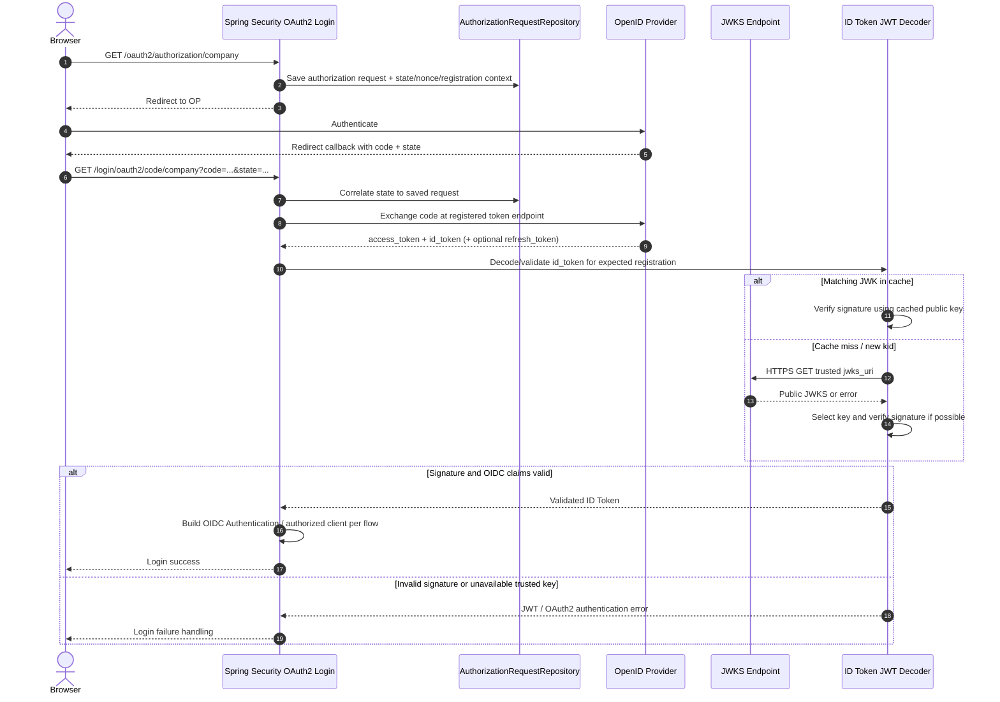

# 28.6. Invalid ID Token Signature and JWKS Retrieval Errors

## 1. Context: OAuth2 Callback Received a Code, Yet OIDC Login Still Failed

A **Spring Security OAuth 2.0 / OpenID Connect Client** application usually starts sign-in with the Authorization Code Flow. After the user authenticates at the OpenID Provider (OP), the browser returns to the callback carrying `code` and `state`. Spring Security exchanges the authorization code at the Token Endpoint and receives an access token and an **ID Token**. To authenticate the user, the application must validate the ID Token per OIDC, including its **JWS signature** and claims such as issuer, audience, expiration, and nonce.

Suppose the backend reports:

```text
OAuth2 login failed
caused by: JWT signature validation failed
```

Or:

```text
Could not obtain the keys needed to validate JWT signature
HTTP 503 from JWKS endpoint
```

Both situations produce the same symptom in the UI—the user cannot log in—yet they have **different root causes**:

- **Invalid signature:** The received ID Token **failed verification** against the appropriate key and algorithm from the selected trusted source. Causes include a tampered token, the AS signing with a different key, wrong issuer/registration selected, wrong metadata, abnormal key rotation, or algorithm misconfiguration.
- **Failed to fetch JWKS:** The application **has not yet obtained the public key** needed for verification. Causes include DNS/TLS/proxy/network errors, the JWKS endpoint returning 4xx/5xx, timeouts, wrong `jwks_uri` config, or cache/key rotation issues. **Never conclude the signature is invalid just because you do not yet have the key to check it.**

The most important point:

> When the ID Token signature cannot be verified or no trusted key is available to verify it, **never create a successful Authentication and never use that ID Token as proof of login**. Accurate diagnosis must distinguish "cryptographic validation failed" from "key retrieval failed", though both result in **fail closed** for the unverified login session.

This lesson belongs to chapter **28. Errors and Observability**, topic **28.6. Invalid ID Token Signature and JWKS Retrieval Errors**, in the **Spring Security OAuth 2.0 OIDC Client** module. Examples focus on **Java 17+, Spring Boot 3.x, Spring Security 6.x, Servlet/MVC**, with notes on WebFlux. Exception names, internal classes, log messages, and caching behavior may vary across versions of Spring Security, Spring Security OAuth2 JOSE, Nimbus JOSE + JWT, and HTTP clients.

### Learning Objectives

After this lesson, you will be able to:

1. Describe ID Token, JWS, JWKS, `kid`, `alg`, `iss`, and `aud`, and understand their relationships.
2. Distinguish signature errors from JWKS retrieval errors, missing-key-by-`kid` errors, and claims validation errors.
3. Describe how the OIDC Client selects `ClientRegistration`, expected issuer, JWKS URI, and verification keys.
4. Understand JWKS fetching/caching mechanisms and key rotation/rollover incidents.
5. Diagnose DNS, TLS, proxy, firewall, HTTP 404/429/503, and empty/malformed responses without disabling cryptographic protection.
6. Design helpful logs/metrics/traces that do not expose ID Tokens, access tokens, codes, nonces, or client secrets.
7. Configure Spring Security OIDC Client and failure handlers cleanly; know the limits when customizing decoders.
8. Design tests with synthetic signing keys/JWKS to distinguish key mismatches, tampered tokens, and key-fetch failures.
9. Understand the difference between OIDC ID Token errors and Resource Server JWT Access Token errors.
10. Build a safe investigation and incident-response runbook usable in multi-issuer/multi-tenant environments.

---

## 2. How Is an ID Token Signed and Verified?

### 2.1. What Does an ID Token Prove?

In OIDC, an **ID Token** is a token containing claims about the end user's authentication event, issued by the OP to the **Relying Party (RP)**—the application handling sign-in.

An illustrative parsed payload:

```json
{
  "iss": "https://identity.example.com/realms/workforce",
  "sub": "subject-4821",
  "aud": "employee-portal-web",
  "iat": 1773800000,
  "exp": 1773803600,
  "nonce": "opaque-per-login-value"
}
```

These values only illustrate the claims; this is not a real ID Token. Prior to verification, a JWT payload is merely **data sent by the token issuer** and must not be used to grant access or identify a user.

In OIDC login, the ID Token differs from:

| Object | Purpose | Proper Usage |
| --- | --- | --- |
| **ID Token** | Asserts end-user authentication to the OIDC Client | Verify per OIDC before creating user Authentication |
| **Access token** | Calls Resource Servers by scopes/audience | Resource Server verifies/decides access permissions |
| **Refresh token** | Requests new tokens per grant/OP policy | Use only with the Token Endpoint when permitted |
| **Authorization code** | Short-lived credential to exchange for tokens | Token Endpoint + client authentication/PKCE |
| **Client secret/private key** | Authenticates the OAuth Client | Protect in secret store; never send to browser |
| **JWKS** | Set of published **public keys** for verifiers to check JWS | Fetch only from trusted issuer/URI with right key/alg policy |

**A JWT access token can also have `iss`, `aud`, and `sub`**, yet that does not make it an ID Token suitable for logging a user in.

### 2.2. JWS Compact Serialization Structure

A standard JWS-format ID Token has three parts:

```text
BASE64URL(header) . BASE64URL(payload) . BASE64URL(signature)
```

Illustrative header example:

```json
{
  "alg": "RS256",
  "kid": "workforce-key-2026-11",
  "typ": "JWT"
}
```

Where:

- `alg`: the JOSE algorithm the token claims was used, such as `RS256`.
- `kid`: **key ID** used to locate the matching key in the JWKS; it is not a secret and is not itself proof that a key is trustworthy.
- `typ`: token type hint if provided; **does not replace** issuer/audience checks.
- `signature`: cryptographic signature verifying integrity and signing origin under a trusted key/algorithm.

The verifier **must never trust the header before verification**. It may use `kid` as a **hint to select a key within a trusted JWKS**, but must never use `kid` or `alg` to fetch keys from an arbitrary token-controlled source.

### 2.3. What Does a Valid Signature Guarantee?

In the `RS256` example:

1. The OP holds the **RSA private key**.
2. The OP signs `header.payload` with that private key.
3. The OP publishes the **public key** in its JWKS.
4. The RP uses the public key to verify the signature.
5. If verification passes, the payload was not altered under that verified algorithm/key.

A valid signature **is not enough to log in** if:

- `iss` is not the issuer expected by the RP.
- `aud` does not contain the logging-in client ID.
- `azp`/multi-audience rules are not satisfied.
- The token is expired or timestamp claims are invalid.
- Nonce does not match the authorization request when required.
- The issuer is right, yet the user lacks tenant/application permissions.
- The key came from an untrusted JWKS.

You must enforce **both cryptographic validation and semantic OIDC claims validation**.

### 2.4. Do All ID Tokens Use RSA?

No. OIDC/JWS supports various algorithms and key types depending on profile, client registration, and OP capabilities—such as RSA, RSA-PSS, EC, or MAC-based algorithms where appropriate.

Points to remember:

- For **asymmetric** algorithms like `RS256` or `ES256`, the JWKS normally holds the public verification key.
- For **HMAC** like `HS256`, the verifier uses a symmetric secret defined by the OIDC contract; **never fetch a "public HMAC key" from a JWKS**.
- Attackers must not be allowed to change `alg` in the header to force the RP to accept another algorithm.
- Spring Security OIDC Client enforces a policy on expected algorithms; only change it when the OP/client registration is configured accordingly and you understand the security consequences.
- Never accept `alg=none` as a login fix.

In this lesson, **RS256 + JWKS public RSA keys** is the primary illustrative case because key rotation and key mismatches are easy to observe with it.

---

## 3. What Is a JWKS and How Does It Relate to Issuer?

### 3.1. JSON Web Key Set (JWKS)

A **JWKS** is a JSON object containing a `keys` array. For RSA public keys, part of a sample response looks like:

```json
{
  "keys": [
    {
      "kty": "RSA",
      "kid": "workforce-key-2026-10",
      "use": "sig",
      "alg": "RS256",
      "n": "<base64url-modulus>",
      "e": "AQAB"
    },
    {
      "kty": "RSA",
      "kid": "workforce-key-2026-11",
      "use": "sig",
      "alg": "RS256",
      "n": "<base64url-modulus-new-key>",
      "e": "AQAB"
    }
  ]
}
```

The `n` strings here are **not valid RSA moduli**; the payload only illustrates the JSON shape. On a real system, `n` and `e` define the RSA public key; a public JWKS endpoint must never contain private RSA parameters such as `d`, `p`, or `q`.

Fields to understand:

| Field | Meaning | Related Errors |
| --- | --- | --- |
| `keys` | List of JWKs | Empty/malformed prevents key selection |
| `kty` | Key type, e.g., RSA/EC/OKP | Incompatible with algorithm |
| `kid` | Key ID | Token `kid` not found; rotation |
| `use` | Key usage, e.g., `sig` | Mistakenly picking an encryption key |
| `key_ops` | Allowed operations, if present | Incompatible with verification |
| `alg` | Key's algorithm, if declared | Mismatches expected JWS algorithm |
| `n`, `e` | RSA public modulus/exponent | Corrupted key/signature mismatch |
| `x`, `y`, `crv` | EC public key parameters | Unsupported curve/wrong key |

`kid` **is not necessarily globally unique** across issuers; two OPs can use the same `kid`. Therefore, cache keys and trust sources must include the **configured issuer/JWKS URI**, not `kid` alone.

### 3.2. Discovery Connects Issuer to JWKS URI

An OP can publish metadata at the issuer's OIDC discovery path. Example configuration:

```text
issuer:
  https://identity.example.com/realms/workforce
```

Illustrative metadata:

```json
{
  "issuer": "https://identity.example.com/realms/workforce",
  "authorization_endpoint": "https://identity.example.com/realms/workforce/protocol/openid-connect/auth",
  "token_endpoint": "https://identity.example.com/realms/workforce/protocol/openid-connect/token",
  "jwks_uri": "https://identity.example.com/realms/workforce/protocol/openid-connect/certs",
  "id_token_signing_alg_values_supported": ["RS256"]
}
```

The RP must:

1. Choose the **trusted expected issuer** from `ClientRegistration`, never from an unverified ID Token.
2. Fetch discovery metadata from the endpoint governed by that issuer's trust policy.
3. Confirm metadata `issuer` exactly matches the configured issuer.
4. Use `jwks_uri` from the controlled metadata/configuration.
5. Fetch the JWKS over valid HTTPS/TLS and pick a key matching `kid/alg/use/kty`.
6. Verify the JWS signature, then OIDC claims.

### 3.3. Do Not "Guess" JWKS URIs by String Concatenation

Providers use different paths, such as:

```text
.../protocol/openid-connect/certs
.../.well-known/jwks.json
.../keys
```

Do not replace `token_uri` with `jwks` yourself or append `/certs` to every issuer URL. Obtain it from **trusted discovery metadata or official OP configuration**.

Distinguish:

- `issuer-uri`: identifies the OP/AS.
- `authorization-uri`: browser navigates here for user authentication/consent.
- `token-uri`: backend exchanges codes/refresh tokens.
- `jwk-set-uri`: backend fetches public verification keys.
- `user-info-uri`: backend may call the UserInfo Endpoint using an access token.
- `end-session-endpoint`: relates to OP logout, not JWKS.

Getting one URI wrong produces distinct errors and should not all be blamed on "bad ID Token".

### 3.4. JWKS Usually Only Needs Fetching When the Key Is Not Cached

Frameworks/JOSE decoders normally **cache** public keys and reuse them for an appropriate period. Depending on implementation, the first token verification, a cache miss, or a `kid` absent from cache can trigger an HTTP GET.

Therefore:

- Do not conclude **"no HTTP GET /jwks on every login"** is a bug; the cache is likely working.
- Do not assume **"if the JWKS endpoint is down, every login immediately fails"**; the decoder may still hold valid public keys in cache.
- Nor should you promise availability when JWKS is unreachable: a new `kid` after rotation will require refreshing the key cache.
- Cache TTL, refresh triggers, HTTP conditional requests, circuit breakers, and retries depend on implementation/version.

**Never disable caching completely** as a way to "fix key rotation", as that makes the JWKS endpoint a hard dependency for every login and causes cascading failures when the provider has a hiccup.

---

## 4. Actual Flow Inside Spring Security OIDC Client

### 4.1. Spring Security Selects Registration Before Processing the ID Token

Typical flow on Servlet/MVC:



This is a **logical sequence**, not a guarantee of exact internal method ordering or caching implementation across every Spring Security version.

### 4.2. Related Classes in Spring Security Servlet

| Class/API | Common Role |
| --- | --- |
| `ClientRegistrationRepository` | Resolves client registration by registration ID |
| `ClientRegistration` | Holds client ID, issuer/provider details, redirect URI, scopes, JWK Set URI |
| `OAuth2AuthorizationRequestRepository` | Saves authorization request and `state` before callback |
| `OAuth2LoginAuthenticationFilter` | Participates in handling OAuth2 Login callbacks |
| `OidcAuthorizationCodeAuthenticationProvider` | Handles OIDC Authorization Code steps, token/ID Token validation |
| `OidcIdTokenDecoderFactory` | Factory creating `JwtDecoder` per `ClientRegistration` for OIDC ID Tokens |
| `JwtDecoder` / Nimbus JOSE | Decodes/verifies JWS and runs configured validation |
| `OidcIdTokenValidator` | Validates OIDC claims per registration/flow |
| `OAuth2AuthenticationException` | May represent login failure or wrap an underlying JWT error |
| `AuthenticationFailureHandler` | Chooses user-facing response when OAuth2 Login fails |
| `OAuth2AuthorizedClientRepository/Service` | Stores authorized client when authorization succeeds per flow |

**Do not confuse** `OidcIdTokenDecoderFactory` used by the OIDC Client with a Resource Server's `JwtDecoder` bean for inbound access tokens. Both may use Nimbus/JWKS, yet their **trust contexts and intended audiences differ**.

### 4.3. When Does Login Fail Before Signature Verification?

A callback can fail before the ID Token is ever decoded:

- `state` mismatch / authorization request not found.
- Authorization Server returned `error=access_denied`.
- Token exchange failed due to `invalid_client`, `invalid_grant`, or PKCE/redirect URI.
- HTTP timeout at the Token Endpoint.
- Token response lacked `id_token` when the OIDC flow required it.
- No matching client registration found.

None of these are "signature validation failed", even though the UI displays "Sign-in failed" in all cases.

### 4.4. When Does Login Fail After a Valid Signature?

An ID Token can pass JWS verification and still fail because:

- `iss` does not match the expected issuer.
- `aud` does not contain the registration's OAuth `client_id`.
- `azp` does not satisfy multiple-audience rules.
- Token `exp` has passed or `iat` fails validator checks.
- `nonce` does not match the authorization request.
- User lacks tenant membership or application authorization.

Therefore, classify cleanly:

```text
JWS signature valid
    ≠ ID Token fully valid
    ≠ application user authorized
```

---

## 5. Error Table: "No Key to Verify" vs. "Verified and Signature Failed"

| Error Group | Common Symptoms | What to Check First |
| --- | --- | --- |
| **Signature mismatch** | Signature verification failed / Bad JWS signature | Right issuer, key, signing algorithm? Was token tampered? |
| **Unknown `kid`** | No matching key / Unable to find JWK | Is JWKS updated? Is OP rotating? Is client cache stale? |
| **Wrong `alg`** | Unsupported/disallowed JWS algorithm | OP/client signing algorithm policy; never enable `none` |
| **Wrong `kty`/`use`** | Unable to select verification key | RSA vs. EC, signing key vs. encryption key |
| **JWKS HTTP 404** | Key endpoint not found | Wrong issuer, metadata path, or proxy route |
| **JWKS HTTP 401/403** | Forbidden/unauthorized | Public JWKS endpoint blocked by policy/gateway |
| **JWKS HTTP 429** | Rate limited | Token storm, cache/retry, provider limits |
| **JWKS HTTP 500/502/503/504** | Upstream unavailable | OP outage, gateway/proxy, retry budget |
| **JWKS DNS failure** | Unknown host / resolver error | DNS/egress/VPC/container network |
| **JWKS TLS failure** | PKIX path building failed / hostname mismatch | Truststore/CA/proxy/cert rotation |
| **JWKS timeout** | Connect/read timeout | Firewall, proxy, provider latency, HTTP client config |
| **Malformed JWKS** | JSON parse failure / invalid JWK | Unexpected HTML, schema, truncated response |
| **Empty JWKS** | No usable signing keys | Provider publication/rotation bug |
| **Wrong issuer/tenant** | Invalid issuer / unexpected JWKS | Registration-to-issuer mapping |
| **Wrong audience/nonce/expiry** | OIDC validation failed | Token claims vs. authorization request |
| **Local clock skew** | Token not yet valid/expired (not signature) | NTP/time sync and validator skew policy |

An exception message may be wrapped by `OAuth2AuthenticationException` or `JwtException`; **do not build monitoring solely on exact substring matching of exception messages**, because messages vary across versions and multiple failure categories can get lumped together.

---

## 6. Diagnosing "ID Token Signature Validation Failed"

### 6.1. Verify the Token Is Checked Under the Right Registration

The first step is not changing algorithms. Identify:

```text
current login registrationId
  -> client_id
  -> expected issuer
  -> trusted JWKS URI
  -> allowed JWS algorithms
```

Example:

```text
registrationId = company-oidc
client_id = employee-portal-web
issuer = https://identity.example.com/realms/workforce
jwks_uri = https://identity.example.com/realms/workforce/protocol/openid-connect/certs
allowed_alg = RS256
```

If `id_token` was issued by another issuer/realm yet the RP tries verifying it under the current registration, keys will mismatch or issuer claims will fail. This can be an **authorization-server/client mix-up**, not the OP suddenly signing badly.

In a multi-tenant environment:

```text
tenant A -> registration A -> issuer A -> JWKS A
tenant B -> registration B -> issuer B -> JWKS B
```

Never fall back to: "verifying with JWKS A failed, try every known JWKS until one passes". Doing so breaks binding to the authorization request, issuer, and client ID.

### 6.2. Was the Token Altered in Transit?

With compact JWS, changing even a single byte in the header/payload/signature causes verification to fail.

Common code/infrastructure mistakes:

- Lowercasing or uppercasing the `id_token` string.
- Decoding and re-encoding JSON with different field order/whitespace while keeping the old signature.
- Adding or stripping dots, line breaks, or spaces during storage.
- Truncating the token due to database column or HTTP payload size limits.
- Confusing `access_token` with `id_token`.
- Using an ID Token from another cache/session instead of the current authorization code's token response.
- Test fixtures modifying `sub`, `exp`, or `aud` in the JWT payload without re-signing.
- Proxy/bridge rewriting JSON responses inconsistently with the contract.

Still, normally the backend receives the token response over HTTPS from the Token Endpoint; **do not assume the token was tampered just because signature verification failed**. Check issuer/JWKS/kid/alg first and investigate transport only if evidence points there.

**Never paste a real ID Token into a public "JWT debugger" website** just to inspect its header/payload. ID Tokens can contain personal data, session details, and sensitive claims. When debugging is needed, use safe internal tools or synthetic tokens in staging.

### 6.3. `kid` Does Not Exist in the JWKS

Header:

```json
{
  "alg": "RS256",
  "kid": "signing-key-new-42"
}
```

JWKS cache:

```json
{
  "keys": [
    {"kty": "RSA", "kid": "signing-key-old-41", "use": "sig"}
  ]
}
```

Possible causes:

1. The OP switched to signing with the new key before publishing it in JWKS.
2. OP JWKS updated, while the RP still holds a stale cache.
3. The RP fetched the **JWKS of a different issuer**.
4. Discovery/JWKS URI is wrong or points to an unsynchronized OP replica.
5. Key ID was changed in the signing service without matching the public key.
6. Some requests pass through a proxy/cache serving an older JWKS version.
7. The token uses a different key type/algorithm, so the selector skips the key even though `kid` matches.

Never use `kid` as proof of issuer. If no matching key is available, the safe action is to **refresh JWKS per policy or fail authentication**, never skip the signature check.

### 6.4. `kid` Exists, Yet Signature Still Fails

If the JWKS contains a JWK with the matching `kid`, you still need:

- Public key parameters `n/e` (RSA) or `x/y/crv` (EC) to match the private key used to sign.
- Algorithm compatible with the key type.
- Key published for verification/signature, not encryption.
- RP received the exact ID Token bytes.
- OP/AS did not publish conflicting key material under the same `kid`.
- No provider bug signing with key A while stamping key B's `kid`.

**Matching `kid` does not guarantee two keys are identical.** When an OP changes key material while reusing a `kid`, caches/instances can suffer unpredictable failures. Proper rotation uses a distinct `kid` for new keys and provides an overlap window.

### 6.5. Disallowed `alg` Algorithm

Example:

```text
Client expects: RS256
ID Token header: HS256
```

or:

```text
Client expects: RS256
ID Token header: none
```

The Client must reject tokens violating policy; never automatically enable every algorithm just to "make errors go away".

Questions to investigate:

- Which algorithm is the OP actually configured to sign ID Tokens with?
- Does the OAuth client registration/metadata specify the matching signing algorithm?
- Does the Spring Security/Nimbus version support that algorithm/key type?
- Is an encrypted ID Token (JWE) being confused with a signed ID Token?
- Did someone alter `alg` in a test JWT without re-signing?

With `HS256`, verification and secret management differ from `RS256`; you cannot take an RSA public JWKS and switch the resolver to HS256.

### 6.6. Never Trust Key URLs Supplied in the JOSE Header

JOSE header parameters such as `jku` or `x5u` can contain URLs. If a verifier fetches keys from a URL specified by the ID Token itself without a trust policy, an attacker can supply a public key they control and sign forged tokens.

**Anti-pattern:**

```text
read JWT header.jku (untrusted)
  -> download any URL
  -> verify signature using that key
  -> accept user
```

**Right rule:** Keys must be restricted to the JWKS/issuer trust configuration of the **exact ClientRegistration**. Never use `kid` as a file path, never loosen `alg` based on the token header, and never trust URLs from payload/headers prior to verification.

### 6.7. Do Not Use "Decode" Instead of "Verify"

A JWT payload can be Base64URL-decoded into JSON **without any key**. This helps inspect structure in test environments, yet **it does not prove the signature**.

```text
Base64URL decode payload       -> reads data only
JWS cryptographic verification -> verifies signature under key/alg
OIDC claims validation         -> issuer/audience/time/nonce...
Application authorization      -> user permissions in the system
```

Never write a custom `OidcUserService` that takes raw decoded claims to build an `OidcUser` when the default decoder fails.

---

## 7. Diagnosing JWKS Retrieval Errors: From DNS to JSON Response

### 7.1. Distinguish Three Steps

When verifying an ID Token whose `kid` is not yet cached, the decoder may need to fetch the JWKS:

```text
(1) Resolve/connect trusted JWKS URI
          |
          v
(2) HTTPS GET + receive HTTP response
          |
          v
(3) Parse JWKS, choose suitable key, verify signature
```

Each step has its own failure modes. **Not every error in (1)/(2) is a bad cryptographic signature.**

### 7.2. DNS and Network Egress

Symptoms:

```text
UnknownHostException
Name or service not known
ConnectException: Connection refused
No route to host
Connection timed out
```

Diagnostic questions:

- Can the app container/VM resolve the `jwks_uri` hostname?
- Do firewalls, Kubernetes NetworkPolicies, service meshes, or proxies permit outbound HTTPS?
- Do split-horizon DNS/VPC/private endpoints point to the right target?
- Did the registered host change CNAME/IP after a migration?
- Is it reachable from the **application runtime**, or only from a developer laptop?
- Is a NAT gateway/egress proxy failing?
- With multiple app nodes: can all nodes connect, or is only a subset failing?

Never fix this by pointing the JWKS URI to an untrusted server; restore connectivity to the right OP key endpoint.

### 7.3. TLS and Certificate Validation

Common exceptions:

```text
SSLHandshakeException
PKIX path building failed
unable to find valid certification path
Hostname verification failed
Certificate expired
```

Causes:

- OP rotated its certificate/CA chain.
- Java truststore lacks an internal CA.
- Proxy performing TLS interception presents an untrusted certificate.
- Certificate hostname does not match the URI.
- System clock skew makes a TLS certificate appear expired or not yet valid.
- mTLS/proxy config accidentally applied incorrectly to JWKS requests.

**Do not do:**

```text
Trust all certificates = true
Disable hostname verification = true
```

This is a dangerous anti-pattern: the RP could fetch a fake JWKS and verify attacker-signed tokens. Update the truststore/CA from the proper source or fix the provider's certificate/hostname.

### 7.4. HTTP Status Codes

| HTTP status | Possible Causes | Action |
| --- | --- | --- |
| 200 | Returned JWKS or unexpected content | Parse/validate JSON and key set |
| 301/302 | Endpoint redirect or CDN migration | Check redirect policy; never follow to untrusted hosts |
| 304 | Conditional request cache validation, if supported by client | Inspect HTTP caching behavior |
| 400 | Endpoint/proxy rejected the request | Check URI, headers/proxy |
| 401/403 | Gateway/WAF/ACL policy blocked | JWKS is usually public; check AS config |
| 404 | Wrong discovery/JWKS path | Use metadata from the exact issuer |
| 429 | Rate limiting | Cache/retry/backoff + provider quota |
| 500/502/503/504 | AS/CDN/proxy unavailable | Upstream incident, timeout/backoff, and key-cache policy |

A JWKS endpoint normally serves **public keys** and does not require a Bearer access token. Do not attach an access token or client secret to `GET jwks_uri` just because of a 401/403 response, unless a specific enterprise profile officially supports and secures it.

### 7.5. HTTP 200 Without Usable Keys

A reverse proxy might return HTTP 200 with an HTML login page instead of JWKS JSON. Or the JWKS response might look like:

```json
{
  "keys": []
}
```

Or:

```json
{
  "keys": [
    {
      "kid": "key-42",
      "kty": "oct",
      "k": "<symmetric-secret-placeholder>"
    }
  ]
}
```

An `oct` key is not an RSA public JWK for verifying `RS256` ID Tokens. If a public endpoint accidentally serves a symmetric secret or private key, that is also a severe provider incident.

Check:

- Response Content-Type and JSON structure.
- Presence of a valid `keys` array.
- Presence of a key matching `kid`/`kty`/`use`/`alg`.
- Complete, parseable RSA/EC public parameters.
- Absence of private key material.
- Response size and JSON nesting within bounds.
- Cache/CDN is not serving another tenant's content.

### 7.6. Verify from the App's Actual Runtime Network

Illustrative commands using public key URLs, **needing no tokens/secrets**:

```bash
# 1. Check OIDC discovery at the trusted issuer.
curl --fail --silent --show-error --max-time 5 \
  "https://identity.example.com/realms/workforce/.well-known/openid-configuration"

# 2. Use the exact jwks_uri advertised by metadata.
curl --fail --silent --show-error --max-time 5 \
  "https://identity.example.com/realms/workforce/protocol/openid-connect/certs"
```

With some providers, the discovery path follows standardized placement for issuers with paths, or provider-specific conventions. The commands above **only illustrate the example's published URLs**, not a universal path-concatenation formula for every issuer.

If `jq` is available in the diagnostic environment:

```bash
curl --fail --silent --show-error --max-time 5 \
  "https://identity.example.com/realms/workforce/protocol/openid-connect/certs" \
  | jq '.keys[] | {kid, kty, use, alg}'
```

**Only run against endpoints managed and trusted by your organization.** Avoid pasting arbitrary URLs from attacker-controlled error messages into a shell with internal network access. When investigating production, test from the same VPC/container/network path while respecting access controls and avoiding unnecessary load.

### 7.7. Check Java's Own Truststore

If `curl` succeeds while Java throws `PKIX path building failed`:

- `curl` and the JVM may use **different trust stores**.
- Proxy/OS CA trust may differ from the JDK truststore.
- The container's JDK runtime may lack an internal CA.
- The JVM may configure a custom `javax.net.ssl.trustStore`.
- Do not fix a certificate on your laptop and assume the production container was updated.

Identify the exact JDK image/truststore running the app, the OP certificate chain, and mTLS/proxy policies. Update CAs in the image/runtime through a secure pipeline.

---

## 8. JWKS Caching and Key Rotation: Errors Appearing Only at Certain Times

### 8.1. Why Do OPs Rotate Signing Keys?

An OP may rotate signing keys due to:

- Security policy/rotation schedule.
- Suspected key compromise.
- Algorithm/key-type upgrade.
- HSM/KMS migration.
- Cluster/region migration.
- Related certificate expiry, even though a JWK need not be an X.509 certificate.

During rolling deployments, an OP cluster may have instances signing with different keys during a transition window. The public JWKS must be published **consistently and early enough**.

### 8.2. Safe Rotation Procedure with Overlap

Example timeline:

```text
T0  JWKS publishes Key A (kid=A)
    OP signs ID Tokens with private Key A

T1  JWKS publishes Key A + Key B
    OP still signs with A
    Clients can refresh caches and learn B

T2  OP starts signing with Key B (kid=B)
    JWKS still publishes A + B
    New logins can verify using B
    Tokens signed by A can still be verified while valid

T3  After suitable overlap:
    old tokens signed with A have expired (plus cache/skew window)
    OP removes A from JWKS when policy allows
```

This strategy prevents `unknown kid` errors when the provider switches to signing with B.

If the OP **starts signing with B before publishing B**, clients cannot find public key B and logins can fail en masse. Conversely, if the OP **removes A too early**, recently issued tokens signed by A that are still valid may fail verification upon cache refresh.

### 8.3. Why Do Only Some Nodes Fail?

A system with multiple app instances:

```text
Node A: JWKS cache has Key A + Key B -> login passes
Node B: JWKS cache has only Key A   -> new kid=B needs refresh
Node C: network cannot reach JWKS   -> refresh fails
```

Symptoms:

- Intermittent, node-dependent failures.
- Login succeeds after restarting a node.
- Failures limited to one region/VPC.
- Users logging into the same OP see different outcomes depending on routing.
- Spike in JWKS GETs after the OP starts signing with a new kid.

Measure **per instance/region and issuer alias**, not just a global "login failure" total.

### 8.4. Restarting the App Is Not a Sustainable Key Rotation Fix

Restarting clears the old cache and forces a fresh JWKS fetch, seemingly fixing the error. However, restarting can make outages **worse** if the JWKS endpoint is unavailable, because all nodes suddenly need to fetch keys at once.

Prioritize:

1. Cross-check JWT `kid` via safe debugging against the current JWKS.
2. Confirm expected issuer/JWKS URI and metadata.
3. Check cache refresh behavior per library version.
4. Ensure the OP publishes new keys before signing with them.
5. Diagnose network/proxy/cache-control on failing nodes.
6. Use bounded rollout/retry if config changes are needed.
7. Execute the runbook in coordination with the OP team.

Never set cache TTL to 0 everywhere as a permanent fix.

### 8.5. JWKS Cache and Emergency Key Revocation

If a signing key is compromised, keeping it cached extends the window during which verifiers accept JWTs signed by that key. Yet deleting a key from JWKS immediately can break logins for new/in-flight tokens if the OP has not switched keys yet.

Policies must balance:

- Normal rollover requires **overlap**.
- Emergency compromise may require **immediate key removal/denial**, accepting disruption to ensure safety.
- Cache invalidation/TTL must be part of incident response for both OP and RP.
- Never assume removing a key from the OP JWKS instantly stops every RP from trusting it while caches remain valid.
- Never retain old fallback keys indefinitely "to avoid user errors".
- If a compromised `kid` must be blocked, use supported policy/implementation controls with audit and controlled rollout.

### 8.6. Proxy/CDN Caching Issues

A JWKS URI may sit behind a CDN/reverse proxy. Check:

- Does the CDN cache key include the right host/path/tenant?
- Could realm A's response be served for realm B?
- Are Cache-Control/ETag/Expires aligned with rotation policy?
- Is one edge region serving a stale JWKS?
- Does a WAF block/rate-limit requests lacking a User-Agent?
- Is a proxy modifying JSON responses?
- Is DNS/resolver pointing to an old cluster after a migration?

**Sharing the same `kid` across tenants does not make their JWKS interchangeable.** Never pool key caches globally by `kid` alone.

---

## 9. Standard Spring Boot OIDC Client Configuration

### 9.1. Servlet/MVC Dependencies

Maven example:

```xml
<dependencies>
    <dependency>
        <groupId>org.springframework.boot</groupId>
        <artifactId>spring-boot-starter-web</artifactId>
    </dependency>
    <dependency>
        <groupId>org.springframework.boot</groupId>
        <artifactId>spring-boot-starter-security</artifactId>
    </dependency>
    <dependency>
        <groupId>org.springframework.boot</groupId>
        <artifactId>spring-boot-starter-oauth2-client</artifactId>
    </dependency>
</dependencies>
```

Gradle Kotlin DSL:

```kotlin
dependencies {
    implementation("org.springframework.boot:spring-boot-starter-web")
    implementation("org.springframework.boot:spring-boot-starter-security")
    implementation("org.springframework.boot:spring-boot-starter-oauth2-client")
}
```

Use Spring Boot's dependency management/BOM to keep versions compatible. Do not force Nimbus JOSE + JWT onto an incompatible version just to alter `kid` behavior; that can introduce incompatibilities or vulnerabilities.

### 9.2. `application.yml` with Issuer URI

```yaml
spring:
  security:
    oauth2:
      client:
        registration:
          company:
            provider: workforce
            client-id: ${OIDC_CLIENT_ID}
            client-secret: ${OIDC_CLIENT_SECRET}
            client-authentication-method: client_secret_basic
            authorization-grant-type: authorization_code
            redirect-uri: "{baseUrl}/login/oauth2/code/{registrationId}"
            scope:
              - openid
              - profile
              - email

        provider:
          workforce:
            issuer-uri: https://identity.example.com/realms/workforce
```

When using `issuer-uri`, Spring Boot can discover OP metadata and configure the appropriate endpoints (Authorization, Token, UserInfo, JWK Set) depending on version. Ensure network reachability from the app runtime to discovery/JWKS.

**Never copy a JWKS URL from a browser network tab of another realm** merely because the provider name looks similar. An issuer with a specific path/realm must use the metadata/JWKS belonging to that exact issuer.

### 9.3. When Explicit `jwk-set-uri` Configuration Is Needed

Spring Boot client provider config can specify endpoints explicitly:

```yaml
spring:
  security:
    oauth2:
      client:
        provider:
          workforce:
            issuer-uri: https://identity.example.com/realms/workforce
            jwk-set-uri: https://identity.example.com/realms/workforce/protocol/openid-connect/certs
```

This is a **supplementary/override config snippet** per provider, not a complete application YAML.

Use it only when backed by a clear OP contract or operational need and after verifying **that JWKS belongs to that exact issuer**. Never use another issuer's `jwk-set-uri` to make signatures pass; if there is a mismatch, fix the issuer/client registration or OP publication.

### 9.4. SecurityFilterChain for OAuth2 Login

```java
package com.example.portal.security;

import org.springframework.context.annotation.Bean;
import org.springframework.context.annotation.Configuration;
import org.springframework.security.config.Customizer;
import org.springframework.security.config.annotation.web.builders.HttpSecurity;
import org.springframework.security.web.SecurityFilterChain;

@Configuration
public class OidcWebSecurityConfig {

    @Bean
    SecurityFilterChain securityFilterChain(HttpSecurity http)
            throws Exception {

        return http
                .authorizeHttpRequests(requests -> requests
                        .requestMatchers("/", "/login", "/error").permitAll()
                        .anyRequest().authenticated())
                .oauth2Login(Customizer.withDefaults())
                .build();
    }
}
```

This is the **baseline** configuration. Spring Security performs OIDC token verification via the configured components when using the `openid` scope and an appropriate provider. Never convert ID Tokens into Authentications manually inside a controller to bypass the decoder.

### 9.5. Why Not Write One `JwtDecoder` with Every Issuer's JWKS?

An application may have:

```yaml
registration:
  company-a:
    provider: a
  company-b:
    provider: b
```

If using a single hardcoded global decoder:

```java
// ANTI-PATTERN when multiple issuers exist:
JwtDecoder decoder =
        NimbusJwtDecoder.withJwkSetUri(JWKS_FOR_ISSUER_A).build();
```

and passing all ID Tokens from B through decoder A, signature errors will occur—or worse, custom code might disable issuer validation.

In OAuth2 Client, the decoder must **be chosen per trusted ClientRegistration**. `NimbusJwtDecoder.withJwkSetUri(...)` is a useful API in some contexts, especially Resource Servers, yet **it does not replace the full OIDC Client flow and OIDC claims checks** when used standalone.

---

## 10. Customizing ID Token Algorithms: Only When Truly Needed

### 10.1. Spring Security Provides `OidcIdTokenDecoderFactory`

For Servlet OIDC Client, an extension point is `OidcIdTokenDecoderFactory`, which creates a `JwtDecoder` per `ClientRegistration`. It can be configured with a JWS signing algorithm policy depending on version.

When the OP and client registration **agree on RS256**, the default/properly configured factory is usually sufficient. Do not customize the decoder solely because you saw a generic login error.

### 10.2. Fragment Illustrating Allowed Signing Algorithms

```java
import org.springframework.security.oauth2.client.oidc.authentication.OidcIdTokenDecoderFactory;
import org.springframework.security.oauth2.jose.jws.SignatureAlgorithm;

OidcIdTokenDecoderFactory factory =
        new OidcIdTokenDecoderFactory();

factory.setJwsAlgorithmResolver(
        registration -> SignatureAlgorithm.RS256);
```

This is an **illustrative API fragment**; merely declaring a local variable as above will not automatically change `oauth2Login()`'s decoder. Registering/wiring a custom `JwtDecoderFactory<ClientRegistration>` into the OIDC authentication provider must follow your specific Spring Security version and configuration.

**Warning:** Do not change the resolver to `HS256`/multiple algorithms simply because an ID Token header claims that algorithm. Verify the OP configuration, client authentication/ID Token signing method, and trust model first.

### 10.3. Do Not Replace Validators with a Signature-Only Check

A custom decoder that verifies RSA signatures itself while dropping `iss`, `aud`, and `nonce` introduces vulnerabilities even if signature errors disappear.

If you truly must customize the OIDC decoder/provider:

- Preserve cryptographic JWS verification.
- Preserve expected issuer per registration.
- Preserve ID Token audience/client ID and `azp` rules.
- Preserve validation of expiration, issued time, nonce, and OIDC claims.
- Restrict algorithms/key types.
- Never accept JWT `alg=none`.
- Never fetch JWKs from token-supplied `jku/x5u`.
- Never treat an access token as an ID Token.
- Add integration tests for rejection cases.

A custom configuration compiling cleanly **does not prove it preserves all security invariants**; it requires dedicated security review and a project test suite.

---

## 11. User-Facing Login Errors and Handling in Spring Security

### 11.1. Do Not Turn Technical Exceptions into Browser Leaks

For JWKS fetch or ID Token signature failures:

- The RP must reject login when the token cannot be verified.
- Users need a helpful message **without exposing the ID Token, client secret, JWKS internals, or full exception stack**.
- Ops needs a correlation ID and classified error code to investigate.
- If a JWKS outage causes transient errors, you may advise users to try again later without promising immediate success.
- Never open a "temporary signature validation bypass" to help users log in.

An appropriate UI message:

> Unable to complete secure sign-in. Please try again later or contact support if the issue persists.

### 11.2. Servlet Login Failure Handler Example

```java
package com.example.portal.security;

import org.springframework.context.annotation.Bean;
import org.springframework.context.annotation.Configuration;
import org.springframework.security.config.annotation.web.builders.HttpSecurity;
import org.springframework.security.web.SecurityFilterChain;
import org.springframework.security.web.authentication.SimpleUrlAuthenticationFailureHandler;

@Configuration
public class OidcFailureSecurityConfig {

    @Bean
    SecurityFilterChain securityFilterChain(HttpSecurity http)
            throws Exception {

        var failureHandler =
                new SimpleUrlAuthenticationFailureHandler(
                        "/login?error=oidc_failed");

        return http
                .authorizeHttpRequests(requests -> requests
                        .requestMatchers("/", "/login", "/error").permitAll()
                        .anyRequest().authenticated())
                .oauth2Login(oauth2 ->
                        oauth2.failureHandler(failureHandler))
                .build();
    }
}
```

This is an **alternative** to the baseline SecurityFilterChain in section 9.4; **do not create two global chains with overlapping matchers**. The failure handler only chooses the response URL; it **does not classify root causes** or fix JWKS outages by itself.

### 11.3. Safe Categorization at the Logging/Observability Layer

A custom `AuthenticationFailureHandler` can:

- Extract a classified error code using an internal error classifier.
- Log the request correlation ID along with `registrationId` if obtained from a trusted request context.
- Increment metrics by `reason=invalid_signature|jwks_unavailable|invalid_claims|other`.
- Return a generic response without displaying raw exceptions.
- Never log `code`/`state`/`id_token`/headers/bodies.

**Pseudocode** example illustrating the policy (not a built-in exception API):

```java
// PSEUDOCODE — application-built classifier, not a Spring API.
String category = classifyOidcFailure(authenticationException);

safeAudit.record(
        "oidc_login_failure",
        trustedRegistrationAlias,
        category,
        correlationId);

response.sendRedirect("/login?error=oidc_failed");
```

If ops needs to trace nested exceptions, restrict access and mask all sensitive data. HTTP client/token decoder exception messages can include URLs or internals that must not appear in the browser.

### 11.4. Signature Failures Must Never Persist an Authorized Client

In an OIDC flow, if the ID Token fails verification, the application **must not** create a valid `OidcUser`/Authentication from the raw parsed payload and must not treat the token response as a successful login.

If custom code saves `OAuth2AuthorizedClient` before ID Token validation completes and lets an API client use it, that creates an escalation/mix-up risk. Let the framework manage the lifecycle or ensure custom flows maintain clear transaction/policy state and never "half-authenticate" users.

---

## 12. JWKS Errors at Startup, Login, and Key Rotation

### 12.1. Do Not Lump All Outages Together

| Timing | Component That Can Fail | Observation |
| --- | --- | --- |
| Startup/config binding | OIDC discovery metadata or client registration validation | App may fail to create beans/start depending on config/version |
| First login | JWKS cache lacks key | JWKS GET fails → ID Token cannot be verified |
| After many successful logins | Cache hit | May continue using cached old key per policy |
| OP key rotation | Token has new `kid` | Decoder needs new key; fails if cache/endpoint unavailable |
| OP revokes old key | Stale cache remains | May accept tokens per cache/policy until invalidated |
| New node deployed | Cold JWKS cache | New node fails while endpoint is down; old nodes still pass |
| Multi-tenant onboarding | New tenant's issuer/JWKS | Only new tenant fails, or SSRF block if config untrusted |

"Restarting the app to fix JWKS" creates cold caches and can turn a localized outage into a system-wide outage. Always identify the **current key cache, issuer, and network path** before rolling restarts.

### 12.2. How to Set Timeouts/Retries

HTTP calls to discovery/JWKS need:

- Explicit connection timeout.
- Read/response timeout.
- Bounded retries with backoff/jitter **for transient errors only**.
- Overall login time budget.
- Connection pool, DNS, proxy, and circuit breaker management per dependency.
- Public key caching per library/OP policy.
- Rate limiting to prevent retry storms during concurrent logins.
- Observability separating JWKS GETs from Token Endpoint/UserInfo API requests.

**Never configure infinite retries** that hang login requests, and never set "HTTP timeout 0" to dodge errors. If JWKS is genuinely unavailable and no valid key is cached, fail closed.

### 12.3. Should Public JWKS Be Bundled as a Fallback?

Some closed systems may pin public signing keys under explicit contracts. However, "bundling a JWKS file in code to verify when the network fails" carries major risks:

- Old keys may be revoked/compromised.
- The app misses new key rotations.
- One file gets misused across tenants.
- Deploy/rollover coordination becomes brittle.
- It can inadvertently bypass trusted JWKS update policies.

Only use pinning/offline keys with an explicit **trust, rotation, revocation, and incident response model**. Never accept a new `kid` by trying keys from an uncontrolled fallback URL.

### 12.4. Should Startup Readiness Check JWKS?

You can design appropriate readiness signals, but avoid turning every readiness probe into a `GET jwks_uri` that hammers the OP. Options:

- Validate issuer/registration configuration at startup.
- Warm key caches in a controlled manner if the framework permits and the risk model calls for it.
- Track key retrieval failures and login errors via metrics.
- Probe metadata/JWKS in a separate observability workflow with reasonable intervals/timeouts.
- Distinguish "app is running" from "OIDC login can currently verify new kids".

Do not mark the entire application unavailable because one optional tenant OP is failing, if the multi-tenant architecture can isolate that tenant. Never grant Authentication for the failing tenant, though.

---

## 13. Observability: Measuring JWKS and Signature Errors Without Leaking Credentials

### 13.1. Separate Stages to Alert on the Right Root Cause

An OIDC login can be slow or fail across multiple dependencies:

```text
Browser OAuth2 authorization
    |
    +-- Authorization endpoint / consent
    |
    +-- Callback + state validation
    |
    +-- Token Endpoint / code exchange
    |
    +-- ID Token validation
    |       |
    |       +-- Local JWS signature verification
    |       +-- JWKS cache lookup
    |       +-- JWKS HTTPS GET (if needed)
    |       +-- OIDC claims issuer/audience/time/nonce
    |
    +-- UserInfo Endpoint (if called)
    |
    +-- Local application user mapping/authorization
```

If everything is collapsed into one `oauth2_login_failure` metric, it is hard to tell apart:

- Slow OP Token Endpoint vs. slow JWKS endpoint.
- Badly signed token vs. missing public key.
- Expired ID Token vs. issuer mismatch.
- UserInfo 503 vs. local user mapping failure.
- Tenant authorization denial vs. login protocol failure.

**Note:** Not every step is exposed as a built-in metric by the framework. The application may need custom instrumentation using the APIs/HTTP clients supported by its version.

### 13.2. Suggested Metrics

| Illustrative Metric | Meaning | Recommended Labels |
| --- | --- | --- |
| `oidc.login.attempts` | Login start/completion count | registration alias, result |
| `oidc.login.failures` | OIDC flow failures | reason category, registration alias |
| `oidc.id_token.validation.failures` | Token verification failures | `reason=signature|claims|key_unavailable|unsupported_alg` |
| `oidc.jwks.fetch.requests` | HTTP calls to JWKS | issuer alias, outcome |
| `oidc.jwks.fetch.duration` | JWKS HTTP latency | issuer alias, region |
| `oidc.jwks.fetch.failures` | Retrieval errors | `category=dns|tls|timeout|http4xx|http5xx|parse` |
| `oidc.jwks.key_miss` | No matching verification key found | issuer alias |
| `oidc.jwks.rotation.detected` | New key observed per observability policy | issuer alias |
| `oidc.jwks.cache.hit` / `miss` | Cache effectiveness | issuer alias, component |
| `oidc.id_token.issuer_mismatch` | Wrong issuer in ID Token | registration alias |
| `oidc.id_token.audience_mismatch` | Wrong OAuth client audience | registration alias |
| `oidc.login.failure_handler.invocations` | Failed logins reaching UI | response group |

These are **suggested metric names**, not claims that Spring Security/Nimbus emits them by default. With Micrometer/OpenTelemetry, pick low-cardinality labels and avoid:

- Raw tokens or arbitrary input `kid` values.
- Email, `sub`, `state`, auth code, session ID.
- URIs/query strings that might carry secrets.
- Issuer URLs of un-onboarded tenants.
- Full exception messages as labels.

If you want to detect a new `kid`, record **a normalized fingerprint/hash or a controlled event**, rather than creating millions of metric series from internet-supplied token headers.

### 13.3. Sample Safe Logs

```text
WARN event=oidc_id_token_validation_failed
     registration=company
     issuer_alias=workforce
     phase=jws_verify
     reason=signature_invalid
     correlation_id=login-7fe4a

WARN event=oidc_jwks_fetch_failed
     registration=company
     issuer_alias=workforce
     phase=jwks_fetch
     reason=tls_trust_failure
     duration_ms=145
     correlation_id=login-7fe4a

WARN event=oidc_login_failed
     registration=company
     reason=key_unavailable
     user_message_category=temporary_login_failure
     correlation_id=login-7fe4a
```

Do not log:

```text
id_token=<raw.JWT.value>
Authorization: Bearer <token>
client_secret=<secret>
authorization_code=<code>
state=<state>
nonce=<nonce>
response_body={"id_token": "..."}
```

When debugging requires inspecting `kid/alg`, do so in a protected environment and store only controlled metadata. `kid` is non-secret per specification, yet it remains untrusted input that can have high cardinality and contain attacker-chosen strings.

### 13.4. Spring Security Logging Levels

A **temporary configuration for staging or controlled troubleshooting**:

```yaml
logging:
  level:
    org.springframework.security.oauth2: DEBUG
    org.springframework.security.web.authentication: INFO
```

Review policies/logging implementations for your version before enabling in production:

- DEBUG can print substantial request/security flow details.
- TRACE/HTTP wiretaps can log headers, bodies, and queries containing tokens.
- Never leave global `org.springframework.security: TRACE` or raw HTTP body logging enabled as a long-term default.
- Use correlation IDs instead of logging token values.
- Return logging to normal levels after investigation and review retention.

Never infer from `DEBUG` that "zero raw tokens will appear in logs". A custom filter/proxy/HTTP client may log sensitive data even if Spring Security itself does not.

### 13.5. Traces Separating HTTP and Local Crypto Operations

A trace can represent:

```text
request /login/oauth2/code/company
    |
    +-- oauth2.state.validate
    +-- oauth2.token.exchange (trusted token endpoint)
    +-- oidc.id_token.verify
    |       +-- jwks.cache.lookup
    |       +-- jwks.http.fetch (if cache miss)
    |       +-- jws.signature.verify
    |       +-- oidc.claims.validate
    +-- oauth2.authentication.finish
```

Spans should only carry metadata:

- Registration alias.
- Issuer alias.
- Error category.
- HTTP status group.
- Duration.
- Backend region/node.

**Never attach JWT headers/payloads/signatures, token response bodies, Basic Authorization headers, or client secrets to trace attributes.**

### 13.6. Alerting by Blast Radius

| Scenario | Indicator | Investigation Priority |
| --- | --- | --- |
| One issuer failing across many nodes simultaneously | Rising `jwks_fetch_failures`, timeouts/503 | OP outage/network/rotation |
| One node failing, others passing | Region/node-specific timeouts/cache | DNS, proxy, cache, TLS/truststore |
| Only right after key rotation | `key_miss` rising for new `kid` | JWKS publication/cache refresh |
| All users getting signature invalid | `signature_invalid` rising while JWKS GET 200 | Wrong key/alg/issuer/token handling |
| Only one tenant failing | Different registration/issuer/JWKS | Tenant config, discovery, provider |
| Single user failing | State/nonce/clock/session or corrupted token | Classify specifically; avoid blaming whole OP |
| Right after a new deploy | Changed TLS truststore/library/config | Image/JDK/BOM/config rollout |
| Right after changing client ID | ID Token aud mismatch | Client registration/OP app configuration |

Monitoring must account for login attempt volume so a single request in a very low-traffic tenant does not trigger a "100% failure" page.

---

## 14. Safe Field Diagnostic Procedure

### 14.1. Step 1 — Identify Which Stage Failed

Collect:

- Failure timestamp and deployment region.
- `registrationId`/issuer alias from a trusted request context.
- Whether the Token Endpoint HTTP response succeeded (without logging the token response).
- Whether the ID Token decoder ran.
- Whether the error is `signature_invalid`, `key_missing`, `jwks_unavailable`, or claims validation.
- App instance/version/JDK/truststore.
- Recent events: OP key rotation, proxy changes, certificate updates, deploys, DNS/CDN changes.

Never ask users to paste raw ID Tokens/authorization codes into public chat tickets.

### 14.2. Step 2 — Compare Expected Issuer Against Metadata

Read configuration for the exact registration:

```text
registrationId = company
issuer-uri = https://identity.example.com/realms/workforce
```

Compare against discovery metadata:

```json
{
  "issuer": "https://identity.example.com/realms/workforce",
  "jwks_uri": "https://identity.example.com/realms/workforce/protocol/openid-connect/certs"
}
```

Check:

- Exact issuer string.
- No environment/realm mix-up (dev/staging/prod).
- `jwks_uri` belongs to the issuer's trust profile.
- Host/path/port match the public endpoint.
- Registration `client_id` matches the app at the OP.

If the issuer is wrong, **fix client/provider config**; never "try every public key" to accept an ID Token from another issuer.

### 14.3. Step 3 — Test JWKS from the Runtime Environment

A public-key GET command (no tokens/secrets):

```bash
curl --fail --silent --show-error --max-time 5 \
  "https://identity.example.com/realms/workforce/protocol/openid-connect/certs"
```

Verify:

- DNS resolution.
- TLS certificate chain/hostname.
- HTTP status.
- JSON contains `keys`.
- Key selectors find matching `kid`/`alg/kty/use`.

If your laptop succeeds while the container fails, focus on the container's network/truststore. Do not configure browser CORS to "fix JWKS" in server-side validation: this is a backend-to-OP HTTP call, not JS fetch running in the browser.

### 14.4. Step 4 — Check Key Rotation

If the OP confirms a recent rotation:

- Has the new key been published in JWKS across all regions?
- Does the new token's `kid` exist in the public JWKS?
- Did key type/algorithm change?
- Was the old key removed before older tokens expired?
- Is a cache/CDN stale?
- Does the RP library refresh JWKS on an unknown `kid` in this version?
- Is controlled cache invalidation or a rolling restart needed per runbook?

**Never** fix this by keeping the OP's private key on the RP. The RP only needs public verification material; private signing keys belong strictly to the OP.

### 14.5. Step 5 — If the Key Exists Yet Signature Still Fails

Investigate:

1. Was the token issued by the expected AS?
2. Was the token response mis-parsed/re-serialized?
3. Is header `alg/kid` compatible with the trusted JWK?
4. Does the JWK public key material match the OP signer's public key?
5. Is an OP instance/region signing with an unpublished key?
6. Did a custom JWT decoder override `alg` or the key source?
7. Is the token actually an ID Token rather than an access token?
8. Does OP documentation mention encrypted ID Tokens/JWE?
9. Do claims validations run before or after signature in this implementation?
10. If OP compromise or forged tokens are suspected, has security incident response been activated?

**Never log or send raw tokens to third parties for comparison.** In staging, generate synthetic test ID Tokens from fake keys to reproduce.

### 14.6. Step 6 — Remediate According to Root Cause

| Identified Root Cause | Action |
| --- | --- |
| Wrong registration/issuer | Fix tenant/client routing and expected issuer; never relax issuer validation |
| Wrong JWKS URI | Fix metadata/config per trusted issuer |
| OP has not published new key | OP publishes key, uses overlap rotation |
| Old key removed too early | OP coordinates controlled recovery; never accept arbitrary keys |
| Stale proxy/CDN | Fix cache invalidation/metadata propagation |
| DNS/firewall/egress error | Restore network path to trusted JWKS |
| Java truststore missing CA | Update exact CA/chain; never trust-all |
| TLS hostname mismatch | Fix certificate/host; never disable verification |
| Unsupported signing algorithm | Update negotiated policy and compatible library with review |
| ID Token rewritten | Fix token handling/serialization |
| Wrong ID Token audience | Fix client/issuer registration; never drop audience validator |
| App clock skewed | Fix NTP/time sync and controlled skew policy; never drop expiry checks |
| Cold backend JWKS cache + outage | OP/network recovery, controlled warmup |
| OP signer uses private key not matching JWK | Fix OP KMS/JWKS deployment |
| Possible key compromise | Incident response, revoke/rotate keys and cache policy |

### 14.7. Step 7 — Verify Recovery with Real Tests

After config/OP changes, verify:

- New OIDC logins succeed with the expected issuer/client.
- Tokens with wrong issuer/alg/signature **are still rejected**.
- New JWKS keys can be fetched/cached.
- UserInfo/claims validation is not bypassed.
- All nodes/regions recover together.
- Zero token/secret log leakage occurs.
- Alerts return to baseline and the incident is documented.

Never treat "login succeeded after disabling signature validation" as recovery. That **replaces an availability incident with a security incident**.

---

## 15. Security Failure Modes and Anti-Patterns to Strictly Avoid

### 15.1. Skipping Signature Checks to Let Users Log In

Anti-pattern:

```java
// Conceptual ANTI-PATTERN:
Jwt jwt = parseWithoutVerifyingSignature(idToken);
Authentication auth = buildAuthenticatedUser(jwt.getClaims());
```

If anyone can submit a self-crafted token with `sub=admin`, the application is compromised. **Never create an Authentication from unverified claims.**

### 15.2. Accepting Any `alg`

Anti-pattern:

```text
if header.alg == whatever:
    choose a verifier dynamically and accept
```

Accepting attacker-chosen algorithms enables algorithm confusion/downgrade attacks. Verifiers must enforce an **allowlist per expected OP/client registration** and separate symmetric keys from asymmetric public keys.

### 15.3. Fetching Arbitrary Keys via `jku` from the ID Token

Anti-pattern:

```text
JWT header:
  jku = https://attacker.example/keys

RP:
  GET https://attacker.example/keys
  verify attacker's signed token
  accept login
```

Never let a JWT header or payload dictate the trust source. The JWKS URI must come from the trusted expected issuer/registration.

### 15.4. Ignoring Issuer Once Signature Passes

A token validly signed by another OP still has no authority to log into the current app/tenant. Especially in multi-tenant SaaS, enforce binding:

```text
tenant -> ClientRegistration -> expected issuer -> JWKS
       -> ID Token aud/nonce -> verified (iss,sub)
       -> tenant membership
```

Never "try every JWKS" and map `sub` to a global user.

### 15.5. Using an Access Token as an ID Token

A JWT Access Token may be signed by the same OP yet have `aud` meant for a Resource Server rather than the OAuth client ID. If the RP only checks signatures and creates an OIDC session, token substitution occurs.

**Use only `id_token` from the OIDC token response** and run full OIDC validation.

### 15.6. Automatically Falling Back to an Old ID Token

If a new login receives an unverifiable ID Token, never pull an ID Token from a previous session/cache to declare the new login successful. The old session may be expired, logged out, or belong to another principal; issuer/client/nonce no longer bind to the current authorization request.

### 15.7. Using a JWKS Public Key as a Client Secret

A JWKS holds **verification public keys**, while a client secret authenticates the RP at the Token Endpoint. The two serve different purposes. Never send the OP's RSA private signing key to the RP; never think a JWKS can serve as OAuth client authentication.

### 15.8. Hardcoding Private/Public Keys to Dodge Outages

Pinning a specific public key can have a place in tightly controlled environments, provided a rotation/revocation plan exists. Never hardcode an old key permanently or outside issuer policy.

### 15.9. Logging Raw JWTs Because "It's Not an Access Token"

An ID Token is still a credential/identity assertion with sensitive claims that can identify users. Never log full JWTs. If forensics requires sensitive data during an incident, use a dedicated incident process with access controls, encryption, and retention limits.

### 15.10. Fixing TLS with Trust-All or Disabling Hostname Verification

This is especially severe for JWKS: the RP can fetch **forged public keys** from a MITM. Fix the truststore/certificate chain/OP hostname rather than weakening TLS on the trust-material channel.

---

## 16. Multi-Tenant: JWKS Cache and Trust Isolation

### 16.1. Two Tenants with the Same `kid` Can Have Different Public Keys

Example:

```text
Tenant North:
  issuer = https://login.north.example.com/oidc
  kid = main-key-1
  JWK = RSA Public Key N

Tenant South:
  issuer = https://login.south.example.net/oidc
  kid = main-key-1
  JWK = RSA Public Key S
```

If an application builds a custom cache:

```java
// ANTI-PATTERN: kid is not unique across issuers.
Map<String, PublicKey> cacheByKid;
```

North tokens could be verified against South's key or vice versa, causing false failures or trust confusion if the implementation has dangerous fallbacks.

Key selection must stay scoped to the **expected issuer/registration/JWKS trust source**. Never maintain a global JWKS mixing all tenants.

### 16.2. One Issuer Serving Multiple OAuth Clients

If the same OP issuer serves `employee-portal-web` and `admin-console`, they may share a JWKS trust source, yet the ID Token's `aud` must still be checked against each registration's client ID.

A valid signature with the OP's key **is not enough** for an ID Token issued to `admin-console` to sign into `employee-portal-web`.

### 16.3. When a Tenant Changes OP

If a tenant switches issuers:

- Update ClientRegistration/issuer/metadata through an approval workflow.
- Ensure registration ID/storage namespaces are not mis-reused for old tokens/keys.
- Never keep the old OP's JWKS in the new trust set cache.
- Require verified reauthorization or account linking; never equate `sub` automatically.
- Revoke authorized clients/refresh tokens per the old OP's policy.
- Monitor kid/issuer mismatches after cutover.

**Changing the JWKS URL while keeping an unverified issuer/client ID** alters a trust boundary; do not treat it as a mere network config edit.

### 16.4. BYO-IdP Must Include SSRF Protection

If customers can onboard their own IdPs, metadata/JWKS URIs come from an authenticated admin workflow. Yet endpoints could still point to:

- Private IPs.
- Link-local metadata services.
- Localhost/loopback.
- Internal management APIs.
- Redirect chains to other hosts.
- DNS names that rebind mid-request.

Require:

- Registration restricted to tenant admins.
- Exact issuer/metadata validation.
- HTTPS/TLS.
- SSRF-safe HTTP client/egress firewall.
- Redirect restrictions.
- Timeout/response size/cache limits.
- Audit/config versioning.
- Never let tenant A's issuer authenticate tenant B's login.

---

## 17. WebFlux/Reactive: Similar Errors, Different Processing Path

### 17.1. Do Not Copy Servlet APIs into the Reactive Stack

| Servlet/MVC | WebFlux/Reactive |
| --- | --- |
| `SecurityFilterChain` | `SecurityWebFilterChain` |
| `HttpSecurity` | `ServerHttpSecurity` |
| `ClientRegistrationRepository` | `ReactiveClientRegistrationRepository` |
| `JwtDecoder` | `ReactiveJwtDecoder` in reactive JWT contexts |
| `AuthenticationFailureHandler` | `ServerAuthenticationFailureHandler` |
| `HttpSession` | `WebSession` |
| `SecurityContextHolder` | `ReactiveSecurityContextHolder` |
| Blocking HTTP clients usable outside reactive event loop | `WebClient`/reactive HTTP transport preferred |

Spring Security Reactive OIDC Client must also verify ID Token signatures/claims against the expected registration/issuer. A JWKS fetch error can be emitted inside a reactive Publisher and translated by the authentication filter into a login failure. **Never call `block()` on the event loop** to fetch JWKS or decode ID Tokens.

### 17.2. Basic WebFlux Login Configuration

```java
package com.example.portal.security;

import org.springframework.context.annotation.Bean;
import org.springframework.context.annotation.Configuration;
import org.springframework.security.config.Customizer;
import org.springframework.security.config.annotation.web.reactive.EnableWebFluxSecurity;
import org.springframework.security.config.web.server.ServerHttpSecurity;
import org.springframework.security.web.server.SecurityWebFilterChain;

@Configuration
@EnableWebFluxSecurity
public class ReactiveOidcSecurityConfig {

    @Bean
    SecurityWebFilterChain securityWebFilterChain(ServerHttpSecurity http) {

        return http
                .authorizeExchange(exchanges -> exchanges
                        .pathMatchers("/", "/login", "/error").permitAll()
                        .anyExchange().authenticated())
                .oauth2Login(Customizer.withDefaults())
                .build();
    }
}
```

This is only **basic WebFlux configuration**. Do not assume every HTTP client for JWKS already has the timeouts/proxies/circuit-breakers required for production; inspect customizations per version.

### 17.3. Transport Errors Must Propagate, Never Be Swallowed

Anti-pattern:

```java
// Conceptual ANTI-PATTERN in reactive token verification:
return fetchJwks()
        .onErrorResume(error ->
                Mono.just(allowAnyTokenKey()));
```

This replaces a JWKS failure with a fake key or no-op verifier, which is extremely dangerous. If verification with a trusted key cannot happen, the Publisher must error and the login flow must be rejected.

Some apps need fallback UI during a JWKS outage:

```text
JWKS unavailable
    -> security failure (no authenticated session)
    -> user-friendly retry page
    -> metrics/alert to ops
```

**Fallback UI is not fallback authentication.**

### 17.4. Reactor Context and Sending Tokens to APIs

A WebFlux app may use both OAuth2 Login and WebClient OAuth2 Client. If a developer stores `lastIdToken`/`lastAccessToken` in a mutable singleton field to "cache" it, requests from different users/tenants can get mixed up.

Use an authorized-client manager/repository keyed by Authentication and request context; never turn unverified ID Tokens into shared security state. When WebClient attaches access tokens automatically, still enforce an API destination allowlist.

---

## 18. Testing Signatures/JWKS Without Production Keys or Tokens

### 18.1. Three Independent Testing Layers

A strong test suite separates:

1. **Cryptography unit test:** A JWS signed with private key A must verify with public key A and fail with public key B or a modified payload.
2. **JWKS transport/cache integration test:** Decoder fetches keys from a mock JWKS HTTP endpoint and handles new keys, HTTP 503, timeouts, malformed JSON, and unknown kids per policy.
3. **Spring Security OIDC Login integration test:** Callback correlates state, Token Endpoint returns ID Token, issuer/audience/nonce/expiry validations run, and Authentication is created only when all rules pass.

Writing only a "RSA signature passes" unit test without testing expected issuer/client audience leaves the system exposed to client/tenant confusion.

### 18.2. Test Dependencies

Gradle Kotlin DSL:

```kotlin
dependencies {
    testImplementation("org.springframework.boot:spring-boot-starter-test")
    testImplementation("org.springframework.security:spring-security-test")
}
```

`spring-security-oauth2-jose` and Nimbus are normally pulled in transitively via the OAuth2 Client starter under Boot's BOM; if the project customizes dependencies, verify what is needed for test compilation.

For mock HTTP endpoints, use WireMock, MockWebServer, or an embedded mock server compatible with your Spring Boot and Spring Security versions. Never tie tests to a production OP.

### 18.3. Unit Test Verifying JWS with a Synthetic RSA Key

The following example **only tests JWS signatures**, not an OIDC Login integration test. It generates a fresh key inside the test and uses no real keys:

```java
package com.example.portal.security;

import static org.junit.jupiter.api.Assertions.assertEquals;
import static org.junit.jupiter.api.Assertions.assertThrows;

import java.nio.charset.StandardCharsets;
import java.time.Instant;
import java.util.Base64;
import java.util.Date;

import com.nimbusds.jose.JOSEObjectType;
import com.nimbusds.jose.JWSAlgorithm;
import com.nimbusds.jose.JWSHeader;
import com.nimbusds.jose.crypto.RSASSASigner;
import com.nimbusds.jose.jwk.RSAKey;
import com.nimbusds.jose.jwk.gen.RSAKeyGenerator;
import com.nimbusds.jwt.JWTClaimsSet;
import com.nimbusds.jwt.SignedJWT;

import org.junit.jupiter.api.Test;
import org.springframework.security.oauth2.jwt.Jwt;
import org.springframework.security.oauth2.jwt.JwtException;
import org.springframework.security.oauth2.jwt.NimbusJwtDecoder;

class IdTokenJwsSignatureTest {

    @Test
    void verifiesCorrectSignatureAndRejectsPayloadTampering()
            throws Exception {

        // Synthetic test key, not a production signing key.
        RSAKey signingKey =
                new RSAKeyGenerator(2048)
                        .keyID("test-key-a")
                        .generate();

        JWTClaimsSet claims = new JWTClaimsSet.Builder()
                .issuer("https://issuer.example.test")
                .subject("synthetic-user")
                .audience("synthetic-client")
                .issueTime(Date.from(Instant.now()))
                .expirationTime(
                        Date.from(Instant.now().plusSeconds(3600)))
                .build();

        SignedJWT signedJwt = new SignedJWT(
                new JWSHeader.Builder(JWSAlgorithm.RS256)
                        .type(JOSEObjectType.JWT)
                        .keyID("test-key-a")
                        .build(),
                claims);

        signedJwt.sign(new RSASSASigner(signingKey.toPrivateKey()));

        String compact = signedJwt.serialize();

        // Decoder with the matching RSA public key.
        NimbusJwtDecoder decoder = NimbusJwtDecoder
                .withPublicKey(signingKey.toRSAPublicKey())
                .build();

        Jwt decoded = decoder.decode(compact);

        assertEquals("synthetic-user", decoded.getSubject());

        // Modify payload bytes but reuse the old signature.
        String[] parts = compact.split("\\.");

        String tamperedPayload = Base64.getUrlEncoder()
                .withoutPadding()
                .encodeToString(
                        "{\"sub\":\"attacker\"}"
                                .getBytes(StandardCharsets.UTF_8));

        String tampered = parts[0]
                + "." + tamperedPayload
                + "." + parts[2];

        assertThrows(
                JwtException.class,
                () -> decoder.decode(tampered));
    }
}
```

Explanation:

- The test generates an RSA private/public key pair with Nimbus.
- `SignedJWT` builds a synthetic token with `RS256`.
- `NimbusJwtDecoder.withPublicKey(...)` verifies the signature using the matching public key.
- Tampering the payload alters part of the signed input while keeping the old signature → must be rejected.
- No real OP, JWKS network call, or production secrets are involved.

**Limitation:** `NimbusJwtDecoder` in this test does not replace full OIDC registration, `nonce`, or `azp` checks in `oauth2Login`. Those must be tested through a dedicated Spring Security OIDC flow test.

### 18.4. Unit Test Ensuring Key B Cannot Verify Key A's Signature

Test model:

```text
KeyPair A:
  private A signs ID Token
  public A verifies OK

KeyPair B:
  public B attempts verify token signed by A
  -> signature invalid
```

Keys A/B must be generated **independently**. If a test only changes the token's `kid` without changing the public key, it tests key selection rather than true cryptographic mismatch.

### 18.5. Mock JWKS Server

A fake OP can serve:

```http
HTTP/1.1 200 OK
Content-Type: application/json
Cache-Control: public, max-age=300

{
  "keys": [
    {
      "kty": "RSA",
      "kid": "test-key-a",
      "use": "sig",
      "alg": "RS256",
      "n": "<valid-test-rsa-modulus>",
      "e": "AQAB"
    }
  ]
}
```

In a real test, `n` must come from a **public JWK generated from the test RSA key pair**. The placeholder in the HTTP response above is not a modulus you can run tests with.

Use a mock HTTP server to simulate:

- HTTP 200 with key A.
- HTTP 200 with keys A+B during rotation.
- HTTP 200 with key B after retiring A.
- HTTP 404.
- HTTP 429 with Retry-After.
- HTTP 503.
- Connection timeout.
- TLS trust failure (in an appropriate integration environment).
- Malformed JSON.
- HTML response with wrong Content-Type.
- Empty JWKS / no matching `kid`.

### 18.6. Timeline-Based Rotation Test

An integration test can simulate:

```text
T0:
  JWKS publishes Key A.
  OP signs token A with kid=A.
  Expected: verify succeeds.

T1:
  JWKS publishes Key A+B.
  OP still signs A.
  Expected: token A remains valid.

T2:
  OP signs token B with kid=B.
  Expected: decoder refreshes/selects Key B per cache policy
            and verify succeeds.

T3:
  JWKS endpoint returns 503.
  Expected: existing cached keys may be used
            only according to configured cache policy.
            Unknown kid must NOT be accepted.

T4:
  Attacker supplies token signed with key C.
  Expected: reject; never download arbitrary header.jku.
```

Avoid rigid assumptions about exact HTTP GET counts or cache TTLs when they depend on Spring Security/Nimbus versions. Test behavior against the **security contract**; instrument network interactions when you have a specific cache configuration.

### 18.7. Testing OIDC Claims Separately

With signed tokens **having valid signatures**, create these cases:

| Test input | Expected |
| --- | --- |
| Valid `iss`, `aud`, nonce, timestamps | Login passes if all other checks pass |
| `iss` differs from expected issuer | Reject |
| `aud` lacks current OAuth client ID | Reject |
| `azp` invalid when required by profile | Reject |
| `exp` in the past | Reject |
| `iat` too far in the future per policy | Reject per validator |
| Wrong/missing nonce when required by flow | Reject |
| Token passes signature yet lacks required OIDC claim | Reject |
| JWT Access Token placed in ID Token position | Reject |
| Same `kid` yet JWKS belongs to another issuer | Reject per trusted issuer/key source |

**All keys/tokens are test fixtures.** Never treat a test signed with fake private keys as proof that the production OP is properly configured.

### 18.8. Testing the Exact Failure Stage

A fake OIDC server can return scenarios:

```text
Case A:
  /authorize -> callback code + state
  /token -> HTTP 503
  Expected: token exchange failure, NOT ID Token signature failure.

Case B:
  /token -> 200 with signed ID Token
  /jwks -> HTTP 503
  Expected: key unavailable if no cached suitable key.

Case C:
  /token -> 200 with signed ID Token
  /jwks -> 200 with a different public key
  Expected: signature/key mismatch.

Case D:
  /token -> 200 with correctly signed ID Token
  ID Token iss -> wrong issuer
  Expected: claims validation failure.

Case E:
  /token -> 200 with ID Token signed by key B
  JWKS -> stale set only A
  Expected: unknown kid/key mismatch until trusted JWKS B available.

Case F:
  /token -> 200 with correctly signed ID Token
  state -> missing/incorrect
  Expected: callback rejected before successful login.
```

These are test expectations, **not tests executed** while authoring Markdown.

---

## 19. Practical Scenario Table

The scenarios below help decide remediation without relaxing security.

### 19.1. Case 1 — JWKS Has the Right `kid`, Signature Fails Verification

```text
Current registration:
  issuer=workforce
  alg=RS256

ID Token header:
  kid=key-42

JWKS:
  kid=key-42, kty=RSA, use=sig

Error:
  signature invalid

Expected response:
  Do not create Authentication.
  Check public key material, OP signer, token bytes,
  selected issuer, caching, algorithm compatibility.
  Never skip JWS verification.
```

### 19.2. Case 2 — OP Just Rotated to `kid=key-43`

```text
ID Token:
  kid=key-43

RP JWKS cache:
  key-42 only

OP published JWKS:
  key-42 + key-43

Expected:
  Decoder refreshes key cache per policy.
  If key-43 is fetched, verify.
  If unable to fetch, fail closed and alert.
```

### 19.3. Case 3 — OP Signed with New Key Before Publishing It

```text
ID Token:
  kid=key-43

OP JWKS:
  key-42 only

Expected:
  OP team fixes rotation procedure,
  publishing key-43 before starting to sign with it.
  RP has no trusted way to verify key-43.
```

### 19.4. Case 4 — HTTPS to JWKS Fails with PKIX

```text
HTTP client:
  javax.net.ssl.SSLHandshakeException
  PKIX path building failed

Expected:
  Check CA chain/JDK truststore/certificate/proxy.
  Never trust-all or disable hostname verification.
```

### 19.5. Case 5 — JWKS Returns Login HTML

```text
GET /jwks:
  HTTP 200
  Content-Type: text/html
  Body: <html>Sign in...</html>

Expected:
  Reject unusable JWKS.
  Check proxy/gateway/SSO interception.
  Never parse HTML into keys or hardcode fallbacks.
```

### 19.6. Case 6 — ID Token Has `alg=HS256`, App Expects RS256

```text
Expected:
  RS256 public key verification

Received:
  HS256

Expected:
  Reject per algorithm policy.
  Verify registered OP signing method.
  Never enable HS256 arbitrarily and never use an RSA public JWK
  as an HMAC shared secret.
```

### 19.7. Case 7 — Valid Signature Yet Wrong Realm `iss`

```text
Expected issuer:
  https://identity.example.com/realms/workforce

Received iss:
  https://identity.example.com/realms/admin

Expected:
  Reject claims/issuer mismatch.
  Never treat same hostname as same issuer.
```

### 19.8. Case 8 — Valid Signature Yet `aud` Is Another Client

```text
Expected client_id:
  employee-portal-web

Received aud:
  admin-console

Expected:
  Reject ID Token.
  Never accept a token intended for another OAuth client.
```

### 19.9. Case 9 — Two Tenants Use the Same `kid`

```text
North:
  issuer A, kid=main, public key A

South:
  issuer B, kid=main, public key B

Expected:
  JWKS/key cache scoped to expected issuer/registration.
  Never select global kid=main without trust context.
```

### 19.10. Case 10 — One Node Cold Cache, Another Node Warm Cache

```text
Node A:
  previously cached key A, login passes.

Node B:
  newly deployed, cannot reach JWKS, login fails.

Expected:
  Fix JWKS availability/network, not user credentials.
  Avoid restarting all instances simultaneously.
```

### 19.11. Case 11 — JWT Payload Modified in Test

```text
Original:
  signed ID Token, signature valid

Modification:
  payload claim sub changed without re-signing

Expected:
  Signature invalid.
  Cannot edit claims manually and keep the signature.
```

### 19.12. Case 12 — JWT Header Has Unfamiliar `jku`

```text
JWT header:
  jku=https://attacker.example/keys

Expected:
  Ignore/reject unsupported/untrusted key URL.
  Only trusted issuer JWKS source allowed.
```

### 19.13. Case 13 — Resource Server JWT Error After Successful OIDC Login

```text
Portal:
  OIDC Login succeeded and user authenticated.

Employee API:
  returns 401 invalid_token for access token.

Expected:
  Investigate Access Token validation at Resource Server:
  API issuer/audience/scope/key config.
  Do not assume it is an ID Token signature failure.
```

### 19.14. Case 14 — Token Endpoint Times Out, JWKS Is Normal

```text
/token:
  504 Gateway Timeout

/jwks:
  200 with correct keys

Expected:
  Login fails at token exchange.
  Do not change JWKS URL or signing algorithm to handle it.
```

### 19.15. Case 15 — Local Clock Skew

```text
ID Token signature:
  valid

Token exp/iat:
  not acceptable according to clock

Expected:
  Claims/time validation failure.
  Fix NTP/time sync and controlled skew policy.
  Never drop exp or signature validation.
```

### 19.16. Case 16 — JWKS Returns 429 After Retry Storm

```text
OP JWKS:
  HTTP 429 Too Many Requests

RP:
  many concurrent cold caches/new kid requests

Expected:
  Cache, bounded retry/backoff/jitter,
  examine rate limits and rollout/rotation strategy.
  Do not retry unbounded.
```

### 19.17. Case 17 — UserInfo Fails After Valid ID Token

```text
ID Token:
  signature, issuer, audience valid

UserInfo:
  500 Internal Server Error

Expected:
  Separate UserInfo availability error from JWS/JWKS.
  Apply reviewed login failure/fallback policy.
```

### 19.18. Case 18 — OP Signing Key Compromised

```text
Security incident:
  signing private key may be stolen

Expected:
  Incident response of OP/RP:
  rotate/revoke compromised key per policy,
  update JWKS and cache invalidation,
  evaluate issued tokens,
  never keep old key as compatibility fallback.
```

### 19.19. Case 19 — JWKS Endpoint URL Changed After Migration

```text
Expected:
  Trusted discovery/ClientRegistration update,
  validate exact issuer and new JWKS origin,
  avoid sending any secrets to arbitrary replacement URL.
```

### 19.20. Case 20 — Browser Reports Error Yet Backend Sees No JWKS GET

```text
Browser:
  Login failed

Backend:
  No new GET /jwks observed

Possible:
  Cached keys already present, signature failed locally;
  callback failed before decoder; token endpoint failed;
  JWKS cached by HTTP proxy.

Expected:
  Identify failure phase; do not assume "app skipped JWKS".
```

---

## 20. Quick Operations Reference Table

| Indicator | Key Available to Verify? | Signature Verified? | Handling Team |
| --- | --- | --- | --- |
| DNS failure to JWKS | Probably not | **Not yet** if no matching cached key | Network/DNS |
| TLS PKIX to JWKS | Probably not | Not yet if no cached key | Truststore/certificate |
| HTTP 503 JWKS | Probably not | Not yet if no cache | OP/CDN availability |
| `kid` absent from JWKS | **No matching key** | Not yet | Rotation/issuer/cache |
| `kid` present, JWS verify false | **Candidate key present** | **Invalid** | Crypto/signing/key material |
| Unsupported `alg` | Key/alg policy mismatch | Not verified per policy | OP/client algorithm config |
| Signature passes, wrong `iss` | Yes | **Valid signature, wrong claims** | Expected issuer/mix-up |
| Signature passes, wrong `aud` | Yes | Valid signature, wrong claims | OAuth client audience |
| Signature passes, wrong `exp` | Yes | Valid signature, wrong time | Token lifetime/NTP |
| Invalid `state` callback | Decoder not reached | Not applicable | OAuth correlation |
| Token Endpoint 401 | No valid ID Token received | Not applicable | Client auth/token exchange |
| UserInfo 5xx | ID Token may already be valid | Separate | UserInfo dependency |
| Resource Server 401 | OIDC login may already be valid | Different token/path | Access token validation |

**A useful triage question:** "Did the verifier already obtain a trusted matching key and actually attempt JWS verification?" If not, prioritize JWKS fetching/key selection. If yes and it failed, prioritize cryptographic key/signing/token bytes. If signature passed, prioritize OIDC claims and application authorization.

---

## 21. Troubleshooting Decision Tree from Logs to Root Cause

```text
App reports OIDC Login Failure
       |
       v
Was authorization callback/state correlated successfully?
       |
       +-- No -> State/session/callback/CSRF/authorization request
       |
       v
Did Token Endpoint return a structurally valid OIDC token response?
       |
       +-- No -> invalid_client / invalid_grant / timeout / missing id_token
       |
       v
Was ID Token processed by the decoder of the right registration?
       |
       +-- No -> ClientRegistration/issuer/tenant routing
       |
       v
Is JWS alg in the allowlist and token format valid?
       |
       +-- No -> algorithm policy / JWE vs JWS / malformed token
       |
       v
Is there a trusted verification key matching kid/kty/use/alg?
       |
       +-- Yes -> attempt JWS signature verification
       |              |
       |              +-- Fail -> Key material / token bytes /
       |              |           OP signer / wrong issuer / compromised key
       |              |
       |              +-- Pass -> OIDC claims validation
       |
       +-- No -> Does JWKS need loading/refreshing?
                      |
                      +-- DNS/connect/TLS error
                      |       -> Network/truststore/certificate
                      |
                      +-- 404/401/403
                      |       -> Wrong URL/gateway/permissions
                      |
                      +-- 429/5xx/timeout
                      |       -> Rate limit/outage/cache/retry
                      |
                      +-- 200 but malformed/empty JWKS
                      |       -> Provider response/schema/rotation
                      |
                      +-- 200 valid JWKS but no matching kid
                              -> Key not published /
                                 stale CDN / wrong issuer /
                                 alg/key type mismatch
       |
       v
Are OIDC claims (iss/aud/azp/exp/iat/nonce) valid?
       |
       +-- No -> Claims validation, not JWS crypto
       |
       v
Is application user/tenant authorization valid?
       |
       +-- No -> Membership/account mapping/policy
       |
       v
OIDC Login succeeded
       |
       v
If downstream API returns 401/403:
  investigate Access Token + Resource Server,
  do not blame ID Token JWKS automatically
```

### 21.1. Grouping Incidents

Incidents can be grouped into four high-level buckets:

**Group A — Misconfiguration**

- Wrong issuer URI, registration/client ID, or JWKS URI.
- Wrong signing algorithm policy.
- Staging/production mix-up.
- Wrong truststore after deploy.
- Unvalidated dynamic tenant config.

**Group B — OP/Publication/Key Rotation**

- OP signs with an unpublished key.
- JWKS lacks `kid` or has wrong key parameters.
- Non-overlapping JWKS rotation.
- Unsynchronized CDN/JWKS replicas.
- Compromised/abnormally rotated private signing key.

**Group C — Availability/Transport**

- DNS, proxy, firewall, TLS.
- HTTP 429/5xx or timeouts.
- Cold key cache during OP outage.
- Malformed/HTML JWKS response.
- Retry storms from multiple app instances.

**Group D — Token/Context Misuse**

- ID Token modified, truncated, or swapped.
- Using another issuer's JWKS.
- Using an Access Token instead of an ID Token.
- Skipping expected `aud`/`iss`/nonce validation.
- Routing a user/tenant login to another registration.

This grouping helps route incidents to the right owner: App team, Identity/OP team, Network/Platform, Security, or joint response.

---

## 22. Frequently Asked Questions

### 22.1. Are "JWT signature invalid" and "Unable to retrieve JWKS" the same?

**No.** Invalid signature means verification was attempted (or could not match policy) and the token failed. JWKS retrieval failure means **the trusted key required to verify could not be obtained**. Both reject login, yet each requires a different runbook.

### 22.2. If the ID Token's `kid` is in the JWKS, is the signature guaranteed valid?

No. `kid` is a key selection hint; public key material, algorithm, key usage, and signed bytes must actually match. A JWKS key sharing `kid` with a different RSA modulus will fail verification.

### 22.3. JWKS contains public keys, so why require HTTPS?

Because the RP must trust that those public keys came from the **authentic OP**, not replaced by a MITM. Public JWKS contents do not need secrecy, yet they require **origin authenticity and transport integrity**. Disabling TLS validation is extremely dangerous.

### 22.4. Can an ID Token be decoded without fetching JWKS?

You can Base64URL-decode the payload to view JSON, yet that **is not signature verification**. If the decoder already holds the key in cache or uses a trusted configured key, it can verify without a new GET. Never skip verification because of that.

### 22.5. When does the decoder need to re-fetch JWKS?

Depending on cache state, `kid`, TTL/refresh policy, and implementation. First verification, cache misses, or key rotation can trigger a GET. Do not assume every decoder immediately refreshes on any unknown kid or retries infinitely.

### 22.6. Why does the JWKS endpoint return HTTP 200 yet login still fails?

Possible causes: invalid JSON, empty `keys`, no matching `kid`, wrong `kty/use/alg`, public key not matching signer, tampered ID Token, or invalid OIDC claims.

### 22.7. Can you hardcode a JWKS URI to "fix" discovery?

Only if it is the **exact issuer's** endpoint, configured and governed as trusted, with a clear rationale. Never use another issuer's JWKS or a URL supplied by a token/browser. Fixing discovery/provider config remains preferable if metadata was wrong.

### 22.8. Can you use the old OP's public key to verify the new OP's ID Token?

Not by default. Even with identical key material, expected issuer/client binding must be verified. When migrating OPs, use an explicit migration/trust policy; never assume old keys remain trusted.

### 22.9. What if the OP changes `kid` while keeping the same RSA key?

It can still trigger key selection/cache misses depending on the decoder. The system should publish the JWK with the new `kid` with proper timing and overlap. Do not skip `kid`/key-source checks just because the RSA modulus did not change.

### 22.10. What needs to happen if the OP switches from RS256 to ES256?

Confirm the OP/client registration configured the new algorithm, the decoder/library supports the appropriate EC curve, and update the algorithm allowlist via security review. Never enable all algorithms based solely on the JWT header.

### 22.11. Should `alg=none` be allowed to sign in?

**No.** That eliminates proof of token origin. For production OIDC Clients, never accept unsigned ID Tokens as a workaround for JWKS failures.

### 22.12. Why not try every tenant's JWKS until a signature passes?

Because you lose expected issuer/client binding and introduce cross-tenant authentication risks. Key selection must stay within the trust context of the registration/issuer selected when the OAuth authorization request started.

### 22.13. Does `NimbusJwtDecoder.withJwkSetUri(...)` fully replace OIDC Login?

No. It is a useful JWT decoder configuration, yet OIDC Login also requires authorization request correlation, token exchange, ID Token issuer/client audience/nonce validation, and Authentication lifecycle handling. Never use a standalone signature decoder to reimplement the entire OIDC flow.

### 22.14. Does Spring Security always fetch JWKS immediately at app startup?

Do not assume so. Metadata/registrations may resolve at initialization, while JWKS key retrieval may happen on first verification or cache miss. Exact behavior varies by version/config. Observe logs/metrics rather than generalizing from one case.

### 22.15. Does restarting the app fix JWKS cache errors?

It may reset cache state temporarily, yet it does not fix OP publication, network, or issuer config errors. Restarting many nodes can trigger a cold-cache storm and worsen an outage. Identify the root cause first and perform controlled rolling recovery.

### 22.16. When the JWKS endpoint is down, can stale cached keys still be used?

If the decoder still holds a **trusted matching key** in cache and policy permits, some tokens may still verify. Never accept unverified tokens or unknown kids. If a key was compromised, stale caches may need urgent invalidation.

### 22.17. Can JWKS cache TTL be set to infinite so login always works?

No. Key rotation and revocation must propagate. An infinite TTL trusts old keys too long or fails to learn new keys; choose a policy balancing availability and key lifecycle.

### 22.18. Why does `curl` to JWKS succeed while Java reports a TLS error?

JDK/JVM truststores and OS/curl CA stores can differ; the app container may also have a different network/proxy than a laptop. Check the exact runtime JDK image, truststore, proxy, and certificate chain.

### 22.19. If only one region fails, what should you investigate?

Prioritize DNS, egress/NAT, proxies, CDN edges, JVM truststores, config rollouts, and JWKS caches in that region. Do not assume the entire OP is signing improperly.

### 22.20. Does a JWKS HTTP 401 mean you need to send a client secret to fetch keys?

Normally public JWKS endpoints do not require a client secret. A 401/403 may indicate a gateway/WAF misconfiguration or a special provider policy. Never attach credentials to key retrieval without an explicit contract and threat review.

### 22.21. Can an ID Token with a valid signature be rejected due to `exp`?

Yes. `exp` is timestamp claims validation, separate from cryptographic verification. System clocks, token TTL, and allowed clock skew affect the outcome; never drop expiry checks to "fix signature".

### 22.22. Can an ID Token with a valid signature have the wrong `iss` or `aud`?

Yes. A token can be validly signed by an OP yet meant for a different issuer/client context. Spring Security OIDC Client must validate expected issuer, client audience, and required claims.

### 22.23. Should `kid` be placed in a metric label?

Generally avoid placing raw `kid` values from untrusted tokens into metric labels due to high cardinality and attacker-controlled values. To track rotations, use safe events or bounded key aliases/fingerprints.

### 22.24. Should the full ID Token be logged for technical support?

No. Use correlation IDs, registration/issuer aliases, failure categories, and controlled metadata. If incident forensics requires sensitive artifacts, use a dedicated secure workflow rather than posting real tokens in tickets/chats/general logs.

### 22.25. Should you retry when ID Token signature is invalid?

Never retry accepting the same token by relaxing validation. If the cause is **stale JWKS/unknown kid**, refresh JWKS per bounded policy; if the signature genuinely fails against the trusted key, reject and investigate the signer/token bytes.

### 22.26. Does the UserInfo Endpoint use the same JWKS?

UserInfo responses can be JSON or signed/encrypted JWTs depending on OP/client profile. Do not equate UserInfo HTTP errors with ID Token JWS failures. ID Token validation must always satisfy its own OIDC contract.

### 22.27. Does a Resource Server returning 401 mean ID Token verification failed?

Not by default. After successful OIDC Login, the backend may use an **Access Token** to call APIs. A Resource Server 401 typically concerns access token validity/issuer/audience/expiry or API policy, not the RP's ID Token.

### 22.28. If the JWKS is compromised or a key leaks, what should be done?

Distinguish **public JWKS tampered in transit** from **OP private signing key compromised**. Both require incident response, restoring trusted metadata/TLS, rotating/revoking keys appropriately, invalidating caches, and evaluating issued tokens. Never keep a compromised key as a fallback.

### 22.29. Can one shared JWKS be used across multiple issuers?

Only when it is a **formal trust configuration** and exact issuer/client/audience are still verified. Never treat a shared key as proof that tokens from any issuer are valid. For multi-tenant setups, maintain isolation per trust domain.

### 22.30. What are the most important tests?

At a minimum, include negative tests for:

- Token with invalid signature.
- Token signed by another issuer's key.
- Token with a new unpublished `kid`.
- JWKS endpoint timeout/503.
- Malformed/empty JWKS.
- Wrong `alg`/`kty`.
- Valid signature yet wrong `iss`/`aud`/nonce.
- Logs containing zero tokens/secrets.
- Resource Server Access Token 401 classified separately from OIDC login.

---

## 23. Summary

**Invalid ID Token signature** and **JWKS retrieval errors** are two distinct problems, even though both cause OIDC Login to fail.

- **ID Token** is the OP's user authentication assertion for the OAuth client. Verify both the JWS signature **and** OIDC claims against the right registration/issuer/client.
- **JWKS** supplies public verification keys; each key is selected inside a **trusted issuer context** by `kid`, `alg`, `kty`, `use`, and JOSE policy.
- **Unknown kid** may stem from key rotation or stale caches; it does not automatically mean a forged token. Yet without a matching trusted key, **never accept the token**.
- **Signature invalid** may stem from key mismatch, OP signing bugs, tampered tokens, wrong algorithms, or mixed-up registrations/issuers; never "fix" by skipping verification.
- **JWKS fetch failures** require checking DNS, TLS, Java truststores, HTTP 4xx/5xx, timeouts, proxies/CDNs, parsing, and caches.
- **Key rotation** requires publishing new keys before signing, maintaining proper overlap, and managing cache/revocation.
- **Spring Security OIDC Client** already provides the standard flow; prefer fixing issuer/client registration/OP config over writing custom JWT verifiers.
- **Logging/observability** must separate Token Endpoint, JWKS transport, JWS crypto, OIDC claims, and Resource Server stages—without logging raw tokens/secrets.
- **Multi-tenant** systems must preserve tenant → registration → expected issuer/JWKS → OIDC identity binding rather than trying every OP's keys.
- **WebFlux** uses reactive APIs while still failing closed and never blocking the event loop.
- **Tests** should use synthetic keys and mock OPs to prove forged tokens, wrong issuers, and unavailable JWKS are all rejected.

A formula to remember:

```text
Trusted ClientRegistration
    -> Expected issuer + trusted JWKS URI
    -> Locate matching public verification key
    -> Verify JWS signature with allowed algorithm
    -> Validate ID Token iss / aud / azp / exp / iat / nonce
    -> Create Authentication only after validation succeeds
    -> Check application authorization separately
```

**Conclusion:** If you lack trusted verification material, **diagnose JWKS retrieval**; if you have the right key yet the signature fails, **diagnose signer/token/algorithm**. In either case, **never turn an unverified ID Token into a valid login session**.

### References

- [Spring Security — OAuth2 Login (Servlet)](https://docs.spring.io/spring-security/reference/servlet/oauth2/login/index.html)
- [Spring Security — OAuth2 Login Core Configuration](https://docs.spring.io/spring-security/reference/servlet/oauth2/login/core.html)
- [Spring Security — OAuth2 Client Core Interfaces and Classes](https://docs.spring.io/spring-security/reference/servlet/oauth2/client/core.html)
- [Spring Security — Reactive OAuth2 Login](https://docs.spring.io/spring-security/reference/reactive/oauth2/login/index.html)
- [Spring Security API — OidcIdTokenDecoderFactory](https://docs.spring.io/spring-security/reference/api/java/org/springframework/security/oauth2/client/oidc/authentication/OidcIdTokenDecoderFactory.html)
- [Spring Security API — OidcAuthorizationCodeAuthenticationProvider](https://docs.spring.io/spring-security/reference/api/java/org/springframework/security/oauth2/client/oidc/authentication/OidcAuthorizationCodeAuthenticationProvider.html)
- [Spring Security API — NimbusJwtDecoder](https://docs.spring.io/spring-security/reference/api/java/org/springframework/security/oauth2/jwt/NimbusJwtDecoder.html)
- [Spring Security API — OAuth2AuthenticationException](https://docs.spring.io/spring-security/reference/api/java/org/springframework/security/oauth2/core/OAuth2AuthenticationException.html)
- [Spring Boot — OAuth2 Client Properties](https://docs.spring.io/spring-boot/reference/web/spring-security.html)
- [OpenID Connect Core 1.0 — ID Tokens and validation](https://openid.net/specs/openid-connect-core-1_0.html)
- [OpenID Connect Discovery 1.0](https://openid.net/specs/openid-connect-discovery-1_0.html)
- [RFC 7515 — JSON Web Signature (JWS)](https://www.rfc-editor.org/rfc/rfc7515)
- [RFC 7517 — JSON Web Key (JWK)](https://www.rfc-editor.org/rfc/rfc7517)
- [RFC 7518 — JSON Web Algorithms (JWA)](https://www.rfc-editor.org/rfc/rfc7518)
- [RFC 7519 — JSON Web Token (JWT)](https://www.rfc-editor.org/rfc/rfc7519)
- [RFC 8414 — OAuth 2.0 Authorization Server Metadata](https://www.rfc-editor.org/rfc/rfc8414)
- [RFC 9207 — Authorization Server Issuer Identification](https://www.rfc-editor.org/rfc/rfc9207)
- [RFC 9700 — OAuth 2.0 Security Best Current Practice](https://www.rfc-editor.org/rfc/rfc9700)
- [OWASP — JSON Web Token Cheat Sheet for Java](https://cheatsheetseries.owasp.org/cheatsheets/JSON_Web_Token_for_Java_Cheat_Sheet.html)
- [OWASP — SSRF Prevention Cheat Sheet](https://cheatsheetseries.owasp.org/cheatsheets/Server_Side_Request_Forgery_Prevention_Cheat_Sheet.html)
