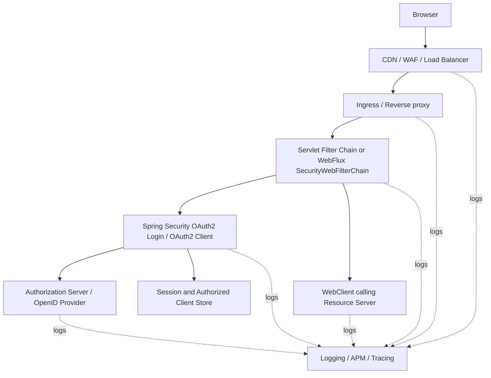

# 28.8. Environment-Specific Spring Security Logging and Sensitive Data Redaction

> **Module:** Spring Security OAuth 2.0 OIDC Client  
> **Chapter:** 28. Errors and Observability  
> **Scope:** Enabling, scoping, and disabling logging in Spring Boot applications using Spring Security OAuth 2.0/OIDC Client on Servlet or WebFlux; building observability to diagnose login failures, Token Endpoint, OIDC UserInfo, and WebClient without leaking authorization codes, tokens, secrets, sessions, or personal data.

An application integrating OpenID Connect (OIDC) can fail to log in due to a wrong `redirect_uri`, `state` mismatch, Token Endpoint rejecting Client authentication, ID Token wrong issuer, WebClient picking the wrong registration, or a revoked refresh token. In such situations, Spring Security logs are valuable for identifying which filter/provider processed the request, which decision was made, and where the failure occurred.

However, **enabling DEBUG/TRACE across the entire security stack does not equal safe observability**. An OAuth2 Client handles high-value secrets: `authorization_code`, `access_token`, `refresh_token`, `id_token`, Client secret, PKCE `code_verifier`, and session cookies. This data can enter logs not only via Spring Security itself, but also via reverse proxies, Servlet containers, HTTP wiretaps, WebClient filters, request/response logging, APMs, or custom exception handlers.

The goal of this lesson is to build a practical model:

- **Production:** log enough to operate, favoring INFO/WARN/ERROR and sanitized structured security events.
- **Staging/test:** enable scoped detailed logs to verify a scenario, while still using synthetic credentials and redaction.
- **Local development:** DEBUG can be enabled for needed loggers, while limiting TRACE and raw request/header printing modes.
- **During incidents:** enable logging temporarily, limit scope and duration, record who approved it, and then return to a safe configuration.

**Core message:** distinguish **log levels**, **what is allowed to be logged**, **who can view logs**, **where logs are stored**, and **when elevated logging must be turned off**. Lowering a logger to WARN does not fix a custom filter that logs tokens at WARN.

---

## 1. Learning Objectives

After this lesson, you will be able to:

1. Understand the roles of SLF4J, Logback/Log4j2, Spring Boot logging configuration, and Spring Security loggers.
2. Distinguish ERROR, WARN, INFO, DEBUG, TRACE, and the appropriate verbosity for each environment.
3. Use `application.yml`, `application-dev.yml`, `application-prod.yml`, and environment variables to control logger levels.
4. Enable scoped DEBUG for `org.springframework.security`, OAuth2 Client, web security, or specific loggers.
5. Explain why `@EnableWebSecurity(debug = true)` is dangerous in environments with real credentials.
6. Identify sensitive data across Authorization Code/OIDC Login, Token Endpoint, UserInfo, and resource API calls.
7. Write safe login event logs without logging raw `Authentication`, `OAuth2AuthorizedClient`, token values, or request queries.
8. Use correlation IDs and allowlist-based structured logging instead of dumping entire HTTP requests.
9. Configure request logging on Servlet/WebFlux without enabling uncontrolled header/body logging.
10. Distinguish Spring Security logging from proxy, ingress, WAF, APM, telemetry, and HTTP client wiretap logging.
11. Protect cookies, Authorization headers, redirect Locations, and queries containing authorization codes.
12. Understand how to protect logs when runtime log levels are changed via Spring Boot Actuator.
13. Establish retention, access control, alerting, redaction, and incident response for logs.
14. Test with synthetic credentials to catch leaks before deployment.
15. Build a reusable OAuth2 troubleshooting workflow without enabling system-wide TRACE.

## 2. Which Layers Are Involved in Spring Security Logging?

An OAuth2/OIDC request may pass through:



Enabling:

```yaml
logging:
  level:
    org.springframework.security: DEBUG
```

only changes the logger level under that namespace inside the **Spring Boot application**. It does not automatically disable or sanitize:

- NGINX access logs containing `$request_uri`.
- Cloud load balancer/WAF logs.
- HTTP client wiretaps.
- Browser analytics or RUM.
- Database query logs.
- HTTP headers/body logs created by custom filters.
- Traces/exception payloads captured automatically by an APM agent.
- External Authorization Server logs.

Therefore, "redacting sensitive data" requires defense in depth across layers, not just a single Spring Boot property.

## 3. Log Levels: More Detail Is Not Always More Useful

| Level | Common Role | Recommendation in OAuth2/OIDC Client |
|---|---|---|
| `ERROR` | Failure preventing operation completion | Log safe error codes; never dump requests/tokens |
| `WARN` | Access rejections, security errors to monitor, retry exhaustion | Suitable for production, while avoiding noise and data leaks |
| `INFO` | Aggregate operational events: login success, token refresh outcome, logout | Use safe structured fields |
| `DEBUG` | Processing branches, filter selection, registration/protocol diagnostics | Mainly local/test; enabled under strict control in production |
| `TRACE` | Detailed flow, framework internals | Minimize as much as possible; only when truly necessary and after secret-exposure review |
| `OFF` | Disable logger | Can silence an unsafe custom logger while fixing it; not a long-term solution |

Different loggers can emit different types of data at the same level. For example, a framework logger might only print a filter name, whereas an application-written logger at DEBUG might print a raw token.

**Never treat DEBUG as "safe because only developers use it".** If logs are forwarded to a centralized platform, credentials become accessible to many people and persist in backups.

## 4. SLF4J, Logging Backends, and Package Loggers

In Spring Boot, applications typically call SLF4J:

```java
import org.slf4j.Logger;
import org.slf4j.LoggerFactory;

final class LoginDiagnostics {
    private static final Logger log =
        LoggerFactory.getLogger(LoginDiagnostics.class);

    void successfulLogin(String registrationId) {
        log.info("oauth2_login_success registrationId={}", registrationId);
    }
}
```

SLF4J is the API; backends such as Logback or Log4j2 write logs according to configuration. Spring Boot supports configuration via `logging.level.*`, backend config files, and environment overrides.

### 4.1. Logger Hierarchy

Example:

```text
org.springframework.security
  ├── org.springframework.security.web
  ├── org.springframework.security.authentication
  ├── org.springframework.security.oauth2
  │     ├── org.springframework.security.oauth2.client
  │     ├── org.springframework.security.oauth2.core
  │     └── ...
  └── ...
```

Setting a parent logger to DEBUG causes many child loggers to emit extra output. Setting a specific package/class to DEBUG keeps the scope much narrower.

### 4.2. Package Names May Vary by Component/Version

Classes in Servlet OAuth2 Login, reactive OAuth2 Client, or Resource Server do not necessarily share the same package. When identifying a specific logger, check the class/package in a stack trace or the API docs for your exact version; do not assume all OAuth2 logs come from a single namespace.

## 5. Separating Configuration by Spring Boot Profiles

A common layout:

```text
src/main/resources/
  application.yml
  application-dev.yml
  application-staging.yml
  application-prod.yml
  application-test.yml
```

**Base configuration** should be safe even if someone forgets to activate a profile:

```yaml
# application.yml
logging:
  level:
    root: INFO
    org.springframework.security: WARN
    org.springframework.web: INFO
    reactor.netty: WARN

management:
  endpoints:
    web:
      exposure:
        include: health,info
```

These values are an illustrative baseline, not a mandatory standard for every organization.

### 5.1. Local Development

```yaml
# application-dev.yml
logging:
  level:
    root: INFO
    org.springframework.security: DEBUG
    org.springframework.security.oauth2.client: DEBUG
    org.springframework.security.web: DEBUG
    org.springframework.web: INFO
    reactor.netty: WARN
```

The goal is to observe SecurityFilterChain, OAuth2 Login, and authorized-client decisions. It **does not** justify logging raw Authorization headers, token responses, or request bodies. Even locally, use a test OP and fake credentials.

### 5.2. Staging

```yaml
# application-staging.yml
logging:
  level:
    root: INFO
    org.springframework.security: INFO
    org.springframework.security.oauth2.client: INFO
    org.springframework.security.web: INFO
    reactor.netty: WARN
```

When reproducing an incident, a needed package can be temporarily overridden to DEBUG. Staging may hold production-like data; never assume staging is a free-for-all for logging secrets.

### 5.3. Production

```yaml
# application-prod.yml
logging:
  level:
    root: INFO
    org.springframework.security: WARN
    org.springframework.security.oauth2.client: WARN
    org.springframework.security.web: WARN
    org.springframework.web: WARN
    reactor.netty: WARN

management:
  endpoints:
    web:
      exposure:
        include: health,info
```

In production, important application security events should still be recorded via self-managed loggers at INFO/WARN with **controlled fields**, without needing framework-wide DEBUG.

### 5.4. Test

```yaml
# application-test.yml
logging:
  level:
    root: WARN
    org.springframework.security.web.FilterChainProxy: DEBUG
    org.springframework.security.oauth2.client: INFO
```

Tests can enable a single class logger to observe filter selection decisions; never enable full HTTP dumps by default and never use production tokens.

## 6. How to Activate a Profile?

Local run example:

```shell
SPRING_PROFILES_ACTIVE=dev java -jar application.jar
```

Production deployment configuration example using an environment variable:

```text
SPRING_PROFILES_ACTIVE=prod
```

Spring Boot supports multiple configuration sources: application files, environment variables, command-line arguments, and others per property precedence. Actual values depend on deployment.

### 6.1. Do Not Let HTTP Users Control the Profile

Never expose an endpoint like:

```text
/admin/set-spring-profile?value=dev
```

to change the entire application's security profile per request. Profiles and log levels must be managed through deployment/admin tooling with authentication, authorization, and audit trails.

### 6.2. Do Not Assume Production Always Selects prod

If production forgets `SPRING_PROFILES_ACTIVE=prod`, the baseline `application.yml` must still be safe. Putting `org.springframework.security: TRACE` in base config and lowering it only in prod is error-prone if a profile is missed.

## 7. Environment Variables to Override Logger Levels

Spring Boot can accept overrides from environment variables. For a package logger such as:

```text
logging.level.org.springframework.security=DEBUG
```

a common environment variable name is:

```text
LOGGING_LEVEL_ORG_SPRINGFRAMEWORK_SECURITY=DEBUG
```

However, **for a specific class logger name**, environment-variable relaxed binding has limitations around case sensitivity and separators. When you need to override an exact fully qualified class name, prefer config files, command-line properties, or properly secured and tested Actuator loggers.

### 7.1. Never Let Debug Overrides Survive into Subsequent Deployments

When handling an incident:

1. Record which logger was changed.
2. Record who approved it and the scope.
3. Apply the change via deployment/config management.
4. Monitor log volume and secret exposure.
5. Restore safe levels once finished.
6. Verify no override lingers in Helm values, ConfigMaps, Secrets, Docker Compose, or CI environments.

A leftover override is often harder to spot than a DEBUG line in source code.

## 8. How Does Enabling DEBUG for Spring Security Help?

Observable events depending on version/config:

- Which SecurityFilterChain applied to a request.
- Requests blocked by authentication/authorization.
- Which filters ran in the chain.
- How the authentication entry point or access denied handler was invoked.
- Certain authorization decisions.
- OAuth2 Login or authorized-client manager failures.
- Error context when an authorization request cannot be loaded by state.

**Never assume every OIDC error has one standard log line** spelling out the root cause. For Token Endpoint `invalid_grant`, the origin may be at the AS; for browser SameSite cookies, you need to observe the network flow; for JDBC authorized client storage, you need to check transaction/DB behavior.

### 8.1. Start with a Small Class/Package

If you want to inspect filter selection:

```yaml
logging:
  level:
    org.springframework.security.web.FilterChainProxy: DEBUG
```

If you want to investigate OAuth2 Client:

```yaml
logging:
  level:
    org.springframework.security.oauth2.client: DEBUG
```

Never enable by default:

```yaml
logging:
  level:
    root: TRACE
```

as it inflates log volume across the entire application and dependencies, including unrelated components that may emit sensitive metadata.

## 9. Distinguishing Security Logging from Spring Security Debug Mode

On the Servlet stack, Spring Security has a filter-chain debug mode, for example:

```java
import org.springframework.security.config.annotation.web.configuration.EnableWebSecurity;

@EnableWebSecurity(debug = true)
class DebugSecurityConfiguration {
    // Only for controlled local/test environments.
}
```

This mode helps diagnose SecurityFilterChain configuration and request handling, yet **it can print very detailed request/security context info** and must never be used in production or with real credentials.

### 9.1. DEBUG Logger and debug=true Are Not the Same

| Method | Purpose | Warning |
|---|---|---|
| `logging.level.org.springframework.security=DEBUG` | Increases logger verbosity | May log sensitive metadata depending on class/config |
| `logging.level...FilterChainProxy=DEBUG` | Focuses on filter-chain observations | Narrower scope, yet still review log output |
| `@EnableWebSecurity(debug = true)` | Enables security debug mode on Servlet | Risks dumping extensive request/security details; not for production |
| Custom HTTP logging filter | Application decides what to log | Very easy to leak queries/headers/bodies without redaction |
| Reactor Netty `wiretap` | Traces HTTP/network data | Can expose token headers/bodies; enable only under strict control |

**Never add debug=true to shared configuration** to troubleshoot a rare callback bug; choose a specific logger and use synthetic traffic.

## 10. Order of OAuth2 Login Diagnosis Before Raising Log Levels

When login fails, trace the sequence:

```text
Browser request /oauth2/authorization/{registrationId}
    |
    v
Authorization Request + state + redirect_uri
    |
    v
OP authenticates and redirects callback
    |
    v
Authorization Request Repository matches state
    |
    v
Token Endpoint: code exchange + Client authentication + PKCE
    |
    v
OIDC: ID Token verification, issuer/aud/nonce
    |
    v
Load user/UserInfo, map authorities
    |
    v
SecurityContext/session + success redirect
```

At each step, log **error code, phase, registration ID, and correlation ID**—without printing raw tokens or callback URLs.

### 10.1. Classification by Phase

| Phase | Symptom | Useful Safe Log Fields |
|---|---|---|
| Initiation | No redirect to OP | Route template, registration ID, filter chain, outcome |
| Authorization callback | `state` mismatch | Event code `state_mismatch`, registration (if reliably determined), trace ID |
| Token exchange | `invalid_client` or `invalid_grant` | Grant type, allowlisted OAuth2 error code, HTTP status |
| ID Token verification | Invalid issuer/audience/nonce | Failure reason **containing no raw claims/tokens** |
| UserInfo | HTTP error/timeout | Provider registration, endpoint category, status, duration |
| Authorized client save/load | JDBC/session storage error | Registration, storage type, error category |
| API call | HTTP 401/403 | Resource category, registration, API route template, status |
| Logout | Redirect or end-session error | Provider registration, logout phase, outcome |

Do not include token values "so engineers can compare easily"; verify equivalent details via mocks, configs, and metrics.

## 11. Sensitive Data in OAuth2/OIDC Client

| Data | Why Sensitive? | How to Handle in Logging |
|---|---|---|
| Authorization code | Transaction credential subject to interception | Never log query/callback code |
| Access token | Bearer credential to call APIs | Never log raw value, even if JWT |
| Refresh token | Credential capable of minting new tokens | Strictly exclude from logs/traces |
| ID Token | Contains issuer, subject, personal claims, session context | Never log raw token/full JSON |
| Client secret | Authenticates confidential Client | Never log; never render in errors |
| Private key | Client authentication/request signing | Never log; protect in vault |
| PKCE `code_verifier` | Binds authorization code | Never log Token Request body |
| `state` | Correlation/CSRF protection | Never log raw state; use separate trace ID |
| `nonce` | Binds ID Token to request | Never log raw value |
| Session cookie | Represents logged-in session | Never log Cookie/Set-Cookie |
| `Authorization` header | Bearer or Basic Client credentials | Never log raw header |
| Logout `id_token_hint` | May embed ID Token in redirect URL | Redact Location/query |
| UserInfo response | May contain PII and permission groups | Log only minimal approved fields |
| Email/name/phone | Personal data | Avoid or mask per policy |
| Tenant/principal IDs | Potentially sensitive, easy to correlate | Pseudonymous ID/allowlist, bounded labels |

**Do not mask only the string `password`.** OAuth2 has many credentials that do not contain the word "password".

## 12. Authorization Code in Callback URL: A Major Log Risk

Redirect-based Authorization Code Flow normally produces:

```http
GET /login/oauth2/code/corporate?code=<redacted>&state=<redacted> HTTP/1.1
Host: app.example.test
```

Having `code` in the callback query is a normal part of the protocol. Yet a logger recording the full request URI can send `code`/`state` straight into the SIEM.

### 12.1. Anti-Example in Servlet

```java
// ANTI-EXAMPLE: never use in production.
log.info("request={} query={}",
    request.getRequestURI(),
    request.getQueryString());
```

`request.getRequestURI()` excludes the query, yet `getQueryString()` can contain `code`/`state`. Concatenating both as above leaks login credentials.

### 12.2. Do Not Log Callback URLs from Exceptions

Avoid:

```java
// ANTI-EXAMPLE.
log.error("OIDC callback failed at {}",
    request.getRequestURL() + "?" + request.getQueryString(),
    exception);
```

Exception messages/causes can also hold URLs or response bodies. Before logging raw exceptions, understand the exception types and library sanitization.

### 12.3. Which Fields Can Be Logged?

Record:

```text
event=oauth2_login_callback
route=/login/oauth2/code/{registrationId}
registrationId=corporate
outcome=state_mismatch
correlationId=opaque-72c
code=[not-logged]
state=[not-logged]
```

The route template and registration ID come from verified sources. Do not infer registration from an untrusted query parameter and put it in an audit log as if it were verified.

## 13. Access Tokens, Refresh Tokens, and ID Tokens Do Not Belong in Logs

An OAuth2 authorized client may hold:

```java
OAuth2AuthorizedClient client = ...;
client.getAccessToken().getTokenValue();
client.getRefreshToken();
```

Those values exist for the protocol, **not for observability**. Never pass them to `log.debug`, `toString()`, JSON serialization, or tracing tags.

Anti-example:

```java
// ANTI-EXAMPLE: avoid printing objects containing credentials.
log.debug("authorizedClient={}", authorizedClient);
```

Even if one version's `toString()` masks some fields, relying on `toString()` for long-term security is unreliable. Log allowlisted fields explicitly.

### 13.1. What Token Metadata Can Be Used?

When policy permits, you may log:

- Registration ID.
- Grant type.
- Token endpoint outcome.
- Relative TTL in buckets rather than raw timestamps tied to individuals when unnecessary.
- API HTTP status.
- Allowlisted error codes.
- Correlation ID.
- Authorized client storage operation (load/save/remove) and result.

Even metadata requires privacy review: a registration ID might identify a customer/tenant.

## 14. Token Endpoint Request/Response Logging

The Token Endpoint typically receives a POST form body:

```http
POST /oauth2/token HTTP/1.1
Host: login.example.test
Authorization: Basic <redacted-client-credentials>
Content-Type: application/x-www-form-urlencoded

grant_type=authorization_code&code=<redacted>&redirect_uri=<encoded>&code_verifier=<redacted>
```

The response may contain:

```json
{
  "access_token": "<redacted>",
  "refresh_token": "<redacted>",
  "id_token": "<redacted>",
  "token_type": "Bearer",
  "expires_in": 300
}
```

If body logging/wiretap is enabled on the HTTP Client used by Spring Security to call the Token Endpoint, both code/verifier and the token response can be recorded.

### 14.1. Separate Protocol Errors from Raw Bodies

Instead of logging the full response:

```text
token_exchange_failed registrationId=corporate
grantType=authorization_code
httpStatus=400
errorCode=invalid_grant
durationMs=187
correlationId=ev-9d2
```

`invalid_grant` is simply an error code requiring further analysis; it does not prove the code was stolen. Causes include expired/reused codes, PKCE mismatches, redirect URI mismatches, or invalid refresh tokens.

### 14.2. Never Disable TLS Verification to Debug

If the Token Endpoint fails due to trust/certificate/hostname verification, never fix it by disabling TLS or letting the Client send credentials over HTTP. Log the safe error category and then fix certificates, issuer URLs, proxies, and truststores.

## 15. UserInfo and OIDC Claims

`OidcUser` may contain:

- `sub`, `iss`, `aud`.
- Email/name/locale.
- Profile attributes.
- Custom roles/groups.
- Tenant information.
- ID Token/UserInfo attributes provided by the OP.

Do not log the entire object:

```java
// ANTI-EXAMPLE.
log.debug("oidcUser={}", oidcUser);
log.info("claims={}", oidcUser.getClaims());
```

When debugging authority mapping, log an event:

```text
event=oidc_authorities_mapping
registrationId=corporate
mappingPolicyVersion=v4
outcome=success
assignedAuthorityCount=3
correlationId=ev-9d2
```

Even authority names can expose sensitive titles/permissions. Log role names only when policy allows and a specific investigation needs them; avoid labels containing personal data.

## 16. Cookies, Sessions, and CSRF

A Spring Security Servlet app typically uses a session cookie and may have a CSRF token in browser flows.

Never log:

- `Cookie`.
- `Set-Cookie`.
- Session ID.
- Raw CSRF token.
- HTTP Basic credentials.
- Authorization headers.
- OIDC Logout Token.
- Raw OAuth2 `state`/`nonce`.

Exposing a session cookie can lead to session hijacking depending on other protections. CSRF tokens, state, and nonce are not API Bearer tokens, yet they remain security-transaction binding data.

### 16.1. Do Not Use Session ID as Trace ID

Session IDs are both sensitive and longer-lived than a single request. Use a dedicated randomly generated correlation ID or one provided by trusted tracing infrastructure, never the session identifier.

## 17. Safe Logging Using an Allowlist

There are two approaches:

**Denylist/redaction:** take raw logs and try to strip `password`, `access_token`, `Authorization`, etc.

**Allowlist:** only emit approved fields into logs from the start.

In security logging, prioritize **allowlist**. Regex denylists are a secondary safety net for catching stragglers, not the primary guarantee.

### 17.1. Why Regex Redaction Often Misses Things

Tokens can appear under many names:

```text
access_token
refresh_token
id_token
id_token_hint
assertion
client_assertion
code
code_verifier
Authorization
Cookie
Set-Cookie
uri_query
http.url
page_location
```

Values can also be URL-encoded, Base64-encoded, nested in JSON, serialized in headers, or embedded inside `Exception.getMessage()`.

A regex replacing only `token=` misses many cases and creates a false sense of security.

### 17.2. Sample Structured Logging

```java
log.info(
    "oauth2_login_result registrationId={} outcome={} phase={} traceId={}",
    safeRegistrationId,
    "failure",
    "token_exchange",
    safeCorrelationId
);
```

These fields must come from a trusted context/allowlist. Never put raw error descriptions from the AS into logs, as they can contain uncontrolled content.

## 18. Safe Servlet Request Logging Pattern

You can write a `OncePerRequestFilter` that logs only **route category**, method, status, and duration without raw URIs/queries/headers.

```java
package example.security.logging;

import java.io.IOException;
import jakarta.servlet.FilterChain;
import jakarta.servlet.ServletException;
import jakarta.servlet.http.HttpServletRequest;
import jakarta.servlet.http.HttpServletResponse;

import org.slf4j.Logger;
import org.slf4j.LoggerFactory;
import org.springframework.web.filter.OncePerRequestFilter;

public final class SafeSecurityRequestLoggingFilter
        extends OncePerRequestFilter {

    private static final Logger log =
        LoggerFactory.getLogger(SafeSecurityRequestLoggingFilter.class);

    @Override
    protected void doFilterInternal(
            HttpServletRequest request,
            HttpServletResponse response,
            FilterChain chain)
            throws ServletException, IOException {

        long start = System.nanoTime();
        String path = request.getRequestURI();
        String context = request.getContextPath();

        String route;
        if (path.startsWith(context + "/login/oauth2/code/")) {
            route = "/login/oauth2/code/{registrationId}";
        } else if (path.startsWith(context + "/oauth2/authorization/")) {
            route = "/oauth2/authorization/{registrationId}";
        } else {
            route = "other";
        }

        try {
            chain.doFilter(request, response);
        } finally {
            long elapsedMs =
                (System.nanoTime() - start) / 1_000_000L;

            // Do not log getQueryString(), Cookie, Authorization,
            // authentication.toString(), or request body.
            log.info(
                "security_http route={} method={} status={} durationMs={}",
                route,
                request.getMethod(),
                response.getStatus(),
                elapsedMs
            );
        }
    }
}
```

### 18.1. This Is an Example of Allowed Data, Not a Full Production Filter

A real system needs to consider:

- Filter registration/ordering and interaction with Spring Security.
- Async dispatch behavior.
- Approved route categories.
- Log sampling to avoid excessive volume.
- Error/status visibility when the response is already committed or request is cancelled.
- Audit event semantics separate from access logging.
- Correlation ID from trusted tracing integration.

The example intentionally **does not log the intact URL**: any path outside known patterns is recorded as `other` rather than raw path, because paths can also contain secrets.

### 18.2. Path Logging Trap

Even `request.getRequestURI()` without a query string can contain:

```text
/reset-password/<secret>
/download/<signed-token>
```

Therefore, never assume raw paths are safe to log by default. Prefer route templates or categories.

## 19. What Can CommonsRequestLoggingFilter Expose?

Spring Framework includes `CommonsRequestLoggingFilter`. If an application configures:

```java
// Cautionary config, not recommended for OAuth endpoints.
filter.setIncludeQueryString(true);
filter.setIncludeHeaders(true);
filter.setIncludePayload(true);
```

then logs can contain callback `code/state`, Authorization/Cookie headers, and payloads depending on request/filter behavior.

### 19.1. Rules When Using Request Logging Filters

- Never enable query logging for OAuth callbacks.
- Never enable full headers on Token Endpoint or bearer API calls.
- Never log payloads containing code/verifier/client_assertion/refresh tokens.
- Allowlist only needed fields.
- Test login success, login error, 401, and logout.
- Check the filter's logging level/formatter and who reads the logs.

### 19.2. Do Not Just Set False and Forget Custom Filters

Teams may have `HandlerInterceptor`, `OncePerRequestFilter`, or other Servlet filters printing requests themselves. Inventory all instrumentation code, not just Spring-provided filters.

## 20. Safe Logging on WebFlux

WebFlux uses `ServerWebExchange`, `SecurityWebFilterChain`, and Reactor—not `HttpServletRequest`/`OncePerRequestFilter`.

A `WebFilter` that logs only route categories:

```java
package example.security.logging;

import org.slf4j.Logger;
import org.slf4j.LoggerFactory;
import org.springframework.web.server.ServerWebExchange;
import org.springframework.web.server.WebFilter;
import org.springframework.web.server.WebFilterChain;
import reactor.core.publisher.Mono;

public final class SafeReactiveRequestLoggingFilter
        implements WebFilter {

    private static final Logger log =
        LoggerFactory.getLogger(SafeReactiveRequestLoggingFilter.class);

    @Override
    public Mono<Void> filter(
            ServerWebExchange exchange,
            WebFilterChain chain) {

        String path = exchange.getRequest()
            .getURI()
            .getRawPath();

        String route = path.startsWith("/login/oauth2/code/")
            ? "/login/oauth2/code/{registrationId}"
            : "other";

        long startNanos = System.nanoTime();

        return chain.filter(exchange)
            .doFinally(signal -> {
                long durationMs =
                    (System.nanoTime() - startNanos) / 1_000_000L;

                log.info(
                    "security_http_reactive route={} signal={} durationMs={}",
                    route,
                    signal.name(),
                    durationMs
                );
            });
    }
}
```

This example does not auto-register the filter bean; the application must wire it explicitly per WebFlux config and evaluate filter ordering.

### 20.1. Do Not Block in Reactive Logging

Never call `block()` to fetch principal, tenant, or authorized client solely for logging. That can stall the event loop, cause runtime errors, or even re-trigger the authorization pipeline.

### 20.2. Reactor Context and MDC

In reactive flows, execution can hop threads. ThreadLocal-based MDC **does not automatically** propagate across every operator without proper integration/context propagation.

When a correlation ID is needed, use Reactor Context–compatible tracing instrumentation or Micrometer context propagation per your version/framework rather than assuming servlet-thread MDC remains intact in WebFlux callbacks.

## 21. Spring MVC and WebFlux Request-Details Logging

Spring Boot/Spring Framework have options enabling detailed request logging. Example of two common properties in corresponding Spring Boot versions:

```yaml
spring:
  mvc:
    log-request-details: false
  codec:
    log-request-details: false
```

The goal is **not enabling header/form-parameter details by default** when handling credentials.

### 21.1. Check the Exact Stack/Version

- Servlet/MVC uses one set of properties/loggers.
- WebFlux codecs/WebClient use another set of properties/loggers.
- A property that does not apply to the active stack has no effect.
- Framework/dependency versions may rename settings or change behavior.

Do not rely on a single property to promise all bodies/queries are masked; still inspect custom instrumentation, proxies, and APMs.

## 22. WebClient OAuth2 Logging and HTTP Body Redaction

Spring Security can integrate `WebClient` with the OAuth2 authorized-client manager. Requests to a Resource Server normally include:

```http
GET /reports/current HTTP/1.1
Host: api.example.test
Authorization: Bearer <redacted>
```

If a logging filter prints request headers or Reactor Netty enables wiretap, the token can appear in logs.

Anti-example:

```java
// ANTI-EXAMPLE: never print all WebClient headers.
ExchangeFilterFunction unsafe = (request, next) -> {
    log.debug("headers={}", request.headers());
    return next.exchange(request);
};
```

### 22.1. Safe WebClient Filter Logging Only Method + Category

```java
import org.springframework.web.reactive.function.client.ClientRequest;
import org.springframework.web.reactive.function.client.ExchangeFilterFunction;
import reactor.core.publisher.Mono;

ExchangeFilterFunction safeApiEvents() {
    return (request, next) -> {
        String method = request.method().name();

        // Fixed route category for this client.
        String target = "reports-api";

        return next.exchange(request)
            .doOnNext(response ->
                log.info(
                    "api_call target={} method={} status={}",
                    target,
                    method,
                    response.statusCode().value()
                )
            );
    };
}
```

Never log `request.url()` verbatim if the URL query can carry PII/tokens; never log `request.headers()` or response bodies. This example assumes the filter is attached only to a dedicated WebClient for reports-api, not arbitrary destinations.

### 22.2. Can WebClient Follow Redirects Automatically?

Redirect behavior depends on connector/HTTP client config. If redirects are followed, check whether the Authorization header is stripped when crossing origins. That is a separate token-leakage issue; do not turn on header logging to "observe" it by exposing tokens.

## 23. Reactor Netty Wiretap: Exercise Extreme Caution

Reactor Netty supports wiretap/network activity logging per configuration. Depending on format, some modes can expose HTTP headers/bodies.

Never enable detailed wiretap for OAuth2 Token Endpoints and API Bearer requests in production simply to debug timeouts.

### 23.1. Safe Alternatives

To investigate timeouts:

- Log endpoint **category** such as `token-endpoint`, not full URLs with queries.
- Log connect/response timeout category.
- Log status code and duration.
- Log retry count and transient failure class.
- Log trace ID.
- Check TLS/DNS/connection pool metrics.
- Use a mock AS with synthetic tokens when packet-level traces are needed.

If wiretap is unavoidable in an isolated environment, use fake credentials with strict start/stop windows, and treat the log output as sensitive.

## 24. Referrer, Callbacks, and Browser Analytics

Authorization Code callbacks have URLs like:

```text
https://app.example.test/login/oauth2/code/corporate?code=<redacted>&state=<redacted>
```

This URL can be:

- Stored in ingress logs.
- Recorded by browser/network telemetry.
- Captured by analytics `page_location` or `window.location.href`.
- Transmitted in the HTTP `Referer` header depending on `Referrer-Policy`.
- Pasted into support tickets or screenshots.

### 24.1. Referrer-Policy Reduces Part of the Risk

A strict configuration for Spring Security Servlet:

```java
import org.springframework.security.web.header.writers.ReferrerPolicyHeaderWriter.ReferrerPolicy;

http.headers(headers -> headers
    .referrerPolicy(referrer ->
        referrer.policy(ReferrerPolicy.NO_REFERRER)
    )
);
```

This configuration is part of `SecurityFilterChain` and should be adapted to your Spring Security version.

**Do not misunderstand:** `Referrer-Policy: no-referrer` governs the HTTP Referer header; JavaScript on the page can still read `window.location.href` and send it to analytics. Callbacks should be handled by the security filter and quickly redirected to a clean URL before rendering third-party scripts.

### 24.2. Do Not Use URL History to Debug OAuth Flows

When investigating, never ask users to paste full callback URLs containing `code`/`state`. Use non-credential error codes/correlation IDs.

## 25. OIDC RP-Initiated Logout and id_token_hint

In some OIDC RP-Initiated Logout flows, the redirect to the OP may contain:

```text
https://login.example.test/logout?id_token_hint=<redacted>&post_logout_redirect_uri=...
```

`id_token_hint` can be an ID Token. Even though it is not an API access token, it contains sensitive identity claims.

You must:

- Use only trusted OP end-session endpoints.
- Never log the full `Location` header.
- Never put the ID Token into custom exception messages.
- Apply proper Referrer-Policy/redirect policies.
- Audit ingress/proxy/browser logs.
- Keep post-logout redirect URIs allowlisted.

Do not treat login logging as the only scope; logout redirects can also carry token-like values.

## 26. Logs at Reverse Proxies, Ingress, and WAF

A common NGINX pattern:

```nginx
log_format unsafe '$remote_addr "$request" $status';
```

`$request` includes the request line with queries containing authorization codes. `$request_uri` also typically includes the query string.

A pattern that reduces query leakage:

```nginx
log_format oauth_safe
  '$remote_addr method=$request_method path=$uri '
  'status=$status duration=$request_time';
access_log /var/log/nginx/access.log oauth_safe;
```

In NGINX, `$uri` normally excludes the query string; however, it **can still contain path secrets or PII**. For sensitive routes, apply route normalization/masking or log fixed route categories.

### 26.1. Do Not Fix Only One Ingress Layer

A request may traverse:

```text
CDN -> WAF -> Cloud Load Balancer -> Ingress -> Service Mesh
    -> Servlet container / WebFlux server -> Spring Security
```

Each layer has independent logs and retention. Inventory:

- `request_uri`/query-string logging.
- Cookies and Authorization headers.
- Response headers such as `Location`.
- Error logs/5xx dumps.
- Sampling/tracing.
- Exports to SIEM or third parties.
- Access controls and backup lifecycles.

### 26.2. HTTPS Does Not Prevent Proxy Logs

TLS protects the wire up to TLS termination, yet the terminating proxy sees URLs, headers, and bodies; it still requires redaction and access controls.

## 27. Servlet Container Access Logs

Tomcat, Jetty, and Undertow have their own logging configurations. A pattern logging raw request lines can expose queries; a pattern logging only paths reduces part of the risk.

In Spring Boot, embedded server access log properties vary by container/version. Never assume `logging.level.org.springframework.security=WARN` changes container access logs.

Checklist questions:

1. Does the pattern log request lines or request URIs?
2. Is the query string included?
3. Where is Cookie/Header logging enabled?
4. Do error pages/uncaught exceptions print full URLs?
5. Is a second reverse proxy logging raw requests?
6. Which destinations receive the logs?
7. Do you need actual paths, or are route templates sufficient?

## 28. APM, Tracing, and RUM

Application Performance Monitoring may capture attributes:

```text
http.url
url.full
http.target
http.request.header.authorization
http.response.header.location
exception.message
span.attributes
browser.page_location
```

Exact names depend on OpenTelemetry semantic conventions and vendor/version. Do not assume every agent collects all fields above.

### 28.1. Privacy by Design in Tracing

- Keep only route templates like `/login/oauth2/code/{registrationId}`.
- Never attach `code`/`state`/`nonce` to spans.
- Never capture `Authorization`, `Cookie`, `Set-Cookie`.
- Never capture Token Endpoint bodies.
- Scrub `Location` headers when they carry `id_token_hint`.
- Minimize user IDs, emails, and tenant names in span attributes.
- Use correlation IDs, not session IDs.
- Enforce sampling and retention policies.

### 28.2. Do Not Rely Solely on Spring Logger Levels

APM agents can capture data via bytecode/HTTP instrumentation. Even when Spring Security logs only WARN, traces still contain raw URLs/queries if the agent is not configured to scrub them.

## 29. Tracing Correlation IDs Instead of Tokens/User Identifiers

A correlation ID links logs belonging to the same request:

```text
traceId=8f4a...
spanId=2a91...
registrationId=corporate
phase=token_exchange
outcome=invalid_grant
durationMs=170
```

Never use:

```text
traceId=<access_token>
traceId=<session_cookie>
traceId=<authorization_code>
```

### 29.1. Servlet MDC

In traditional Servlet applications, MDC can store a trace ID for the request thread using a proper correlation filter.

Key rules:

- Only accept trace IDs from trusted instrumentation, or validate input if client-supplied.
- Clear MDC at the end of the request to prevent leaks across thread reuse.
- Never put raw user emails/tokens into MDC.
- When asynchronous processing switches threads, ensure proper context propagation.

### 29.2. WebFlux/Reactor Context

Reactive chains are not guaranteed to stay on one thread. Use Reactor Context–compatible tracing integration; never assume MDC automatically copies across `flatMap`, scheduling, and `publishOn`.

## 30. Structured Security Event Service

Instead of having every component log ad-hoc messages, create an abstraction:

```java
public interface SecurityEventReporter {

    void loginSucceeded(String registrationId, String correlationId);

    void loginFailed(
        String registrationId,
        String reasonCategory,
        String correlationId);

    void tokenRefreshOutcome(
        String registrationId,
        String resultCategory,
        String correlationId);
}
```

This is an **application-defined** interface, not a built-in Spring Security API.

The implementation logs only allowlisted values:

```java
import org.slf4j.Logger;
import org.slf4j.LoggerFactory;

public final class SafeSecurityEventReporter
        implements SecurityEventReporter {

    private static final Logger log =
        LoggerFactory.getLogger(SafeSecurityEventReporter.class);

    @Override
    public void loginSucceeded(
            String registrationId,
            String correlationId) {

        log.info(
            "security_event=login_succeeded registration={} traceId={}",
            registrationId,
            correlationId
        );
    }

    @Override
    public void loginFailed(
            String registrationId,
            String reasonCategory,
            String correlationId) {

        log.warn(
            "security_event=login_failed registration={} reason={} traceId={}",
            registrationId,
            reasonCategory,
            correlationId
        );
    }

    @Override
    public void tokenRefreshOutcome(
            String registrationId,
            String resultCategory,
            String correlationId) {

        log.info(
            "security_event=token_refresh registration={} result={} traceId={}",
            registrationId,
            resultCategory,
            correlationId
        );
    }
}
```

### 30.1. Reporter Does Not Sanitize Arbitrary Strings Automatically

This example is only safe if call sites pass registration ID, reason category, and correlation ID from a **trusted allowlist**. Never pass raw `exception.getMessage()` as `reasonCategory` or take a correlation ID from an unvalidated query parameter.

Production implementations should use enums/validated IDs, length limits, and cardinality/PII controls.

## 31. Success Handler Logging in Servlet OAuth2 Login

You can extend `SavedRequestAwareAuthenticationSuccessHandler` to preserve prior redirect behavior while logging a safe event:

```java
import java.io.IOException;
import jakarta.servlet.ServletException;
import jakarta.servlet.http.HttpServletRequest;
import jakarta.servlet.http.HttpServletResponse;

import org.slf4j.Logger;
import org.slf4j.LoggerFactory;
import org.springframework.security.core.Authentication;
import org.springframework.security.oauth2.client.authentication.OAuth2AuthenticationToken;
import org.springframework.security.web.authentication.SavedRequestAwareAuthenticationSuccessHandler;

public final class SafeOAuth2SuccessHandler
        extends SavedRequestAwareAuthenticationSuccessHandler {

    private static final Logger log =
        LoggerFactory.getLogger(SafeOAuth2SuccessHandler.class);

    @Override
    public void onAuthenticationSuccess(
            HttpServletRequest request,
            HttpServletResponse response,
            Authentication authentication)
            throws ServletException, IOException {

        String registrationId = "other";

        if (authentication instanceof OAuth2AuthenticationToken oauth2) {
            registrationId =
                oauth2.getAuthorizedClientRegistrationId();
        }

        log.info(
            "oauth2_login_success registrationId={}",
            registrationId
        );

        super.onAuthenticationSuccess(request, response, authentication);
    }
}
```

### 31.1. Wiring

```java
.oauth2Login(login -> login
    .successHandler(new SafeOAuth2SuccessHandler())
)
```

This snippet sits inside the `SecurityFilterChain` configuration DSL, not as a standalone method. You can use dependency injection/a dedicated bean per your architecture.

### 31.2. Do Not Log the Authentication Object

Anti-example:

```java
// ANTI-EXAMPLE:
log.info("user logged in: {}", authentication);
```

Authentication/principal objects can contain claims and metadata disallowed from logging. Extract only the registration ID and approved fields.

## 32. Failure Handler: Logging Classified Error Codes

When handling authentication failures, avoid:

```java
// ANTI-EXAMPLE:
log.error("oauth2 failure {}", exception.getMessage(), exception);
```

Some exception messages/causes can include request URLs, headers, or AS error descriptions. To log with lower risk, classify the error:

```java
import org.springframework.security.core.AuthenticationException;
import org.springframework.security.oauth2.core.OAuth2AuthenticationException;

static String failureCategory(AuthenticationException ex) {
    if (ex instanceof OAuth2AuthenticationException oauth2) {
        String code = oauth2.getError().getErrorCode();

        return switch (code) {
            case "invalid_grant" -> "invalid_grant";
            case "invalid_client" -> "invalid_client";
            case "invalid_scope" -> "invalid_scope";
            case "access_denied" -> "access_denied";
            default -> "oauth2_other";
        };
    }

    return "authentication_other";
}
```

Then log `failureCategory(exception)`, phase (if known), and trace ID. This code is only an **illustrative classifier**; errors from the OP might not surface as this exception type, and raw error codes from a remote AS must still be allowlisted.

### 32.1. Do Not Hide All Errors with a Catch-All

Sanitizing logs does not mean swallowing exceptions or returning HTTP 200 on failed logins. Still execute the right failure handler/entry point; only change what data gets logged.

## 33. OAuth2AuthorizedClientManager and Refresh Token Logs

The authorized client manager can:

- Load an unexpired authorized client.
- Request a new Client Credentials token.
- Refresh a token when eligible.
- Save an authorized client.
- Remove/remediate tokens after certain authorization errors.

Events to distinguish:

```text
event=oauth2_authorization
registrationId=reports-m2m
grantType=client_credentials
outcome=success
durationMs=420
```

and:

```text
event=oauth2_refresh
registrationId=calendar-user
outcome=invalid_grant
retryable=false
```

### 33.1. Do Not Log Refresh Tokens to Debug invalid_grant

`invalid_grant` can stem from revocation, expiry, rotation races, or token reuse detection. Logging the raw refresh token turns a security error into a credential leak.

Better:

- Log registration ID and a **pseudonymous/opaque** principal only if genuinely needed.
- Log error category, attempt count, and storage operation.
- Count refresh failures.
- Inspect AS audit events using correlation metadata.
- Never infinitely retry an old refresh token just because logs show the same error code.

## 34. Distinguishing Servlet and WebFlux Loggers

| Aspect | Servlet | WebFlux |
|---|---|---|
| Security configuration | `HttpSecurity`, `SecurityFilterChain` | `ServerHttpSecurity`, `SecurityWebFilterChain` |
| Request context | `HttpServletRequest` | `ServerWebExchange` |
| Security context | Thread-bound in parts; session repository | Reactive Context/security context |
| Request logging extension | Servlet Filter/OncePerRequestFilter | WebFilter/ExchangeFilterFunction |
| OAuth2 Client manager | Servlet manager/authorized client repository/service | Reactive manager/repository/service |
| Network logging | Servlet HTTP clients, RestClient/RestTemplate if used | WebClient/Reactor Netty |
| Tracing propagation | MDC requires cleanup | Reactor Context/propagation requires care |

A logger class may look similar in namespace while differing in how request context, threads, cancellation, and retries behave.

### 34.1. Retries Can Make the Same Operation Appear Multiple Times

In WebFlux, `retryWhen` can re-subscribe to the authorization/WebClient pipeline depending on placement. If logs show two token requests or two API calls with the same trace, it may be a retry/concurrency rather than two browser clicks.

Log attempt count, phase, and redacted idempotency/correlation context. Never use raw bearer tokens as log-deduplication keys.

## 35. Spring Boot Actuator Loggers

Spring Boot Actuator includes the `loggers` endpoint to view or change log levels at runtime when exposed and authorized.

It is a handy tool during incidents, yet **very sensitive** because it can enable DEBUG/TRACE in production.

### 35.1. Do Not Expose All Management Endpoints

Example production baseline:

```yaml
management:
  endpoints:
    web:
      exposure:
        include: health,info
```

Never do:

```yaml
# ANTI-EXAMPLE for production.
management:
  endpoints:
    web:
      exposure:
        include: "*"
```

and assume `/actuator` prefixes make endpoints safe on their own. You need network isolation, authentication, authorization, and auditing.

### 35.2. When Loggers Must Be Opened

Require:

1. Exposing on an appropriate internal management interface/port.
2. Allowing only admin/ops identities to alter loggers.
3. Enforcing mTLS/SSO/RBAC and firewall/private network controls per architecture.
4. Auditing who changed what logger, old/new level, timestamp, and reason.
5. Maintaining a runbook to restore levels.
6. Limiting duration and logger scope.
7. Never turning on request body/header wiretaps just because loggers were opened.
8. Verifying APM/log exports and redaction still hold.

### 35.3. Sample Request When Authorized

Illustrative endpoint:

```http
POST /actuator/loggers/org.springframework.security.oauth2.client HTTP/1.1
Host: management.internal.example.test
Content-Type: application/json
Authorization: Bearer <redacted-admin-credential>

{"configuredLevel":"DEBUG"}
```

This is an **operational example for a secured environment**, not advice to expose actuator to the Internet. To restore, set a safe explicit level or reset the logger to inherited configuration per policy.

### 35.4. Runtime Levels May Vanish on Restart

An Actuator change may live only in memory for that process. After a restart/deploy, file/env config governs the level again. This is convenient for temporary debugging, yet should not be relied on for persistent policy configuration.

## 36. Log Volume, Sampling, and Cardinality

Enabling DEBUG for every HTTP request in production can:

- Spike CPU and I/O.
- Consume storage/log ingestion quotas.
- Saturate collector pipelines.
- Inflate SIEM costs.
- Bury critical security events in noise.
- Widen the information-leakage surface.

### 36.1. Controlled Log Sampling

Sampling can be used for high-frequency events, but:

- Authentication failures and critical security incidents may require complete audit records per policy.
- Sampling does not make a log containing a token safe.
- Never sample based on token values.
- Never drop mandatory investigative events.

### 36.2. Metric Labels Need Low Cardinality

Good:

```text
oauth2_login_attempts{registration="corporate",result="success"}
oauth2_token_failures{grant="refresh_token",error="invalid_grant"}
```

Bad:

```text
oauth2_token_failures{access_token="<raw>",email="user@example.test"}
```

Labels containing tokens/PII are both dangerous and high-cardinality, driving up costs and operational pain.

## 37. Metrics Instead of Adding Detailed Logs to Every Request

Several questions are better answered with metrics:

- OAuth2 login success/failure rates by registration.
- Token exchange and refresh latency.
- `invalid_grant`/`invalid_client` rates.
- UserInfo endpoint error counts.
- API 401/403 counts by target category.
- Authorized-client save/load failure counts.
- Logout/revoked session counts.
- Retry exhaustion, timeout, and cancellation counts.

Exact metric names are **defined by the application/observability stack**, not all emitted by Spring Security out of the box.

### 37.1. Avoid Tracing via Token Values

To see whether two failures share a root cause, use correlation IDs, registration, permitted opaque internal user IDs, request IDs, and timelines. Never log arbitrary token hashes if entropy/identity implications have not been reviewed.

## 38. Log Levels by Failure Scenario

| Symptom | Where to Start? | Should System-Wide TRACE Be Enabled? |
|---|---|---|
| No SecurityFilterChain match | `org.springframework.security.web.FilterChainProxy` DEBUG in tests | No |
| Redirected to wrong OP | Registration routing + safe custom event + config | No |
| `state` mismatch | Safe Authorization Request Repository/session/cookie tracing | No |
| `invalid_client` | Client authentication method, Client ID/secret references, AS events | Never log secrets |
| `invalid_grant` | Code/redirect/PKCE/refresh state, clock, AS logs | Never log code/verifier |
| ID Token invalid issuer | Configured issuer/discovery, validation category | Never log ID Token |
| OIDC UserInfo 403/timeout | Endpoint category/status/latency, access scope | Never log token/body |
| `@PreAuthorize` 403 | Authorities/policy version, route/decision ID | Never dump principal claims |
| 401 after logout | Session/authorized client lifecycle and RS validation | Never log cookies |
| Token refresh storm | Authorized client manager/concurrency metrics | Never log refresh tokens |
| WebClient timeout | Connect/response timeout, proxy/DNS/TLS metrics | Never enable wiretap with real credentials |
| Multi-tenant token mismatch | Tenant/registration mapping, issuer/audience checks | Never log raw tokens |

This is an **investigation roadmap**, not a guarantee that one specific logger always solves every situation.

## 39. Observing 401 and 403 Errors Without Exposing Detailed Permissions

HTTP 401 typically indicates invalid/missing authentication; HTTP 403 typically indicates insufficient authorization. In practice, filter chains and RS policies define exact behavior.

Safe logs:

```text
event=api_access_denied
route=/api/admin/reports
method=GET
status=403
decision=insufficient_authority
policyVersion=2026-11
traceId=...
```

Do not log:

```text
Authorization: Bearer eyJ...
principal: {all claims...}
sessionCookie: ...
```

### 39.1. Do Not Confuse 403 with Expired Tokens

If a scope/role is missing, refreshing the token and retrying still returns 403; turning up logging should not mask an authorization policy failure. Log the error category and inspect configured permissions/mappings.

## 40. Security Logs Differ from Ordinary Access Logs

Logs can be separated into:

**Access log:** method, normalized route, HTTP status, latency, request ID.

**Security event log:** login success/failure, logout, reauthorization, consent revocation, disabled accounts, suspicious activity.

**Audit log:** who changed permissions/configuration, timestamp, target, and outcome for compliance.

**Debug log:** internal framework details for troubleshooting.

These four categories have different purposes, viewing permissions, and retention. Never merge them all into one broadly accessible log stream.

### 40.1. Audits Do Not Need Token Values

Example:

```text
event=oauth_connection_revoked
registrationId=calendar-api
actorType=end_user
internalSubjectRef=opaque-user-42
result=local_disabled_remote_pending
traceId=...
```

Even when audits require accurate evidence, raw access/refresh tokens are not required evidence to store.

## 41. Log Read Permissions and Retention

A system can log the right fields and still create risk if:

- Every developer can read production identity/security logs.
- Log backups are unencrypted.
- Retention is indefinite.
- Logs are exported to unapproved vendors/regions.
- Support dashboards display out-of-scope PII.
- Alerting webhooks forward full exception payloads.
- Temporary debug logs persist for years.

Define:

1. Log stream classification.
2. Role-based access and break-glass procedures.
3. Encryption in transit/at rest.
4. Retention/minimization.
5. Export/vendor policies.
6. Deletion/redaction workflows if a leak occurs.
7. Auditing of who viewed logs or changed configuration.
8. Log file rotation and file permissions.

### 41.1. Never Promise Immediate Erasure of All Copies

Once a token is written to logs, it may have reached collectors, indices, snapshots, and backups. Deleting one line from application stdout does not erase downstream copies. Incident response must trace the full data lineage.

## 42. Procedure for Temporary Production Debugging

A technical runbook may include:

1. **Identify the symptom:** which registration, phase, user impact, and error code.
2. **Prioritize existing data:** metrics, safe security events, AS/provider status, config version.
3. **Form a hypothesis:** e.g., wrong callback URI or token endpoint timeout.
4. **Pick the minimal logger:** one class/package; never enable root TRACE.
5. **Assess privacy:** could the logger print URLs, tokens/headers/bodies, or claims?
6. **Approve and bound:** owner, duration, list of nodes/instances, traffic sample.
7. **Enable via admin channel:** config deployment/secured Actuator.
8. **Observe:** inspect the very first log lines for secrets/PII; if found, stop and remediate immediately.
9. **Restore:** revert logger to baseline and verify across all instances.
10. **Audit data:** if a leak occurred, scan SIEM/APM/log collectors.
11. **Document:** record findings and improve metrics/allowlisted events.
12. **Regression:** write tests to avoid needing the same risky debug mode next time.

This is an illustrative workflow; organizations may have stricter change management/incident response policies.

## 43. Testing Logs with Synthetic Credentials

You do not need real tokens to verify whether a system logs raw tokens.

Create fixtures:

```text
authorizationCode = TEST_CODE_MARKER_71F
accessToken        = TEST_ACCESS_TOKEN_MARKER_92A
refreshToken       = TEST_REFRESH_TOKEN_MARKER_44B
idToken            = TEST_ID_TOKEN_MARKER_18C
clientSecret       = TEST_SECRET_MARKER_3F2
state              = TEST_STATE_MARKER_887
codeVerifier       = TEST_VERIFIER_MARKER_45A
```

These markers **are not production credentials**.

### 43.1. Test Procedure

1. Use a test OP/AS and token fixtures.
2. Execute a synthetic Authorization Code callback.
3. Call an API with a fake Bearer token in the test environment.
4. Simulate token refresh and invalid_grant.
5. Trigger an authentication failure.
6. Collect application, proxy, test APM, and error reporter logs.
7. Scan for which markers appear.
8. Fix any leaking logging layer.
9. Re-run the exact scenario.
10. Ensure route/status/error category remain present for investigation.

Never enable raw logging in production and send real tokens "to test redaction".

## 44. Unit Testing Safe Event Logging

When an application has `SecurityEventReporter`, verify:

- Registration/outcome fields are recorded.
- No method accepts raw token values.
- Unknown error codes map to a generic category.
- Long/untrusted values are bounded/excluded from logs.
- `Authentication.toString()` is never logged.
- `OAuth2AuthorizedClient` objects are never logged.

Use log capture in unit tests or an appropriate test backend appender with synthetic data.

### 44.1. Avoid Brittle Formatting Assertions

The critical requirement is **zero secrets in output**, not exact whitespace/ordering of a single log line. Structured logging fields keep test contracts more stable.

## 45. Integration Testing Referrer-Policy

If the application configured no-referrer:

```java
import static org.springframework.test.web.servlet.request.MockMvcRequestBuilders.get;
import static org.springframework.test.web.servlet.result.MockMvcResultMatchers.header;

mockMvc.perform(get("/"))
    .andExpect(header().string("Referrer-Policy", "no-referrer"));
```

This example uses `MockMvc` configured in a Spring Boot test with a corresponding endpoint. Check actual responses on callback/error routes and through proxies/CDNs, since headers can be altered at the edge.

### 45.1. Header Tests Do Not Prove Query-Free Logs

Even with no-referrer, the ingress may already have logged `/login/oauth2/code/...?code=...`. Test every logging layer, not just HTTP response headers.

## 46. Lab A — Enabling Profile-Based DEBUG

**Goal:** distinguish dev/staging/prod log verbosity.

1. Create base `application.yml` with security WARN.
2. Create `application-dev.yml` enabling security DEBUG.
3. Run the app with the dev profile and a test OP.
4. Sign in with a synthetic account.
5. Observe the filter chain and OAuth2 phases.
6. Run again with the prod profile.
7. Compare log volume; verify safe security events remain at INFO/WARN.
8. Verify zero callback codes/refresh tokens appear in either profile.

**Expected result:** DEBUG aids diagnosis in controlled environments while the production baseline stays quiet.

## 47. Lab B — Comparing debug=true vs. Package DEBUG

**Goal:** understand the impact of enabling Spring Security debug mode.

1. Use an isolated local environment with fake tokens/credentials.
2. Enable `logging.level.org.springframework.security.web.FilterChainProxy=DEBUG`.
3. Send a login request and a 403 request.
4. Observe the output volume.
5. In a separate test run, enable `@EnableWebSecurity(debug=true)`.
6. Compare the request/security context details that appear.
7. Disable debug=true and return to minimal logger levels.
8. Document why debug=true is never used in production.

**Expected result:** enabling selective class loggers carries far less risk than full filter-chain debugging.

## 48. Lab C — Callback Codes in Proxy Logs

**Goal:** see why Spring WARN does not stop proxies from logging queries.

1. Configure a test OP returning a synthetic authorization code.
2. Route the callback through a test NGINX/ingress.
3. Use pattern `"$request"` to demonstrate the risk in the lab.
4. Observe the code marker appearing.
5. Change the log pattern to log only method + normalized path/status/latency.
6. Verify the code marker disappears from the proxy access log.
7. Verify application filters and test APM also omit raw queries.
8. Never use real codes/tokens.

**Expected result:** redaction is a responsibility at every layer, not just the Spring Security logger.

## 49. Lab D — Header/Body Logging and WebClient

**Goal:** detect tokens printed by a logging filter.

1. Mock a Resource Server and token response.
2. Create a WebClient sending a fake Bearer token.
3. In tests, add an unsafe header-printing filter to observe the risk.
4. Confirm the fake token marker appears in logs.
5. Remove the unsafe filter and replace it with `safeApiEvents()` logging only target/method/status.
6. Verify the token marker is gone.
7. Test an HTTP redirect to another host to inspect token forwarding policy.
8. Never enable wiretap with real credentials.

**Expected result:** the Authorization header is the right place to send Bearer tokens, yet still requires redaction.

## 50. Lab E — Structured Login Failure Event

**Goal:** log enough to investigate without leaking tokens.

1. Use a test OP returning `invalid_client`.
2. Failure handler classifies the reason as `invalid_client`.
3. Log registration ID, phase, status, trace ID.
4. Never log Client secret, Token Request body, or raw response.
5. Repeat with `invalid_grant` and a generic unknown error.
6. Verify unknown descriptions never enter logs.
7. Emit failure count metrics by registration/error category.
8. Test log sampling/retention per policy.

**Expected result:** error triage remains effective without logging raw credentials.

## 51. Lab F — Controlled Actuator Loggers

**Goal:** practice runtime logging without exposing a public management surface.

1. In a test environment, configure Actuator `loggers` on an internal interface/port.
2. Protect the endpoint with authentication/authorization.
3. Verify unauthorized callers cannot change loggers.
4. Enable DEBUG for `org.springframework.security.oauth2.client`.
5. Observe log output using synthetic requests.
6. Record the timestamp and who changed the level.
7. Restore the WARN/INFO baseline.
8. Restart the service and verify persistent configuration.
9. Never expose `management.endpoints.web.exposure.include=*` to the Internet.

**Expected result:** logger level changes follow a clear process, permissions, and rollback path.

## 52. Lab G — Multi-Step OAuth2 Tracing

**Goal:** correlate login flows without logging state/tokens.

1. Generate a separate correlation ID at login start or use tracing instrumentation.
2. Start the Authorization Code Flow against a test OP.
3. Attach correlation metadata server-side via a secure authorization transaction.
4. On callback, log phase/outcome with the trace ID.
5. On Token Endpoint failure, log error category and duration.
6. On login success, log registration and success outcome.
7. Verify traces contain no raw `state`, `code`, `id_token`, or email.
8. Test a reactive flow with `publishOn` to verify correlation propagation in Reactor.

**Expected result:** the entire processing chain is visible without using credentials as tracing keys.

## 53. Lab H — Responding to a Logged Refresh Token Leak

**Goal:** practice incident response.

1. Create a synthetic refresh token and intentionally write it to a mock log store.
2. Secret scanner detects the marker.
3. Identify the source logger, collectors, exports, dashboards, and backups.
4. Disable the unsafe logging source.
5. Simulate revoking/rotating the token in the test AS.
6. Quarantine/redact log records and copies per policy.
7. Record audit metadata and an incident summary containing no raw tokens.
8. Add a regression test to prevent recurrence.

**Expected result:** response goes beyond deleting one log line; it addresses credential validity, data propagation, and root cause.

## 54. System Test Matrix

| Scenario | Expectation |
|---|---|
| No profile set | Safe base logging |
| Dev profile | DEBUG on exact packages, no full credential logging |
| Prod profile | Spring Security WARN/INFO per policy |
| Package logger override | Only intended namespace changes level |
| Debug=true | Tests only, never production |
| OAuth2 callback code/state | Absent from application/proxy/APM logs |
| Token Endpoint POST | Body/code_verifier not logged |
| Token Endpoint response | Access/refresh/ID tokens not logged |
| WebClient Bearer request | Authorization header not logged |
| Cookie-based session | Cookie/Set-Cookie not logged |
| OIDC Logout `id_token_hint` | Full Location not logged |
| OIDC UserInfo | Full claims not dumped |
| Unknown AS error description | Mapped to generic category |
| OAuth2 invalid_client | Error category present, no Client secret |
| OAuth2 invalid_grant | Error category present, no refresh token |
| Access denied 403 | Route/policy category present, no principal dump |
| Reactor async boundary | Trace correlation preserved per config |
| Proxy query-string logging | Zero raw code/state |
| APM URL attributes | Normalized/sanitized |
| Browser analytics | Full OAuth callback URL not captured |
| Referrer-Policy | no-referrer on sensitive flows per policy |
| Actuator loggers unauthorized | Cannot access or modify |
| Actuator loggers authorized | Audited with rollback |
| Log retention | Policy-bounded, not indefinite |
| Synthetic credential scan | Zero markers found in tested sinks |
| Multiple instances | Logging config consistent or monitored |
| Incident handling | Revoke/rotate, full inventory, and scoped cleanup |

## 55. Logging Troubleshooting Table

| Symptom | Possible Cause | Handling Direction |
|---|---|---|
| Spring Security DEBUG missing | Wrong profile, logger namespace, or override precedence | Check effective configuration |
| DEBUG enabled yet token exchange unseen | Different token response client/logger or insufficient tracing | Use safe phase/HTTP status events and AS logs |
| Logs contain `code=...` | Request query logging in proxy/Servlet/APM | Strip raw query; clean downstream copies |
| Logs contain Authorization header | WebClient filter, HTTP wiretap, or proxy header logging | Disable/redact header capture |
| Logs contain refresh token | Token response body logging or authorized-client dump | Stop source, revoke token if needed |
| Logs contain full OidcUser | Printing principal/claims directly | Log only allowlisted metadata |
| Prod writes TRACE after deploy | Leftover environment override | Restore deployment config |
| Actuator loggers publicly open | Wrong exposure and RBAC/network config | Close/restrict endpoint; investigate change |
| No-referrer set yet APM still shows callback URL | Agent captures full URL | Sanitize APM attributes; redirect cleanly |
| One request emits duplicate log events | Retries/reactive resubscription, multiple filters | Log phase/attempt/correlation |
| Missing trace ID in WebFlux | MDC not propagated across Reactor | Use tracing context integration |
| Error logs full of raw exceptions | Unsafe exception handler | Classify error codes; keep safe metadata |
| Secrets remain in logs after disabling DEBUG | Data already reached SIEM/backups | Incident cleanup and retention |
| Cannot tell why user was denied | Missing security event/decision category | Add allowlisted events + metrics |
| Logger level resets after restart | Runtime Actuator override is non-persistent | Define clear deployment baseline config |
| Metrics have tokens/emails as labels | Bad custom instrumentation | Replace labels with categories/opaque IDs |

## 56. Misconceptions to Avoid

| Misconception | Reality |
|---|---|
| "Spring Security DEBUG is always safe." | Logger output depends on component/version and custom code; evaluate the output. |
| "WARN cannot leak tokens." | A custom logger can print tokens at WARN/ERROR. |
| "Turning off Spring DEBUG is enough." | Proxies, APMs, wiretaps, and analytics can still log. |
| "debug=true is identical to logging.level=DEBUG." | Debug filter mode has different scope and verbosity. |
| "application-prod.yml applies automatically in production." | The profile must actually be activated and overrides checked. |
| "Staging can log secrets because it isn't production." | Staging may hold real data and shared logs. |
| "Authorization code in callback violates the protocol." | It is normal in code flow; leaking it afterward is the issue. |
| "HTTPS stops callback queries from appearing in logs." | TLS termination, browsers, and apps still see the URL. |
| "Referrer-Policy stops JavaScript from reading location.href." | It only governs HTTP Referer, not JS execution. |
| "Bearer headers don't need redaction." | Header logging still exposes tokens. |
| "Logging Authentication.toString is safe because the framework masks it." | Never rely on toString to enforce privacy. |
| "One regex masking tokens is enough." | Data uses multiple keys, encodings, and nested payloads. |
| "Trace ID can be the session ID." | Session ID is a sensitive credential/identifier. |
| "MDC works automatically across every Reactor operator." | Context propagation is needed for reactive runtimes. |
| "Actuator loggers is just an observability tool and needs no protection." | It can turn on sensitive logging in production. |
| "Enabling root TRACE will solve any OAuth2 error." | Usually creates noise, cost, and leaks; diagnose selectively. |
| "Deleting the log source deletes all copies." | Collectors, exports, and backups have separate lifecycles. |
| "Not logging tokens means incidents can't be investigated." | Safe events, metrics, and correlation IDs are usually sufficient. |

## 57. Self-Check Questions

**Q1.** Why doesn't `logging.level.org.springframework.security=DEBUG` automatically sanitize NGINX access logs?

*Hint:* they are different components along the HTTP request path.

**Q2.** When production forgets to activate the `prod` profile, which configuration should guarantee logging stays safe?

*Hint:* baseline `application.yml`.

**Q3.** How does `@EnableWebSecurity(debug = true)` differ from raising a single class logger's level?

*Hint:* debug filter chain mode can expose extensive request/security details.

**Q4.** Where does the authorization code appear in the Authorization Code Flow?

*Hint:* the query string of the registered redirect callback.

**Q5.** Why shouldn't you log `request.getQueryString()` on an OAuth2 callback?

*Hint:* it can contain code/state.

**Q6.** Which credentials can an `OAuth2AuthorizedClient` hold?

*Hint:* access token and refresh token if issued by the AS.

**Q7.** Why shouldn't you log `Authentication.toString()`?

*Hint:* principal/claims/metadata may be sensitive.

**Q8.** Should you use a trace ID or session ID to correlate events?

*Hint:* a dedicated trace ID, never a session credential.

**Q9.** Can a WebFlux app rely on ThreadLocal MDC across every Reactor operator out of the box?

*Hint:* not by default; context propagation is needed.

**Q10.** Does Referrer-Policy no-referrer stop analytics scripts from sending `location.href`?

*Hint:* no.

**Q11.** What risk comes with enabling `CommonsRequestLoggingFilter.includePayload=true`?

*Hint:* request bodies can contain code_verifier, refresh tokens, and Client auth data.

**Q12.** Why must `id_token_hint` in OIDC logout be masked in response Location logs?

*Hint:* it can contain a raw ID Token with identifying claims.

**Q13.** Which loggers must protect API Authorization Bearer headers?

*Hint:* WebClient/HTTP client/proxy/APM and app custom filters.

**Q14.** Why shouldn't metric labels contain raw user emails or tokens?

*Hint:* privacy exposure and high cardinality.

**Q15.** What safeguards does Actuator `loggers` need in production?

*Hint:* private network/RBAC, auditing, time bounds/rollback.

**Q16.** If a refresh token was logged into SIEM, is turning off DEBUG enough?

*Hint:* no; revoke/rotate, downstream cleanup, and incident response are needed.

**Q17.** What data should be used to test redaction?

*Hint:* synthetic credentials and a test OP, never production tokens.

**Q18.** Why should an OAuth2 login error include phase, reason category, and registration ID?

*Hint:* aids diagnosis without printing request/token values.

## 58. Pre-Production Implementation Checklist

1. **Baseline:** Does `application.yml` have safe logging levels even when no profile is active?
2. **Profiles:** Do dev/staging/prod/test have clear log policies without unintended overrides?
3. **Spring Security:** Have you defined which package/class loggers use INFO/WARN, keeping DEBUG temporary?
4. **Debug mode:** Is `@EnableWebSecurity(debug=true)` absent from production?
5. **Request logging:** Is raw query string logging disabled on OAuth2 callbacks?
6. **Headers:** Are Authorization/Cookie/Set-Cookie/Location redacted?
7. **Token Endpoint:** Are request/response bodies, code_verifier, Client secrets, and tokens excluded from logs?
8. **UserInfo:** Are OIDC claims/PII/authorities never dumped?
9. **Authorized clients:** Are objects/toString/JSON containing tokens never logged?
10. **WebClient:** Are unsafe filters/wiretaps disabled, and tokens sent only to approved API targets?
11. **Browser:** Are callback redirects clean, Referrer-Policy set appropriately, and analytics kept off URLs containing codes?
12. **Proxy:** Do CDN/WAF/ingress/load balancer/access logs omit raw queries?
13. **Container:** Have Tomcat/Jetty/Undertow access log patterns been reviewed?
14. **APM:** Are full URLs, headers, bodies, and exception attributes sanitized?
15. **Tracing:** Are safe correlation IDs used instead of tokens/session IDs?
16. **WebFlux:** Is Reactor context propagation configured properly without blocking to log?
17. **Actuator:** Is the loggers endpoint private, restricted to admins, audited, and paired with rollback?
18. **Metrics:** Are labels free of tokens/PII with bounded cardinality?
19. **Retention:** Do logs/SIEM/backups enforce encryption, access control, and retention limits?
20. **Tests:** Are synthetic token markers confirmed absent from all tested log sinks?
21. **Incident:** Is there a runbook for revoking/rotating credentials and cleaning downstream copies?
22. **Review:** Do custom filters/interceptors/exception handlers comply with the logging policy?

## 59. References

- [Spring Boot Reference — Logging](https://docs.spring.io/spring-boot/reference/features/logging.html): log levels, configuration, and environments.
- [Spring Boot Reference — Profiles](https://docs.spring.io/spring-boot/reference/features/profiles.html): profile-based configuration.
- [Spring Boot Reference — Externalized Configuration](https://docs.spring.io/spring-boot/reference/features/external-config.html): property precedence and environment variables.
- [Spring Boot Actuator — Loggers Endpoint](https://docs.spring.io/spring-boot/reference/actuator/endpoints.html#actuator.endpoints.loggers): controlled viewing/changing of logger levels.
- [Spring Security Reference — Architecture](https://docs.spring.io/spring-security/reference/servlet/architecture.html): SecurityFilterChain, filter behavior, and debugging.
- [Spring Security Reference — OAuth2 Login](https://docs.spring.io/spring-security/reference/servlet/oauth2/login/index.html): OAuth2/OIDC Authorization Code Login.
- [Spring Security Reference — Advanced OAuth2 Login](https://docs.spring.io/spring-security/reference/servlet/oauth2/login/advanced.html): authorization requests, PKCE, and extension points.
- [Spring Security Reference — OAuth2 Client](https://docs.spring.io/spring-security/reference/servlet/oauth2/client/index.html): authorized clients, token lifecycle.
- [Spring Security Reference — Reactive OAuth2 Client](https://docs.spring.io/spring-security/reference/reactive/oauth2/client/index.html): WebFlux, WebClient, and reactive managers.
- [Spring Security Reference — HTTP Response Headers](https://docs.spring.io/spring-security/reference/servlet/exploits/headers.html): security headers, Referrer-Policy, and cache control.
- [Spring Framework Reference — WebClient](https://docs.spring.io/spring-framework/reference/web/webflux-webclient.html): reactive HTTP client and filters.
- [Spring Framework API — CommonsRequestLoggingFilter](https://docs.spring.io/spring-framework/docs/current/javadoc-api/org/springframework/web/filter/CommonsRequestLoggingFilter.html): request logging, query/headers/payload options.
- [Project Reactor Reference — Context](https://projectreactor.io/docs/core/release/reference/advancedFeatures/context.html): Reactor Context and propagation.
- [Reactor Netty Reference](https://projectreactor.io/docs/netty/release/reference/): HTTP client and network instrumentation.
- [OpenTelemetry Semantic Conventions](https://opentelemetry.io/docs/specs/semconv/): attributes, URLs, HTTP tracing, and privacy decisions.
- [RFC 6749 — OAuth 2.0](https://www.rfc-editor.org/rfc/rfc6749): Authorization Code, Token Endpoint, and state.
- [RFC 6750 — Bearer Token Usage](https://www.rfc-editor.org/rfc/rfc6750): Authorization header and token-in-URI risks.
- [RFC 7636 — PKCE](https://www.rfc-editor.org/rfc/rfc7636): code verifier/challenge.
- [RFC 9700 — OAuth 2.0 Security BCP](https://www.rfc-editor.org/rfc/rfc9700): protecting authorization codes, tokens, redirects, and Clients.
- [OpenID Connect Core](https://openid.net/specs/openid-connect-core-1_0.html): ID Token, UserInfo, issuer/audience/nonce.
- [OpenID Connect RP-Initiated Logout](https://openid.net/specs/openid-connect-rpinitiated-1_0.html): end-session, `id_token_hint`, and redirects.
- [MDN — Referrer-Policy](https://developer.mozilla.org/en-US/docs/Web/HTTP/Headers/Referrer-Policy): referrer leakage and browser policies.
- [OWASP Logging Cheat Sheet](https://cheatsheetseries.owasp.org/cheatsheets/Logging_Cheat_Sheet.html): what not to log, event design, log access, and retention.
- [OWASP OAuth2 Cheat Sheet](https://cheatsheetseries.owasp.org/cheatsheets/OAuth2_Cheat_Sheet.html): best practices for OAuth2 Clients.

**Conclusion:** Proper Spring Security logging is not simply turning on `DEBUG` whenever an error occurs. Start from a **safe baseline logging config**, apply clear dev/staging/prod profiles, pick the narrowest logger serving your hypothesis, and avoid debug filter modes/wiretaps with real credentials. Across every environment, keep authorization codes, access/refresh/ID tokens, PKCE verifiers, Client secrets, Cookies, Authorization headers, and logout `id_token_hint` values out of logs, HTTP traces, and analytics. Use **allowlisted structured events, dedicated correlation IDs, route templates, error categories, and metrics**, while auditing the entire path from proxy → application → APM → SIEM. When log levels are raised temporarily, enforce approvals, time bounds, rollback, and incident response if credentials were ever recorded. Good observability reveals **why** a login or API call failed without exposing **anything that could be used to log in or call APIs on a user's behalf**.
