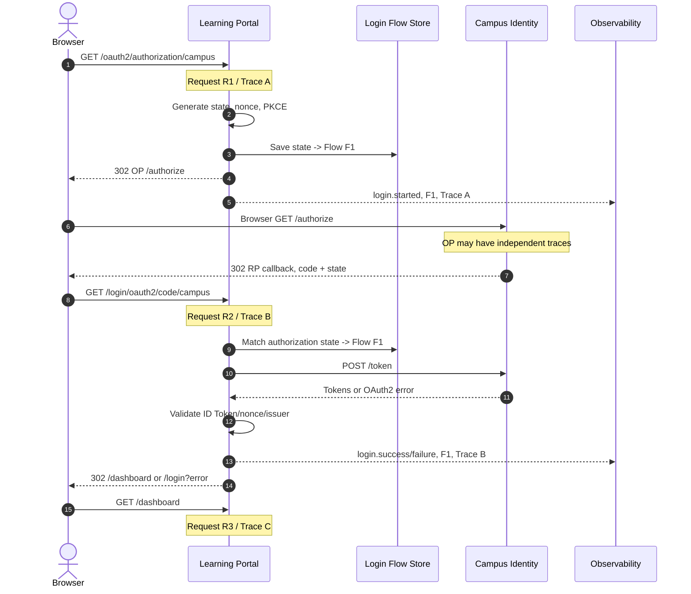

# 28.9. Correlation IDs, Request Tracing, and Tracking Across Redirects

## Lesson Objectives

In **Spring Security OAuth 2.0/OIDC Client**, a single sign-in typically spans multiple requests, browser redirects, an OpenID Provider (OP), and server-side API calls. This lesson enables you to:

- Distinguish **request ID**, **correlation ID**, **trace ID**, **span ID**, and **login flow ID** from OAuth2 `state`, OIDC `nonce`, and session ID.
- Understand why **an HTTP 302 through the browser does not automatically preserve a distributed trace** and why the OIDC callback usually gets a new trace ID.
- Design tracking across the entire Authorization Code Flow without leaking `authorization_code`, `state`, `nonce`, PKCE `code_verifier`, tokens, or cookies.
- Use a **server-side flow correlation record** bound to an exact OAuth2 authorization transaction with TTL/cleanup.
- Identify instrumentation points at authorization request, callback, Token Endpoint, ID Token validation, UserInfo, persistence, and downstream APIs.
- Apply **Micrometer Observation/Tracing**, OpenTelemetry/W3C Trace Context, structured logs, and MDC in Spring Boot Servlet.
- Use **WebFilter** and Reactor Context properly on Spring WebFlux/Reactive.
- Distinguish back-channel HTTP tracing from browser navigation to the OP; understand the limits of what an RP can observe from a third-party OP.
- Identify root causes of `invalid_state`, `invalid_grant`, wrong issuer, lost sessions, redirect loops, refresh failures, and Resource Server HTTP 401/403s.
- Design metrics, trace sampling, retention, privacy, and integration test suites aligned with trust boundaries.

---

## 1. A Single Sign-In Can Generate Multiple HTTP Requests

Suppose **Learning Portal** is a Spring Boot application using Campus Identity for OIDC Login.

One login journey:

```text
Browser:
  1. GET /oauth2/authorization/campus

Learning Portal:
  2. Builds OAuth2AuthorizationRequest, state/nonce/PKCE
  3. Saves authorization request
  4. Returns 302 Location: https://idp.example.org/authorize?...

Browser/OP:
  5. Navigates to OP
  6. User authenticates, possibly completes MFA/consent
  7. OP returns 302 to Learning Portal's callback

Browser:
  8. GET /login/oauth2/code/campus?code=...&state=...

Learning Portal:
  9. Verifies authorization transaction/state
 10. POST /token (back-channel)
 11. Verifies ID Token, nonce, issuer, audience
 12. Optionally calls UserInfo Endpoint
 13. Saves Authentication, session, authorized client
 14. Returns 302 to /dashboard

Browser:
 15. GET /dashboard
```

The HTTP trace for step 1 can end as soon as the RP returns `302`. Step 8 is a **brand-new request** when the browser returns from the OP. Step 15 is yet another new request.

Without application-level correlation, logs might only show:

```text
09:00:00  GET /oauth2/authorization/campus -> 302
09:00:08  GET /login/oauth2/code/campus -> 302 /login?error
09:00:08  OAuth2AuthenticationException: invalid_grant
```

Those lines are not necessarily enough to tell which authorization attempt the callback belonged to, which registration was chosen, where the token request went, or how many tabs a user had open.

> **Right mindset:** Distributed tracing tracks **operations and HTTP context propagation**; login flow correlation tracks **a sign-in journey**. One journey can contain multiple separate traces.

## 2. Common Identifiers

| Identifier | Scope | Purpose | Should It Be Logged Verbatim? |
| --- | --- | --- | --- |
| **Request ID** | One inbound HTTP request | Locate logs for that request | Yes, when generated/validated at the trust boundary |
| **Trace ID** | One distributed trace | Stitch spans within a trace | Yes, per observability policy |
| **Span ID** | One operation/span | Identify a specific step | Yes, per observability policy |
| **Correlation ID** | System-defined workflow | Link business events | Yes, if nonsecret and free of PII |
| **Login flow ID** | One OIDC authorization attempt | Link initiation to callback | Yes, if a random nonsecret ID |
| **OAuth2 `state`** | Authorization transaction | CSRF/response binding | **No** |
| **OIDC `nonce`** | OIDC authentication request | Bind ID Token to request | **No** |
| **PKCE `code_verifier`** | Authorization Code exchange | Prove client holds PKCE verifier | **No** |
| **Authorization Code** | One-time grant | Exchange for tokens | **No** |
| **Session ID/cookie** | Browser session | Locate/authenticate session | **No** |
| **ID Token/Access Token/Refresh Token** | Authentication/authorization | Security credentials | **No** |

### 2.1. Request ID

A request can receive from the RP:

```http
HTTP/1.1 302 Found
X-Request-ID: 64cd45a3-a034-48b1-a8a5-e65ba0f8e194
Location: https://idp.example.org/authorize?...
```

Request IDs normally **differ** across initiation, callback, and dashboard requests. They help when assisting users who report an error on a specific HTTP response.

### 2.2. Trace ID and Span ID

A distributed trace has one trace ID and multiple spans:

```text
Trace A: 11111111111111111111111111111111
  Span A1: GET /oauth2/authorization/campus
  Span A2: internal registration lookup
```

After the browser redirect:

```text
Trace B: 22222222222222222222222222222222
  Span B1: GET /login/oauth2/code/campus
  Span B2: POST OP /token
  Span B3: GET OP /userinfo
  Span B4: save application user/session
```

Two traces can still belong to the **same login attempt**.

### 2.3. Login Flow ID

The application generates its own ID, for example:

```text
loginFlowId = 73421f3c-a3e1-43bd-a3a0-33f3924479b0
```

It carries no email, user ID, token, or session ID. The RP stores metadata:

```text
OAuth2 state (internal lookup key)
    -> loginFlowId
    -> registrationId
    -> startedAt
    -> initialTraceId (optional)
    -> backend-validated AppTenant (optional)
```

Put only `loginFlowId` into logs. **Never turn `state` into a flow ID.**

## 3. Diagram of an OIDC Journey with Multiple Traces



Key takeaways:

- **Trace A** and **Trace B** can be different.
- The HTTP Token Endpoint call **from the RP** can have a client span under Trace B if the HTTP client is instrumented.
- The OP is not a component whose internal logs/traces the RP has automatic permission to view.
- F1 allows querying initiation/callback events for a single workflow.
- A browser redirect must never be treated as an internal server-to-server call.

## 4. Why Doesn't an HTTP Redirect Automatically Propagate Trace Context?

HTTP `302` merely provides a target for the **browser** to navigate to:

```http
Location: https://idp.example.org/authorize?client_id=...&state=...
```

The browser issues a new HTTP request to the OP's domain. There is no guarantee the browser copies `traceparent`, `tracestate`, or `baggage` headers from the RP's response into the OP's request.

Reasons:

- Browser navigation is not an RP HTTP client call.
- The OP may be a third-party system not instrumented with the same SDK.
- Login/MFA/consent introduce additional redirects, origins, and user interactions.
- Browser extensions/cookie policies can alter the flow.
- The flow can span several minutes or be abandoned mid-way by the user.

**Never** put tracing headers into the OP's query string to try forcing trace continuity:

```text
/authorize?...&traceparent=...&baggage=...
```

That data can be logged by the OP, proxies, browser history, and analytics. It is also trivial for callers to spoof and does not guarantee the tracing backend links the spans.

### 4.1. Which Legs Can Have Real Propagation?

During the callback:

```text
Learning Portal (Trace B)
   -> POST Token Endpoint
   -> GET UserInfo
   -> POST internal user service
   -> database/cache
```

If those clients are instrumented, trace context can propagate via **HTTP headers** per W3C across supporting systems.

Do not assume the OP will expose internal traces to the RP even if it receives `traceparent`.

### 4.2. Span Links and Business Correlation

OpenTelemetry supports **Span Links** to associate contexts without a linear parent-child relationship. When a trusted initial span context is available, a system can consider linking the callback span to initiation.

However, Spring Security OAuth2 Login **does not automatically** link two requests via `state`. A simpler, more resilient solution is usually storing a flow ID and querying structured logs by F1.

### 4.3. Do Not Keep One Span Open Throughout User MFA Input

A login might start at 09:00 and callback at 09:10. Holding a server-side span open for ten minutes waiting on the browser is generally inappropriate.

Instead:

```text
Trace A: initiation request, finishes quickly
Flow F1: awaits callback within a bounded TTL
Trace B: callback processing, finishes
```

Business duration `startedAt -> completedAt` can be measured separately without equating it to server latency.

## 5. OAuth2 `state`, OIDC `nonce`, and Correlation IDs

### 5.1. `state` Serves a Security Purpose

Spring Security uses an authorization request repository to save transaction details:

```text
Authorization Request
    response_type=code
    client_id=...
    redirect_uri=...
    scope=openid profile
    state=<opaque-state>
    nonce=<opaque-nonce>
    PKCE challenge if applicable
```

The OP returns `state` on callback so the RP can match **the exact request**.

If you write:

```java
String correlationId =
    request.getParameter("state");
```

and write it to logs, you have leaked a sensitive transaction-binding value into the observability system.

### 5.2. `nonce` Is Not `state`

`nonce` binds the ID Token to the OIDC authentication request; `state` binds the OAuth2 authorization response to the authorization request. They serve distinct purposes and neither should be used as a logging identifier.

### 5.3. PKCE Verifier Is a Credential

`code_verifier` is used when exchanging the authorization code at the Token Endpoint. Never log the verifier or token request body to debug `invalid_grant`.

### 5.4. Log Only a Nonsecret Flow ID

Generate:

```java
String loginFlowId =
    UUID.randomUUID().toString();
```

Then store:

```text
state -> loginFlowId
```

**in a trusted server-side store**. The mapping must have a TTL, be cleaned up after the callback, and never be exposed through a public endpoint.

### 5.5. Flow ID Must Never Be Used to Bypass Authentication

A browser knowing F1 has no authority to:

- Complete OIDC Login.
- Switch `registrationId` or tenant.
- Read sessions/ID Tokens.
- Access another user's logs.

Correlation metadata **never replaces** verifying `state`, `nonce`, issuer, audience, token signatures, or tenant membership.

## 6. Designing a LoginFlowMetadata Record

An illustrative Java type:

```java
public record LoginFlowMetadata(
    String flowId,
    String registrationId,
    String appTenantId,
    String initialRequestId,
    String initialTraceId,
    Instant createdAt,
    Instant expiresAt
) {}
```

Where:

- `flowId` is the random ID of the attempt.
- `registrationId` comes from the trusted `ClientRegistrationRepository`.
- `appTenantId` is optional; set only after backend tenant resolution.
- `initialRequestId` and `initialTraceId` help look up the initiation leg.
- `expiresAt` ensures records are not retained forever.

No raw `state`, `code`, `nonce`, tokens, or personal data appear in the loggable record. The store may use `state` **as an internal lookup key** without ever printing it.

### 6.1. Store Interface

```java
public interface LoginFlowStore {

    void put(String oauth2State, LoginFlowMetadata metadata);

    Optional<LoginFlowMetadata> get(String oauth2State);

    Optional<LoginFlowMetadata> consume(String oauth2State);
}
```

Implementations must ensure:

- State keys are unpredictable, generated by the Spring Security/OAuth2 authorization flow.
- The store enforces TTL and access control.
- `consume` is single-use or replay-protected.
- Users cannot alter flow metadata via HTTP queries/headers.
- User A's flow cannot be attached to User B's callback.
- Shared session/transaction storage when running multiple instances.

### 6.2. Distinguish the Two Repository Layers

`LoginFlowStore` above **does not replace** Spring Security's `AuthorizationRequestRepository` used to verify `state`. It is strictly **sidecar metadata** for observability.

Spring Security's repository must still store the full authorization request and perform state matching. If the authentication transaction is invalid, a correlation record can never make the callback valid.

## 7. Attaching Correlation at the Authorization Request Repository (Servlet)

Spring Security Servlet uses:

```java
AuthorizationRequestRepository<OAuth2AuthorizationRequest>
```

A common implementation:

```java
HttpSessionOAuth2AuthorizationRequestRepository
```

Key methods:

```java
OAuth2AuthorizationRequest loadAuthorizationRequest(
    HttpServletRequest request
);

void saveAuthorizationRequest(
    OAuth2AuthorizationRequest authorizationRequest,
    HttpServletRequest request,
    HttpServletResponse response
);

OAuth2AuthorizationRequest removeAuthorizationRequest(
    HttpServletRequest request,
    HttpServletResponse response
);
```

A custom wrapper can:

1. Delegate saving/loading/removing the authorization request to Spring Security's repository.
2. On save, generate a flow ID and persist the state-to-flow mapping server-side.
3. On successful remove, place the flow ID into a controlled request attribute.
4. Have authentication success/failure handlers read the request attribute and log the outcome event.
5. Clean up metadata per transaction/TTL.

### 7.1. Pseudocode Placing the Extension Point Correctly

```java
@Override
public void saveAuthorizationRequest(
        OAuth2AuthorizationRequest authorizationRequest,
        HttpServletRequest request,
        HttpServletResponse response) {

    delegate.saveAuthorizationRequest(
        authorizationRequest, request, response
    );

    if (authorizationRequest != null) {
        String flowId = UUID.randomUUID().toString();

        LoginFlowMetadata metadata =
            createMetadata(flowId, authorizationRequest, request);

        flowStore.put(
            authorizationRequest.getState(),
            metadata
        );

        logSafeEvent("oauth2.login.started", metadata);
    }
}
```

`createMetadata` and `logSafeEvent` are application-defined functions, not Spring Security APIs. A real implementation must handle store errors, atomicity relative to the repository, nullable requests, and multi-tab support.

### 7.2. Callback Must Use the Matched Transaction

One approach:

```java
@Override
public OAuth2AuthorizationRequest removeAuthorizationRequest(
        HttpServletRequest request,
        HttpServletResponse response) {

    OAuth2AuthorizationRequest matched =
        delegate.removeAuthorizationRequest(request, response);

    if (matched != null) {
        flowStore.consume(matched.getState())
            .ifPresent(meta ->
                request.setAttribute(
                    "loginFlowId", meta.flowId()
                )
            );
    }

    return matched;
}
```

Use only the matched authorization request returned by the delegate. Never trust `request.getParameter("state")` as an identity or as proof of membership.

This step only propagates the nonsecret `loginFlowId` into the callback's request context; **it does not yet mean Authentication succeeded**. Log success events only after token validation and actual Authentication succeed.

### 7.3. Configuring the Repository for OAuth2 Login

```java
@Bean
SecurityFilterChain securityFilterChain(
        HttpSecurity http,
        AuthorizationRequestRepository<OAuth2AuthorizationRequest>
            correlatingRepository)
        throws Exception {

    http
        .authorizeHttpRequests(auth -> auth
            .requestMatchers("/", "/assets/**").permitAll()
            .anyRequest().authenticated()
        )
        .oauth2Login(oauth2 -> oauth2
            .authorizationEndpoint(endpoint -> endpoint
                .authorizationRequestRepository(
                    correlatingRepository
                )
            )
        );

    return http.build();
}
```

This config assumes the custom repository bean exists, imports are added, and the OAuth2 Client registration is valid. Do not use an unimplemented `correlatingRepository` in production.

### 7.4. Callback Without a Matched Request

Log:

```text
event=oauth2.callback.rejected
reason=missing_or_mismatched_state
registrationId=campus
requestId=R2
traceId=T2
flowId=unknown
```

Do not log:

```text
state=<raw-input>
code=<authorization-code>
```

and never skip state validation to let the callback continue.

## 8. Multi-Tab, Session Timeout, and Multiple Instances

### 8.1. Two Tabs

```text
Tab A:
  state=SA
  flowId=FA

Tab B:
  state=SB
  flowId=FB
```

Right store:

```text
SA -> FA
SB -> FB
```

Do not use:

```text
session.lastFlowId = FB
```

because if callback A arrives later, it would be wrongly linked to FB.

Some simple authorization request repositories may not support multiple pending flows within the same browser session; when multi-tab is required, select/implement a per-state repository while preserving full CSRF/state checks.

### 8.2. Session Timeout

User starts login, then leaves the MFA screen idle too long. The session holding the authorization request can expire. A callback with the old `state` **must not** be accepted just because a correlation ID exists.

Log `authorization_request_expired` or `invalid_state` per policy; the flow ID may no longer exist due to TTL.

### 8.3. Multi-Instance Deployment

```text
Browser initiation -> Pod A
Browser callback   -> Pod B
```

If authorization requests and flow mappings live only in Pod A's memory, Pod B cannot find them. Use a shared session store/Spring Session or a distributed transaction store with proper TTL, access control, and consistency.

Never fix this by accepting arbitrary states when the store misses.

### 8.4. Flow Cleanup

Outcomes:

```text
SUCCESS
AUTHENTICATION_FAILURE
INVALID_CALLBACK
EXPIRED / ABANDONED
USER_CANCELLED (if reliably known)
```

When no callback arrives, you can only state that the flow **hit TTL without completing at the RP**. Do not immediately assume an OP outage.

## 9. Observability Events to Emit

| Event | When | Safe Fields |
| --- | --- | --- |
| `oauth2.login.started` | Authorization request created/saved | flowId, registrationId, requestId |
| `oauth2.login.redirect_issued` | RP returns 302 to OP | flowId, provider alias, status |
| `oauth2.callback.received` | RP receives callback | requestId, traceId, registrationId |
| `oauth2.callback.state_invalid` | State missing/mismatched | requestId, error category |
| `oauth2.token_exchange.started` | RP calls Token Endpoint | grantType, provider alias |
| `oauth2.token_exchange.failed` | OP returns OAuth2 error/timeout | errorCode, duration, status |
| `oidc.id_token.rejected` | Token validation fails | validation category |
| `oauth2.login.succeeded` | RP Authentication succeeds | flowId, registrationId, duration |
| `oauth2.login.failed` | RP Authentication fails | flowId if available, error category |
| `oauth2.login.abandoned` | Flow TTL expires with no callback | registrationId, elapsed bucket |
| `oauth2.authorized_client.refreshed` | Refresh token completes | registrationId, grantType |
| `oauth2.resource_call.failed` | Resource Server returns error | service alias, HTTP status |
| `oauth2.logout.started` | RP processes logout | requestId, provider alias |
| `oidc.logout.redirect_issued` | RP redirects to end-session endpoint | provider alias, never log Location |

### 9.1. HTTP 302 Does Not Equal Login Success

A callback may return:

```http
302 Location: /login?error
```

The business outcome is **failure**, even though the HTTP status is 302. Emit `login.succeeded` only after authentication/token validation and required application policies succeed.

### 9.2. Separate Login from Refresh

`OAuth2AuthorizedClientManager` can refresh Access Tokens hours after login. Refresh success/failure handlers **differ** from UI login success handlers.

Do not attach the original login flow ID as a permanent tracking ID across every future refresh for that user.

### 9.3. Callback May Never Reach the Token Endpoint

On a state mismatch, Spring Security may reject before calling `/token`. Never emit `token_exchange.failed` when the Token Endpoint was never invoked.

## 10. Micrometer Observation and Tracing in Spring Boot

In modern Spring Boot, **Micrometer Observation** and **Micrometer Tracing** are standard foundations for creating observations, spans, and exporting traces via the OpenTelemetry bridge.

Dependency example on Spring Boot 3.x:

```groovy
dependencies {
    implementation 'org.springframework.boot:spring-boot-starter-actuator'
    implementation 'io.micrometer:micrometer-tracing-bridge-otel'
    runtimeOnly 'io.opentelemetry:opentelemetry-exporter-otlp'
}
```

Library versions should be managed by the Spring Boot BOM; check the corresponding starter and property names for other Spring Boot/Spring Security versions.

### 10.1. Configuration Example

```yaml
management:
  tracing:
    sampling:
      probability: 0.10
  otlp:
    tracing:
      endpoint: http://otel-collector:4318/v1/traces
```

The collector address in the example is a trusted internal service, not a default production endpoint.

### 10.2. Traces Are Not Audits

A `0.10` sampling rate may export only 10% of traces per SDK policy. Never make critical **security audits** depend on whether an event's trace happened to be sampled.

A sound design:

```text
Traces  -> latency/spans, appropriate sampling
Logs    -> flow events, correlation metadata
Metrics -> aggregate outcomes/durations
Audit   -> critical security events, dedicated retention
```

### 10.3. Not Every Spring Security Method Automatically Gets Its Own Span

HTTP server instrumentation creates inbound spans, yet there is no default guarantee of separate spans for:

```text
ClientRegistration lookup
OIDC nonce validation
membership mapping
authorized client persistence
```

When needed, add **custom observations** in application code you own rather than logging raw tokens to compensate for missing spans.

## 11. W3C Trace Context and Headers

Trace context is typically propagated via:

```http
traceparent: 00-aaaaaaaaaaaaaaaaaaaaaaaaaaaaaaaa-bbbbbbbbbbbbbbbb-01
tracestate: vendor=value
```

And if the application uses baggage:

```http
baggage: service-zone=internal
```

### 11.1. What Are W3C Headers Used For?

When one service calls another, it can inject context into outbound HTTP headers. Instrumented downstream services use that context to connect spans per tracing policy.

### 11.2. Baggage Easily Leaks Data

Never put into baggage:

```text
email
sub
tenant secret
session ID
state
nonce
code
Access Token
Refresh Token
```

Baggage can propagate to external systems if enabled. Allowlist only approved keys and bound sizes.

### 11.3. `traceparent` Does Not Authenticate the Caller

Any internet client can send arbitrary tracing headers. Never use trace IDs as proof of login, tenant membership, or API permissions. At trust boundaries, sanitize or ignore inbound trace context per policy.

## 12. Servlet: Request ID via OncePerRequestFilter

An independent request ID helps locate an HTTP request even when tracing is not configured.

```java
@Component
public class RequestIdFilter extends OncePerRequestFilter {

    private static final String HEADER = "X-Request-ID";

    @Override
    protected void doFilterInternal(
            HttpServletRequest request,
            HttpServletResponse response,
            FilterChain filterChain)
            throws ServletException, IOException {

        String id = UUID.randomUUID().toString();

        request.setAttribute("requestId", id);
        response.setHeader(HEADER, id);

        try (MDC.MDCCloseable ignored =
                MDC.putCloseable("requestId", id)) {

            filterChain.doFilter(request, response);
        }
    }
}
```

Key imports:

```java
import jakarta.servlet.FilterChain;
import jakarta.servlet.ServletException;
import jakarta.servlet.http.HttpServletRequest;
import jakarta.servlet.http.HttpServletResponse;
import org.slf4j.MDC;
import org.springframework.stereotype.Component;
import org.springframework.web.filter.OncePerRequestFilter;

import java.io.IOException;
import java.util.UUID;
```

### 12.1. Why Generate an ID Instead of Trusting Internet Headers?

If you accept:

```http
X-Request-ID: attacker-controlled
```

and write it straight to logs, callers can trigger log injection, spoofing, or cardinality abuse. The example filter **always generates a fresh UUID**.

If an upstream gateway supplies a trusted request ID, define the trust boundary, validate format/length, and avoid accepting arbitrary headers from public clients.

### 12.2. Filter Order

To ensure the request ID is present even for errors emitted by Spring Security, run the filter at the right order before security processing. When using `FilterRegistrationBean` or registering the filter inside `HttpSecurity`, avoid registering the same filter twice and generating two IDs.

### 12.3. Async Servlet and MDC

MDC is thread-local context. If a request moves to an executor/async dispatch, a custom request ID may not automatically follow onto the new thread. Use context propagation/instrumented executors and test it rather than assuming `@Async` always keeps MDC.

### 12.4. Request ID Is Not a Secret

You can return a random request ID in `X-Request-ID` for support, but never create an endpoint where users submit a request ID to read arbitrary logs/traces.

## 13. Attaching Trace ID to Logs via Micrometer Tracer

A component:

```java
@Component
class CurrentTraceInfo {

    private final Tracer tracer;

    CurrentTraceInfo(Tracer tracer) {
        this.tracer = tracer;
    }

    String traceIdOrNull() {
        Span span = tracer.currentSpan();
        return span == null
            ? null
            : span.context().traceId();
    }
}
```

Imports:

```java
import io.micrometer.tracing.Tracer;
import io.micrometer.tracing.Span;
import org.springframework.stereotype.Component;
```

You can record the initial trace ID in `LoginFlowMetadata` when authorization starts, and then record the new trace ID on callback.

### 13.1. Trace ID Is Unsuitable as a Login Flow ID

Do not write:

```java
String loginFlowId = traceIdOrNull();
```

because a trace may not exist, may be unsampled, or may span multiple operations. Generate the login flow ID independently and store it in the flow store.

### 13.2. Logging Pattern Example

With an MDC-supporting logging framework:

```yaml
logging:
  pattern:
    correlation: "[%X{traceId:-},%X{spanId:-}] "
```

Configuration of correlation patterns and automatic tracing MDC varies by Spring Boot/Logback version. When adding `requestId`, verify actual log formatting, especially on async/background threads.

### 13.3. Having Different IDs per Event Is Normal

Start:

```text
flowId=F1 requestId=R1 traceId=TA spanId=SA
```

Callback:

```text
flowId=F1 requestId=R2 traceId=TB spanId=SB
```

R1 and R2 differ, and TA and TB can differ; only F1 stays constant across **one authorization attempt**.

## 14. Custom Observation for Business Steps

Suppose you want to measure account lookup latency after OIDC Login:

```java
@Service
class AccountLookupObservation {

    private final ObservationRegistry registry;

    AccountLookupObservation(ObservationRegistry registry) {
        this.registry = registry;
    }

    void observeLookup(
            String registrationId,
            Runnable lookupOperation) {

        Observation.createNotStarted(
                "oidc.account.lookup",
                registry
            )
            .lowCardinalityKeyValue(
                "registration.id", registrationId
            )
            .observe(lookupOperation);
    }
}
```

Imports:

```java
import io.micrometer.observation.Observation;
import io.micrometer.observation.ObservationRegistry;
```

### 14.1. Which Tags Have Low Cardinality?

```text
registrationId = campus
outcome = success/failure
grantType = authorization_code
errorCategory = issuer_mismatch
targetService = course-api
```

Never use:

```text
flowId
requestId
traceId
email
subject
sessionId
authorizationCode
```

as metric labels.

### 14.2. Do Not Replace the Default Success Handler Just to Log

Spring Security Login and Authorized Client Manager rely on success/failure handlers to manage redirects, sessions, and token persistence. If a custom handler only records an Observation and drops default behavior, you break the security flow.

Compose/delegate to the proper extension point and ensure `login.succeeded` is emitted only after authentication genuinely succeeds.

## 15. WebFlux: WebFilter and Reactor Context

In Spring WebFlux, do not rely solely on ThreadLocal/MDC as in synchronous Servlet apps.

`WebFilter` example:

```java
@Component
class ReactiveRequestIdFilter implements WebFilter {

    @Override
    public Mono<Void> filter(
            ServerWebExchange exchange,
            WebFilterChain chain) {

        String requestId = UUID.randomUUID().toString();

        exchange.getAttributes().put(
            "requestId", requestId
        );

        exchange.getResponse().getHeaders().set(
            "X-Request-ID", requestId
        );

        return chain.filter(exchange)
            .contextWrite(context ->
                context.put("requestId", requestId)
            );
    }
}
```

Imports:

```java
import org.springframework.stereotype.Component;
import org.springframework.web.server.ServerWebExchange;
import org.springframework.web.server.WebFilter;
import org.springframework.web.server.WebFilterChain;
import reactor.core.publisher.Mono;
import java.util.UUID;
```

### 15.1. Reading Reactor Context

```java
Mono<String> currentRequestId() {
    return Mono.deferContextual(context ->
        Mono.just(
            context.getOrDefault(
                "requestId", "unknown"
            )
        )
    );
}
```

This code reads the Reactor Context of the **current request**; it does not survive automatically across a browser redirect to the OP and back to the callback.

### 15.2. MDC Does Not Automatically Cross Every Thread Hop

Reactor `publishOn`, `flatMap`, schedulers, and custom subscriptions can switch threads. Configure Micrometer/Reactor context propagation properly, or pass `ServerWebExchange`/Reactor Context explicitly.

Never call `.block()` on the event loop just to read a trace ID. Never call `.subscribe()` on your own to run logging/persistence detached from the framework-managed lifecycle.

### 15.3. Reactive Authorization Request Repository

Spring Security WebFlux provides:

```java
ServerAuthorizationRequestRepository<OAuth2AuthorizationRequest>
```

with an implementation such as:

```java
WebSessionOAuth2ServerAuthorizationRequestRepository
```

When extending to store a flow ID, use state-indexed server-side mapping and the proper reactive lifecycle. Never copy `HttpSession`/Servlet filters into `SecurityWebFilterChain`.

## 16. Instrumentation Layers to Distinguish

| Layer | Spring Servlet | Spring WebFlux |
| --- | --- | --- |
| HTTP inbound | Servlet filters/observations | WebFilter/server observations |
| Security context | `SecurityContextHolder` per Servlet flow | `ReactiveSecurityContextHolder` |
| Authorization request | `AuthorizationRequestRepository` | `ServerAuthorizationRequestRepository` |
| Session | `HttpSession`/Spring Session | `WebSession`/Reactive Spring Session |
| Request-local metadata | Request attributes/MDC | Exchange attributes/Reactor Context |
| HTTP outbound | Instrumented RestClient/WebClient/RestTemplate per version | Instrumented WebClient |
| Trace API | Micrometer Tracer | Micrometer Tracer + Reactor propagation |
| Flow correlation | Shared state-to-flow store | Shared reactive state-to-flow store |

Never use a `static String currentFlowId` to correlate requests, since multiple users/requests run concurrently.

## 17. Token Endpoint Tracing During Callback

During the callback, Spring Security OAuth2 Client calls the Token Endpoint via the **back-channel**.

Meaningful request example:

```http
POST /oauth2/token HTTP/1.1
Host: idp.example.org
Content-Type: application/x-www-form-urlencoded

grant_type=authorization_code&
code=<one-time-authorization-code>&
redirect_uri=...&
code_verifier=<pkce-verifier>
```

**Never enable HTTP body logging** for the Token Endpoint in production.

### 17.1. Safer Metadata

```text
operation=oauth2.token.exchange
grantType=authorization_code
registrationId=campus
providerAlias=campus-op
httpMethod=POST
httpStatus=400
oauthErrorCode=invalid_grant
durationMs=...
```

Never log Client Secret, client assertions, codes, or verifiers.

### 17.2. Which Token Client Is Actually Instrumented?

Creating an observation-configured `RestClient` bean in the application **does not automatically mean** Spring Security's token client uses that instance.

Check the configuration of `OAuth2AccessTokenResponseClient`, the HTTP client stack, and tracing instrumentation for your Spring Security version. Integration tests must verify actual client spans.

### 17.3. Error Descriptions May Be Unsafe to Log

`OAuth2Error` contains `errorCode`, `description`, and `uri`. Provider-specific descriptions may include request details or nonstandard data. Prefer **sanitized error categories/codes** rather than dumping raw exception bodies.

## 18. UserInfo, ID Token Validation, and Downstream Spans

After the Token Endpoint:

```text
ID Token JWS verification
issuer/audience/expiry/nonce checks
optional UserInfo fetch
application user lookup
tenant membership
authorized client save
session persistence
```

Not every step automatically has its own span. Add valuable observations on critical application-owned operations.

### 18.1. Do Not Log the UserInfo Body

UserInfo can contain email, name, profile, address, or other PII. The tracing backend is not the place to store raw profile responses.

### 18.2. Do Not Log Unverified ID Token Claims

Before the token is validated, JWT claims are untrusted data. Never extract email/sub/tenant from a raw decoded JWT and emit it as a security audit identity.

### 18.3. Distinguish Validation Failures

Sample categories:

```text
invalid_signature
issuer_mismatch
audience_mismatch
token_expired
nonce_mismatch
userinfo_sub_mismatch
unsupported_algorithm
```

Log category + registration/flow ID, never the raw ID Token.

## 19. W3C Propagation and Trust Boundaries

A downstream API may receive:

```http
traceparent: 00-aaaaaaaaaaaaaaaaaaaaaaaaaaaaaaaa-bbbbbbbbbbbbbbbb-01
```

This links the RP's HTTP client span with the API's server span if both are instrumented.

However:

- `traceparent` is not proof of authentication.
- `tracestate`/`baggage` must never be used for tenant authorization.
- Never send PII or credentials in baggage.
- Never send tracing context to arbitrary domains from user-controlled URLs.
- Never use Trace ID as a token store key.

If the RP calls an external OP, some tracing headers may be sent depending on client instrumentation. The OP may ignore them; the RP still sees only **its own HTTP client span**.

## 20. Redaction: URLs, Queries, Headers, and Response Location

In OIDC Login, sensitive URLs include:

```text
/authorize?state=...&nonce=...&code_challenge=...
/login/oauth2/code/campus?code=...&state=...
/logout?id_token_hint=...&post_logout_redirect_uri=...
```

Logging full URLs or `Location` headers can send tokens/authorization metadata into log stores.

### 20.1. Log Route Templates

Good:

```text
http.route=/login/oauth2/code/{registrationId}
http.method=GET
http.status_code=302
```

Bad:

```text
url.full=https://portal.example.org/login/oauth2/code/campus?code=...&state=...
```

### 20.2. Scrub Response Headers Too

- Authorization redirect `Location` can contain `state` and `nonce`.
- OIDC Logout redirect can contain `id_token_hint`.
- Callback URL contains `code` and `state`.
- Token Endpoint requests contain Authorization headers/client credentials.

Hiding only the `Authorization` header while still logging full `Location` headers or queries is insufficient.

### 20.3. Fields to Block

```text
Authorization
Cookie
Set-Cookie
access_token
refresh_token
id_token
id_token_hint
authorization_code / code
state
nonce
code_verifier
client_secret
client_assertion
```

Those fields must never appear as metric tags, trace attributes, or log fields.

### 20.4. Secure the Trace Backend

Enforce TLS/mTLS where appropriate, least-privilege access, bounded retention, and environment isolation. Trace IDs are nonsecret yet can let privileged operators correlate a user's actions; never expose trace queries publicly.

## 21. Distinguishing Errors Across Each Stage

| Stage | Symptom | What to Determine |
| --- | --- | --- |
| Authorization initiation | No 302 to OP | Registration/redirect request creation/session save |
| Browser navigation | 302 sent, no callback | User cancel, OP/network, redirect URI/browser |
| Callback | `invalid_state` | Session cookie, repository, missing/mismatched state |
| Token exchange | `invalid_grant` | Code expired/reused, PKCE, redirect URI |
| Token exchange | `invalid_client` | Client credential/method, rotation, issuer |
| ID Token validation | Issuer mismatch | OP/client registration mapping |
| ID Token validation | Nonce mismatch | Auth transaction replay/mix-up |
| UserInfo | Timeout/claim error | UserInfo HTTP client/OP policy |
| Session persistence | Login succeeded, API gets 401 | Session cookie/store/filter chain |
| Authorized-client persistence | Refresh reuses old token | Success handler/store issue |
| Resource Server | 401 `invalid_token` | Wrong aud/iss, expiry, revoked token |
| Resource Server | 403 `insufficient_scope` | Scope or business authorization |
| Logout | RP 302 OP | OP logout may not have succeeded |

### 21.1. `invalid_state`

Can stem from:

- Authorization request was not saved.
- Session/WebSession timed out while the user completed MFA.
- Browser omitted the cookie after a cross-site redirect.
- Wrong SameSite/Secure/path/domain.
- Callback hit another instance without a shared store.
- Two tabs overwrote the pending authorization request.
- Callback was tampered with or attacked.

Never disable state verification to "fix" the error.

### 21.2. `invalid_grant`

In Authorization Code Flow: code expired/reused, wrong PKCE verifier, redirect URI mismatch, grant rejected by OP. In Refresh Token Grant: refresh token expired/revoked/rotated.

Log `grantType` to distinguish:

```text
grantType=authorization_code
errorCode=invalid_grant
```

from:

```text
grantType=refresh_token
errorCode=invalid_grant
```

Never log raw codes or refresh tokens.

### 21.3. OP Outage

If the RP returned a redirect yet the browser never reached the OP, the RP may see only a flow with no callback. If the callback arrived and the Token Endpoint returned HTTP 503, the RP will have a direct span/error.

These are two distinct failure modes.

## 22. Tracking Redirect Loops

A loop can look like:

```text
GET /dashboard
  -> 302 /oauth2/authorization/campus
    -> OP SSO auto-login
      -> callback
        -> 302 /dashboard
          -> RP misses session cookie
            -> 302 /oauth2/authorization/campus
```

Indicators:

- Many `login.started` events in a short window.
- Each flow has a new ID.
- Callback may succeed, yet the subsequent request loses Authentication.
- Request IDs/traces change continuously.

Never try tying a loop together using the same `state`; state must be freshly generated per authorization transaction.

### 22.1. Root Causes

Check:

```text
Session cookie path/domain/SameSite/Secure
Proxy/public base URL
Session storage across instances
SessionAuthenticationStrategy/SecurityContext persistence
Post-login application authorization policy
Frontend retry/redirect logic
```

### 22.2. Protect UX

Do not auto-retry redirects to the OP infinitely; stop at an error page with a support reference/request ID and a clear user action.

## 23. Request Tracing When Calling Resource Server APIs

A post-login request:

```text
Browser -> Learning Portal -> Course API
```

normally carries a trace for the current request. If the Access Token expired, the authorized client manager may call the Token Endpoint to refresh before sending the Course API request.

Trace:

```text
GET /api/my-courses
  -> OAuth2AuthorizedClientManager.authorize
      -> refresh_token grant (if needed)
      -> save updated authorized client
  -> Course API GET /courses
```

There is no need to pull a login flow span from hours earlier into this request.

### 23.1. `401` from API Is Not `invalid_state`

A `401 invalid_token` from the Course API can be caused by wrong audience, expiry, or revocation—it does not prove the OIDC Login callback failed.

### 23.2. `403` Is Not Necessarily a Token Error

It may be due to a missing scope or the user lacking permission to view courses for that tenant. Never self-grant admin rights or disable audience validation to work around it.

### 23.3. Refresh Token Rotation

Two requests can refresh concurrently:

```text
A refreshes RT1 -> AT2, RT2
B refreshes RT1 -> invalid_grant
```

If B deletes A's newer authorized client due to the race, logs may look like a token revocation. Implement versioned persistence/single-flight/locking per architecture, plus telemetry for concurrent refreshes.

## 24. Structured Logging Schema

A login initiation event JSON:

```json
{
  "timestamp": "2026-11-16T03:05:00Z",
  "service": "learning-portal",
  "environment": "production",
  "event": "oauth2.login.started",
  "registrationId": "campus",
  "loginFlowId": "73421f3c-a3e1-43bd-a3a0-33f3924479b0",
  "requestId": "64cd45a3-a034-48b1-a8a5-e65ba0f8e194",
  "traceId": "aaaaaaaaaaaaaaaaaaaaaaaaaaaaaaaa",
  "spanId": "1111111111111111",
  "outcome": "started"
}
```

Callback event:

```json
{
  "timestamp": "2026-11-16T03:05:12Z",
  "service": "learning-portal",
  "environment": "production",
  "event": "oauth2.login.succeeded",
  "registrationId": "campus",
  "loginFlowId": "73421f3c-a3e1-43bd-a3a0-33f3924479b0",
  "requestId": "3bd4e26c-03bc-4a07-aec0-5cbf7db24a5e",
  "traceId": "bbbbbbbbbbbbbbbbbbbbbbbbbbbbbbbb",
  "spanId": "2222222222222222",
  "durationMs": 12000,
  "outcome": "success"
}
```

Two different `traceId` values do not break correlation when querying by `loginFlowId`.

### 24.1. Event Naming Conventions

Keep consistent:

```text
oauth2.login.started
oauth2.login.redirect_issued
oauth2.callback.received
oauth2.login.succeeded
oauth2.login.failed
oauth2.login.abandoned
oauth2.token_exchange.failed
oauth2.authorized_client.refreshed
oauth2.resource_call.failed
```

### 24.2. Do Not Log PII Unless Necessary

Email, `sub`, tenant/client IDs, and full IPs can be sensitive. Collect only metadata proven necessary, with retention/access controls. `registrationId` or a provider alias is usually enough to classify OAuth2 configuration issues.

## 25. Metrics for OIDC Login and OAuth2 Client

Examples:

```text
oauth2_login_started_total{registrationId}
oauth2_login_completed_total{registrationId,outcome,errorCategory}
oauth2_token_exchange_duration_seconds{registrationId,outcome}
oidc_token_validation_failures_total{registrationId,category}
oauth2_callback_invalid_state_total{registrationId}
oauth2_login_flow_abandoned_total{registrationId}
oauth2_client_refresh_total{registrationId,outcome}
oauth2_resource_call_failures_total{targetService,status}
```

### 25.1. Avoid High-Cardinality Tags

Never put:

```text
flowId
requestId
traceId
spanId
email
sub
state
nonce
```

into Prometheus counter/histogram labels.

### 25.2. Separate Server Latency from User Interaction

A flow might wait two minutes for a user to enter MFA even though the Token Endpoint responded in 100 ms.

Distinguish:

```text
login_flow_elapsed_time = startedAt -> completedAt
callback_processing_latency
token_endpoint_latency
userinfo_latency
```

Never judge the OP Token Endpoint as slow based on total time spent waiting for user password entry.

### 25.3. Abandoned Flows Are Not Automatically OP Failures

Users may close a tab or change their mind. Define metrics by TTL and clear buckets rather than turning every flow without a callback into an incident.

## 26. Sampling, Auditing, and Observability Security

An application may sample 10% of traces yet still need to audit critical authentication events.

### 26.1. Trace Sampling

```text
Trace A sampled = true
Trace B sampled = false
```

This is normal. Flow correlation events still let you look up outcomes even when a span is missing.

### 26.2. Separate Auditing

Events such as:

```text
authentication denied
account linking
role/tenant change
client registration change
suspicious login failure
```

may require dedicated audit retention by policy. Never keep them only when a trace happens to be sampled.

### 26.3. Securing Logs/Traces

- TLS and access control to collectors/backends.
- Redact tokens, headers, URLs, and PII.
- Separate dev/staging/prod.
- Bounded retention.
- Audit access to sensitive log/trace backends.
- Never put secrets into baggage or span tags.
- Never allow unauthenticated queries by flow ID.

## 27. Test Suite for Correlation Across OIDC Redirects

### 27.1. Successful E2E Login

```text
Given:
  Browser starts OIDC Login with campus
  Test OP issues valid code/ID Token
  RP creates flow F1 bound to state SA

When:
  GET /oauth2/authorization/campus
  Browser navigates OP
  Callback arrives with code and SA

Then:
  login.started event has F1
  login.succeeded event has F1
  Initial and callback Request IDs differ
  Trace IDs may differ
  Zero raw SA, code, nonce, ID Token logged
```

### 27.2. Callback State Mismatch

```text
Given:
  Pending authorization SA, flow F1

When:
  Callback contains mismatched SB

Then:
  Authentication rejected
  Callback not attached to F1 when state is invalid
  Zero raw SB logged
  Sanitized failure category logged
```

### 27.3. Two Tabs

```text
Tab A: SA -> FA
Tab B: SB -> FB
Callback B arrives before A
```

If the app needs to support multiple pending requests, both must map accurately. If the repository does not support multi-tab flows, define the policy and test fail-closed behavior rather than attaching the wrong flow.

### 27.4. Session Expired

```text
Flow FA starts
HTTP session expires
Callback arrives
```

Expectation: do not bypass state binding, do not create Authentication from a callback lacking an authorization request; flow ID may be unavailable; log safe request ID/error category.

### 27.5. OP Unavailable

Have a fake OP return 503 at the authorization endpoint or simulate a browser network error after 302. There may be no callback. RP logs `login.started`, then abandoned after TTL; do not log token exchange errors when the Token Endpoint was never called.

### 27.6. Token Endpoint Timeout

OP sends a valid callback, yet `/token` times out. Log category `token_endpoint_timeout` with flow/request/trace IDs. Never log `code_verifier` or secrets.

### 27.7. Redirect Loop

OP SSO auto-login, RP fails to persist session cookie. Browser test detects multiple flow IDs in a short window and stops at an error page instead of looping forever.

## 28. Unit Testing the Request ID Filter

Mock Servlet example:

```java
@Test
void requestIdAppearsInMdcAndResponse()
        throws Exception {

    RequestIdFilter filter = new RequestIdFilter();

    MockHttpServletRequest request =
        new MockHttpServletRequest("GET", "/health");

    MockHttpServletResponse response =
        new MockHttpServletResponse();

    AtomicReference<String> seen =
        new AtomicReference<>();

    filter.doFilter(
        request,
        response,
        (req, res) ->
            seen.set(MDC.get("requestId"))
    );

    assertThat(seen.get()).isNotBlank();

    assertThat(response.getHeader("X-Request-ID"))
        .isEqualTo(seen.get());

    assertThat(MDC.get("requestId")).isNull();
}
```

Tests should also send a fake, oversized, or control-character-laden `X-Request-ID` header and confirm the filter never puts that raw value into logs.

### 28.1. Testing MDC Across Async Boundaries

If the app uses `@Async`, executors, or Servlet async dispatch, test propagation on that exact stack. The synchronous test above does not prove MDC survives on worker threads.

### 28.2. MockMvc Does Not Run Full OIDC Login

`oidcLogin()` in Spring Security Test creates a mock OIDC Authentication to test authorization. It does not execute:

```text
Browser redirect
Token Endpoint
ID Token JWS verification
state/nonce matching
```

To test real flow correlation, use a fake OP or integration tests with authorization requests/callbacks.

## 29. WebFlux Tests

WebTestClient can verify:

| Scenario | Expectation |
| --- | --- |
| Inbound request | Has random `X-Request-ID` |
| Second request | Different Request ID |
| Reactor `flatMap` | Request ID stays in context |
| OIDC callback | Flow ID retrieved from transaction store |
| Lost session | State validation not bypassed |
| Multi-tab | Flows not overwritten wrongly |
| Multi-node | Shared state/flow store |
| OP timeout | Safe error category |
| Resource Server 401 | Not conflated with login invalid_state |
| Refresh grant | Observed under new request |
| Raw OAuth2 callback URL | Query credentials scrubbed |
| Unsubscribed `Mono` | Test catches unexecuted persistence/telemetry |

### 29.1. Do Not Use `.block()` on the Event Loop

If you need to log after a reactive persistence action, chain the publisher properly:

```java
return repository.save(data)
    .doOnSuccess(ignored ->
        log.info("safe_event=flow.saved")
    );
```

Do not do:

```java
repository.save(data);
return Mono.empty();
```

because lazy publishers normally never execute.

## 30. When the OP Belongs to Another System

The RP does not automatically have Campus Identity's traces. A practical approach when collaborating with the provider:

1. Find `loginFlowId` in RP logs.
2. Check whether initiation/callback appeared.
3. If callback appeared, inspect the Token Endpoint span, HTTP status, and sanitized error.
4. If callback did not appear, inspect E2E browser telemetry, DNS/TLS, OP uptime, and redirect URI.
5. If the OP supplies a request ID in headers/back-channel errors, store the **OP request ID** after validating/sanitizing its format.
6. When opening a support ticket with the provider, send UTC timestamp, provider alias, safe client registration ID, and error category/status.
7. Never send authorization codes, raw state, ID Tokens, Access Tokens, cookies, or client secrets.

### 30.1. OP Request ID Differs from RP Request ID

You may have:

```text
rpRequestId = R2
opRequestId = OP-6472
traceId = TB
loginFlowId = F1
```

Do not name all of them `correlationId` and lose their distinct meanings.

### 30.2. Never Send User PII in Support Tickets

If an account must be identified, use an approved secure channel rather than pasting raw tokens or email/profile claims into public tickets.

## 31. Common Mistakes Table

| Mistake | Consequence | Right Approach |
| --- | --- | --- |
| Log OAuth2 `state` as correlation ID | Leaks transaction key | Random flow ID + server mapping |
| Log raw callback URL | Leaks authorization code/state | Route template, scrub query |
| Log full logout `Location` | Can leak `id_token_hint` | Redact response headers |
| Assume 302 preserves trace | Browser issues new request | Separate traces + flow correlation |
| Put `traceparent` in OP query | Data leak/nonstandard propagation | Never do this |
| Trust caller-provided trace ID for authz | Unauthenticated trace context | Independent security checks |
| Use `session.lastFlowId` | Multi-tab mismatch | State-keyed metadata |
| Store mapping in pod memory | Callback hitting another pod fails | Shared store |
| No TTL/cleanup | Metadata leak, memory growth | TTL/consume |
| Log entire Token Endpoint body | Leaks code/secret/refresh | Safe error metadata |
| Put flow ID in metric labels | High cardinality | Logs/traces for IDs; aggregate metrics |
| Treat callback HTTP 302 as login success | May redirect to error | Business outcome events |
| Fall back to state as trace ID when trace missing | Security flaw | Independent request/flow IDs |
| Rely on ThreadLocal MDC in WebFlux | Context lost across thread switches | Reactor Context/instrumentation |
| Reuse login flow ID for future refreshes | Overly long tracking | Request-specific traces |
| Assume missing callback means OP down | User may have abandoned | Abandoned/unknown |
| Disable state validation | Login CSRF/mix-up | Fix session/request repo |
| Skip issuer check on error | Token confusion | Fix registration/trust |
| Trust arbitrary `X-Request-ID` from Internet | Log spoofing/injection | Generate/validate |
| Trace sampling drops audits | Missing security events | Dedicated audit pipeline |

## 32. Pre-Production Checklist

### 32.1. Correlation

- Every request has a safe request ID.
- Every authorization attempt has a random login flow ID.
- State-to-flow mapping is server-side, state-indexed, with TTL.
- Multi-tab and multi-node behaviors are explicit.
- Callbacks with invalid state fail closed.
- Flow ID contains no PII and never replaces authentication.

### 32.2. Tracing

- Micrometer/OpenTelemetry instrumentation matches the version.
- Inbound HTTP spans and outbound HTTP client spans are verified.
- Browser redirects are not assumed to preserve traces.
- Async/Reactive context propagation is tested.
- When callback trace differs from initiation trace, flow ID still links them.

### 32.3. Logs and Privacy

- Lifecycle events follow a consistent schema.
- Error categories separate state, token, ID Token, session, and API.
- Raw codes, state, nonce, tokens, secrets, and cookies are never logged.
- Queries and `Location` responses are scrubbed.
- Metric labels have low cardinality.
- Trace backend has strict access controls, retention, and explicit sampling.

### 32.4. Tests

- Full OIDC Authorization Code Flow with a fake OP.
- Missing/invalid state; session expiration.
- OP unavailable, Token Endpoint errors.
- Multi-tab login, cluster callbacks.
- Redirect loops and missing callbacks.
- Post-login Resource Server 401/403.
- Refresh Token Grant does not reuse old login flow IDs.
- Zero credentials in logs/traces.
- Audit events do not depend on trace sampling.

## 33. Practice Exercises

### Exercise 1 — Two Trace IDs

**Question:** Initiation has trace TA and callback has TB. Is that a bug?

**Answer:** No. The redirect causes a new browser request. Use F1 (flow ID) to link the events.

### Exercise 2 — Choosing a Flow ID

**Question:** Can you use raw OAuth2 `state` as `X-Correlation-ID`?

**Answer:** No. Generate a random nonsecret ID and keep the state-to-flow mapping on the server.

### Exercise 3 — Two Tabs

**Scenario:** SA/FA and SB/FB coexist.

**Answer:** Key flows by their own state; never keep a single `session.lastFlowId`.

### Exercise 4 — Callback State Mismatch

**Answer:** Fail closed, grant no session/authentication; log sanitized category, never log raw state.

### Exercise 5 — Token Endpoint 503

**Answer:** If the callback reached the token exchange step, log that request/span with safe status/category. Never dump the HTTP body.

### Exercise 6 — OP Never Calls Back

**Answer:** Log the flow as abandoned/unknown after TTL. Do not automatically conclude an OP outage.

### Exercise 7 — WebFlux MDC

**Answer:** Use Reactor Context/context propagation; MDC does not cross every thread hop automatically.

### Exercise 8 — Metric Tag

**Answer:** Never use unique flow IDs as Prometheus labels.

### Exercise 9 — Logout Location

**Answer:** Scrub `id_token_hint` and sensitive query parameters from logs/traces.

### Exercise 10 — UserInfo

**Answer:** Measure latency and status/error categories; never log raw profile responses.

### Exercise 11 — ID Token Issuer Mismatch

**Answer:** Log validation category + registration/flow ID; never skip issuer validation.

### Exercise 12 — Next-Day Refresh

**Answer:** Create a new request trace rather than extending yesterday's login span.

### Exercise 13 — Fake Request ID

**Answer:** Never trust client headers outside the trust boundary; generate or validate.

### Exercise 14 — Spring Session Cluster

**Answer:** Share authorization request/flow store; test callbacks across two pods.

## 34. Review Questions

**1. What is a Request ID?**

> Identifies a single specific HTTP request.

**2. What is a Trace ID?**

> Identifies a distributed trace spanning multiple spans.

**3. What is a Span ID?**

> Identifies a single span/operation within a trace.

**4. What is a Login Flow ID used for?**

> Linking authorization initiation to callback across multiple requests/traces.

**5. Should OAuth2 `state` be used as a logging correlation ID?**

> No; state is a sensitive transaction-binding value.

**6. Does OIDC `nonce` replace `state`?**

> No, they protect against different threats.

**7. Does an HTTP 302 through the browser preserve trace context?**

> Not guaranteed; the browser makes a new request, and the OP is in a separate trust domain.

**8. Can the Token Endpoint call belong to the callback trace?**

> Yes, if the outbound HTTP client is instrumented and context is preserved.

**9. Should `traceparent` be added to the OP's query string?**

> No; propagation is not guaranteed and metadata can leak.

**10. Where should the flow mapping live?**

> A trusted state-bound server-side store with TTL and cleanup.

**11. What should happen when callback `state` mismatches?**

> Reject; never infer user/tenant from untrusted input.

**12. Why is flow ID unsuitable as a metric label?**

> Unique/high cardinality wastes resources and increases privacy risk.

**13. Why is MDC lost in WebFlux?**

> Thread hops/async contexts; proper Reactor propagation is required.

**14. When should `login.succeeded` be logged?**

> When authentication and all required security checks actually succeed.

**15. Does a missing callback prove the OP is down?**

> No, the user may have abandoned it or browser/cookie/redirect issues occurred.

**16. Should the full `Location` header be logged?**

> No, it can contain state or `id_token_hint`.

**17. Is a Resource Server 401 the same as invalid_state?**

> No; an API token failure differs from an authorization callback state error.

**18. Does a next-day Refresh Token Grant need yesterday's login flow ID?**

> No. Use the current request's trace/context.

**19. Can sampled traces replace security audits?**

> No. Critical audits need a dedicated retention/pipeline.

**20. What does a safe log for `invalid_grant` contain?**

> Registration, grant type, error category, and request/trace/flow ID if available; never log code/verifier/refresh token.

---

## Remember

In **Spring Security OAuth 2.0/OIDC Client**, an Authorization Code Flow crosses multiple requests and trust boundaries. **Request ID** ties to an HTTP request, **trace/span IDs** tie to distributed operations, and **login flow ID** ties to a single sign-in attempt. Because **an HTTP 302 through the browser does not guarantee W3C Trace Context continuity**, the callback may sit in a different trace from initiation. The safe solution is to **generate a random nonsecret login flow ID, store a server-side mapping bound to OAuth2 `state` with TTL, and log structured lifecycle events** without outputting raw state, nonce, code, tokens, cookies, or secrets.

Use **Micrometer Observation/Tracing, OpenTelemetry, Servlet MDC, or WebFlux Reactor Context** to observe inbound requests, Token Endpoint/UserInfo, and downstream APIs. Separate **authentication outcome** from HTTP 302, separate Token Endpoint errors from Resource Server 401/403, account for session timeouts/multi-tab/multi-node, and protect the tracing backend with redaction, low-cardinality metrics, clear sampling/retention, and independent audits. Good observability **makes troubleshooting fast without weakening OAuth2/OIDC checks**.

## References

- [Spring Security — Servlet OAuth2 Login](https://docs.spring.io/spring-security/reference/servlet/oauth2/login/index.html): Authorization Code Flow and callbacks.
- [Spring Security — OAuth2 Login Advanced](https://docs.spring.io/spring-security/reference/servlet/oauth2/login/advanced.html): AuthorizationRequestRepository/Resolver and extension points.
- [Spring Security — Reactive OAuth2 Login](https://docs.spring.io/spring-security/reference/reactive/oauth2/login/index.html): OIDC Login on WebFlux.
- [Spring Security — OAuth2 Client Core](https://docs.spring.io/spring-security/reference/servlet/oauth2/client/core.html): authorized client lifecycle and refresh.
- [Spring Boot — Observability](https://docs.spring.io/spring-boot/reference/actuator/observability.html): Micrometer Observation.
- [Spring Boot — Tracing](https://docs.spring.io/spring-boot/reference/actuator/tracing.html): Micrometer Tracing/OTLP.
- [Micrometer — Observation](https://docs.micrometer.io/micrometer/reference/observation.html): observations and cardinality.
- [Micrometer — Tracing](https://docs.micrometer.io/tracing/reference/): tracing abstractions.
- [OpenTelemetry — Context Propagation](https://opentelemetry.io/docs/concepts/context-propagation/): span context propagation.
- [W3C — Trace Context](https://www.w3.org/TR/trace-context/): traceparent and tracestate.
- [W3C — Baggage](https://www.w3.org/TR/baggage/): baggage and privacy.
- [RFC 6749 — OAuth 2.0](https://www.rfc-editor.org/rfc/rfc6749): authorization codes and state.
- [RFC 7636 — PKCE](https://www.rfc-editor.org/rfc/rfc7636): code challenge/verifier.
- [RFC 9700 — OAuth 2.0 Security Best Current Practice](https://www.rfc-editor.org/rfc/rfc9700): OAuth2 security.
- [OpenID Connect Core 1.0](https://openid.net/specs/openid-connect-core-1_0.html): nonce, ID Token, and token validation.
- [OWASP — Logging Cheat Sheet](https://cheatsheetseries.owasp.org/cheatsheets/Logging_Cheat_Sheet.html): log injection, secrets, and sensitive data.
