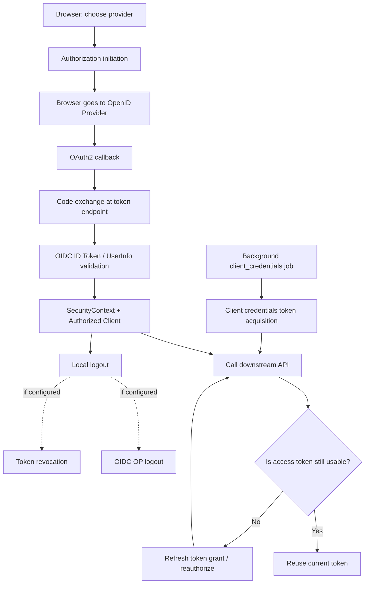
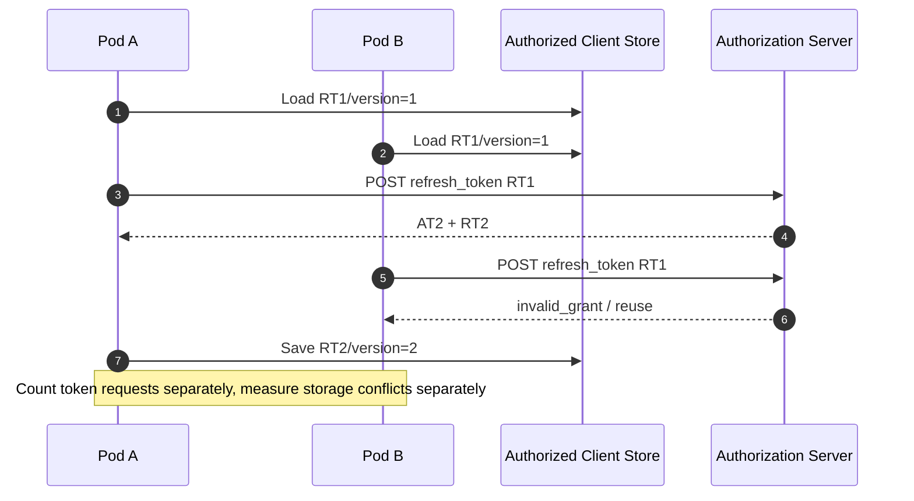

# 28.10. Metrics for Login, Token Acquisition, Refresh, and Logout

In **Spring Security OAuth 2.0 / OpenID Connect (OIDC) Client**, users can encounter symptoms that look identical yet belong to completely different stages: the sign-in button does not redirect, the callback returns `invalid_state`, authorization code exchange fails, the app is logged in yet an API call returns 401, a refresh token is rejected, or local app logout succeeds while the OpenID Provider still holds an active SSO session.

If you only collect application HTTP 5xx counts, operations teams struggle to answer: **how many users started signing in, how many callbacks actually succeeded, which provider's token endpoint is slow, are refresh tokens failing en masse, and did logout end the app session or merely issue a redirect?** That is why metrics must be designed around the **true business and technical boundaries** of OAuth2/OIDC Client.

Lesson **"28.10. Metrics for Login, Token Acquisition, Refresh, and Logout"** in chapter **28. Errors and Observability** teaches how to build a measurement model using **Micrometer, Spring Boot Actuator, Prometheus/Grafana, and OpenTelemetry/Observation**; identifies instrumentation points in **Servlet** and **WebFlux Reactive**; distinguishes counters, timers, gauges, distributions, traces, and logs; provides PromQL queries and alerting criteria; and protects sensitive data such as authorization codes, access tokens, refresh tokens, ID Tokens, session IDs, and user identities.

> **Core principle:** Metrics must have **clear semantics**. Receiving a `GET /oauth2/authorization/{registrationId}` request does not mean the user completed login. `OAuth2AuthorizedClientManager.authorize(...)` returning a client does not mean the token endpoint was just called. An HTTP 302 after logout does not prove the refresh token was revoked or the OP ended the SSO session.

## 1. Learning Objectives

After this lesson, you will be able to:

1. Trace the OIDC Login flow from authorization initiation to callback, token exchange, ID Token validation, and creating `SecurityContext`.
2. Define meaningful metrics for **login started, login completed/failed, token acquisition, refresh, and local/remote logout**.
3. Choose the right **Counter, Timer, Gauge, LongTaskTimer**, or histogram for each signal.
4. Separate browser/OP latency from in-JVM processing latency and token endpoint latency.
5. Use `MeterRegistry`/`Timer`/`Counter`/`ObservationRegistry` without altering authentication logic.
6. Attach instrumentation to success/failure handlers, `OAuth2AccessTokenResponseClient`, HTTP transport, and Reactive `Mono`.
7. Classify failure causes into a **finite label set** instead of putting raw exceptions, emails, user IDs, or URLs into metrics.
8. Expose the Actuator Prometheus endpoint securely and build dashboards, SLIs/SLOs, and baseline alerts.
9. Handle hard-to-measure cases like users closing browsers, cancelling login at the OP, or timing out without a callback.
10. Test metrics for accurate semantics, zero double-counting, and zero secret leakage across metrics/tracing/logging.

## 2. Full Picture of OAuth2/OIDC Client Observability

An application signs users in, calls APIs on their behalf, and runs background jobs using `client_credentials`. Each action has distinct metrics:



### 2.1. What the Backend Can Observe

| Stage | Can Backend Observe Directly? | Reliable Signal |
|---|---|---|
| Provider selection page rendered | Yes | HTTP request/view metric |
| Authorization request started | Yes | Resolver/filter builds or redirects request |
| Browser entering password at OP | **Not directly** | Only sees outbound redirect, no callback yet |
| User closes tab mid-flow | **Not directly** | Can infer pending login intent expired its TTL |
| Callback arrives at Portal | Yes | Spring Security OAuth2 callback processing |
| Exchanging code for token | Yes | OAuth2 token response client + HTTP client |
| Verifying ID Token/UserInfo | Yes | Authentication success/failure + JWK/HTTP calls |
| Reusing unexpired access token | Yes if manager/cache path instrumented | Zero POST token endpoint calls generated |
| Refreshing token at token endpoint | Yes | `refresh_token` grant at token response client |
| User clicks logout | Yes if request reaches the right chain | Logout request/handler/success |
| OP actually ended SSO session | **Not known automatically** from 302 redirect alone | Requires proper protocol/callback/ack; sometimes no confirmation exists |
| AS revoked token | Sees response of revocation call | Does not guarantee every API rejects the token immediately |

### 2.2. Distinguish Events, Outcomes, and Durations

Example for one login:

```text
T0: user GET /oauth2/authorization/company-login
    -> login.started +1
T1: browser redirected to OP
T2: browser callback /login/oauth2/code/company-login
    -> login.callback.received +1
T3: Portal POST /token (authorization_code)
    -> token.request.duration records 1 observation
T4: Portal verifies ID Token, saves SecurityContext
    -> login.completed{outcome="success"} +1
T5: later request calls API with existing access token
    -> token.request does not increment
T6: later refreshes token
    -> token.request.duration{grant="refresh_token"} records 1 observation
T7: user POST /logout
    -> logout.local.completed +1 after local logout succeeds
```

One successful login can lead to an initial token request, several UserInfo/JWKS calls, and many subsequent refreshes. **Never sum them all into one "login count" metric.**

## 3. Design the Metric Contract Before Writing Code

Metric names can live under an application namespace. The examples below are **suggested custom metrics**, **not claims that Spring Security emits them automatically by default**.

| Micrometer Name | Type | Standard Meaning |
|---|---|---|
| `app.oauth2.login.started` | Counter | Authorization request successfully initiated at Portal |
| `app.oauth2.login.callback.received` | Counter | Portal received a callback related to OAuth2 login |
| `app.oauth2.login.completed` | Counter | Callback finished with success/failure outcome in application |
| `app.oauth2.login.callback.duration` | Timer | Backend time to process callback; excludes user time at OP |
| `app.oauth2.login.journey.duration` | Timer | Time from login start to callback completion **when valid correlation exists** |
| `app.oauth2.login.intent.expired` | Counter | Pending login intent hit TTL without completing; only estimates abandonment |
| `app.oauth2.token.request.duration` | Timer | One call to token response client by grant and outcome |
| `app.oauth2.token.reused` | Counter | Manager reused existing client/token without calling token endpoint, if instrumented |
| `app.oauth2.authorized_client.missing` | Counter | Authorized client not found in storage when application needed it |
| `app.oauth2.logout.local.completed` | Counter | Local logout pipeline completed as defined |
| `app.oauth2.logout.provider.request` | Counter/Timer | OIDC OP logout request issued or callback handled, distinguishing states |
| `app.oauth2.token.revocation.duration` | Timer | Backend called token revocation endpoint and got outcome/exception |
| `app.oauth2.provider.http.duration` | Timer/Observation | Outbound HTTP discovery/token/JWKS/UserInfo/revocation |

Names should reflect **specific events**. If the system wants "a counter for all refreshes", use `token.request.duration` with tag `grant="refresh_token"` rather than creating another metric counting the same thing. Never create multiple counters for the same action without documenting how they relate.

### 3.1. Allowed Label Patterns

| Tag | Example | Rule |
|---|---|---|
| `registration` | `company-login`, `partner-login` | Only from server config allowlist |
| `grant` | `authorization_code`, `refresh_token`, `client_credentials` | Finite set |
| `phase` | `initiation`, `callback`, `token`, `userinfo` | Finite set |
| `outcome` | `success`, `failure`, `cancelled` | Standardized; no dynamic error messages |
| `reason` | `invalid_grant`, `state_mismatch`, `network`, `unknown` | Only from approved taxonomy |
| `provider` | `corporate`, `partner` | Internal ID from config, never arbitrary URLs |
| `tenant` | `north`, `south` | **Only** when tenant count is small and tag is controlled; if thousands of tenants exist, omit |

### 3.2. Things That Must Never Become Metric Tags

Never use:

```text
email, username, principalName, OIDC sub
Authorization header, access_token, refresh_token, id_token
authorization code, OAuth2 state, nonce, PKCE code_verifier
session ID, unique request ID, trace ID
raw request URI with query, user-supplied full redirect_uri
exception.getMessage(), stacktrace, response body
arbitrary tenantId from browser input
```

A tag whose value differs per user or per request causes **high cardinality**, inflates TSDB memory/cost, and can leak sensitive data through Prometheus/Grafana.

### 3.3. Why Bounding Tags Matters

Suppose:

```text
registration: 4 values
grant:        3 values
outcome:      4 values
reason:       8 values
instance:     12 values
```

Theoretically, one metric can produce `4 × 3 × 4 × 8 × 12 = 4,608` series if every combination occurs. Adding `principalName` with 100,000 users explodes that into millions of series. Do not attach every tag to every metric; pick **only the few analytical dimensions genuinely needed**.

## 4. How Do Counter, Timer, Gauge, and Observation Differ?

### 4.1. Counter

A Counter increments when an event happens:

```java
Counter.builder("app.oauth2.login.started")
        .description("OAuth2 authorization requests initiated")
        .tag("registration", "company-login")
        .register(registry)
        .increment();
```

Never use a Counter for "currently logged-in users" or "unexpired tokens"; those are **current state**, not cumulative event counts. Counters reset on process restart; analyze them using `rate(...)`/`increase(...)` in Prometheus.

### 4.2. Timer

A Timer records **duration and observation count**:

```java
Timer.builder("app.oauth2.token.request.duration")
        .description("Latency of provider token requests")
        .tag("grant", "refresh_token")
        .tag("outcome", "success")
        .register(registry)
        .record(() -> callTokenEndpoint());
```

`callTokenEndpoint()` is an illustrative method; a Timer will not accurately measure "token request" if you accidentally wrap the entire login flow or wrap only a cache read.

### 4.3. Gauge

A Gauge suits quantities existing at scrape time:

- Active/pending connections in an HTTP client pool.
- Pending login intents awaiting callback **if** the repository offers a cheap and safe measurement.
- Open circuit breakers (typically via dedicated instrumentation).

Never scan the entire refresh token database or count all browser sessions on every Prometheus scrape just to build a gauge; the cost and access scope can be excessive. Leverage existing pool/cache/store metrics when a proper contract exists.

### 4.4. Observation and Traces

`ObservationRegistry` models an operation with start/stop, low-cardinality key-values for metrics, and high-cardinality details for traces when a tracing handler is configured. Tracing helps investigate **a specific request**, while metrics show **rates and trends**.

Do not assume Observations automatically appear in Prometheus without configured observation handlers/registries. And never use tracing as an excuse to attach tokens or PII to span attributes.

## 5. Normalizing Outcomes: Success, Failure, and Unknown

Good observability goes beyond `success=true/false`. With OAuth2/OIDC, you need to know **where the failure originated**:

| Group | Example Errors | User or Infrastructure? |
|---|---|---|
| `user_cancelled` | User declined consent at OP | Likely normal user behavior |
| `state_mismatch` | Callback did not match initial request | Session/CSRF/correlation; requires security monitoring |
| `invalid_grant` | Used/expired code or invalid refresh token | Credential lifecycle, races, provider policy |
| `invalid_client` | Client authentication rejected | Client secret/mTLS/key rotation configuration |
| `provider_5xx` | Token endpoint returned server error | Provider outage |
| `rate_limited` | HTTP 429 or quota policy | Bursts/retries/request scheduling |
| `network` | Connect/read timeout, DNS | Network, proxy, pool, OP |
| `tls` | PKIX/SAN/handshake failure | Certificate trust/protocol |
| `id_token_invalid` | Wrong issuer/audience/signature/nonce | Trust/validation/configuration |
| `authorized_client_missing` | Unable to load issued token | Storage/session/registration/principal |
| `unknown` | Unclassified | Investigate filtered traces/logs |

Classification must be **bounded and controlled**; an `OAuth2Error.getErrorCode()` is not guaranteed to stay within standard codes, since providers can return proprietary codes. Never put arbitrary error codes from responses into labels without allowlisting.

### 5.1. A Helper to Keep Cardinality Finite

```java
import org.springframework.security.oauth2.core.OAuth2AuthorizationException;

final class OAuth2MetricTags {

    static String registration(String id) {
        return switch (id == null ? "" : id) {
            case "company-login" -> "company-login";
            case "partner-login" -> "partner-login";
            case "inventory-service" -> "inventory-service";
            default -> "other";
        };
    }

    static String oauthError(Throwable failure) {
        if (failure instanceof OAuth2AuthorizationException oauth) {
            return switch (oauth.getError().getErrorCode()) {
                case "invalid_grant" -> "invalid_grant";
                case "invalid_client" -> "invalid_client";
                case "temporarily_unavailable" -> "provider_unavailable";
                case "access_denied" -> "user_cancelled";
                default -> "oauth_error";
            };
        }
        return "other_error";
    }

    private OAuth2MetricTags() {}
}
```

In production, extend classification for `SSLHandshakeException`, `UnknownHostException`, `SocketTimeoutException`, HTTP 429/5xx, etc. via the HTTP client's cause chain/error model **while still returning finite labels**. Never put `exception.toString()` into a tag.

## 6. Measuring Login: Define Each Stage Precisely

OIDC Login normally involves a **browser round-trip** through the OpenID Provider. You cannot measure the whole process by wrapping a single Java method in a Timer.

### 6.1. Login Started

Strong definition:

> `login.started` increments when Spring Security has created a valid `OAuth2AuthorizationRequest` for a registration and is about to redirect to the OP.

A rough approximation is counting `GET /oauth2/authorization/{registrationId}`, yet that also counts requests with bad registrations, requests blocked before the filter, or requests failing to build an authorization request.

For exact semantics, measure at the **authorization request resolver/filter** after successful resolution. If relying solely on HTTP server metrics, name it `login.start.endpoint.requests` rather than a name implying the flow was initiated.

### 6.2. Login Callback Received

An HTTP callback request to `/login/oauth2/code/{registrationId}` is not guaranteed to succeed:

- State may be missing or wrong.
- Authorization code may be rejected.
- TLS to the token endpoint may fail.
- ID Token may be invalid.
- User may lack membership/roles in the application.

Hence `callback.received` differs from `login.completed{outcome="success"}`.

### 6.3. Login Completed

In a Servlet application, `AuthenticationSuccessHandler` runs after OAuth2/OIDC authentication succeeds in Spring Security's flow. When this handler runs, you can increment `login.completed{outcome="success"}`.

`AuthenticationFailureHandler` records callback failures. If business authorization runs **after** the success handler, this metric represents "Spring Security authentication success", **not yet** "user was granted access to the tenant/application".

Name metrics along clear boundaries, for example:

```text
login.authentication.completed -> Spring Security authentication
login.business.access.denied   -> not permitted to use Portal
```

Never report "100% of users entered the application" just because ID Tokens validated.

### 6.4. Journey Duration vs. Callback Duration

`login.callback.duration`:

```text
T callback processing starts at Portal
-> token exchange, ID Token validation, UserInfo, save context
T callback ends
```

`login.journey.duration`:

```text
T user initiates authorization at Portal
-> browser navigates to OP, user enters password/MFA/consent
-> browser calls back and Portal processes
T login finishes
```

Journey duration includes **user think/typing time, MFA, and browser networking**, so it cannot be treated as Portal or OP latency alone. Measuring journeys requires protected transaction correlation (typically tied to `state` and a server-side request repository), TTLs, and handling missing callbacks.

### 6.5. Abandonment Is Only an Estimate

If there are 100 login starts and only 65 callbacks, never claim 35 "provider failures":

- Users may close the tab.
- Bots or users may double-click buttons.
- Login may complete in another session.
- State may hit TTL.
- A callback may arrive outside the observation window.
- OP may reject or browser may hit network issues.

To estimate abandonment meaningfully, store **pending login intents** with a TTL and count expirations of uncompleted intents; still document it as an **estimate**, not proof of user drop-off or OP outage.

## 7. Spring Boot Actuator and Micrometer

A Spring Boot web application can use:

```xml
<dependencies>
    <dependency>
        <groupId>org.springframework.boot</groupId>
        <artifactId>spring-boot-starter-actuator</artifactId>
    </dependency>
    <dependency>
        <groupId>io.micrometer</groupId>
        <artifactId>micrometer-registry-prometheus</artifactId>
    </dependency>
    <dependency>
        <groupId>org.springframework.boot</groupId>
        <artifactId>spring-boot-starter-oauth2-client</artifactId>
    </dependency>
</dependencies>
```

Spring Boot Actuator provides instrumentation and exposes metrics when configured; Micrometer is the facade for recording Counters/Timers/Observations. Each registry/exporter determines how names and labels are formatted.

### 7.1. Management Configuration Example

```yaml
management:
  endpoints:
    web:
      exposure:
        include: health,info,prometheus
  endpoint:
    health:
      show-details: when_authorized
  metrics:
    tags:
      application: reports-portal
    distribution:
      percentiles-histogram:
        app.oauth2.token.request.duration: true
        app.oauth2.login.callback.duration: true
      slo:
        app.oauth2.token.request.duration:
          - 250ms
          - 500ms
          - 1s
          - 3s
          - 10s
```

Thresholds are examples, not default SLOs. Exact property structure and histogram export behavior depend on the Spring Boot/Micrometer/Prometheus registry versions. Match your project's versions.

**Never expose Actuator `/actuator/prometheus` to the unauthenticated Internet.** Restrict it via network policy, ingress allowlists, and environment-appropriate authentication/authorization. Metrics can reveal architecture, registration names, infrastructure health, and error rates.

### 7.2. Do Custom Metrics Appear Automatically?

No. Configuring Actuator and the Prometheus registry only builds the export pipeline. `app.oauth2.login.completed` and `app.oauth2.token.request.duration` **only exist once the application actually records them into MeterRegistry**.

For HTTP servers/clients, Spring Boot offers built-in observations/metrics depending on starter, version, and instrumentation. They give HTTP latency/status, yet they do not know whether a `POST /token` request is a refresh or a code exchange, nor whether local logout cleared the token store.

### 7.3. Metric Name Formatting When Exported to Prometheus

A Micrometer Counter:

```text
app.oauth2.login.completed
```

may be exported by Prometheus as:

```text
app_oauth2_login_completed_total{
  registration="company-login",
  outcome="success"
}
```

Timer `app.oauth2.token.request.duration` typically exports `_seconds_count`, `_seconds_sum`, and `_seconds_bucket` series when histograms are enabled. Verify exact names against your running exporter's output, especially after Micrometer/Prometheus registry upgrades.

## 8. Servlet: Measuring Login Success/Failure Without Breaking Flows

Spring Security allows configuring `AuthenticationSuccessHandler` and `AuthenticationFailureHandler` on `oauth2Login()`.

### 8.1. Recording Success by Registration

```java
import io.micrometer.core.instrument.Counter;
import io.micrometer.core.instrument.MeterRegistry;
import org.springframework.security.oauth2.client.authentication
        .OAuth2AuthenticationToken;
import org.springframework.security.web.authentication
        .AuthenticationSuccessHandler;
import org.springframework.security.web.authentication
        .SavedRequestAwareAuthenticationSuccessHandler;

AuthenticationSuccessHandler loginSuccessMetrics(
        MeterRegistry registry) {

    var delegate = new SavedRequestAwareAuthenticationSuccessHandler();

    return (request, response, authentication) -> {
        String registration = "unknown";
        if (authentication instanceof OAuth2AuthenticationToken oauth2) {
            registration = OAuth2MetricTags.registration(
                    oauth2.getAuthorizedClientRegistrationId());
        }

        Counter.builder("app.oauth2.login.completed")
                .description("Completed OAuth2 login authentications")
                .tag("registration", registration)
                .tag("outcome", "success")
                .register(registry)
                .increment();

        delegate.onAuthenticationSuccess(
                request, response, authentication);
    };
}
```

This is an illustrative handler factory method. `delegate` preserves standard saved-request redirect behavior instead of returning an empty response; if the application already has a custom success handler, **wrap/delegate to that handler** so you do not inadvertently drop business, session, or navigation logic.

### 8.2. Recording Failure with a Bounded Taxonomy

```java
import io.micrometer.core.instrument.Counter;
import io.micrometer.core.instrument.MeterRegistry;
import org.springframework.security.web.authentication
        .AuthenticationFailureHandler;
import org.springframework.security.web.authentication
        .SimpleUrlAuthenticationFailureHandler;

AuthenticationFailureHandler loginFailureMetrics(
        MeterRegistry registry) {

    var delegate =
            new SimpleUrlAuthenticationFailureHandler("/login?error");

    return (request, response, exception) -> {
        Counter.builder("app.oauth2.login.completed")
                .tag("registration", "unknown")
                .tag("outcome", "failure")
                .tag("reason",
                        OAuth2MetricTags.oauthError(exception))
                .register(registry)
                .increment();

        delegate.onAuthenticationFailure(
                request, response, exception);
    };
}
```

On the failure path, `OAuth2AuthenticationToken` is not always available. The example uses `registration="unknown"` instead of reading registration from a caller-modifiable query parameter. If per-registration breakdown is required, obtain **server-protected correlation** from the authorization request/session or a filter layer that reliably knew the registration before the failure.

When sharing one metric for success and failure, you might set `reason="none"` on success to normalize dimensions, though it is not strictly required if queries/dashboards handle it cleanly. Avoid inconsistent label sets that make PromQL confusing; define the schema deliberately.

### 8.3. Wiring Handlers into oauth2Login

```java
http.oauth2Login(oauth2 -> oauth2
        .loginPage("/login")
        .successHandler(loginSuccessMetrics(registry))
        .failureHandler(loginFailureMetrics(registry)));
```

This snippet sits inside `SecurityFilterChain`, not as a complete security configuration. If the system uses `OidcUserService`, post-login business validation, multiple security chains, or a custom request cache, preserve all of those behaviors when adding metrics.

**Never write access tokens/ID Tokens into counter tags or logs inside handlers.** `Authentication.getName()` should not be a metric label either.

### 8.4. Where to Count Login Initiation?

You can wrap `OAuth2AuthorizationRequestResolver` to increment the counter when `resolve(...)` returns a valid `OAuth2AuthorizationRequest`. With multiple overloads, avoid **double counting** if `resolve(request)` delegates internally to `resolve(request, registrationId)`.

A safe pattern:

```text
Increment counter at exactly one layer:
  - resolver success
  OR
  - filter redirect success
Never increment both resolver and HTTP filter for the same request
```

If you only count `GET` requests in request logging filters, give it a distinct name and meaning like `app.oauth2.login.start.http.requests`.

## 9. Measure Token Acquisition at the Right Boundary

In Spring Security OAuth2 Client, `OAuth2AuthorizedClientManager.authorize(...)` can:

1. Return an already-existing authorized client.
2. Refresh the access token when needed.
3. Request a `client_credentials` token when no valid token exists.
4. Initiate/complete authorization depending on grant and context.
5. Return `null` or fail when unable to authorize per contract.

**The manager returning an `OAuth2AuthorizedClient` does not automatically mean the token endpoint was just called.** Measuring token acquisition by counting every manager call wildly inflates numbers on token cache hits.

### 9.1. Exact Measurement Boundary

To count a **real token request**, instrument `OAuth2AccessTokenResponseClient` (Servlet) or `ReactiveOAuth2AccessTokenResponseClient` (WebFlux), where grant-specific request/response execution happens in Spring Security's API.

| Grant | Context | What to Measure |
|---|---|---|
| `authorization_code` | Login callback | Code exchange attempts/outcomes/latency |
| `refresh_token` | Token renewal | Refresh attempts/outcomes/latency, token rotation |
| `client_credentials` | Service-to-service | Machine token acquisition/cache efficiency |
| `token_exchange` if supported | Policy-based token exchange | Exchange attempts/outcomes/latency |

Never lump all grants together and call the total "refresh count".

### 9.2. Synchronous Wrapper Example for Token Response Client

```java
import io.micrometer.core.instrument.MeterRegistry;
import io.micrometer.core.instrument.Timer;
import java.util.concurrent.TimeUnit;
import org.springframework.security.oauth2.client.endpoint
        .AbstractOAuth2AuthorizationGrantRequest;
import org.springframework.security.oauth2.client.endpoint
        .OAuth2AccessTokenResponseClient;
import org.springframework.security.oauth2.core.endpoint
        .OAuth2AccessTokenResponse;

final class MeteredTokenResponseClient<
        T extends AbstractOAuth2AuthorizationGrantRequest>
        implements OAuth2AccessTokenResponseClient<T> {

    private final OAuth2AccessTokenResponseClient<T> delegate;
    private final MeterRegistry registry;
    private final String grant;

    MeteredTokenResponseClient(
            OAuth2AccessTokenResponseClient<T> delegate,
            MeterRegistry registry,
            String grant) {
        this.delegate = delegate;
        this.registry = registry;
        this.grant = grant; // Fixed value from server config.
    }

    @Override
    public OAuth2AccessTokenResponse getTokenResponse(T request) {
        long startedNanos = System.nanoTime();
        String outcome = "success";
        String reason = "none";

        String registration = OAuth2MetricTags.registration(
                request.getClientRegistration().getRegistrationId());

        try {
            return delegate.getTokenResponse(request);
        } catch (RuntimeException failure) {
            outcome = "failure";
            reason = OAuth2MetricTags.oauthError(failure);
            throw failure; // Never swallow OAuth2 errors.
        } finally {
            Timer.builder("app.oauth2.token.request.duration")
                    .description("Duration of OAuth2 token request")
                    .tag("registration", registration)
                    .tag("grant", grant)
                    .tag("outcome", outcome)
                    .tag("reason", reason)
                    .register(registry)
                    .record(System.nanoTime() - startedNanos,
                            TimeUnit.NANOSECONDS);
        }
    }
}
```

Key points:

- `grant` comes from application config, not browser queries.
- `registration` is bounded through an allowlist.
- Each execution of the delegate token response client produces **one** duration observation.
- Exceptions are rethrown so Spring Security handles them properly; metrics never alter auth semantics.
- Never log `getAccessToken().getTokenValue()`, refresh tokens, or response bodies.
- Since a Timer tracks count, failure rates can be computed from `_seconds_count` by tags; you do not necessarily need a separate Counter for the same request.

**Measurement definition:** this wrapper measures **token client method execution time** (serialization, HTTP, parsing/error handling inside the delegate). If generic retries happen inside the delegate, actual HTTP calls can exceed one wrapper call. To measure each physical network attempt, add instrumentation at the HTTP client layer. Never sum both levels into one "request count" without distinguishing them.

### 9.3. Applying to Specific Grants

Conceptual example:

```java
OAuth2AccessTokenResponseClient<OAuth2AuthorizationCodeGrantRequest>
        authorizationCodeClient = new MeteredTokenResponseClient<>(
                actualAuthorizationCodeClient,
                registry,
                "authorization_code");

OAuth2AccessTokenResponseClient<OAuth2RefreshTokenGrantRequest>
        refreshClient = new MeteredTokenResponseClient<>(
                actualRefreshClient,
                registry,
                "refresh_token");
```

`actualAuthorizationCodeClient` and `actualRefreshClient` are delegates built with the token response clients for your Spring Security version. Import the grant request classes, configure TLS/timeouts properly, and wire them into the **exact extension points** on login and authorized-client providers. Creating wrapper beans without wiring them into providers produces zero metrics.

### 9.4. Do Not Forget client_credentials in Background Jobs

A service manager might run:

```java
OAuth2AuthorizeRequest request =
        OAuth2AuthorizeRequest.withClientRegistrationId(
                "inventory-service")
            .principal("service:nightly-job")
            .build();

OAuth2AuthorizedClient client = manager.authorize(request);
```

If the client is still valid and the service manager loads it from the store, **no new token HTTP call occurs**. Count `client_credentials` acquisition only when the token response client actually executes. You can also instrument cache hits/misses to evaluate reuse efficiency.

## 10. Dedicated Metrics for Refresh Tokens

Refresh tokens have special states due to potential **rotation** and `invalid_grant` rejections. Metric group:

| Metric/Dimension | Meaning |
|---|---|
| `token.request.duration{grant="refresh_token"}` | Each refresh HTTP/client request |
| `outcome="success"` | Valid token response received from provider |
| `reason="invalid_grant"` | Refresh token invalid/expired/reused or grant rejected |
| `reason="network"` / `"tls"` | Transport failure reaching token endpoint |
| `authorized_client.missing` | No token store record found before refresh |
| `refresh.concurrent_collisions` (custom) | Race/version conflict saving rotating refresh token |
| `refresh.reauthorization_required` (custom) | User needs to reauthorize per policy after refresh failure |

### 10.1. Why Isn't invalid_grant Always a Provider Outage?

`invalid_grant` can happen due to:

- Refresh token expired or revoked by user/administrator.
- Refresh token rotated and old token was reused.
- Two instances refreshed concurrently using the same old token.
- Logout/cleanup race caused saving the wrong token.
- Client registration/principal mapping changed.
- New provider policy or revoked consent.

Never lump `invalid_grant` into OP HTTP 5xx, and never auto-retry a rejected refresh token to "boost success rate".

### 10.2. Refresh Failure Does Not Mean the Login Session Ended

A browser can still hold an authenticated `SecurityContext` in its session even when an API access token expired and refresh failed. Metrics must separate:

```text
web.authentication.session.valid = true
refresh.token.request = failure
downstream.api.call = denied_or_reauth_required
```

Do not count every refresh failure as a `login.failure`. You can add a dedicated metric when the application actually triggers reauthorization.

### 10.3. Refresh Rotation and Unknown Outcomes



If the response carrying RT2 is lost to a timeout, the client does not know whether the OP processed RT1. Transport metrics should record `outcome="failure"`, `reason="network"`, or an `unknown_outcome` bucket where supported; **do not assert the provider failed**. Blind retries can trigger reuse detection.

### 10.4. How Should Refresh SLI Be Calculated?

You can examine:

```text
refresh_success_ratio =
  successful_refresh_token_response_client_calls
  /
  all_completed_refresh_token_response_client_calls
```

Yet break it down further by reason:

- Spike in `invalid_grant`: check rotation/user revocations.
- Concurrent spike in `network`/`tls`/`provider_5xx`: suspect outage.
- Spike in refresh attempts without active user growth: check token cache/session/principal keys, refresh skew, or races.

Overall success rate can drop due to legitimate user revocations; do not blindly classify every failure as infrastructure downtime.

## 11. Reactive WebFlux: Non-Blocking Instrumentation

In Spring WebFlux, a grant HTTP request typically returns `Mono<OAuth2AccessTokenResponse>`. Never call `block()` to "measure time" and never start the stopwatch at **Publisher creation**, because the Publisher may be subscribed later or multiple times.

### 11.1. Reactive Token Client Wrapper

```java
import io.micrometer.core.instrument.MeterRegistry;
import io.micrometer.core.instrument.Timer;
import java.util.concurrent.TimeUnit;
import java.util.concurrent.atomic.AtomicReference;
import org.springframework.security.oauth2.client.endpoint
        .AbstractOAuth2AuthorizationGrantRequest;
import org.springframework.security.oauth2.client.endpoint
        .ReactiveOAuth2AccessTokenResponseClient;
import org.springframework.security.oauth2.core.endpoint
        .OAuth2AccessTokenResponse;
import reactor.core.publisher.Mono;

final class MeteredReactiveTokenClient<
        T extends AbstractOAuth2AuthorizationGrantRequest>
        implements ReactiveOAuth2AccessTokenResponseClient<T> {

    private final ReactiveOAuth2AccessTokenResponseClient<T> delegate;
    private final MeterRegistry registry;
    private final String grant;

    MeteredReactiveTokenClient(
            ReactiveOAuth2AccessTokenResponseClient<T> delegate,
            MeterRegistry registry,
            String grant) {
        this.delegate = delegate;
        this.registry = registry;
        this.grant = grant;
    }

    @Override
    public Mono<OAuth2AccessTokenResponse> getTokenResponse(T request) {
        return Mono.defer(() -> {
            long startedNanos = System.nanoTime();
            var outcome = new AtomicReference<>("cancelled");
            var reason = new AtomicReference<>("none");
            String registration = OAuth2MetricTags.registration(
                    request.getClientRegistration().getRegistrationId());

            return delegate.getTokenResponse(request)
                    .doOnSuccess(response -> outcome.set(
                            response == null ? "empty" : "success"))
                    .doOnError(error -> {
                        outcome.set("failure");
                        reason.set(OAuth2MetricTags.oauthError(error));
                    })
                    .doFinally(signal -> {
                        Timer.builder("app.oauth2.token.request.duration")
                                .tag("grant", grant)
                                .tag("registration", registration)
                                .tag("outcome", outcome.get())
                                .tag("reason", reason.get())
                                .register(registry)
                                .record(System.nanoTime() - startedNanos,
                                        TimeUnit.NANOSECONDS);
                    });
        });
    }
}
```

Intentional design points:

- `Mono.defer(...)` starts timing at **subscription**, not Publisher creation.
- `doFinally` records once across complete/error/cancel signals.
- `AtomicReference` isolates each subscription's result rather than sharing globally.
- `cancelled` must not be treated as a provider 5xx; it may be caller timeout/cancellation.
- Never calls `block()`, never breaks backpressure, and never alters token response client behavior.

In production, add a reason for cancellation if your taxonomy includes it, and keep distinct tag counts low. Wire the wrapper into the security chain's actual token provider/client.

### 11.2. Reactive Login Success/Failure

`ServerAuthenticationSuccessHandler` and `ServerAuthenticationFailureHandler` are the right extension points for WebFlux OAuth2 Login. When adding metrics:

1. Preserve prior redirect/saved-request handler behavior.
2. Never alter OAuth2 state/nonce/PKCE validation.
3. Use the `ServerWebExchange` request context and Spring Security–verified Authentication.
4. When a failure lacks a trusted registration, use tag `unknown` or server-side correlation.
5. Never make blocking JDBC/remote calls just to record a metric.

MeterRegistry increments are normally lightweight; if the metrics backend is slow, let the registry/scrape mechanism handle exporting rather than performing synchronous network exports inside a login handler.

### 11.3. Measuring WebClient Outbound Traffic

A `WebClient` calling the OP can be instrumented via Spring Boot Observation/HTTP client instrumentation. Separate:

```text
Reactive token client -> business semantics:
  grant, registration, token outcome

Reactor Netty/WebClient -> transport semantics:
  HTTP method, allowlisted host, status, connect/response timing
```

If the token client retries inside the HTTP stack, transport observations may record multiple HTTP attempts while the semantic token request records one. Those are two different measurement levels, not "inconsistent numbers", provided the contract is documented.

## 12. Logout Metrics: Local Logout and OP Logout Differ

### 12.1. Local Logout

Local logout can clear:

- `SecurityContext` / `Authentication`.
- `HttpSession` or `WebSession`.
- Cookies or session store records per configuration.
- Local authorized client storage if the application performs custom cleanup.

`LogoutSuccessHandler` in Servlet or `ServerLogoutSuccessHandler` in Reactive observes the **outcome of the local logout pipeline**, yet it does not prove the OP session ended or tokens were revoked at the AS.

Name the metric:

```text
app.oauth2.logout.local.completed
```

rather than `logout.everywhere.success`.

### 12.2. Wrapping Servlet LogoutSuccessHandler Example

```java
import io.micrometer.core.instrument.Counter;
import io.micrometer.core.instrument.MeterRegistry;
import org.springframework.security.web.authentication.logout
        .LogoutSuccessHandler;
import org.springframework.security.web.authentication.logout
        .SimpleUrlLogoutSuccessHandler;

LogoutSuccessHandler meteredLocalLogout(MeterRegistry registry) {

    var delegate = new SimpleUrlLogoutSuccessHandler();
    delegate.setDefaultTargetUrl("/login?logout");

    return (request, response, authentication) -> {
        delegate.onLogoutSuccess(
                request, response, authentication);

        Counter.builder("app.oauth2.logout.local.completed")
                .tag("outcome", "success")
                .register(registry)
                .increment();
    };
}
```

This illustrates **local logout redirect success**. If OIDC RP-Initiated Logout is required, a custom success handler must **delegate to `OidcClientInitiatedLogoutSuccessHandler` or the corresponding flow** instead of replacing it with a local redirect. In Spring Security, the success handler runs after logout handlers, yet you must verify the handler chain actually clears SecurityContext/session per contract.

If custom handlers cleaning DB/remote OP state can throw errors, clearly define:

- What state constitutes "local logout succeeded"?
- How are exceptions handled?
- Has the post-logout response already been sent?
- Might an authorized client still remain in the database?

Never emit `logout.local.completed{outcome="success"}` right upon receiving `POST /logout` before cleanup has executed.

### 12.3. OIDC OP Logout

An application may use RP-Initiated Logout:

```text
POST /logout at Portal
-> local SecurityContext/session cleanup
-> redirect browser to OP end_session_endpoint
-> OP handles SSO session
-> browser may redirect back to post_logout_redirect_uri
```

**Issuing the redirect does not mean the OP finished processing.** Use metrics with distinct semantics:

```text
app.oauth2.logout.provider.redirect_issued
app.oauth2.logout.provider.callback_received
app.oauth2.logout.provider.confirmed   (only when reliable confirmation exists)
```

With many OPs, there is not always a callback or reliable signal confirming session deletion. Never invent an "OP logout success" metric merely by observing an HTTP 302 from the Portal.

### 12.4. Token Revocation

If the Portal calls a token revocation endpoint:

```text
app.oauth2.token.revocation.duration
  registration = company-login
  outcome = success / failure
  reason = none / network / provider_error / ...
```

This reflects the **revocation call outcome** per RFC 7009/provider contract, not proof that every Resource Server rejected the old token at that instant. Even when the backend deletes the local authorized client record, the AS token may still remain valid until revoked/expired.

### 12.5. Watch the Denominator in Logout Ratios

`logout.local.completed / logout.request.received` shows completion of the **local pipeline** when both counters are placed accurately. Never divide `logout.local.completed / login.started` and call it "logout failure rate": a user may stay logged in for days, never click logout, time out, or close the browser.

## 13. HTTP Client Metrics for Provider Endpoints

One OIDC Login can touch several endpoints:

| Endpoint | HTTP Signals to Measure |
|---|---|
| OIDC discovery | TLS/connect/response duration, HTTP status, cache/startup errors |
| Token | Transport timing, HTTP status, retry count, mTLS/PKIX failures |
| JWKS | Cache hit/miss, fetch latency, signature/key validation errors |
| UserInfo | HTTP response, token audience/authorization issues |
| Revocation | HTTP call status, response/transport errors |
| Introspection if used | Latency, failures, throttling |

### 13.1. Server Metrics vs. Client Metrics

`http.server.requests` observes **inbound** requests to the Portal, such as `/login/oauth2/code/...`. `http.client.requests` or HTTP client observations observe **outbound** requests to the OP/API when transport is instrumented.

If callback latency increases, causes may include:

```text
callback backend duration
  = application/security processing
  + token endpoint HTTP call
  + JWKS fetch if needed
  + UserInfo HTTP call if needed
  + authorized-client/session persistence
```

Break it down with traces/HTTP client timers so you do not blame the OP when the session database is slow.

### 13.2. Token Requests Differ from Token Reuse

A system may handle 10,000 API requests with only 200 token acquisitions/refreshes. That is normally healthy behavior when authorized-client caching and token expiry are managed well.

If token acquisitions climb to match API request volume, check:

- Is the principal key changing on every request?
- Is `OAuth2AuthorizedClient` saved in the right repository/service?
- Are multiple pods using separate `InMemoryOAuth2AuthorizedClientService` instances?
- Is there a refresh token rotation race?
- Is clock skew too large, causing tokens to look expired early?
- Is the client credentials manager being reused?

Measuring token reuse/cache paths helps explain behavior, yet only call something a "cache hit" when you have proof a token was loaded and used without calling the token endpoint.

### 13.3. Avoid Passing Bearer Tokens in URLs/Metric Labels

Never record full URIs like `/userinfo?access_token=...` or callbacks `/login/oauth2/code/...?...code=...` as tags. Query URLs can carry credentials/state.

For HTTP client tracing, use **URI templates or endpoint classes** (`token`, `jwks`, `userinfo`) rather than raw URLs; restrict hostnames to approved values.

## 14. Latency: Where Should SLOs Be Defined?

### 14.1. Login Callback Processing p95

Measures:

```text
Callback HTTP request starts
-> Spring Security processes OAuth2/OIDC
-> callback response finishes
```

This closely tracks latency caused by the application/backend/provider, though it still includes network calls to the OP. To isolate internal Portal time, use traces and separate spans for token/JWKS/UserInfo/storage.

### 14.2. Token Endpoint p95/p99

Measure `OAuth2AccessTokenResponseClient` latency by:

```text
grant=authorization_code
grant=refresh_token
grant=client_credentials
registration=company-login | partner-login | ...
outcome=success | failure
```

When analyzing latency, consider:

- Timeout failures can heavily skew p99 upward.
- Ultra-short durations from local validation failures do not reflect OP network time.
- Histogram buckets must match SLOs and sample sizes.
- At low traffic, a 5-minute window p99 can be very noisy.

### 14.3. Do Not Use Login Journey p95 as "OP Response Time"

Users may pause to read consent, enter MFA, or call support. Journey duration is good for evaluating **end-to-end sign-in UX**, not as direct proof of a slow provider.

To measure UX, you can combine RUM (Real User Monitoring) deployed under a privacy policy, recording only timestamps and approved milestones without capturing passwords/OTPs/ID Tokens.

## 15. PromQL for Dashboards

The queries below assume the Prometheus exporter uses the metric names from the examples. **Verify actual names at `/actuator/prometheus`** before applying.

### 15.1. Completed Logins per Minute

```promql
sum by (registration, outcome) (
  rate(app_oauth2_login_completed_total[5m])
) * 60
```

This is the **callback/authentication completion rate**, not unique user count. One user logging in multiple times counts multiple times.

### 15.2. Success Ratio Among Completed Login Callbacks

```promql
sum(rate(
  app_oauth2_login_completed_total{outcome="success"}[10m]
))
/
clamp_min(
  sum(rate(app_oauth2_login_completed_total[10m])),
  0.000001
)
```

This excludes login starts that never returned a callback. Title the dashboard panel accurately: **"Authentication success among completed callback outcomes"**, not "percentage of all user logins that succeeded".

During zero-traffic periods, the expression may yield no valid series or misleading values. Dashboards/alerts need a **minimum traffic volume gate** before evaluating thresholds.

### 15.3. Token Request Rate by Grant

```promql
sum by (registration, grant, outcome) (
  rate(app_oauth2_token_request_duration_seconds_count[5m])
)
```

A Timer emits count and sum; `_seconds_count` gives the rate of requests measured by the wrapper. If the wrapper encloses internal retries, count reflects **wrapper invocations**, not necessarily raw HTTP attempts.

### 15.4. Refresh Success Ratio

```promql
sum(rate(
  app_oauth2_token_request_duration_seconds_count{
    grant="refresh_token",outcome="success"
  }[10m]
))
/
clamp_min(
  sum(rate(
    app_oauth2_token_request_duration_seconds_count{
      grant="refresh_token"
    }[10m]
  )),
  0.000001
)
```

Group by `registration` to isolate a specific provider. Never mix all environments into one query when production SLOs differ from development/staging.

### 15.5. p95 Token Request Duration

When histograms are exported:

```promql
histogram_quantile(
  0.95,
  sum by (le, registration, grant) (
    rate(
      app_oauth2_token_request_duration_seconds_bucket[10m]
    )
  )
)
```

Conditions:

- Histogram buckets exist for this timer.
- Sufficient samples exist in the window.
- Keep `le` in the grouping for classic histograms.
- Never average per-instance p95 values; sum buckets first, then compute the quantile.

If the exporter uses native histograms or a different naming/version convention, adjust the query accordingly.

### 15.6. Refresh invalid_grant Errors by Provider

```promql
sum by (registration) (
  rate(
    app_oauth2_token_request_duration_seconds_count{
      grant="refresh_token",
      outcome="failure",
      reason="invalid_grant"
    }[5m]
  )
)
```

Compare alongside total refresh requests so a small absolute error count is not mistaken for a large outage. If your metric taxonomy does not separate `invalid_grant`, add controlled classification inside the wrapper.

### 15.7. Local Logout Throughput

```promql
sum(rate(app_oauth2_logout_local_completed_total[15m]))
```

This counts **local logout events passing through the success handler** per instrumentation, not proof of successful OP logout or token revocation.

## 16. SLI, SLO, and Error Budgets

A system can set SLOs for operations that are **measurable and meaningful to users**.

| Goal | Suggested SLI | Caveats |
|---|---|---|
| Callback authentication | Success / completed callback outcomes | Excludes users who never return |
| OP token endpoint | Successful token client calls / completed calls | Group by grant/provider; separate policy errors from outages |
| Refresh availability | Refresh success on valid requests | Separate revoked/invalid_grant vs. transport/provider |
| Local logout | Completed local cleanup / valid logout requests | Excludes OP SSO unless measured separately |
| Backend latency | p95/p99 callback/token processing | Never treat journey time as OP server latency |

**Illustrative threshold** examples, not mandatory targets:

```text
Callback authentication completion success:
  >= 99.5% over 30 days when traffic is sufficient

Token response client latency:
  p95 < 2s for successful code exchanges

Local logout completion:
  >= 99.9% for valid POST logout requests
```

SLO definitions must specify:

1. Which requests belong in the denominator.
2. Whether user-cancelled attempts are excluded.
3. Whether provider-side failures count against the ops team's budget.
4. Evaluation window and minimum sample threshold.
5. Client-side/browser signals if end-to-end UX is required.

Without clear definitions, "99.9% success" may misrepresent user experience or page operations on uncontrollable errors.

### 16.1. Alerts Should Look Beyond Overall Error Rate

Examples:

- **Login callback failure spike:** rising failure ratio paired with sufficient callback volume.
- **Token 5xx/TLS spike:** multiple registrations hitting provider transport failures simultaneously.
- **Refresh invalid_grant spike:** suspect refresh rotation/races or policy changes.
- **JWKS validation failures:** possible signing key rotation/issuer issue.
- **Local logout pipeline failures:** users unable to terminate sessions.
- **Zero-login-traffic** on a provider with an established baseline: possible UI/routing/edge outage, excluding off-peak hours.

Avoid alerting on `login.started - login.completed` over one minute as a "provider outage" because browser/MFA/consent delays vary widely.

### 16.2. Multi-Window Burn Rate

For SLOs with error budgets, short/long window burn-rate alerts detect failures quickly with less noise. Exclude `user_cancelled` and non-availability causes per policy before computing burn rate. Small denominators make burn rates noisy; add volume gating.

## 17. Suggested Dashboard

A multi-panel dashboard sharing consistent logic:

| Panel | Content | Operational Meaning |
|---|---|---|
| Login starts vs. callback completions | Rates by registration | Observe funnel; do not jump to abandonment conclusions |
| Callback success/failure | Stacked rate by outcome/reason | Spot authentication failures |
| Callback latency | p50/p95 and volume | Backend + provider response |
| Token requests by grant | Count/rate for code/refresh/client_credentials | Diagnose token load |
| Token request duration | p95/p99 by provider/grant | Spot OP latency |
| Refresh failures | invalid_grant/network/tls/5xx | Separate user/grant vs. infrastructure |
| Authorized client store | Missing/load/save/latency | Diagnose missing tokens |
| Local logout | Requests, completed, failures | Verify session cleanup |
| OP logout and revocation | Separate redirect/request/callback/outcome | Never confuse with local logout |
| HTTP transport | DNS/TCP/TLS/response errors, pool pending | Investigate provider connectivity |

If the system has thousands of tenants, dashboards should not create one series per tenant. Use aggregated metrics by registration/provider class and look up specific tenants via access-controlled, retention-bounded logs/traces.

## 18. Tracing and Correlation Across Browser Redirects

A server-side distributed trace for the callback may contain:

```text
HTTP GET /login/oauth2/code/{registrationId}
  ├─ OAuth2 code exchange
  │    └─ HTTP POST /token
  ├─ OIDC ID Token verification
  │    └─ HTTPS JWKS fetch (cache miss)
  ├─ UserInfo retrieval (if applicable)
  ├─ Local user provisioning / membership check
  ├─ Save OAuth2AuthorizedClient
  └─ Save SecurityContext/session
```

When the user moves from Portal to OP via browser redirect, trace context **does not automatically cross domains/browser/OP** like an internal RPC. Never embed trace context/authorization codes in unsafe places to force one continuous span.

### 18.1. Safe Correlation IDs

Use an application-specific correlation ID or internal trace/span ID to link logs across authorized services. When storing pending login intents, use the framework-protected opaque state for **internal server-side linking** without writing raw state to logs.

Never use `traceId` as a metric label: it is unique per request and causes massive cardinality.

### 18.2. High-Cardinality Trace Attributes Can Be PII

Tracing tolerates higher cardinality than metrics, yet privacy rules still apply. Never automatically allow:

```text
user.email
OIDC sub
id_token
authorization.code
oauth2.state
client_secret
session.cookie
```

into span attributes. Prefer allowlisted `registrationId`, grant type, error category, HTTP status, and endpoint class. If user/tenant correlation is needed for specific incidents, enforce privacy policies, access control, and retention limits.

## 19. Securing Actuator, Metrics, and Logs

### 19.1. Expose the Prometheus Endpoint Under Control

`/actuator/prometheus` can reveal:

- Internal provider/registration names.
- Login and logout rates.
- Authentication, TLS, and token endpoint errors.
- Deployment/service details.

Allow only authorized Prometheus/scrapers via network policy/ingress or proper authentication. If the management server runs on a separate port, secure that port independently and verify which `SecurityFilterChain`/`SecurityWebFilterChain` applies.

### 19.2. Do Not Log HTTP Token Request Bodies

During debugging, logging `WebClient`/`RestClient` wire data can expose:

```text
Authorization: Basic <client_id:client_secret>
authorization code
refresh_token
access_token
ID Token
PKCE code_verifier
session cookies
```

Metrics only need timing/status/category, never raw tokens. For OAuth2/OIDC, unredacted wire logging is far riskier than logging an ordinary public API.

### 19.3. Observation Never Replaces Validation

Never weaken `state`/`nonce`/`issuer`/`audience`/JWT signature verification or disable CSRF to "improve login success rate". A pretty success rate achieved by disabling security checks is not healthy operations.

## 20. Double Counting and Retries

A system might have:

```text
HTTP client automatic retry
  -> POST /token attempt A
  -> POST /token attempt B

TokenResponseClient wrapper
  -> one delegate call

OAuth2AuthorizedClientManager
  -> one authorize call

User login attempt
  -> one authorization initiation
```

Incrementing the same counter at all 4 layers makes the dashboard report "4 token requests" when only 2 HTTP network attempts and 1 logical token acquisition occurred.

### 20.1. Name Metrics by Layer

```text
login.started                         = logical browser authorization initiation
token.request.duration               = logical token response client call
provider.http.request.duration       = physical HTTP attempt (if instrumented)
authorized_client.manager.calls      = manager invocations (including reuse)
```

Count each layer separately and document it. For retries, add an `attempt_type` tag or a dedicated retry metric if budgeted; never record token values or raw request IDs.

### 20.2. Do Not Retry Token Grants Unwisely

Authorization codes are single-use credentials; refresh tokens may rotate. If the response is lost after the provider processed it:

- Retrying `authorization_code` with the old code can return `invalid_grant`.
- Retrying an old `refresh_token` can trigger reuse detection.

Metrics must separate **unknown transport outcome** from **provider-confirmed rejection**, rather than bumping `provider_failure` on every timeout. Use bounded retries, grant-aware policies, and explicit retry statistics.

## 21. Distinguishing Login Errors from Token/API Errors

Suppose Alice logs in successfully:

```text
login.completed{outcome="success"} +1
```

30 minutes later, the Portal refreshes the token and gets `invalid_grant`:

```text
token.request.duration{
  grant="refresh_token",
  outcome="failure",
  reason="invalid_grant"
}
```

Never go back and decrement the recorded login success count; those metrics are events at **different points in time**. If the application forces Alice to log in again, that is a **new authorization initiation**.

### 21.1. An API 401 Is Not Always a Refresh Failure

A Resource Server can return 401 because:

- Access token expired or was revoked.
- Wrong audience/issuer.
- HTTP client omitted the bearer token.
- Token lacked scope/permissions.
- API policy required additional authentication.

Measure HTTP API results on the outbound client, and record a refresh failure only when the refresh flow actually fails. Never treat an API 401 as automatic proof of a token endpoint outage.

### 21.2. Missing Authorized Client Does Not Equal Login Failure

`OAuth2AuthorizedClientService.loadAuthorizedClient(...)` returning `null` can happen because:

- The client was saved in an HTTP session repository different from the one the service reads.
- Wrong registration ID/principal name.
- In-memory store lost on restart.
- User never authorized that registration.
- Code turned a storage error into empty.

An `authorized_client.missing` metric can help, yet separate **record does not exist** from **database unavailable**. Never use `onErrorResume(e -> Mono.empty())` across all errors and count them as cache misses.

## 22. Designing Metrics for Multi-Provider and Multi-Tenant Systems

Many OPs/tenants easily cause high cardinality:

```text
company-login / Corporate OP
partner-login / Partner OP
tenant-00001 ... tenant-50000
```

Creating a time series per tenant and per reason/outcome/instance can cause costs to skyrocket.

### 22.1. Recommended Tag Model

```text
registration = small finite set
provider     = small finite set
grant        = authorization_code | refresh_token | client_credentials
outcome      = success | failure | cancelled
reason       = known buckets only
```

If `registrationId` is dynamic per tenant (50,000 registrations), it is itself high-cardinality. Group by server-mapped **provider category/tenant tier** and route per-tenant details to access-controlled logs/traces/analytics.

### 22.2. Tenant Is Not an Arbitrary Metric Label

Unverified `request.getParameter("tenant")` or `X-Tenant-ID` must never be used as a tag. Beyond security risks, callers could send millions of distinct strings and cause **metrics cardinality exhaustion**.

If per-tenant metrics are contractually required, enforce allowlists/quotas, dedicated metrics storage, and access controls—never attach raw tenant IDs to every metric by default.

### 22.3. Do Not Group Issuers by Email Domain

A user can use the same email across two issuers; never infer the provider from email to tag metrics. Use trusted `ClientRegistration`/issuer mappings, never `Authentication.getName()`, as metric keys.

## 23. Testing Metrics with SimpleMeterRegistry

Metrics are a technical contract and can be tested without sending data to a real Prometheus server.

### 23.1. Testing a Counter

```java
import io.micrometer.core.instrument.simple.SimpleMeterRegistry;
import org.junit.jupiter.api.Test;

import static org.assertj.core.api.Assertions.assertThat;

class LoginMetricTest {

    @Test
    void successCounterIncreasesOnce() {
        try (SimpleMeterRegistry registry = new SimpleMeterRegistry()) {
            // Invoke application instrumentation exactly once.
            io.micrometer.core.instrument.Counter.builder(
                    "app.oauth2.login.completed")
                    .tag("registration", "company-login")
                    .tag("outcome", "success")
                    .register(registry)
                    .increment();

            double value = registry.find(
                    "app.oauth2.login.completed")
                    .tags("registration", "company-login",
                          "outcome", "success")
                    .counter()
                    .count();

            assertThat(value).isEqualTo(1.0);
        }
    }
}
```

This test illustrates the `SimpleMeterRegistry` API; in real tests, invoke your **application's handler/wrapper** rather than incrementing the counter directly in the test, proving the instrumentation actually runs.

### 23.2. Testing the Token Response Wrapper

A test can use a fake delegate:

```text
Given:
  delegate token response client returns a valid response
When:
  meteredClient.getTokenResponse(grantRequest) is called once
Then:
  token.request.duration timer has count 1
  grant=authorization_code
  outcome=success
  delegate was called exactly once
```

With a delegate throwing `OAuth2AuthorizationException("invalid_grant")`:

```text
Then:
  exception is still thrown to caller
  timer count = 1
  outcome=failure
  reason=invalid_grant
  no token value in meter tags
```

Tests should verify **zero double-counting** when the manager calls the wrapper, not merely that a metric name exists.

### 23.3. Testing Reactive Cancellation

A cancelled Publisher emits neither success nor error. Check:

```text
delegate = Mono.never()
subscriber subscribes
subscriber cancels
timer outcome=cancelled, count 1
```

With `StepVerifier`, use `thenCancel()` and assert `SimpleMeterRegistry` after the subscription ends. Never call `block()` in the application's reactive handler to record metrics.

### 23.4. Testing Zero Sensitive Data Leakage

Create fake test principal/token strings with distinct markers:

```text
email = fake-user-unique@example.invalid
accessToken = fake-secret-token-unique
authorizationCode = fake-code-unique
```

After running instrumentation, iterate over all meter IDs/tags accessible in the test and assert those strings are **absent**. Do the same for trace attributes/log captures per security policy.

### 23.5. Testing That Login Handlers Preserve Redirects

```text
OAuth2 login success
  -> original success handler is invoked
  -> saved request or default redirect still works
  -> metrics success +1

OAuth2 login failure
  -> original failure handler is invoked
  -> no raw OAuth2 error body/token exposed to UI
  -> metrics failure +1
```

Metric instrumentation must be an **observer** that never alters security flows.

## 24. Integration Testing and Production Readiness

| Scenario | Metric Expectation |
|---|---|
| User clicks Corporate login, resolver succeeds | `login.started +1` |
| User closes tab at OP | Does not increment callback success/failure; pending intent may expire |
| OP returns `access_denied` | Callback failure reason classified; not counted as provider outage |
| State mismatch | Login failure state/correlation bucket; raw state never logged |
| Token endpoint `invalid_client` | Token request failure, exact registration/grant |
| Token endpoint TLS timeout | Token request failure reason network/tls; no infinite retries |
| Code exchange succeeds | Token request success; login can still fail if ID Token is invalid |
| JWT signature validation fails | Login failure/validation metric; prior token request can be success |
| Access token reuse | Token acquisition HTTP count unchanged |
| Refresh succeeds with RT rotation | One refresh success; store version update tested separately |
| Refresh concurrent race | Multiple token attempts possible; conflict event if instrumented |
| `client_credentials` cache hit | Manager invoked, yet token request count unchanged |
| Local logout succeeds | `logout.local.completed +1` |
| Local logout finishes, OP SSO remains | Provider logout confirmed is not marked |
| Revocation HTTP succeeds | Revocation outcome success per contract; does not claim APIs already blocked token |
| Prometheus scrape | Exposes metrics only, zero secrets/PII |
| App restart | Process counters reset; rate queries handle resets cleanly |

### 24.1. Testing Against a Dedicated Test OP

In integration tests, use a mock OIDC provider/token endpoint over HTTPS with controlled responses, needing no production secrets. Create scenarios:

1. Successful code exchange.
2. Invalid authorization code.
3. Invalid client.
4. JWKS failure.
5. Refresh token rotation/reuse.
6. UserInfo timeout.
7. Local logout and optional OP logout redirect.

After each scenario, assert event/timer counts **match instrumentation points**. Never hit real production systems to generate mass login errors.

### 24.2. Differences Across Replicas

Metrics typically carry instance/pod labels from Prometheus targets. On rolling restarts, new pods' counters start at 0; Prometheus `rate` handles resets normally. Production queries should aggregate appropriately by service/registration.

Never build a global Counter in Redis just to "persist metric counts" across restarts; that is the metrics backend's job, not the auth database's.

## 25. Diagnosing with Metrics: Three Scenarios

### 25.1. Callback Success Drops While Token Endpoint Stays Healthy

```text
login.started: steady
callback.received: steady
token.request{grant=authorization_code,outcome=success}: steady
login.completed{outcome=failure}: rising
```

Likely causes:

- ID Token issuer/signature/nonce validation failing.
- JWK Set retrieval/cache issue.
- Local membership/business admission denied if measured inside completion.
- Session/security context persistence failing.

Do not assume an HTTP token endpoint error when the token exchange metric still shows success.

### 25.2. Refresh invalid_grant Spikes After Rollout

```text
login completed success: normal
refresh token attempts: rising
refresh invalid_grant: sharp spike
pod count: just scaled from 2 to 8
```

Investigate:

- Is authorized client storage shared across pods?
- Are multiple pods refreshing the same rotating refresh token?
- Did principal key or registration ID change after deploy?
- Is a stale write/`invalid_grant` handler deleting newer tokens?
- Are token POSTs being retried after unknown timeouts?

This is usually a **token lifecycle/concurrency** issue, not necessarily an OP outage.

### 25.3. Local Logout Succeeds Yet User "Logs Back In Immediately"

```text
logout.local.completed: success
session invalidation test: pass
login.started after logout: rising
new login.completed: success
```

Likely the OP still holds an SSO cookie and automatically logs the user back in. This can be expected behavior if the Portal only performs local logout without coordinating OIDC RP-Initiated Logout. Metrics help distinguish **accurate local logout** from **remaining OP SSO session**.

## 26. Implementation Checklist

| Question | Decision to Clarify |
|---|---|
| Where is `login.started` incremented? | After resolver success vs. merely HTTP request arrival |
| Is callback success authentication or business access success? | Boundaries named clearly |
| Is journey duration measured? | State correlation/TTL, privacy, abandonment approximation |
| Where is token acquisition measured? | Token response client, not every manager invocation |
| Are refresh and client_credentials separated? | Separate `grant` tag and policy |
| What do token reuse/cache hits mean? | Never miscount manager calls as HTTP token requests |
| Which state does logout metric represent? | Local cleanup, OP redirect, or revocation |
| Are error reasons finite? | Allowlist, zero raw exceptions/user input |
| Do metric labels contain PII/tokens/sessions? | No |
| Are there high-cardinality tenants/registrations? | Grouping/quotas/cost |
| Are semantic and transport attempts separated? | No double counting on retries |
| Are HTTP clients/token grants fully instrumented? | Code/refresh/client_credentials, JWKS/UserInfo |
| Do reactive metrics use `Mono.defer`/`doFinally`? | Proper subscription/cancellation |
| Is Actuator Prometheus endpoint secured? | Internal network/authentication |
| Are histogram buckets and SLOs reasonable? | Grounded in real latency/traffic |
| Do alerts have volume gating? | Avoid noise during low traffic |
| Do logging/tracing enforce redaction? | Zero tokens/authorization codes/state |
| Do integration tests check semantics and duplicate counts? | Yes |

## 27. Design Mistakes to Avoid

1. **Treating every login initiation GET as a successful login.**
2. **Treating missing callbacks as provider failures**, when users may close tabs or cancel flows.
3. **Counting every `OAuth2AuthorizedClientManager.authorize()` call as a token endpoint call.**
4. **Sharing one counter for authorization_code, refresh, and client_credentials** without a grant tag.
5. **Double counting the same HTTP token attempt across manager, token response client, and HTTP transport.**
6. **Blaming every `invalid_grant` on a provider outage**, ignoring rotation/revocation.
7. **Unconditionally retrying token POSTs**, skewing failure/latency metrics.
8. **Marking local logout success as OP logout success** merely because of a 302 redirect.
9. **Treating local `OAuth2AuthorizedClient` deletion as successful AS revocation.**
10. **Using email, `sub`, principal name, session ID, state, or access token as metric tags.**
11. **Using raw exception messages as `reason`**, causing high cardinality and information leaks.
12. **Attaching dynamic tenant IDs to every metric** without a budget.
13. **Adding Spring Boot Actuator and assuming all OAuth2 semantic metrics exist automatically.**
14. **Replacing login success/failure handlers without delegating**, breaking saved request/redirect logic.
15. **Creating Timers around reactive Publisher creation instead of subscription**, distorting durations.
16. **Ignoring reactive cancel signals**, dropping cancelled requests.
17. **Assuming HTTP client metrics track grants accurately** without instrumenting the OAuth2 token client.
18. **Using p95 journey duration to blame the OP**, ignoring MFA/user think time.
19. **Treating a success rate across 2 requests as a reliable SLO** without volume gating.
20. **Enabling token endpoint wire logs** to debug and leaking credentials.
21. **Exposing the Prometheus endpoint to the public Internet** without restrictions.
22. **Using queries with raw URIs/queries containing authorization codes**, causing PII/credential leakage.
23. **Designing alerts that fail to distinguish user, provider, and storage failures**, causing noise.
24. **Skipping instrumentation tests**, leaving pretty dashboards that misrepresent real flows.

## 28. Review Questions

1. How does `login.started` differ from `login.callback.received` and `login.completed`?
2. Why can't the backend know for certain whether the user entered their password successfully at the OP before the callback?
3. Can `login.started - login.completed` be claimed as the provider outage rate? Why or why not?
4. Which signals fit Counters, Timers, and Gauges?
5. Does `OAuth2AuthorizedClientManager.authorize(...)` always call the token endpoint?
6. Where should instrumentation be placed to measure `authorization_code`, `refresh_token`, and `client_credentials` token requests?
7. How does a token response client Timer differ from an HTTP client span/timer?
8. Why shouldn't `exception.getMessage()` be used as the `reason` metric tag?
9. Should a system with 50,000 tenants put raw tenant IDs as tags on every metric?
10. Why should `clientId` or registration IDs be selected from an allowlist for labels?
11. For what causes can `invalid_grant` appear during refresh?
12. How does a timeout during refresh token rotation differ from a provider-confirmed `invalid_grant`?
13. Does local logout success prove the OP SSO session ended?
14. Does HTTP 200 from a revocation endpoint prove every API rejected the token immediately?
15. Why might `WebClient` metrics not capture the entire OIDC callback latency?
16. Why can't one user logging in multiple times be counted as multiple unique users?
17. How do `Mono.defer` and `doFinally` make Reactive instrumentation accurate?
18. Which metrics help when scaling pods increases refresh failures?
19. Why must `le` be preserved when computing classic Prometheus histogram quantiles?
20. Why shouldn't you average p95 values across instances?
21. During low traffic, what condition should a success-ratio alert include?
22. Which components besides the token endpoint can increase callback latency?
23. Why does trace ID belong in logs/traces rather than metric tags?
24. Which test verifies instrumentation did not alter login redirects/saved requests?
25. How do you test that no access token, refresh token, or session ID appears in meter tags?
26. When local logout succeeds yet the browser immediately logs back in, how do metrics help identify why?
27. Why must `/actuator/prometheus` be protected even when metrics contain no passwords?
28. When should a "success" metric be emitted to avoid reporting success prematurely?

## References

- [Spring Security Reference — OAuth2 Client](https://docs.spring.io/spring-security/reference/servlet/oauth2/client/index.html)
- [Spring Security Reference — OAuth2 Login](https://docs.spring.io/spring-security/reference/servlet/oauth2/login/index.html)
- [Spring Security Reference — OAuth2 Client Authorized Clients](https://docs.spring.io/spring-security/reference/servlet/oauth2/client/authorized-clients.html)
- [Spring Security Reference — Logout (Servlet)](https://docs.spring.io/spring-security/reference/servlet/authentication/logout.html)
- [Spring Security Reference — OIDC Logout](https://docs.spring.io/spring-security/reference/servlet/oauth2/login/logout.html)
- [Spring Security Reference — Reactive OAuth2 Client](https://docs.spring.io/spring-security/reference/reactive/oauth2/client/index.html)
- [Spring Security Reference — Reactive OAuth2 Login](https://docs.spring.io/spring-security/reference/reactive/oauth2/login/index.html)
- [Spring Boot Reference — Observability](https://docs.spring.io/spring-boot/reference/actuator/observability.html)
- [Spring Boot Reference — Metrics](https://docs.spring.io/spring-boot/reference/actuator/metrics.html)
- [Spring Boot Reference — Prometheus](https://docs.spring.io/spring-boot/reference/actuator/metrics.html#actuator.metrics.export.prometheus)
- [Micrometer — Concepts: Counters](https://docs.micrometer.io/micrometer/reference/concepts/counters.html)
- [Micrometer — Concepts: Timers](https://docs.micrometer.io/micrometer/reference/concepts/timers.html)
- [Micrometer — Concepts: Histograms and Percentiles](https://docs.micrometer.io/micrometer/reference/concepts/histogram-quantiles.html)
- [Micrometer Observation Reference](https://docs.micrometer.io/micrometer/reference/observation.html)
- [Prometheus — Querying Functions](https://prometheus.io/docs/prometheus/latest/querying/functions/)
- [Prometheus — Metric and Label Naming](https://prometheus.io/docs/practices/naming/)
- [OpenTelemetry — Semantic Conventions](https://opentelemetry.io/docs/specs/semconv/)
- [RFC 6749 — OAuth 2.0 Authorization Framework](https://datatracker.ietf.org/doc/html/rfc6749)
- [RFC 7009 — OAuth 2.0 Token Revocation](https://datatracker.ietf.org/doc/html/rfc7009)
- [RFC 9700 — OAuth 2.0 Security Best Current Practice](https://www.rfc-editor.org/rfc/rfc9700.html)
- [OpenID Connect Core 1.0](https://openid.net/specs/openid-connect-core-1_0.html)
- [OpenID Connect RP-Initiated Logout 1.0](https://openid.net/specs/openid-connect-rpinitiated-1_0.html)
