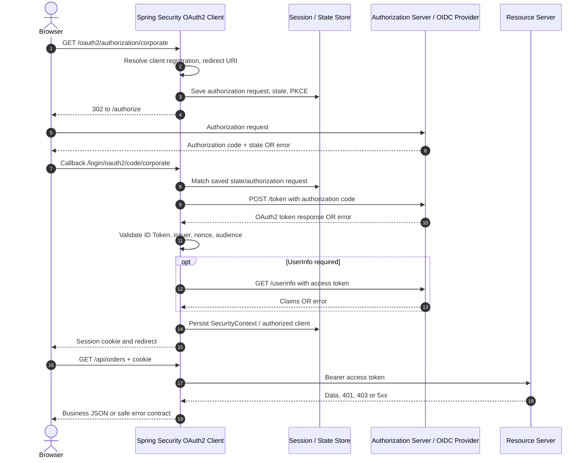

# 28.11. User-Facing Error Messages and Operational Diagnostic Data

## 1. One OAuth2/OIDC Incident Requires Two Different Representations

In a **Spring Security OAuth 2.0/OIDC Client** application, the same failure can appear from two perspectives:

- **The user:** needs to understand what did not complete, whether data was saved, whether they can try again, or what to do next.
- **The operations team:** needs to distinguish whether the failure occurred in the browser, Spring Security, Authorization Server, Token Endpoint, UserInfo Endpoint, Resource Server, HTTP client, session store, or application policy; and from there isolate and remediate it.

For example: a user clicks "Sign in with your company account", but the Authorization Server rejects authenticating the OAuth2 client.

**Message that should not be shown to the user:**

```text
OAuth2AuthenticationException:
invalid_client
Client secret rejected at https://id.internal.example/oauth2/token
client_id=portal-prod-tenant-a
...
```

A more appropriate message:

> Unable to complete sign-in right now. Please try again in a few minutes. If the issue persists, provide support code `8a7c62f1` to support.

For operational systems, the corresponding event can be recorded **in a structured format, with secrets redacted**:

```json
{
  "event": "oauth2.login.failure",
  "publicCode": "LOGIN_SERVICE_UNAVAILABLE",
  "internalReason": "CLIENT_AUTH_FAILED",
  "stage": "TOKEN_ENDPOINT",
  "providerAlias": "workforce",
  "tenantRef": "tenant-opaque-47",
  "correlationId": "8a7c62f1",
  "httpStatusClass": "4xx",
  "retryable": false,
  "outcome": "failure"
}
```

**Principle:** the same `correlationId` enables support to locate the exact event; the user **does not need** to know client secrets, tokens, internal issuers, or stack traces.

### After this lesson, you will be able to

1. Design error messages that are easy to understand, leak no data, and provide a next action.
2. Classify errors by **OAuth2/OIDC stage** and severity level.
3. Map OAuth2 error codes such as `access_denied`, `invalid_client`, `invalid_grant`, `invalid_scope`, and `temporarily_unavailable` to application error codes.
4. Distinguish login callback errors from unauthenticated API calls and unauthorized API calls.
5. Configure `oauth2Login().failureHandler(...)`, `AuthenticationEntryPoint`, and `AccessDeniedHandler` in Spring Security Servlet.
6. Design a JSON API error contract and avoid contextually inappropriate login redirects.
7. Generate and propagate correlation IDs, trace IDs, and request IDs.
8. Collect structured logs, metrics, traces, and audit events without logging secrets/tokens.
9. Monitor errors across `OAuth2AuthorizedClientManager`, refresh tokens, UserInfo, and downstream APIs.
10. Build dashboards/alerts/runbooks to isolate incidents by tenant/provider/stage.
11. Test the security of error messages, logs, and authentication failure paths.
12. Troubleshoot incidents without turning diagnostic activities into a credential leak source.

The domains, tenant names, support codes, and IDs in the examples are **fictional**. Code samples focus on Spring Security Servlet/MVC; WebFlux is compared in a dedicated section.

---

## 2. Goals of an Error Message: Accurate, Safe, Helpful

A user-facing error message should answer four questions:

1. **What did not complete?** Sign-in, account connection, permission consent, or data loading?
2. **What can be done?** Try again, sign in again, choose the right account, contact an administrator, or wait for the system to recover?
3. **Was any data lost?** If it cannot be confirmed, do not claim it.
4. **How to get support?** A non-sensitive reference code.

Examples:

| Scenario | Appropriate message |
|---|---|
| User cancels consent | "You did not grant this permission. Other features can still be used normally." |
| BFF session expired | "Your sign-in session has expired. Please sign in again." |
| Cannot connect to IdP | "Unable to connect to the sign-in service right now. Please try again later." |
| Failed or expired callback | "This sign-in request is no longer valid. Please start again." |
| Insufficient permission for API | "You do not have permission to perform this action." |
| Additional scope required | "This feature requires additional access permission. Select Connect to continue." |
| Provider connection revoked | "The connection is no longer valid. Please reconnect." |
| Failure while saving an action | "Unable to complete the request. Check the status before trying again." |

### 2.1. Do not blame the user

Do not write:

```text
You entered incorrect sign-in credentials.
```

if the application does not know that, for instance when the Token Endpoint returns `invalid_client` due to backend configuration. That is an integration error, not a user password mistake.

### 2.2. Do not say "try again" for every error

An admin-restricted scope error, issuer mismatch, wrong client secret, or OIDC signature validation failure usually **will not resolve itself** when the user repeatedly clicks retry.

The message should guide toward the accurate next step: contact support, request permission, or wait for the system; do not cause a retry loop.

### 2.3. Do not promise data was saved when unknown

If the Token Endpoint or an upstream API times out after the server has sent the request, the client cannot always know whether the remote server processed it.

For operations such as payments, changing payout accounts, or creating orders, the message should direct the user to **check the outcome**; the backend needs business-level idempotency or reconciliation.

---

## 3. Failure Map of an OAuth2/OIDC Login Flow



Every arrow can fail. Seeing only "OAuth2 login failed" does not tell you whether the failure occurred at the **authorization endpoint**, **callback/state**, **token endpoint**, **ID Token validation**, **UserInfo**, **session store**, or **authorized client persistence**.

### 3.1. Stages that should be standardized

An internal enum can be used:

```text
LOGIN_INITIATION
AUTHORIZATION_REDIRECT
AUTHORIZATION_CALLBACK
STATE_VALIDATION
TOKEN_ENDPOINT
ID_TOKEN_VALIDATION
USERINFO_ENDPOINT
LOCAL_ACCOUNT_MAPPING
SESSION_PERSISTENCE
AUTHORIZED_CLIENT_LOOKUP
TOKEN_REFRESH
DOWNSTREAM_RESOURCE
LOGOUT
CONSENT
STEP_UP
```

The enum names are an **application convention**, not a mandatory taxonomy from Spring Security. The purpose is to reduce generic logs like "OAuth error" during incident analysis.

---

## 4. Separating Protocol Errors, Integration Errors, and Business Errors

| Layer | Example | What the user needs to know | What operations needs to know |
|---|---|---|---|
| User interaction | Consent declined | Can continue using other parts | `access_denied`, stage, provider |
| OAuth2 configuration | `invalid_client` | Service temporarily unable to connect | Registration, auth method, secret version |
| OAuth2 request | `invalid_scope` | Permission currently unavailable | Scope policy and AS/client config |
| Callback integrity | `state` mismatch | Start sign-in again | Session/cookie/state correlation, do not log raw state |
| OIDC validation | Issuer/audience/nonce mismatch | Cannot verify sign-in | Validation reason, expected provider alias |
| User profile | UserInfo 401/timeout | Unable to retrieve profile | UserInfo endpoint, HTTP status class, latency |
| Session/storage | Unable to save SecurityContext | Sign-in did not complete | Session store latency/availability |
| Local identity policy | User disabled | Cannot sign in with this account | Internal reason with audit access controls |
| Authorized client | Refresh token expired | Connection is no longer valid | `invalid_grant`, registration, token lifecycle |
| Downstream API | 403 business authorization | Insufficient permission | API operation, scope/ownership decision |
| Infrastructure | DNS, TLS, proxy, timeout | Try again or wait for recovery | Network target alias, exception category |

### 4.1. Do not forward raw error codes from the provider into the UI

OAuth2 errors can include `error_description`, `error_uri`, and provider-specific payloads.

For example:

```text
error=invalid_request
error_description=The redirect URI https://internal.example/... was rejected
```

`error_description` is not standardized as a UX message and may contain implementation details or externally controlled data. Do not display it directly to the user; **classify and map it to an allowlist**.

### 4.2. HTTP status alone does not explain the root cause

HTTP 400 from the Token Endpoint can be `invalid_grant`, `invalid_scope`, or `invalid_request`. HTTP 401 from a downstream API is not equivalent to HTTP 401 for the BFF session.

Diagnostics must combine **source/stage + OAuth2 error code + status + operation**, not just a single status code.

---

## 5. Two Layers of Error Codes: Public Code and Internal Reason

Two separate code sets should be designed.

**Public codes** for frontend/support:

```text
LOGIN_NOT_COMPLETED
LOGIN_TRY_AGAIN
LOGIN_SERVICE_UNAVAILABLE
SESSION_EXPIRED
CONSENT_NOT_GRANTED
ACCOUNT_RECONNECT_REQUIRED
ACCESS_NOT_ALLOWED
TEMPORARY_ERROR
```

**Internal reasons** for operations:

```text
OAUTH_CALLBACK_STATE_MISMATCH
OAUTH_AUTHORIZATION_REQUEST_NOT_FOUND
TOKEN_ENDPOINT_INVALID_CLIENT
TOKEN_ENDPOINT_INVALID_GRANT
OIDC_ISSUER_MISMATCH
OIDC_AUDIENCE_MISMATCH
OIDC_NONCE_INVALID
USERINFO_UNAUTHORIZED
SESSION_REPOSITORY_UNAVAILABLE
REFRESH_TOKEN_REVOKED
DOWNSTREAM_INSUFFICIENT_SCOPE
DOWNSTREAM_BUSINESS_FORBIDDEN
```

### 5.1. Why not return internal reasons?

An internal code can reveal:

- Which IdP/backend product is in use.
- The existence of an account/tenant.
- The status of security checks such as nonce, issuer, or signature.
- Internal route names, credentials, or configuration.
- Potential user enumeration.

Public codes should be stable, minimal in detail, and documented for UX. Internal reasons can be more detailed but must still be redacted.

### 5.2. Only map known codes

Pseudocode:

```text
if stage == AUTHORIZATION_CALLBACK and error == access_denied:
    public = CONSENT_NOT_GRANTED or LOGIN_NOT_COMPLETED
    // Depends on pending intent: login or incremental consent.

else if stage == TOKEN_ENDPOINT and error == invalid_client:
    public = LOGIN_SERVICE_UNAVAILABLE
    internal = TOKEN_ENDPOINT_INVALID_CLIENT

else:
    public = LOGIN_TRY_AGAIN
    internal = UNCLASSIFIED_AUTH_FAILURE
```

Not every `access_denied` means "the user canceled": the AS may enforce a policy or admin restriction. UX should only interpret it as user cancellation if there is evidence in the flow/provider behavior.

---

## 6. Mapping Table for Common OAuth2/OIDC Errors

| Error from AS/OP | Common stage | Safe UX message | Diagnostics/operations |
|---|---|---|---|
| `access_denied` | Authorization redirect | "Permission request did not complete." | User denial, tenant policy, or app authorization? |
| `invalid_request` | Authorization/Token Endpoint | "Unable to complete the request." | Parameters, redirect URI, PKCE, provider contract |
| `unauthorized_client` | Authorization/Token Endpoint | "Sign-in service is not available." | Grant/client permissions |
| `invalid_client` | Token Endpoint | "Unable to connect to the sign-in service." | Client authentication, secret rotation, mTLS |
| `invalid_grant` | Token Endpoint/refresh | "The request has expired. Please try again/reconnect." | Code expired/reused or refresh token invalid; **distinguish by stage** |
| `unsupported_grant_type` | Token Endpoint | "The service does not support this request yet." | Grant registration/provider capability |
| `invalid_scope` | Authorization/Token Endpoint | "This permission is currently unavailable." | Scope allowlist/consent/admin policy |
| `server_error` | Authorization redirect | "The sign-in service is experiencing an issue." | AS outage/incident |
| `temporarily_unavailable` | Authorization redirect | "The service is temporarily unavailable." | Transient AS maintenance/overload |
| `login_required` | OIDC prompt=none | "Please sign in to continue." | Silent authorization cannot proceed |
| `consent_required` | OIDC prompt=none | "Permission is required to use this feature." | Interactive consent required |
| `interaction_required` | OIDC prompt=none | "A confirmation step needs to be completed." | OP requires interaction |
| `account_selection_required` | OIDC prompt=none | "Please choose an account." | Account chooser required |
| `invalid_token` | Resource Server Bearer | "Session/connection requires re-authentication." **Depends on source** | Signature/expiry/audience/revocation |
| `insufficient_scope` | Resource Server Bearer | "This feature requires additional access permission." | Scope mapping, business permission |
| No OAuth2 error code | Network/TLS/storage | "Unable to connect right now." | DNS/TLS/timeout/proxy/session store |

**Note on `invalid_grant`:** when code exchange fails, sign-in may need to be restarted; when refresh fails, the user may need to reconnect or a rotation race may need handling. Do not treat the two cases as equivalent.

---

## 7. Security Errors That Must Fail Closed

Some errors are not merely UX situations:

```text
OAuth2 state mismatch
OIDC issuer does not match registration
ID Token signature validation failure
ID Token audience does not contain expected client
OIDC nonce mismatch
Token response from untrusted endpoint
Tenant/account binding does not match callback
```

For these errors:

1. **Do not create a successful Authentication.**
2. **Do not accept the access/ID Token** for further use.
3. Do not skip state/nonce/issuer checks to "help the user sign in".
4. Do not return the raw ID Token or callback query to the browser.
5. Log a sanitized security event with the correlation ID.
6. If there are signs of a broad attack, flag the security severity and alert.

### 7.1. Do not label everything "incorrect password"

Spring OAuth2 Client typically does not receive the user's password directly from the IdP. If an ID Token is invalid, there is no basis to claim the user entered a wrong password.

### 7.2. Do not silently retry integrity errors

A request with a mismatched `state` or issuer mismatch must be rejected. The user can be guided to **start a new flow**, never "bypass the failed check".

---

## 8. Browser Navigation and JSON APIs Need Different Handling

When a user visits an HTML page:

```http
GET /app
Accept: text/html
```

the application can redirect to login or an error explanation page.

However, an SPA calling:

```http
GET /api/orders
Accept: application/json
Cookie: SESSION=...
```

typically expects **JSON and a status code**, not the HTML login page from the Authorization Server.

### 8.1. API contract example

When the BFF session has expired:

```http
HTTP/1.1 401 Unauthorized
Content-Type: application/problem+json
Cache-Control: no-store
X-Correlation-ID: 2d4f6c9a
```

```json
{
  "type": "about:blank",
  "title": "Sign-in required",
  "status": 401,
  "detail": "Your sign-in session has expired.",
  "code": "SESSION_EXPIRED",
  "correlationId": "2d4f6c9a"
}
```

`code` and `correlationId` are **application-defined extension fields** on the problem details format; Spring Framework provides `ProblemDetail`, while the actual JSON structure depends on serializer/configuration.

### 8.2. Why not redirect API calls to the IdP?

If a `fetch()` receives a 302 and follows the redirect to the IdP domain, the browser may encounter CORS errors, receive HTML instead of JSON, or handle the session differently from what the frontend expects.

The design:

```text
GET /api/me -> 401 JSON (no session)
Frontend -> top-level location.assign("/oauth2/authorization/corporate")
```

keeps UX clear and helps classify failures cleanly.

### 8.3. 401 and 403 are not interchangeable

- **401** at the BFF: no valid authentication yet or session has expired.
- **403** at the BFF: authenticated, but not permitted.
- **401** at the downstream Resource Server: Bearer token was not accepted.
- **403** downstream: insufficient scopes or business authorization.

Do not blindly convert a downstream 401 into `SESSION_EXPIRED` if the BFF session is still valid but the token was issued for the wrong audience.

### 8.4. Do not return 500 for every error to "hide details"

Hiding sensitive information is right, but useful HTTP status semantics should still be used:

```text
401 session required
403 access denied
400/422 invalid business request per API contract
409 conflict
429 rate-limited
502/503 upstream temporarily unavailable
500 unexpected internal failure
```

The specific status choice depends on the API contract and does not require exposing raw OAuth2 errors.

---

## 9. Designing a Consistent Error Payload

A practical API contract:

```json
{
  "type": "https://docs.example/errors/connection-required",
  "title": "Reconnection required",
  "status": 409,
  "detail": "The connection to the provider is no longer valid.",
  "code": "ACCOUNT_RECONNECT_REQUIRED",
  "correlationId": "1c5e9f2a",
  "retryable": false,
  "nextAction": "RECONNECT_PROVIDER"
}
```

The fields `code`, `correlationId`, `retryable`, and `nextAction` are application conventions, not mandatory fields of RFC 9457.

### 9.1. Do not return stack traces in JSON

Avoid:

```json
{
  "exception": "OAuth2AuthorizationException",
  "stackTrace": "...",
  "clientSecret": "...",
  "accessToken": "..."
}
```

Even in staging environments, avoid dumping raw credentials so they do not spread into log aggregation and screenshots.

### 9.2. `nextAction` is a UX hint

Some values:

```text
RETRY
SIGN_IN
RECONNECT_PROVIDER
REQUEST_PERMISSION
CONTACT_SUPPORT
CHECK_OPERATION_STATUS
NONE
```

Do not let the frontend define security policy simply because it sees `nextAction`. The backend still enforces authentication/authorization when the user performs the next action.

### 9.3. Not every error has retryable=true

`invalid_client` cannot be fixed by user retries; transient network errors may allow bounded retries; `access_denied` requires the user to deliberately start over.

---

## 10. Spring Security: Where Is Each Error Caught?

In Servlet/MVC there are several different extension points:

| Extension point | Handles scenario |
|---|---|
| `oauth2Login().failureHandler(...)` | OAuth2 Login authentication failure at filter/callback |
| `AuthenticationEntryPoint` | Unauthenticated user accessing a protected resource |
| `AccessDeniedHandler` | Authenticated principal denied permission |
| `OAuth2AuthorizationFailureHandler` | OAuth2AuthorizedClient authorization/refresh failure |
| `@RestControllerAdvice` | Exceptions passing through MVC controller/service |
| `RestClient`/`WebClient` error handling | HTTP errors when the BFF calls downstream APIs |
| Custom OAuth2 UserService/OidcUserService | UserInfo call errors, identity mapping, policy |
| Observability/filters/interceptors | Correlation, metrics, trace, audit |

### 10.1. `@ControllerAdvice` does not catch every filter error

The OAuth2 Login callback typically goes through Spring Security filters **before** the MVC controller. Therefore, writing only:

```java
@RestControllerAdvice
class GlobalExceptionHandler { ... }
```

does not guarantee handling `OAuth2LoginAuthenticationFilter` failures.

The appropriate authentication failure handler/entrypoint must be used.

### 10.2. Authentication and authorization are different

- **AuthenticationFailureHandler:** failed to prove identity.
- **AuthenticationEntryPoint:** need to initiate authentication.
- **AccessDeniedHandler:** identity is present, but lacks permission.

Using the wrong handler causes the frontend to receive the wrong message or triggers login loops.

---

## 11. Example of a Safe OAuth2 Login Failure Handler

Spring Security allows:

```java
.oauth2Login(oauth2 -> oauth2
    .failureHandler(...)
)
```

The example below maps to **fixed public codes**, without showing the exception message or provider `error_description`.

```java
import java.io.IOException;
import java.util.UUID;

import jakarta.servlet.ServletException;
import jakarta.servlet.http.HttpServletRequest;
import jakarta.servlet.http.HttpServletResponse;

import org.slf4j.Logger;
import org.slf4j.LoggerFactory;

import org.springframework.security.core.AuthenticationException;
import org.springframework.security.oauth2.core.OAuth2AuthenticationException;
import org.springframework.security.web.authentication.AuthenticationFailureHandler;

public final class SafeOAuth2LoginFailureHandler
        implements AuthenticationFailureHandler {

    private static final Logger log =
        LoggerFactory.getLogger(SafeOAuth2LoginFailureHandler.class);

    @Override
    public void onAuthenticationFailure(
            HttpServletRequest request,
            HttpServletResponse response,
            AuthenticationException exception)
            throws IOException, ServletException {

        // New Correlation ID, do not use browser input directly.
        String reference = UUID.randomUUID().toString();

        String code = "LOGIN_NOT_COMPLETED";
        String internalReason = "UNCLASSIFIED_AUTH_FAILURE";

        if (exception instanceof OAuth2AuthenticationException oauth) {
            String error = oauth.getError().getErrorCode();

            if ("access_denied".equals(error)) {
                code = "LOGIN_NOT_COMPLETED";
                internalReason = "PROVIDER_ACCESS_DENIED";
            }
            else if ("invalid_client".equals(error)) {
                code = "LOGIN_SERVICE_UNAVAILABLE";
                internalReason = "CLIENT_AUTH_FAILED";
            }
            else if ("invalid_grant".equals(error)) {
                code = "LOGIN_TRY_AGAIN";
                internalReason = "AUTHORIZATION_GRANT_REJECTED";
            }
        }

        // Only log application-generated constants/IDs.
        // Do not log exception.getMessage() or raw error_description.
        log.warn(
            "event=oauth2_login_failure reason={} reference={}",
            internalReason, reference
        );

        response.setHeader("Cache-Control", "no-store");

        // Redirect to a route owned by the application itself.
        // code only takes one of the hardcoded values above.
        response.sendRedirect(
            request.getContextPath()
            + "/login?reason=" + code
            + "&reference=" + reference
        );
    }
}
```

### 11.1. What does the code sample above demonstrate?

- There is a handler processing authentication failures of OAuth2 Login.
- The user only sees an allowlisted **public code**.
- The internal reason is recorded in logs without needing raw tokens.
- A fresh reference is generated; it does not rely on `state` or `error_description` from the URL.
- The redirect does not accept an arbitrary `return_to`.

This is a **foundational example**: production should typically use the correlation ID issued by the request filter to link multi-step logs, add verified stage/provider alias metadata, and avoid logging raw request URIs/queries.

### 11.2. Why not use `exception.getMessage()` in the redirect?

Exception messages can contain provider diagnostics, URLs, token request metadata, or unsafe strings supplied by an external system.

Do not do:

```java
response.sendRedirect(
    "/login?error=" + exception.getMessage()
);
```

Besides information leakage risks, it is prone to URL encoding bugs and creates an unstable UI.

### 11.3. Log events still need to link to traces

If a failure handler generates an entirely new reference that the request filter/trace does not use, support will struggle to connect spans. In production, you should have:

```text
correlationId generated at start of request
    -> MDC
    -> failureHandler
    -> response
    -> logs/traces
```

A later section illustrates setting up a unified correlation ID.

---

## 12. Attaching the Failure Handler to SecurityFilterChain

```java
import org.springframework.context.annotation.Bean;
import org.springframework.context.annotation.Configuration;
import org.springframework.http.HttpStatus;
import org.springframework.security.config.Customizer;
import org.springframework.security.config.annotation.web.builders.HttpSecurity;
import org.springframework.security.web.SecurityFilterChain;
import org.springframework.security.web.authentication.HttpStatusEntryPoint;
import org.springframework.security.web.util.matcher.AntPathRequestMatcher;
import org.springframework.security.web.authentication.AuthenticationFailureHandler;

@Configuration
public class BrowserSecurityConfiguration {

    @Bean
    SecurityFilterChain webSecurity(
            HttpSecurity http,
            AuthenticationFailureHandler loginFailureHandler)
            throws Exception {

        http
            .authorizeHttpRequests(auth -> auth
                .requestMatchers(
                    "/login", "/", "/assets/**", "/error"
                ).permitAll()
                .anyRequest().authenticated()
            )
            .oauth2Login(oauth2 -> oauth2
                .failureHandler(loginFailureHandler)
            )
            .oauth2Client(Customizer.withDefaults())
            .exceptionHandling(exceptions -> exceptions
                .defaultAuthenticationEntryPointFor(
                    new HttpStatusEntryPoint(HttpStatus.UNAUTHORIZED),
                    new AntPathRequestMatcher("/api/**")
                )
            );

        // Do not disable CSRF for browser-cookie sessions.
        return http.build();
    }

    @Bean
    AuthenticationFailureHandler loginFailureHandler() {
        return new SafeOAuth2LoginFailureHandler();
    }
}
```

**Explanation:**

- Browser OAuth2 Login callback failures go through `failureHandler`.
- Unauthenticated API calls return 401 instead of auto-redirecting to the IdP.
- OAuth2 Client support is enabled for downstream calls if the application needs it.
- CSRF remains enabled for the session-cookie app.
- The 401 API JSON body is not implemented in this example; to return a consistent ProblemDetail, use a custom `AuthenticationEntryPoint`.

### 12.1. API routing should be treated separately

In large projects with multiple `SecurityFilterChain` beans, do not attach the same handler to every security chain and assume all of them behave like one MVC application.

For example, a Resource Server Bearer API may need `BearerTokenAuthenticationEntryPoint` and `BearerTokenAccessDeniedHandler` per RFC 6750, unlike a BFF session-cookie API.

### 12.2. The login error page is a safe route

The `/login` page reads `reason` from an **allowlist of public codes**; do not print arbitrary query parameters to HTML. An attacker-crafted request with `?reason=...` must never be allowed to inject HTML/JavaScript.

---

## 13. AuthenticationEntryPoint for Unauthenticated API Calls

An API using browser sessions should return HTTP 401 when there is no valid Authentication.

Example `AuthenticationEntryPoint`:

```java
import java.io.IOException;
import java.util.LinkedHashMap;
import java.util.Map;

import com.fasterxml.jackson.databind.ObjectMapper;

import jakarta.servlet.http.HttpServletRequest;
import jakarta.servlet.http.HttpServletResponse;

import org.springframework.http.MediaType;
import org.springframework.security.core.AuthenticationException;
import org.springframework.security.web.AuthenticationEntryPoint;

public final class JsonApiAuthenticationEntryPoint
        implements AuthenticationEntryPoint {

    private final ObjectMapper mapper;

    public JsonApiAuthenticationEntryPoint(ObjectMapper mapper) {
        this.mapper = mapper;
    }

    @Override
    public void commence(
            HttpServletRequest request,
            HttpServletResponse response,
            AuthenticationException exception) throws IOException {

        response.setStatus(HttpServletResponse.SC_UNAUTHORIZED);
        response.setContentType(
            MediaType.APPLICATION_PROBLEM_JSON_VALUE
        );
        response.setHeader("Cache-Control", "no-store");

        Map<String, Object> body = new LinkedHashMap<>();
        body.put("type", "about:blank");
        body.put("title", "Sign-in required");
        body.put("status", 401);
        body.put("detail", "Please sign in to continue.");
        body.put("code", "AUTH_REQUIRED");

        mapper.writeValue(response.getOutputStream(), body);
    }
}
```

This is an API-specific entrypoint. `AuthenticationException` is received but **not** serialized into the response. Correlation ID should be added from request-scoped tracing/correlation infrastructure, never taken from raw exception messages.

### 13.1. Should you return `SESSION_EXPIRED` or `AUTH_REQUIRED`?

A backend usually cannot prove that a browser **previously had a session that expired** solely from a request without a valid cookie. `AUTH_REQUIRED` is a safer phrasing when unknown.

Only use `SESSION_EXPIRED` if there is a mechanism that reliably determines that state, without relying on client self-reporting.

### 13.2. API messages can still be multilingual

`code` should remain stable:

```text
AUTH_REQUIRED
```

The frontend selects the translation by locale, or the backend uses a message catalog with the appropriate locale. Do not put the language of a provider's `error_description` directly into the response.

---

## 14. AccessDeniedHandler: Signed In Without Permission

An authenticated principal accessing `/api/admin/reports` without the required role should receive 403, not an infinite redirect to login.

Example API response:

```http
HTTP/1.1 403 Forbidden
Content-Type: application/problem+json
Cache-Control: no-store
```

```json
{
  "type": "about:blank",
  "title": "Forbidden",
  "status": 403,
  "detail": "You do not have permission to perform this action.",
  "code": "ACCESS_NOT_ALLOWED"
}
```

### 14.1. Do not disclose resource existence when unauthorized

For some sensitive resources, an application may choose 404 instead of 403 to prevent resource enumeration. This decision belongs to business/API authorization policy.

Do not put:

```text
User Alice is not the owner of Bob's bank account
```

into a public message; that is personal information and permission rule detail.

### 14.2. Do not destroy the session just because of a 403

A user who lacks permission to view admin reports can still use the rest of the application. A 403 does not prove the session is invalid.

---

## 15. ControllerAdvice Handles Business Errors, Not Replacing Security Filters

In Spring MVC, `@RestControllerAdvice` can be used for exceptions thrown by controllers/services:

```java
import java.util.Map;

import org.springframework.http.HttpStatus;
import org.springframework.http.ResponseEntity;
import org.springframework.web.bind.annotation.ExceptionHandler;
import org.springframework.web.bind.annotation.RestControllerAdvice;

@RestControllerAdvice
public class ApiBusinessExceptionHandler {

    @ExceptionHandler(FeatureDisabledException.class)
    public ResponseEntity<Map<String, Object>> featureDisabled(
            FeatureDisabledException ignored) {

        return ResponseEntity
            .status(HttpStatus.FORBIDDEN)
            .body(Map.of(
                "code", "FEATURE_NOT_AVAILABLE",
                "message", "This feature is not available yet."
            ));
    }
}
```

`FeatureDisabledException` is a **custom application exception** that must be defined separately.

### 15.1. Operational metadata is still needed

A production API error should include a consistent correlation ID in both the header and body; the handler can read the request attribute set by the correlation filter.

### 15.2. Do not return raw exceptions in production

Do not write:

```java
return Map.of("error", exception.toString());
```

`exception/toString` may contain URLs, token values, SQL parameters, headers, or internal paths.

---

## 16. Correlation ID: The Key Linking UX and Diagnostics

Each request should have an identifier for correlation:

```text
Browser UI:
    "Support code: 6c2139ef"

HTTP response:
    X-Correlation-ID: 6c2139ef

Backend log:
    correlationId=6c2139ef

Metrics/tracing:
    traceId=... (linked via structured log)
```

### 16.1. Distinguishing IDs

| ID | Purpose | Can it be shown publicly? |
|---|---|---|
| `correlationId` | Ties events belonging to one request/workflow | Yes, if the ID is random and contains no secrets |
| `traceId` | Connects distributed spans | Possibly, if organization policy allows |
| `spanId` | Identifies a specific span | Mostly for internal use |
| `sessionId` | Session identifier credential | **No** |
| OAuth2 `state` | CSRF protection/correlation for authorization flow | **Do not use as support ID** |
| Authorization code | Short-lived, single-use credential | **No** |
| ID Token `sub` | External identity identifier | Not by default |
| Access token/refresh token | OAuth2 credentials | **Never** |
| `clientId` | OAuth2 client identifier | Log only when policy permits; no need to make public |
| Tenant alias | Organization-level diagnostics | Public only if the user is authorized to see it |

### 16.2. Avoid taking raw `X-Correlation-ID` from the internet

An attacker could send:

```http
X-Correlation-ID: <script>...</script>
```

or long/malformed strings to cause log injection, metrics overload, or mislead support.

Two safe approaches:

1. **Generate a new ID** at the BFF public edge, storing the inbound ID separately only when genuinely needed.
2. Only accept an inbound correlation ID from a trusted reverse proxy, validating charset, length, uniqueness, and provenance.

### 16.3. One OAuth2 login spans multiple HTTP requests

OAuth2 Login typically spans different requests:

```text
GET /oauth2/authorization/corporate
GET /login/oauth2/code/corporate
```

The two requests may have **different correlation IDs**. If you need visibility across the entire login transaction, generate a **separate login attempt ID** in the server-side authorization request/pending intent and link it safely through the state repository.

Do not use the raw OAuth2 `state` string as the login attempt ID in logs.

---

## 17. Generating a Correlation ID with a Servlet Filter

An example:

```java
import java.io.IOException;
import java.util.UUID;

import jakarta.servlet.FilterChain;
import jakarta.servlet.ServletException;
import jakarta.servlet.http.HttpServletRequest;
import jakarta.servlet.http.HttpServletResponse;

import org.slf4j.MDC;
import org.springframework.stereotype.Component;
import org.springframework.web.filter.OncePerRequestFilter;

@Component
public class CorrelationIdFilter extends OncePerRequestFilter {

    public static final String ATTRIBUTE =
        CorrelationIdFilter.class.getName() + ".correlationId";

    @Override
    protected void doFilterInternal(
            HttpServletRequest request,
            HttpServletResponse response,
            FilterChain chain)
            throws ServletException, IOException {

        String correlationId = UUID.randomUUID().toString();

        request.setAttribute(ATTRIBUTE, correlationId);
        response.setHeader("X-Correlation-ID", correlationId);

        try (MDC.MDCCloseable ignored =
                MDC.putCloseable("correlationId", correlationId)) {

            chain.doFilter(request, response);
        }
    }
}
```

### 17.1. Note on filter ordering

Ensure the filter runs before any security errors that need diagnostics. Spring Boot servlet filter registration and the Spring Security filter chain have their own ordering; test in practice whether the correlation ID is present on 302, 401, 403, and OAuth2 callback failures.

### 17.2. MDC does not propagate automatically across all async threads

SLF4J MDC is typically thread-bound. With `@Async`, custom Executors, Reactor, or background tasks, MDC may not propagate automatically.

Use an appropriate task decorator/context propagation mechanism and **clear the context after the task** to avoid leaking correlation IDs or tenants across requests.

### 17.3. The filter does not need to log the request body

The filter's role is to attach the correlation ID. Do not turn it into "log all HTTP requests/responses", because OAuth2 callbacks, Token Endpoint requests, and session cookies contain sensitive data.

---

## 18. Distributed Tracing: An HTTP Request Is Not the Whole OAuth2 Flow

A BFF request calling the Token Endpoint can produce a trace consisting of:

```text
HTTP GET callback
    |
    +-- Spring Security filter span
    +-- OAuth2 token endpoint HTTP client span
    +-- UserInfo HTTP client span
    +-- Database session/authorized client spans
```

However, the browser leaves the origin to visit the Authorization Server and redirects back in a separate request. Tracing does not automatically link two browser requests into one end-to-end trace without workflow correlation.

### 18.1. Where should tracing focus?

- Duration from callback to token response.
- Token Endpoint and UserInfo timeouts.
- Session/authorized client store latency.
- Outbound API calls.
- Failure points in the HTTP client or authentication validation.
- Retry and circuit-breaker behavior.

### 18.2. Do not put secrets into span attributes

Do not add:

```text
oauth2.access_token
oauth2.refresh_token
oauth2.authorization_code
http.request.header.authorization
http.request.header.cookie
oauth2.state
client_secret
```

With automatic tracing instrumentation, check header/query/body capture settings before enabling in production.

### 18.3. Baggage can travel outbound

W3C Baggage or custom tracing headers can be forwarded to upstream services. Do not include emails, access tokens, raw subjects, or tenant secrets in baggage.

An approved opaque tenant reference may be used internally if policy permits and it is not sent to untrusted third parties.

---

## 19. Structured Logging: Fields to Include

A standardized event:

```json
{
  "timestamp": "2026-11-16T08:05:00Z",
  "level": "WARN",
  "event": "oauth2.login.failure",
  "stage": "TOKEN_ENDPOINT",
  "publicCode": "LOGIN_SERVICE_UNAVAILABLE",
  "internalReason": "TOKEN_ENDPOINT_INVALID_CLIENT",
  "registrationAlias": "workforce",
  "tenantRef": "t-47",
  "correlationId": "c-8174",
  "loginAttemptRef": "la-25af",
  "oauth2ErrorFamily": "invalid_client",
  "remoteStatus": 401,
  "latencyMs": 143,
  "retryable": false,
  "result": "failure"
}
```

`oauth2ErrorFamily` is drawn from an **allowlist** and normalized; do not log unbounded raw provider responses.

### 19.1. Useful fields

| Field | Benefit |
|---|---|
| `event` | Aggregates the right kind of activity |
| `stage` | Pinpoints the failure area |
| `publicCode` | Correlates with UX |
| `internalReason` | Controlled diagnostics |
| `correlationId` | Finds the request |
| `loginAttemptRef` | Links authorization initiation/callback |
| `registrationAlias` | Provider/client route |
| `tenantRef` | Isolates tenant, should be pseudonymized |
| `remoteStatus` | Distinguishes network/AS errors |
| `oauth2ErrorFamily` | Classification from OAuth2Error |
| `latencyMs` | Monitors performance |
| `retryable` | Selects retry policy |
| `result` | Success/failure/cancel |
| `configVersion` | Detects failures after secret rotation/rollout |
| `deploymentVersion` | Compares errors before/after deploy |

### 19.2. Be careful with raw principal names

`Authentication.getName()` may be an email, username, or external subject depending on the provider and mapping. Do not blindly put it into logs or metrics. Use an opaque internal user reference only when needed for investigation and with proper access controls.

### 19.3. Do not log the entire `Authentication`

An `OAuth2AuthenticationToken`, `OidcUser`, or `OAuth2AuthorizedClient` can contain attributes, ID Token claims, or access/refresh tokens. Do not do:

```java
log.info("auth={}", authentication);
log.info("client={}", authorizedClient);
```

without verifying the output contains no sensitive data.

---

## 20. Redaction: What Data Must Never Be Logged?

List of items to block in HTTP logs, APM, exception reporting, metrics, traces, debug dumps, screenshots, and support tickets:

```text
access_token
refresh_token
id_token
authorization_code
client_secret
client_assertion
private_key
code_verifier
session cookie
Authorization: Bearer ...
Authorization: Basic ...
Set-Cookie
Cookie
raw JWK private material
mTLS private key/certificate bundle secrets
raw token endpoint request/response body
```

### 20.1. Callback query strings are still sensitive

For example:

```text
/login/oauth2/code/corporate?code=AUTH_CODE&state=RANDOM_STATE
```

If the reverse proxy logs the full request URI, the authorization code and state can be inadvertently stored. Redact query parameters or log the **route template**, not the full URL for auth endpoints.

### 20.2. Do not print exception stacks unconditionally

An exception chain from an HTTP client or provider SDK may contain headers/bodies/URLs with secrets. Calling `log.error("...", exception)` in production can leak data if messages and nested exceptions have not been vetted.

Safe approach:

- Log a **safe exception category/class** and internal reason.
- Enable gated diagnostic traces only when a redaction policy and authorized operators are in place.
- Never dump raw HTTP exchanges from the Token Endpoint.
- Restrict log retention and access permissions.

### 20.3. Do not use a token hash as a correlation ID

Hashing a raw token still creates a stable fingerprint that can correlate sessions and poses data exposure risks. Generate a **separate random ID**; do not use token values, token suffixes, or hashes of access/refresh tokens as support codes.

### 20.4. `error_description` can be untrusted data

Do not put `error_description` from a provider into an unbounded structured log field or into the UI, as it can contain newlines, HTML, or unintended information.

If it genuinely needs to be retained for an incident, apply sanitization/truncation, policy controls, and separate it from public logs.

---

## 21. Error Codes Must Be Stable, Messages Can Change

A system needs to support i18n and product UX evolution over time.

For example:

```text
Public code: ACCOUNT_RECONNECT_REQUIRED
vi-VN: "Kết nối đã hết hiệu lực. Vui lòng kết nối lại."
en-US: "Your connection has expired. Reconnect to continue."
```

The frontend should not compare message strings:

```javascript
if (error.message === "Your connection has expired") {
    ...
}
```

Instead use:

```javascript
switch (error.code) {
  case "ACCOUNT_RECONNECT_REQUIRED":
    showReconnectAction();
    break;
  case "AUTH_REQUIRED":
    showSignInAction();
    break;
  default:
    showSupportReference(error.correlationId);
}
```

**Note:** the frontend selects UX; the backend must still verify permissions. An error code does not grant API permissions.

---

## 22. UI Handling OAuth2 Login Failures

A `/login` page can read `reason` from an allowlist:

```text
LOGIN_NOT_COMPLETED:
  "Sign-in was not completed."
  "You can try again or choose another sign-in method."

LOGIN_SERVICE_UNAVAILABLE:
  "Unable to connect to the sign-in service right now."
  "Please try again later. If the problem persists, contact support."

LOGIN_TRY_AGAIN:
  "The sign-in request has expired."
  "Please start again from the sign-in page."
```

### 22.1. Do not display raw provider errors

Block:

```text
?reason=<script>alert(1)</script>
?message=Client secret foo rejected
```

Even if the login page accepts a query string, only render messages from the application catalog, HTML-escaped by the template engine.

### 22.2. Do not display overly specific "this account does not exist" messages

For account mapping/local onboarding, messages may reveal whether an email already exists or a tenant user is disabled. Message wording must account for the user enumeration threat model.

### 22.3. UX can offer multiple support levels

- A **Try again** button if a new request makes sense.
- A **Sign in with another method** button if a provider has an outage and business policy permits.
- A **Contact administrator** button with the support code.
- Explain **signed in successfully but lacking permission** differently from a login failure.
- Do not automatically retry login redirects infinitely.

---

## 23. Distinguishing OAuth2 Consent Denial from Login Failure

A user already signed in to the BFF selects "Connect calendar". The IdP denies `calendar.readonly`.

This situation is not the same as a user failing to sign in.

```text
Local session:
    User Alice is still authenticated.

Incremental consent:
    Failed / denied.

Calendar feature:
    Not connected.

Dashboard:
    Still working.
```

### 23.1. Different public codes

```text
LOGIN_NOT_COMPLETED
CONSENT_NOT_GRANTED
ACCOUNT_RECONNECT_REQUIRED
```

The same provider `access_denied` may require different UX depending on the **trusted server-side intent** of the flow.

### 23.2. Do not rely on `?flow=consent` from the browser

A self-declared `flow=consent` parameter on a callback is not proof that the user initiated consent. Use `state` and server-side pending intent to distinguish authorization transaction types.

---

## 24. Errors When Loading UserInfo/OIDC Profile

After the Token Endpoint returns an access token/ID Token, Spring Security may call the UserInfo Endpoint.

Possibilities include:

- HTTP 401/403 from UserInfo.
- TLS certificate error.
- Timeout.
- Malformed JSON response.
- Missing stable user-name attribute.
- Claims conflicting with ID Token `sub`.
- Custom `OAuth2UserService` mapping exception.
- Internal account disabled/tenant policy denied.

### 24.1. Safe messages

User:

> Unable to verify account information to complete sign-in. Please try again or contact support.

Operations:

```text
stage = USERINFO_ENDPOINT
providerAlias = corporate
internalReason = USERINFO_HTTP_UNAUTHORIZED
remoteStatus = 401
registrationConfigVersion = 13
correlationId = ...
```

### 24.2. Do not return raw UserInfo responses

UserInfo can contain email, address, full name, groups, phone number, birthdate, or custom claims. Do not log the entire JSON to "debug".

### 24.3. `sub` mismatch is an integrity error

With OIDC, the UserInfo subject must be verified to match the ID Token subject per protocol. If they do not match, do not skip the check to let login proceed.

---

## 25. `OAuth2AuthorizedClientManager` and Refresh Token Errors

After the user has signed in, the BFF can use:

```java
OAuth2AuthorizedClientManager
```

to load/authorize/refresh access tokens when calling downstream APIs.

Common errors:

```text
invalid_grant
invalid_client
network timeout
token response invalid
missing authorized client
client registration not found
```

### 25.1. `invalid_grant` during token refresh

There can be several causes:

- Refresh token expired.
- User revoked consent.
- Admin revoked authorization.
- Token rotation occurred and an old token was reused.
- Token does not belong to the current client.
- Client registration/issuer changed.

Therefore do not log:

```text
"User revoked consent"
```

when you only know `invalid_grant`.

### 25.2. Failure handler and token storage

Spring Security provides:

```java
OAuth2AuthorizationFailureHandler
```

For some authorized client managers, `invalid_grant` by default can cause the old authorized client to be removed from the repository/service. When strict refresh token rotation is deployed with concurrent requests, inspect **races between a stale refresh failure and a newly saved token**.

A stale failure must not delete the new authorized client if the backend just refreshed successfully in another request.

### 25.3. UX for expired/revoked integration

If the BFF session is still valid but the provider authorization has expired:

```json
{
  "code": "ACCOUNT_RECONNECT_REQUIRED",
  "detail": "The service connection is no longer valid.",
  "nextAction": "RECONNECT_PROVIDER"
}
```

Do not force the user to log out of the whole app if only one external integration needs reauthorization.

### 25.4. Do not retry refresh infinitely

If the AS returns `invalid_grant`, retrying the same refresh token multiple times can increase replay detection risk. For timeouts/5xx, use bounded/backoff retries while accounting for whether the request may already have been processed at the AS.

---

## 26. Classifying Downstream Resource Server Failures

A BFF can log in successfully yet fail when calling the Orders API.

```text
Browser -> BFF:
    Cookie SESSION=...

BFF -> Orders API:
    Authorization Bearer AT1

Orders API -> BFF:
    401 invalid_token or 403 insufficient_scope
```

### 26.1. API Bearer 401

Possible reasons include:

- Token expired/revoked.
- Untrusted issuer.
- Wrong audience.
- Incorrect signature/JWK configuration.
- Sender-constrained token missing proof.

Do not assume a 401 from the Orders API means the browser session has expired.

### 26.2. API Bearer 403

`insufficient_scope` may indicate a missing OAuth2 permission. However, 403 can also be a business authorization denial.

**Only display a consent button** when the backend verifies that a missing scope is required for a valid feature. Do not take a raw `scope` returned by upstream and feed it into an authorization request without an allowlist.

### 26.3. Upstream 5xx

Appropriate message:

> Unable to load data right now. Please try again later.

If data can be safely cached per policy, the UX can display a "stale data" status with the last-updated timestamp; never claim the data is up to date.

### 26.4. Do not expose upstream URLs and credentials

Avoid:

```json
{
  "message": "orders.internal.local:8443 returned 401 for Bearer eyJ..."
}
```

Only use public codes and correlation IDs.

---

## 27. Logging for the Token Endpoint: What Should Be Recorded?

Example of a failed token request:

```text
stage=TOKEN_ENDPOINT
grantType=authorization_code
registrationAlias=corporate
providerAlias=idp-a
httpStatusClass=4xx
oauth2ErrorFamily=invalid_client
durationMs=213
configVersion=14
correlationId=...
```

Do not record:

```text
client_secret
authorization_code
code_verifier
refresh_token
Authorization header
request body
full response body
```

### 27.1. Grant type is a useful diagnostic

An `authorization_code` `invalid_grant` failure differs from a refresh token `invalid_grant` failure.

Record:

```text
grantType=authorization_code
```

or:

```text
grantType=refresh_token
```

when the information comes from trusted client configuration/operation, not solely from browser input.

### 27.2. `client_id` is sometimes sensitive metadata

Client ID is generally not a secret under OAuth2, but it can reveal enterprise infrastructure or tenant identity. There is no need to show it to the user; an opaque registration alias can be used in logs while keeping the mapping controlled.

### 27.3. Config version helps isolate rollouts

When the `invalid_client` rate spikes after secret rotation, `clientConfigVersion` can identify which version is failing **without having to log the secret**.

---

## 28. Metrics: Measuring Quality Without Unbounded Cardinality

An illustrative metrics set:

```text
oauth2_login_attempts_total{
  provider="workforce",
  outcome="success"
}

oauth2_login_failures_total{
  provider="workforce",
  stage="TOKEN_ENDPOINT",
  reason="INVALID_CLIENT"
}

oauth2_token_requests_total{
  grant_type="refresh_token",
  outcome="failure"
}

oauth2_token_request_duration_seconds{
  provider="workforce",
  grant_type="authorization_code"
}

oauth2_callback_failures_total{
  category="STATE_VALIDATION"
}
```

The names above are **application-defined metrics**, not available verbatim by default in Spring Boot/Spring Security.

### 28.1. Choose low-cardinality labels

**Consider using:**

```text
provider family
stage
outcome
sanitized error category
grant type
HTTP status class
deployment region
```

**Avoid:**

```text
access token
user email
raw subject
session ID
correlation ID
trace ID
request ID
full URL/query
unbounded tenant/user ID
raw error_description
```

Correlation ID belongs in **logs/traces**, not as a metric label because of excessive cardinality.

### 28.2. A tenant may need its own visibility

If the tenant count is large, do not place raw tenant IDs as metric labels system-wide. You can use sampling, per-tenant logs, bounded top-N alerts, or tenant tier/region as labels.

For security incidents requiring tenant-level lookup, use a protected log search/audit system.

### 28.3. Track the denominator

Looking only at an increase in `oauth2_login_failures_total` is insufficient, because login volume may also have increased.

For example:

\[
\text{Login failure rate} =
\frac{\text{failed attempts}}
{\text{completed attempts}}
\]

Distinguish **user cancel** from **system errors**; an increase in `access_denied` for a provider due to users declining consent is not necessarily an outage.

---

## 29. Observability in Spring Security and Spring Boot

Spring Boot integrates Micrometer Observation/metrics/tracing when the corresponding dependencies and observability infrastructure are configured.

Spring Security also provides observations for several filter chain, authentication, and authorization activities. **Observation names, filters, and default enablement may vary by Spring Security version.**

### 29.1. Do not rely solely on built-in metrics

Built-in observations can report latency and outcomes at security layers, but typically do not know the business meaning of a pending consent flow, token refresh policy, tenant-specific connection status, or public support code.

Applications should add **custom structured events** and metrics for critical steps.

### 29.2. Actuator endpoints

Spring Boot Actuator can support health, metrics, tracing integration, and other operational endpoints.

Do not expose all of `/actuator/**` to the internet. These endpoints can reveal configuration, runtime details, and security data; exposure and access permissions must be tightly controlled.

### 29.3. Sampling

Distributed tracing may sample only a fraction of requests. A failed login having a correlation ID without a sampled trace can happen.

Do not promise support **will always have a full trace** for every support code. Structured logs/audit with clear retention are an essential fallback.

---

## 30. Alerts That Actually Provide Value

Examples of signals worth alerting on:

| Signal | Possibility | Action |
|---|---|---|
| Sharp spike in `invalid_client` for a registration | Secret rotation/config mismatch | Check credential version and AS |
| Callback `state` failure rate rises | Cookie/session store, routing, or attack | Check recent deployment and session behavior |
| OIDC issuer/signature failures increase | IdP key/issuer mismatch or compromise | Security priority; do not bypass validation |
| Token Endpoint timeouts increase | Network/AS outage | Check connectivity, provider status |
| Refresh `invalid_grant` spikes | Revocation, token rotation race | Check refresh concurrency and provider policy |
| UserInfo 401 increases | Wrong token UserInfo scopes/audience | Check provider config |
| Session load errors spike | Redis/JDBC failure | Check health, failover, pool |
| One tenant loses login while others are normal | Tenant-specific registration issue | Compare tenant config version |
| Downstream API 401 increases | Wrong audience/issuer/expiry | Check token target/Resource Server |
| API 403 increases | Scope/role policy rollout | Distinguish `insufficient_scope` from business denies |
| Consent denials increase | UX change/permission scope change | Product analysis, avoid always treating as outage |

### 30.1. Incident severity classification

- **Security SEV:** issuer/nonce/signature validation anomalies, token leakage, bypass risk.
- **Availability SEV:** no tenants can log in or major Token Endpoint outage.
- **Configuration incident:** a client registration has a wrong secret/scope/redirect URI.
- **User-recoverable error:** session expired, user canceled consent.
- **UX quality issue:** consent fatigue, unclear message, retry loop.

Classification reduces alert noise; however, never downgrade security validation failure signals.

### 30.2. Alerts should not rely on raw user data

Do not use email, phone number, or full subject as an alert key, and do not send raw tokens/exceptions into Slack/email incident notifications.

---

## 31. Runbook for Login Failures

An operational runbook in order:

1. Obtain **public code + correlation ID + timestamp** from the user.
2. Confirm the user is in the right tenant/environment without asking for passwords/tokens.
3. Search structured logs by correlation ID.
4. Inspect `stage`, `internalReason`, `providerAlias`, and `registrationConfigVersion`.
5. Compare against the baseline for the same provider/region.
6. Determine whether the error affects all users, one tenant, or one session.
7. Check recent deployments/config changes/secret rotations.
8. If callback/state failed, inspect session store, cookie flags, proxy host/redirect URI, and clock skew.
9. If Token Endpoint failed, inspect status/error family, TLS/proxy, client authentication, and provider health.
10. If OIDC validation failed, inspect issuer/JWKS/audience/nonce, **never disabling validation**.
11. If UserInfo failed, check API permissions and provider response contract.
12. If authorized client refresh failed, check token lifecycle and rotation races.
13. Record mitigation and redacted postmortem metadata.
14. If user contact is needed, ask only for the reference code and action description, **never ask for tokens or cookies**.

### 31.1. "Cannot reproduce" can stem from session state

Login is a browser-redirect flow with session-bound state and PKCE verifier. If support copies a callback URL from the user to another machine, it may not work and exposes the authorization code.

Instead of asking the user for the full callback URL, reproduce with a fresh login attempt using an appropriate test account/tenant.

### 31.2. Clocks and proxies are subtle failure sources

Diagnostics:

```text
Cookie Secure/SameSite
Reverse proxy Forwarded headers
Session affinity/distributed session store
Authorization request TTL
OIDC/JWT clock skew
Redirect URI registration
PKCE verifier persistence
```

An OAuth2 `state` mismatch is not necessarily an attack; however, never disable the check assuming it is merely a dropped cookie.

---

## 32. Runbook: Token Endpoint `invalid_client`

```text
Symptom:
    oauth2.login.failure
    stage=TOKEN_ENDPOINT
    internalReason=TOKEN_ENDPOINT_INVALID_CLIENT

Questions:
    Was client secret recently rotated?
    Which app version/configVersion is failing?
    Did client authentication method change?
    Does registration client_id match realm/tenant?
    Does Token URI point to the right IdP?
    Are mTLS/private_key_jwt keys/certificates still valid?
    Did the provider disable the client?
```

### 32.1. Mistakes to avoid

Do not:

- Send the client secret in an unprotected support ticket.
- Temporarily disable client authentication.
- Point the Token Endpoint to an untrusted "test" host.
- Enable plaintext HTTP or disable TLS hostname verification.
- Blame "the user entered a wrong password".

### 32.2. Recovery

- Verify configuration from the secret manager.
- Cross-check provider console/admin settings.
- Roll forward/roll back config per plan and credential validity.
- Monitor login success rate and `invalid_client` after the change.
- If the secret may have been exposed, perform rotation and incident handling per policy.

---

## 33. Runbook: `invalid_grant` on Refresh

```text
Symptom:
    oauth2.token.refresh.failure
    error=invalid_grant
    provider=...
    tenant=...
```

Distinguish among:

1. Refresh token expired.
2. User revoked consent.
3. Admin revoked/disabled client.
4. One-time-use refresh token rotation.
5. Two requests used the same RT1.
6. Old token cached after update.
7. Cross-tenant/principal token ownership mismatch.
8. Client/issuer changed.

### 33.1. Rotation race

Example:

```text
Thread A:
    RT1 -> RT2 (success)

Thread B:
    RT1 -> invalid_grant

Failure handler:
    Deletes authorized client by key
```

If B deletes A's **new** record, the user is disconnected even though RT2 is valid. Diagnostics require inspecting sequence/version events without logging raw RT1/RT2.

### 33.2. Useful metadata

```text
registrationAlias
pseudonymized principalRef
operation=refresh_token
cacheVersion/authorizationEpoch
result
time
correlationId
```

Do not use token suffixes/hashes for cross-referencing.

### 33.3. UX

If refresh cannot succeed and the account needs re-authentication:

> The connection to the provider is no longer valid. Please reconnect to continue.

Do not force a full application logout if only one integration lost its token.

---

## 34. Multi-Tenant Observability and Privacy

In SaaS, an error may affect only tenant Alpha:

```text
tenant Alpha:
    issuer=https://id.alpha.example
    configVersion=18
    invalid_client spike

tenant Beta:
    normal login success
```

### 34.1. Tenant references should be opaque

You can use:

```text
tenantRef=t-0c28
```

instead of an internal domain containing the company name when unnecessary. Mapping back to the real tenant requires RBAC in operational systems.

### 34.2. Do not show one user's tenant in another user's message

A message like:

```text
Tenant Acme's client secret was rejected
```

is unnecessary for end users and can disclose infrastructure/customers.

### 34.3. Correlation ID is not a capability token

Someone knowing a correlation ID **is not automatically authorized to read logs or user data**. The support console must authenticate staff, enforce RBAC/tenant scope, and audit every query.

### 34.4. Tenant context from the browser is not necessarily trustworthy

A header:

```http
X-Tenant: some-other-tenant
```

is not enough to attribute a request log to that tenant. Operations should use the **backend-resolved and authorized tenant**, never trusting raw user input.

---

## 35. Security and Audit Events Differ from Application Logs

**Application logs** serve diagnostics and may be sampled/rotated.

**Audit records** serve traceability for sensitive actions and policy decisions:

```text
User consent granted/revoked
Account linking/unlinking
Client registration changed
Step-up authentication succeeded/failed
Session invalidated by administrator
Tenant OAuth client disabled
Repeated OIDC issuer mismatch incidents
```

### 35.1. Audits should not contain secrets

Example:

```json
{
  "event": "tenant.oauth.client.disabled",
  "tenantRef": "t-0c28",
  "registrationAlias": "corporate",
  "actorRef": "admin-opaque-72",
  "reasonCode": "SECURITY_POLICY",
  "result": "SUCCESS",
  "correlationId": "c-c273"
}
```

Do not store client secrets, tokens, or ID Tokens in audit records.

### 35.2. Audits may have different retention from logs

Separate policies are needed for:

- Who can view audit records.
- How long personal data is retained.
- Tamper-evidence or append-only storage if required.
- Export access and incident/legal hold.
- Deletion/anonymization per policy and applicable law.

Do not extend retention of all access logs indefinitely just to serve as an audit trail.

### 35.3. Do not equate "login failed" with "security attack"

A user canceling consent is normal behavior. Security events have their own severity; raise critical alerts only when there are anomalous signals in volume, source, or integrity checks.

---

## 36. Securing Logging Across HTTP Boundaries

An architecture has multiple hops:

```text
Browser
   |
   v
CDN / WAF / Reverse proxy
   |
   v
Spring Boot BFF
   |
   +----> Authorization Server / Token Endpoint
   |
   +----> UserInfo Endpoint
   |
   +----> Resource Server
   |
   +----> Session DB / Redis
```

Each component may keep its own logs.

### 36.1. Reverse proxy

Check the access log configuration to ensure it does not store full callback queries:

```text
/login/oauth2/code/... ?code=...&state=...
```

At the proxy, you can log the **path** and status; query parameters containing OAuth2 credentials must be redacted.

### 36.2. HTTP client instrumentation

Do not enable full request header/body logging for the Token Endpoint in production. HTTP Basic/client assertions and refresh tokens are inside the request; the token response contains access/refresh tokens.

### 36.3. Session store

Redis/JDBC sessions may hold SecurityContext or authorized clients depending on design. Do not enable debug logs that dump serialized session attributes.

### 36.4. Browser console/analytics

Do not send tokens, codes, state, or raw `error_description` to the browser console, client-side analytics, or crash reporting SDKs.

---

## 37. `WWW-Authenticate` and Bearer Errors Differ from BFF Session Errors

A Resource Server using OAuth2 Bearer may return the header:

```http
WWW-Authenticate: Bearer error="invalid_token"
```

or:

```http
WWW-Authenticate: Bearer error="insufficient_scope",
    scope="orders.read"
```

This is a **downstream Bearer authorization** error.

In a BFF session-cookie API, the frontend typically does not need to see the raw `WWW-Authenticate` from the Orders API. The BFF can map it to:

```text
RESOURCE_CONNECTION_FAILED
RESOURCE_PERMISSION_REQUIRED
```

depending on backend policy, rather than blindly copying upstream headers to the browser.

### 37.1. Do not introduce vulnerabilities through error headers

Upstream responses may contain `Set-Cookie`, `Location`, diagnostics, or endpoint-specific headers. Do not pass through all headers when proxying APIs if there is a risk of credential leakage or open redirect.

### 37.2. When the BFF is also a Resource Server

An application may have two security chains:

```text
Browser routes:
    Cookie session + OAuth2 Login

Machine API routes:
    Bearer access token + Resource Server
```

Error handlers must be selected per chain to avoid a Bearer client receiving an HTML login redirect or a browser receiving an inappropriate `WWW-Authenticate`.

---

## 38. Spring WebFlux/Reactive Counterpart

In WebFlux, the UX and diagnostic concepts remain the same, while the APIs change:

| Servlet/MVC | WebFlux |
|---|---|
| `HttpSecurity` | `ServerHttpSecurity` |
| `SecurityFilterChain` | `SecurityWebFilterChain` |
| Servlet authentication failure handler | Reactive authentication failure handler |
| `AuthenticationEntryPoint` | `ServerAuthenticationEntryPoint` |
| `AccessDeniedHandler` | `ServerAccessDeniedHandler` |
| `OAuth2AuthorizedClientManager` | `ReactiveOAuth2AuthorizedClientManager` |
| Servlet request/MDC | `ServerWebExchange` + Reactor Context |
| `RestClient`/Servlet HTTP | `WebClient` reactive HTTP |
| `@RestControllerAdvice` | Reactive-compatible controller advice |

### 38.1. Reactor Context differs from ThreadLocal MDC

Reactive requests can move across multiple threads. Do not rely purely on `MDC.put()` at the start of a filter and assume all spans/logs retain the same correlation ID.

Use Reactor Context + context propagation integration matching your Spring Boot/Micrometer version.

### 38.2. Do not call `.block()` in reactive error handling

A WebFlux error handler should not block the event loop to write to a DB/audit log or call a provider API; use reactive APIs or offload blocking operations.

### 38.3. Already-committed responses have limits

If WebFlux/Servlet has already started streaming the response, the error handler may be unable to change the status or body as desired. Design streaming endpoints and retry semantics separately rather than assuming a JSON error can always be returned.

---

## 39. Testing Messages and Sensitive Data

Tests should verify **both UX output and operational log behavior**.

### 39.1. Unit tests for error mappers

```text
OAuth2 access_denied
    -> public code LOGIN_NOT_COMPLETED/CONSENT_NOT_GRANTED per intent

Token Endpoint invalid_client
    -> LOGIN_SERVICE_UNAVAILABLE

Refresh invalid_grant
    -> ACCOUNT_RECONNECT_REQUIRED when unrecoverable

Unknown exception
    -> TEMPORARY_ERROR / LOGIN_TRY_AGAIN per stage

OIDC issuer mismatch
    -> deny login; safe generic message
```

### 39.2. Do not test HTTP status alone

Tests must verify the response **does not contain**:

```text
client_secret
access_token
refresh_token
id_token
authorization_code
code_verifier
raw session ID
raw provider error_description
stack trace
```

### 39.3. Test error page against injection

Send:

```text
/login?reason=<script>alert(1)</script>
```

and verify the page displays only an allowlisted safe message without rendering untrusted HTML.

### 39.4. Test correlation ID

- `X-Correlation-ID` present on success/error.
- ID is not taken directly from a user-controlled header.
- ID appears in log events, not in metric labels.
- Async workflows preserve linking through event metadata.
- Session ID and OAuth2 state are not exposed.

### 39.5. Test failed login callbacks

- Authorization `state` mismatch.
- Authorization request not found.
- Wrong PKCE verifier.
- Token Endpoint `invalid_client`.
- `invalid_grant` on code exchange.
- Invalid OIDC issuer/audience/signature/nonce.
- UserInfo timeout/401.
- Local account disabled.
- Session store unavailable.

For each test, verify: **login is not treated as successful**, the public message is safe, and logs classify the right stage when observable.

---

## 40. MockMvc Test Example for an API Entrypoint

A conceptual test:

```java
import static org.springframework.test.web.servlet.request.MockMvcRequestBuilders.get;
import static org.springframework.test.web.servlet.result.MockMvcResultMatchers.status;
import static org.springframework.test.web.servlet.result.MockMvcResultMatchers.header;

@Test
void apiWithoutSessionReturns401AndCorrelationId() throws Exception {
    mockMvc.perform(get("/api/orders"))
        .andExpect(status().isUnauthorized())
        .andExpect(
            header().exists("X-Correlation-ID")
        );
}
```

The test requires `spring-security-test`, with MockMvc configured with the security filter chain and `CorrelationIdFilter`. Simply copying the snippet will not run without setup.

### 40.1. Test distinguishing 401 and 403

- No Authentication -> 401 per BFF API contract.
- Has Authentication but lacks permission -> 403.
- OAuth2 Login failure -> safe login error page/redirect.
- Resource Server invalid token -> error mapped by source/stage, not assumed to be session expired.

### 40.2. Test log redaction

Use fake tokens:

```text
access_token = fake.access.secret
refresh_token = fake.refresh.secret
```

Trigger the failure path and capture logs/traces in the test environment. Assert those strings **do not appear**.

No real tokens are needed to test redaction.

### 40.3. Test retry safety

A timeout when calling a downstream POST should not automatically resend the request if the business operation lacks idempotency protection.

Test the API contract for `retryable` and `nextAction` to prevent the frontend from mistakenly retrying non-idempotent transactions.

---

## 41. OAuth2 Client Observability Dashboard

A dashboard may include these panels:

```text
Authentication:
    Login success rate by provider
    Auth callback failure rate
    OAuth2 state/nonce validation failures

Token lifecycle:
    Token Endpoint success/error rate
    Refresh invalid_grant by registration
    Client auth invalid_client incidents

Dependencies:
    IdP latency and 5xx
    UserInfo latency/errors
    Session/authorized client DB errors
    Downstream Resource Server 401/403/5xx

User experience:
    Consent denied vs system errors
    Session-expired frequency
    Reconnect-required rate
    Retry-loop signals
```

### 41.1. Use per-provider baselines

One IdP provider may undergo temporary maintenance while others operate normally. Looking only at the platform-wide aggregate "login failure rate" can mask an outage affecting a single provider.

### 41.2. Overlay deployment/config changes on the timeline

Put metadata on the dashboard:

```text
Spring Boot app version
Spring Security dependency version
Tenant client config version
Secret rotation event
IdP incident window
```

You do not need to log secret values to know an incident started after a rotation.

### 41.3. Do not let metrics become user tracking

Do not place raw user identities or session IDs into dashboard time series.

---

## 42. Stage-by-Stage Diagnostic Scenarios

### Scenario A: User clicks sign in and gets an error page

**User:** "Unable to complete sign-in. Support code: ..."

**Ops:** inspect `LOGIN_INITIATION`, `AUTHORIZATION_CALLBACK`, `TOKEN_ENDPOINT`, and `ID_TOKEN_VALIDATION` by correlation/login attempt ID.

### Scenario B: User clicks "Deny" on consent

**User:** "You did not grant permission; other features remain usable."

**Ops:** `access_denied` on consent intent, do not mark as an outage.

### Scenario C: Token Endpoint `invalid_client` after rotation

**User:** "Sign-in service is unavailable."

**Ops:** compare `configVersion`, client auth method, and IdP settings; do not ask the user for a password.

### Scenario D: Callback cannot find OAuth2 `state`

**User:** "This sign-in request is no longer valid. Start again."

**Ops:** session store, `SameSite`, reverse proxy, duplicate tabs, and auth request TTL; do not log raw state.

### Scenario E: ID Token issuer mismatch

**User:** "Unable to verify sign-in."

**Ops:** security event at `ID_TOKEN_VALIDATION`, verify issuer/registration trust; do not disable validation.

### Scenario F: UserInfo timeout

**User:** "Temporarily unable to retrieve account information."

**Ops:** UserInfo endpoint latency, TLS/proxy, and response parser.

### Scenario G: OIDC login succeeds but local account is disabled

**User:** "This account cannot access the application. Contact an administrator."

**Ops:** internal account policy; do not mistake it for an OAuth2 provider outage.

### Scenario H: Spring Session Redis loses connection

**User:** "Sign-in session is currently unavailable."

**Ops:** session repository health and cluster failover; do not remove tokens or bypass session protection just to keep the app running.

### Scenario I: BFF API fetch receives 302 to IdP

**User:** may see confusing CORS/network errors.

**Ops:** fix API entrypoint to return 401 JSON for `/api/**`, trigger login via top-level browser navigation.

### Scenario J: Downstream Orders API returns `insufficient_scope`

**User:** "You need to grant additional permission to use this feature."

**Ops:** audience/scope mapping per API; suggest consent only when permitted by the backend feature allowlist.

### Scenario K: 403 due to resource ownership

**User:** "You do not have permission for this resource."

**Ops:** business authorization; do not trigger pointless consent/reauth.

### Scenario L: Refresh token rotation race

**User:** "Connection requires re-authentication" if unrecoverable.

**Ops:** concurrent authorized client updates, stale `invalid_grant` failure, conditional storage.

### Scenario M: Login error page renders raw `error_description`

**User:** may see URLs, internal service names, or malicious HTML content.

**Ops:** enforce public code allowlist and output encoding; review logging/incident handling.

### Scenario N: Correlation ID taken from an arbitrary header

**Risk:** log injection, collisions, metrics amplification.

**Ops:** generate internally or validate from trusted edge; never put unvalidated input into MDC.

### Scenario O: Support asks the user to send an access token to debug

**Right approach:** prohibit collecting credentials; use correlation ID, test accounts, and redacted events.

### Scenario P: One tenant fails login, others work normally

**Ops:** inspect that tenant's client registration/config version and provider endpoint while protecting tenant metadata.

### Scenario Q: Provider returns `temporarily_unavailable`

**User:** try again after an appropriate interval.

**Ops:** provider health, rate limiting, bounded retry; do not trigger an OAuth2 redirect loop.

### Scenario R: Token B has the wrong audience

**User:** "Unable to load data."

**Ops:** Resource Server 401, token audience, issuer, and registration; do not blame the browser session.

### Scenario S: Trace does not appear despite having a support code

**Ops:** may be due to tracing sampling or span propagation; search structured logs by correlation ID.

### Scenario T: Enabling full HTTP DEBUG to investigate

**Risk:** raw authorization codes, cookies, Basic credentials, and tokens enter logs.

**Right approach:** gated diagnostics and safe metadata, masking at proxies, HTTP clients, SDKs, and APM.

---

## 43. Self-Check Questions

**1. Why do OAuth2/OIDC errors need two representations?**  
Users need safe, actionable messages; operations needs metadata to investigate root causes without leaking secrets.

**2. Should `OAuth2AuthenticationException.getMessage()` be shown?**  
No. The message can contain system/provider data; map it to a public code.

**3. Should the Correlation ID be the OAuth2 state?**  
No. State protects the authorization flow; use a separate random support ID.

**4. Should a session ID be used as a support reference?**  
No. A session ID is a credential.

**5. What is `invalid_client` usually related to?**  
Client authentication or registration/provider configuration.

**6. Does `invalid_grant` always mean user revocation?**  
No. It can also stem from expired/reused codes, refresh rotation, or client mismatch.

**7. Should user `access_denied` always force a logout?**  
No. Denying consent for one feature does not have to invalidate the local login session.

**8. How should a callback state mismatch be handled?**  
Reject the flow, guide the user to start over, and log a sanitized event; do not disable state validation.

**9. Are Spring Security filter authentication failures caught by `@RestControllerAdvice`?**  
Not in all cases; configure an OAuth2 Login failure handler.

**10. How does `AuthenticationEntryPoint` differ from `AccessDeniedHandler`?**  
EntryPoint is used when authentication is needed; AccessDeniedHandler is used when permissions are insufficient.

**11. Should an API fetch receive an HTML login page or 401?**  
Typically an API should return 401 JSON, and the frontend initiates top-level login navigation.

**12. Does a Resource Server 401 mean the browser session expired?**  
Not necessarily. It can be a token audience/issuer/expiry failure.

**13. Why should logs not contain callback query strings?**  
They can contain the authorization code and state.

**14. Why not log `OAuth2AuthorizedClient`?**  
The object can contain access/refresh tokens.

**15. Is `correlationId` suitable as a metric label?**  
No. It has high cardinality; use logs/traces instead.

**16. Does a single trace automatically connect OAuth2 redirects through the browser?**  
Not guaranteed. Separate workflow/login attempt correlation is required.

**17. Should `error_description` be logged verbatim?**  
No. External data may contain secrets, PII, or log injection payloads.

**18. When is reauthorization UX needed?**  
When the authorization connection has genuinely expired or lacks scope and the user can re-grant it under provider policy.

**19. Should a 403 caused by business permissions open a consent screen?**  
No. OAuth2 consent does not replace business authorization.

**20. When should `invalid_client` errors trigger alerts?**  
When errors show an anomalous pattern such as spiking after rotation/deploy or affecting multiple users/tenants.

**21. Should all Actuator endpoints be exposed publicly for easy debugging?**  
No. Exposure and RBAC must be strictly controlled.

**22. Why should token refresh retries be bounded?**  
Unbounded retries can trigger refresh token replay detection, rate limits, and duplicate processing.

**23. Should users be asked to send screenshots containing the callback URL?**  
No. The callback may contain the authorization code/state.

**24. Is XSS prevented merely by hiding error descriptions?**  
No. Output escaping/CSP, HTTP security, backend authorization, and avoiding token exposure are required.

**25. What should be recorded when investigating per-tenant errors?**  
Opaque tenant reference, provider alias, stage, error family, config version, and correlation ID; no raw subject/token needed.

---

## 44. Implementation Cheat Sheet

| Concern | Principle |
|---|---|
| User-facing message | Short, accurate, actionable, non-leaking |
| Public error code | Stable allowlist supporting i18n/UX |
| Internal reason | Structured, categorized by stage |
| Correlation ID | Random, secret-free, consistent within a request |
| Login attempt ID | Links HTTP requests across the OAuth2 redirect flow |
| OAuth2 `state` | Used for authorization correlation, never as a support ID |
| `error_description` | Untrusted; never echo to UI/logs |
| `oauth2Login().failureHandler(...)` | Handles login authentication failures |
| `AuthenticationEntryPoint` | Unauthenticated |
| `AccessDeniedHandler` | Authenticated but unauthorized |
| `@RestControllerAdvice` | MVC/controller exceptions, does not replace filter handlers |
| `OAuth2AuthorizationFailureHandler` | Authorization/refresh failures |
| `OAuth2AuthorizedClient` | May contain access/refresh tokens: do not serialize/log |
| API Problem Details | Proper 4xx/5xx semantics, no-store, public code |
| Token Endpoint diagnostics | Grant type, error family, HTTP status, duration |
| UserInfo diagnostics | Sanitized endpoint alias, status/latency |
| Resource Server diagnostics | Distinguish 401 `invalid_token`, 403 `insufficient_scope`, and business deny |
| Structured logs | Event, stage, reason, trace/correlation, safe metadata |
| Metrics | Low-cardinality labels and denominators |
| Tracing | Trace/span propagation, avoid PII in baggage |
| Security audit | Permission/config change events, access controls, and retention |
| Error redaction | Never log tokens, codes, secrets, cookies, raw request/response |
| Retry policy | Classify transient/non-transient, bounded retries |
| Runbook | Start from reference and stage, do not collect credentials |
| Multi-tenant | Trusted tenant context and opaque references |
| Alerts | Anomalous SLO/latency/error-rate, distinguish user cancel |
| Testing | Verify proper status/UX and absence of secrets in output |

### Conclusion

Error design in **Spring Security OAuth 2.0/OIDC Client** does not stop at catching an exception and displaying a message. A well-operable system requires **two linked yet distinct outputs**:

1. **The user** receives a safe, context-appropriate message without unfair blame, knowing whether they can retry, reconnect, or contact support. When needed, display a random, non-sensitive reference code.
2. **The operations team** receives structured data: flow stage, provider/registration alias, standardized error family, internal reason, latency, correlation/trace IDs, config version, and dependency health — **without receiving raw secrets/tokens/callback parameters** in logs.

Be careful to distinguish OAuth2 Login errors from consent denied, session expiration, refresh token failures, and Resource Server authorization. `invalid_client`, `invalid_grant`, `invalid_scope`, `state` mismatch, OIDC issuer/nonce validation, and HTTP 401/403 each have distinct causes and actions.

**A good error handler both shields users from sensitive information and provides enough signal for operations to diagnose issues without enabling logging modes that risk exposing credentials.**

## References

- [Spring Security — Advanced OAuth2 Login Configuration](https://docs.spring.io/spring-security/reference/servlet/oauth2/login/advanced.html) — OAuth2 Login callback, UserInfo, and customization points.
- [Spring Security API — OAuth2LoginAuthenticationFilter](https://docs.spring.io/spring-security/reference/api/java/org/springframework/security/oauth2/client/web/OAuth2LoginAuthenticationFilter.html) — processing Authorization Code responses and OAuth2 Login.
- [Spring Security API — OAuth2ErrorCodes](https://docs.spring.io/spring-security/reference/api/java/org/springframework/security/oauth2/core/OAuth2ErrorCodes.html) — list of supported error codes.
- [Spring Security API — DefaultOAuth2AuthorizedClientManager](https://docs.spring.io/spring-security/reference/api/java/org/springframework/security/oauth2/client/web/DefaultOAuth2AuthorizedClientManager.html) — authorized client failure handling.
- [Spring Security — OAuth2 Client Authorized Clients](https://docs.spring.io/spring-security/reference/servlet/oauth2/client/authorized-clients.html) — authorized client manager, persistence, and token lifecycle.
- [Spring Security — Observability (Servlet)](https://docs.spring.io/spring-security/reference/servlet/integrations/observability.html) — observations in Spring Security.
- [Spring Boot — Actuator Observability](https://docs.spring.io/spring-boot/reference/actuator/observability.html) — Micrometer Observation, tracing/metrics integration.
- [Spring Security — Exception Handling](https://docs.spring.io/spring-security/reference/servlet/architecture.html) — filter chain/security architecture.
- [Spring Security — CSRF Protection](https://docs.spring.io/spring-security/reference/servlet/exploits/csrf.html) — protecting session-cookie requests.
- [RFC 6749 — OAuth 2.0 Authorization Framework](https://www.rfc-editor.org/rfc/rfc6749) — authorization/token endpoint error handling.
- [RFC 6750 — OAuth 2.0 Bearer Token Usage](https://www.rfc-editor.org/rfc/rfc6750) — Bearer `invalid_token`/`insufficient_scope`.
- [OpenID Connect Core 1.0](https://openid.net/specs/openid-connect-core-1_0.html) — ID Token validation and authentication error semantics.
- [RFC 9457 — Problem Details for HTTP APIs](https://www.rfc-editor.org/rfc/rfc9457) — HTTP API error representation.
- [W3C Trace Context](https://www.w3.org/TR/trace-context/) — distributed trace propagation.
- [OWASP — Logging Cheat Sheet](https://cheatsheetseries.owasp.org/cheatsheets/Logging_Cheat_Sheet.html) — log event design, sensitive data exclusion, and log injection.
- [OWASP — Error Handling Cheat Sheet](https://cheatsheetseries.owasp.org/cheatsheets/Error_Handling_Cheat_Sheet.html) — safe error messages.
- [RFC 9700 — OAuth 2.0 Security Best Current Practice](https://www.rfc-editor.org/rfc/rfc9700) — OAuth2 security guidelines.
