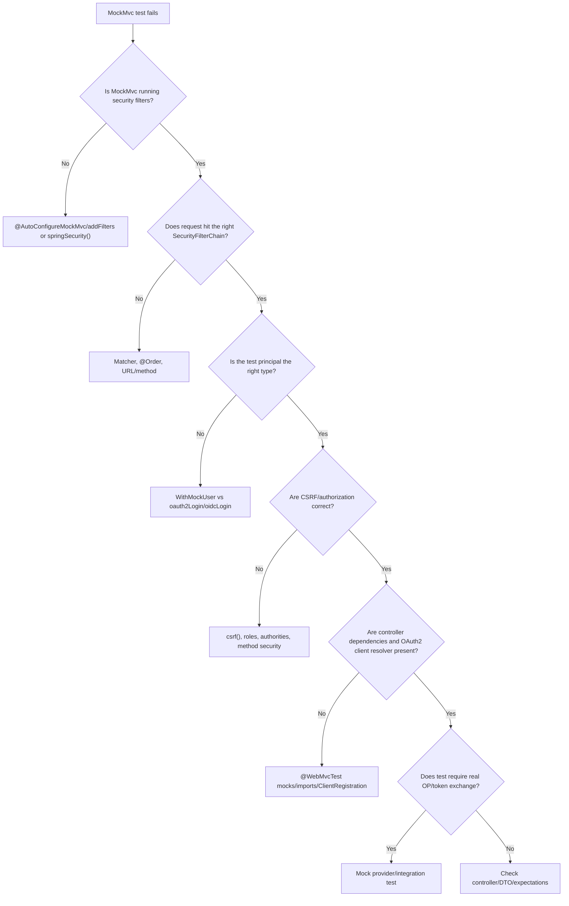

# 29.1. Setting Up spring-security-test and MockMvc

In a **Spring Security OAuth 2.0 / OpenID Connect (OIDC) Client application running on Servlet**, configuring `oauth2Login()`, `oauth2Client()`, `SecurityFilterChain`, and controllers is only half the work. The other half is **testing what the application actually allows or denies**: whether unauthenticated requests are blocked, how the principal after OIDC login is used, whether CSRF is protected, whether access permissions are misconfigured, and whether the controller retrieves the right authorized client to call downstream APIs.

Spring Security provides the **`spring-security-test`** module to build a simulated security context and verify security outcomes. Combined with **Spring MVC Test `MockMvc`**, we can send **simulated HTTP requests through the Servlet filter chain** without starting a real HTTP server.

Example:

```java
mockMvc.perform(get("/account/me")
        .with(oidcLogin()
            .idToken(token -> token.claim("sub", "user-123"))))
    .andExpect(status().isOk())
    .andExpect(jsonPath("$.sub").value("user-123"));
```

This test demonstrates a user authenticated via OIDC in a MockMvc context. It does **not** call an OpenID Provider itself, does not perform an Authorization Code exchange, does not verify a real JWKS, and does not itself prove that `state`/`nonce`/PKCE were handled properly at the callback. Those flows require separate tests with a simulated provider or an appropriate integration environment.

This lesson walks through **setting up `spring-security-test` and MockMvc from scratch**, distinguishing test levels, wiring the security filter chain into MockMvc, creating users/OIDC principals/authorized clients for requests, testing authorization and CSRF, avoiding false positives when disabling filters, handling beans/configuration in Spring Boot, and designing a highly reliable Servlet test suite.

> **Goal:** after this lesson, learners can build a test project that **runs through the application's real security filters** when needed, while still **simulating OAuth2/OIDC identities in a controlled way** to test controllers/services without connecting to an OP on every run.

## 1. Which Layers Need Testing?

A typical OIDC Client application consists of:

```text
Browser
  |
  | GET /orders
  v
Servlet Filter Chain
  |
  +-- Spring Security FilterChainProxy
  |     +-- SecurityContext persistence
  |     +-- CSRF
  |     +-- Authorization
  |     +-- OAuth2 Login filters
  |     +-- Logout
  |
  v
DispatcherServlet
  |
  +-- MVC Controller
  |     +-- @AuthenticationPrincipal
  |     +-- @RegisteredOAuth2AuthorizedClient
  |
  v
Service / WebClient
  |
  | Authorization: Bearer Access Token
  v
Downstream Resource Server
```

Not every test should run this entire chain. A good test suite knows clearly **which layer is under test**.

| Target | Appropriate test type | Tests the HTTP Security Filter Chain? |
|---|---|---|
| Business service computation or DTO mapping | JUnit/Mockito unit test | Not needed. |
| Controller returns correct JSON for `OidcUser` | `@WebMvcTest` + `MockMvc` + `oidcLogin()` | Possibly, if filters are enabled. |
| Endpoint requiring role/authority | `MockMvc` + appropriate security chain/method security | Yes, and filters must not be disabled. |
| Controller receiving `OAuth2AuthorizedClient` | MockMvc + `oauth2Client()` post-processor / resolver configuration | Possibly, depending on the configured layer. |
| Application's real `SecurityFilterChain` | `@SpringBootTest` + `@AutoConfigureMockMvc` | Yes by typical default. |
| Login initiation URL redirects to OP | MockMvc with configured registration provider metadata | Yes for the redirect-issuing request. |
| Authorization Code callback exchanging token with OP | Integration test with mock HTTP provider/appropriate OP | Possibly, but requires additional network simulation. |
| Browser cookies, SameSite, and multiple redirects | Browser/E2E test | MockMvc does not fully simulate a browser. |
| Resource Server verifies real JWT | Separate Resource Server integration test | Not proven by `oidcLogin()` alone. |

### 1.1. What Is MockMvc?

`MockMvc` lets you test Spring MVC request handling through a simulated Servlet environment. Tests build requests with `MockMvcRequestBuilders`, pass them through the MVC infrastructure, and assert results with `ResultMatchers`.

Example:

```java
mockMvc.perform(get("/health"))
    .andExpect(status().isOk())
    .andExpect(content().string("OK"));
```

When Spring Security is present and filters are properly registered, requests also flow through the security chain just like an HTTP request arriving at the application.

### 1.2. MockMvc Is Not WebTestClient

| Criterion | MockMvc | WebTestClient |
|---|---|---|
| Primary stack | Spring MVC/Servlet | Spring WebFlux/Reactive, can also be used with some other server test modes |
| Test client API | `mockMvc.perform(...)` | `webTestClient.get().uri(...).exchange()` |
| Spring Security test helpers | `SecurityMockMvcRequestPostProcessors` | `SecurityMockServerConfigurers` / reactive test helpers |
| Context | Servlet request/session | `ServerWebExchange`/reactive context |
| OIDC request helper | `oidcLogin()` for MockMvc | Appropriate reactive helper for WebFlux |
| Real HTTP server | Not needed | Can bind to controller/context or a server depending on configuration |

This lesson covers **Servlet**, not simply "an application that happens to add a `WebClient` dependency". A project using `spring-boot-starter-web` together with `WebClient` can still be a Servlet server and require MockMvc.

## 2. What Does `spring-security-test` Provide?

The `org.springframework.security:spring-security-test` module contains testing utilities, of which the following are important for MockMvc:

- `SecurityMockMvcConfigurers.springSecurity()`: integrates Spring Security with a manually constructed MockMvc.
- `SecurityMockMvcRequestPostProcessors.user(...)`: creates a simulated user authentication.
- `SecurityMockMvcRequestPostProcessors.anonymous()`: executes an unauthenticated request.
- `SecurityMockMvcRequestPostProcessors.csrf()`: adds a valid CSRF token to the test request.
- `SecurityMockMvcRequestPostProcessors.oauth2Login()`: simulates an authentication from OAuth2 Login.
- `SecurityMockMvcRequestPostProcessors.oidcLogin()`: simulates authentication with an `OidcUser`/ID Token.
- `SecurityMockMvcRequestPostProcessors.oauth2Client(...)`: provides an authorized client for the request in a test.
- `@WithMockUser`: supplies a mock user via the Spring Security Test context listener.
- `@WithUserDetails` and `@WithSecurityContext`: creates authentication from `UserDetails` or a custom security context.
- Matchers and request builders for security/CSRF/logout use cases.

Not every helper runs a real Authorization Server. **Request post-processors** typically place test state directly into the request/security context to focus on the behavior under test.

### 2.1. Do Not Put `spring-security-test` in Production Runtime

This dependency is for testing, not part of production authentication infrastructure. Use test scope:

```gradle
testImplementation("org.springframework.security:spring-security-test")
```

or `<scope>test</scope>` in Maven.

Do not use `implementation` for a test dependency just because a class fails to compile in `src/main/java`. Test helpers belong in `src/test/java` or the corresponding test source set.

## 3. Creating a Spring Boot Servlet Project for Learning

Typical application dependencies:

- Spring Web (Servlet/MVC).
- Spring Security.
- Spring OAuth2 Client.
- Spring Boot Test/JUnit.
- Spring Security Test.

An illustrative project structure:

```text
src/
  main/
    java/com/example/
      Application.java
      config/SecurityConfiguration.java
      web/AccountController.java
      web/OrdersController.java
      service/OrdersApiClient.java
    resources/
      application.yml
  test/
    java/com/example/
      web/AccountControllerWebMvcTest.java
      security/SecurityIntegrationTest.java
      security/OidcLoginMockMvcTest.java
    resources/
      application-test.yml
```

This is an illustrative structure. Package and file names may vary, but keep tests clear and never mix test fixtures with production code.

### 3.1. Prerequisites for Using MockMvc

MockMvc is used with **Spring MVC Servlet**. If a project is primarily WebFlux, use WebTestClient and reactive test helpers instead of copying MockMvc tests.

If a project includes both `spring-boot-starter-web` and `spring-boot-starter-webflux`, verify the actual application type. Do not merely see `reactor.core.publisher.Mono` in a controller and conclude the server is reactive.

## 4. Installing Dependencies with Gradle Kotlin DSL

Example `build.gradle.kts`:

```kotlin
plugins {
    java
    id("org.springframework.boot") version "<spring-boot-version>"
    id("io.spring.dependency-management") version "<dependency-management-version>"
}

java {
    toolchain {
        languageVersion.set(JavaLanguageVersion.of(21))
    }
}

dependencies {
    implementation("org.springframework.boot:spring-boot-starter-web")
    implementation("org.springframework.boot:spring-boot-starter-security")
    implementation("org.springframework.boot:spring-boot-starter-oauth2-client")

    testImplementation("org.springframework.boot:spring-boot-starter-test")
    testImplementation("org.springframework.security:spring-security-test")
}

tasks.test {
    useJUnitPlatform()
}
```

The two version placeholders are left explicit because you must choose a **compatible set of Spring Boot, plugin, and JDK versions** for your project. In a project already configured by Spring Initializr or build management, **do not re-add the `plugins` block** if one already exists; only add the required test dependency.

### 4.1. Why Not Pin the Spring Security Test Version Manually?

If the project uses the Spring Boot BOM/dependency management, you should generally let it manage the versions of:

```text
spring-security-core
spring-security-config
spring-security-web
spring-security-oauth2-client
spring-security-test
```

Avoid adding a `spring-security-test` version that diverges too far from the Spring Security runtime, as APIs/method signatures and test infrastructure may be incompatible.

### 4.2. Where Do JUnit and AssertJ Come From?

`spring-boot-starter-test` normally provides JUnit Jupiter, AssertJ, Mockito, Spring Test, and common testing libraries matching the version in use. The `spring-security-test` module adds security-specific testing support.

There is no need to add `junit-jupiter` separately if the starter/BOM already provides everything required.

### 4.3. If Using Gradle Groovy DSL

`build.gradle`:

```gradle
dependencies {
    implementation 'org.springframework.boot:spring-boot-starter-web'
    implementation 'org.springframework.boot:spring-boot-starter-security'
    implementation 'org.springframework.boot:spring-boot-starter-oauth2-client'

    testImplementation 'org.springframework.boot:spring-boot-starter-test'
    testImplementation 'org.springframework.security:spring-security-test'
}

tasks.named('test') {
    useJUnitPlatform()
}
```

In Gradle Groovy, you can use single or double quotes according to project convention.

## 5. Installing Dependencies with Maven

Example `dependencies` section of `pom.xml`:

```xml
<dependencies>
    <dependency>
        <groupId>org.springframework.boot</groupId>
        <artifactId>spring-boot-starter-web</artifactId>
    </dependency>

    <dependency>
        <groupId>org.springframework.boot</groupId>
        <artifactId>spring-boot-starter-security</artifactId>
    </dependency>

    <dependency>
        <groupId>org.springframework.boot</groupId>
        <artifactId>spring-boot-starter-oauth2-client</artifactId>
    </dependency>

    <dependency>
        <groupId>org.springframework.boot</groupId>
        <artifactId>spring-boot-starter-test</artifactId>
        <scope>test</scope>
    </dependency>

    <dependency>
        <groupId>org.springframework.security</groupId>
        <artifactId>spring-security-test</artifactId>
        <scope>test</scope>
    </dependency>
</dependencies>
```

This snippet assumes the project already has a compatible Spring Boot parent/BOM or dependency management. It is not a complete standalone `pom.xml`.

### 5.1. The Test Classpath Must Have Servlet Security

If importing:

```java
import static org.springframework.security.test.web.servlet.request
    .SecurityMockMvcRequestPostProcessors.oidcLogin;
```

reports symbol not found, check:

- Whether `spring-security-test` is on **`testCompileClasspath`**.
- Whether Maven/Gradle imports aligned Spring Security versions.
- Whether the test source resides in `src/test/java`.
- Whether the IDE has reloaded the Gradle/Maven project.
- Whether the import is the Servlet MockMvc helper, not a WebFlux helper.
- Whether there are any dependency exclusions or version conflicts.

Adding the dependency to the production source set just to clear IDE red underlines addresses the wrong cause.

## 6. Two Strategies for Building MockMvc

There are two common setups.

### 6.1. Spring Boot Auto-Configures MockMvc

Use:

```java
@SpringBootTest
@AutoConfigureMockMvc
class SecurityIntegrationTest {
    @Autowired
    MockMvc mockMvc;
}
```

Spring Boot creates a fairly complete application context and provides `MockMvc` with filters depending on configuration. This is appropriate when you want to run the **application's real `SecurityFilterChain`** in the test context.

Or:

```java
@WebMvcTest(AccountController.class)
class AccountControllerTest {
    @Autowired
    MockMvc mockMvc;
}
```

`@WebMvcTest` creates a smaller MVC test slice that can auto-configure `MockMvc` without loading all services/repositories like `@SpringBootTest`.

### 6.2. Manual Setup with `MockMvcBuilders`

When using a Spring Test context:

```java
import static org.springframework.security.test.web.servlet.setup
    .SecurityMockMvcConfigurers.springSecurity;

import org.junit.jupiter.api.BeforeEach;
import org.springframework.beans.factory.annotation.Autowired;
import org.springframework.web.context.WebApplicationContext;
import org.springframework.test.web.servlet.MockMvc;
import org.springframework.test.web.servlet.setup.MockMvcBuilders;

class ManualMockMvcConfigurationExample {

    @Autowired
    WebApplicationContext context;

    MockMvc mockMvc;

    @BeforeEach
    void setUp() {
        mockMvc = MockMvcBuilders
            .webAppContextSetup(context)
            .apply(springSecurity())
            .build();
    }
}
```

This is an illustrative fragment placed within **a test context that has a `WebApplicationContext`**; a plain JUnit class will not automatically have `context` injected by Spring without the corresponding Spring Test extension/annotations.

The key piece is:

```java
.apply(springSecurity())
```

which integrates `FilterChainProxy`/security test infrastructure and supports test `SecurityContext` handling when building MockMvc manually.

### 6.3. Do Not Build Another MockMvc If a Suitable Bean Already Exists

If `@AutoConfigureMockMvc` already creates and autowires `MockMvc` properly, you normally **do not need to rebuild it** with `MockMvcBuilders`. Creating two `MockMvc` instances with different filter setups can cause one test to pass and another to fail because one instance omitted the security chain.

Pick one primary setup approach per test class and understand clearly which filters are active.

## 7. Why `springSecurity()` Matters When Building MockMvc Manually

When using:

```java
MockMvcBuilders.webAppContextSetup(context)
    .apply(springSecurity())
    .build();
```

the Spring Security Test configurer attaches Spring Security's `FilterChainProxy` and supports request post-processors for the security context.

If you only write:

```java
MockMvcBuilders.standaloneSetup(controller)
    .build();
```

requests can go straight to the controller **without passing through authorization, CSRF, or OAuth2 login filters**.

A test like:

```java
mockMvc.perform(get("/admin"))
    .andExpect(status().isOk());
```

might pass in standalone setup because it **bypassed the filter chain**, while the production application returns 401/302/403. That gives **false confidence** when the goal is testing security.

### 7.1. Standalone Setup Still Has Its Place

`standaloneSetup(controller)` is useful for testing:

- URL mappings.
- JSON serialization/deserialization.
- Validation.
- Controller advice.
- Controller behaviors that do not depend on security filters.

However, **do not use standalone MVC test results as proof that an endpoint is protected by Spring Security**.

If you try to test a controller using `@AuthenticationPrincipal` in standalone setup, you must configure the appropriate argument resolvers/security context; test complexity rises and easily diverges from production. For security tests, `@WebMvcTest`/`@SpringBootTest` with security integration is generally more reliable.

### 7.2. Spring Security Test Does Not Guarantee Every Configuration Automatically

Even when calling `springSecurity()`, you must still:

- Configure `SecurityFilterChain` properly.
- Ensure requests match the intended chain.
- Not disable filters in Boot tests.
- Not mock the security manager/filter chain in a way that bypasses the behavior under test.
- Know whether the controller uses method security.
- Know whether the test principal represents the same `Authentication` type as production.

## 8. How `@WebMvcTest` Differs from `@SpringBootTest`

| Criterion | `@WebMvcTest` | `@SpringBootTest + @AutoConfigureMockMvc` |
|---|---|---|
| Scope | Controller/MVC slice and selected related components | Broader application context |
| Speed | Typically faster | Typically slower |
| Services/repositories | Usually must be mocked/explicitly imported | Can load real beans or stub per test |
| `SecurityFilterChain` | Depends on slice/imports/auto-config | Can run the real application configuration |
| OIDC provider wiring | May lack registrations if sliced narrowly | Needs test configuration to avoid accidental real network discovery |
| Best suited for | Testing endpoints and principal/controller behavior | Testing integrated security routing/wiring |
| Limitation | Does not prove the whole system on its own | Still does not fully simulate a browser/OP |

**Do not write every test with `@SpringBootTest`**, because context startup can be slow, depend on infrastructure, and bloat the test suite. Conversely, do not rely solely on `@WebMvcTest` if the goal is ensuring the application's real security chains/method security are wired properly.

### 8.1. When a Controller Depends on a Service

Example:

```java
@RestController
@RequestMapping("/orders")
public class OrdersController {

    private final OrdersService service;

    public OrdersController(OrdersService service) {
        this.service = service;
    }

    @GetMapping
    public List<OrderSummary> list() {
        return service.list();
    }
}
```

With `@WebMvcTest(OrdersController.class)`, the `OrdersService` bean is usually not loaded automatically. You can use a mock bean in the test:

```java
@MockitoBean
OrdersService service;
```

The annotation name depends on the Spring Boot/Spring Framework version. Modern versions provide `@MockitoBean`; older Boot versions may use `@MockBean`. Use the API matching your project's dependency version; do not arbitrarily mix both annotations.

### 8.2. Do Not Mock the Controller Under Test

If you mock `OrdersController` instead of its service dependency, the test may only verify Mockito stubbing without running real controller logic. In an MVC slice, keep the controller real; mock dependencies outside the slice's scope.

## 9. Starting with a Minimal OIDC Controller

Controller receiving `OidcUser`:

```java
package com.example.web;

import java.util.Map;

import org.springframework.security.core.annotation.AuthenticationPrincipal;
import org.springframework.security.oauth2.core.oidc.user.OidcUser;
import org.springframework.web.bind.annotation.GetMapping;
import org.springframework.web.bind.annotation.RequestMapping;
import org.springframework.web.bind.annotation.RestController;

@RestController
@RequestMapping("/account")
public class AccountController {

    @GetMapping("/me")
    public Map<String, String> me(
            @AuthenticationPrincipal OidcUser principal) {

        return Map.of(
            "sub", principal.getSubject()
        );
    }
}
```

This is a simple use case demonstrating:

- The controller is mapped at `GET /account/me`.
- The controller requires an **OIDC** principal, not just a username string.
- If authentication is missing, the security chain must protect the endpoint.
- Tests can pass a simulated `OidcUser` without calling an OP.

### 9.1. Security Config for the Test Slice

To keep the example independent of production security setup, the test can import a simple configuration requiring authentication and using an HTTP Basic entry point for a **deterministic 401 anonymous response**. This is a test fixture, **not a replacement for production OAuth2 Login configuration**.

```java
package com.example.web;

import org.springframework.boot.test.context.TestConfiguration;
import org.springframework.context.annotation.Bean;
import org.springframework.security.config.Customizer;
import org.springframework.security.config.annotation.web.builders.HttpSecurity;
import org.springframework.security.web.SecurityFilterChain;

@TestConfiguration
public class AccountTestSecurityConfiguration {

    @Bean
    SecurityFilterChain testSecurityFilterChain(HttpSecurity http)
            throws Exception {

        return http
            .authorizeHttpRequests(auth -> auth
                .requestMatchers("/account/me").authenticated()
                .anyRequest().permitAll()
            )
            .httpBasic(Customizer.withDefaults())
            .build();
    }
}
```

**Limitation:** because the test fixture uses HTTP Basic instead of `oauth2Login()`, it only helps verify the **controller and request security context** with consistent results. Testing real OIDC Login configuration requires separate integration tests.

## 10. Testing `@WebMvcTest` with `oidcLogin()`

A test class:

```java
package com.example.web;

import static org.springframework.security.test.web.servlet.request
    .SecurityMockMvcRequestPostProcessors.oidcLogin;
import static org.springframework.test.web.servlet.request
    .MockMvcRequestBuilders.get;
import static org.springframework.test.web.servlet.result
    .MockMvcResultMatchers.jsonPath;
import static org.springframework.test.web.servlet.result
    .MockMvcResultMatchers.status;

import org.junit.jupiter.api.Test;
import org.springframework.beans.factory.annotation.Autowired;
import org.springframework.boot.test.autoconfigure.web.servlet.WebMvcTest;
import org.springframework.context.annotation.Import;
import org.springframework.test.web.servlet.MockMvc;

@WebMvcTest(AccountController.class)
@Import(AccountTestSecurityConfiguration.class)
class AccountControllerWebMvcTest {

    @Autowired
    MockMvc mockMvc;

    @Test
    void oidcUserCanReadOwnSubject() throws Exception {
        mockMvc.perform(get("/account/me")
                .with(oidcLogin()
                    .idToken(token -> token
                        .claim("sub", "user-123"))))
            .andExpect(status().isOk())
            .andExpect(jsonPath("$.sub").value("user-123"));
    }

    @Test
    void anonymousCannotReadAccount() throws Exception {
        mockMvc.perform(get("/account/me"))
            .andExpect(status().isUnauthorized());
    }
}
```

In this snippet:

1. `@WebMvcTest(AccountController.class)` creates an MVC slice for the controller.
2. `@Import(...)` ensures the test uses the fixture's dedicated security chain.
3. `@Autowired MockMvc` obtains the Boot-configured MockMvc.
4. `oidcLogin()` creates an authentication with an `OidcUser` for the request.
5. `@AuthenticationPrincipal` receives the principal and the controller returns JSON `sub`.
6. The anonymous request receives **401** because the test fixture enables `httpBasic()` and requires authentication.

If you replace the security fixture with production `oauth2Login()`, an anonymous request may be **redirected to the login page/OP** instead of receiving 401. Do not assert 401 for every endpoint without considering the authentication entry point.

### 10.1. Why Is `oidcLogin()` Useful?

It lets you create a principal with **OIDC claims** such as `sub`, `email`, and `name` without having to:

- Open a real browser.
- Start an OpenID Provider.
- Issue a real authorization code.
- Call a token endpoint.
- Sign a real ID Token or fetch JWKS.

This keeps controller tests fast, deterministic, and runnable offline.

### 10.2. Why Not Use `@WithMockUser` for the Controller Above?

`@WithMockUser` normally creates a username/password-style authentication for tests, not an `OAuth2AuthenticationToken` with an `OidcUser`.

If the controller declares:

```java
@AuthenticationPrincipal OidcUser principal
```

then `@WithMockUser` alone **does not guarantee** Spring MVC injects an `OidcUser`; the injection may become `null` or fail type matching depending on resolvers/config.

When testing code that reads OIDC claims, prefer `oidcLogin()` or a custom security context that creates the matching authentication type.

## 11. When Is `@WithMockUser` Appropriate?

Example of an endpoint that only needs to know the user is logged in:

```java
@GetMapping("/hello")
public String hello(Authentication authentication) {
    return "Hello " + authentication.getName();
}
```

Test:

```java
import org.springframework.security.test.context.support.WithMockUser;

@Test
@WithMockUser(username = "alice")
void returnsAuthenticatedName() throws Exception {
    mockMvc.perform(get("/hello"))
        .andExpect(status().isOk())
        .andExpect(content().string("Hello alice"));
}
```

`@WithMockUser` is convenient for testing rules such as:

- `authenticated()`.
- `hasRole(...)`.
- `hasAuthority(...)`.
- Controllers that only need `Authentication.getName()`.
- Method security that does not directly depend on OIDC claim structure.

### 11.1. `roles` and `authorities`

Example:

```java
@WithMockUser(username = "admin", roles = "ADMIN")
```

normally creates the `ROLE_ADMIN` authority. When checking:

```java
hasRole("ADMIN")
```

Spring Security applies the role prefix by convention.

Conversely:

```java
@WithMockUser(
    username = "api-reader",
    authorities = "orders:read"
)
```

grants the exact `orders:read` authority.

**`ROLE_ADMIN`, `orders:read`, and `SCOPE_orders.read` are not the same string.** Tests must match the application's actual authority model.

### 11.2. `@WithMockUser` Does Not Simulate End-to-End OAuth2 Login

This test does not prove that:

- The OIDC ID Token was verified.
- Issuer/audience/nonce are valid.
- The UserInfo endpoint was called.
- OAuth2 authorities mapping works.
- The authorized client was saved under the right registration/principal.
- The Authorization Code Flow has PKCE/state protection.

It only provides simulated authentication for the layer under test.

## 12. Using `oauth2Login()` When OIDC Is Not Needed

Spring Security OAuth2 Login can work with a non-OIDC OAuth2 provider. In tests, you can use:

```java
import static org.springframework.security.test.web.servlet.request
    .SecurityMockMvcRequestPostProcessors.oauth2Login;

mockMvc.perform(get("/profile")
        .with(oauth2Login()
            .attributes(attributes ->
                attributes.put("name", "Alice"))))
    .andExpect(status().isOk());
```

Differences:

| Helper | Typical principal | Used for |
|---|---|---|
| `user("alice")` | Spring Security `UserDetails` | Username/role-centric tests. |
| `@WithMockUser` | Mock username/password authentication | Simple security rules. |
| `oauth2Login()` | `OAuth2User`/OAuth2 authentication | OAuth2 Login without requiring an OIDC user. |
| `oidcLogin()` | `OidcUser`/OAuth2 authentication | OIDC Login and ID Token/UserInfo claims. |
| `oauth2Client("registrationId")` | Authorized client association | Controllers/filters needing an OAuth2 client token. |

### 12.1. Do Not Blindly Replace `oauth2Login()` with `oidcLogin()`

If the production provider returns OAuth2 user attributes without issuing an ID Token, a test using `oidcLogin()` can **simulate OIDC capabilities that the real provider does not have**.

Choose the helper based on the application's **actual protocol and principal type**.

### 12.2. The Same User Can Have Multiple Authorized Clients

`oidcLogin()` only handles the simulated authentication. An application may need an Access Token for a different registration. In that case, test `OAuth2AuthorizedClient`/repository/manager according to the use case, rather than assuming an OIDC principal automatically implies tokens for every registration.

## 13. Configuring Claims with `oidcLogin()`

When a controller reads additional claims:

```java
@GetMapping("/account/profile")
public Map<String, String> profile(
        @AuthenticationPrincipal OidcUser user) {

    return Map.of(
        "subject", user.getSubject(),
        "email", user.getEmail() == null ? "" : user.getEmail()
    );
}
```

Test:

```java
@Test
void exposesApprovedProfileFields() throws Exception {
    mockMvc.perform(get("/account/profile")
            .with(oidcLogin()
                .idToken(token -> token
                    .claim("sub", "subject-42")
                    .claim("email", "alice@example.org")
                    .claim("email_verified", true))))
        .andExpect(status().isOk())
        .andExpect(jsonPath("$.subject").value("subject-42"))
        .andExpect(jsonPath("$.email").value("alice@example.org"));
}
```

Explanation:

- `idToken(...)` customizes claims inside the test's **simulated ID Token**.
- `sub` lets the controller look up the user identifier.
- `email` is just a claim; it should not be used as an immutable identity key unless the application has an explicit policy for it.
- `email_verified` in a mock is test-supplied data, not proof that an OP verified it.

### 13.1. Missing-Claim Test Cases

An application may encounter an ID Token without `email` or other optional claims. Tests should verify the fallback behavior of controllers/services.

Example:

```java
mockMvc.perform(get("/account/profile")
        .with(oidcLogin()
            .idToken(token -> token
                .claim("sub", "subject-without-email"))))
    .andExpect(status().isOk())
    .andExpect(jsonPath("$.email").value(""));
```

**Never assume every OP provides `email`** merely because the `email` scope was requested. Provider/consent/policy determines actual claims.

### 13.2. Testing Authorities from OIDC

Authorities can be specified explicitly:

```java
import org.springframework.security.core.authority.SimpleGrantedAuthority;

mockMvc.perform(get("/reports")
        .with(oidcLogin()
            .authorities(
                new SimpleGrantedAuthority("ROLE_REPORT_VIEWER")
            )))
    .andExpect(status().isOk());
```

This test checks behavior **once authentication already carries that authority**. It does **not** verify how authorities are mapped from ID Token/UserInfo claims.

To test real mapping, write unit/integration tests against the application's `GrantedAuthoritiesMapper`, `OidcUserService`, or custom authentication converter.

## 14. `oauth2Client()`: Mocking an Authorized Client by Registration

In OAuth2 Client, an authorized client represents **a `ClientRegistration` that has been granted an Access Token** in the context of a principal.

Test helper:

```java
import static org.springframework.security.test.web.servlet.request
    .SecurityMockMvcRequestPostProcessors.oauth2Client;

mockMvc.perform(get("/api/orders")
        .with(oauth2Client("company")))
    .andExpect(status().isOk());
```

This is a syntactic example. For the request to actually be authenticated and reach the controller, you may need to **combine authentication** (for example `oidcLogin()`) with an appropriate security chain:

```java
mockMvc.perform(get("/api/orders")
        .with(oidcLogin())
        .with(oauth2Client("company")))
    .andExpect(status().isOk());
```

### 14.1. Difference Between `oidcLogin()` and `oauth2Client()`

| Helper | Primary simulated data | Purpose |
|---|---|---|
| `oidcLogin()` | `Authentication` with `OidcUser`/ID Token claims | Controller/security sees a logged-in OIDC user. |
| `oauth2Client("company")` | `OAuth2AuthorizedClient` for registration `company` | Lets authorized-client resolution logic use a test token. |

A logged-in user **does not inherently possess an authorized client for every registration**; similarly, an authorized client in a store **does not automatically establish an authenticated browser session** in every scenario.

### 14.2. A Simulated Access Token Is Not a Real Token

A test creating a fixed Access Token:

```java
import java.time.Instant;
import java.util.Set;

import org.springframework.security.oauth2.core.OAuth2AccessToken;

OAuth2AccessToken token = new OAuth2AccessToken(
    OAuth2AccessToken.TokenType.BEARER,
    "test-access-token",
    Instant.parse("2030-01-01T00:00:00Z"),
    Instant.parse("2030-01-01T01:00:00Z"),
    Set.of("orders.read")
);
```

The value `test-access-token` is for tests only. Never use production tokens/Refresh Tokens as fixtures; test logs, CI, and reports are not places to store real credentials.

With the version-appropriate post-processor:

```java
mockMvc.perform(get("/api/orders")
        .with(oidcLogin())
        .with(oauth2Client("company")
            .accessToken(token)))
    .andExpect(status().isOk());
```

A simulated Access Token **is not checked by Spring Security for signature/audience** when you inject the authorized client directly into the request. That is a property of test fixtures, not proof that the Resource Server will accept the token.

### 14.3. Principal Name in the Authorized Client

If a controller/service looks up tokens by `principalName`, tests must align:

- Request authentication.
- `OAuth2AuthorizedClient.getPrincipalName()`.
- Registration ID.
- The repository/manager in use.

A mismatch between the `oidcLogin()` principal and the mocked authorized client can indicate a test setup error or a bug in identity mapping logic. Never work around it by letting a service grab "the first token in the store".

## 15. `@RegisteredOAuth2AuthorizedClient` in an MVC Controller

Example controller receiving an authorized client:

```java
package com.example.web;

import java.util.Map;

import org.springframework.security.oauth2.client.OAuth2AuthorizedClient;
import org.springframework.security.oauth2.client.annotation.RegisteredOAuth2AuthorizedClient;
import org.springframework.web.bind.annotation.GetMapping;
import org.springframework.web.bind.annotation.RestController;

@RestController
public class AuthorizedClientController {

    @GetMapping("/client/registration")
    public Map<String, String> registration(
            @RegisteredOAuth2AuthorizedClient("company")
            OAuth2AuthorizedClient client) {

        return Map.of(
            "registrationId",
            client.getClientRegistration().getRegistrationId()
        );
    }
}
```

Test:

```java
@Test
void resolvesAuthorizedClientForRequestedRegistration() throws Exception {
    mockMvc.perform(get("/client/registration")
            .with(oidcLogin())
            .with(oauth2Client("company")))
        .andExpect(status().isOk())
        .andExpect(jsonPath("$.registrationId")
            .value("company"));
}
```

This test is only meaningful when the MVC test context includes the necessary **argument resolver/authorized-client infrastructure** and the helper hooks into the proper repository mechanism. If `@WebMvcTest` strips out the needed OAuth2 Client beans, **import/test-configure the missing components**, or use `@SpringBootTest` for that use case.

### 15.1. Do Not Just Mock a Bean and Assume You Tested the Resolver

If you test the controller as a direct Java method call:

```java
controller.registration(fakeAuthorizedClient);
```

you can check body mapping, but **you do not test** Spring MVC's argument resolution of `@RegisteredOAuth2AuthorizedClient`.

To test MVC integration, requests must flow through `MockMvc` with the corresponding argument resolver/security infrastructure.

### 15.2. Use the Correct Registration ID

`company` in:

```java
@RegisteredOAuth2AuthorizedClient("company")
```

is the **client registration ID**, not the issuer URL, provider key, or `client_id`.

Tests should include wrong or missing registration cases to prevent dangerous fallbacks to another authorized client, especially in applications with multiple OIDC providers.

### 15.3. Do Not Return Raw Tokens Just to Assert in Tests

A production endpoint should not do:

```java
return client.getAccessToken().getTokenValue();
```

solely so tests can identify which token was chosen. Use safe metadata or mock the outbound HTTP client and inspect the `Authorization: Bearer` header at the test boundary; **do not expose tokens to the browser**.

## 16. Testing POST and CSRF Protection

One area where `spring-security-test` provides clear value is `csrf()`.

Suppose there is an endpoint:

```java
@PostMapping("/account/preferences")
public ResponseEntity<Void> savePreferences(
        @RequestBody PreferencesRequest request) {

    preferencesService.save(request);
    return ResponseEntity.noContent().build();
}
```

If the security chain enables CSRF protection and the browser uses cookie sessions, a POST request without a valid CSRF token is normally rejected.

Test without CSRF:

```java
@Test
void postWithoutCsrfIsForbidden() throws Exception {
    mockMvc.perform(post("/account/preferences")
            .with(oidcLogin())
            .contentType(MediaType.APPLICATION_JSON)
            .content("{\"theme\":\"dark\"}"))
        .andExpect(status().isForbidden());
}
```

Test with valid CSRF:

```java
@Test
void postWithCsrfCanReachController() throws Exception {
    mockMvc.perform(post("/account/preferences")
            .with(oidcLogin())
            .with(csrf())
            .contentType(MediaType.APPLICATION_JSON)
            .content("{\"theme\":\"dark\"}"))
        .andExpect(status().isNoContent());
}
```

For the example to compile, the test class needs the static imports for `post`, `status`, `csrf`, and `MediaType`. Also, `PreferencesRequest` and `preferencesService` require corresponding fixtures/beans or mocks.

### 16.1. Invalid CSRF Token

```java
mockMvc.perform(post("/account/preferences")
        .with(oidcLogin())
        .with(csrf().useInvalidToken())
        .contentType(MediaType.APPLICATION_JSON)
        .content("{\"theme\":\"dark\"}"))
    .andExpect(status().isForbidden());
```

This tests a request that includes a token, but an **invalid** one.

### 16.2. Authentication and CSRF Are Two Independent Conditions

An authenticated user is not exempt from CSRF on unsafe methods merely because they logged in via OIDC.

Therefore:

```java
.with(oidcLogin())
```

does not replace:

```java
.with(csrf())
```

When a POST test fails with 403, distinguish **missing CSRF** from **missing authority**. Never disable CSRF just to make a test pass.

### 16.3. If an API Is Configured as Stateless Bearer

A Resource Server API receiving a Bearer token in the `Authorization` header may have a different CSRF policy than browser endpoints using session cookies. Tests must reflect the real security chain.

Do not mechanically apply `csrf()` to every endpoint or disable it app-wide to avoid separating browser and API security.

## 17. Testing Authorization: Anonymous, Authenticated, Admin

A policy:

```java
http.authorizeHttpRequests(auth -> auth
    .requestMatchers("/public/**").permitAll()
    .requestMatchers("/admin/**").hasRole("ADMIN")
    .anyRequest().authenticated()
);
```

Cases to verify:

| Request | Principal | Expected result |
|---|---|---|
| `GET /public/info` | Anonymous | Allowed per policy. |
| `GET /account/me` | Anonymous | Requires authentication. |
| `GET /account/me` | Valid OIDC user | Allowed if the endpoint requires no extra permissions. |
| `GET /admin/report` | OIDC user without `ROLE_ADMIN` | 403 or appropriate access-denied behavior. |
| `GET /admin/report` | User with `ROLE_ADMIN` | Passes filter; outcome depends on controller/service. |

Test lacking authority:

```java
mockMvc.perform(get("/admin/report")
        .with(oidcLogin()))
    .andExpect(status().isForbidden());
```

Test with sufficient authority:

```java
mockMvc.perform(get("/admin/report")
        .with(oidcLogin()
            .authorities(
                new SimpleGrantedAuthority("ROLE_ADMIN")
            )))
    .andExpect(status().isOk());
```

Status 200 assertions only hold if the fixture-backed controller/service returns success. For other endpoints, assert the appropriate response rather than hardcoding 200.

### 17.1. Do Not Implicitly Treat OIDC `scope` as a Spring Authority

An ID Token carries claims and an Access Token carries scopes, but **OAuth2 Login principal authorities** depend on the provider/user service/mapper.

In a test, writing:

```java
.authorities(new SimpleGrantedAuthority("ROLE_ADMIN"))
```

**explicitly grants a test authority**; it does not test role mapping from OP claims. To test mapping, run the real mapper logic and supply corresponding token/UserInfo claims.

### 17.2. Test Denied Cases as Well

A suite that only checks that admins can get in without checking that regular users are blocked can miss a `permitAll()` misconfiguration or an overly broad matcher.

Include negative cases for sensitive endpoints, especially when `SecurityFilterChain` has multiple matchers or chain ordering.

## 18. Method Security and MVC Filters

Spring Security can enforce protection at two layers:

1. Request authorization in `HttpSecurity.authorizeHttpRequests(...)`.
2. Method authorization via `@PreAuthorize`/`@PostAuthorize` when method security is enabled.

Example service:

```java
@Service
public class ReportService {

    @PreAuthorize("hasAuthority('report:export')")
    public byte[] export() {
        return new byte[0];
    }
}
```

For `@PreAuthorize` to take effect in a Servlet app, appropriate method security configuration—usually `@EnableMethodSecurity` in the right place—is required.

### 18.1. Slice Tests May Not Activate Real Method Security

`@WebMvcTest` trims the application context. If `ReportService` is mocked, controller tests may not execute `@PreAuthorize` placed on the real service method.

If the goal is testing **method security integration**:

- Ensure method security is enabled in the test context.
- Ensure the method under test goes through a Spring proxy.
- Do not mock the class/method whose annotations you need to verify.
- Use `@SpringBootTest` or a focused test configuration for method security when needed.
- Test both allowed and denied cases.

A unit test calling `new ReportService().export()` directly also does not prove `@PreAuthorize` was applied by Spring AOP.

### 18.2. RequestMatchers and Method Security Complement Each Other

Request matchers can restrict endpoints by URL/method. Method security checks permissions at the service layer. Both layers should be consistent, though not identical in scope.

MockMvc can test both when the context/proxies are properly wired; if a test only imports the controller and mocks the service, it mainly tests the HTTP layer.

## 19. `@SpringBootTest` and `@AutoConfigureMockMvc`

An integration test typically looks like:

```java
import org.junit.jupiter.api.Test;
import org.springframework.beans.factory.annotation.Autowired;
import org.springframework.boot.test.autoconfigure.web.servlet.AutoConfigureMockMvc;
import org.springframework.boot.test.context.SpringBootTest;
import org.springframework.test.web.servlet.MockMvc;

@SpringBootTest
@AutoConfigureMockMvc
class OAuth2SecurityIntegrationTest {

    @Autowired
    MockMvc mockMvc;

    @Test
    void protectedPageRejectsAnonymousRequest() throws Exception {
        // Specific assertion depends on entry point:
        // HTTP Basic typically 401, oauth2Login typically redirects.
    }
}
```

This is a skeleton illustrating the annotations. `@SpringBootTest` loads a broader application context; tests may need to mock downstream services, databases, or provide dedicated configuration to avoid real dependencies.

### 19.1. MockMvc Does Not Start a Real HTTP Server

`@SpringBootTest` by default can run a mock Servlet context web environment. `@AutoConfigureMockMvc` creates `MockMvc` and registers the appropriate filters.

If the goal is testing a browser/TLS reverse proxy, real server `Set-Cookie` behavior, or cross-site redirects, you need a **different test layer**. MockMvc is useful, but it does not replace E2E/browser tests.

### 19.2. `addFilters=false` Is a Trap

Example:

```java
@AutoConfigureMockMvc(addFilters = false)
```

prevents filters from being registered with MockMvc under this option. If the goal is testing Spring Security, this can make tests pass even though production rejects the request.

Only use `addFilters=false` when **intentionally testing a controller in isolation from security**, and do not call those results a security integration test.

### 19.3. Context Loading and External Dependencies

If the production application configures `issuer-uri`, causing Spring Security to fetch discovery metadata at startup, `@SpringBootTest` can become dependent on the network/OP.

Maintain a **test profile/configuration using simulated endpoints or explicitly specified provider metadata**, rather than calling the production OP on every test run.

## 20. Configuring `ClientRegistration` in the Test Environment

An OIDC client is commonly configured as:

```yaml
spring:
  security:
    oauth2:
      client:
        registration:
          company:
            provider: company-oidc
            client-id: ${OIDC_CLIENT_ID}
            client-secret: ${OIDC_CLIENT_SECRET}
            authorization-grant-type: authorization_code
            redirect-uri: "{baseUrl}/login/oauth2/code/{registrationId}"
            scope:
              - openid
              - profile
        provider:
          company-oidc:
            issuer-uri: https://id.company.example/realms/main
```

If you are only testing controller/authorization rules, real discovery metadata is unnecessary. For integration tests, you can provide a test `ClientRegistrationRepository` bean or configure test provider endpoints explicitly.

### 20.1. Test Profile with Simulated Endpoints

Example `application-test.yml`:

```yaml
spring:
  security:
    oauth2:
      client:
        registration:
          company:
            provider: test-company
            client-id: test-client
            client-secret: test-secret
            client-authentication-method: client_secret_basic
            authorization-grant-type: authorization_code
            redirect-uri: "{baseUrl}/login/oauth2/code/{registrationId}"
            scope: [openid, profile]
        provider:
          test-company:
            authorization-uri: https://id.example.test/authorize
            token-uri: https://id.example.test/token
            jwk-set-uri: https://id.example.test/jwks
            user-info-uri: https://id.example.test/userinfo
            user-name-attribute: sub
```

Avoid configuring `issuer-uri` on the example test provider to prevent **Spring from performing automatic discovery against that issuer**, while noting that if the default `application.yml` still declares an issuer under the same key, profile merging may preserve the old value. Make sure the test profile **actually overrides** production registration/provider settings or use a test bean override.

### 20.2. This Is a Fixture, Not a Running OP

The `id.example.test` domain is just an illustrative endpoint with no real server behind it. Tests can verify that the **RP constructs the redirect URL** without hitting that endpoint.

To test callbacks/token exchange/JWKS, you must stand up a **stub HTTP server** or simulated provider capable of receiving requests and returning valid metadata/tokens/JWKS. Merely declaring a test URL **does not mean** network requests will succeed.

### 20.3. Do Not Put Real Client Secrets in Tests

`test-secret` is a fixture string. Never use production secrets or real user tokens in:

- Test sources.
- CI environments.
- Snapshots/reports.
- HTTP request recordings.
- Logs/traces.
- Mock responses.

An offline test should use synthetic data and dedicated test keys/certificates when JWT signing is needed.

## 21. Testing the OAuth2 Login Initiation Endpoint

With registration `company` and `oauth2Login()` configured, Spring Security Servlet normally exposes the default authorization request endpoint:

```text
GET /oauth2/authorization/company
```

Test:

```java
import static org.hamcrest.Matchers.startsWith;
import static org.springframework.test.web.servlet.request.MockMvcRequestBuilders.get;
import static org.springframework.test.web.servlet.result.MockMvcResultMatchers.header;
import static org.springframework.test.web.servlet.result.MockMvcResultMatchers.status;

@Test
void startLoginRedirectsToApprovedAuthorizationEndpoint()
        throws Exception {

    mockMvc.perform(get("/oauth2/authorization/company"))
        .andExpect(status().is3xxRedirection())
        .andExpect(header().string(
            "Location",
            startsWith("https://id.example.test/authorize")
        ));
}
```

When the test uses the test registration and real security chain, this assertion can prove the RP **initiates an authorization request and redirects to the configured authorization URI**.

### 21.1. What Else Should Be Checked in the Authorization URL?

A test focused on OAuth2 Login can parse `Location` to verify:

- `response_type=code`.
- `client_id` matches the registration.
- `redirect_uri` matches the callback.
- `scope` contains the expected scopes.
- `state` is present, non-empty, and randomized across flows.
- `code_challenge`/`code_challenge_method` when PKCE is required.
- `nonce` when required by the OIDC flow/configuration.

Do not hardcode a specific `state` value, since the framework generates a random value per flow. When asserting `Location`, parse encoded query parameters rather than comparing the entire URL string if parameter ordering is unstable.

### 21.2. Testing the Redirect Does Not Prove Callback Completion

A valid redirect does not prove that:

- The OP will accept the client ID/redirect URI.
- An authorization code is issued.
- The token endpoint can exchange the code.
- The ID Token signature/issuer/nonce are valid.
- The authorized client is saved.
- Session fixation protection runs.

Those aspects require deeper integration tests.

## 22. Mocking the Authorization Code Callback: Limitations and Options

The Servlet callback is typically:

```text
GET /login/oauth2/code/{registrationId}?code=...&state=...
```

To genuinely test the callback, you cannot simply call:

```java
mockMvc.perform(get("/login/oauth2/code/company")
    .param("code", "fake")
    .param("state", "fake"));
```

and expect login to succeed. Spring Security requires the **corresponding saved authorization request**, a valid state, a proper token endpoint response, and OIDC verification.

### 22.1. Two Separate Test Layers

**Layer 1 — controller/security rule tests:** use `oidcLogin()` to simulate authentication **after login has already succeeded**.

**Layer 2 — OAuth2 Login flow tests:** use a test OP/stub endpoints with real session/state to walk through authorization redirect, callback, token exchange, JWKS, and OIDC validation.

Do not conflate the two goals and claim an `oidcLogin()` test has "tested the entire OAuth2 callback".

### 22.2. Role of WireMock/MockWebServer or a Test OP

A simulated server bound to loopback/localhost dedicated to testing can:

- Return test OIDC metadata.
- Provide authorization/token/JWKS endpoints.
- Issue an authorization response/code following the test flow.
- Return an ID Token signed with a test key.
- Simulate `invalid_grant`, timeouts, and `invalid_client` errors.

Because these libraries are not mandatory dependencies for **setting up `spring-security-test` + MockMvc**, this lesson does not assume a specific mock server is pre-installed. When building full integration tests, choose a library and version compatible with your stack.

### 22.3. Browser Behavior Still Needs E2E

MockMvc does not fully simulate:

- SameSite cookie policies across OP/RP origins.
- Browser history/back/forward.
- Third-party cookies/tracking protection.
- Cross-site form POSTs.
- Real TLS/reverse proxy chains.
- Browser JavaScript auto-login and redirect loops.

That is why **browser E2E** complements rather than replaces MockMvc integration tests.

## 23. Testing Authorized Clients with `OAuth2AuthorizedClientService`

In applications using service-backed persistence, `OAuth2AuthorizedClientService` stores authorized clients keyed by:

```text
(clientRegistrationId, principalName)
```

MockMvc provides `oauth2Client(...)` to populate an authorized client for the request via its test mechanism. However, when business logic calls the **service directly**, tests may need to **mock or populate `OAuth2AuthorizedClientService` itself** in the way the application uses it.

### 23.1. Choosing the Layer Under Test

| Controller/service activity | Where should you mock? |
|---|---|
| Controller receiving `@RegisteredOAuth2AuthorizedClient` | Request post-processor, resolver/repository integration. |
| Service calling `authorizedClientService.loadAuthorizedClient(...)` | Mock/fake service or test database. |
| WebClient OAuth2 filter selecting a registration | Manager/repository or authorized client request attribute. |
| Token refresh grant | Stub token endpoint + manager/provider. |
| DB persistence/encryption | Dedicated repository/service integration test. |

Do not try to use `oauth2Client(...)` in place of every persistence test. It sets up test request state; it does not prove database save/read, refresh rotation, or KMS encryption.

### 23.2. Do Not Use Real Production Tokens

Tests of token reuse should use fake values and verify **the token is attached to the right downstream request** at an HTTP stub boundary. Never return Access Tokens/Refresh Tokens from a controller just to make test assertions easier.

## 24. Verifying the Right User and Tenant

For multi-provider/multi-tenant applications, include tests for:

| Case | Expectation |
|---|---|
| Tenant alpha + logged-in alpha user | Allows only alpha endpoints. |
| Tenant beta + alpha user | Denies cross-tenant access. |
| Same email across two different issuers | Does not default to the same internal account. |
| Registrations `company` and `partner` | Does not use one provider's token for the other provider's API. |
| User missing linked provider authorization | Does not fall back to a machine token. |
| Principal key differs from saved authorized client | Does not fetch another user's token. |

`oidcLogin()` can simulate claims/authorities to check controller-side policy; however, account linking/tenant membership **must execute through real business security logic** at the appropriate test level.

### 24.1. `sub` Is Not Unique Across Issuers

OIDC identity is typically identified by the pair:

```text
(issuer, subject)
```

If you only mock `sub` while the controller also relies on the issuer, tests should supply matching OIDC claims/provider context or a custom fixture. Never use an unverified email as a long-term identity key.

### 24.2. Mocking a Role Does Not Prove Real Mapping

Testing:

```java
.with(oidcLogin()
    .authorities(new SimpleGrantedAuthority("ROLE_TENANT_ADMIN")))
```

verifies policy when the authority already exists; it **does not test** the logic that derives authorities from tenant membership/provider claims. Test the mapper/authorization service separately.

## 25. `SecurityFilterChain` Matchers: Avoiding False Positives

An application may have two chains:

```text
/api/** -> API security
/**     -> browser OIDC Login
```

If a test sends `GET /api/orders` while you expect browser OIDC chain behavior, the outcome may be misleading.

Factors to check:

- `@Order` on `SecurityFilterChain` beans.
- Each chain's `securityMatcher(...)`.
- `requestMatchers(...)` inside authorization rules.
- Whether login initiation/callback URLs fall inside the right chain.
- Dispatcher type and error/forward requests if used.
- CSRF policy differences between browser and API.
- Entry point: redirect/401/403 per chain.

### 25.1. Test Against Real URLs

Do not test `/orders` if the production endpoint is `/api/v1/orders` and the two paths traverse different chains. Use the actual URL, method, content-type, and headers representing real requests.

### 25.2. 401, 302, and 403 Assertions Mean Different Things

| Status | Typical meaning | Scenario |
|---|---|---|
| `401 Unauthorized` | Missing or invalid authentication per the configured entry point. | API/basic/bearer authentication. |
| `302/303 Redirect` | Browser login entry point redirects. | OAuth2 login for an unauthenticated user. |
| `403 Forbidden` | Authenticated but lacking permission, or rejected by CSRF/security condition. | Authorization/CSRF failures. |
| `200/204` | Request passed security and business logic succeeded. | Controller/service returned a valid result. |

Do not assert 401 as the universal default for every endpoint simply because no user is present. With `oauth2Login()` browser flow, Spring Security usually redirects to the login entry point.

## 26. Request Post-Processors to Remember

Common patterns:

```java
// UserDetails authentication:
mockMvc.perform(get("/me")
    .with(user("alice").roles("USER")));

// OIDC authentication:
mockMvc.perform(get("/me")
    .with(oidcLogin()));

// OAuth2 (not necessarily OIDC) authentication:
mockMvc.perform(get("/me")
    .with(oauth2Login()));

// Authorized client for a specific registration:
mockMvc.perform(get("/client")
    .with(oidcLogin())
    .with(oauth2Client("company")));

// POST with CSRF token:
mockMvc.perform(post("/save")
    .with(oidcLogin())
    .with(csrf()));

// Anonymous request:
mockMvc.perform(get("/public")
    .with(anonymous()));
```

Imports usually come from:

```java
import static org.springframework.security.test.web.servlet.request
    .SecurityMockMvcRequestPostProcessors.*;
import static org.springframework.test.web.servlet.request
    .MockMvcRequestBuilders.*;
import static org.springframework.test.web.servlet.result
    .MockMvcResultMatchers.*;
```

In strict production/test codebases, prefer **explicit static imports** over wildcards so readers can immediately see which helpers are used. The fragments above illustrate the syntax and require an appropriate security context/route fixture.

### 26.1. Do Not Treat Arbitrary Claims as Proof of Authentication

A unit/mock test accepts whatever claims you pass in. Only tests exercising real OP/ID Token validation flows prove the application rejects forged tokens, wrong issuers, or invalid signatures.

### 26.2. Test Negative Authentication Cases

Alongside `oidcLogin()` for happy paths, test:

- Anonymous requests to protected routes.
- Valid authentication type missing the required role.
- OIDC principal missing optional claims.
- Wrong tenant or registration.
- Missing/invalid CSRF token.
- Service/API returning 401/403 for BFF handling.
- Session losing access after logout.

## 27. `@WithUserDetails` and Custom Security Contexts

When an application needs to mock a user from `UserDetailsService`:

```java
@WithUserDetails(
    value = "alice",
    userDetailsServiceBeanName = "testUserDetailsService"
)
```

This annotation loads `UserDetails` from the service in the test context and sets the corresponding authentication.

However, this still **does not create an `OidcUser`**. For applications whose controllers/services depend on a provider-specific principal, you can write a custom `@WithSecurityContext` annotation to build the exact authentication type.

### 27.1. When Should You Write a Custom `@WithSecurityContext`?

It can be helpful when many tests share the same complex OIDC principal:

```text
@WithCompanyOidcUser(
    subject = "user-42",
    tenant = "alpha",
    roles = {"REPORT_VIEWER"}
)
```

The factory for that annotation must create a valid `SecurityContext`, authentication, and authorities following test policy.

However, if you only need an OIDC principal in a MockMvc request, `oidcLogin()` is usually **simpler and clearer**.

### 27.2. Avoid a "God Fixture" That Grants Every Permission

A helper that always grants `ROLE_ADMIN`, every scope, and every tenant makes happy-path tests pass too easily, masking authorization bugs. Choose the **minimum privilege** for each scenario.

## 28. Testing Logout in Servlet

Local logout typically involves:

```text
POST /logout + CSRF token + session cookie
```

A test can use the request builder:

```java
import static org.springframework.security.test.web.servlet.request
    .SecurityMockMvcRequestBuilders.logout;

mockMvc.perform(logout())
    .andExpect(status().is3xxRedirection());
```

The exact redirect target depends on the application's logout success handler. If the application uses **OIDC RP-Initiated Logout**, the redirect may point to the OP's `end_session_endpoint`; do not hardcode a local success URL when real policy does not use it.

### 28.1. Which Test Checks Real Logout?

To verify the session is invalidated:

1. Start from a request authenticated via a flow with a real session.
2. Retain the `MockHttpSession`/session cookie within the same test flow.
3. Send logout with the proper method/CSRF.
4. Send a protected request after logout using the old session.
5. Verify the authentication is no longer accepted.

Do not attach the `oidcLogin()` post-processor on **every request** and conclude logout failed. If the post-logout request also adds `.with(oidcLogin())`, you have **explicitly re-authenticated** that request.

### 28.2. Session Fixation Tests Differ from OIDC Principal Tests

`oidcLogin()` can bypass the authentication-success lifecycle of the OAuth2 Login filter. Therefore it is **not sufficient** to verify `changeSessionId()` after a real callback.

To test session fixation, you need an authentication path that actually triggers the session authentication strategy and compares session IDs before/after in the test flow, or appropriate integration/browser tests.

## 29. How to Avoid Calling a Real OP in Controller Tests

A well-structured test suite separates:

- Controller tests: `oidcLogin()`/`oauth2Login()` and mocked services.
- Security configuration tests: broader context, test registrations/static endpoints.
- OAuth2 flow integration tests: mock OP HTTP server, simulated tokens/JWKS.
- External-provider contract tests: authorized environment, not required on every commit.
- Browser E2E: verifies real cookies/redirects/UX.

### 29.1. Why Avoid Real OPs in CI?

If every test requires a production provider:

- Tests become flaky due to network/availability/rate limits.
- Tests may create unintended real accounts/tokens.
- Failures are hard to reproduce when the OP changes.
- Credentials risk leaking into CI logs.
- Flows may require MFA or CAPTCHA.
- Runs are slow and unsuitable for unit/slice tests.

Test fixtures should be synthetic and isolated; only managed contract/E2E tests should call a dedicated test IdP environment when necessary.

### 29.2. MockMvc Does Not Fetch JWKS When Using `oidcLogin()`

`oidcLogin()` supplies a simulated OIDC principal. Because the test does not run token parsing/validation, Spring Security has no need to verify an ID Token signature via JWKS.

This provides the speed benefit, while also serving as a **boundary on what security guarantees are proven**.

## 30. Testing Outbound WebClient When a Controller Needs an Access Token

An OIDC Client BFF can look like:

```text
Browser --session cookie--> Spring MVC Controller
  |
  +-- @RegisteredOAuth2AuthorizedClient("company")
  |
  v
Service + WebClient
  |
  +-- Authorization: Bearer Access Token
  v
orders-api Resource Server
```

To test the **controller**, you can mock the service and simply verify the controller selects the right registration/object.

To test the **WebClient filter**, you need a downstream HTTP stub and an authorized client fixture, then verify:

- Requests go to the **correct API origin**.
- The `Authorization` header is attached to requests requiring credentials.
- Tokens are not sent to other hosts.
- 401/403 behavior is handled per contract.
- Tokens are not leaked in JSON responses or logs.

### 30.1. A Mocked Token Does Not Prove Token Audience

If a downstream stub accepts `test-access-token`, you have only proven the client sends that header. A real Resource Server must still verify issuer/audience/scope/signature/introspection.

Do not call that WebClient test "end-to-end OAuth2 security testing".

### 30.2. Do Not Enable a Default Token on Every WebClient Request

A `WebClient` configured to automatically attach a default authorized client to every request risks sending tokens to the wrong host. Tests should include a **negative case that sends no `Authorization` header** to endpoints that do not require a token.

## 31. Test Data and the Security Regression Suite

A test suite can be organized as a matrix:

| Scenario | User/credential | HTTP request | Expectation |
|---|---|---|---|
| Public | Anonymous | `GET /public/info` | Allowed. |
| Protected | Anonymous | `GET /account/me` | 401/redirect per entry point. |
| OIDC principal | `oidcLogin(sub=user-1)` | `GET /account/me` | Returns user-1. |
| OAuth2 principal | `oauth2Login()` | `GET /oauth2/attributes` | Reads expected attributes. |
| Admin denied | OIDC user missing admin role | `GET /admin` | 403. |
| Admin allowed | OIDC user with `ROLE_ADMIN` | `GET /admin` | Succeeds per controller. |
| CSRF missing | Authenticated | `POST /preferences` | 403 if CSRF required. |
| CSRF valid | Authenticated + `csrf()` | `POST /preferences` | Passes CSRF filter. |
| Authorized client | User + `oauth2Client("company")` | `GET /client/registration` | Uses right registration. |
| Wrong registration | User only has another registration | API needing `company` | Does not use another registration's token. |
| Login start | Anonymous, test `ClientRegistration` | `GET /oauth2/authorization/company` | Redirects to approved authorization URI. |
| Logout | Authenticated session | `POST /logout` | Local session invalidated per policy. |
| Role mapping | OP claims through real mapper | Authorization rule | Authorities mapped accurately. |
| Token refresh | Expiring token + stub OP | Manager authorize | Refresh/save/failure handled properly. |
| Multi-tenant | User alpha tries beta | Tenant endpoint | Cross-tenant access denied. |

There is no need to cram every case into one giant test class. Separating by behavior and layer makes failures easier to diagnose and reduces test context overhead.

### 31.1. Behavior-Based Naming

Clear test names:

```text
anonymousCannotReadAccount()
oidcUserCanReadOwnSubject()
postWithoutCsrfIsForbidden()
userWithoutAdminAuthorityGetsForbidden()
startLoginRedirectsToApprovedAuthorizationEndpoint()
wrongRegistrationIsNotUsedForOrdersApi()
logoutInvalidatesBrowserSession()
```

Test names should explain the **business/security expectation**, not just `test1()` or `happyPath()`.

## 32. Diagnosing Common `MockMvc` Errors

| Error/symptom | Possible cause | Resolution |
|---|---|---|
| `cannot find symbol oidcLogin` | Missing `spring-security-test` or wrong import. | Check test scope, BOM, and static import. |
| `MockMvc` bean missing | Missing `@WebMvcTest`/`@AutoConfigureMockMvc` or wrong context. | Choose the appropriate test annotation. |
| Protected endpoint test returns 200 for anonymous | Security filters disabled/bypassed, wrong matcher. | Check `addFilters`, chain matching, and setup. |
| Test returns 401 when expecting 302 | Test fixture enables HTTP Basic, real app uses OAuth2 Login. | Align with the real authentication entry point. |
| Test returns 302 when expecting 401 | Browser OAuth2 Login redirects to entry point. | Fix expectation or target the proper API chain. |
| `@WithMockUser` does not inject `OidcUser` | Wrong principal type. | Use `oidcLogin()`. |
| POST returns 403 despite `oidcLogin()` | Missing/invalid CSRF token or missing authority. | Add `csrf()` and check policy. |
| Controller test fails to load Service bean | `@WebMvcTest` creates a slice only. | Add `@MockitoBean`/`@MockBean` or `@Import`. |
| `@PreAuthorize` does not block in slice | Method security disabled or method mocked. | Use proper context/proxy or integration test. |
| `OAuth2AuthorizedClient` fails to resolve | Missing resolver/repository or registration mismatch in test. | Wire `oauth2Client()` and OAuth2 client infrastructure. |
| Test startup tries calling real issuer | `issuer-uri` triggers discovery/network dependency. | Use test profile with test endpoints or override registration bean. |
| Login-start URL returns 404 | Security chain does not intercept `/oauth2/authorization/**`. | Check matcher/filter and registration repository. |
| Callback `authorization_request_not_found` | Original request/state/session not saved. | Test full flow with session; do not invent arbitrary code/state. |
| CSRF test passes without token | Security filters/CSRF disabled in test chain. | Verify the active security configuration. |
| `oauth2Client("company")` while controller uses `partner` | Registration IDs do not match. | Match the fixture properly; do not fall back to another token. |
| Tests use real secrets from environment | Fixture/config coupled to production. | Use synthetic credentials and isolated test profile. |
| Session fixation test keeps same ID | `oidcLogin()` bypasses real authentication success lifecycle. | Use actual auth flow for session strategy. |
| Test suite flaky in parallel runs | Shared mutable static state, token store, session fixture. | Use per-test data, isolate contexts/stubs, avoid singleton token state. |

### 32.1. Troubleshooting Workflow When a Test Fails



This flow helps avoid fixing the wrong layer. For instance, an anonymous GET request getting redirected is authentication entry point behavior, not necessarily a CSRF error. A missing-state callback error should never be "fixed" by disabling state checks.

## 33. Test Design Pitfalls

### 33.1. Setting `addFilters=false` and Claiming Security Is Tested

If Spring Security is not running, the test proves nothing about endpoint protection.

### 33.2. Using `@WithMockUser` for Every OIDC Test

Mock users normally lack an `OidcUser`/ID Token; tests may take a different code path than production.

### 33.3. Assuming `oidcLogin()` Checks Signature/Nonce/JWKS

It mocks successful authentication without calling an OP or verifying real signatures.

### 33.4. Omitting `csrf()` and "Fixing" It by Disabling CSRF

A rejected POST may be the exact expected behavior. Fix the fixture or test setup rather than opening a production vulnerability.

### 33.5. Hardcoding 401 Checks for Every Anonymous Request

An `oauth2Login()` browser entry point may redirect with 302. Identify the proper chain and entry point.

### 33.6. Using Production Client Secrets and Tokens in Tests

CI artifacts/logs can leak credentials. Always use synthetic fixtures or isolated test-environment secrets under strict control.

### 33.7. Mocking a Service While Claiming Method Security on It Is Tested

A mocked method does not pass through real authorization logic/proxies. Test it separately.

### 33.8. Testing Callbacks with Arbitrary Code/State Values

The Authorization Code Flow requires a saved authorization request, state correlation, token endpoint, and OIDC validation. You cannot just fake query parameters and expect login to succeed.

### 33.9. Testing One Route When Production Uses Another Chain

Security matchers and `@Order` determine the active filter chain. Use real URLs and methods.

### 33.10. Using One Global OIDC Fixture with All Permissions

It becomes easy to miss unauthorized/tenant-isolation cases. Grant minimum privileges per scenario.

### 33.11. Confusing Servlet MockMvc with Reactive WebFlux

`SecurityMockMvcRequestPostProcessors` are not reactive request helpers. Match your stack.

### 33.12. Assuming Passing Tests Guarantee Safety in Real Browsers

MockMvc does not simulate full cookie policies, TLS termination, cross-origin redirects, OP SSO sessions, or browser JS.

## 34. Mental Model for Effective Test Configuration

```text
                      Java test source set
                              |
          +-------------------+-------------------+
          |                                       |
          v                                       v
     spring-boot-starter-test                spring-security-test
     JUnit / Mockito / Spring Test           oidcLogin / oauth2Login
                                             oauth2Client / csrf
          |                                       |
          +-------------------+-------------------+
                              |
                     Choose test scope
                              |
              +---------------+----------------+
              |                                |
              v                                v
       @WebMvcTest                        @SpringBootTest
       Controller slice                   Full context
       @MockitoBean deps                  @AutoConfigureMockMvc
              |                                |
              +---------------+----------------+
                              |
                             MockMvc
                              |
                    Spring Security Filters
                    (when configured/enabled)
                              |
                      Spring MVC Controller
                              |
                 Mocked or real business layer
                              |
                  Assert status/JSON/redirect
                              |
                Separate full OP flow tests
                Separate browser E2E tests
```

An effective test suite does not force every test to be "full integration". Instead:

- **Slice tests** verify controller/principal behavior quickly.
- **Security integration tests** ensure production chains/filters/wiring are fairly complete.
- **Provider simulation tests** verify Authorization Code callback/token/JWKS when needed.
- **Browser/E2E tests** verify real cookies, redirects, and UX.
- **Service/unit tests** verify mapping/authorization logic in isolation.

These test layers complement one another to avoid false confidence.

## 35. Practical Implementation Checklist

When setting up `spring-security-test` and MockMvc for Spring Security OAuth2/OIDC Client Servlet:

1. **Confirm the application is Servlet/MVC**, not WebFlux.
2. **Add `spring-boot-starter-test` and `spring-security-test` to test scope**.
3. **Keep dependency versions aligned** with the Spring Boot/Spring Security runtime.
4. **Use JUnit Jupiter**, ensuring test sources and build tooling discover tests.
5. **Choose `@WebMvcTest` for controller slices**, mocking service dependencies when needed.
6. **Choose `@SpringBootTest + @AutoConfigureMockMvc`** when broader security configuration/wiring is needed.
7. **When configuring MockMvc manually, use `webAppContextSetup(...).apply(springSecurity())`** to integrate security.
8. **Never disable filters** if the goal is security testing.
9. **Use `@WithMockUser` for simple authz**, without confusing it with an OIDC principal.
10. **Use `oidcLogin()` for `OidcUser`/claims** and `oauth2Login()` for OAuth2 users.
11. **Use `oauth2Client("registrationId")`** when testing authorized client resolution.
12. **Verify CSRF explicitly** with requests both with and without `csrf()`.
13. **Test both allowed and denied behavior**, matching the real URL/method/chain.
14. **Configure test registrations without depending on the production OP**, preventing unintended network discovery.
15. **Separate mocked OIDC authentication from the real Authorization Code flow**, without claiming tests prove more than their scope.
16. **If callback/JWKS testing is needed**, add a stub OP in the appropriate integration layer.
17. **Never use real tokens/secrets** and do not log sessions/cookies/tokens in tests.
18. **Keep test fixtures per-user/per-tenant/per-registration** to prevent credential mix-ups.
19. **Add tests for session/logout/method security** using real lifecycles when those are in scope.
20. **Maintain a suite with clear layers and expectations** to catch regressions quickly with minimal flakiness.

## 36. References

- [Spring Security Reference — Testing (Servlet)](https://docs.spring.io/spring-security/reference/servlet/test/index.html)
- [Spring Security Reference — MockMvc](https://docs.spring.io/spring-security/reference/servlet/test/mockmvc/index.html)
- [Spring Security Reference — MockMvc Setup](https://docs.spring.io/spring-security/reference/servlet/test/mockmvc/setup.html)
- [Spring Security Reference — MockMvc Authentication](https://docs.spring.io/spring-security/reference/servlet/test/mockmvc/authentication.html)
- [Spring Security Reference — MockMvc OAuth2](https://docs.spring.io/spring-security/reference/servlet/test/mockmvc/oauth2.html)
- [Spring Security Reference — MockMvc CSRF](https://docs.spring.io/spring-security/reference/servlet/test/mockmvc/csrf.html)
- [Spring Security Reference — MockMvc Request Post Processors](https://docs.spring.io/spring-security/reference/servlet/test/mockmvc/request-post-processors.html)
- [Spring Security Reference — OAuth2 Login](https://docs.spring.io/spring-security/reference/servlet/oauth2/login/index.html)
- [Spring Security Reference — OAuth2 Client](https://docs.spring.io/spring-security/reference/servlet/oauth2/client/index.html)
- [Spring Framework Reference — MockMvc](https://docs.spring.io/spring-framework/reference/testing/spring-mvc-test-framework.html)
- [Spring Boot Reference — Testing Spring Boot Applications](https://docs.spring.io/spring-boot/reference/testing/spring-boot-applications.html)
- [Spring Boot Reference — Testing Auto-Configured MVC Tests](https://docs.spring.io/spring-boot/reference/testing/spring-boot-applications.html#testing.spring-boot-applications.spring-mvc-tests)
- [OpenID Connect Core 1.0](https://openid.net/specs/openid-connect-core-1_0.html)
- [OAuth 2.0 Authorization Framework — RFC 6749](https://www.rfc-editor.org/rfc/rfc6749)
- [OAuth 2.0 Security Best Current Practice — RFC 9700](https://www.rfc-editor.org/rfc/rfc9700)

**Conclusion:** to test a Spring Security OAuth2/OIDC Client on **Servlet**, add **`spring-security-test` to test scope** and configure **MockMvc to run through the Spring Security Filter Chain**. Use **`@WebMvcTest`** for controller slices, **`@SpringBootTest + @AutoConfigureMockMvc`** for broader integration, **`@WithMockUser`** for simple authentication/authorization rules, **`oauth2Login()`/`oidcLogin()`** to mock OAuth2/OIDC principals, **`oauth2Client()`** for authorized clients, and **`csrf()`** when sending state-changing requests. Most importantly, understand the limits: **mocked authentication helps verify controllers and security rules, but does not by itself verify the Authorization Code Flow, ID Token signatures, or browser cookie policies**. Clear test layering, never disabling filters to make tests pass, and relying exclusively on synthetic fixtures establish a testing foundation that is both fast and security-meaningful.
