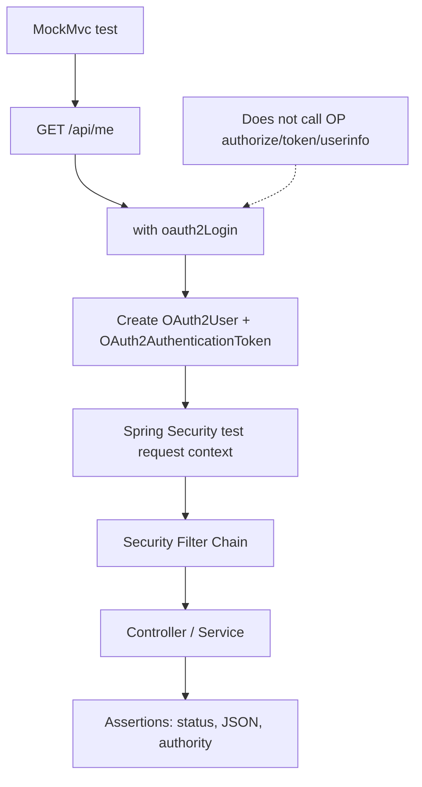
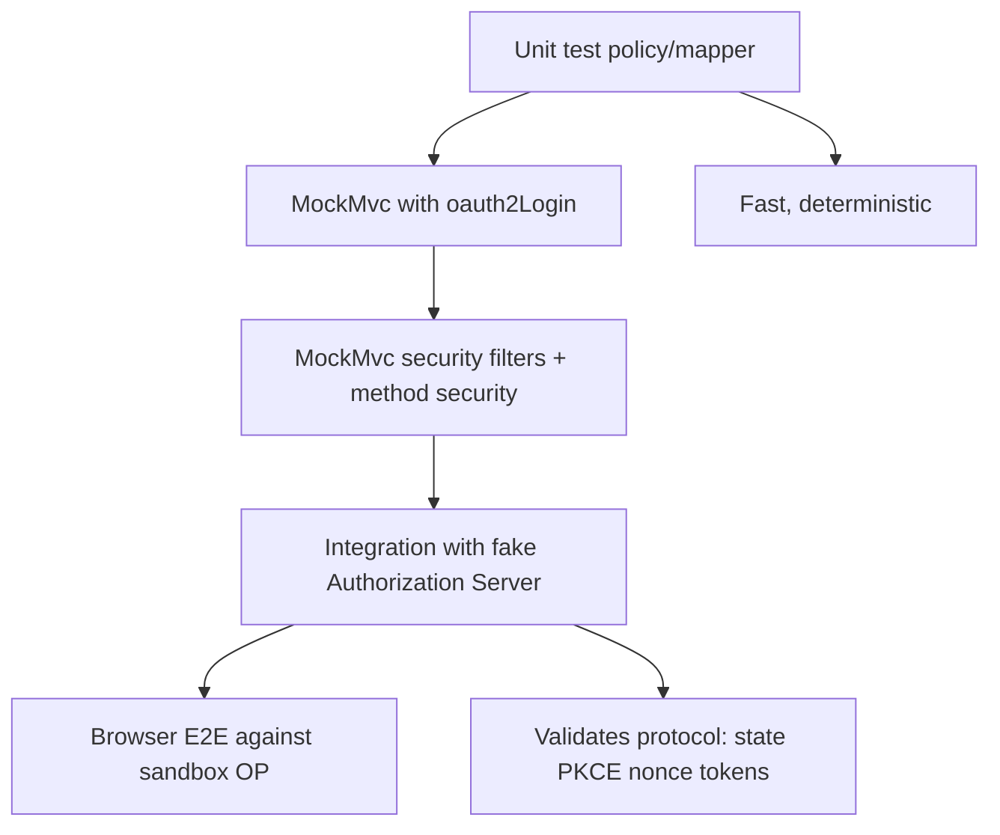

# 29.2. Using `oauth2Login()` to Simulate an OAuth 2.0 User

In a **Spring Security OAuth 2.0 / OpenID Connect (OIDC) Client** application running on **Spring MVC/Servlet**, controllers or services often need to know **who the logged-in OAuth2 user is**, what attributes they have, and what authorities they were granted. If every test had to open a browser, redirect to an Authorization Server (AS), enter credentials, and exchange an authorization code for a token, the test suite would be slow, prone to network failures, and dependent on an external identity system.

**Spring Security Test** provides a very useful utility:

```java
SecurityMockMvcRequestPostProcessors.oauth2Login()
```

When used in `MockMvc`, `oauth2Login()` creates **a simulated OAuth 2.0 authentication context** for the request under test. This allows you to test controllers, URL authorization, method security, `OAuth2User` handling, and certain `OAuth2AuthorizedClient` scenarios **without running a real Authorization Code Flow**.

> **Key point:** `oauth2Login()` in this lesson is **`RequestPostProcessor` from `spring-security-test`**. It sets a fake `OAuth2AuthenticationToken` and `OAuth2User` on the **MockMvc request**. It does **not** send requests to an OP, does not verify token signatures, does not handle `state`/PKCE/nonce, and does not prove that the real login configuration works.

This article uses **Spring Boot 3.x, Spring Security 6.x, JUnit 5, Spring Security Test, and MockMvc**. The examples apply to **Servlet**, not WebFlux; the corresponding reactive helpers are noted at the end.

## 1. Learning Objectives

After this lesson, you will be able to:

1. Distinguish the `oauth2Login()` test post-processor from `HttpSecurity.oauth2Login()` in application configuration.
2. Add the required dependencies and configure `MockMvc` with the Spring Security filter chain.
3. Use `.with(oauth2Login())` to simulate an authenticated OAuth2 user.
4. Understand the `OAuth2AuthenticationToken`, `OAuth2User`, attributes, authorities, and `ClientRegistration` created in a test.
5. Customize `attributes(...)`, `authorities(...)`, `oauth2User(...)`, and `clientRegistration(...)`.
6. Write tests for `@AuthenticationPrincipal OAuth2User`, `Authentication`, and registration IDs.
7. Test URL authorization, `@PreAuthorize`, and 401/403/redirect cases matching the filter chain.
8. Use `csrf()` when testing state-changing requests.
9. Understand the role of the simulated `OAuth2AuthorizedClient` and caveats around `@RegisteredOAuth2AuthorizedClient`.
10. Choose the right helper among `oauth2Login()`, `oidcLogin()`, `oauth2Client()`, `jwt()`, and `@WithMockUser`.
11. Avoid assuming that mocked login is equivalent to testing the real OAuth2/OIDC protocol.
12. Organize test fixtures, negative tests, multi-provider cases, and test credential hygiene.

## 2. Three Very Easily Confused `oauth2Login` Names

Spring Security has similarly named APIs with different responsibilities:

| Syntax | Location | Responsibility |
| --- | --- | --- |
| `http.oauth2Login(...)` | `HttpSecurity` configuration | Enables and customizes OAuth2/OIDC Login in the **real application** |
| `oauth2Login()` imported from `SecurityMockMvcRequestPostProcessors` | `MockMvc.perform(...).with(...)` | **Simulates a logged-in user** in a test request |
| `oauth2Login(...)` in WebFlux config | `ServerHttpSecurity` | Enables reactive browser login; **not a MockMvc post-processor** |

Production configuration example:

```java
@Bean
SecurityFilterChain securityFilterChain(HttpSecurity http)
        throws Exception {

    http
        .authorizeHttpRequests(auth -> auth
                .requestMatchers("/", "/public/**").permitAll()
                .anyRequest().authenticated())
        .oauth2Login(Customizer.withDefaults());

    return http.build();
}
```

Test example:

```java
mvc.perform(get("/api/me").with(oauth2Login()))
        .andExpect(status().isOk());
```

**Fundamental difference:**

- `HttpSecurity` configuration creates the filter chain that handles browser OAuth2 Login at runtime.
- The test `RequestPostProcessor` **places a mock authentication on the request**. It bypasses redirect/callback/token exchange so you can test *post-login* logic.
- A test using `oauth2Login()` **does not verify** that production configuration, redirect URIs, or the Token Endpoint are working properly.

### 2.1. Architecture Model



This tool is best suited for **post-login behavior**: reading user info, authorization checks, response payloads, principal binding, handling missing attributes, and authority-based business rules.

## 3. Objects Created When Calling `oauth2Login()`

Spring Security Test prepares a request with several simulated components:

1. **`OAuth2User`:** simulated principal containing an attribute map and a set of `GrantedAuthority` instances.
2. **`OAuth2AuthenticationToken`:** an `Authentication` representing OAuth2 login, carrying the principal and registration ID.
3. **`SecurityContext`:** bound to the request so controllers/filters see an authenticated user.
4. **`OAuth2AuthorizedClient`:** a simple authorized client placed into a mock `HttpSessionOAuth2AuthorizedClientRepository` via the test mechanism.

These values are **declarative fixtures** and do not require an actually valid access token or ID Token.

### 3.1. Default Principal Values

According to the Spring Security Test documentation, `oauth2Login()` by default creates an `OAuth2User` with attribute:

```json
{
  "sub": "user"
}
```

and authority:

```text
SCOPE_read
```

In an uncustomized setup, the principal name is usually taken from the `sub` attribute.

This is convenient for quick tests, but keep one point in mind: **`SCOPE_read` here is a test default**, not proof that the production OP granted scope `read` or that the real application maps this exact authority. Whenever logic requires other scopes or roles, configure them explicitly.

### 3.2. Related Concepts

| Type | Role in test |
| --- | --- |
| `OAuth2User` | Principal's attributes and authorities |
| `DefaultOAuth2User` | Simple implementation for constructing a custom principal |
| `OAuth2AuthenticationToken` | Authentication of a logged-in OAuth2 user |
| `ClientRegistration` | OAuth2 client metadata, including registration ID, client ID, endpoints, and scopes |
| `OAuth2AuthorizedClient` | Client given a mock token in the test's session repository |
| `SecurityContextHolder` | Accesses authentication on the Servlet request thread when filter integration is active |
| `@AuthenticationPrincipal` | Injects the principal into a controller argument |
| `@RegisteredOAuth2AuthorizedClient` | Resolves an authorized client according to repository/configuration |
| `GrantedAuthority` | Input to URL/method authorization |

### 3.3. `oauth2Login()` Does Not Create an `OidcUser`

OAuth2 Login and OIDC Login are closely related, not identical:

- `oauth2Login()` simulates an **`OAuth2User`** for OAuth2 login without OIDC.
- `oidcLogin()` simulates an **`OidcUser`**, `OidcIdToken`, and corresponding OIDC metadata.

If a controller calls `getIdToken()`, `getClaims()`, or requires `OidcUser`, use **`oidcLogin()`** instead of trying to cast a default `OAuth2User` to an OIDC user.

## 4. Dependencies for Spring Boot + MockMvc

### 4.1. Maven

Example configuration for a Servlet project with OAuth2 Client:

```xml
<dependencies>
    <dependency>
        <groupId>org.springframework.boot</groupId>
        <artifactId>spring-boot-starter-web</artifactId>
    </dependency>
    <dependency>
        <groupId>org.springframework.boot</groupId>
        <artifactId>spring-boot-starter-security</artifactId>
    </dependency>
    <dependency>
        <groupId>org.springframework.boot</groupId>
        <artifactId>spring-boot-starter-oauth2-client</artifactId>
    </dependency>

    <dependency>
        <groupId>org.springframework.boot</groupId>
        <artifactId>spring-boot-starter-test</artifactId>
        <scope>test</scope>
    </dependency>
    <dependency>
        <groupId>org.springframework.security</groupId>
        <artifactId>spring-security-test</artifactId>
        <scope>test</scope>
    </dependency>
</dependencies>
```

In a Spring Boot project, let Boot's dependency management align compatible versions. Never force `spring-security-test` onto a different major version than `spring-security-web`/`spring-security-config`.

### 4.2. Gradle

```groovy
dependencies {
    implementation 'org.springframework.boot:spring-boot-starter-web'
    implementation 'org.springframework.boot:spring-boot-starter-security'
    implementation 'org.springframework.boot:spring-boot-starter-oauth2-client'

    testImplementation 'org.springframework.boot:spring-boot-starter-test'
    testImplementation 'org.springframework.security:spring-security-test'
}

tasks.named('test') {
    useJUnitPlatform()
}
```

`spring-boot-starter-test` provides JUnit Jupiter and Spring MVC Test; `spring-security-test` provides `oauth2Login()`, `oidcLogin()`, `csrf()`, and related security test helpers.

### 4.3. Exact Imports

```java
import static org.springframework.security.test.web.servlet.request
        .SecurityMockMvcRequestPostProcessors.oauth2Login;

import static org.springframework.test.web.servlet.request
        .MockMvcRequestBuilders.get;

import static org.springframework.test.web.servlet.result
        .MockMvcResultMatchers.status;
```

**Do not import `oauth2Login` from the reactive package or confuse it with the configuration DSL.** The static import path is one of the most common mistakes.

## 5. Preparing a Sample Servlet Application

To understand the mechanics clearly, suppose the application has an endpoint `/api/me` returning details from the authenticated principal.

### 5.1. Security Configuration

```java
import org.springframework.context.annotation.Bean;
import org.springframework.context.annotation.Configuration;
import org.springframework.security.config.Customizer;
import org.springframework.security.config.annotation.web.builders.HttpSecurity;
import org.springframework.security.web.SecurityFilterChain;

@Configuration
public class SecurityConfig {

    @Bean
    SecurityFilterChain securityFilterChain(HttpSecurity http)
            throws Exception {

        return http
                .authorizeHttpRequests(auth -> auth
                        .requestMatchers(
                                "/", "/login", "/error")
                            .permitAll()
                        .requestMatchers("/api/admin/**")
                            .hasRole("ADMIN")
                        .anyRequest()
                            .authenticated())
                .oauth2Login(Customizer.withDefaults())
                .build();
    }
}
```

`oauth2Login(Customizer.withDefaults())` is **runtime** configuration. When running the real app, it needs a properly configured `ClientRegistrationRepository`.

### 5.2. Controller Using `@AuthenticationPrincipal OAuth2User`

```java
import java.util.Map;

import org.springframework.security.core.annotation.AuthenticationPrincipal;
import org.springframework.security.oauth2.core.user.OAuth2User;
import org.springframework.web.bind.annotation.GetMapping;
import org.springframework.web.bind.annotation.RestController;

@RestController
public class ProfileController {

    @GetMapping("/api/me")
    public Map<String, Object> me(
            @AuthenticationPrincipal OAuth2User user) {

        return Map.of(
                "subject", user.getName(),
                "displayName", user.getAttribute("name") == null
                        ? ""
                        : user.getAttribute("name"));
    }
}
```

This controller does one small job: read the principal provided by Spring Security and return JSON.

At runtime, `OAuth2User` normally comes from an OAuth2 login user service. In tests, `oauth2Login()` provides the simulated principal.

### 5.3. A Registration Used in the Test Profile

If `@SpringBootTest` enables `oauth2Login()`, the application may still require a valid client registration to initialize the security chain. You can put one in `src/test/resources/application-test.yml` or supply it via test properties:

```yaml
spring:
  security:
    oauth2:
      client:
        registration:
          demo:
            provider: demo-provider
            client-id: test-client
            client-secret: test-secret-only
            authorization-grant-type: authorization_code
            client-authentication-method: client_secret_basic
            redirect-uri: "{baseUrl}/login/oauth2/code/{registrationId}"
            scope:
              - profile
        provider:
          demo-provider:
            authorization-uri: https://idp.test/authorize
            token-uri: https://idp.test/token
            user-info-uri: https://idp.test/userinfo
            user-name-attribute: sub
```

This is a **non-OIDC OAuth2 fixture**, requiring no network discovery because the endpoints are declared directly. `idp.test` is a fake domain; tests using `oauth2Login()` **do not call the endpoint**. Never put a real client secret in test configuration.

When using `application-test.yml`, activate the profile:

```java
@ActiveProfiles("test")
```

If your project already has suitable test registrations, you do not need to add another just to try out the post-processor.

## 6. Simplest Test: `with(oauth2Login())`

```java
import static org.springframework.security.test.web.servlet.request
        .SecurityMockMvcRequestPostProcessors.oauth2Login;
import static org.springframework.test.web.servlet.request
        .MockMvcRequestBuilders.get;
import static org.springframework.test.web.servlet.result
        .MockMvcResultMatchers.jsonPath;
import static org.springframework.test.web.servlet.result
        .MockMvcResultMatchers.status;

import org.junit.jupiter.api.Test;
import org.springframework.beans.factory.annotation.Autowired;
import org.springframework.boot.test.autoconfigure.web.servlet.AutoConfigureMockMvc;
import org.springframework.boot.test.context.SpringBootTest;
import org.springframework.test.context.ActiveProfiles;
import org.springframework.test.web.servlet.MockMvc;

@SpringBootTest
@AutoConfigureMockMvc
@ActiveProfiles("test")
class ProfileControllerTest {

    @Autowired
    MockMvc mvc;

    @Test
    void oauth2UserCanReadOwnProfile() throws Exception {
        mvc.perform(get("/api/me").with(oauth2Login()))
                .andExpect(status().isOk())
                .andExpect(jsonPath("$.subject").value("user"))
                .andExpect(jsonPath("$.displayName").value(""));
    }
}
```

Explanation:

1. `get("/api/me")` creates a mock HTTP GET request.
2. `with(oauth2Login())` attaches a simulated OAuth2 authentication.
3. Spring Security filters see an authenticated user.
4. `@AuthenticationPrincipal` receives the `OAuth2User`.
5. The controller returns `subject="user"` because that is the default `sub`.
6. `jsonPath(...)` asserts the response without needing an AS.

### 6.1. Do We Need to Call `/oauth2/authorization/demo` First?

**No.** With `oauth2Login()`, you are simulating **post-login state**, not running the browser flow.

You do not need:

```text
GET /oauth2/authorization/demo
Redirect to OP
Callback ?code=...&state=...
POST /token
GET /userinfo
```

That is the main advantage for testing application logic. If you need to test those steps, write a **separate integration test** with an AS/OP test double.

### 6.2. Do We Need `@WithMockUser`?

No. `with(oauth2Login())` already builds an OAuth2-login-compatible `Authentication` for the request.

Combining `@WithMockUser` and `.with(oauth2Login())` on the same test can make it unclear which principal is used; choose one consistent authentication model per test.

## 7. Customizing Attributes with `attributes(...)`

In a real application, `OAuth2User` can carry `sub`, `name`, `email`, or provider-published attributes.

To test the controller with a display name:

```java
@Test
void oauth2UserWithNameAttribute() throws Exception {
    mvc.perform(get("/api/me")
            .with(oauth2Login()
                    .attributes(attrs -> {
                        attrs.put("sub", "subject-123");
                        attrs.put("name", "Nguyen An");
                        attrs.put("email", "an@example.test");
                    })))
            .andExpect(status().isOk())
            .andExpect(jsonPath("$.subject").value("subject-123"))
            .andExpect(jsonPath("$.displayName").value("Nguyen An"));
}
```

`attributes(...)` takes a `Consumer<Map<String, Object>>` to modify the mock principal's attribute map.

### 7.1. Attributes Are Test Input Data, Not Verified Data

Whatever values you pass into `attributes(...)` are placed onto the principal by the test helper. It does **not prove** that a real AS verified the email or claim, nor does it run a custom `OAuth2UserService`'s attribute mapping.

For example:

```java
.with(oauth2Login()
    .attributes(attrs -> attrs.put("email_verified", true)))
```

exposes `email_verified=true` to the controller; **the test does not check ID Token signature, OIDC UserInfo provenance, or email verification policy**. For high-trust requirements, write separate mapping/OP integration tests.

### 7.2. Does Changing `sub` Change the Principal Name?

The default mock `OAuth2User` uses `sub` as its name attribute. When a custom principal needs another field (for example `user_name`), construct a `DefaultOAuth2User` with an **explicit `nameAttributeKey`** using `oauth2User(...)` shown later.

### 7.3. Testing Missing Attributes

You can remove or omit an optional field:

```java
@Test
void missingOptionalNameUsesEmptyDisplayName() throws Exception {
    mvc.perform(get("/api/me")
            .with(oauth2Login()
                    .attributes(attrs -> attrs.remove("name"))))
            .andExpect(status().isOk())
            .andExpect(jsonPath("$.displayName").value(""));
}
```

When testing production apps, test **required fields** and error handling too rather than assuming every OP returns the exact same set of claims.

## 8. Customizing Authorities with `authorities(...)`

An authenticated principal **does not automatically have every permission**. Spring Security authorizes based on the `GrantedAuthority` objects attached to the authentication.

Example endpoint requiring a scope:

```java
import org.springframework.context.annotation.Bean;
import org.springframework.context.annotation.Configuration;
import org.springframework.security.config.annotation.web.builders.HttpSecurity;
import org.springframework.security.web.SecurityFilterChain;

@Configuration
public class ReportSecurityConfig {

    @Bean
    SecurityFilterChain securityFilterChain(HttpSecurity http)
            throws Exception {

        return http
                .authorizeHttpRequests(auth -> auth
                        .requestMatchers("/api/reports/**")
                            .hasAuthority("SCOPE_reports.read")
                        .anyRequest()
                            .authenticated())
                .oauth2Login(org.springframework.security.config
                        .Customizer.withDefaults())
                .build();
    }
}
```

**This configuration example is an alternative** to `SecurityConfig` in section 5. Do not accidentally declare two filter chains with overlapping matchers in the same demo project.

### 8.1. Allowed Test

```java
import org.springframework.security.core.authority.SimpleGrantedAuthority;

@Test
void reportReaderIsAllowed() throws Exception {
    mvc.perform(get("/api/reports/summary")
            .with(oauth2Login()
                    .authorities(new SimpleGrantedAuthority(
                            "SCOPE_reports.read"))))
            .andExpect(status().isOk());
}
```

This test assumes the application has a `GET /api/reports/summary` handler returning success; you need to provide the corresponding controller or mocked service. The focus of the check is the **authorization matcher**.

### 8.2. Denied Test

```java
@Test
void oauth2UserWithoutReportScopeIsForbidden() throws Exception {
    mvc.perform(get("/api/reports/summary")
            .with(oauth2Login()
                    .authorities(new SimpleGrantedAuthority(
                            "SCOPE_profile.read"))))
            .andExpect(status().isForbidden());
}
```

The user is still **authenticated**, but lacks `SCOPE_reports.read`, so Spring returns **403 Forbidden** for the protected API per configuration.

**Distinction:** an unauthenticated request may receive a **302 redirect** to the login page if the app uses the browser OAuth2 Login flow, or **401** if the app configures an API entry point. Never hardcode "every missing-user request returns 401" in tests for an OAuth2 Login web app.

### 8.3. Authorities Are Not the Scopes Inside a Real Token

Mocking:

```java
oauth2Login().authorities(
        new SimpleGrantedAuthority("SCOPE_reports.read"))
```

lets you test the **security rule**. It does not prove:

- The AS granted the `reports.read` scope.
- A real token carries that scope.
- The application's `GrantedAuthoritiesMapper` builds the right authorities from the provider.
- A real user has the required tenant membership.
- A downstream API will accept the access token.

Write separate tests for mapping and integration.

## 9. `ROLE_*` Differs from `SCOPE_*`

Spring Security typically uses:

```java
hasRole("ADMIN")
```

to check the authority:

```text
ROLE_ADMIN
```

Whereas:

```java
hasAuthority("SCOPE_reports.read")
```

checks the exact string:

```text
SCOPE_reports.read
```

Test:

```java
@Test
void adminAreaRequiresRoleAdmin() throws Exception {
    mvc.perform(get("/api/admin/dashboard")
            .with(oauth2Login()
                    .authorities(new SimpleGrantedAuthority(
                            "ROLE_ADMIN"))))
            .andExpect(status().isOk());
}
```

And negative case:

```java
@Test
void scopeDoesNotAutomaticallyBecomeAdminRole() throws Exception {
    mvc.perform(get("/api/admin/dashboard")
            .with(oauth2Login()
                    .authorities(new SimpleGrantedAuthority(
                            "SCOPE_admin"))))
            .andExpect(status().isForbidden());
}
```

These tests assume `/api/admin/dashboard` has a route handler returning success when permitted. **`SCOPE_admin` is not equal to `ROLE_ADMIN`** unless the application explicitly defines such a mapping.

Never directly turn a user-supplied `role="admin"` attribute into an authority; production mappers must derive roles/groups from **trusted sources**, governed by policy per issuer, tenant, and account.

## 10. Creating a Custom `OAuth2User` with `oauth2User(...)`

By default, `oauth2Login()` uses `sub` as the principal name. However, some non-OIDC OAuth2 providers use a different attribute such as `id` or `user_name`.

Example controller:

```java
@GetMapping("/api/principal-name")
public String principalName(
        @AuthenticationPrincipal OAuth2User user) {
    return user.getName();
}
```

Constructing `DefaultOAuth2User` with attribute key `user_name`:

```java
import java.util.Map;

import org.springframework.security.core.authority.AuthorityUtils;
import org.springframework.security.oauth2.core.user.DefaultOAuth2User;
import org.springframework.security.oauth2.core.user.OAuth2User;

@Test
void customPrincipalNameAttribute() throws Exception {

    OAuth2User user = new DefaultOAuth2User(
            AuthorityUtils.createAuthorityList(
                    "SCOPE_profile.read"),
            Map.of(
                    "user_name", "alice_partner",
                    "display_name", "Alice"),
            "user_name");

    mvc.perform(get("/api/principal-name")
            .with(oauth2Login().oauth2User(user)))
            .andExpect(status().isOk())
            .andExpect(content().string("alice_partner"));
}
```

Static import needed:

```java
import static org.springframework.test.web.servlet.result
        .MockMvcResultMatchers.content;
```

### 10.1. When to Use `oauth2User(...)` Instead of `attributes(...)`?

Use `attributes(...)` when you only need to add or tweak a few fields on the **default user**.

Use `oauth2User(...)` when you:

- Want to change the **name attribute key**.
- Have a custom `OAuth2User` implementation class.
- Need to test a specific authority/attribute combination.
- Need a full custom attribute map without relying on default `sub`.
- Want to reuse a user fixture across multiple tests.

### 10.2. Do Not Confuse with `DefaultOidcUser`

If a controller requires:

```java
@AuthenticationPrincipal OidcUser oidcUser
```

creating a `DefaultOAuth2User` is **not the right way** to supply an ID Token. Use `oidcLogin()` with Spring Security Test's OIDC fixtures.

## 11. Customizing `ClientRegistration` with `clientRegistration(...)`

An application can work with multiple OAuth2 clients:

```text
company-login
partner-login
github-login
```

To test controllers that inspect the registration ID and branch by provider, you can pass a simulated `ClientRegistration` into `oauth2Login()`.

### 11.1. Creating a Registration Completely in the Test

```java
import org.springframework.security.oauth2.client.registration
        .ClientRegistration;
import org.springframework.security.oauth2.core.AuthorizationGrantType;
import org.springframework.security.oauth2.core.ClientAuthenticationMethod;

private static ClientRegistration partnerRegistration() {
    return ClientRegistration
            .withRegistrationId("partner-login")
            .clientId("partner-test-client")
            .clientSecret("dummy-test-secret")
            .clientAuthenticationMethod(
                    ClientAuthenticationMethod.CLIENT_SECRET_BASIC)
            .authorizationGrantType(
                    AuthorizationGrantType.AUTHORIZATION_CODE)
            .redirectUri(
                    "{baseUrl}/login/oauth2/code/{registrationId}")
            .authorizationUri("https://partner-idp.test/authorize")
            .tokenUri("https://partner-idp.test/token")
            .userInfoUri("https://partner-idp.test/userinfo")
            .userNameAttributeName("sub")
            .scope("profile", "partner.read")
            .clientName("Partner Test")
            .build();
}
```

`.test` domains are not used on the real Internet. This test helper builds **static metadata** without contacting any discovery endpoint.

### 11.2. Controller Reading the Registration ID

```java
import java.util.Map;

import org.springframework.security.oauth2.client.authentication
        .OAuth2AuthenticationToken;
import org.springframework.web.bind.annotation.GetMapping;
import org.springframework.web.bind.annotation.RestController;

@RestController
public class AuthContextController {

    @GetMapping("/api/auth/context")
    public Map<String, String> context(
            OAuth2AuthenticationToken authentication) {

        return Map.of(
                "registrationId",
                authentication.getAuthorizedClientRegistrationId(),
                "principalName",
                authentication.getName());
    }
}
```

Test:

```java
@Test
void oauth2AuthenticationUsesSelectedRegistration()
        throws Exception {

    mvc.perform(get("/api/auth/context")
            .with(oauth2Login()
                    .clientRegistration(partnerRegistration())
                    .attributes(attrs ->
                            attrs.put("sub", "partner-subject-7"))))
            .andExpect(status().isOk())
            .andExpect(jsonPath("$.registrationId")
                    .value("partner-login"))
            .andExpect(jsonPath("$.principalName")
                    .value("partner-subject-7"));
}
```

### 11.3. What Is the Registration ID?

On `OAuth2AuthenticationToken`:

```java
authentication.getAuthorizedClientRegistrationId()
```

returns the **registration ID** the authentication belongs to, such as `partner-login`. It is not:

- The `client_id` issued by the OP.
- The `issuer`.
- An email domain.
- Tenant membership.
- A guaranteed permission merely because the provider is named "partner".

To verify that a user actually belongs to a partner organization, the application must still enforce identity/provider mapping and tenant authorization at the service/policy layer.

### 11.4. Does a Mock `ClientRegistration` Call the Token Endpoint?

**No.** When using `oauth2Login()`, `ClientRegistration` merely shapes the mock authentication/authorized client. No code exchange, UserInfo call, or real client authentication occurs.

Therefore, this test does not prove that production client secrets, authorization endpoints, or TLS certificates are configured properly. Those require separate integration/contract tests.

## 12. Where Is the Simulated `OAuth2AuthorizedClient` Stored?

An easily overlooked detail in Spring Security Test: `oauth2Login()` does not only create an `Authentication`; it also associates **a simulated `OAuth2AuthorizedClient`** via a mock authorized client repository placed in MockMvc's session/request context.

This is useful when a controller uses:

```java
@RegisteredOAuth2AuthorizedClient("partner-login")
OAuth2AuthorizedClient client
```

or integrations that expect an authorized client from OAuth2 Login.

### 12.1. What Is an Authorized Client?

`OAuth2AuthorizedClient` holds:

- `ClientRegistration`: OAuth2 client metadata.
- `principalName`: the principal name bound to the authorization.
- `OAuth2AccessToken`: a granted access token.
- `OAuth2RefreshToken`: optional, if granted by the AS.

In tests, these tokens are **simulated and do not need signatures or values accepted by an OP**.

### 12.2. Important Note on Repository Compatibility

Spring Security Test uses a mock `HttpSessionOAuth2AuthorizedClientRepository` for this mechanism. If the real application configures:

- `AuthenticatedPrincipalOAuth2AuthorizedClientRepository`,
- a database-backed `OAuth2AuthorizedClientService`,
- a custom `OAuth2AuthorizedClientRepository`,
- or a manager/service reading tokens from a different store,

then **do not assume the mock client in the session will automatically appear in every store**.

Specifically, tests for `@RegisteredOAuth2AuthorizedClient` need a repository bean/configuration compatible with how Spring Test places the client into the session. The Spring Security Test API documentation notes that registering an `HttpSessionOAuth2AuthorizedClientRepository` bean may be required for tests.

### 12.3. Test Repository Configuration

A test-only option:

```java
import org.springframework.boot.test.context.TestConfiguration;
import org.springframework.context.annotation.Bean;
import org.springframework.security.oauth2.client.web
        .HttpSessionOAuth2AuthorizedClientRepository;
import org.springframework.security.oauth2.client.web
        .OAuth2AuthorizedClientRepository;

@TestConfiguration
public class AuthorizedClientTestConfig {

    @Bean
    OAuth2AuthorizedClientRepository authorizedClientRepository() {
        return new HttpSessionOAuth2AuthorizedClientRepository();
    }
}
```

You can import this configuration into the test context if the application does not already provide a compatible bean. **Do not inadvertently add a second bean of the same type to production**, as it can alter security semantics and refresh token storage. Verify actual resolver/repository selection when custom integration is present.

### 12.4. Controller Exposes Metadata Only, Not Tokens

```java
import java.util.Map;

import org.springframework.security.oauth2.client.OAuth2AuthorizedClient;
import org.springframework.security.oauth2.client.annotation
        .RegisteredOAuth2AuthorizedClient;
import org.springframework.web.bind.annotation.GetMapping;
import org.springframework.web.bind.annotation.RestController;

@RestController
public class AuthorizedClientMetadataController {

    @GetMapping("/api/connection")
    public Map<String, String> connection(
            @RegisteredOAuth2AuthorizedClient("partner-login")
            OAuth2AuthorizedClient client) {

        return Map.of(
                "registrationId",
                client.getClientRegistration().getRegistrationId(),
                "principal",
                client.getPrincipalName());
    }
}
```

Illustrative test with `HttpSessionOAuth2AuthorizedClientRepository` properly wired:

```java
@Test
void authorizedClientIsAvailableInCompatibleSessionRepository()
        throws Exception {

    mvc.perform(get("/api/connection")
            .with(oauth2Login()
                    .clientRegistration(partnerRegistration())))
            .andExpect(status().isOk())
            .andExpect(jsonPath("$.registrationId")
                    .value("partner-login"));
}
```

**Never return an `OAuth2AuthorizedClient` object directly as JSON**: the object holds access/refresh tokens or associated client secrets; controllers should return minimal DTOs/metadata.

### 12.5. When to Use `oauth2Client("registrationId")`?

If a test **only needs an authorized client** without simulating a user logged in via OAuth2, the more targeted helper is:

```java
import static org.springframework.security.test.web.servlet.request
        .SecurityMockMvcRequestPostProcessors.oauth2Client;

mvc.perform(get("/api/connection")
        .with(oauth2Client("partner-login")));
```

Note: `oauth2Client()` is not meant to replace user `Authentication`. If the endpoint requires an authenticated user, provide an appropriate `Authentication` or use `oauth2Login()` when the test scenario is OAuth2 login.

## 13. Testing `@AuthenticationPrincipal`

`@AuthenticationPrincipal` can inject the principal with the matching type.

### 13.1. Controller Reading Email

```java
import java.util.Map;

import org.springframework.security.core.annotation.AuthenticationPrincipal;
import org.springframework.security.oauth2.core.user.OAuth2User;
import org.springframework.web.bind.annotation.GetMapping;
import org.springframework.web.bind.annotation.RestController;

@RestController
class EmailController {

    @GetMapping("/api/email")
    Map<String, String> email(
            @AuthenticationPrincipal OAuth2User user) {

        String email = user.getAttribute("email");
        return Map.of("email", email == null ? "" : email);
    }
}
```

Test:

```java
@Test
void oauth2PrincipalEmailIsInjected() throws Exception {
    mvc.perform(get("/api/email")
            .with(oauth2Login()
                    .attributes(attrs ->
                            attrs.put("email", "learner@example.test"))))
            .andExpect(status().isOk())
            .andExpect(jsonPath("$.email")
                    .value("learner@example.test"));
}
```

### 13.2. When Attributes Are Missing or Have Unexpected Types

UserInfo responses from providers can return missing fields or unexpected types. Tests should cover:

- Missing/null email.
- `email_verified` false/missing if business policy checks it.
- An object attribute instead of a string.
- Provider changing `user_name` to `id`.
- Missing authorities.
- Empty group list.
- Unicode or unusually long name values.

`oauth2Login()` lets you construct arbitrary data to test **controller/service resilience**. However, it does not test the real UserInfo endpoint or source trust; that is the job of integration tests.

## 14. Testing Default Login vs. Unauthenticated User

Keep both tests side by side to prove the filter chain genuinely distinguishes authenticated and anonymous requests.

### 14.1. Authenticated Request

```java
@Test
void authenticatedOauth2UserCanViewProfile() throws Exception {
    mvc.perform(get("/api/me").with(oauth2Login()))
            .andExpect(status().isOk());
}
```

### 14.2. Anonymous Request

```java
@Test
void anonymousBrowserMustAuthenticate() throws Exception {
    mvc.perform(get("/api/me"))
            .andExpect(status().is3xxRedirection());
}
```

The anonymous test assumes the application uses browser-style `oauth2Login()` and its entry point redirects to login. If the app customizes the entry point for REST APIs to `401 Unauthorized`, adjust the expectation accordingly.

### 14.3. Checking the Redirect Target

Do not rely on a generic 302 if business logic requires redirecting to a specific location. A test can assert `Location` or `redirectedUrlPattern(...)` matching configuration:

```java
mvc.perform(get("/api/me"))
        .andExpect(status().is3xxRedirection())
        .andExpect(header().exists("Location"));
```

Static import `MockMvcResultMatchers.header` is needed. The actual redirect location depends on the application's login page/authorization request resolver; avoid hardcoding the wrong endpoint when multiple providers exist.

## 15. Testing `@PreAuthorize` with OAuth2 Users

`@PreAuthorize` protects **methods**, not just URLs. If the application enables method security:

```java
import org.springframework.context.annotation.Configuration;
import org.springframework.security.config.annotation.method.configuration
        .EnableMethodSecurity;

@Configuration
@EnableMethodSecurity
public class MethodSecurityConfig {}
```

Service:

```java
import org.springframework.security.access.prepost.PreAuthorize;
import org.springframework.stereotype.Service;

@Service
public class InvoiceService {

    @PreAuthorize("hasAuthority('SCOPE_invoice.read')")
    public String readInvoice() {
        return "invoice-ok";
    }
}
```

Controller:

```java
import org.springframework.web.bind.annotation.GetMapping;
import org.springframework.web.bind.annotation.RestController;

@RestController
public class InvoiceController {

    private final InvoiceService invoices;

    public InvoiceController(InvoiceService invoices) {
        this.invoices = invoices;
    }

    @GetMapping("/api/invoice")
    public String invoice() {
        return invoices.readInvoice();
    }
}
```

Test:

```java
@Test
void invoiceReadRequiresScope() throws Exception {
    mvc.perform(get("/api/invoice")
            .with(oauth2Login().authorities(
                    new SimpleGrantedAuthority(
                            "SCOPE_invoice.read"))))
            .andExpect(status().isOk())
            .andExpect(content().string("invoice-ok"));
}

@Test
void oauth2UserWithoutInvoiceScopeGetsForbidden() throws Exception {
    mvc.perform(get("/api/invoice")
            .with(oauth2Login().authorities(
                    new SimpleGrantedAuthority("SCOPE_profile.read"))))
            .andExpect(status().isForbidden());
}
```

Conditions:

- `@EnableMethodSecurity` must actually be loaded in the test context.
- The service must be managed by Spring through a proxy, not instantiated with `new InvoiceService()` outside Spring expecting annotations to apply.
- The filter chain/`SecurityContext` must be active in MockMvc.
- If `@WebMvcTest` mocks `InvoiceService` with Mockito, `@PreAuthorize` on the real implementation **is not properly tested**. Use an integration/service security test with the real bean when needed.

### 15.1. Scope of This Test

This test proves service method authorization checks the **test-granted authority**. It does not prove the AS actually issued that scope or that the production authority mapper builds permissions correctly. Test mapping and access policy independently.

## 16. POST/PUT/DELETE: `csrf()` Is Required When CSRF Is Enabled

An authenticated user is not sufficient to perform a state-changing POST in a Servlet application using session/CSRF protection.

Example endpoint:

```java
@PostMapping("/api/settings")
public ResponseEntity<Void> updateSettings() {
    return ResponseEntity.noContent().build();
}
```

Proper test:

```java
import static org.springframework.security.test.web.servlet.request
        .SecurityMockMvcRequestPostProcessors.csrf;
import static org.springframework.test.web.servlet.request
        .MockMvcRequestBuilders.post;

@Test
void authenticatedOauth2UserWithCsrfMayUpdate() throws Exception {
    mvc.perform(post("/api/settings")
            .with(oauth2Login())
            .with(csrf()))
            .andExpect(status().isNoContent());
}
```

Missing CSRF test:

```java
@Test
void missingCsrfIsRejectedEvenWithOauth2Login()
        throws Exception {

    mvc.perform(post("/api/settings")
            .with(oauth2Login()))
            .andExpect(status().isForbidden());
}
```

### 16.1. Why Does CSRF Still Matter?

If a browser uses session cookies, another website could attempt to send state-changing requests on the user's behalf. OAuth2 Login does not exempt the app from CSRF protection.

**Never disable CSRF app-wide just to make an `oauth2Login()` POST test pass.** If an API uses stateless Bearer tokens under a different threat model, CSRF configuration may differ; tests must reflect the actual architecture.

### 16.2. Does `oauth2Login()` Automatically Generate a CSRF Token?

Do not assume so. The `oauth2Login()` test helper focuses on **Authentication**, while `csrf()` is a separate `RequestPostProcessor`.

Use:

```java
.with(oauth2Login())
.with(csrf())
```

for requests requiring CSRF, instead of treating OAuth2 authentication as implying an anti-CSRF token.

## 17. Checking the Right `Authentication` Type

A controller can accept `Authentication`:

```java
@GetMapping("/api/auth/type")
public String authenticationType(Authentication authentication) {
    return authentication.getClass().getSimpleName();
}
```

When a request uses `oauth2Login()`, the expected type is `OAuth2AuthenticationToken`; not `UsernamePasswordAuthenticationToken`, `JwtAuthenticationToken`, or `BearerTokenAuthentication`.

Test:

```java
@Test
void mockUserIsOauth2AuthenticationToken() throws Exception {
    mvc.perform(get("/api/auth/type")
            .with(oauth2Login()))
            .andExpect(status().isOk())
            .andExpect(content().string(
                    "OAuth2AuthenticationToken"));
}
```

This is a simple check for a demo. In production applications, avoid building business logic on `getClass().getSimpleName()`; use proper interfaces/types when distinguishing authentication kinds.

### 17.1. Reading the Principal via `SecurityContextHolder`

In the Servlet stack when Spring Security filters run:

```java
Authentication authentication =
        SecurityContextHolder.getContext()
                .getAuthentication();
```

However, in controllers, **injecting `Authentication` or `@AuthenticationPrincipal` is usually easier to test and less coupled**.

Do not rely on global `SecurityContextHolder` when code executes on asynchronous threads without context propagation. An `oauth2Login()` test request does not automatically verify thread propagation in background jobs.

## 18. `MockMvc` Must Have Spring Security Attached

A common testing mistake is using `MockMvcBuilders.standaloneSetup(...)` without attaching the Spring Security filter chain, then finding `oauth2Login()` does not appear as expected or security annotations have no effect.

### 18.1. Using `@SpringBootTest` + `@AutoConfigureMockMvc`

```java
@SpringBootTest
@AutoConfigureMockMvc
class OAuth2MvcIntegrationTest {

    @Autowired
    MockMvc mvc;
}
```

This setup automatically integrates MVC/security filters from the application context, making it suitable for testing both security configuration and controllers.

### 18.2. Using `MockMvcBuilders.webAppContextSetup(...)`

If configuring `MockMvc` manually:

```java
import static org.springframework.security.test.web.servlet.setup
        .SecurityMockMvcConfigurers.springSecurity;

import org.springframework.test.web.servlet.setup.MockMvcBuilders;

// Inside @BeforeEach or setup code with a WebApplicationContext:
mvc = MockMvcBuilders
        .webAppContextSetup(context)
        .apply(springSecurity())
        .build();
```

`springSecurity()` is the key integration point ensuring post-processors and `SecurityContext` work with the MockMvc filter chain.

### 18.3. Why Is Standalone Setup Error-Prone?

A test like:

```java
MockMvc mvc = MockMvcBuilders
        .standaloneSetup(new ProfileController())
        .build();
```

only builds the controller layer and **does not load the full Spring Security filter chain**. Such tests can bypass URL/method authorization, CSRF, or fail to propagate context as in runtime.

When testing authorization, prefer `webAppContextSetup(...).apply(springSecurity())` or a Boot test configuration with active filters. Standalone setup is only appropriate when intentionally testing controller mechanics alone while understanding its limits.

## 19. `@WebMvcTest`: A Slice Test with Limits

`@WebMvcTest` normally loads only MVC controllers, filters, and a limited set of beans. If the production `SecurityConfig` depends on `ClientRegistrationRepository`, `OAuth2AuthorizedClientService`, or a custom principal mapper, the slice test may miss beans and fail to start.

Example:

```java
@WebMvcTest(ProfileController.class)
@Import(TestSecurityConfiguration.class)
class ProfileMvcSliceTest {

    @Autowired
    MockMvc mvc;

    @Test
    void profileIsVisible() throws Exception {
        mvc.perform(get("/api/me")
                .with(oauth2Login()))
                .andExpect(status().isOk());
    }
}
```

`TestSecurityConfiguration` is a **project-authored** configuration class, not a built-in Spring class. It needs:

- A security chain suited to the test goal.
- Beans required for the chain to start.
- Security not accidentally disabled if testing authorization.
- Appropriately scoped mock services or fixtures.

### 19.1. When to Choose `@SpringBootTest` Instead of `@WebMvcTest`?

Use `@WebMvcTest` for fast verification of **MVC contracts + security filters when all needed beans are present**.

Use `@SpringBootTest` when you need:

- Interaction between the security chain and multiple business services.
- Real `@EnableMethodSecurity`/authorization proxies.
- Custom authorized client repository/registration services.
- Session lifecycle or cross-layer security behavior.
- Complex multi-provider configuration integration.

Do not promote every controller unit test to a full context just because one mock bean is missing; choose the test level intentionally.

## 20. `oauth2Login()` vs. `oidcLogin()`: Choosing the Right Helper

In an OIDC Client, the principal is normally an `OidcUser` with `OidcIdToken` and `OidcUserInfo`.

| Criterion | `oauth2Login()` | `oidcLogin()` |
| --- | --- | --- |
| Simulated principal | `OAuth2User` | `OidcUser` |
| Authentication | `OAuth2AuthenticationToken` | `OAuth2AuthenticationToken` |
| Mocks ID Token? | Not this helper's purpose | Yes |
| Customizing principal attributes | `attributes(...)`, `oauth2User(...)` | `idToken(...)`, `userInfo(...)`, `oidcUser(...)` |
| Customizing authorities | Yes | Yes |
| Customizing `ClientRegistration` | Yes | Yes |
| Use case | Non-OIDC OAuth2 login, controllers using `OAuth2User` | Controllers needing OIDC claims/`OidcUser` |
| Runs Authorization Code/Token Endpoint? | No | No |

### 20.1. `oidcLogin()` Example

```java
import static org.springframework.security.test.web.servlet.request
        .SecurityMockMvcRequestPostProcessors.oidcLogin;

mvc.perform(get("/api/oidc/me")
        .with(oidcLogin()
                .idToken(token -> token
                        .subject("oidc-subject-42")
                        .claim("email", "alice@example.test"))))
        .andExpect(status().isOk());
```

This example assumes a controller accepting `OidcUser` at `/api/oidc/me`. When testing OIDC, understand the difference between **ID Token claims** and **UserInfo claims**. Using the OIDC mock helper does not mean OP signature, nonce, `at_hash`, or issuer validation took place.

### 20.2. Do Not Implicitly Force `OAuth2User` into `OidcUser`

If an endpoint is:

```java
@GetMapping("/api/oidc/me")
String me(@AuthenticationPrincipal OidcUser user) {
    return user.getIdToken().getSubject();
}
```

default `oauth2Login()` does not create an `OidcUser`. Pick `oidcLogin()` rather than casting `OAuth2User` to an OIDC type.

## 21. `oauth2Login()`, `oauth2Client()`, `jwt()`, and `@WithMockUser`

All four assist security testing, yet represent **different authentication mechanisms**.

| Helper | Simulates | Typical Principal/Authentication | When appropriate |
| --- | --- | --- | --- |
| **`oauth2Login()`** | Browser user logged in via OAuth2 Client | `OAuth2User` / `OAuth2AuthenticationToken` | Post-login MVC controllers |
| **`oidcLogin()`** | Browser user logged in via OIDC | `OidcUser` / `OAuth2AuthenticationToken` | OIDC claims/ID Token |
| **`oauth2Client("id")`** | Authorized client/token in repository | Does not necessarily include user authentication | `@RegisteredOAuth2AuthorizedClient`/outbound client |
| **`jwt()`** | Incoming Bearer JWT verified by Resource Server (simulated) | `JwtAuthenticationToken` | REST API/resource-server authorization |
| **`@WithMockUser`** | Username/password-style security user | Usually `UsernamePasswordAuthenticationToken` | Generic role/method security |
| **`user("...")`** | Security `UserDetails` | Username-password authentication | Controllers using `UserDetails` |

### 21.1. Browser OAuth2 Login Differs from Resource Server JWT

A single application can simultaneously act as:

- An **OAuth2 Client** to log users in via browser.
- A **Resource Server** to accept JWTs from mobile apps/services.

If a controller is only invoked with `JwtAuthenticationToken` from an API Bearer token, `jwt()` is more appropriate than `oauth2Login()`. Choose the helper based on the **endpoint's authentication mechanism**, not simply whether the project has an OAuth2 dependency.

### 21.2. Why Can `@WithMockUser` Cause False Positives?

A test like:

```java
@WithMockUser(roles = "ADMIN")
@Test
void adminCanRead() ...
```

can verify `hasRole("ADMIN")`, yet **does not verify OAuth2 principal mapping**. A controller expecting `OAuth2User` may fail when the real principal is `UserDetails`. Use `oauth2Login()` whenever the OAuth2 principal type is part of the contract under test.

### 21.3. An App with Multiple Authentication Mechanisms

If the same URL supports both browser sessions and API Bearer tokens, verify the exact `SecurityFilterChain` and entry point. Testing with `oauth2Login()` exercises only the mock OAuth2 session path; `jwt()` simulates the other mechanism. Both tests can coexist when the production security chain genuinely supports both.

## 22. Simulating Multiple Providers in the Same Test Suite

Suppose the app has `company` and `partner`. You can create separate fixtures:

```java
private static ClientRegistration companyRegistration() {
    return ClientRegistration
            .withRegistrationId("company")
            .clientId("company-test-client")
            .clientSecret("company-test-secret")
            .clientAuthenticationMethod(
                    ClientAuthenticationMethod.CLIENT_SECRET_BASIC)
            .authorizationGrantType(
                    AuthorizationGrantType.AUTHORIZATION_CODE)
            .authorizationUri("https://company-idp.test/authorize")
            .tokenUri("https://company-idp.test/token")
            .userInfoUri("https://company-idp.test/userinfo")
            .userNameAttributeName("sub")
            .redirectUri(
                    "{baseUrl}/login/oauth2/code/{registrationId}")
            .scope("profile")
            .build();
}
```

And `partnerRegistration()` from section 11.

Tests:

```java
@Test
void companyOauth2LoginUsesCompanyRegistration() throws Exception {
    mvc.perform(get("/api/auth/context")
            .with(oauth2Login()
                    .clientRegistration(companyRegistration())))
            .andExpect(status().isOk())
            .andExpect(jsonPath("$.registrationId").value("company"));
}

@Test
void partnerOauth2LoginUsesPartnerRegistration() throws Exception {
    mvc.perform(get("/api/auth/context")
            .with(oauth2Login()
                    .clientRegistration(partnerRegistration())))
            .andExpect(status().isOk())
            .andExpect(jsonPath("$.registrationId")
                    .value("partner-login"));
}
```

### 22.1. What Do the Tests Above Actually Verify?

They prove the controller reads the **mock registration ID** attached by the test. They do not verify:

- Home Realm Discovery / pre-login routing.
- OP discovery metadata and issuer pinning.
- State binding between authorization request and callback.
- OIDC `iss` + `sub` identity mapping.
- Real client secrets or `private_key_jwt`.
- Cross-tenant token isolation in the database.
- OP SSO cookies/logout.

To test multiple real providers, write separate integration tests for `/oauth2/authorization/{registrationId}` and callbacks using dedicated OP fixtures.

### 22.2. Provider Name Does Not Grant Roles

A dangerous test:

```java
.with(oauth2Login()
        .clientRegistration(companyRegistration())
        .authorities(new SimpleGrantedAuthority("ROLE_ADMIN")))
```

gives the user admin rights because **the test granted the authority**, not because the `company` registration creates that role on its own. Never conclude from this test that every user signing in via the Corporate OP automatically receives `ROLE_ADMIN`.

Real policy tests must verify mapping from **verified identity, tenant membership, and trusted authority sources**, not from a test-selected registration name.

## 23. Mocking Does Not Prove `OAuth2UserService` Mapping

At runtime, OAuth2 Login can invoke:

```java
OAuth2UserService<OAuth2UserRequest, OAuth2User>
```

or a custom implementation to fetch UserInfo and transform attributes/authorities.

When you use `oauth2Login().oauth2User(...)`, **Spring Security Test injects the simulated principal directly into the `SecurityContext`**. Consequently:

- A custom `OAuth2UserService` may **not be called**.
- The UserInfo HTTP client is not called.
- OP response mapping is untested.
- Issuer/provider-specific claims validation is unproven.
- User database mapping may not run.

### 23.1. Test Mapping Separately

If you have a service:

```java
public interface ExternalIdentityMapper {
    InternalUser map(String registrationId, OAuth2User user);
}
```

unit test it directly:

```text
Given:
  registrationId = company
  user.attributes = {id: "123", email: "...", groups: [...]}

When:
  mapper.map(...)

Then:
  expected internal user/roles
  unknown groups are ignored
  missing subject is rejected
  untrusted provider cannot create admin
```

Then integration-test controller/security behavior with `oauth2Login()` and **fixtures reflecting production mappings**. Never treat setting `ROLE_ADMIN` in a post-processor as a test of the mapper.

### 23.2. Do Not Automatically Merge Accounts by Email in Tests

If two providers return the same email, the real identities may belong to different users. `oauth2Login()` does not verify `iss` or ownership. Account linking in the application needs dedicated tests with vetted identities; never use mocked attributes to bypass enrollment policy.

## 24. Testing `@RegisteredOAuth2AuthorizedClient` and Token Access

Some controllers use an authorized client to call downstream APIs. Testing can have two levels:

**Level A — Controller/service contract:** Mock the authorized client and HTTP API, verifying the service picks the right registration and never exposes tokens to the client.

**Level B — Protocol integration:** Run Authorization Code/token exchange with an AS test double, verifying real token persistence/refresh/failure handling.

`oauth2Login()` generally fits Level A and does not replace Level B.

### 24.1. Warning Against Assuming the Token Is Always Present

If a test uses `oauth2Login()` while the app declares a database-backed repository, a controller using `@RegisteredOAuth2AuthorizedClient` may fail to find the mock token. Fix this by **wiring a compatible test repository** or testing via `oauth2Client(...)`/service mocks along the production path.

Do not change production from a database `OAuth2AuthorizedClientService` to in-memory just to make a test pass, and never disable authentication checks.

### 24.2. Do Not Use Mock Tokens to Call Real APIs

A mocked `OAuth2AuthorizedClient` contains a fixture token that a production Resource Server will normally reject. In tests:

- Stub/mock downstream HTTP calls.
- Use WireMock or a fake API/AS in integration environments.
- Keep test credentials distinct from production.
- Assert the `Authorization` header carries **the expected mock token**, without printing tokens to logs.
- Test that access tokens are never leaked to untrusted API hosts.

Do not send a mock `test-access-token` to a public API and blame Spring Test for an HTTP 401.

## 25. MockMvc Session Context and Test Scope

`oauth2Login()` is a **per-request post-processor**. On each `mvc.perform(...)`, you apply it to that specific request.

### 25.1. Do Not Assume Authentication Persists to the Next Request

Example:

```java
mvc.perform(get("/api/me").with(oauth2Login()))
        .andExpect(status().isOk());

mvc.perform(get("/api/me"));
```

The second request **does not automatically reuse the same security context** just because the first call simulated login. If you want to simulate the same browser session, explicitly manage `MockHttpSession`/`SecurityContextRepository` and lifecycle according to your architecture.

### 25.2. A Different Mock User per Request

```java
@Test
void differentRequestsCanUseDifferentOAuth2Users() throws Exception {
    mvc.perform(get("/api/me")
            .with(oauth2Login()
                    .attributes(attrs ->
                            attrs.put("sub", "user-A"))))
            .andExpect(jsonPath("$.subject").value("user-A"));

    mvc.perform(get("/api/me")
            .with(oauth2Login()
                    .attributes(attrs ->
                            attrs.put("sub", "user-B"))))
            .andExpect(jsonPath("$.subject").value("user-B"));
}
```

This helps verify the controller does not store static/global user state. However, it **does not automatically verify** session fixation, logout invalidation, same-browser account switching, or token storage isolation. Those concerns require dedicated session integration tests.

### 25.3. Parallel Test Execution

Avoid sharing **mutable static** `SecurityContextHolder` or user fixtures without synchronization across tests. Create fresh `OAuth2User` instances and attribute maps per test as needed. Isolate token service/database fixtures per test context or transaction.

## 26. Organizing Fixtures for Maintainable Tests

When multiple tests share patterns, create helper classes **strictly inside test sources**:

```java
import java.util.Map;

import org.springframework.security.core.authority.AuthorityUtils;
import org.springframework.security.oauth2.core.user.DefaultOAuth2User;
import org.springframework.security.oauth2.core.user.OAuth2User;

public final class OAuth2TestUsers {

    private OAuth2TestUsers() {}

    public static OAuth2User companyViewer(String subject) {
        return new DefaultOAuth2User(
                AuthorityUtils.createAuthorityList(
                        "SCOPE_profile.read",
                        "ROLE_VIEWER"),
                Map.of(
                        "sub", subject,
                        "name", "Test Viewer"),
                "sub");
    }

    public static OAuth2User companyAdmin(String subject) {
        return new DefaultOAuth2User(
                AuthorityUtils.createAuthorityList(
                        "ROLE_ADMIN"),
                Map.of(
                        "sub", subject,
                        "name", "Test Admin"),
                "sub");
    }
}
```

Usage:

```java
mvc.perform(get("/api/me")
        .with(oauth2Login()
                .oauth2User(
                        OAuth2TestUsers.companyViewer(
                                "viewer-101"))))
        .andExpect(status().isOk());
```

### 26.1. Requirements for Safe Fixtures

- Use completely synthetic data.
- Never use real emails/subjects/refresh tokens.
- Each case should represent a clear **policy/identity**.
- Do not grant admin roles by default to all users.
- Do not confuse `OAuth2User` with `OidcUser`.
- Avoid tests whose assertions merely echo back injected data without verifying business behavior.
- For negative tests, specify missing/extra authorities explicitly.

### 26.2. Prefer Behavior-Describing Test Names

Good test names:

```text
oauth2ViewerCanReadOwnProfile
oauth2UserWithoutInvoiceScopeIsForbidden
oauth2LoginWithPartnerRegistrationShowsPartnerContext
missingEmailAttributeUsesFallback
csrfIsRequiredEvenWhenOAuth2UserIsAuthenticated
```

Poor names:

```text
testOAuth2
test1
loginWorks
```

Because `oauth2Login()` **does not test the login protocol**, avoid names like `loginWorks` that misrepresent coverage.

## 27. Essential Negative Tests

A positive test showing "an OAuth2 user can view the page" is not enough. You must test what **must not be allowed**.

| Category | Scenario | Expected outcome |
| --- | --- | --- |
| Anonymous | Without `oauth2Login()` | Redirected/401 per entry point |
| Missing scope | Has only `SCOPE_profile.read` when endpoint needs `SCOPE_invoice.read` | 403 |
| Wrong role | Has `SCOPE_admin` when `ROLE_ADMIN` is required | 403 |
| Invalid/missing attribute | Missing `email`/`user_id` | Controlled fallback or validation error |
| Suspended internal account | Mock `OAuth2User` but account disabled in DB | Denied per application policy |
| Cross-tenant access | User A requests tenant B data | Denied even though user is authenticated |
| Wrong registration | User has `partner` registration but route is company-only | Denied per explicit policy |
| Missing CSRF | POST/DELETE with OAuth2 login but no CSRF | 403 when CSRF is enabled |
| Authorization object leak | Controller returns full `OAuth2AuthorizedClient` | Test must prevent responses from leaking credentials |
| Unknown provider | `registrationId` not in allowlist | Does not create a trusted issuer |
| Concurrency | Two requests with different principals | No shared static user/session state |
| Tampered downstream URL | User picks external URL while service attaches token | Blocked by allowlist |
| Missing authorized client | User auth present but storage lacks token | Clear recovery/error policy |

**Never equate a mock user with security trust.** If the application accepts test-supplied input directly as a source of authority, tests will pass even though production logic is flawed. Test real policy with trusted data sources.

## 28. Common Errors and Troubleshooting

| Symptom | Possible cause | Resolution |
| --- | --- | --- |
| `oauth2Login()` not found | Missing `spring-security-test` or wrong static import | Add test dependency, import the right class |
| Test returns 302 instead of 200 | Mock auth not bound to security filters or URL needs different config | Check `springSecurity()`/`@AutoConfigureMockMvc` |
| Test returns 403 despite `oauth2Login()` | Missing authority or CSRF | Verify `hasRole/hasAuthority` and `csrf()` |
| `@AuthenticationPrincipal OAuth2User` is null | Missing auth, wrong test setup, or type mismatch | Use `with(oauth2Login())` and Spring Security filters |
| Principal lacks ID Token | `oauth2Login()` creates `OAuth2User`, not `OidcUser` | Use `oidcLogin()` |
| `ClassCastException` between `OAuth2User` and `OidcUser` | Casting to wrong principal type | Pick the right helper instead of casting |
| `user.getAttribute("email")` is null | Default only contains `sub` | Add `attributes(...)` or a custom user |
| Expected `ROLE_ADMIN` but only `SCOPE_admin` present | No implicit mapping | Grant the right authority or test the production mapper |
| `getName()` does not return expected username | Different name attribute key | Use `DefaultOAuth2User(..., "user_name")` |
| `@RegisteredOAuth2AuthorizedClient` is null | Mock repository differs from the repo the resolver reads | Wire `HttpSessionOAuth2AuthorizedClientRepository` or test config |
| `ClientRegistrationRepository` bean missing | OAuth2 Login runtime config requires registration in test context | Add a test registration fixture |
| `@WebMvcTest` does not load custom service | Slice lacks the bean | Use `@MockBean`/Mockito mock per Boot version or full context |
| `@PreAuthorize` not enforced | Missing `@EnableMethodSecurity` or mocked service | Load the real service/proxy |
| Anonymous test expected 401 but got 302 | OAuth2 Login browser entry point redirects | Assert against the actual entry point |
| OAuth2 callback is untested | `oauth2Login()` bypasses the OAuth2 protocol | Write fake-OP integration tests |
| Test uses mock token against a real API | Mock token is invalid outside tests | Stub downstream HTTP calls |
| Different tests bleed users | Mutable static fixture/thread-local/session reuse | Isolate fixtures, cleanup, and sessions |
| HTTP POST returns 403 due to CSRF | Only `oauth2Login()` was provided | Add `csrf()` when policy requires it |
| Test uses reactive helper in MockMvc | Wrong stack | Use Servlet `SecurityMockMvcRequestPostProcessors` |
| Test startup calls external OIDC issuer | Test config uses `issuer-uri` discovery | Use static test endpoints or a fake OP |
| Multi-provider admin test "passes too easily" | Helper directly assigned `ROLE_ADMIN` | Test mapping/business policy separately |

### 28.1. Diagnostic Checklist

1. Confirm the test runs **Spring MVC/Servlet + MockMvc**, not WebFlux.
2. Confirm the right version of `spring-security-test` is present.
3. Check the static import `SecurityMockMvcRequestPostProcessors.oauth2Login`.
4. Verify `MockMvc` integrates Spring Security filters.
5. Verify the request includes `.with(oauth2Login())`.
6. Check the principal type and controller parameter.
7. Inspect default or custom attributes/authorities.
8. If POST/DELETE, check CSRF.
9. If the authorized client is missing, check repository binding.
10. If you are trying to test redirects/token exchange, move to an **integration test with a simulated OP** rather than forcing a post-processor to do work it was not designed for.

## 29. Anti-Patterns to Avoid

### 29.1. Treating `oauth2Login()` as an Authorization Code Flow Test

Wrong because the helper never visits `/authorize`, never receives a `code`, never calls `/token`, and never verifies state/PKCE/nonce. It simulates the **post-login outcome**, not the entire grant.

### 29.2. Using `@WithMockUser` and Casting Principal to `OAuth2User`

`@WithMockUser` normally creates a `UserDetails` principal, not an `OAuth2User`. Use the helper matching the controller contract.

### 29.3. Creating `OAuth2User` with a Missing Name Attribute Key

`DefaultOAuth2User` requires the key to determine the principal name. If the key is absent from attributes, construction can fail or the principal name will be unexpected. Check your fixtures.

### 29.4. Granting Every Mock OAuth2 User `ROLE_ADMIN`

Creates authorization false positives. Grant only the authorities each test case genuinely needs, and always include negative tests.

### 29.5. Skipping CSRF Tests Because the User Is "OAuth2 Logged In"

Authentication and CSRF are two separate mechanisms. Tests with session-backed POST/DELETE must preserve CSRF policy.

### 29.6. Returning the Entire `OAuth2AuthorizedClient` to the Browser

Mock tokens may look harmless in fixtures, but production objects contain access/refresh tokens. Design controllers to return only necessary metadata without exposing secrets.

### 29.7. Claiming the Test Verified `OAuth2UserService`

The post-processor injects the principal directly, bypassing UserInfo calls and the login flow's mapping service. Test the mapper/integration separately.

### 29.8. Inferring User Permissions from the Registration ID

A registration only selects the OAuth2 client; permissions must come from verified identity, internal membership, and controlled authority mapping.

### 29.9. Using OAuth2 Login Mocks to Test a JWT Resource Server

A Bearer-token API uses `JwtAuthenticationToken`, not `OAuth2AuthenticationToken`; use `jwt()` and proper Resource Server integration tests.

### 29.10. Omitting Spring Security Filters in MockMvc

Failing to apply `springSecurity()` can cause tests to miss runtime authorization and CSRF behavior.

### 29.11. Using Production Providers/Tokens in Test Fixtures

No real OP is needed for `oauth2Login()`. Use fake endpoints/test users and never let production credentials appear in CI logs or test reports.

### 29.12. Using `oauth2Login()` to Test ID Token Signature Failures

The helper does not verify cryptographic signatures. Write OIDC decoder/token validation integration tests with an OP fixture.

## 30. From MockMvc Unit Tests to Full OIDC Integration Tests

Divide your testing strategy into layers:



### 30.1. Layer 1 — Pure Function Unit Tests

Test `(registrationId, attributes) -> user/roles` mapping, account linking, tenant membership, and deny policies.

No MockMvc/HTTP needed.

### 30.2. Layer 2 — MockMvc with `oauth2Login()`

Verify:

- `@AuthenticationPrincipal`.
- `OAuth2AuthenticationToken` type and registration.
- URL authorization and method security.
- Missing-attribute handling.
- DTOs/outputs do not leak tokens.
- CSRF on updates.
- Authorized client resolution with a compatible repository.

This is the **core layer of this lesson**.

### 30.3. Layer 3 — Spring Security OAuth2 Login Integration

Use a controlled simulated OP (test doubles, mock HTTP server) to test:

1. `GET /oauth2/authorization/{registrationId}`.
2. Redirect to the right Authorization Endpoint, `client_id`, `redirect_uri`, and scopes.
3. `state`, PKCE `code_challenge`, and OIDC `nonce` where applicable.
4. Browser session/correlation.
5. Callback with matching/mismatching `code` and `state`.
6. Token Endpoint authorization code exchange.
7. UserInfo/ID Token validation per protocol.
8. Authorized client persistence/refresh.
9. Error paths (invalid state, wrong issuer, `invalid_grant`, expired code).
10. Multi-provider isolation and account mapping.

`oauth2Login()` does not perform these steps for you.

### 30.4. Layer 4 — OP Sandbox / Browser E2E

Verify cookies, SameSite, reverse proxies, HTTPS, consent, MFA/assurance, SSO, logout, and real provider behavior. Never put production credentials in automated tests.

### 30.5. Meaningful Coverage

A test suite claiming "100% of controllers use `oauth2Login()`" can still leave critical gaps in protocol handling, client registration, permission mapping, or token lifecycle. Describe coverage by **verified responsibilities**, not by how many times a helper is called.

## 31. Servlet vs. Reactive Differences

`MockMvc` uses the Servlet API. When an application uses WebFlux, use `WebTestClient` and helpers in:

```java
org.springframework.security.test.web.reactive.server
        .SecurityMockServerConfigurers
```

Illustrative example:

```java
import static org.springframework.security.test.web.reactive.server
        .SecurityMockServerConfigurers.mockOAuth2Login;

webTestClient
        .mutateWith(mockOAuth2Login())
        .get()
        .uri("/api/me")
        .exchange()
        .expectStatus()
        .isOk();
```

**This example is for WebFlux tests**, not for `MockMvc`. Check the exact names/availability of test configurers and builder methods against your Spring Security version. For reactive OIDC, the corresponding helper is typically `mockOidcLogin()`.

If the project runs on Servlet, stay with `MockMvc + oauth2Login()` and do not mix `ServerWebExchange`/`ReactiveSecurityContextHolder` into standard controller tests.

## 32. Practice Exercises

**Exercise 1 — Same name, different roles.** How does `HttpSecurity.oauth2Login()` differ from `SecurityMockMvcRequestPostProcessors.oauth2Login()`?

> One configures the runtime OAuth2 Login filter chain; the other injects a mock OAuth2 authentication into a MockMvc request without running an OP flow.

**Exercise 2 — Simple test.** A controller takes `@AuthenticationPrincipal OAuth2User` and returns `user.getName()`. How do you mock the user?

> `mvc.perform(get("/...").with(oauth2Login()))`. The default principal has `sub="user"`.

**Exercise 3 — Default authority.** What authority does `oauth2Login()` grant by default?

> According to the Spring Security Test docs: `SCOPE_read`. Never infer from this that the production OP granted that scope.

**Exercise 4 — Custom attribute.** A controller reads `user_id` via `OAuth2User.getAttribute("user_id")`.

> Use `oauth2Login().attributes(attrs -> attrs.put("user_id", "1234"))`.

**Exercise 5 — Custom name key.** A provider uses `user_name` as the principal name instead of `sub`.

> Create a `DefaultOAuth2User` with `nameAttributeKey="user_name"` and pass it via `oauth2Login().oauth2User(...)`.

**Exercise 6 — Scope authorization.** A URL requires `SCOPE_invoice.read`, but the test user only has `SCOPE_profile.read`.

> Authenticated but unauthorized, expecting 403 when security matchers/services are wired properly.

**Exercise 7 — Roles differ from scopes.** Does `SCOPE_admin` automatically equal `ROLE_ADMIN`?

> No. `hasRole("ADMIN")` normally checks for the `ROLE_ADMIN` authority. Explicit mapping is required if product policy differs.

**Exercise 8 — Testing POST.** The OAuth2 user is authenticated, yet `POST /api/settings` returns 403.

> Check CSRF; add `.with(csrf())` if CSRF is enabled. Never disable CSRF just to make tests pass.

**Exercise 9 — OIDC principal.** A controller calls `OidcUser.getIdToken()`. Use `oauth2Login()` or `oidcLogin()`?

> `oidcLogin()`, because it builds an OIDC principal and simulated ID Token.

**Exercise 10 — Authorized client.** A controller uses `@RegisteredOAuth2AuthorizedClient` but cannot find the mock client.

> Check which `OAuth2AuthorizedClientRepository` the resolver uses; the test's mock session repository must be wired compatibly.

**Exercise 11 — Testing client credentials.** A scheduled job needs an authorized client without a browser OAuth2 user.

> `oauth2Login()` does not simulate background grants. Unit test the manager/service or use `oauth2Client(...)` in an appropriate HTTP context; integration-test client credentials separately.

**Exercise 12 — Multiple providers.** You want the controller to see `registrationId="partner-login"`.

> Use `oauth2Login().clientRegistration(partnerRegistration())`, keeping in mind it is only a mock registration.

**Exercise 13 — Anonymous behavior.** Why does an unauthenticated request return 302 instead of 401?

> With browser OAuth2 Login, the entry point normally redirects to login. Expectations depend on security chain configuration.

**Exercise 14 — Missing security filters.** A standalone MockMvc test passes even though the production endpoint requires a role.

> The filter chain is likely not attached. Use `@AutoConfigureMockMvc` or `webAppContextSetup(...).apply(springSecurity())` when testing security.

**Exercise 15 — Account mapping.** An `oauth2Login()` test passes with `ROLE_ADMIN`. Does that prove the production custom `OAuth2UserService` maps roles properly?

> No. The test manually granted the role and bypassed loading/mapping. Write dedicated tests for the mapper/OP integration.

**Exercise 16 — OIDC `state`.** An `oauth2Login()` test passes; does it prove the callback is safe from login CSRF?

> No. You need integration tests verifying authorization request/callback correlation with `state`, PKCE, and nonce across the flow.

**Exercise 17 — Session.** You run `mvc.perform(...with(oauth2Login()))` followed by another request without the post-processor. Is the second request authenticated by default?

> No. You must explicitly manage a mock session/security context if testing multiple requests in the same browser session.

**Exercise 18 — Real user credentials.** Should you use a production access token to create a simulated `OAuth2AuthorizedClient` in tests?

> No. Use token fixtures, fake APIs, or an AS test double. Never let real credentials appear in source or CI.

**Exercise 19 — Resource Server.** An endpoint accepts Bearer JWTs and the controller uses `JwtAuthenticationToken`.

> Use the `jwt()` test post-processor, not `oauth2Login()`.

**Exercise 20 — Multi-tenant.** A test picks the `company` registration and assigns `ROLE_ADMIN`; does that prove a real user belongs to the `company` tenant?

> No. You need identity mapping/tenant membership tests backed by verified data sources.

## 33. Checklist for Using `oauth2Login()` Properly

- [ ] Tests run on **Spring MVC/Servlet** using `MockMvc`.
- [ ] `spring-security-test` matches the Spring Security runtime version.
- [ ] Properly imports `SecurityMockMvcRequestPostProcessors.oauth2Login`.
- [ ] `MockMvc` integrates **Spring Security filters** when testing authorization.
- [ ] Controllers/services genuinely expect **`OAuth2User`/`OAuth2AuthenticationToken`**.
- [ ] Assertions verify business/security behavior, not merely echoed test inputs.
- [ ] `attributes(...)` is used when custom mock claims/attributes are needed.
- [ ] `authorities(...)` is used when specific scopes/roles are needed.
- [ ] `oauth2User(...)` is used when a custom principal or name attribute is needed.
- [ ] `clientRegistration(...)` is used when testing registration-specific logic.
- [ ] `@RegisteredOAuth2AuthorizedClient` has a compatible repository in the test context.
- [ ] POST/PUT/DELETE requests preserve CSRF policy when using cookies/sessions.
- [ ] Negative tests exist for anonymous access, wrong scope, wrong role, and missing attributes.
- [ ] OIDC controllers use `oidcLogin()` instead of attempting to cast `OAuth2User`.
- [ ] Bearer JWT Resource Servers use `jwt()` instead of `oauth2Login()`.
- [ ] Mock login is never treated as a test of `state`, PKCE, nonce, issuer/audience, or JWT signatures.
- [ ] Separate integration/contract tests cover OP interactions, UserInfo mapping, token storage, and security configuration.
- [ ] No real secrets/tokens/user data appear in fixtures or test logs.

## 34. Summary

```text
                   SPRING MVC / SERVLET TEST
                             |
                             v
              MockMvc.perform(get("/api/..."))
                             |
                             v
                    .with(oauth2Login())
                             |
            +----------------+------------------+
            |                |                  |
            v                v                  v
         OAuth2User     OAuth2Authentication  Mock authorized
         attributes     Token + Security     client in session
         authorities    Context              repository
            |                |                  |
            +----------------+------------------+
                             |
                             v
                 Spring Security Filter Chain
                             |
              +--------------+---------------+
              |                              |
              v                              v
       URL/method security          Controller/service
              |                     @AuthenticationPrincipal
              |                     Authentication
              v                              |
       200 / 403 / redirect                   v
                                   JSON / business behavior
                             |
                             v
                         Assertions

        DOES NOT happen inside oauth2Login() mock:
          - OP login/consent
          - /authorize redirect + callback
          - authorization code exchange
          - Token Endpoint client authentication
          - ID Token signature / issuer / nonce validation
          - PKCE/state protocol validation
          - HTTP UserInfo call
          - Production token refresh/revocation
```

**Ten takeaways to remember:**

1. **Spring Security Test's `oauth2Login()` is a `MockMvc RequestPostProcessor`**, distinct from `http.oauth2Login()` in runtime configuration.
2. **The default principal is an `OAuth2User`** with `sub="user"` and authority `SCOPE_read` per Spring Security Test documentation.
3. It populates the request with an **`OAuth2AuthenticationToken` and security context**, while also placing a mock authorized client into the test session repository.
4. **`attributes(...)`, `authorities(...)`, `oauth2User(...)`, and `clientRegistration(...)`** help build exact inputs for controller and authorization tests.
5. **`@AuthenticationPrincipal OAuth2User`** can be tested without a real AS.
6. With **`@RegisteredOAuth2AuthorizedClient`**, ensure the repository used by the argument resolver is compatible with the mock session authorized client.
7. **`oauth2Login()` does not replace CSRF tests**: session-backed POST/DELETE requests usually require `csrf()`.
8. **`oidcLogin()` is for OIDC principals**, `jwt()` is for Resource Server Bearer JWTs, and `oauth2Client()` is for authorized clients independent of login.
9. **Mock authentication does not test the OAuth2/OIDC protocol**, UserInfo mapping, or signature/issuer/audience/nonce validation; write separate integration tests.
10. **Treat granted authorities/attributes strictly as test fixtures**, never inferring that the production OP grants them or that a user is verified for a tenant.

### References

- [Spring Security Reference — Testing OAuth 2.0 (Servlet/MockMvc)](https://docs.spring.io/spring-security/reference/servlet/test/mockmvc/oauth2.html).
- [Spring Security Reference — Testing Servlet Security with MockMvc](https://docs.spring.io/spring-security/reference/servlet/test/mockmvc/index.html).
- [Spring Security Reference — MockMvc Setup](https://docs.spring.io/spring-security/reference/servlet/test/mockmvc/setup.html).
- [Spring Security API — SecurityMockMvcRequestPostProcessors](https://docs.spring.io/spring-security/reference/api/java/org/springframework/security/test/web/servlet/request/SecurityMockMvcRequestPostProcessors.html).
- [Spring Security API — OAuth2LoginRequestPostProcessor (Spring Security 6.1)](https://docs.spring.io/spring-security/site/docs/6.1.x/api/org/springframework/security/test/web/servlet/request/SecurityMockMvcRequestPostProcessors.OAuth2LoginRequestPostProcessor.html).
- [Spring Security Reference — OAuth 2.0 Login (Servlet)](https://docs.spring.io/spring-security/reference/servlet/oauth2/login/index.html).
- [Spring Security Reference — OAuth 2.0 Client (Servlet)](https://docs.spring.io/spring-security/reference/servlet/oauth2/client/index.html).
- [Spring Security Reference — Method Security](https://docs.spring.io/spring-security/reference/servlet/authorization/method-security.html).
- [Spring Security Reference — CSRF (Servlet)](https://docs.spring.io/spring-security/reference/servlet/exploits/csrf.html).
- [Spring Security Reference — Testing Reactive OAuth 2.0](https://docs.spring.io/spring-security/reference/reactive/test/web/oauth2.html).
- [Spring Boot Reference — Testing Spring MVC with MockMvc](https://docs.spring.io/spring-boot/reference/testing/spring-boot-applications.html).
- [Spring Framework Reference — MockMvc](https://docs.spring.io/spring-framework/reference/testing/spring-mvc-test-framework.html).
- [RFC 6749 — OAuth 2.0 Authorization Framework](https://www.rfc-editor.org/rfc/rfc6749).
- [OpenID Connect Core 1.0](https://openid.net/specs/openid-connect-core-1_0.html).
- [RFC 9700 — OAuth 2.0 Security Best Current Practice](https://www.rfc-editor.org/rfc/rfc9700).
