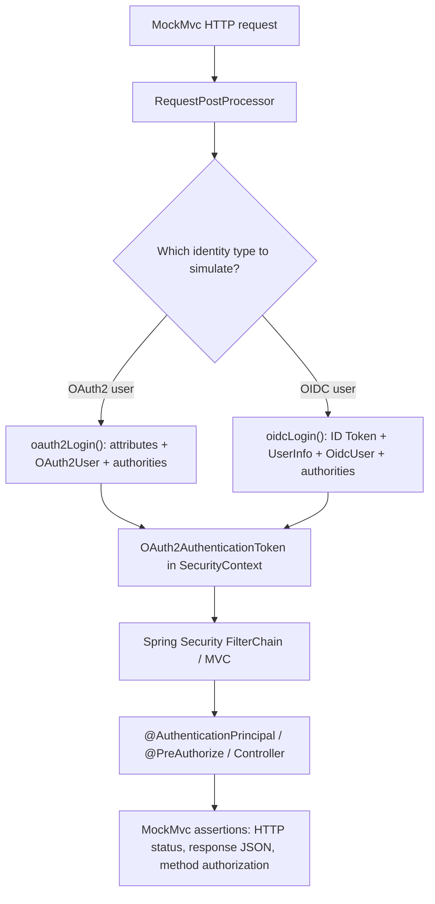

# 29.4. Customizing Attributes, ID Token Claims, and Authorities in Tests

When a **Spring Security OAuth 2.0 / OpenID Connect (OIDC) Client** application uses login via Google, Microsoft Entra ID, Keycloak, or an internal OpenID Provider (OP), controllers and business services often need more than just knowing **"the user is logged in"**. They may read `sub`, `email`, `tenant_id`, `preferred_username`, user groups/permissions, and which registration was used.

Example controller:

```java
@GetMapping("/me")
Map<String, Object> me(@AuthenticationPrincipal OidcUser user) {
    return Map.of(
        "subject", user.getIdToken().getSubject(),
        "issuer", user.getIdToken().getIssuer().toString());
}
```

To test this controller with **MockMvc**, simply adding `@WithMockUser` is usually insufficient: it provides a simulated Spring Security username/password-style Authentication and **does not guarantee the principal is an `OidcUser` with an ID Token**.

Spring Security Test provides two very useful `RequestPostProcessor` helpers on **Servlet**:

- **`oauth2Login()`**: creates an `OAuth2AuthenticationToken` with an `OAuth2User` principal and OAuth2 user attributes.
- **`oidcLogin()`**: creates an `OAuth2AuthenticationToken` with an **`OidcUser`** principal, including a mock `OidcIdToken`, `OidcUserInfo`, and authorities.

This lesson is part of **Chapter 29. Servlet Testing**. We will practice customizing **OAuth2 attributes**, **OIDC ID Token claims**, **UserInfo claims**, **`GrantedAuthority`**, and **principal names**, while testing `@AuthenticationPrincipal`, `@PreAuthorize`, `@RegisteredOAuth2AuthorizedClient`, missing-permission cases, and common pitfalls.

> **Scope:** Java 17+, Spring Boot 3.x, Spring Security 6.5, JUnit 5, MockMvc, and `spring-security-test`. The tokens/claims in this lesson are **test fixtures**, not real verification tokens. The examples do not require calling a real OP. Consult the documentation for your actual Spring Security version if APIs differ.

---

## 1. Why Does OAuth2/OIDC Testing with MockMvc Need Dedicated Tools?

A real post-login request may go through:

```text
Browser -> /oauth2/authorization/company
       -> OpenID Provider: Authorization Code + PKCE
       -> /login/oauth2/code/company?code=...&state=...
       -> Token Endpoint
       -> ID Token validation + UserInfo
       -> SecurityContext containing OAuth2AuthenticationToken
       -> Controller/Service
```

To test **controller or method security** logic, most tests do not need to run the entire flow above. We only need a **`SecurityContext` that reflects the right Authentication type** expected by the code.



This avoids having to:
- Generate authorization codes and correlation state for every controller test;
- Run an OIDC Provider test server just to return a username;
- Sign real JWTs and serve JWKS for tests not focused on token validation;
- Put real client secrets, refresh tokens, or real user data into test fixtures.

**Important boundary:** `oidcLogin()` and `oauth2Login()` **simulate an already-authenticated state**; they do not perform authorization redirects, PKCE exchanges, signature validation, or network calls to an OP. When you need to test those, write integration tests with a mock Authorization Server/OP and an appropriate HTTP client.

## 2. Choosing the Right Test Type and Post-Processor

| Goal | Tool to use | What must not be inferred |
| --- | --- | --- |
| Controller only needs `Authentication.getName()` or generic `Principal` | `@WithMockUser` or `user()` | Does not prove OIDC login |
| Controller reads `OAuth2User.getAttributes()` | **`oauth2Login()`** | Not an OIDC ID Token |
| Controller reads `OidcUser.getIdToken()` | **`oidcLogin()`** | Mock ID Token is not cryptographically verified |
| Controller reads `OidcUser.getUserInfo()` | **`oidcLogin().userInfoToken(...)`** | Does not call the UserInfo endpoint |
| Filter/method security checks role/scope | `oidcLogin().authorities(...)` or `oauth2Login().authorities(...)` | Claims do not automatically become roles |
| Controller uses `@RegisteredOAuth2AuthorizedClient` | `oauth2Client()` or authorized client created by login post-processor | Does not perform token refresh |
| Resource Server accepts Bearer JWT | **`jwt()`** | Not the same as OAuth2 Client OIDC Login |
| Real login initiation/callback/token endpoint | Integration test with mock OP, MockWebServer/WireMock/Testcontainers as appropriate | Cannot be proven by `oidcLogin()` alone |

### 2.1. Three Easily Confused Classes

- `OAuth2User`: general OAuth2 Login principal with attributes and authorities.
- `OidcUser`: principal for OIDC Login, extending `OAuth2User` and providing `getIdToken()` and `getUserInfo()`.
- `JwtAuthenticationToken`: Authentication commonly seen in an **OAuth2 Resource Server** using Bearer JWTs; it does not replace `OAuth2AuthenticationToken` from OAuth2 Client login.

**Do not use `jwt()` to test a controller expecting `OidcUser`, and do not use `@WithMockUser` and attempt to cast the principal to `OidcUser`.**

---

## 3. Required Dependencies and Imports

### 3.1. Maven

```xml
<dependencies>
    <dependency>
        <groupId>org.springframework.boot</groupId>
        <artifactId>spring-boot-starter-web</artifactId>
    </dependency>
    <dependency>
        <groupId>org.springframework.boot</groupId>
        <artifactId>spring-boot-starter-security</artifactId>
    </dependency>
    <dependency>
        <groupId>org.springframework.boot</groupId>
        <artifactId>spring-boot-starter-oauth2-client</artifactId>
    </dependency>

    <dependency>
        <groupId>org.springframework.boot</groupId>
        <artifactId>spring-boot-starter-test</artifactId>
        <scope>test</scope>
    </dependency>
    <dependency>
        <groupId>org.springframework.security</groupId>
        <artifactId>spring-security-test</artifactId>
        <scope>test</scope>
    </dependency>
</dependencies>
```

The Spring Boot parent/BOM normally manages dependency versions. Never force `spring-security-test` onto a version different from the Spring Security runtime.

### 3.2. Gradle

```groovy
dependencies {
    implementation 'org.springframework.boot:spring-boot-starter-web'
    implementation 'org.springframework.boot:spring-boot-starter-security'
    implementation 'org.springframework.boot:spring-boot-starter-oauth2-client'

    testImplementation 'org.springframework.boot:spring-boot-starter-test'
    testImplementation 'org.springframework.security:spring-security-test'
}

tasks.named('test') {
    useJUnitPlatform()
}
```

This is an illustrative configuration snippet for understanding test dependencies. In this documentation step, we **do not run Gradle** and do not modify the repository build.

### 3.3. Static Imports in Tests

```java
import static org.springframework.security.test.web.servlet.request
    .SecurityMockMvcRequestPostProcessors.oauth2Login;
import static org.springframework.security.test.web.servlet.request
    .SecurityMockMvcRequestPostProcessors.oidcLogin;

import static org.springframework.test.web.servlet.request
    .MockMvcRequestBuilders.get;
import static org.springframework.test.web.servlet.result
    .MockMvcResultMatchers.status;
import static org.springframework.test.web.servlet.result
    .MockMvcResultMatchers.jsonPath;
```

Long static imports can be written on one line per project style:

```java
import static org.springframework.security.test.web.servlet.request.SecurityMockMvcRequestPostProcessors.oauth2Login;
import static org.springframework.security.test.web.servlet.request.SecurityMockMvcRequestPostProcessors.oidcLogin;
```

Do not confuse the request post-processors above with `SecurityMockServerConfigurers.mockOidcLogin()` intended for **Reactive WebFlux/WebTestClient**.

---

## 4. Understanding Default Values of `oauth2Login()` and `oidcLogin()`

Example:

```java
mvc.perform(get("/me").with(oidcLogin()));
```

Spring Security Test builds an Authentication valid **for the request test context**, with convenient defaults.

| Data | `oauth2Login()` | `oidcLogin()` |
| --- | --- | --- |
| Authentication | `OAuth2AuthenticationToken` | `OAuth2AuthenticationToken` |
| Principal | `OAuth2User` | **`OidcUser`** |
| Default subject | Attribute `sub=user` | ID Token claim `sub=user` |
| Default test authorities | Single authority **`SCOPE_read`** | Single authority **`SCOPE_read`** |
| UserInfo | No OIDC UserInfo model | Default empty mock `OidcUserInfo` |
| ID Token | No | Includes mock `OidcIdToken` |
| Authorized client | Linked mock authorized client | Linked mock authorized client |
| Network call to OP | No | No |
| JWT/JWKS signature validation | No | No |

**Do not project these defaults onto production.** Authority policies in a real app depend on the OP, scopes, OIDC user service, and role mapping. Test post-processors do not run custom production mapping steps.

### 4.1. What Does `RequestPostProcessor` Do?

In `mvc.perform(get(...).with(oidcLogin()))`, the processor modifies **`MockHttpServletRequest`** to attach Authentication/`SecurityContext` and simulate an authorized client. For MVC/Spring Security to see the context properly, MockMvc must have Spring Security filters integrated.

Two common setups:
- Spring Boot Test with `@AutoConfigureMockMvc` and security auto-configuration;
- Standalone MockMvc with `.apply(springSecurity())` or an equivalent filter setup.

If you forget to attach Spring Security to MockMvc, `@AuthenticationPrincipal` may resolve to `null` even when the test calls `.with(oidcLogin())`.

---

## 5. `oauth2Login().attributes()`: Customizing OAuth2 User Attributes

With non-OIDC OAuth2 Login, a controller may read attributes:

```java
import org.springframework.security.core.annotation.AuthenticationPrincipal;
import org.springframework.security.oauth2.core.user.OAuth2User;
import org.springframework.web.bind.annotation.GetMapping;
import org.springframework.web.bind.annotation.RestController;

@RestController
class GenericOAuthUserController {

    @GetMapping("/oauth2/profile")
    String profile(@AuthenticationPrincipal OAuth2User user) {
        return user.getAttribute("user_id");
    }
}
```

In a test:

```java
mvc.perform(get("/oauth2/profile")
        .with(oauth2Login()
            .attributes(attrs -> attrs.put("user_id", "acct-123"))))
    .andExpect(status().isOk())
    .andExpect(content().string("acct-123"));
```

`attributes(...)` takes a `Consumer<Map<String, Object>>`. It lets you mutate the attribute map created for the test:

```java
mvc.perform(get("/oauth2/profile")
    .with(oauth2Login().attributes(attrs -> {
        attrs.put("user_id", "acct-123");
        attrs.put("preferred_username", "tester");
        attrs.put("email_verified", Boolean.TRUE);
        attrs.put("groups", java.util.List.of("readers", "auditors"));
    })));
```

### 5.1. Choose the Right Types

Values in the map have type `Object`, not `String` by default.

For example:

```java
Boolean verified = user.getAttribute("email_verified");
List<String> groups = user.getAttribute("groups");
String userId = user.getAttribute("user_id");
```

If a test puts `email_verified="true"` (String) while production expects `Boolean.TRUE`, you can mask or trigger incorrect type conversion errors. Test fixtures should mirror the **actual types of provider data**.

### 5.2. Modifying or Removing Attributes

```java
.with(oauth2Login().attributes(attrs -> {
    attrs.remove("email");
    attrs.put("user_id", "acct-999");
}))
```

Use this negative case to test how the application handles missing attributes.

**Do not grant access merely because an attribute says `role="admin"`.** For `hasAuthority("ROLE_ADMIN")` to succeed, the Authentication needs the corresponding authority or the real permission-mapping pipeline must execute in the test.

### 5.3. When Should You Not Use `oauth2Login()`?

If the controller declares:

```java
@AuthenticationPrincipal OidcUser user
```

then `oauth2Login()` is not the right fixture. It simulates a generic `OAuth2User` and does not provide `getIdToken()`. In that case, use **`oidcLogin()`**.

---

## 6. `oidcLogin().idToken()`: Customizing ID Token Claims

An OIDC controller may read claims from the ID Token:

```java
import org.springframework.security.core.annotation.AuthenticationPrincipal;
import org.springframework.security.oauth2.core.oidc.user.OidcUser;
import org.springframework.web.bind.annotation.GetMapping;
import org.springframework.web.bind.annotation.RestController;

@RestController
class OidcIdentityController {

    @GetMapping("/identity/tenant")
    String tenant(@AuthenticationPrincipal OidcUser user) {
        return user.getIdToken().getClaimAsString("tenant_id");
    }
}
```

In MockMvc:

```java
mvc.perform(get("/identity/tenant")
        .with(oidcLogin()
            .idToken(token -> token
                .claim("sub", "employee-42")
                .claim("tenant_id", "tenant-a")
                .claim("email", "learner@example.test")
                .claim("email_verified", true))))
    .andExpect(status().isOk())
    .andExpect(content().string("tenant-a"));
```

`idToken(...)` takes a `Consumer<OidcIdToken.Builder>`. Each `claim(name, value)` updates claims on the **mock ID Token**.

### 6.1. Common Claims

| Claim | Typical type | Meaning | Use in tests |
| --- | --- | --- | --- |
| `sub` | String | Subject identifying user within issuer | Testing identity keys |
| `iss` | String/URI representation | Issuer that issued the ID Token | Simulating issuer, not checking signature |
| `aud` | String/List | Audience of the ID Token | Testing metadata reading, not replacing JWT validation |
| `email` | String | Email claim | Testing present/missing/changed email |
| `email_verified` | Boolean | Email verification status | Testing boolean handling logic |
| `preferred_username` | String | Display username | Testing principal naming |
| `name` | String | Display name | Testing UI output |
| `tenant_id` | String (OP-specific) | Tenant/business context | Testing tenant-aware logic |
| `groups` | List or provider-specific | Groups from OP | Testing mapping in dedicated service |
| `auth_time` | Epoch seconds/time representation | Authentication timestamp | Testing freshness policy when supported |
| `nonce` | String | Binds authentication request | Test claim only; does not validate OIDC nonce |

Example with a list claim:

```java
.with(oidcLogin()
    .idToken(token -> token
        .claim("sub", "employee-42")
        .claim("groups", List.of("engineering", "reports-read"))))
```

### 6.2. Mock Data Is Not Automatically Validated

A test could write:

```java
.with(oidcLogin().idToken(token -> token
    .claim("iss", "https://untrusted.example.test")
    .claim("exp", 1L)))
```

and the controller will still receive an `OidcUser` during the test request. **That does not demonstrate a vulnerability**: the request post-processor intentionally skips the login protocol and creates Authentication directly so you can test post-login layers.

To ensure invalid issuers, signatures, audiences, expirations, or nonces are rejected, test:
- The OIDC login authentication provider/ID Token decoder at its own layer;
- The Authorization Code callback + token/JWKS test server;
- Or configuration/integration tests that genuinely execute token validation.

**Never use `oidcLogin()` to claim the application has tested real JWT signature verification.**

### 6.3. Do Not Use an ID Token as an Access Token

`OidcIdToken` is an identity token for the client. A Resource Server API typically expects an **access token** with its own audience/scope. In MockMvc:
- `oidcLogin().idToken(...)` simulates OIDC identity;
- `oauth2Client()` or `@RegisteredOAuth2AuthorizedClient` deals with outbound access tokens;
- `jwt()` simulates an inbound JWT in Resource Server tests.

Never pass `getIdToken().getTokenValue()` as an API Bearer token just to make tests pass.

---

## 7. `oidcLogin().userInfoToken()`: Customizing UserInfo Claims

OIDC can supply user attributes via the **UserInfo endpoint**, separate from the ID Token.

The Spring Security 6.5 test API uses the method name:

**`userInfoToken(Consumer<OidcUserInfo.Builder>)`**.

Example:

```java
mvc.perform(get("/identity/profile")
    .with(oidcLogin()
        .idToken(idToken -> idToken.claim("sub", "user-123"))
        .userInfoToken(info -> info
            .claim("name", "Nguyễn An")
            .claim("locale", "vi-VN")
            .claim("department", "finance"))));
```

Remember the method name **`userInfoToken(...)`** when using Spring Security Test Servlet 6.5. Do not guess `.userInfo(...)`; check the Javadoc of your actual dependency version.

### 7.1. ID Token and UserInfo Are Read via Different APIs

```java
OidcIdToken idToken = user.getIdToken();
String subject = idToken.getSubject();

OidcUserInfo userInfo = user.getUserInfo();
String name = userInfo == null
    ? null
    : userInfo.getClaimAsString("name");
```

To accurately test where the controller reads data from, put the fixture in the **matching source**:
- Controller reads `getIdToken().getClaimAsString("tenant_id")` -> use `idToken(...)`.
- Controller reads `getUserInfo().getClaimAsString("name")` -> use `userInfoToken(...)`.
- Controller reads `getClaims()` or `getAttribute()` on `OidcUser` -> data may be aggregated from ID Token and UserInfo; tests should simulate overlapping or missing claims appropriately.

### 7.2. Default UserInfo in Tests Is Empty

According to the Spring Security Test documentation, `oidcLogin()` by default creates an **`OidcUserInfo` with no claims**. Thus test code reading `user.getUserInfo().getClaimAsString("name")` can return `null` unless customized.

This helps catch code that assumes a UserInfo claim is present when a fixture omits it.

### 7.3. Do Not Assume UserInfo Always Exists in Production

Depending on the provider, scopes, permissions, token policy, and user service:
- An OP may not expose a UserInfo endpoint;
- The client may not call UserInfo;
- A claim may exist only in the ID Token or only in UserInfo;
- UserInfo may return unexpected data;
- When UserInfo is used, `sub` must match the ID Token per OIDC Core.

Good tests cover **missing UserInfo** and **missing claims**, not just the happy path where every field is populated.

---

## 8. `authorities()`: Authentication Authorities in Tests

Spring Security authorization normally checks **`GrantedAuthority`** rather than reading arbitrary claims directly.

Example controller:

```java
@PreAuthorize("hasAuthority('ROLE_REPORT_READER')")
@GetMapping("/reports")
String reports() {
    return "report-ok";
}
```

To allow the request:

```java
mvc.perform(get("/reports")
    .with(oidcLogin()
        .authorities(
            new SimpleGrantedAuthority("ROLE_REPORT_READER"))))
    .andExpect(status().isOk());
```

To verify missing the required authority is denied:

```java
mvc.perform(get("/reports")
    .with(oidcLogin()
        .authorities(
            new SimpleGrantedAuthority("SCOPE_read"))))
    .andExpect(status().isForbidden());
```

**`authorities(...)` sets the authorities that the test Authentication will have.** Do not assume it appends to the default `SCOPE_read` authority; if you need both, declare both explicitly:

```java
.with(oidcLogin().authorities(
    new SimpleGrantedAuthority("SCOPE_read"),
    new SimpleGrantedAuthority("ROLE_REPORT_READER")))
```

### 8.1. Roles and Scopes Differ

| Expression | Effective authority | Example |
| --- | --- | --- |
| `hasRole("ADMIN")` | Checks `ROLE_ADMIN` using default role prefix | Business admin permission |
| `hasAuthority("ROLE_ADMIN")` | Checks exact string `ROLE_ADMIN` | Equivalent when using default prefix |
| `hasAuthority("SCOPE_reports.read")` | Checks exact string `SCOPE_reports.read` | OAuth2 scope |
| `hasAuthority("reports.read")` | Checks string `reports.read` | Not equal to `SCOPE_reports.read` |

A claim:

```json
{
  "groups": ["report-readers"]
}
```

**does not automatically create** the `ROLE_REPORT_READER` authority. Real applications need a custom user service/authority mapper/provisioning logic to translate verified groups into business roles. In tests, calling `.authorities(...)` **simulates the output of mapping**, without testing the mapping itself.

### 8.2. Keep Two Test Layers Separate

**Test A — controller authorization:** set the right authorities with the post-processor and assert 200/403.

**Test B — role mapping:** pass mock claims into the **real mapper** and assert the generated authorities. Do not mock the mapper in a test meant to prove the mapping logic itself.

### 8.3. Never Arbitrarily Escalate Privileges from Email/Claims

For example, OP data containing:

```json
{
  "email": "director@example.test",
  "tenant_id": "west"
}
```

must never grant `ROLE_ADMIN` just because an email or tenant string matches a pattern. Authorization mapping requires trusted policy, verified issuer/subject, tenant boundaries, and verified data.

---

## 9. Complete Example: Controller Accepting `OidcUser`

Create an illustrative controller with two endpoints: one returning claims, one guarded by method security.

```java
package example.web;

import java.util.LinkedHashMap;
import java.util.Map;

import org.springframework.http.HttpStatus;
import org.springframework.security.access.prepost.PreAuthorize;
import org.springframework.security.core.annotation.AuthenticationPrincipal;
import org.springframework.security.oauth2.core.oidc.user.OidcUser;
import org.springframework.web.bind.annotation.GetMapping;
import org.springframework.web.bind.annotation.RestController;
import org.springframework.web.server.ResponseStatusException;

@RestController
class ProfileController {

    @GetMapping("/api/profile")
    Map<String, Object> profile(@AuthenticationPrincipal OidcUser user) {
        if (user == null) {
            throw new ResponseStatusException(
                HttpStatus.UNAUTHORIZED, "OIDC login required");
        }

        Map<String, Object> result = new LinkedHashMap<>();
        result.put("subject", user.getIdToken().getSubject());
        result.put("department",
            user.getIdToken().getClaimAsString("department"));

        String displayName = user.getUserInfo() == null
            ? null
            : user.getUserInfo().getClaimAsString("name");

        result.put("displayName", displayName);
        return result;
    }

    @GetMapping("/api/reports")
    @PreAuthorize("hasAuthority('ROLE_REPORT_READER')")
    String reports() {
        return "report-ok";
    }
}
```

This is a learning-model controller; never directly expose tokens or sensitive claims. In real production apps, return only data the user is authorized to view and enforce appropriate authorization/tenant policies.

### 9.1. Security Configuration for `WebMvcTest`

You can create a **test-only `SecurityFilterChain`** so HTTP status assertions remain deterministic without calling an OP:

```java
package example.web;

import org.springframework.boot.test.context.TestConfiguration;
import org.springframework.context.annotation.Bean;
import org.springframework.security.config.Customizer;
import org.springframework.security.config.annotation.method.configuration.EnableMethodSecurity;
import org.springframework.security.config.annotation.web.builders.HttpSecurity;
import org.springframework.security.web.SecurityFilterChain;

@TestConfiguration
@EnableMethodSecurity
class ProfileTestSecurityConfig {

    @Bean
    SecurityFilterChain testChain(HttpSecurity http) throws Exception {
        return http
            .authorizeHttpRequests(auth -> auth
                .anyRequest().authenticated())
            .httpBasic(Customizer.withDefaults())
            .build();
    }
}
```

**Why use `httpBasic()` in the test configuration?** To demonstrate an unauthenticated client receiving **401** rather than a browser OAuth2 login redirect. It **does not replace the production `SecurityFilterChain`**. If you want to verify the real application's exact OAuth2 Login policy, import the production security config or use `@SpringBootTest` as appropriate.

### 9.2. MockMvc Test with Claims and Authorities

```java
package example.web;

import org.junit.jupiter.api.Test;
import org.springframework.beans.factory.annotation.Autowired;
import org.springframework.boot.test.autoconfigure.web.servlet.WebMvcTest;
import org.springframework.context.annotation.Import;
import org.springframework.security.core.authority.SimpleGrantedAuthority;
import org.springframework.test.web.servlet.MockMvc;

import static org.springframework.security.test.web.servlet.request.SecurityMockMvcRequestPostProcessors.oidcLogin;
import static org.springframework.test.web.servlet.request.MockMvcRequestBuilders.get;
import static org.springframework.test.web.servlet.result.MockMvcResultMatchers.content;
import static org.springframework.test.web.servlet.result.MockMvcResultMatchers.jsonPath;
import static org.springframework.test.web.servlet.result.MockMvcResultMatchers.status;

@WebMvcTest(ProfileController.class)
@Import(ProfileTestSecurityConfig.class)
class ProfileControllerTest {

    @Autowired
    MockMvc mvc;

    @Test
    void profileReadsIdTokenAndUserInfo() throws Exception {
        mvc.perform(get("/api/profile")
            .with(oidcLogin()
                .idToken(token -> token
                    .claim("sub", "employee-42")
                    .claim("department", "engineering"))
                .userInfoToken(info ->
                    info.claim("name", "Nguyễn An"))))
            .andExpect(status().isOk())
            .andExpect(jsonPath("$.subject").value("employee-42"))
            .andExpect(jsonPath("$.department").value("engineering"))
            .andExpect(jsonPath("$.displayName").value("Nguyễn An"));
    }

    @Test
    void reportAllowedWithBusinessAuthority() throws Exception {
        mvc.perform(get("/api/reports")
            .with(oidcLogin().authorities(
                new SimpleGrantedAuthority("ROLE_REPORT_READER"))))
            .andExpect(status().isOk())
            .andExpect(content().string("report-ok"));
    }

    @Test
    void reportForbiddenWithoutBusinessAuthority() throws Exception {
        mvc.perform(get("/api/reports")
            .with(oidcLogin().authorities(
                new SimpleGrantedAuthority("SCOPE_read"))))
            .andExpect(status().isForbidden());
    }

    @Test
    void anonymousUserCannotAccessProfile() throws Exception {
        mvc.perform(get("/api/profile"))
            .andExpect(status().isUnauthorized());
    }

    @Test
    void missingOptionalClaimsAreHandled() throws Exception {
        mvc.perform(get("/api/profile").with(oidcLogin()))
            .andExpect(status().isOk())
            .andExpect(jsonPath("$.subject").value("user"));
    }
}
```

In this example:
- `@WebMvcTest` creates a controller/MVC test slice;
- `@Import(ProfileTestSecurityConfig.class)` enables the test policy and `@EnableMethodSecurity`;
- `@AutoConfigureMockMvc` is integrated with `@WebMvcTest` via Spring Boot test configuration, so Spring Security filters are applied in a standard setup;
- `oidcLogin()` supplies the `OidcUser` expected by the controller;
- `idToken` and `userInfoToken` populate two separate claim sources;
- `authorities` supplies present/missing permissions to test `@PreAuthorize`;
- The 401 test is a result of the **test-only `httpBasic` config**; with production `oauth2Login()`, an anonymous user may receive a **302 redirect** instead of 401.

### 9.3. Do Not Claim These Tests Verified a JWT

None of the tests in section 9 send tokens to an OP, call JWKS, execute PKCE, or verify signatures. They test **controller + authorization behavior after Authentication is simulated**.

When testing the production filter chain, keep the real production `SecurityFilterChain` instead of replacing it with a test config, and do not infer from a test-only chain's 401/403 that production browser UX behaves identically.

---

## 10. Full `OAuth2User` Customization: `oauth2Login().oauth2User(...)`

Sometimes a provider puts the username in `user_name` instead of `sub`, or the application uses a custom `OAuth2User` implementation.

Example:

```java
import java.util.Map;

import org.springframework.security.core.authority.AuthorityUtils;
import org.springframework.security.oauth2.core.user.DefaultOAuth2User;
import org.springframework.security.oauth2.core.user.OAuth2User;

OAuth2User customUser = new DefaultOAuth2User(
    AuthorityUtils.createAuthorityList(
        "ROLE_SUPPORT",
        "SCOPE_profile.read"),
    Map.of(
        "user_name", "support-01",
        "user_id", "u-123",
        "email_verified", true),
    "user_name");

mvc.perform(get("/oauth2/profile")
    .with(oauth2Login().oauth2User(customUser)));
```

The `DefaultOAuth2User` constructor takes:
1. Authorities;
2. Attribute map;
3. **`nameAttributeKey`** — the key used for `getName()`.

Thus:

```java
customUser.getName(); // "support-01"
```

**If `nameAttributeKey` is missing from the attributes**, `DefaultOAuth2User` can fail upon creation. When testing custom principals, ensure the key is included.

### 10.1. Why Use `oauth2User(...)` Instead of `attributes(...)`?

`attributes(...)` suffices when you only tweak map fields while keeping default behavior.

`oauth2User(customUser)` fits when:
- Using a subclass or custom implementation;
- Changing `getName()`;
- Testing authorities bound directly to the principal;
- The controller calls a custom method on the custom principal;
- A business service relies on a structured production user object.

### 10.2. Avoid Conflicting Configuration Combinations

For example:

```java
oauth2Login()
    .attributes(attrs -> attrs.put("user_id", "A"))
    .oauth2User(customUser)
```

If you provide a complete `customUser`, do not expect earlier `attributes` modifications to merge in any specific way. Pick **one clear fixture strategy**: either customize the default builder, or supply a complete principal.

---

## 11. Full `OidcUser` Customization: `oidcLogin().oidcUser(...)`

When you want to test a principal name other than `sub` or a specific `OidcUser` implementation, you can construct `DefaultOidcUser`.

```java
import org.springframework.security.core.authority.AuthorityUtils;
import org.springframework.security.oauth2.core.oidc.OidcIdToken;
import org.springframework.security.oauth2.core.oidc.user.DefaultOidcUser;
import org.springframework.security.oauth2.core.oidc.user.OidcUser;

OidcIdToken token = OidcIdToken.withTokenValue("synthetic-id-token")
    .claim("sub", "employee-42")
    .claim("preferred_username", "nguyen.an")
    .claim("tenant_id", "tenant-a")
    .build();

OidcUser custom = new DefaultOidcUser(
    AuthorityUtils.createAuthorityList(
        "SCOPE_read",
        "ROLE_REPORT_READER"),
    token,
    "preferred_username");

mvc.perform(get("/api/profile")
    .with(oidcLogin().oidcUser(custom)));
```

Here:
- `OidcIdToken.withTokenValue(...)` builds a test token model, not an OP-signed token.
- `DefaultOidcUser` accepts authorities, the ID Token, and `nameAttributeKey`.
- `getName()` resolves via `preferred_username` when chosen.
- `getIdToken()` still returns the constructed token.

### 11.1. Including `OidcUserInfo`

If you want to build a principal with UserInfo as well:

```java
import org.springframework.security.oauth2.core.oidc.user.OidcUserInfo;

OidcUserInfo userInfo = OidcUserInfo.builder()
    .claim("sub", "employee-42")
    .claim("name", "Nguyễn An")
    .claim("locale", "vi-VN")
    .build();

OidcUser custom = new DefaultOidcUser(
    AuthorityUtils.createAuthorityList("ROLE_REPORT_READER"),
    token,
    userInfo,
    "preferred_username");
```

When simulating real OIDC data, **`sub` in UserInfo must match the ID Token**. If the goal is testing rejection of UserInfo subject mismatch, do not use `oidcLogin()` as proof that the OIDC user service checked it: the post-processor bypasses UserInfo retrieval/validation. Test the real user service with a separate integration test.

### 11.2. Custom `OidcUser` vs. `idToken(...)` / `userInfoToken(...)`

- `idToken(...)`: modifies ID Token claims inside the auto-created mock principal.
- `userInfoToken(...)`: modifies UserInfo claims inside the auto-created mock principal.
- **`oidcUser(custom)`**: replaces the entire principal with the object you built.

Avoid calling all three without knowing precedence rules, especially when claims conflict.

---

## 12. Testing Missing, Null, and Wrong-Type Claims

Provider specifications often define optional fields; tests with only fully populated data easily hide `NullPointerException` or `ClassCastException` bugs.

### 12.1. Missing Email

```java
mvc.perform(get("/api/profile")
    .with(oidcLogin()
        .idToken(token ->
            token.claims(claims -> claims.remove("email")))));
```

This illustrates adjusting the builder to remove an optional claim in a test. On Spring Security versions with different builder APIs, check `OidcIdToken.Builder` in Javadoc before implementing.

**Never backfill `email` with `sub` and treat it as a verified email address.** They are different identifiers.

### 12.2. `email_verified` Has Type Boolean

```java
.with(oidcLogin().idToken(token -> token
    .claim("email", "learner@example.test")
    .claim("email_verified", false)))
```

This lets you test business logic that rejects unverified emails or avoids relying on email as an account-linking key.

### 12.3. Complex List and Map Claims

A provider might issue:

```json
{
  "groups": ["reporting", "engineering"],
  "custom": {
    "department": "ops",
    "cost_center": "CC-17"
  }
}
```

Fixture:

```java
.with(oidcLogin().idToken(token -> token
    .claim("groups", List.of("reporting", "engineering"))
    .claim("custom", Map.of(
        "department", "ops",
        "cost_center", "CC-17"))))
```

Test accurate **data types** along with empty, missing, and mismatched-type cases. For provider-specific claims, never assume every string is a scope or role.

### 12.4. An `"admin"` Claim Does Not Grant `ROLE_ADMIN`

```java
.with(oidcLogin().idToken(token -> token
    .claim("groups", List.of("admin"))))
```

Nothing here gives `Authentication` the `ROLE_ADMIN` authority. If method security relies on roles, you must:
- Assign roles via `authorities(...)` when testing policy;
- Or execute the production role mapper in a separate test to verify conversion.

---

## 13. Testing a Custom Role/Authority Mapper Instead of Only Mocking Roles

An illustrative policy:

- `groups` containing `reports-read` -> grant `ROLE_REPORT_READER`;
- Only allowlisted groups are mapped;
- Never grant `ROLE_ADMIN` from arbitrary group values;
- Claims must come from a trusted issuer/provider in the real authentication flow.

A plain Java mapper:

```java
package example.security;

import java.util.ArrayList;
import java.util.Collection;
import java.util.List;

import org.springframework.security.core.GrantedAuthority;
import org.springframework.security.core.authority.SimpleGrantedAuthority;
import org.springframework.security.oauth2.core.oidc.user.OidcUser;

public final class ReportRoleMapper {

    public Collection<GrantedAuthority> map(OidcUser user) {
        List<GrantedAuthority> result = new ArrayList<>();
        result.add(new SimpleGrantedAuthority("SCOPE_read"));

        List<String> groups =
            user.getIdToken().getClaimAsStringList("groups");

        if (groups != null && groups.contains("reports-read")) {
            result.add(
                new SimpleGrantedAuthority("ROLE_REPORT_READER"));
        }

        return result;
    }
}
```

Mapper test:

```java
@Test
void reportsReadGroupMapsToBusinessRole() {
    OidcIdToken idToken = OidcIdToken.withTokenValue("test")
        .claim("sub", "employee-42")
        .claim("groups", List.of("reports-read"))
        .build();

    OidcUser user = new DefaultOidcUser(
        AuthorityUtils.createAuthorityList("SCOPE_read"),
        idToken);

    Collection<GrantedAuthority> authorities =
        new ReportRoleMapper().map(user);

    assertThat(authorities)
        .contains(new SimpleGrantedAuthority("ROLE_REPORT_READER"));
}
```

And negative test:

```java
@Test
void unknownGroupDoesNotBecomeAdmin() {
    OidcIdToken token = OidcIdToken.withTokenValue("test")
        .claim("sub", "employee-42")
        .claim("groups", List.of("arbitrary-admin"))
        .build();

    OidcUser user = new DefaultOidcUser(
        AuthorityUtils.createAuthorityList("SCOPE_read"),
        token);

    Collection<GrantedAuthority> authorities =
        new ReportRoleMapper().map(user);

    assertThat(authorities)
        .doesNotContain(new SimpleGrantedAuthority("ROLE_ADMIN"));
}
```

**Two distinct testing levels**:

1. Mapper unit test: "Are `groups` claims X translated into authorities Y properly?"
2. Controller authorization test: "Given authorities Y, does the endpoint/method allow or deny properly?"

If you only use `oidcLogin().authorities(...)` to test both, the mapper could be broken while controller tests stay green.

### 13.1. Claims from UserInfo or ID Token?

The mapper above intentionally reads `user.getIdToken()`. If the production mapper reads `getUserInfo()` or `getClaims()`, the fixture and test must put claims in the matching source.

Do not move data from UserInfo to ID Token in tests if production does not behave that way.

### 13.2. Where Does the Role Mapper Run in Production?

Spring Security can plug custom mapping into a `GrantedAuthoritiesMapper` or an OIDC user service wrapper. `oidcLogin()` **does not re-run that entire pipeline**. Therefore:
- Test the mapper in a dedicated unit/integration context;
- Test post-login authorization with mocked authorities;
- Keep some integration tests running the real/mock OIDC login flow when you need to prove wiring.

---

## 14. Multi-Tenant and Multi-Provider Scenarios

Suppose the Portal has two OIDC registrations:

```text
company -> issuer https://id.company.example.test
partner -> issuer https://id.partner.example.test
```

Both returning `sub="42"` or `email="an@example.test"` does not mean they refer to the same person.

An OIDC identity key is at minimum:

```text
(issuer, subject)
```

### 14.1. Changing the Test `ClientRegistration`

`oidcLogin()` and `oauth2Login()` provide:

```java
.clientRegistration(ClientRegistration registration)
```

A test registration:

```java
import org.springframework.security.oauth2.client.registration.ClientRegistration;
import org.springframework.security.oauth2.core.AuthorizationGrantType;
import org.springframework.security.oauth2.core.ClientAuthenticationMethod;

ClientRegistration companyRegistration =
    ClientRegistration.withRegistrationId("company")
        .clientId("test-client-id")
        .clientSecret("test-only-secret")
        .clientAuthenticationMethod(
            ClientAuthenticationMethod.CLIENT_SECRET_BASIC)
        .authorizationGrantType(
            AuthorizationGrantType.AUTHORIZATION_CODE)
        .redirectUri("{baseUrl}/login/oauth2/code/{registrationId}")
        .authorizationUri("https://id.company.example.test/authorize")
        .tokenUri("https://id.company.example.test/token")
        .jwkSetUri("https://id.company.example.test/jwks")
        .issuerUri("https://id.company.example.test")
        .scope("openid", "profile")
        .clientName("Company")
        .build();
```

Using in a test:

```java
mvc.perform(get("/api/profile")
    .with(oidcLogin()
        .clientRegistration(companyRegistration)
        .idToken(token -> token
            .claim("sub", "employee-42")
            .claim("tenant_id", "tenant-a"))));
```

**`clientRegistration(...)` simulates client/authorized-client metadata** without calling OIDC Discovery. The issuer value in this test is strictly a fixture; no signature validation occurs with `oidcLogin()`.

### 14.2. Do Not Change Only the Issuer Claim and Assume Registration Changed

```java
.with(oidcLogin().idToken(token ->
    token.claim("iss", "https://id.partner.example.test")))
```

This does not make `OAuth2AuthenticationToken.getAuthorizedClientRegistrationId()` become `partner`. Registration ID and token claims are **two different sets of data**. When testing multi-provider logic, set both the matching **registration** and **claims**.

### 14.3. Do Not Let Roles Cross Tenant Boundaries

A helpful test:

```text
OIDC identity:
  issuer = company
  sub = user-42
  tenant_id = tenant-a

Business request:
  /tenants/tenant-b/reports

Expected:
  403 or domain-specific denial,
  even though the user holds ROLE_REPORT_READER in tenant-a.
```

A global authority like `ROLE_REPORT_READER` is not enough to prove a user can access **every tenant**. Tests must exercise the real production tenant authorizer/ACL logic or corresponding service, not merely a simple `hasAuthority` check.

---

## 15. Testing `@RegisteredOAuth2AuthorizedClient`

A controller may need an authorized client's access token to call an API:

```java
import org.springframework.security.oauth2.client.OAuth2AuthorizedClient;
import org.springframework.security.oauth2.client.annotation.RegisteredOAuth2AuthorizedClient;
import org.springframework.web.bind.annotation.GetMapping;
import org.springframework.web.bind.annotation.RestController;

@RestController
class ConnectionController {

    @GetMapping("/connection/registration")
    String registration(
        @RegisteredOAuth2AuthorizedClient OAuth2AuthorizedClient client) {

        return client.getClientRegistration().getRegistrationId();
    }
}
```

According to Spring Security Test documentation, `oauth2Login()` and `oidcLogin()` not only create the principal but also associate a **mock `OAuth2AuthorizedClient`** with a compatible mock/repository to support such cases.

```java
mvc.perform(get("/connection/registration")
    .with(oidcLogin().clientRegistration(companyRegistration)))
    .andExpect(status().isOk())
    .andExpect(content().string("company"));
```

Condition: the test's MVC context must include the **argument resolver/authorized client infrastructure** compatible with `@RegisteredOAuth2AuthorizedClient`. In a minimal `@WebMvcTest` slice that has not registered OAuth2 Client support, the resolver may be absent, so the snippet above **is not guaranteed to work with the post-processor alone**. In that case:
- Import the appropriate OAuth2 Client MVC configuration;
- Or use `@SpringBootTest` with the real configuration;
- Or test the service/controller by mocking the dependency at the appropriate boundary.

### 15.1. When No User Is Logged In Yet an OAuth2 Client Token Is Needed

For `client_credentials` or a registration independent of a user, you can use:

```java
import static org.springframework.security.test.web.servlet.request.SecurityMockMvcRequestPostProcessors.oauth2Client;

mvc.perform(get("/connection/registration")
    .with(oauth2Client()));
```

`oauth2Client()` is dedicated to an **authorized client** that does not necessarily involve an `OidcUser`. Never use `oidcLogin()` when what you really want to test is a service account/token from a `client_credentials` grant.

### 15.2. Never Log Access Tokens in Tests

Avoid:

```java
// Never create a debug endpoint returning raw tokens.
return client.getAccessToken().getTokenValue();
```

Instead, test non-sensitive metadata (registrationId, token expiry category) or mock the outbound HTTP client to verify the `Bearer` header is attached properly in **local tests** without writing real tokens to logs.

### 15.3. Mocking an Authorized Client Does Not Prove Token Refresh

The MockMvc post-processor does not execute:
- Real Authorization Code token exchanges;
- Refresh Token grants;
- Secret rotation;
- Token revocation;
- Remote Resource Server audience/scope validation.

Those behaviors must be tested separately on `OAuth2AuthorizedClientManager`, client providers, `RestClient`/`WebClient` integration, or external mock servers.

---

## 16. `@WithMockUser` Compared to `oidcLogin()`

`@WithMockUser` is very convenient when code only checks:

```java
@PreAuthorize("hasRole('USER')")
@GetMapping("/basic")
String basic(Principal principal) {
    return principal.getName();
}
```

Test:

```java
@Test
@WithMockUser(username = "alice", roles = "USER")
void basicAccess() throws Exception {
    mvc.perform(get("/basic"))
        .andExpect(status().isOk());
}
```

However, when the controller requires:

```java
@GetMapping("/oidc")
String oidc(@AuthenticationPrincipal OidcUser user) {
    return user.getIdToken().getSubject();
}
```

`@WithMockUser` does not produce an `OidcUser`. Tests may encounter `null` or behavior inconsistent with the production login principal.

**Choose `oidcLogin()` whenever code relies on OIDC semantics.**

### 16.1. Can You Use a Custom `@WithSecurityContext`?

Yes. For a large test suite, you can build a custom `@WithMockOidcUser` annotation with `@WithSecurityContext` and a `WithSecurityContextFactory`.

However, that is a heavier abstraction requiring you to construct `OidcUser`, `OAuth2AuthenticationToken`, and—if tests use `@RegisteredOAuth2AuthorizedClient`—the authorized client context as well. For most controller tests, **`oidcLogin()`** is simpler and matches built-in contracts.

### 16.2. When Is `@WithMockUser` Still the Right Choice?

If a test only verifies a generic role-based policy and does not inspect an OAuth2/OIDC-specific principal, `@WithMockUser` is enough. Do not force every test into an OIDC test if the controller does not depend on OIDC.

---

## 17. Testing with `@PreAuthorize` and Method Security

`@PreAuthorize` will not execute in a slice test if method security is not enabled or the controller/service is not properly proxied.

To test method security policies:
- Enable `@EnableMethodSecurity` in an active configuration;
- Ensure the bean is managed by Spring—never instantiate it with `new` and call it directly when testing proxies;
- Integrate `SecurityFilterChain`;
- Pick exact authorities in tests;
- Include negative cases.

### 17.1. A Positive Test Alone Is Not Enough

```java
mvc.perform(get("/api/reports")
    .with(oidcLogin()
        .authorities(new SimpleGrantedAuthority("ROLE_REPORT_READER"))))
    .andExpect(status().isOk());
```

If you forgot to enable method security, the test above can still pass because the endpoint is unguarded by a proxy.

Include:

```java
mvc.perform(get("/api/reports")
    .with(oidcLogin()
        .authorities(new SimpleGrantedAuthority("ROLE_OTHER"))))
    .andExpect(status().isForbidden());
```

The missing-authority case proves method security is genuinely blocking unauthorized calls.

### 17.2. Distinguishing 401 and 403

- **401 Unauthorized**: the request is unauthenticated and the system returns HTTP 401.
- **403 Forbidden**: typically authenticated but lacking sufficient permission.

In production browser OIDC Login, an unauthenticated user is usually redirected (HTTP **302**) to the login entry point rather than receiving 401. Therefore, MockMvc tests **must follow the real `SecurityFilterChain`** or clearly document a test-only config as in section 9.

### 17.3. Authorities on Authentication Differ from Raw Claims

A controller with:

```java
@PreAuthorize("hasAuthority('ROLE_ADMIN')")
```

checks the `Authentication.getAuthorities()` collection. Adding `.idToken(token -> token.claim("role","ADMIN"))` is not equivalent to:

```java
.authorities(new SimpleGrantedAuthority("ROLE_ADMIN"))
```

If production runs custom role mapping, verify it with a mapper integration test. Never introduce false positives into authorization tests.

---

## 18. MockMvc Setup and `SecurityContext`

### 18.1. Spring Boot `@WebMvcTest`

```java
@WebMvcTest(ProfileController.class)
@Import(ProfileTestSecurityConfig.class)
class ProfileControllerTest {
    @Autowired MockMvc mvc;
}
```

In a standard Spring Boot setup, the `@WebMvcTest` slice auto-configures `MockMvc` and Spring Security filters. However, if a test specifies `@AutoConfigureMockMvc(addFilters = false)` or customizes configuration, you can lose the very filters you intend to test.

### 18.2. Standalone MockMvc

An example when building manually:

```java
import static org.springframework.security.test.web.servlet.setup.SecurityMockMvcConfigurers.springSecurity;

MockMvc mvc = MockMvcBuilders.webAppContextSetup(context)
    .apply(springSecurity())
    .build();
```

If using `standaloneSetup(controller)`, configure `SecurityContext` integration/filters properly; do not assume `.with(oidcLogin())` alone suffices when no security filter is attached to the request.

### 18.3. Per-Request `SecurityContext`

```java
mvc.perform(get("/api/profile")
    .with(oidcLogin().idToken(token ->
        token.claim("sub", "user-a"))));

mvc.perform(get("/api/profile")
    .with(oidcLogin().idToken(token ->
        token.claim("sub", "user-b"))));
```

Each request receives its own fixture. Never save a global static `SecurityContextHolder` across tests, as it easily causes cross-test or cross-thread contamination.

### 18.4. When Using Asynchronous MVC

For async endpoints, MockMvc may require `asyncDispatch(...)` to assert the final result. Spring Security provides context propagation for framework-managed async operations, whereas custom threads/executors need explicit handling. Do not assume `oidcLogin()` automatically propagates `SecurityContext` to custom threads.

---

## 19. Testing Principal Name Mapping

An OP may designate `preferred_username` or `user_name` as the display principal name.

### 19.1. `oauth2Login()` with `DefaultOAuth2User`

```java
OAuth2User user = new DefaultOAuth2User(
    AuthorityUtils.createAuthorityList("SCOPE_read"),
    Map.of(
        "user_name", "tester-01",
        "sub", "subject-42"),
    "user_name");

mvc.perform(get("/oauth2/username")
    .with(oauth2Login().oauth2User(user)));
```

### 19.2. `oidcLogin()` with `DefaultOidcUser`

```java
OidcUser user = new DefaultOidcUser(
    AuthorityUtils.createAuthorityList("SCOPE_read"),
    OidcIdToken.withTokenValue("synthetic")
        .claim("sub", "subject-42")
        .claim("preferred_username", "tester-01")
        .build(),
    "preferred_username");

mvc.perform(get("/oidc/username")
    .with(oidcLogin().oidcUser(user)));
```

### 19.3. A Display Name Is Not a Unique Identity Key

`preferred_username` can change or collide across users; `email` should likewise not serve as a unique identifier across issuers.

In multi-provider OIDC, business identity should rely on at least `(iss, sub)` and an account-linking policy. When testing principal names, never infer that the chosen display name is also a safe unique identity key.

---

## 20. Realistic Fixture Data: Avoid Over-Granting Permissions

A common testing mistake is creating one "super-privileged" OIDC principal shared across all tests:

```java
static RequestPostProcessor superUser() {
    return oidcLogin().authorities(
        new SimpleGrantedAuthority("ROLE_ADMIN"),
        new SimpleGrantedAuthority("ROLE_REPORT_READER"),
        new SimpleGrantedAuthority("SCOPE_read"),
        new SimpleGrantedAuthority("SCOPE_write"));
}
```

When every test runs as `superUser`, you fail to catch endpoints that grant overly broad access.

Better: define small, purpose-specific fixtures:

```java
import org.springframework.test.web.servlet.request.RequestPostProcessor;
import org.springframework.security.core.authority.SimpleGrantedAuthority;

final class OidcFixtures {

    private OidcFixtures() {}

    static RequestPostProcessor basicEmployee() {
        return oidcLogin()
            .idToken(token -> token
                .claim("sub", "employee-42")
                .claim("tenant_id", "tenant-a"))
            .authorities(new SimpleGrantedAuthority("SCOPE_read"));
    }

    static RequestPostProcessor reportReader() {
        return oidcLogin()
            .idToken(token -> token
                .claim("sub", "employee-42")
                .claim("tenant_id", "tenant-a"))
            .authorities(
                new SimpleGrantedAuthority("SCOPE_read"),
                new SimpleGrantedAuthority("ROLE_REPORT_READER"));
    }
}
```

### 20.1. Never Place Fixtures in Production Scope

Keep fixture classes in `src/test/java`. Never allow a production controller or bean to manufacture arbitrary `Authentication` objects like `oidcLogin()`.

### 20.2. Never Store Real Tokens in Source

Fixture token values should be dummy strings such as `synthetic-id-token`. Never copy real ID Tokens or access tokens from staging/production into test files or CI logs.

### 20.3. Separate Happy Paths and Negative Cases

Example test matrix:

| Test scenario | Input | Expected assertion |
| --- | --- | --- |
| OIDC subject | `sub=user-42` | Subject is used properly |
| ID Token tenant | `tenant_id=tenant-a` | Controller reads tenant properly |
| UserInfo display name | `name=Nguyễn An` | UI displays properly |
| Missing email | Missing `email` | No NPE/no fabricated email |
| Unverified email | `email_verified=false` | App policy handles properly |
| Has `ROLE_REPORT_READER` | Matching `GrantedAuthority` | HTTP 200 per policy |
| Missing `ROLE_REPORT_READER` | Only `SCOPE_read` | HTTP 403 |
| Role claim without mapped authority | Claim `role=ADMIN` without authority | Does not gain admin privileges |
| Custom name key | `preferred_username` | Correct `Authentication` name |
| Two registrations | Company/Partner fixtures | Does not mix issuer, `sub`, or roles |
| Tenant mismatch | Tenant A requests resource B | Denied per ACL |
| Anonymous | No post-processor | 401 or 302 per chain |
| `@RegisteredOAuth2AuthorizedClient` | Right registration | Resolver finds authorized client |
| Invalid ID Token signature | Invalid token via real validation flow | Rejected — **do not use `oidcLogin()` to test** |

---

## 21. Missing or Inconsistent Claims

### 21.1. Missing Claim

```java
.with(oidcLogin()
    .idToken(token ->
        token.claims(claims -> claims.remove("department"))))
```

If a controller uses `Map.of("department", value)` and `value` is `null`, `Map.of` throws an exception. Testing such negative cases encourages null-safe responses or explicit validation.

### 21.2. Duplicate Claims in UserInfo and ID Token

For example:
- ID Token: `name="Alice A"`;
- UserInfo: `name="Alice B"`.

If the controller reads `user.getClaims()` instead of a specific source, understand how the `OidcUser` implementation merges claims. In tests, prefer:
- Reading `getIdToken()` or `getUserInfo()` when business logic expects a specific source;
- When using aggregated `getClaims()`, writing tests that assert precedence and missing/conflicting behavior for your Spring Security version.

Never assume two differing claims mean the OP guarantees identical values.

### 21.3. UserInfo Subject Mismatch

An OIDC UserInfo response checked per OIDC Core must have a `sub` matching the ID Token.

If you write:

```java
.with(oidcLogin()
    .idToken(token -> token.claim("sub", "user-a"))
    .userInfoToken(info -> info.claim("sub", "user-b")))
```

the test request **may still build an Authentication** because the validator is not invoked by the mock login post-processor. This is a **negative fixture for business code** or an illustration of test boundaries, **not a way to verify production OIDC UserInfo subject validation**.

---

## 22. Distinguishing Claim Mapping Tests from Token Validation Tests

There are three independent layers:

### 22.1. Layer A — Post-Login Controller/Service

```java
mvc.perform(get("/api/profile")
    .with(oidcLogin()
        .idToken(token -> token.claim("tenant_id", "tenant-a"))))
    .andExpect(status().isOk());
```

**Goal:** the controller receives the right principal/claims. **Does not** sign tokens.

### 22.2. Layer B — Custom Mapping Policy

```text
ID Token groups -> GrantedAuthoritiesMapper/OidcUserService
                  -> ROLE_REPORT_READER
                  -> @PreAuthorize
```

**Goal:** verify mapping policy. Test the mapper/service directly with mock inputs or an appropriate context.

### 22.3. Layer C — OIDC Protocol and Token Validation

```text
GET /oauth2/authorization/company
    -> OP authorize redirect
    -> Callback code/state
    -> Token endpoint HTTP response
    -> JWKS / JwtDecoder / OIDC validators
    -> UserInfo validation
    -> Authentication
```

**Goal:** test signature, issuer, audience, nonce, state, PKCE, token responses, and provider errors using a mocked OP/real integration flow.

`oidcLogin()` **does not execute Layer C**. If an expired ID Token in a fixture still yields 200 from the controller, it does not mean production disabled expiry validation; it only shows you **manually injected an already-authenticated Authentication in the test**.

### 22.4. Do Not Misuse `jwt()` at the Wrong Layer

`jwt()` belongs to **Resource Server inbound Bearer JWT testing**, creating a `JwtAuthenticationToken` to test APIs. `oidcLogin()` belongs to **OAuth2/OIDC Client login session testing**, creating an `OAuth2AuthenticationToken` and `OidcUser`.

---

## 23. Common Issues When Running MockMvc OAuth2/OIDC Tests

| Symptom | Common cause | Resolution |
| --- | --- | --- |
| `NoClassDefFoundError` for `SecurityMockMvcRequestPostProcessors` | Missing `spring-security-test` | Add compatible test dependency |
| `oidcLogin()` not recognized | Wrong static import or missing test dependency | Use `SecurityMockMvcRequestPostProcessors.oidcLogin` |
| `@AuthenticationPrincipal OidcUser` is `null` | Used `@WithMockUser` or MockMvc lacks security filters | Use `oidcLogin()` and integrate Security into MockMvc |
| Controller expects `OAuth2User` but test provides `UsernamePasswordAuthenticationToken` | Wrong fixture type | Use `oauth2Login()` |
| Cannot call `userInfo(...)` | Method name differs by version | In 6.5, use **`userInfoToken(...)`** |
| ID Token claim appears null | Claim placed in UserInfo instead of ID Token | Use `idToken(...)` for the right source |
| UserInfo name is null | Default mock `OidcUserInfo` is empty | Add `userInfoToken(...)` |
| `ClassCastException` Boolean/String | Wrong fixture type | `email_verified` should be `Boolean` |
| `hasRole` does not match `SCOPE_read` | Scope != role | Use proper `ROLE_*` or adjust policy |
| `groups` claim present but missing `ROLE_*` | Mock post-processor does not run role mapping | Test mapper separately, set explicit authorities |
| `@PreAuthorize` appears inactive | Method security/proxy not enabled | Add `@EnableMethodSecurity`, test positive + negative cases |
| Anonymous returns 302 instead of 401 | Production OAuth2 Login entry point | Assert against the actual `SecurityFilterChain` |
| 403 on POST without CSRF token | CSRF filter rejects before authorization | Add `csrf()` when testing policy past CSRF |
| Test needs `@RegisteredOAuth2AuthorizedClient` but resolver is null | MVC OAuth2 client infrastructure omitted in slice | Import needed config or use `@SpringBootTest` |
| Wrong registration ID | Only changed ID Token `iss` claim | Use `clientRegistration(...)` |
| Wrong custom name | `nameAttributeKey` not configured | Use `oauth2User(...)` / `oidcUser(...)` |
| Test passes despite "badly signed" ID Token | Mock bypasses validation | Test real token validation in another layer |
| UserInfo query triggers network call in test | Test runs real login instead of post-processor | Check test scope and mock OP |
| Same `ROLE_ADMIN` fixture across all tests | Over-privileged fixtures | Use least-privilege fixtures and negative cases |
| Test A affects Test B | Reused global mutable `SecurityContext`/session | Isolate per request/test, reset mutable state |
| Multi-tenant authorization untested | Asserting role while ignoring tenant | Add tenant mismatch tests |

### 23.1. Never Fix Tests by Disabling Security

Wrong:

```java
@AutoConfigureMockMvc(addFilters = false)
```

when the goal is testing filter/method authorization. Disabling filters can return 200 instead of 403 and hide security policies. You may disable filters **only when intentionally writing a pure controller unit test**, and never label that authorization testing.

### 23.2. CSRF in POST Tests

When testing a state-changing API:

```java
import static org.springframework.security.test.web.servlet.request.SecurityMockMvcRequestPostProcessors.csrf;

mvc.perform(post("/api/profile")
    .with(csrf())
    .with(oidcLogin()
        .authorities(new SimpleGrantedAuthority("ROLE_PROFILE_EDITOR"))));
```

`csrf()` satisfies the CSRF filter for the POST request; it neither grants roles nor creates OAuth2 `state`/PKCE nonces. Distinguish HTTP CSRF protection from OAuth2 `state` correlation.

---

## 24. Step-by-Step Workflow for Building an OAuth2/OIDC Client Test Suite

A sound workflow:

1. Identify whether the controller/service expects `Principal`, `OAuth2User`, or `OidcUser`.
2. Pick `@WithMockUser`, `oauth2Login()`, or `oidcLogin()` accordingly.
3. Define test data in the exact source: OAuth2 attributes, ID Token, or UserInfo.
4. Use accurate claim types: `String`, `Boolean`, `List`, `Map`, `Instant`/epoch values when genuinely needed.
5. Assign authorities matching the authorization rule; never assume claims auto-map.
6. Verify the controller response or service result.
7. Add negative cases for missing claims, wrong types, and missing authorities.
8. For method security, confirm `@EnableMethodSecurity` is active.
9. For multi-provider setups, vary `ClientRegistration` and protect the `(iss, sub)` identity key.
10. For `@RegisteredOAuth2AuthorizedClient`, ensure the argument resolver and authorized-client repository are present.
11. For cryptographic trust guarantees, write separate integration tests for OIDC token validation.
12. Keep test fixtures in the test source set; never commit real client secrets or tokens.

### 24.1. Choosing the Test Level

| Level | Setup | Best suited for |
| --- | --- | --- |
| Java unit test | Manually build `DefaultOidcUser` | Mappers, business services |
| MockMvc `@WebMvcTest` | `oidcLogin()`/`oauth2Login()` | Controllers, method security, responses |
| MockMvc `@SpringBootTest` | Full application context + OAuth2 fixtures | Security wiring, resolvers, persistence |
| OP integration test | Fake/test Authorization Server + token endpoint/JWKS | Authorization Code, PKCE, ID Token validation |
| End-to-end browser test | Real browser and test OP | Redirects, cookies/sessions, provider UX |

A solid test suite uses **multiple layers**, avoiding treating `oidcLogin()` as the answer to every testing need.

---

## 25. Practice Exercises

### Exercise 1 — Controller Needs UserInfo Name

Controller reads:

```java
user.getUserInfo().getClaimAsString("name")
```

**Question:** which test method should you use?

> **`oidcLogin().userInfoToken(info -> info.claim("name", "Nguyễn An"))`**.

### Exercise 2 — Controller Needs ID Token `tenant_id`

**Question:** what is the appropriate test snippet?

> **`oidcLogin().idToken(token -> token.claim("tenant_id", "tenant-a"))`**.

### Exercise 3 — Non-OIDC `OAuth2User`

Controller accepts `OAuth2User` and reads the `user_id` attribute.

> Use `oauth2Login().attributes(attrs -> attrs.put("user_id", "u-42"))`.

### Exercise 4 — `@WithMockUser` Does Not Provide `getIdToken()`

**Question:** why does the test get a null principal?

> `@WithMockUser` simulates a generic user and does not create an `OidcUser`. Use `oidcLogin()` when code expects an OIDC-specific principal.

### Exercise 5 — Scope vs. Role

Endpoint requires `hasAuthority("ROLE_REPORT_READER")`; fixture only has `SCOPE_read`.

**Expected outcome?**

> Denied (typically HTTP 403 when authenticated). Scopes and business roles are not automatically equivalent.

### Exercise 6 — `groups` Claim Contains `admin`

Test builds:

```java
oidcLogin().idToken(token -> token.claim("groups", List.of("admin")))
```

**Question:** does `Authentication` automatically gain `ROLE_ADMIN`?

> **No.** You must test the real custom mapper, or explicitly set `authorities(...)` for an authorization test.

### Exercise 7 — Testing Only the Positive Case

A `@PreAuthorize` test with admin returns 200, with no test for an unauthorized user.

**Risk?**

> Method security might not even be enabled and the test would still pass. Add a 403 negative case and verify `@EnableMethodSecurity`.

### Exercise 8 — `email_verified`

Fixture uses the string `"true"` while production reads a `Boolean`.

**Fix?**

> Use boolean `true` and add a `false` case. Claims in the map have type `Object`.

### Exercise 9 — Changing the Username

The provider uses `preferred_username` as the principal name.

> Construct a `DefaultOidcUser` with `nameAttributeKey` `"preferred_username"` and pass it via `oidcLogin().oidcUser(customUser)`.

### Exercise 10 — Two Issuers Sharing the Same `sub`

Company and Partner both issue `sub=user-42`.

**Question:** is testing identity keyed solely by `sub` sufficient?

> No. At minimum `issuer` + `subject` is needed; account linking has its own policy.

### Exercise 11 — Bad ID Token Signature Still Returns 200

**Question:** does that mean the app disabled signature validation?

> You cannot conclude that. `oidcLogin()` creates `Authentication` directly without running decoder/JWKS validation. Write an OIDC flow integration test.

### Exercise 12 — UserInfo Subject Differs from ID Token Subject

**Question:** does setting two different claims in `oidcLogin()` prove OP validation works?

> No. The test helper does not check UserInfo subject matching. Test OIDC user service/validation logic at a different layer.

### Exercise 13 — Missing `department`

Controller reads `getIdToken().getClaimAsString("department")` and passes it to `Map.of()` when null.

**What should be tested?**

> Missing claim behavior. `Map.of()` rejects null values; add validation or use a null-tolerant map per the API contract.

### Exercise 14 — Testing Authorized Client Registration

Controller injects `@RegisteredOAuth2AuthorizedClient` but the test slice lacks the resolver.

**Solution?**

> Add OAuth2 Client MVC infrastructure or use `@SpringBootTest`, paired with `clientRegistration(...)` or `oauth2Client()` depending on the flow.

### Exercise 15 — Anonymous Test Returns 302

The real application enables `oauth2Login()`, and an anonymous request returns 302 to the login page.

**Question:** is the test wrong because it didn't return 401?

> No. Browser login normally redirects. Assert against the real `SecurityFilterChain`.

### Exercise 16 — REST Endpoint Uses Bearer JWT Input

The controller/resource server uses `JwtAuthenticationToken` rather than `OidcUser`.

**Which helper to choose?**

> `jwt()` (Resource Server test), not `oidcLogin()`.

### Exercise 17 — POST API Returns 403 Before Method Security

**Question:** what should you check?

> The CSRF filter and CSRF token. Add `with(csrf())` to test authorization after valid CSRF, without disabling CSRF globally.

### Exercise 18 — Role Mapper Has a Bug

Controller test uses `oidcLogin().authorities(ROLE_REPORT_READER)` and stays green.

**Question:** does that prove the role mapper is correct?

> No. `authorities()` bypasses the mapper. Test the mapper directly with realistic claims and negative cases.

### Exercise 19 — Mixing Custom Principal and `attributes()` on One Request

Test uses both `oauth2User(custom)` and `attributes(...)` with unclear precedence.

> Choose one consistent principal simulation approach, avoiding fixtures with two conflicting sources.

### Exercise 20 — Avoiding Network OP Calls in Controller Tests

**Question:** do you have to generate a valid RSA-signed ID Token?

> No. Use `oidcLogin()` to test authenticated controller behavior; keep signature/issuer/JWKS verification in separate integration tests.

---

## 26. Decision Tree for Choosing a Test API

```text
Are you testing Spring Security on Servlet?
    |
    v
What Authentication data does the code need?
    |
    +-- Principal.getName() / generic role
    |       -> @WithMockUser or user()
    |
    +-- OAuth2User.getAttributes()
    |       -> oauth2Login()
    |             +-- attributes(...)
    |             +-- authorities(...)
    |             +-- oauth2User(custom)
    |             +-- clientRegistration(...)
    |
    +-- OidcUser.getIdToken()
    |       -> oidcLogin()
    |             +-- idToken(...)
    |             +-- authorities(...)
    |             +-- oidcUser(custom)
    |             +-- clientRegistration(...)
    |
    +-- OidcUser.getUserInfo()
    |       -> oidcLogin().userInfoToken(...)
    |
    +-- @RegisteredOAuth2AuthorizedClient
    |       -> oauth2Client() or login helper
    |       -> ensure MVC OAuth2 Client argument resolver
    |
    +-- Resource Server inbound Bearer Jwt
    |       -> jwt()
    |
    +-- Authorization Code, PKCE, issuer/JWK/nonce validation
            -> Integration test with test OP/token/JWKS
            -> DO NOT infer from oidcLogin() mock

Every test needs security filters/method security at the right scope.
```

### 26.1. Core Principles

1. **`oauth2Login()`** fits `OAuth2User` and **`attributes(...)`**.
2. **`oidcLogin()`** fits `OidcUser`, **`idToken(...)`**, and **`userInfoToken(...)`**.
3. **`authorities(...)`** sets test `Authentication` permissions; claims do not automatically become `ROLE_*`/`SCOPE_*`.
4. **`oidcUser(custom)`** and **`oauth2User(custom)`** replace the entire principal, especially for `getName()` or custom implementations.
5. **`clientRegistration(...)`** simulates the registration bound to the authorized client; it does not validate issuers or tokens.
6. **`@WithMockUser`** suffices for generic role tests but does not create an `OidcUser`.
7. **Method security must genuinely be enabled**, with both allowed and forbidden test cases.
8. **MockMvc requires Spring Security context/filter integration**; otherwise post-processors may not behave as expected.
9. **Mock login does not test cryptographic OIDC validation.** Separate controller/mapping tests from real-flow integration tests.
10. **Fixtures should grant minimal privileges, use accurate claim types, and respect issuer/tenant boundaries**, never using real tokens or personal data.

### References

- [Spring Security 6.5 — Testing OAuth 2.0 on Servlet / MockMvc](https://docs.spring.io/spring-security/reference/6.5/servlet/test/mockmvc/oauth2.html)
- [Spring Security 6.5 API — SecurityMockMvcRequestPostProcessors](https://docs.spring.io/spring-security/reference/6.5/api/java/org/springframework/security/test/web/servlet/request/SecurityMockMvcRequestPostProcessors.html)
- [Spring Security 6.5 API — OidcLoginRequestPostProcessor](https://docs.spring.io/spring-security/reference/6.5/api/java/org/springframework/security/test/web/servlet/request/SecurityMockMvcRequestPostProcessors.OidcLoginRequestPostProcessor.html)
- [Spring Security 6.5 API — OAuth2LoginRequestPostProcessor](https://docs.spring.io/spring-security/reference/6.5/api/java/org/springframework/security/test/web/servlet/request/SecurityMockMvcRequestPostProcessors.OAuth2LoginRequestPostProcessor.html)
- [Spring Security — Testing Method Security](https://docs.spring.io/spring-security/reference/6.5/servlet/test/method.html)
- [Spring Security — Testing Spring MVC](https://docs.spring.io/spring-security/reference/6.5/servlet/test/mockmvc/index.html)
- [Spring Security — OAuth2 Login](https://docs.spring.io/spring-security/reference/6.5/servlet/oauth2/login/index.html)
- [Spring Security — Reactive OAuth2 Login Testing (for stack distinction)](https://docs.spring.io/spring-security/reference/6.5/reactive/test/web/oauth2.html)
- [OpenID Connect Core 1.0](https://openid.net/specs/openid-connect-core-1_0.html)
