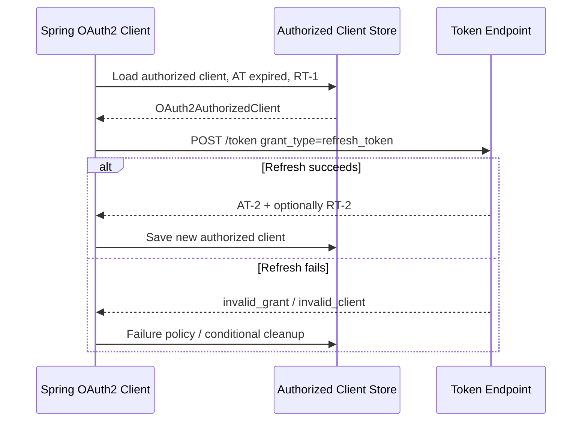

# 29.5. Using `oauth2Client()` to Simulate an Authorized Client

In a **Spring Security OAuth 2.0/OIDC Client** application running on the Servlet stack, many tests do not need to call a real OpenID Provider (OP). A controller may only need an existing `OAuth2AuthorizedClient` to inspect metadata, extract an access token, or pass a token to a service that calls another API.

Spring Security Test provides **`SecurityMockMvcRequestPostProcessors.oauth2Client()`** to prepare a simulated authorized client when running `MockMvc`. This lets you test application branches that use OAuth2 Client without running a browser Authorization Code Flow, signing in at an OP, or exchanging a real authorization code for tokens.

Example:

```java
mockMvc.perform(get("/orders")
        .with(oidcLogin())
        .with(oauth2Client("orders")))
    .andExpect(status().isOk());
```

Here:

- `oidcLogin()` creates a simulated Authentication with an OIDC principal.
- `oauth2Client("orders")` prepares an authorized client associated with registration ID `orders`.
- `MockMvc` dispatches the request through Spring MVC and the Security infrastructure in the test context.
- There is no guarantee an AS issued the access token, no JWT signature is verified, and no HTTP request hits the Token Endpoint from these two post-processors alone.

**Core point:** `oauth2Client()` is for **testing an authorized client in a Servlet request**, not a way to perform OIDC login or an implementation of an OAuth authorization grant.

---

## 1. Lesson Objectives

After this lesson, readers will be able to:

1. Explain the roles of `OAuth2AuthorizedClient`, `ClientRegistration`, and `OAuth2AccessToken`.
2. Configure `spring-security-test` and import `oauth2Client()` for MockMvc.
3. Test controllers receiving `@RegisteredOAuth2AuthorizedClient`.
4. Build token fixtures with test-controlled scopes and lifetimes.
5. Combine `oauth2Client()` with `oauth2Login()` or `oidcLogin()`.
6. Customize `ClientRegistration` and principal names in tests.
7. Distinguish OAuth2 Client testing from Resource Server `jwt()` and `opaqueToken()`.
8. Recognize when to mock `OAuth2AuthorizedClientManager` instead of using a request processor.
9. Avoid the illusion of passing tests when token acquisition, redirect/PKCE/nonce, refresh rotation, or downstream APIs remain untested.
10. Build positive/negative test suites for registration, scope, principal isolation, and token leakage.

## 2. Where `OAuth2AuthorizedClient` Fits in the Architecture

An `OAuth2AuthorizedClient` represents an OAuth client that has been granted authorization in the context of a principal.

```text
OAuth2AuthorizedClient
├── ClientRegistration
│   ├── registrationId = orders
│   ├── clientId = portal-client
│   ├── authorizationGrantType
│   ├── authorizationUri
│   ├── tokenUri
│   └── scopes
├── principalName = employee-725
├── OAuth2AccessToken
│   ├── value = AT-1
│   ├── type = Bearer
│   ├── issuedAt / expiresAt
│   └── scopes = orders.read
└── OAuth2RefreshToken (optional)
    └── value = RT-1
```

Easily confused concepts:

| Concept | Role | Relation to tests |
|---|---|---|
| `ClientRegistration` | OAuth client configuration with AS/OP | Can build a dedicated fixture |
| `registrationId` | Spring's local key for a registration | Passed to `oauth2Client("orders")` |
| `clientId` | OAuth client identity at the AS | Not the registration ID |
| `OAuth2AccessToken` | Credential for calling a Resource Server | Passed via `.accessToken(...)` |
| `OAuth2RefreshToken` | Credential to request new tokens when issued | Typically tested separately with manager/refresh |
| `OAuth2AuthorizedClient` | Registration + principal + tokens | The mocked object |
| `OAuth2AuthorizedClientRepository` | Loads/saves clients in the Servlet request context | Affects how resolvers work |
| `OAuth2AuthorizedClientService` | Saves/loads by registration and principal, independent of request | May need separate seeding |
| `OAuth2AuthorizedClientManager` | Obtains or renews tokens when needed | Not fully tested by the processor alone |

### 2.1. An Authorized Client Differs from an Authenticated User

A user may be authenticated via OIDC while the application does not yet have an authorized client for the Orders API.

Conversely, a backend can hold a Client Credentials Grant authorized client **without an OIDC end-user session**.

```text
Authentication / SecurityContext
  -> Who is using the application?

OAuth2AuthorizedClient
  -> Which OAuth client holds which token in which context?
```

The two questions are related, not interchangeable.

### 2.2. An Access Token Differs from an ID Token

- An **OIDC ID Token** is for the Relying Party to verify End-User authentication.
- An **OAuth access token** is for the Resource Server, carrying API access permissions.
- `oauth2Client()` relates to the access token inside an authorized client.
- `oidcLogin()` relates to OIDC Authentication and `OidcUser`.

Never use an ID Token as a Bearer access token to call an API just because it happens to be a JWT.

## 3. True Scope of `oauth2Client()`

`oauth2Client()` is a **MockMvc `RequestPostProcessor`** in `spring-security-test`.

```text
JUnit test
   |
   v
MockMvc request builder
   |
   +-- .with(oauth2Client("orders"))
   |       -> prepares OAuth2AuthorizedClient fixture
   |
   +-- .with(oidcLogin())
   |       -> prepares authenticated OIDC principal
   |
   v
Spring Security filter chain
   |
   v
Spring MVC controller / argument resolver
```

It lets the application see an authorized client inside a test request. However, it does **not**:

- Call the Authorization Endpoint.
- Call the Token Endpoint.
- Receive a real authorization code.
- Validate `state`, PKCE, or browser login nonces.
- Verify the JWT signature of an ID Token or access token.
- Call downstream APIs on the application's behalf.
- Validate whether a token matches the real issuer/audience.
- Fully simulate refresh token rotation.
- Guarantee the current principal is already authenticated.

If a test needs to verify those things, add tests at the appropriate layer.

## 4. Preparing Dependencies and Imports

Example Gradle config in a Spring Boot project using Servlet MVC:

```groovy
dependencies {
    implementation 'org.springframework.boot:spring-boot-starter-web'
    implementation 'org.springframework.boot:spring-boot-starter-security'
    implementation 'org.springframework.boot:spring-boot-starter-oauth2-client'

    testImplementation 'org.springframework.boot:spring-boot-starter-test'
    testImplementation 'org.springframework.security:spring-security-test'
}
```

Let the Spring Boot BOM manage a `spring-security-test` version compatible with the runtime.

Common static imports:

```java
import static org.springframework.security.test.web.servlet.request.SecurityMockMvcRequestPostProcessors.oauth2Client;
import static org.springframework.security.test.web.servlet.request.SecurityMockMvcRequestPostProcessors.oauth2Login;
import static org.springframework.security.test.web.servlet.request.SecurityMockMvcRequestPostProcessors.oidcLogin;

import static org.springframework.test.web.servlet.request.MockMvcRequestBuilders.get;
import static org.springframework.test.web.servlet.result.MockMvcResultMatchers.status;
import static org.springframework.test.web.servlet.result.MockMvcResultMatchers.content;
```

The full name `SecurityMockMvcRequestPostProcessors` indicates this is a **Servlet MockMvc** API, not WebFlux's `WebTestClient`.

### 4.1. With JUnit 5

```java
import org.junit.jupiter.api.Test;
import org.springframework.beans.factory.annotation.Autowired;
import org.springframework.boot.test.autoconfigure.web.servlet.AutoConfigureMockMvc;
import org.springframework.boot.test.context.SpringBootTest;
import org.springframework.test.web.servlet.MockMvc;
```

Auto-configuration package paths may differ across Spring Boot major versions. The examples in this lesson reflect the typical Spring Boot 3.x structure; projects on Boot 4.x should check exact import paths.

## 5. First Example: A Controller Receiving an Authorized Client

Suppose a controller checks registration and scope, while **not** returning the token value to the browser:

```java
import org.springframework.security.oauth2.client.OAuth2AuthorizedClient;
import org.springframework.security.oauth2.client.annotation.RegisteredOAuth2AuthorizedClient;
import org.springframework.web.bind.annotation.GetMapping;
import org.springframework.web.bind.annotation.RestController;

@RestController
public class OrdersClientInfoController {

    @GetMapping("/demo/orders-client")
    public String info(
            @RegisteredOAuth2AuthorizedClient("orders")
            OAuth2AuthorizedClient authorizedClient) {

        String registrationId = authorizedClient
            .getClientRegistration()
            .getRegistrationId();

        boolean hasReadScope = authorizedClient
            .getAccessToken()
            .getScopes()
            .contains("orders.read");

        return registrationId + ":" + hasReadScope;
    }
}
```

`@RegisteredOAuth2AuthorizedClient("orders")` instructs Spring MVC argument resolution to look up the authorized client under registration ID `orders`.

This is an **illustrative controller for testing**. In real production systems, the Resource Server must still validate the access token, scopes, audience, tenant, and data permissions. Never use a scope check in the controller as the sole authorization mechanism.

### 5.1. Testing with Default Fixtures

```java
@SpringBootTest
@AutoConfigureMockMvc
class OrdersClientInfoControllerTest {

    @Autowired
    MockMvc mvc;

    @Test
    void resolvesAuthorizedClient() throws Exception {
        mvc.perform(get("/demo/orders-client")
                .with(oidcLogin())
                .with(oauth2Client("orders")))
            .andExpect(status().isOk());
    }
}
```

This test assumes the application's Spring context has proper OAuth2 Client repository/argument resolver/security wiring. Asserting only the HTTP status is a starting point; subsequent examples verify scopes and response bodies.

### 5.2. Why Add `oidcLogin()`?

If the application protects `/demo/orders-client` with `authenticated()`, `oauth2Client()` alone does not supply an Authentication.

`oidcLogin()` gives the request a simulated OIDC principal. If the app uses OAuth2-only Login, you can use `oauth2Login()` instead.

## 6. Creating an `OAuth2AccessToken` with Explicit Scopes

Every test should control its inputs rather than relying on implicit default scopes.

```java
import java.time.Instant;
import java.util.Set;
import org.springframework.security.oauth2.core.OAuth2AccessToken;

Instant now = Instant.now();

OAuth2AccessToken ordersReadToken =
    new OAuth2AccessToken(
        OAuth2AccessToken.TokenType.BEARER,
        "test-access-token-orders-read",
        now.minusSeconds(30),
        now.plusSeconds(600),
        Set.of("orders.read")
    );
```

Fields:

- `TokenType.BEARER`: access token type.
- `tokenValue`: simulated string, not a production token.
- `issuedAt`: simulated issuance timestamp.
- `expiresAt`: simulated expiration timestamp.
- `scopes`: set of scopes granted in the fixture.

### 6.1. Injecting the Token into `oauth2Client()`

```java
mvc.perform(get("/demo/orders-client")
        .with(oidcLogin())
        .with(oauth2Client("orders")
            .accessToken(ordersReadToken)))
    .andExpect(status().isOk())
    .andExpect(content().string("orders:true"));
```

This verifies the controller receives the right authorized client with `orders.read`.

### 6.2. Testing Without the Scope

```java
OAuth2AccessToken profileOnly =
    new OAuth2AccessToken(
        OAuth2AccessToken.TokenType.BEARER,
        "test-profile-token",
        now.minusSeconds(30),
        now.plusSeconds(600),
        Set.of("profile")
    );

mvc.perform(get("/demo/orders-client")
        .with(oidcLogin())
        .with(oauth2Client("orders")
            .accessToken(profileOnly)))
    .andExpect(status().isOk())
    .andExpect(content().string("orders:false"));
```

These two tests verify **both branches of application logic**. They do not prove whether the real OP grants `orders.read` to the client.

### 6.3. Never Put Real Tokens in Test Sources

Use:

```text
test-access-token-orders-read
```

never an access token taken from a production OP or pasted from an issue tracker. A fake token without a real signature/audience is intentional in this kind of test.

## 7. Creating a Test-Specific `ClientRegistration`

The default processor builds a convenient `ClientRegistration`. However, if code inspects `clientId`, `authorizationGrantType`, scopes, or endpoints, build an explicit fixture:

```java
import org.springframework.security.oauth2.client.registration.ClientRegistration;
import org.springframework.security.oauth2.core.AuthorizationGrantType;
import org.springframework.security.oauth2.core.ClientAuthenticationMethod;

ClientRegistration ordersRegistration =
    ClientRegistration.withRegistrationId("orders")
        .clientId("orders-client-test")
        .clientSecret("test-only-secret")
        .clientAuthenticationMethod(
            ClientAuthenticationMethod.CLIENT_SECRET_BASIC)
        .authorizationGrantType(
            AuthorizationGrantType.AUTHORIZATION_CODE)
        .authorizationUri("https://idp.test.invalid/authorize")
        .tokenUri("https://idp.test.invalid/token")
        .redirectUri("{baseUrl}/login/oauth2/code/{registrationId}")
        .scope("openid", "orders.read")
        .build();
```

`.invalid` hostnames are purely for examples, not production services. Constructing this object **does not send HTTP requests** to the endpoints.

### 7.1. Using `clientRegistration(...)`

```java
mvc.perform(get("/demo/orders-client")
        .with(oidcLogin())
        .with(oauth2Client("orders")
            .clientRegistration(ordersRegistration)
            .accessToken(ordersReadToken)))
    .andExpect(status().isOk())
    .andExpect(content().string("orders:true"));
```

In the test, three places must align:

```text
with(oauth2Client("orders"))
ordersRegistration.getRegistrationId() == "orders"
@RegisteredOAuth2AuthorizedClient("orders")
```

### 7.2. `ClientRegistration` Is Configuration, Not a Granted Authorization

Having a `ClientRegistration` does not mean an `OAuth2AuthorizedClient` exists. In production, the AS must issue a matching access token; in a MockMvc test, we intentionally simulate the already-granted state.

### 7.3. `registrationId` Is Not `clientId`

In the example:

```text
registrationId = orders
clientId = orders-client-test
```

`@RegisteredOAuth2AuthorizedClient("orders")` uses the local registration ID, not the client ID.

## 8. Distinguishing Three Important Post-Processors

| Processor | Simulated data | What is the test for? |
|---|---|---|
| `oauth2Client("orders")` | `OAuth2AuthorizedClient`, access token, registration | MVC logic needing an authorized client |
| `oauth2Login()` | `OAuth2AuthenticationToken` and `OAuth2User` | MVC logic needing an OAuth2 Login principal |
| `oidcLogin()` | OIDC Authentication and `OidcUser`/ID Token | MVC logic needing an OIDC user |

And two other processors:

| Processor | Simulates |
|---|---|
| `jwt()` | Resource Server receiving JWT Bearer authentication |
| `opaqueToken()` | Resource Server receiving an opaque Bearer token |

### 8.1. OAuth2 Client and Resource Server Are Two Distinct Roles

```text
OAuth2 Client:
  App holds an access token
  App sends the token to a Resource Server

Resource Server:
  App receives a Bearer token
  App validates or introspects the token
```

Use `jwt()` to test Resource Server authentication, **not** to populate an `OAuth2AuthorizedClient` in the Servlet repository.

### 8.2. OIDC Login Is Not Equivalent to an OAuth2 Client Token

`oidcLogin()` helps test code reading OIDC claims from `OidcUser`. If the controller also needs an access token for registration `orders`, supply the corresponding authorized client.

### 8.3. Authentication Is Not Client Authorization

`Authentication` answers "who is logged in?". `OAuth2AuthorizedClient` answers "which client holds which token for which principal?". Do not conflate them in tests.

## 9. Combining `oidcLogin()` and `oauth2Client()`

A controller may accept both:

```java
import org.springframework.security.core.annotation.AuthenticationPrincipal;
import org.springframework.security.oauth2.client.OAuth2AuthorizedClient;
import org.springframework.security.oauth2.client.annotation.RegisteredOAuth2AuthorizedClient;
import org.springframework.security.oauth2.core.oidc.user.OidcUser;
import org.springframework.web.bind.annotation.GetMapping;
import org.springframework.web.bind.annotation.RestController;

@RestController
public class UserOrdersController {

    @GetMapping("/demo/me/orders")
    String userOrders(
            @AuthenticationPrincipal OidcUser user,
            @RegisteredOAuth2AuthorizedClient("orders")
            OAuth2AuthorizedClient authorizedClient) {

        boolean canRead = authorizedClient.getAccessToken()
            .getScopes().contains("orders.read");

        return user.getSubject() + ":" + canRead;
    }
}
```

MockMvc:

```java
mvc.perform(get("/demo/me/orders")
        .with(oidcLogin())
        .with(oauth2Client("orders")
            .accessToken(ordersReadToken)))
    .andExpect(status().isOk());
```

Here `oidcLogin()` creates the principal, while `oauth2Client()` supplies the authorized client. If you need to assert the subject, build an explicit principal fixture instead of relying on defaults.

### 9.1. Do Not Arbitrarily Substitute `user("alice")` for `OidcUser`

Spring Security Test's `user("alice")` creates a standard username/password-style principal. It lacks an ID Token and `OidcUser` methods.

If the controller binds the principal as `OidcUser`, use `oidcLogin()`.

### 9.2. OAuth2-Only Endpoints Use `oauth2Login()`

```java
mvc.perform(get("/demo/orders-client")
        .with(oauth2Login())
        .with(oauth2Client("orders")
            .accessToken(ordersReadToken)))
    .andExpect(status().isOk());
```

With an OAuth2 provider that does not issue ID Tokens, `oauth2Login()` is more appropriate than `oidcLogin()`.

## 10. Customizing `OidcUser` and Principal Name

In OIDC, external user identity typically relies on the pair `(iss, sub)`. A mock OIDC user can be constructed from `OidcIdToken`.

```java
import java.time.Instant;
import java.util.List;
import java.util.Map;

import org.springframework.security.core.authority.SimpleGrantedAuthority;
import org.springframework.security.oauth2.core.oidc.OidcIdToken;
import org.springframework.security.oauth2.core.oidc.user.DefaultOidcUser;
import org.springframework.security.oauth2.core.oidc.user.OidcUser;

Instant issuedAt = Instant.now();

OidcIdToken idToken = new OidcIdToken(
    "test-id-token",
    issuedAt,
    issuedAt.plusSeconds(600),
    Map.of(
        "iss", "https://idp.test.invalid",
        "sub", "employee-725",
        "aud", List.of("portal-client-test")
    )
);

OidcUser employee = new DefaultOidcUser(
    List.of(new SimpleGrantedAuthority("ROLE_USER")),
    idToken,
    "sub"
);
```

Usage:

```java
mvc.perform(get("/demo/me/orders")
        .with(oidcLogin().oidcUser(employee))
        .with(oauth2Client("orders")
            .principalName(employee.getName())
            .accessToken(ordersReadToken)))
    .andExpect(status().isOk())
    .andExpect(content().string("employee-725:true"));
```

### 10.1. An `OidcIdToken` Fixture Does Not Validate Signatures

`"test-id-token"` above is a dummy string. `oidcLogin()` builds a mock Authentication; it does not run full ID Token JWS signature, audience, issuer, and nonce validation like a real login callback.

To test those validations, test the OIDC token decoder/validator or run an authorization flow against a test OP/AS.

### 10.2. `getName()` May Differ from `getSubject()`

If the app configures a `user-name-attribute` other than `sub`, `OidcUser.getName()` may return that attribute instead. When mocking an authorized client, `principalName` must match the name used by the repository/service and manager in practice.

### 10.3. Do Not Use Email Alone as an Identity Key

In multi-tenant systems, emails can change or collide across issuers. Tests should reflect safe identity mapping rather than keying tokens solely by unverified email addresses.

## 11. `principalName` and the Authorized-Client Storage Key

An authorized client is typically stored and loaded by:

```text
(clientRegistrationId, principalName)
```

Example:

```text
(orders, employee-725) -> access token A
(orders, employee-813) -> access token B
```

### 11.1. Specify `principalName` Explicitly in Fixtures

`oauth2Client(...)` supports:

```java
.with(oauth2Client("orders")
    .principalName("employee-725")
    .accessToken(ordersReadToken))
```

Do not confuse `principalName` with `clientId` or a tenant name.

### 11.2. When Testing User A vs. User B

Include negative tests verifying user B's request cannot load token A from a shared store. `oauth2Client()` sets up the request fixture, while persistence/isolation tests must exercise the actual repository/service.

### 11.3. Never Pass an Arbitrary `principalName` into Production Lookups

Anti-pattern:

```java
String principal = request.getParameter("principal");
OAuth2AuthorizedClient client =
    authorizedClientService.loadAuthorizedClient("orders", principal);
```

Without authorization checks, a caller could retrieve another user's token. In tests, customizing the principal is useful to verify isolation; production must use a trusted `Authentication`.

## 12. MockMvc with Spring Boot

Example JUnit class:

```java
import java.time.Instant;
import java.util.Set;

import org.junit.jupiter.api.Test;
import org.springframework.beans.factory.annotation.Autowired;
import org.springframework.boot.test.autoconfigure.web.servlet.AutoConfigureMockMvc;
import org.springframework.boot.test.context.SpringBootTest;
import org.springframework.security.oauth2.core.OAuth2AccessToken;
import org.springframework.test.web.servlet.MockMvc;

import static org.springframework.security.test.web.servlet.request.SecurityMockMvcRequestPostProcessors.oauth2Client;
import static org.springframework.security.test.web.servlet.request.SecurityMockMvcRequestPostProcessors.oidcLogin;
import static org.springframework.test.web.servlet.request.MockMvcRequestBuilders.get;
import static org.springframework.test.web.servlet.result.MockMvcResultMatchers.content;
import static org.springframework.test.web.servlet.result.MockMvcResultMatchers.status;

@SpringBootTest
@AutoConfigureMockMvc
class OrdersClientControllerTest {

    @Autowired
    MockMvc mvc;

    @Test
    void seesOrdersReadScope() throws Exception {
        Instant now = Instant.now();

        OAuth2AccessToken token = new OAuth2AccessToken(
            OAuth2AccessToken.TokenType.BEARER,
            "test-orders-token",
            now.minusSeconds(30),
            now.plusSeconds(600),
            Set.of("orders.read")
        );

        mvc.perform(get("/demo/orders-client")
                .with(oidcLogin())
                .with(oauth2Client("orders").accessToken(token)))
            .andExpect(status().isOk())
            .andExpect(content().string("orders:true"));
    }
}
```

### 12.1. Conditions for the Example to Work

The application context must contain the Spring MVC controller, security configuration, and compatible `OAuth2AuthorizedClientRepository`/argument resolver integration. If the app uses custom wiring, a fixture may not be resolved properly if the context does not use the default repository.

### 12.2. `@SpringBootTest` Does Not Guarantee Total Offline Execution

Custom app beans might call a discovery endpoint on startup or invoke other APIs. `oauth2Client()` does not disable network I/O performed by application code.

For offline tests, define static test `ClientRegistration` entries and mock external clients that issue network calls.

### 12.3. Test Secrets Must Be Synthetic

Never enable a production profile containing real client secrets just to test a controller. Use a test profile, test registrations, or fake IdP metadata.

## 13. Using `@WebMvcTest` for Controller Slices

`@WebMvcTest` can reduce startup time:

```java
@WebMvcTest(OrdersClientInfoController.class)
class OrdersClientWebMvcTest {

    @Autowired
    MockMvc mvc;

    @Test
    void readsAuthorizedClient() throws Exception {
        mvc.perform(get("/demo/orders-client")
                .with(oidcLogin())
                .with(oauth2Client("orders")))
            .andExpect(status().isOk());
    }
}
```

This is an illustrative skeleton, **not a guarantee every project will run it out of the box**. An MVC slice may omit:

- The production `SecurityFilterChain`.
- `ClientRegistrationRepository`.
- `OAuth2AuthorizedClientRepository`.
- `OAuth2AuthorizedClientManager`.
- Service beans needed by the controller.
- Application-specific test customizations.

When needed, import minimal security configuration or test beans, and use mock dependencies matching your Spring Boot version.

### 13.1. Do Not Disable Filters to Hide Missing Security Wiring

`@AutoConfigureMockMvc(addFilters = false)` can be used for pure routing MVC tests, but if the goal is testing `oauth2Client()` through Security/argument resolution, disabling filters renders the test far less meaningful.

### 13.2. When to Use the Full Application Context?

Use `@SpringBootTest` when testing real wiring of repositories, argument resolvers, security chains, or controller-service integration. Use `@WebMvcTest` when you only need a web slice that already has the minimal required beans.

## 14. Spring Security MockMvc Integration

When constructing `MockMvc` manually instead of via Boot auto-configuration, apply Spring Security:

```java
import static org.springframework.security.test.web.servlet.setup.SecurityMockMvcConfigurers.springSecurity;

MockMvc mvc = MockMvcBuilders
    .webAppContextSetup(webApplicationContext)
    .apply(springSecurity())
    .build();
```

If the filter chain or test config is missing, an `oauth2Client()` fixture might still be created while actual request handling diverges from production.

### 14.1. Post-Processor vs. Security Filter

`oauth2Client()` prepares test data; the Spring Security filter chain remains responsible for protecting routes.

### 14.2. Do Not Blame the Framework for an Incomplete Standalone Setup

`MockMvcBuilders.standaloneSetup(controller)` can make sense for pure MVC, whereas security integration and argument resolution require proper configuration.

### 14.3. Tests Must Assert Real Behavior

A 200 response when security filters are not running does not verify OIDC-authenticated requests or proper authorized-client lookup.

## 15. Testing Positive and Negative Scopes

Suppose a controller implements an illustrative policy:

```java
import org.springframework.http.HttpStatus;
import org.springframework.http.ResponseEntity;

@GetMapping("/demo/orders/check")
ResponseEntity<String> check(
        @RegisteredOAuth2AuthorizedClient("orders")
        OAuth2AuthorizedClient client) {

    boolean allowed = client.getAccessToken()
        .getScopes().contains("orders.read");

    if (!allowed) {
        return ResponseEntity.status(HttpStatus.FORBIDDEN)
            .body("missing-scope");
    }
    return ResponseEntity.ok("ready");
}
```

This snippet belongs to an illustrative controller that already imports Spring MVC/security annotations and types.

### 15.1. Positive

```java
mvc.perform(get("/demo/orders/check")
        .with(oidcLogin())
        .with(oauth2Client("orders")
            .accessToken(tokenWithOrdersRead)))
    .andExpect(status().isOk())
    .andExpect(content().string("ready"));
```

### 15.2. Negative

```java
mvc.perform(get("/demo/orders/check")
        .with(oidcLogin())
        .with(oauth2Client("orders")
            .accessToken(tokenWithProfileOnly)))
    .andExpect(status().isForbidden())
    .andExpect(content().string("missing-scope"));
```

### 15.3. Security Caveat

This is a local scope-branching test. An access token in a fixture can declare any scope because no AS verified it. Resource Server authorization must rely on verified tokens, audience, domain membership, and object-level permissions.

## 16. Factory for Token Fixtures

When many tests need tokens, place a factory under `src/test/java`:

```java
import java.time.Instant;
import java.util.Set;
import org.springframework.security.oauth2.core.OAuth2AccessToken;

public final class OAuthTestTokens {

    private OAuthTestTokens() {}

    public static OAuth2AccessToken bearer(
            String value,
            Set<String> scopes) {

        Instant now = Instant.now();

        return new OAuth2AccessToken(
            OAuth2AccessToken.TokenType.BEARER,
            value,
            now.minusSeconds(30),
            now.plusSeconds(600),
            scopes
        );
    }
}
```

Test:

```java
OAuth2AccessToken token = OAuthTestTokens.bearer(
    "test-orders-read",
    Set.of("orders.read"));

mvc.perform(get("/demo/orders-client")
        .with(oidcLogin())
        .with(oauth2Client("orders").accessToken(token)))
    .andExpect(content().string("orders:true"));
```

### 16.1. Do Not Randomize Everything Pointlessly

If the test targets scope branching, a stable synthetic token value is ideal. Randomizing every token string can make tests and logs harder to read.

### 16.2. Do Not Use Real JWT Access Tokens

If you need to test a JWT parser/decoder, that belongs in a separate Resource Server/token validation test. For authorized-client fixtures, the token value does not need to be a JWT.

## 17. Controllers That Need Both a Principal and an Authorized Client

A test often needs to satisfy two conditions:

```text
Authenticated OIDC principal exists
AND
OAuth2AuthorizedClient for registration orders exists
```

Example:

```java
mockMvc.perform(get("/demo/me/orders")
        .with(oidcLogin().oidcUser(employee))
        .with(oauth2Client("orders")
            .principalName(employee.getName())
            .accessToken(ordersReadToken)))
    .andExpect(status().isOk());
```

### 17.1. Order and Defaults

Avoid relying blindly on default principal names, token scopes, or registration metadata. When a test needs an exact identity, set it explicitly.

### 17.2. Avoid Overlapping Authentication Processors

A request combining both `user("alice")` and `oidcLogin()` may not produce the intended principal. Construct one clear Authentication fixture.

### 17.3. Testing Unauthenticated Access

If a route requires an authenticated user, running a request with `oauth2Client()` alone can trigger a login redirect or 401 depending on app policy. Never assert 401 unconditionally: MVC browser login usually redirects to the login page.

## 18. When the Client Registration in the Processor Does Not Match

Endpoint:

```java
@RegisteredOAuth2AuthorizedClient("orders")
OAuth2AuthorizedClient client
```

Request:

```java
.with(oauth2Client("billing"))
```

does not turn a Billing token into an Orders authorized client.

In some setups, the resolver/manager may attempt to load or authorize the `orders` client separately if that registration exists; thus the outcome may be a missing-client error, an authorization initiation, or another configuration-dependent behavior.

**Tests must verify the intended app behavior**, rather than asserting a single hardcoded HTTP status across all framework versions.

### 18.1. Multi-Tenant

If tenant Alpha uses registration `orders-alpha` and tenant Beta uses `orders-beta`, tests must verify there is no cross-tenant token leakage. Do not share a single `orders` fixture when production separates registrations.

### 18.2. `clientId` Is Not `registrationId`

A `ClientRegistration` may have:

```text
registrationId = orders-alpha
clientId = alpha-backend-001
```

Controllers use `@RegisteredOAuth2AuthorizedClient("orders-alpha")`, not the client ID, to resolve the client.

## 19. Testing a Missing Authorized Client

If the request is authenticated yet lacks an authorized client for registration `orders`:

```java
mvc.perform(get("/demo/orders-client")
        .with(oidcLogin()));
```

behavior depends on:

- Whether the manager auto-authorizes.
- The registration's grant type.
- Whether the repository/service still holds a token.
- Whether the app enforces a reconnect/reauthorization policy.
- Whether the controller handles null/exceptions.

### 19.1. Do Not Assume a Missing Client Always Returns 404

With the Authorization Code Flow, a missing authorized client may trigger a new authorization flow; with the Client Credentials Grant, the manager may obtain a token server-side.

### 19.2. Tests Should Verify User-Facing Policy

For example: "Account reconnection required", "Matching access permission not found", or safe application-defined error mappings.

### 19.3. Never Fall Back to Another Registration's Token

If `orders` has no token, never grab the `billing` token just because both belong to the same user. Audiences, resources, and tenants differ.

## 20. `OAuth2AuthorizedClientRepository` and `OAuth2AuthorizedClientService`

Two abstractions:

**`OAuth2AuthorizedClientRepository`** is normally tied to Servlet web requests/sessions.

**`OAuth2AuthorizedClientService`** loads/saves authorized clients by registration ID and principal name, usable even in request-independent contexts.

An app might use:

- `HttpSessionOAuth2AuthorizedClientRepository`.
- `AuthenticatedPrincipalOAuth2AuthorizedClientRepository`.
- `JdbcOAuth2AuthorizedClientService`.
- A custom persistent service.
- A dedicated manager for scheduled jobs.

### 20.1. Why Might a Test Fixture "Disappear"?

`oauth2Client()` prepares state for the MockMvc request. If a downstream service directly calls a **separate JDBC authorized client service** that reads from a different source, it may not see the fixture token.

### 20.2. Choose the Right Boundary

If testing `@RegisteredOAuth2AuthorizedClient` injection, use the processor on the request.

If testing `JdbcOAuth2AuthorizedClientService`, seed and read the test DB via the service.

If testing `OAuth2AuthorizedClientManager`, mock/customize manager token acquisition.

If testing session persistence across two requests, keep the same session and a compatible repository.

### 20.3. Do Not Treat a Request Fixture as a Durable Record

The processor does not prove tokens exist in the production database or a distributed session store.

## 21. Using a Session in Tests

Some tests need to preserve `MockHttpSession` across requests:

```java
import org.springframework.mock.web.MockHttpSession;

MockHttpSession session = new MockHttpSession();

mvc.perform(get("/demo/orders-client")
        .session(session)
        .with(oidcLogin())
        .with(oauth2Client("orders")));
```

If the controller uses a session-backed repository and the test sends a second request, you can reuse the same session:

```java
mvc.perform(get("/demo/orders-client")
        .session(session)
        .with(oidcLogin()));
```

**Important:** this test is only meaningful if the repository and principal binding genuinely persist state across both requests as expected. Never assume every authorized-client mocking approach equates to persistent session storage across all Spring Security configurations.

### 21.1. Do Not Confuse `HttpSession` with the OP Session

`MockHttpSession` is a local Servlet session; it does not verify the OP's SSO session or front/back-channel logout.

### 21.2. When Spring Session Shares Across Nodes

A MockMvc request test does not verify Redis/JDBC Spring Session consistency or distributed invalidation. Write separate integration tests against the actual session store.

## 22. When You Need to Construct `OAuth2AuthorizedClient` Manually

Besides the post-processor, you can construct the object directly for unit tests or repository tests:

```java
import org.springframework.security.oauth2.client.OAuth2AuthorizedClient;

OAuth2AuthorizedClient client =
    new OAuth2AuthorizedClient(
        ordersRegistration,
        "employee-725",
        ordersReadToken
    );
```

When a refresh token is present:

```java
import org.springframework.security.oauth2.core.OAuth2RefreshToken;

OAuth2RefreshToken refreshToken =
    new OAuth2RefreshToken(
        "test-refresh-token",
        Instant.now().minusSeconds(120)
    );

OAuth2AuthorizedClient clientWithRefresh =
    new OAuth2AuthorizedClient(
        ordersRegistration,
        "employee-725",
        ordersReadToken,
        refreshToken
    );
```

### 22.1. An Object Is Not a Stored Authorized Client

Calling `new OAuth2AuthorizedClient(...)` only instantiates a Java object. If a service/manager loads from persistence, save the object into the matching test store.

### 22.2. Testing Service Persistence

```java
authorizedClientService.saveAuthorizedClient(
    clientWithRefresh,
    authentication
);
```

`authentication` must be a safely constructed test `Authentication` with a matching `principalName`. This seeds the **service**; it does not automatically seed request repositories that do not delegate to the same service.

### 22.3. Do Not Share Mutable Token Objects Without Control

`OAuth2AuthorizedClient` exposes token metadata, yet how tests retain principals/sessions/stores can affect test isolation. Reset fake services/DBs/sessions between tests.

## 23. Client Credentials vs. User-Delegated Authorization Code

With the Client Credentials Grant, the token is for a service/workload, not necessarily an OIDC End-User.

Fixture:

```java
ClientRegistration serviceRegistration =
    ClientRegistration.withRegistrationId("reports")
        .clientId("reports-test-client")
        .clientSecret("test-only")
        .clientAuthenticationMethod(
            ClientAuthenticationMethod.CLIENT_SECRET_BASIC)
        .authorizationGrantType(
            AuthorizationGrantType.CLIENT_CREDENTIALS)
        .tokenUri("https://idp.test.invalid/token")
        .scope("reports.read")
        .build();
```

Processor:

```java
.with(oauth2Client("reports")
    .clientRegistration(serviceRegistration)
    .accessToken(reportsReadToken))
```

### 23.1. What Does It Simulate?

An authorized client for `reports` that already holds an access token.

### 23.2. What Does It Not Simulate?

- Proper transmission of the client secret.
- The AS permitting the `client_credentials` grant.
- The Token Endpoint returning real scopes.
- Service-to-service client auth and mTLS/`private_key_jwt`.
- Caching/single-flight token acquisition.

To test those, test `OAuth2AuthorizedClientManager` and token response client/AS fixtures directly.

## 24. Testing an Expired Access Token

```java
Instant now = Instant.now();

OAuth2AccessToken expired =
    new OAuth2AccessToken(
        OAuth2AccessToken.TokenType.BEARER,
        "test-expired-token",
        now.minusSeconds(600),
        now.minusSeconds(30),
        Set.of("orders.read")
    );

mvc.perform(get("/demo/orders-client")
        .with(oidcLogin())
        .with(oauth2Client("orders").accessToken(expired)));
```

### 24.1. An Expired Token May Trigger Reauthorization

If the `@RegisteredOAuth2AuthorizedClient`/manager code path checks expiry and has a refresh provider, it may attempt a refresh. Tests may need a fake token response client or a mocked manager to prevent network calls.

### 24.2. `oauth2Client()` Does Not Produce Refresh Responses

To verify refresh rotation, test the grant/provider/manager separately. A synthetic expired token does not prove the refresh flow works.

### 24.3. Avoid Time-Based Flakiness

Happy-path fixtures should set expiry minutes in the future, not `now.plusMillis(5)`. When testing time-sensitive logic, inject a `Clock` or use fixed timestamps by design, avoiding `Thread.sleep`.

## 25. Testing Refresh Tokens Is a Different Level

A real refresh flow:



`oauth2Client()` only helps build the input authorized client. To test the grant:

1. Mock the token response client or use a fake AS.
2. Configure `OAuth2AuthorizedClientProvider` with `refreshToken()`.
3. Use the manager appropriate for the Servlet/background context.
4. Observe success/failure handlers.
5. Verify persistence under the right principal/registration.
6. With refresh token rotation, test concurrency and reuse handling.

### 25.1. Do Not Retry Stale Refresh Tokens Indefinitely

Some AS implementations rotate refresh tokens and reject old ones. Duplicate refreshes from concurrent requests can return `invalid_grant` or even revoke the token family per policy.

### 25.2. Test Storage Concurrency Separately

Optimistic locking/CAS and per-key coordination are not proven by a single MockMvc request with `oauth2Client()`.

## 26. When Testing a Controller Calling a Service

A clean pattern is having the controller obtain the client and delegate to a service/gateway:

```java
public interface OrdersGateway {
    String fetchSummary(OAuth2AccessToken token);
}
```

Controller:

```java
@RestController
public class OrdersController {

    private final OrdersGateway gateway;

    public OrdersController(OrdersGateway gateway) {
        this.gateway = gateway;
    }

    @GetMapping("/orders/summary")
    public String summary(
            @RegisteredOAuth2AuthorizedClient("orders")
            OAuth2AuthorizedClient client) {

        return gateway.fetchSummary(client.getAccessToken());
    }
}
```

### 26.1. Mockito Checks the Controller-to-Service Handoff

```java
when(ordersGateway.fetchSummary(any(OAuth2AccessToken.class)))
    .thenReturn("summary-ok");

mvc.perform(get("/orders/summary")
        .with(oidcLogin())
        .with(oauth2Client("orders")
            .accessToken(ordersReadToken)))
    .andExpect(status().isOk())
    .andExpect(content().string("summary-ok"));
```

This snippet assumes the test provides a Mockito mock `ordersGateway` following the project's test setup.

### 26.2. Verify the Exact Token

```java
var captor = ArgumentCaptor.forClass(OAuth2AccessToken.class);

verify(ordersGateway).fetchSummary(captor.capture());

assertEquals(
    "test-access-token-orders-read",
    captor.getValue().getTokenValue()
);
```

### 26.3. Never Return Tokens to the Browser

Capturing the token to assert in a test does not justify serializing tokens to the UI in production endpoints. For BFF/confidential clients, tokens belong on the backend.

### 26.4. A Mocked Gateway Is Not Downstream Integration

The test above does not prove the real HTTP client attaches `Authorization: Bearer ...`, enforces TLS, matches the target audience, or maps errors properly.

## 27. Outbound `RestClient`/`WebClient` Tests

In a Servlet app, services may use `RestClient` or `WebClient` to send access tokens to a Resource Server.

Testing outbound requests additionally requires:

- `MockRestServiceServer` or an appropriate fake HTTP server.
- HTTP client configuration with the real OAuth2 interceptor/filter.
- Matching registration/authorized client manager.
- Token fixtures and principal context.
- Assertions on URL/headers/status/timeouts.

`oauth2Client()` prepares inbound MockMvc request data; it does not intercept outbound HTTP requests.

### 27.1. Two Models for Obtaining Tokens

**Model A — explicit token passing**

```text
@RegisteredOAuth2AuthorizedClient("orders")
  -> client.getAccessToken()
  -> OrdersGateway
  -> RestClient
```

**Model B — HTTP client resolves the authorized client automatically**

```text
RestClient/WebClient OAuth2 interceptor
  -> OAuth2AuthorizedClientManager
  -> repository/service
  -> token
  -> Authorization: Bearer
```

Model B may use a service-based manager and fail to see an authorized client set by `oauth2Client()` on the request unless the context is wired accordingly.

### 27.2. Test the Exact Data Flow

Do not assume the processor populates every manager/service cache with tokens. If the real manager loads from a JDBC service, seed that service or mock the manager.

### 27.3. Never Send Tokens to Arbitrary Hosts

Outbound tests should verify access tokens are only sent to allowed Resource Server origins, never forwarded to URLs chosen by an unverified caller or tenant.

## 28. OAuth2 Client Tests vs. JWT Resource Server Tests

A Resource Server endpoint may be protected with:

```java
http.oauth2ResourceServer(oauth2 -> oauth2.jwt());
```

Test:

```java
mvc.perform(get("/api/orders")
        .with(jwt()))
    .andExpect(status().isOk());
```

`jwt()` simulates an inbound JWT authenticated principal. It does not create an authorized client.

Conversely:

```java
.with(oauth2Client("orders"))
```

does not mean the server verified an inbound Bearer JWT.

### 28.1. A Single Application Can Be Both Client and Resource Server

In an API gateway/BFF architecture:

- Some endpoints accept access tokens from upstream callers.
- Simultaneously, the backend calls downstream APIs using a different authorized client.

In tests, distinguish **inbound** tokens from **outbound** tokens carefully. Never reuse the same object/string while assuming the two trust domains are equivalent.

## 29. Testing Multiple Registrations and Tenants

Suppose:

```text
tenant alpha -> orders-alpha
tenant beta  -> orders-beta
```

You can define two fixtures:

```java
OAuth2AccessToken alphaToken = OAuthTestTokens.bearer(
    "test-alpha-token", Set.of("orders.read"));

OAuth2AccessToken betaToken = OAuthTestTokens.bearer(
    "test-beta-token", Set.of("orders.read"));
```

Test per registration:

```java
mvc.perform(get("/tenants/alpha/orders")
        .with(oidcLogin())
        .with(oauth2Client("orders-alpha")
            .accessToken(alphaToken)));
```

### 29.1. Never Cache by Issuer Alone

Two tenants may share an OP issuer while having distinct client registrations, principals, and access tokens. Tests must verify token isolation, not just scopes.

### 29.2. Test Wrong Registration Cases

If an endpoint requires `orders-alpha` while the fixture only provides `orders-beta`, expected behavior must follow app policy and **never fall back to the beta token**.

### 29.3. Do Not Infer Tenant Roles from Registration ID

Logging in via `orders-alpha` does not prove the user is authorized to read Alpha orders. Domain membership and row-level access must still be enforced.

## 30. Testing That Token Values Are Never Leaked

Because an access token is a bearer credential, never render it in responses for test convenience.

```java
var result = mvc.perform(get("/demo/orders-client")
        .with(oidcLogin())
        .with(oauth2Client("orders")
            .accessToken(ordersReadToken)))
    .andReturn();

String body = result.getResponse().getContentAsString();

assertFalse(body.contains("test-access-token-orders-read"));
```

### 30.1. Avoid Debug Output Printing the Whole Authorized Client

Never log:

```text
OAuth2AuthorizedClient{accessToken=..., refreshToken=...}
```

### 30.2. Never Pass Tokens in URLs

Anti-pattern:

```text
Location: /app?access_token=test-access-token-orders-read
```

Tokens must be sent in the `Authorization` header to trusted APIs or kept server-side in session/service stores.

### 30.3. HTTP Response Tests Do Not Replace Log Redaction Tests

Absence of a token in the response body does not prove wire logs, traces, or debug interceptors aren't recording tokens.

## 31. MockMvc Security Filter Chain and Protected Endpoints

Given configuration:

```java
http.authorizeHttpRequests(auth -> auth
    .requestMatchers("/demo/**").authenticated()
    .anyRequest().denyAll());
```

Testing with only:

```java
mvc.perform(get("/demo/orders-client")
        .with(oauth2Client("orders")));
```

may redirect to login because the request lacks an authenticated principal.

Test with both:

```java
mvc.perform(get("/demo/orders-client")
        .with(oidcLogin())
        .with(oauth2Client("orders")));
```

### 31.1. Do Not Hardcode 401 for Every Unauthenticated Outcome

In browser MVC, Spring Security usually redirects to login; in APIs, it may return 401. Tests must match the application's actual entry point/content negotiation.

### 31.2. Protecting Authorization with Roles

If an endpoint requires `ROLE_ADMIN`, create an OIDC principal with appropriate authorities. `oauth2Client()` does not grant roles.

### 31.3. Never Disable Authorization Just to Make Tests Pass

Tests passing under permit-all do not validate production authorization.

## 32. Test Slice Fails to Resolve `@RegisteredOAuth2AuthorizedClient`

Common causes:

1. Spring MVC argument resolver not registered because the context is too narrow.
2. Missing required authorized client repository or manager.
3. Registration ID mismatch.
4. Principal name mismatch.
5. Controller routed through a different security chain.
6. Code calls a service store that does not share the fixture.
7. Test uses WebFlux instead of MVC.

How to resolve:

- Check `@WebMvcTest` imports/configuration.
- Provide a compatible test `ClientRegistrationRepository`.
- Ensure `SecurityFilterChain` is active.
- Use explicit principal and registration fixtures.
- Inspect errors from the argument resolver/manager instead of dropping filters arbitrarily.
- If the service needs `OAuth2AuthorizedClientService`, seed or mock that service.

Do not assume this is a bug in `oauth2Client()`.

## 33. Distinguishing Code That Acquires Tokens vs. Code That Consumes Tokens

A token acquisition test should simulate:

```text
OAuth2AuthorizedClientManager
  -> OAuth2AuthorizedClientProvider
  -> Token Endpoint request
  -> OAuth2AccessTokenResponse
  -> save authorized client
```

A MockMvc authorized-client test simulates:

```text
already-authorized client
  -> Spring MVC argument resolver
  -> Controller/service logic
```

Both are important, yet answer different questions.

### 33.1. Testing `invalid_client` / `invalid_grant`

If you need to simulate an AS returning:

```json
{"error":"invalid_grant"}
```

test Token Endpoint integration or the manager error handler. `oauth2Client()` does not generate these errors.

### 33.2. Testing Token Rotation

When RT-1 is replaced by RT-2, test persistence/updates and concurrency. A fake authorized client holding a valid token provides no evidence about rotation.

### 33.3. Testing PKCE/State/Nonce

Use a test OIDC OP or security filter integration that actually executes the Authorization Code Flow; `oidcLogin()` + `oauth2Client()` bypass this part of the protocol.

## 34. Using Mockito for the Manager When There Is No Servlet Request

A service:

```java
public final class ReportsService {

    private final OAuth2AuthorizedClientManager manager;

    public ReportsService(OAuth2AuthorizedClientManager manager) {
        this.manager = manager;
    }

    public String tokenForJob() {
        OAuth2AuthorizeRequest request =
            OAuth2AuthorizeRequest
                .withClientRegistrationId("reports")
                .principal("scheduled-job")
                .build();

        OAuth2AuthorizedClient client = manager.authorize(request);

        if (client == null) {
            throw new IllegalStateException("No authorized client");
        }

        return client.getAccessToken().getTokenValue();
    }
}
```

Unit tests can mock:

```java
when(manager.authorize(any(OAuth2AuthorizeRequest.class)))
    .thenReturn(clientWithServiceToken);
```

### 34.1. Why Not Use `oauth2Client()`?

The service method does not run through a MockMvc request or the `@RegisteredOAuth2AuthorizedClient` resolver. `oauth2Client()` is a `RequestPostProcessor` and has no place in this unit test.

### 34.2. Test the Manager Separately

To verify the manager chooses the right grant provider, refreshes tokens, and runs success/failure handlers, write integration tests on the manager with a mocked Token Endpoint response client instead of always mocking the manager.

## 35. When Do You Need WebFlux Test Tools?

If the application uses WebFlux:

```text
ServerHttpSecurity
SecurityWebFilterChain
ReactiveOAuth2AuthorizedClientManager
ReactiveClientRegistrationRepository
WebTestClient
```

Do not apply `SecurityMockMvcRequestPostProcessors.oauth2Client()` to `WebTestClient`. Reactive test APIs live under `SecurityMockServerConfigurers` and `SecurityMockServerConfigurers.OAuth2ClientMutator`/`mockOAuth2Client()` depending on the Spring Security version.

Consult the reactive documentation for your exact version before porting test patterns; never merely swap `MockMvc` for `WebTestClient` while keeping Servlet post-processors.

### 35.1. Servlet Apps Can Still Use Outbound `WebClient`

A Spring MVC app can still use `WebClient` for downstream calls. Incoming request tests still use MockMvc, while outbound `WebClient` requires HTTP mocking/stubbing and appropriate security-context propagation.

### 35.2. Avoid Blocking on the Reactive Event Loop

In real WebFlux, never call `.block()` to obtain an authorized client inside a filter chain. Test reactive pipelines according to non-blocking behavior.

## 36. Common Test Matrix

| Target | Mock to use | Assertion |
|---|---|---|
| Controller reads registration ID | `oauth2Client("orders")` | Correct ID |
| Controller checks access token scope | `oauth2Client().accessToken(...)` | Scope branch |
| Controller reads `OidcUser` | `oidcLogin()` | Subject/claims |
| Controller needs OIDC principal + client | Combine both processors | Identity + token |
| OAuth2-only principal | `oauth2Login()` | OAuth2 user attributes |
| Resource Server inbound JWT | `jwt()` | Roles/claims mapping |
| Opaque bearer resource server | `opaqueToken()` | Introspection authorities |
| Service calling manager directly | Mock/fake manager | Manager request/result |
| Spring Client Credentials grant | Mock Token Endpoint + manager | Grant form/client auth |
| Refresh token rotation | Test manager/provider/store | Saves RT-2, conflict policy |
| Outbound `RestClient` header | Fake downstream HTTP server | Bearer header, target URI |
| Repository principal isolation | Test DB/session repository | A cannot read B |
| OIDC callback security | Test OP + flow | state, nonce, PKCE, issuer |
| End-to-end SSO | Test IdP + browser | Browser/session/logout integration |

A strong test suite spans multiple layers, not just a single processor.

## 37. Common Errors and Troubleshooting

| Symptom | Possible cause | What to check |
|---|---|---|
| Request returns 302 login instead of 200 | Missing Authentication | Add `oidcLogin()`/`oauth2Login()` |
| Authorized client is null | Wrong registration/principal/repository | Verify IDs and test beans |
| Test calls real AS | Manager/provider/discovery is active | Stub endpoints/beans at the boundary |
| Test returns 200 while production returns 403 | Filters disabled or policies differ | Enable the security chain |
| Fixture token has scope yet API rejects | Mock token is not a real token | Test audience/issuer/API separately |
| Refresh token missing | Omitted in fixture or grant did not issue one | Write dedicated object/persistence tests |
| `invalid_grant` after expired fixture | Manager tries refreshing with invalid token | Mock the token response client |
| `ClientRegistration` lacks expected metadata | Default fixture is too minimal | Customize with `clientRegistration(...)` |
| Test uses wrong principal | `getName()` differs from `sub` | Set `principalName` explicitly |
| Spring MVC slice lacks beans | Security/repository not imported | Add test configuration |
| Token appears in response | Controller serializes authorized client | Return safe DTOs/metadata |
| One test affects another | Shared session/storage fixture | Isolate/reset state |
| Tests flake near token expiry | Expiration too close to current time | Use stable time fixtures |

## 38. Anti-Patterns to Avoid

### 38.1. Using `oauth2Client()` Instead of OIDC Login

`oauth2Client()` does not authenticate the End-User.

### 38.2. Using `oidcLogin()` Instead of Authorized Client Tests

`oidcLogin()` does not guarantee an authorized client exists for every required registration.

### 38.3. Using `jwt()` Instead of an OAuth2 Client Token

`jwt()` simulates inbound bearer authentication, not an outbound authorized client.

### 38.4. Sharing One Registration/Token Across All Tenants

Hides the risk of cross-tenant token leakage.

### 38.5. Using Real Tokens from Production

Exposes secrets and couples tests to external expirations and conditions.

### 38.6. Using HTTP Status 200 as the Only Assertion

Fails to verify token selection, scope handling, or registration behavior.

### 38.7. Disabling Filters to Make Tests Pass

Destroys the value of security integration tests.

### 38.8. Confusing Request Repositories with Service Stores

The processor may not seed a custom JDBC/service store properly.

### 38.9. Self-Granting Production Scopes from YAML/Test Fixtures

The AS issues tokens; clients cannot arbitrarily grant themselves token scopes.

### 38.10. Putting Tokens in Responses or Redirect Query Strings

Creates bearer credential leakage risks.

### 38.11. Using an Expired Fixture and Assuming Refresh Was Tested

You must test the manager/provider/Token Endpoint separately.

### 38.12. Believing `oauth2Client()` Verifies Token Signatures

It only builds a request fixture; it is not a JWT decoder.

### 38.13. Hardcoding `principalName` for All Users

Can hide token collisions and cross-principal access bugs.

### 38.14. Letting Test `ClientRegistration` Metadata Decide Tenant Authorization

Tenant membership is a domain policy, never inferred from registration alone.

### 38.15. Using Servlet Post-Processors in WebFlux

Use reactive test tooling matching your version.

## 39. Test Implementation Checklist

1. Is `spring-security-test` at the right version?
2. Is the test running on Servlet MockMvc or Reactive WebTestClient?
3. Does the endpoint need `OAuth2AuthorizedClient` or only `Authentication`?
4. Should `oauth2Login()` or `oidcLogin()` accompany it?
5. Does `registrationId` in the processor match the endpoint/annotation?
6. Is a custom `ClientRegistration` needed if code inspects metadata?
7. Does the access token fixture have explicit scopes and expiry?
8. Does `principalName` match the `Authentication`/repository key?
9. Are the Spring Security filter chain and argument resolver active in the test context?
10. If using `@WebMvcTest`, are any required beans missing?
11. If code uses `OAuth2AuthorizedClientService`, is the fixture in the right store?
12. If using the manager, does the test mock token acquisition?
13. Are there negative tests for missing scope, missing client, and wrong principal?
14. Are cross-user and cross-tenant isolation tested?
15. Do assertions confirm tokens never appear in HTTP responses?
16. Is outbound HTTP stubbed to verify the `Bearer` header when needed?
17. Are calls to the production OP avoided?
18. Are expiration timestamps set to avoid flaky tests?
19. Are ID Tokens and access tokens kept clearly distinct?
20. Are the protocol aspects not covered by mock tests documented?

## 40. Conclusion

`oauth2Client()` is a useful **Spring Security Test** utility for simulating **`OAuth2AuthorizedClient`** in **MockMvc Servlet** requests. It lets you quickly test controllers and application layers that depend on an authorized client without running a real Authorization Server.

Usage pattern:

```java
mvc.perform(get("/demo/orders-client")
        .with(oidcLogin())
        .with(oauth2Client("orders")
            .accessToken(ordersReadToken)))
    .andExpect(status().isOk())
    .andExpect(content().string("orders:true"));
```

**Five points to remember:**

- `oauth2Client()` supplies an **authorized client**, not an **authenticated user** by default.
- `oidcLogin()` supplies an **OIDC principal**, not proof that a Resource Server access token was issued.
- `registrationId`, `clientId`, `principalName`, and token scopes are distinct pieces of data.
- Test fixtures do not prove real tokens are valid, the Token Endpoint works, or OIDC callbacks validate `state`/nonce/PKCE.
- Repository/manager/outbound API behavior must be tested at the right layer, especially when refresh tokens, multiple tenants, and persistent authorized clients are involved.

With clear boundaries, `oauth2Client()` makes Servlet OAuth2 Client tests **fast, repeatable, readable, and capable of catching controller/integration bugs**, without creating the illusion of having tested the entire protocol.

## 41. References

- [Spring Security — Testing OAuth 2.0 Clients, Logins, and Resource Servers](https://docs.spring.io/spring-security/reference/servlet/test/mockmvc/oauth2.html): `oauth2Client()`, `oauth2Login()`, `oidcLogin()`, `jwt()`, and `opaqueToken()`.
- [Spring Security — MockMvc Security Testing](https://docs.spring.io/spring-security/reference/servlet/test/mockmvc/index.html): `RequestPostProcessors` and security filter chain integration.
- [Spring Security — OAuth 2.0 Client](https://docs.spring.io/spring-security/reference/servlet/oauth2/client/index.html): `ClientRegistration`, authorized clients, and managers.
- [Spring Security — OAuth 2.0 Login](https://docs.spring.io/spring-security/reference/servlet/oauth2/login/index.html): Servlet OAuth2/OIDC login.
- [Spring Security — OAuth2AuthorizedClient API](https://docs.spring.io/spring-security/site/docs/current/api/org/springframework/security/oauth2/client/OAuth2AuthorizedClient.html): authorized client model.
- [Spring Security — RegisteredOAuth2AuthorizedClient API](https://docs.spring.io/spring-security/site/docs/current/api/org/springframework/security/oauth2/client/annotation/RegisteredOAuth2AuthorizedClient.html): MVC argument resolution annotation.
- [Spring Security — OAuth2AuthorizedClientRepository API](https://docs.spring.io/spring-security/site/docs/current/api/org/springframework/security/oauth2/client/web/OAuth2AuthorizedClientRepository.html): repository in Servlet requests.
- [Spring Security — OAuth2AuthorizedClientService API](https://docs.spring.io/spring-security/site/docs/current/api/org/springframework/security/oauth2/client/OAuth2AuthorizedClientService.html): persistent authorized-client service.
- [Spring Security — OAuth2AuthorizedClientManager API](https://docs.spring.io/spring-security/site/docs/current/api/org/springframework/security/oauth2/client/OAuth2AuthorizedClientManager.html): obtaining and renewing OAuth2 tokens.
- [Spring Security — Reactive OAuth 2.0 Testing](https://docs.spring.io/spring-security/reference/reactive/test/web/oauth2.html): distinguishing reactive `WebTestClient` from Servlet `MockMvc`.
- [Spring Boot — Testing](https://docs.spring.io/spring-boot/reference/testing/index.html): full context tests, MVC slice tests, and MockMvc setup.
- [RFC 6749 — OAuth 2.0 Authorization Framework](https://www.rfc-editor.org/rfc/rfc6749): clients, grants, and access/refresh tokens.
- [OpenID Connect Core 1.0](https://openid.net/specs/openid-connect-core-1_0.html): OIDC Authentication, ID Tokens, and validated principals.
