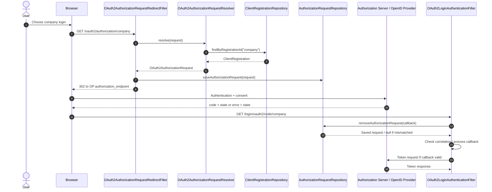

# 29.9. Testing Custom Resolvers, Authorization Requests, and Repositories

In **Spring Security OAuth 2.0/OIDC Client on Servlet**, login tests should not merely assert that hitting `/oauth2/authorization/company` returns HTTP 302. A redirect can be issued while still carrying the wrong `client_id`, `redirect_uri`, or `scope`, or dropping protections like **`state`, PKCE `code_verifier`, and OIDC `nonce`**. Conversely, a callback may carry a syntactically valid authorization code while **no matching authorization request exists in the session**, and Spring Security must reject it rather than proceeding to exchange the token.

Three components are especially critical at the start of the Authorization Code Flow:

1. **`OAuth2AuthorizationRequestResolver`**: inspects the HTTP request and determines how to build an authorization request for the matching `ClientRegistration`.
2. **`OAuth2AuthorizationRequest`**: an immutable object describing the authorization request, the parameters sent to the Authorization Server, and internal attributes needed at callback time.
3. **`AuthorizationRequestRepository<OAuth2AuthorizationRequest>`**: saves, loads, and removes the authorization request between login initiation and callback.

When **custom resolvers** (choosing providers per tenant, adding `prompt`, `login_hint`, or handling redirect URIs) and **custom repositories** (distributed sessions, cookies, Redis, multiple tabs) are introduced, they become points where both functionality and defenses against login CSRF, authorization code injection, and provider mix-up can break.

This lesson walks through **Servlet testing** with JUnit 5, Spring Test `MockHttpServletRequest`/`MockHttpServletResponse`, Spring Security Test, and MockMvc. It shows how to construct standalone fixtures, verify resolver contracts, test repository save/load/remove lifecycles, wire them into `SecurityFilterChain`, and design negative tests. The snippets are illustrative examples to adapt to real projects; no claim is made that the code was executed or passed Content QA.

> **Principle:** A good test checks the flow's **security invariants**, not merely whether a URL contains an expected substring. A wrong `state` or missing authorization request must lead to **rejecting the callback**, never "fixed" by disabling validation.

## 1. Learning Objectives

After this lesson, you will be able to:

- Locate the resolver, authorization request, and repository in OAuth2 Authorization Code/OIDC Login.
- Distinguish the **request built at the RP** from the **callback response returned by the OP via browser**.
- Write unit tests for both `resolve(HttpServletRequest)` and `resolve(HttpServletRequest, String)` overloads.
- Verify registration ID, authorization URI, redirect URI, client ID, response type, scopes, and `state`.
- Verify PKCE `code_challenge` is placed on the front channel while the verifier stays in server-side attributes.
- Design tests that do not depend on random `state`/`nonce` values.
- Write fixtures for `OAuth2AuthorizationRequest` and test `save`, `load`, and `remove` using mock sessions.
- Build and test a custom repository decorator without breaking the underlying repository's semantics.
- Wire both resolver and repository into Servlet `oauth2Login` and test the redirect path via MockMvc.
- Define negative/security tests for callback replay, state mismatch, session timeout, multi-tab flows, and multiple providers.
- Distinguish unit tests, filter-level tests, and end-to-end tests with a simulated OP.

## 2. Servlet Flow Diagram Under Test



In practice, Spring Security also handles `state`, PKCE, OIDC ID Token validation, UserInfo, and saving `OAuth2AuthorizedClient`. This lesson's three components sit **before token exchange**, yet if they fail, later steps lack a trustworthy context.

### 2.1. Default Endpoints

| Purpose | Sample URI | Component |
|---|---|---|
| Authorization initiation | `/oauth2/authorization/{registrationId}` | `OAuth2AuthorizationRequestRedirectFilter` |
| OP Authorization Endpoint | `https://id.example.test/authorize` | Browser navigates to OP |
| Login callback | `/login/oauth2/code/{registrationId}` | `OAuth2LoginAuthenticationFilter` |
| Token Endpoint | `https://id.example.test/token` | RP calls server-to-server |

Servlet paths can be customized. Tests must match the **actual filter chain configuration**, rather than assuming every app uses these exact URIs.

### 2.2. Three Distinct Objects

```text
ClientRegistration:
  registrationId=company
  clientId=portal-web
  authorizationUri=https://id.example.test/authorize
  redirectUri={baseUrl}/login/oauth2/code/{registrationId}

OAuth2AuthorizationRequest:
  authorizationUri=https://id.example.test/authorize
  clientId=portal-web
  redirectUri=https://portal.example.test/login/oauth2/code/company
  state=<random>
  scopes=[openid, profile]
  additionalParameters={...}
  attributes={...}

AuthorizationRequestRepository:
  saves OAuth2AuthorizationRequest on login start
  restores matching browser/session/state on callback
  removes once when callback is processed
```

**`ClientRegistration` is not `OAuth2AuthorizedClient`**. An authorized client holds access/refresh tokens granted after authorization; an authorization request repository only holds pending flow state awaiting callback. Never substitute a token storage service for an authorization request repository.

## 3. API of `OAuth2AuthorizationRequestResolver`

In Servlet, the interface exposes two overloads:

```java
import jakarta.servlet.http.HttpServletRequest;
import org.springframework.security.oauth2.core.endpoint.OAuth2AuthorizationRequest;

public interface OAuth2AuthorizationRequestResolver {

    OAuth2AuthorizationRequest resolve(HttpServletRequest request);

    OAuth2AuthorizationRequest resolve(
        HttpServletRequest request,
        String clientRegistrationId
    );
}
```

This is an **illustrative API signature for learning**, not verbatim official package source; the real interface belongs to package `org.springframework.security.oauth2.client.web.OAuth2AuthorizationRequestResolver`.

### 3.1. Meaning of the Single-Parameter Overload

`resolve(request)` determines the authorization request from the HTTP request, typically matching `/oauth2/authorization/{registrationId}`.

Example:

```text
GET /oauth2/authorization/company
  -> registrationId = company
  -> builds OAuth2AuthorizationRequest for company
```

If the request **does not match the base URI/pattern** or cannot resolve per contract, the resolver may return `null` or throw an exception depending on the case, such as a nonexistent registration ID. Tests should distinguish **non-matching requests** from **invalid `ClientRegistration`s**.

### 3.2. Meaning of the Two-Parameter Overload

`resolve(request, registrationId)` lets callers supply a registration ID explicitly, supporting custom routes and components that select a `ClientRegistration` without parsing the ID from the default path.

A custom resolver must handle both overloads **consistently**. If you customize only the first overload, another flow invoking the second overload can bypass `prompt`, tenant checks, or security constraints.

### 3.3. `DefaultOAuth2AuthorizationRequestResolver`

Spring Security provides the default implementation:

```java
DefaultOAuth2AuthorizationRequestResolver resolver =
    new DefaultOAuth2AuthorizationRequestResolver(
        clientRegistrationRepository,
        "/oauth2/authorization"
    );
```

It supports customizing the authorization request builder via `setAuthorizationRequestCustomizer(...)`. This approach is usually **less risky** than building `OAuth2AuthorizationRequest` from scratch.

## 4. Setting Up Test Fixtures Without Connecting to an OP

Unit tests for resolvers do not need a real Authorization Server. Construct `ClientRegistration` via the builder and set all URLs to fake domains.

```java
import org.springframework.security.oauth2.client.registration.ClientRegistration;
import org.springframework.security.oauth2.client.registration.InMemoryClientRegistrationRepository;
import org.springframework.security.oauth2.client.registration.ClientRegistrationRepository;
import org.springframework.security.oauth2.core.AuthorizationGrantType;
import org.springframework.security.oauth2.core.ClientAuthenticationMethod;

public final class TestRegistrations {

    private TestRegistrations() {}

    public static ClientRegistration company() {
        return ClientRegistration.withRegistrationId("company")
            .clientId("portal-company-client")
            .clientSecret("unit-test-only-secret")
            .clientAuthenticationMethod(
                ClientAuthenticationMethod.CLIENT_SECRET_BASIC
            )
            .authorizationGrantType(
                AuthorizationGrantType.AUTHORIZATION_CODE
            )
            .redirectUri(
                "{baseUrl}/login/oauth2/code/{registrationId}"
            )
            .scope("openid", "profile")
            .authorizationUri("https://id.company.example.test/authorize")
            .tokenUri("https://id.company.example.test/token")
            .jwkSetUri("https://id.company.example.test/jwks")
            .issuerUri("https://id.company.example.test")
            .clientName("Company OP")
            .build();
    }

    public static ClientRegistration partner() {
        return ClientRegistration.withRegistrationId("partner")
            .clientId("portal-partner-client")
            .clientSecret("unit-test-only-secret")
            .clientAuthenticationMethod(
                ClientAuthenticationMethod.CLIENT_SECRET_BASIC
            )
            .authorizationGrantType(
                AuthorizationGrantType.AUTHORIZATION_CODE
            )
            .redirectUri(
                "{baseUrl}/login/oauth2/code/{registrationId}"
            )
            .scope("openid", "profile")
            .authorizationUri("https://id.partner.example.test/authorize")
            .tokenUri("https://id.partner.example.test/token")
            .jwkSetUri("https://id.partner.example.test/jwks")
            .issuerUri("https://id.partner.example.test")
            .clientName("Partner OP")
            .build();
    }

    public static ClientRegistrationRepository repository() {
        return new InMemoryClientRegistrationRepository(
            company(), partner()
        );
    }
}
```

In this fixture there is **no network discovery**: `ClientRegistration` is constructed manually. `example.test` URLs are for tests only. Never put real client secrets into source or test fixtures.

### 4.1. Why Prefer a Fake `ClientRegistration`?

- Tests run fast with deterministic issuer and authorization URIs.
- No dependency on an online OP.
- Never touches production Client IDs or secrets.
- Easy to define two providers to test registration routing.
- Easy to simulate misconfigurations safely.

Unit tests **do not prove** real issuer discovery/JWKS or ID Token validation. That belongs in separate integration tests.

### 4.2. Building Realistic Mock Servlet Requests

Spring Test provides `MockHttpServletRequest`:

```java
import org.springframework.mock.web.MockHttpServletRequest;

public final class ServletRequests {

    private ServletRequests() {}

    public static MockHttpServletRequest authorizationGet(
            String registrationId) {

        String path = "/oauth2/authorization/" + registrationId;

        MockHttpServletRequest request =
            new MockHttpServletRequest("GET", path);

        request.setServletPath(path);
        request.setScheme("https");
        request.setServerName("portal.example.test");
        request.setServerPort(443);

        return request;
    }
}
```

`setServletPath(path)` ensures request matchers relying on servlet path see the exact path. `setScheme`/`setServerName`/`setServerPort` let the resolver expand `{baseUrl}` to the expected public origin.

When the app uses a servlet context path such as `/portal`, fixtures must set `contextPath`, `requestURI`, and `servletPath` accordingly. Never set a fake `requestURI` that mismatches `contextPath` and blame Spring's resolver.

## 5. Unit Testing the Default Resolver

JUnit 5 with AssertJ example:

```java
import org.junit.jupiter.api.Test;
import org.springframework.mock.web.MockHttpServletRequest;
import org.springframework.security.oauth2.client.web.DefaultOAuth2AuthorizationRequestResolver;
import org.springframework.security.oauth2.core.endpoint.OAuth2AuthorizationRequest;

import static org.assertj.core.api.Assertions.assertThat;

class AuthorizationRequestResolverTest {

    private final DefaultOAuth2AuthorizationRequestResolver resolver =
        new DefaultOAuth2AuthorizationRequestResolver(
            TestRegistrations.repository(),
            "/oauth2/authorization"
        );

    @Test
    void resolvesCompanyRegistrationAndPublicCallback() {
        MockHttpServletRequest httpRequest =
            ServletRequests.authorizationGet("company");

        OAuth2AuthorizationRequest authorization =
            resolver.resolve(httpRequest);

        assertThat(authorization).isNotNull();
        assertThat(authorization.getClientId())
            .isEqualTo("portal-company-client");
        assertThat(authorization.getAuthorizationUri())
            .isEqualTo("https://id.company.example.test/authorize");
        assertThat(authorization.getRedirectUri())
            .isEqualTo(
                "https://portal.example.test/login/oauth2/code/company"
            );
        assertThat(authorization.getScopes())
            .contains("openid", "profile");
        assertThat(authorization.getState()).isNotBlank();
    }

    @Test
    void ignoresUnrelatedServletPath() {
        MockHttpServletRequest request =
            new MockHttpServletRequest("GET", "/health");

        request.setServletPath("/health");

        assertThat(resolver.resolve(request)).isNull();
    }
}
```

### 5.1. What Is Verified?

The first test confirms the right Client, authorization destination, callback host/path, scopes, and state. The second confirms the resolver does not intercept requests for unrelated endpoints.

Testing only `HTTP 302` is insufficient: in resolver unit tests, we inspect the exact `OAuth2AuthorizationRequest` that the filter will use.

### 5.2. Never Assert an Exact Random `state`

Wrong:

```java
assertThat(authorization.getState())
    .isEqualTo("hardcoded-constant");
```

`state` must be unpredictable, not a fixed constant. Instead test:

```java
assertThat(authorization.getState()).isNotBlank();
```

For deterministic repository correlation unit tests, use a fixture `state="test-state"`; **never use a fixed state in a production request resolver**.

### 5.3. Testing the Two-Parameter Overload

```java
@Test
void explicitRegistrationIdUsesPartnerConfiguration() {
    MockHttpServletRequest request =
        ServletRequests.authorizationGet("company");

    OAuth2AuthorizationRequest authorization =
        resolver.resolve(request, "partner");

    assertThat(authorization).isNotNull();
    assertThat(authorization.getClientId())
        .isEqualTo("portal-partner-client");
    assertThat(authorization.getAuthorizationUri())
        .isEqualTo("https://id.partner.example.test/authorize");
}
```

In this overload, the registration ID **is supplied by the caller**. Never cite this result as proof that a browser request is allowed to switch providers arbitrarily; production code must still control who may choose which registration.

## 6. Testing `OAuth2AuthorizationRequest` at the Right Depth

`OAuth2AuthorizationRequest` contains two groups of data:

- **Parameters sent in the authorization redirect:** `response_type`, `client_id`, `redirect_uri`, `scope`, `state`, `code_challenge`, OIDC `nonce`, and provider-specific parameters.
- **Internal attributes:** framework state preserved between initiation and callback, such as original registration context, PKCE verifier, and nonce context per implementation.

Not every attribute key is a stable public API across versions. If custom code relies deeply on internal attribute keys, pin/test against your exact Spring Security version and avoid mutating outside official builder methods.

### 6.1. Common Getters

```java
OAuth2AuthorizationRequest authorization = resolver.resolve(httpRequest);

String authorizationUri = authorization.getAuthorizationUri();
String redirectUri = authorization.getRedirectUri();
String clientId = authorization.getClientId();
String state = authorization.getState();

var scopes = authorization.getScopes();
var publicParameters = authorization.getAdditionalParameters();
var serverSideAttributes = authorization.getAttributes();
String fullRedirect = authorization.getAuthorizationRequestUri();
```

Never print `fullRedirect` in production logs: it contains `state` and flow-sensitive parameters.

### 6.2. Testing `response_type`

For the Authorization Code Flow:

```java
import org.springframework.security.oauth2.core.endpoint.OAuth2ParameterNames;

assertThat(authorization.getResponseType().getValue())
    .isEqualTo("code");
```

Do not downgrade to implicit/hybrid flows just to accommodate a legacy provider. If the app uses Authorization Code + PKCE, test the exact flow.

### 6.3. Inspecting URLs with a URI Parser, Not Only `contains`

To avoid false positives from encoding or strings appearing in the wrong place:

```java
import java.net.URI;

URI redirect = URI.create(authorization.getAuthorizationRequestUri());

assertThat(redirect.getScheme()).isEqualTo("https");
assertThat(redirect.getHost())
    .isEqualTo("id.company.example.test");
assertThat(redirect.getPath()).isEqualTo("/authorize");
```

When asserting query parameters, use `UriComponentsBuilder` or an encoding-aware URI parser. Never manually `split("&")` percent-encoded values.

### 6.4. Checking `redirect_uri` from the Public Origin

A very common reverse-proxy bug:

```text
Browser: https://portal.example.test
Spring app: http://spring-app:8080

Wrong:
  redirect_uri=http://spring-app:8080/login/oauth2/code/company

Right:
  redirect_uri=https://portal.example.test/login/oauth2/code/company
```

Test request fixtures/proxy headers to prove `redirectUri` matches the public HTTPS URI registered with the OP. Tests that pass only when host and scheme match catch deployment bugs early.

## 7. Testing PKCE and OIDC Nonce with a Custom Resolver

PKCE protects the Authorization Code Flow against codes being intercepted or exchanged outside the initiated flow. Spring Security provides a customizer utility:

```java
import org.springframework.security.oauth2.client.web.DefaultOAuth2AuthorizationRequestResolver;
import org.springframework.security.config.oauth2.client.OAuth2AuthorizationRequestCustomizers;

var resolver = new DefaultOAuth2AuthorizationRequestResolver(
    TestRegistrations.repository(),
    "/oauth2/authorization"
);

resolver.setAuthorizationRequestCustomizer(
    OAuth2AuthorizationRequestCustomizers.withPkce()
);
```

When your framework/version supports this customizer, the authorization request puts `code_challenge`/`code_challenge_method` into the OP-bound request and retains `code_verifier` privately in attributes needed for token exchange.

### 7.1. PKCE Tests Must Do More Than Search Strings in the URL

```java
import org.springframework.security.oauth2.core.endpoint.PkceParameterNames;

var authorization =
    resolver.resolve(ServletRequests.authorizationGet("company"));

assertThat(authorization.getAdditionalParameters())
    .containsKey(PkceParameterNames.CODE_CHALLENGE);

assertThat(authorization.getAdditionalParameters())
    .containsEntry(PkceParameterNames.CODE_CHALLENGE_METHOD, "S256");

assertThat(authorization.getAttributes())
    .containsKey(PkceParameterNames.CODE_VERIFIER);
```

This example assumes PKCE S256 is configured and attributes hold the verifier per your Spring Security API/version. With other custom resolvers, verify it **preserves the verifier** and never leaks the verifier onto the front-channel authorization URL.

### 7.2. Why Must `code_verifier` Never Appear in the URL?

`code_challenge` is sent to the OP to bind the code. `code_verifier` is a secret the Client keeps for the Token Endpoint request. If a resolver puts the verifier in the URL, browser logs or the OP can see it and PKCE protection is undermined.

Tests must verify **strict separation of the two values**, without dumping raw verifiers to stdout.

### 7.3. OIDC Nonce Is Separate from PKCE

With scope `openid`, OIDC uses `nonce` to bind the ID Token to the authentication request when the flow applies it. Depending on implementation, the nonce sent in the authorization URL may be hashed/derived while an original value stays server-side to validate the ID Token.

Never copy an authorization request carelessly by constructing a new object with only `clientId`, `redirectUri`, and `state`, dropping nonce/context. When a custom resolver adds parameters, prefer:

```java
OAuth2AuthorizationRequest.from(original)
    .additionalParameters(params -> params.put("prompt", "login"))
    .build();
```

`prompt=login` is an example OIDC parameter requesting re-authentication at the OP; use it only when policy and the provider support it. `from(original)` preserves critical fields and attributes. Tests must still verify the copy keeps `state`, PKCE verifier, and needed attributes.

## 8. Custom Resolver: Build with a Decorator Instead of Rebuilding from Scratch

Example of a resolver that selectively adds `prompt` for OIDC registrations without altering endpoints or regenerating state:

```java
import jakarta.servlet.http.HttpServletRequest;
import org.springframework.security.oauth2.client.web.OAuth2AuthorizationRequestResolver;
import org.springframework.security.oauth2.core.endpoint.OAuth2AuthorizationRequest;

public final class PromptAuthorizationRequestResolver
        implements OAuth2AuthorizationRequestResolver {

    private final OAuth2AuthorizationRequestResolver delegate;

    public PromptAuthorizationRequestResolver(
            OAuth2AuthorizationRequestResolver delegate) {
        this.delegate = delegate;
    }

    @Override
    public OAuth2AuthorizationRequest resolve(
            HttpServletRequest request) {
        return customize(delegate.resolve(request));
    }

    @Override
    public OAuth2AuthorizationRequest resolve(
            HttpServletRequest request,
            String clientRegistrationId) {
        return customize(
            delegate.resolve(request, clientRegistrationId)
        );
    }

    private OAuth2AuthorizationRequest customize(
            OAuth2AuthorizationRequest original) {

        if (original == null) {
            return null;
        }

        return OAuth2AuthorizationRequest.from(original)
            .additionalParameters(parameters ->
                parameters.put("prompt", "login")
            )
            .build();
    }
}
```

This variant illustrates a **re-authentication prompt for compatible OIDC providers** and should not be applied to OAuth2-only providers or every login request unless required by the product.

### 8.1. Invariants That Must Be Tested

- `delegate.resolve(...) == null` -> custom resolver also returns `null`.
- Both overloads behave identically.
- Does not alter `clientId`, `authorizationUri`, `redirectUri`, `responseType`, or `scopes` when the intent is only adding `prompt`.
- Does not alter the original request's `state`.
- Does not drop `attributes` holding PKCE/nonce.
- Only adds/updates the intended parameter in `additionalParameters`.
- Does not let the browser specify arbitrary `prompt`/`login_hint`/`redirect_uri` or issuer values.
- Does not place PII/credentials into the URL without explicit need and policy.

### 8.2. Unit Test for the Decorator

```java
import org.junit.jupiter.api.Test;
import org.springframework.security.oauth2.client.web.DefaultOAuth2AuthorizationRequestResolver;

import static org.assertj.core.api.Assertions.assertThat;

class PromptAuthorizationRequestResolverTest {

    private final DefaultOAuth2AuthorizationRequestResolver delegate =
        new DefaultOAuth2AuthorizationRequestResolver(
            TestRegistrations.repository(),
            "/oauth2/authorization"
        );

    private final PromptAuthorizationRequestResolver custom =
        new PromptAuthorizationRequestResolver(delegate);

    @Test
    void addsPromptWithoutReplacingCoreFields() {
        var request = ServletRequests.authorizationGet("company");
        var base = delegate.resolve(request);
        var modified = custom.resolve(request);

        assertThat(modified.getAdditionalParameters())
            .containsEntry("prompt", "login");

        assertThat(modified.getAuthorizationUri())
            .isEqualTo(base.getAuthorizationUri());
        assertThat(modified.getRedirectUri())
            .isEqualTo(base.getRedirectUri());
        assertThat(modified.getClientId())
            .isEqualTo(base.getClientId());

        // State is generated per resolve call; two independent calls
        // must not be asserted equal.
        assertThat(modified.getState()).isNotBlank();
    }

    @Test
    void unrelatedRequestStillReturnsNull() {
        var request = new org.springframework.mock.web.MockHttpServletRequest(
            "GET", "/health"
        );
        request.setServletPath("/health");

        assertThat(custom.resolve(request)).isNull();
    }
}
```

**Note on random `state`:** calling `delegate` twice generates two different `state` values. To test **preservation of the exact same original `state`**, mock the delegate to return **one fixed fixture**, rather than comparing states across two separate resolve calls.

### 8.3. Verifying Original Preservation with a Mock Delegate

```java
import static org.mockito.Mockito.*;
import static org.assertj.core.api.Assertions.assertThat;

var original = AuthorizationRequestFixtures.sample("state-A");
var delegate = mock(OAuth2AuthorizationRequestResolver.class);
var request = ServletRequests.authorizationGet("company");

when(delegate.resolve(request)).thenReturn(original);

var custom = new PromptAuthorizationRequestResolver(delegate);
var modified = custom.resolve(request);

assertThat(modified.getState()).isEqualTo(original.getState());
assertThat(modified.getAttributes())
    .containsAllEntriesOf(original.getAttributes());
assertThat(modified.getAdditionalParameters())
    .containsEntry("prompt", "login");
```

Here `AuthorizationRequestFixtures.sample(...)` is defined in the fixture section below. Mocking lets us compare against **a specific original** rather than tripping over two random states.

### 8.4. Testing the Two-Parameter Overload with Mockito

```java
var original = AuthorizationRequestFixtures.sample("state-B");
var delegate = mock(OAuth2AuthorizationRequestResolver.class);
var request = ServletRequests.authorizationGet("company");

when(delegate.resolve(request, "partner")).thenReturn(original);

var custom = new PromptAuthorizationRequestResolver(delegate);
var modified = custom.resolve(request, "partner");

assertThat(modified).isNotNull();
assertThat(modified.getState()).isEqualTo("state-B");

verify(delegate).resolve(request, "partner");
```

If a custom resolver forgets to override this overload, this test catches the inconsistency.

## 9. Testing Parameter Resolution and Injection Boundaries

A resolver may read tenant, language, prompt, or login hint from the request. Not every browser input belongs directly in the authorization URL.

### 9.1. `login_hint`

`login_hint` can carry an email/user identifier and appears in the redirect URL. Where needed, enforce privacy, URL-logging, and trusted-source policies. Tests must not log real PII.

### 9.2. `prompt`

OIDC `prompt` defines standard values, yet should never accept arbitrary strings from query parameters. If the UI offers re-authentication, the backend should map from a finite set of values:

```text
mode=standard -> omit prompt
mode=reauth   -> prompt=login
```

Never build URIs by manual string concatenation like `"&prompt=" + request.getParameter(...)`.

### 9.3. `redirect_uri`

`redirect_uri` must match the `ClientRegistration` and OP allowlist. Never let the browser specify an arbitrary callback URL and trust it merely because it uses HTTPS.

### 9.4. Multi-Provider / Multi-Tenant

If a request carries `registrationId=partner` or `tenant=other`, the backend must verify the provider/tenant is permitted. Invariant to assert:

```text
authorization request state
  -> permitted ClientRegistration ID
  -> expected issuer
  -> authorization endpoint
  -> token endpoint
  -> redirect_uri
```

Never pick a Token Endpoint from a user-supplied issuer URI; defend against authorization server mix-up, SSRF, and token exfiltration.

## 10. Interface of `AuthorizationRequestRepository`

In Servlet, the repository holds `OAuth2AuthorizationRequest` between initiation and callback:

```java
import jakarta.servlet.http.HttpServletRequest;
import jakarta.servlet.http.HttpServletResponse;
import org.springframework.security.oauth2.core.endpoint.OAuth2AuthorizationRequest;

public interface AuthorizationRequestRepository<T extends OAuth2AuthorizationRequest> {

    T loadAuthorizationRequest(HttpServletRequest request);

    void saveAuthorizationRequest(
        T authorizationRequest,
        HttpServletRequest request,
        HttpServletResponse response
    );

    T removeAuthorizationRequest(
        HttpServletRequest request,
        HttpServletResponse response
    );
}
```

This is a simplified interface outline for learning. The real repository resides in package `org.springframework.security.oauth2.client.web.AuthorizationRequestRepository`.

### 10.1. Contract to Remember

- **`save`**: writes the pending callback request to the appropriate store.
- **`load`**: locates the request matching the browser/session/callback, without granting `Authentication`.
- **`remove`**: returns the matching request and deletes it once consumed per contract.
- **Null/mismatch**: must never return an authorization request belonging to another browser, tenant, or flow.
- **Replay**: an already-removed request must never reappear.
- **Preserve attributes**: PKCE verifier/nonce/context must remain intact for callback time.
- **Storage isolation**: never let user A load user B's request simply by knowing `state`.

### 10.2. `HttpSessionOAuth2AuthorizationRequestRepository`

Spring Security includes an `HttpSession`-backed implementation. This is a good testing baseline:

```java
import org.springframework.security.oauth2.client.web.HttpSessionOAuth2AuthorizationRequestRepository;

var repository =
    new HttpSessionOAuth2AuthorizationRequestRepository();
```

With session storage, account for users opening multiple tabs, session timeouts, or callbacks landing on another instance. Never assume repository/session management satisfies every concurrency need without testing realistic UX flows.

## 11. Fixed Authorization Request Fixtures

To test repositories, `state` should be fixed **in the fixture**, rather than depending on a random resolver. Construct a request like this:

```java
import java.util.Set;
import org.springframework.security.oauth2.core.endpoint.OAuth2AuthorizationRequest;

public final class AuthorizationRequestFixtures {

    private AuthorizationRequestFixtures() {}

    public static OAuth2AuthorizationRequest sample(String state) {
        return OAuth2AuthorizationRequest.authorizationCode()
            .authorizationUri("https://id.company.example.test/authorize")
            .clientId("portal-company-client")
            .redirectUri(
                "https://portal.example.test/login/oauth2/code/company"
            )
            .scopes(Set.of("openid", "profile"))
            .state(state)
            .build();
    }
}
```

`state="test-state"` is strictly for tests. Real applications require random `state`. Fixtures are built independently of any OP and contain no real credentials.

### 11.1. Why Not Build the Fixture from the Callback Query?

The callback `code=...&state=...` is the **response**, not the original authorization request. The repository must return the previously saved request. Never synthesize a fresh authorization request from callback parameters and treat that as a valid load.

### 11.2. Why Not Store Only `state`?

If a custom repository saves only a `state` string and reconstructs a minimal request, it can lose:

- Original authorization/redirect URI.
- Client registration context.
- PKCE verifier.
- OIDC nonce.
- Additional parameters and internal attributes.
- Flow metadata used to defend against mix-up and validate claims.

The repository must preserve **the full object or a representation proven equivalent**; never drop fields arbitrarily during serialization.

## 12. Unit Testing `save -> load -> remove` with `MockHttpServletRequest`

```java
import org.junit.jupiter.api.Test;
import org.springframework.mock.web.MockHttpServletRequest;
import org.springframework.mock.web.MockHttpServletResponse;
import org.springframework.mock.web.MockHttpSession;
import org.springframework.security.oauth2.client.web.HttpSessionOAuth2AuthorizationRequestRepository;

import static org.assertj.core.api.Assertions.assertThat;

class SessionAuthorizationRequestRepositoryTest {

    private final HttpSessionOAuth2AuthorizationRequestRepository repository =
        new HttpSessionOAuth2AuthorizationRequestRepository();

    @Test
    void savesLoadsAndRemovesFromSameSession() {
        var pending =
            AuthorizationRequestFixtures.sample("test-state-123");

        var start = new MockHttpServletRequest(
            "GET", "/oauth2/authorization/company"
        );
        var startResponse = new MockHttpServletResponse();

        repository.saveAuthorizationRequest(
            pending, start, startResponse
        );

        MockHttpSession session =
            (MockHttpSession) start.getSession(false);

        assertThat(session).isNotNull();

        var callback = new MockHttpServletRequest(
            "GET", "/login/oauth2/code/company"
        );
        callback.setSession(session);
        callback.addParameter("state", "test-state-123");

        var callbackResponse = new MockHttpServletResponse();

        assertThat(repository.loadAuthorizationRequest(callback))
            .isNotNull()
            .extracting("state")
            .isEqualTo("test-state-123");

        var removed = repository.removeAuthorizationRequest(
            callback, callbackResponse
        );

        assertThat(removed).isNotNull();
        assertThat(removed.getState()).isEqualTo("test-state-123");

        assertThat(repository.loadAuthorizationRequest(callback))
            .isNull();
    }
}
```

**What this test verifies:** within the same session and matching `state`, the request is retrieved; once consumed, it disappears. That underpins one-time callback handling at the RP layer.

### 12.1. Do Not Treat `load` as Removing the Request

`loadAuthorizationRequest` reads the request without deleting it prematurely. `removeAuthorizationRequest` is responsible for deletion. If a custom repository deletes inside `load`, callers and filter lifecycle steps may fail unpredictably when trying to read it again.

### 12.2. Testing That Another Browser Cannot Load the Request

```java
@Test
void separateSessionCannotLoadAnotherSessionRequest() {
    var pending = AuthorizationRequestFixtures.sample("state-owner-A");

    var owner = new MockHttpServletRequest(
        "GET", "/oauth2/authorization/company"
    );

    repository.saveAuthorizationRequest(
        pending, owner, new MockHttpServletResponse()
    );

    var foreignCallback = new MockHttpServletRequest(
        "GET", "/login/oauth2/code/company"
    );
    foreignCallback.addParameter("state", "state-owner-A");

    assertThat(repository.loadAuthorizationRequest(foreignCallback))
        .isNull();
}
```

An attacker who learns `state` must not be able to retrieve another session's request merely by sending the same state string in a callback.

### 12.3. Testing State Mismatch

```java
@Test
void mismatchedStateDoesNotResolvePendingRequest() {
    var pending = AuthorizationRequestFixtures.sample("expected-state");

    var start = new MockHttpServletRequest(
        "GET", "/oauth2/authorization/company"
    );

    repository.saveAuthorizationRequest(
        pending, start, new MockHttpServletResponse()
    );

    var callback = new MockHttpServletRequest(
        "GET", "/login/oauth2/code/company"
    );
    callback.setSession((MockHttpSession) start.getSession());
    callback.addParameter("state", "attacker-state");

    assertThat(repository.loadAuthorizationRequest(callback))
        .isNull();
}
```

This is a security invariant. **Never modify a repository to return the "latest request regardless of state"** just to work around multi-tab bugs.

## 13. Testing `remove` and Replay Protection

An already-processed callback must leave no valid authorization request available for reuse. Two protection layers apply:

1. The RP repository consumes the pending request.
2. The Authorization Server accepts the authorization code only for the matching Client/PKCE and typically **only once**.

Repository tests verify only the first layer; they **do not prove** the OP prevents authorization code replay.

### 13.1. Testing One-Time Removal

```java
var pending = AuthorizationRequestFixtures.sample("consume-once");

var start = new MockHttpServletRequest(
    "GET", "/oauth2/authorization/company"
);
repository.saveAuthorizationRequest(
    pending, start, new MockHttpServletResponse()
);

var callback = new MockHttpServletRequest(
    "GET", "/login/oauth2/code/company"
);
callback.setSession((MockHttpSession) start.getSession());
callback.addParameter("state", "consume-once");

assertThat(repository.removeAuthorizationRequest(
    callback, new MockHttpServletResponse()
)).isNotNull();

assertThat(repository.removeAuthorizationRequest(
    callback, new MockHttpServletResponse()
)).isNull();
```

In a custom distributed repository, consumption may require an **atomic get-and-delete** rather than two separate operations if you must prevent two concurrent callbacks from reading the same request.

### 13.2. Saving `null` and Cleanup

Some implementations treat `saveAuthorizationRequest(null, request, response)` as removing the stored request. If your contract or custom flow relies on that behavior, write dedicated cleanup tests rather than testing only non-null saves.

Do not assume every custom repository handles `null` as a valid argument. Check your implementation contract.

## 14. Building a Testable Custom Repository Using a Decorator

A typical use case is adding observability without altering persistence semantics. Wrap the real repository:

```java
import java.util.concurrent.atomic.AtomicInteger;

import jakarta.servlet.http.HttpServletRequest;
import jakarta.servlet.http.HttpServletResponse;

import org.springframework.security.oauth2.client.web.AuthorizationRequestRepository;
import org.springframework.security.oauth2.core.endpoint.OAuth2AuthorizationRequest;

public final class CountingAuthorizationRequestRepository
        implements AuthorizationRequestRepository<OAuth2AuthorizationRequest> {

    private final AuthorizationRequestRepository<
        OAuth2AuthorizationRequest> delegate;

    private final AtomicInteger saveCount = new AtomicInteger();
    private final AtomicInteger loadCount = new AtomicInteger();
    private final AtomicInteger removeCount = new AtomicInteger();

    public CountingAuthorizationRequestRepository(
            AuthorizationRequestRepository<
                OAuth2AuthorizationRequest> delegate) {
        this.delegate = delegate;
    }

    @Override
    public OAuth2AuthorizationRequest loadAuthorizationRequest(
            HttpServletRequest request) {
        loadCount.incrementAndGet();
        return delegate.loadAuthorizationRequest(request);
    }

    @Override
    public void saveAuthorizationRequest(
            OAuth2AuthorizationRequest authorizationRequest,
            HttpServletRequest request,
            HttpServletResponse response) {
        saveCount.incrementAndGet();
        delegate.saveAuthorizationRequest(
            authorizationRequest, request, response
        );
    }

    @Override
    public OAuth2AuthorizationRequest removeAuthorizationRequest(
            HttpServletRequest request,
            HttpServletResponse response) {
        removeCount.incrementAndGet();
        return delegate.removeAuthorizationRequest(request, response);
    }

    public int saves() {
        return saveCount.get();
    }

    public int loads() {
        return loadCount.get();
    }

    public int removes() {
        return removeCount.get();
    }
}
```

This decorator is for demos and tests. In production, use Micrometer metrics with low-cardinality tags; **do not rely on simple JVM counters as your distributed observability system**.

### 14.1. Testing That the Decorator Preserves the Contract

```java
@Test
void decoratorDelegatesAndCountsLifecycle() {
    var underlying =
        new HttpSessionOAuth2AuthorizationRequestRepository();

    var observed =
        new CountingAuthorizationRequestRepository(underlying);

    var pending = AuthorizationRequestFixtures.sample("trace-state");

    var start = new MockHttpServletRequest(
        "GET", "/oauth2/authorization/company"
    );
    observed.saveAuthorizationRequest(
        pending, start, new MockHttpServletResponse()
    );

    var callback = new MockHttpServletRequest(
        "GET", "/login/oauth2/code/company"
    );
    callback.setSession((MockHttpSession) start.getSession());
    callback.addParameter("state", "trace-state");

    assertThat(observed.loadAuthorizationRequest(callback))
        .isNotNull();

    assertThat(observed.removeAuthorizationRequest(
        callback, new MockHttpServletResponse()
    )).isNotNull();

    assertThat(observed.saves()).isEqualTo(1);
    assertThat(observed.loads()).isEqualTo(1);
    assertThat(observed.removes()).isEqualTo(1);

    assertThat(underlying.loadAuthorizationRequest(callback))
        .isNull();
}
```

A safe decorator never logs raw `state` or caches authorization requests in a static map. It simply delegates and records metrics.

### 14.2. Why Is Testing Against a Real Delegate Better Than Mocking for Contract Tests?

With a pure Mockito mock, you can verify `save` was called, yet not prove the request is actually persisted or deleted. Testing the decorator wrapping a real repository with `MockHttpSession` verifies **observable behavior** across save/load/remove.

Mockito remains useful for verifying call ordering or exception propagation, but does not replace storage contract tests.

## 15. When a Custom Repository Uses Redis, a Database, or Cookies

Not every custom repository is just a decorator. For distributed sessions, you may serialize the authorization request into Redis/a database or hold it in a signed/encrypted cookie.

### 15.1. Security Boundaries to Uphold

| Design | What must be verified |
|---|---|
| `HttpSession` | Session isolation, state matching, timeout, multi-tab |
| Spring Session Redis | Shared session visibility, TTL, namespace, serializer, Redis outage |
| DB table | Key ownership, concurrency, atomic consume, TTL/cleanup |
| Signed/encrypted cookie | Integrity, confidentiality, expiry, replay control, cookie flags/size |
| Browser local storage | Unsuitable for keeping server-side secrets in a confidential backend |
| Distributed cache | Collisions, eviction, stale writes, key rotation, atomicity |

**Never store PKCE verifiers or nonce secrets in a mutable plaintext cookie**, and never "Base64-encode and call it safe". If designing a cookie-based repository, enforce integrity/AEAD, key rotation, TTL, `Secure`, `HttpOnly`, `SameSite`, and replay protection per policy.

### 15.2. Contract Tests for Custom Implementations

Regardless of backing store, test:

1. Save then load with the same browser context and valid `state`.
2. Missing `state` returns no pending request.
3. Wrong `state` returns no pending request.
4. Another session/tenant cannot load the request.
5. One-time remove; loading after remove returns `null`.
6. Concurrent remove never gives two requests the same pending entry when one-time consume is required.
7. Saving `null`/cleanup matches implementation semantics.
8. TTL expiration or session invalidation clears the request.
9. Tokens/attributes remain intact across serialization/deserialization.
10. Multiple tabs/flows do not overwrite unexpectedly or follow documented behavior.
11. Storage failures fail closed; never skip state validation.
12. Never log the request, verifier, nonce, or real state.
13. For signed cookies, tampering/signature errors are rejected.
14. Key rotation/older encrypted payloads follow policy.
15. Never let the browser pass an arbitrary storage key or `userId` to look up entries.

### 15.3. Commonly Missed Serialization Bugs

A custom JSON serializer might only write:

```json
{
  "state": "EXAMPLE",
  "clientId": "portal-company-client"
}
```

Yet the callback also needs redirect URI, PKCE verifier, nonce, registration context, and attributes. **Reconstructing a request without these fields is unsafe.**

Tests should compare all public fields and essential attributes after a round trip, not just `getState()`.

### 15.4. Atomicity in Distributed Storage

An implementation might do:

```text
GET state-key
DELETE state-key
```

If two concurrent requests arrive, both can `GET` successfully before `DELETE`. When your threat model requires one-time consumption, use an atomic storage operation (such as a transaction/script/get-and-delete with verified semantics) alongside TTL and ownership checks.

### 15.5. TTL Is Not Token Lifetime

Authorization requests have a very short lifetime spanning the imminent callback. Never set TTL equal to refresh token lifetime, and never retain verifiers/nonces for days. Too short a TTL causes missing callbacks; too long enlarges replay exposure and retains sensitive data unnecessarily.

## 16. Multiple Tabs: Define Semantics Before Writing Tests

Scenario:

```text
Tab A: starts company login -> state A
Tab B: starts partner login -> state B
Tab A: callback state A
Tab B: callback state B
```

A repository storing **only one authorization request per session** lets tab B overwrite tab A. A repository supporting multiple flows can store a map of pending requests keyed by `state` inside **the same session**.

Either design can be valid depending on requirements, yet behavior must be explicit. Never "fix" this by returning "the latest request" for any callback.

### 16.1. If Multiple Pending Flows Are Supported

Test:

- Save A and B in the same session.
- Loading callback A returns only A.
- Loading callback B returns only B.
- Removing A does not delete B.
- Callback with `state` C returns neither A nor B.
- Each `state` is consumed at most once.
- Exceeding max pending flows/TTL triggers bounded cleanup against DoS.
- Registrations A/B, PKCE verifiers, and nonces never mix.

### 16.2. If Only One Flow at a Time Is Supported

Explicitly test that starting a new flow prevents the older flow from completing its callback, and the UI shows "Your login session expired, please start again". **Never return request B for a callback carrying `state` A.**

## 17. Wiring Resolver and Repository into `SecurityFilterChain`

Servlet configuration example:

```java
import org.springframework.context.annotation.Bean;
import org.springframework.context.annotation.Configuration;
import org.springframework.security.config.Customizer;
import org.springframework.security.config.annotation.web.builders.HttpSecurity;
import org.springframework.security.oauth2.client.registration.ClientRegistrationRepository;
import org.springframework.security.oauth2.client.web.AuthorizationRequestRepository;
import org.springframework.security.oauth2.client.web.DefaultOAuth2AuthorizationRequestResolver;
import org.springframework.security.oauth2.core.endpoint.OAuth2AuthorizationRequest;
import org.springframework.security.web.SecurityFilterChain;
import org.springframework.security.oauth2.client.web.HttpSessionOAuth2AuthorizationRequestRepository;

@Configuration
public class CustomOAuth2AuthorizationConfiguration {

    @Bean
    AuthorizationRequestRepository<OAuth2AuthorizationRequest>
    authorizationRequestRepository() {
        return new CountingAuthorizationRequestRepository(
            new HttpSessionOAuth2AuthorizationRequestRepository()
        );
    }

    @Bean
    SecurityFilterChain securityFilterChain(
            HttpSecurity http,
            ClientRegistrationRepository clientRegistrations,
            AuthorizationRequestRepository<OAuth2AuthorizationRequest> repository)
            throws Exception {

        var defaultResolver =
            new DefaultOAuth2AuthorizationRequestResolver(
                clientRegistrations,
                "/oauth2/authorization"
            );

        var customResolver =
            new PromptAuthorizationRequestResolver(defaultResolver);

        return http
            .authorizeHttpRequests(authorize -> authorize
                .requestMatchers("/", "/login", "/error").permitAll()
                .anyRequest().authenticated()
            )
            .oauth2Login(login -> login
                .authorizationEndpoint(endpoint -> endpoint
                    .authorizationRequestResolver(customResolver)
                    .authorizationRequestRepository(repository)
                )
            )
            .build();
    }
}
```

**Note:** The snippet above configures a single repository bean **used consistently** for both authorization initiation and callback in the Spring Security flow. Never create two repository instances backed by separate stores and expect the login filter to find requests saved by the redirect filter.

### 17.1. At Which Level Should You Test This Configuration?

- Resolver/repository unit tests: no Spring context startup needed.
- `SecurityFilterChain` integration tests: verify custom beans are wired into the **right chain**, not swallowed by another chain.
- Browser/OP integration tests: verify authorization, callback, tokens, and OIDC validation together.

### 17.2. Multiple Filter Chains

An app might have:

```text
/api/**        -> stateless bearer Resource Server chain
/**            -> browser session + oauth2Login chain
```

If `/oauth2/authorization/company` lands in the wrong chain, the resolver is never invoked or the callback is blocked. Tests must verify `securityMatcher`/filter ordering, not just the resolver class in isolation.

## 18. MockMvc: Testing Real Redirects Through the Filter Chain

An integration test can use:

```java
import org.junit.jupiter.api.Test;
import org.springframework.beans.factory.annotation.Autowired;
import org.springframework.boot.test.autoconfigure.web.servlet.AutoConfigureMockMvc;
import org.springframework.boot.test.context.SpringBootTest;
import org.springframework.test.web.servlet.MockMvc;

import static org.assertj.core.api.Assertions.assertThat;
import static org.springframework.test.web.servlet.request.MockMvcRequestBuilders.get;
import static org.springframework.test.web.servlet.result.MockMvcResultMatchers.status;

@SpringBootTest
@AutoConfigureMockMvc
class OAuth2AuthorizationRedirectIT {

    @Autowired
    MockMvc mvc;

    @Test
    void companyAuthorizationStartsAtExpectedOp() throws Exception {
        var result = mvc.perform(
                get("/oauth2/authorization/company")
                    .secure(true)
                    .with(request -> {
                        request.setScheme("https");
                        request.setServerName("portal.example.test");
                        request.setServerPort(443);
                        return request;
                    })
            )
            .andExpect(status().is3xxRedirection())
            .andReturn();

        String location = result.getResponse().getHeader("Location");

        assertThat(location)
            .startsWith("https://id.company.example.test/authorize?");
    }
}
```

The example **assumes the test application context provides the `ClientRegistrationRepository` and `SecurityFilterChain` from earlier sections**. If Boot's context attempts discovery against a real OP, override with fixtures in test configuration so tests remain network-independent.

### 18.1. What Else Must Be Asserted?

A thorough filter-level test also verifies:

- `Location` targets the right authorization endpoint host/path.
- `response_type=code` and `client_id` are present.
- `redirect_uri` is the exact public HTTPS URI.
- `state` is non-blank.
- Scopes match `ClientRegistration`.
- When PKCE is enabled, `code_challenge` and `code_challenge_method=S256` are present.
- Repository `save` is called, and the session stores the authorization request.
- Requests to unrelated paths do not trigger an OAuth2 redirect.
- Two distinct registrations redirect to their respective OPs.

Use a URI/query parser instead of encoding-fragile regexes.

### 18.2. Callback Tests Must Prepare the Original State

Wrong:

```java
mvc.perform(get("/login/oauth2/code/company")
    .param("code", "any-code")
    .param("state", "any-state"));
```

expecting login to succeed without ever creating an authorization request in the session. That must be rejected. To test the happy path:

1. Initiate authorization via `/oauth2/authorization/company`.
2. Preserve the session cookie and saved authorization request.
3. Mock/stub the OP Token Endpoint to return valid tokens for the test code.
4. For OIDC, supply a JWK signing the ID Token and valid claims.
5. Call back with the real `state` from the initial request.
6. Verify `Authentication` and authorized client are created properly.
7. Verify the repository removes the request after use.

Never hardcode any valid production token into tests.

## 19. Negative Callback Tests with MockMvc

To test security, construct a callback request:

```java
mvc.perform(
    get("/login/oauth2/code/company")
        .param("code", "FAKE_CODE")
        .param("state", "WRONG_STATE")
);
```

When the session has no saved request or `state` is wrong, **it must not authenticate**. Exact HTTP response status may be a redirect to `/login?error`, 401, or a custom failure handler's response per config. Thus the core security assertions are:

- The simulated Token Endpoint **is never called**.
- No new authenticated principal is established.
- The failure handler produces a safe path/outcome.
- Code, state, or raw exceptions are never leaked in responses.
- Pending requests are never attached to another principal.

### 19.1. Testing Callback Missing `state`

If a callback contains `code` without `state`, reject it, even if the same browser session holds a pending request. Never fall back to "grabbing the latest request".

### 19.2. Testing Callback in the Wrong Session

Initiate in session A, then call back with session B. Pending request A must never be retrieved merely because the callback carries the matching state string.

### 19.3. Testing Callback Replay

An already-processed callback must not reuse the repository entry to create a new login. Once the Token Endpoint has issued tokens, the OP must also reject code reuse.

### 19.4. Testing OP Returning `error=access_denied`

This is a failed authorization response, not a successful token exchange. Spring must follow the failure path without calling the Token Endpoint with a nonexistent code.

### 19.5. Testing Multi-Provider Mix-Up

Initiate `company`, then attempt a callback targeting `partner` or another OP issuer. A `company` code must never be sent to `partner`'s Token Endpoint. Verify correlation, expected issuer, and configuration.

## 20. Testing Persistence Failures and Degraded Behavior

Custom repositories can fail when Redis or the DB is unavailable.

### 20.1. `save` Fails

If saving the authorization request fails:

- Never continue the flow as if the later callback could still verify state/PKCE.
- The application must return a safe error response/fallback without leaking secrets.
- Emit metrics at stage `AUTHORIZATION_INITIATION`, category `STORAGE`.
- Any retries must be bounded and not spawn uncontrolled pending flows.

### 20.2. `load` Fails

If the callback cannot reach storage:

- Never skip state validation.
- Never fabricate an authorization request from the callback.
- Never switch to another provider automatically.
- Never send an authorization code to an endpoint guessed from the URL.

The safe outcome is rejecting the request and letting the user restart once the system recovers.

### 20.3. `remove` Fails

If the repository loads the request yet fails to delete it after the callback, replay risks or stale entries remain. For distributed custom stores, testing delete failures and concurrency is essential.

### 20.4. Deserialization Fails

If a new release changes the request storage schema, a callback started on an older pod and landing on a newer pod can fail. Test rolling-upgrade/serializer compatibility when using Redis/DB sessions.

## 21. Security of Custom Resolvers and Repositories

### 21.1. Never Log Raw `OAuth2AuthorizationRequest`

The object can hold `state`, PKCE verifier/nonce, and sensitive attributes. Calls such as:

```java
// Not recommended:
logger.debug("authorizationRequest={}", authorizationRequest);
```

can leak data. Instead log:

```text
event=oauth2_authorization_request_saved
registrationId=company
outcome=success
correlationId=independent-random-id
```

### 21.2. Never Accept Arbitrary Issuer/Redirect URLs

A resolver letting the browser send `issuer=https://...` and having the backend fetch discovery metadata risks SSRF and mix-up. Use only trusted issuer/registration sources matching tenant and egress policies.

### 21.3. Never "Regenerate" `state` on Callback

`state` must be generated at initiation and stored with the request. Generating a fresh state at callback breaks correlation; skipping comparison introduces login CSRF risk.

### 21.4. Never Use Unsigned Cookies Containing the Verifier

If using a cookie-based repository, Base64-encoding JSON alone is not enough. Enforce integrity/authenticity, confidentiality for sensitive data, TTL, cookie flags, key rotation, and replay policy.

### 21.5. Distinguish Application Session from OP Session

The RP's repository stores pending authorization requests. It does not store or clear the OP's browser SSO session. OP logout is a separate flow via `end_session_endpoint` when supported.

## 22. Logging and Observability for Resolvers/Repositories

Suggested event schema:

```json
{
  "event": "oauth2_authorization_request",
  "phase": "repository_remove",
  "registration_id": "company",
  "outcome": "success",
  "repository_type": "session",
  "request_age_bucket": "0-30s",
  "correlation_id": "independent-random-id"
}
```

Illustrative metrics table:

| Metric | Useful labels | Do not use as labels |
|---|---|---|
| `oauth2.authorization.start` | registration, outcome | state, user email |
| `oauth2.authorization.repository.save` | repository type, outcome | serialized request |
| `oauth2.authorization.callback.mismatch` | registration, reason category | raw state, code |
| `oauth2.authorization.repository.remove` | outcome, storage | session ID, refresh token |
| `oauth2.authorization.callback.duration` | provider alias, outcome | full redirect URL |

Never put `state`, `nonce`, `code_verifier`, authorization codes, session cookies, ID/access tokens, or Client secrets into logs or traces.

### 22.1. A Correlation ID Differs from OAuth2 `state`

`state` is a security parameter; never use it as a trace ID. An independent RP-generated ID can link events within the server-side session/request without exposing `state`. Be cautious when propagating tracing headers to an OP through the browser.

### 22.2. Testing Safe Logging

If you have a custom resolver/repository decorator for telemetry, tests must verify logs/metrics never contain:

- Literal `getState()`.
- PKCE verifier.
- Full authorization request URL.
- Raw cookies.
- OAuth2 access/refresh/ID tokens.
- Provider credentials.

Tests must never snapshot the entire request object.

## 23. Troubleshooting Table

| Symptom | Stage | Possible cause | Check first |
|---|---|---|---|
| `/oauth2/authorization/company` returns 404 | Resolver/filter | Wrong registration/chain/path | `SecurityFilterChain`, base URI |
| `/oauth2/authorization/company-op` does not trigger | Resolver | Used provider ID instead of registration ID | YAML `registration.company` |
| Redirects to internal host | Resolver/base URL | Misconfigured forwarded headers/proxy | Request scheme/host/port |
| Missing PKCE challenge | Customizer/resolver | Not enabled or custom builder dropped it | `additionalParameters` |
| Token Endpoint reports missing PKCE verifier | Repository/attributes | Verifier not saved/restored | `attributes` round trip |
| Callback `authorization_request_not_found` | Repository/session | Cookie/TTL/pod/Redis | Saved request + session |
| Callback `state` mismatch | Repository/callback | Different flow or tampering | Session-bound state matching |
| Multi-tab only succeeds for the latest tab | Repository | Stores only one pending request | Concurrency semantics |
| Redirects to `company` yet token goes to `partner` | Resolver/mix-up | Wrong provider/registration mapping | Expected issuer/token endpoint |
| Callback 302 `/login?error` | Authentication failure | Unidentified stage | Redacted failure handler logs |
| Data lost after deploy | Storage/schema | Serialization/rolling upgrade | Serializer/version compatibility |
| Two callbacks both succeed | Custom repository | Non-atomic remove | Concurrent consume tests |
| State lost after restart | Session architecture | In-memory session | Spring Session/Redis/routing |
| Tampered unknown cookie still loads | Cookie repository | Missing integrity validation | Tamper test |
| Login button works yet login fails | End-to-end | Token/JWKS/UserInfo outside unit scope | Mock OP integration |

## 24. Practice Exercises

### Exercise 1 — Resolver Does Not Match

`resolve` returns `null` on `/health`.

**Explanation:** That is normally the right contract: the resolver does not handle URIs unrelated to authorization initiation. Tests should distinguish non-matching requests from invalid registration configs.

### Exercise 2 — Wrong Provider ID Used

YAML defines `registration.company` with `provider: company-op`. The UI calls `/oauth2/authorization/company-op`.

**Answer:** The default login path must use **registration ID `company`**, not the provider ID.

### Exercise 3 — Comparing Two States

A test calls `resolver.resolve(request)` twice and asserts both states are equal.

**Answer:** Wrong, because `state` can be random per flow. When testing that a custom resolver preserves `state`, mock the delegate to return one fixed original request.

### Exercise 4 — Leaked PKCE Verifier

A custom resolver adds `code_verifier` to the authorization URL.

**Answer:** Never do that. The verifier belongs in the Client/token exchange context; the authorization URL sends only code challenge and method.

### Exercise 5 — Custom Resolver Overrides Only One Overload

A custom resolver adds `prompt` in `resolve(request)` while `resolve(request, id)` delegates directly to default.

**Answer:** Test both overloads and share one `customize` helper to prevent bypasses.

### Exercise 6 — Callback Without a Session

A callback arrives with `code` and `state`, yet the request repository finds no original request.

**Answer:** Reject the callback; inspect cookies, Redis/session store, and multi-node routing. Never synthesize a fake request from the callback.

### Exercise 7 — Wrong `state`

The repository holds state A while the callback sends state B.

**Answer:** `load` must not return request A and must never fall back to the latest pending request.

### Exercise 8 — Multiple Tabs

One browser opens `company` and `partner` logins in two tabs.

**Answer:** Clarify multiple-pending-flow requirements. If supported, store/lookup by `state` inside the same session and remove independently; if not, safely reject the older callback.

### Exercise 9 — Non-Atomic Remove

Two concurrent callbacks both read the same request from Redis before deletion.

**Answer:** Use an atomic consume operation per contract, backed by one-time authorization code semantics at the OP.

### Exercise 10 — Serializer Stores Only `state`

A custom repository serializes only `state` and rebuilds the request from the callback.

**Answer:** This loses Client/redirect/PKCE/nonce attributes; round-trip the full needed context and test it.

### Exercise 11 — Unsigned Request Cookie

A repository stuffs JSON/Base64 into a cookie and trusts the browser not to tamper with it.

**Answer:** Base64 does not protect integrity. Use cryptographic protection, TTL, cookie flags, and replay policies.

### Exercise 12 — `ClientRegistration` Has Wrong Issuer

The resolver picks the right registration ID while the issuer/Authorization Endpoint points to another tenant.

**Answer:** Matching the registration string alone is not enough; verify expected issuer, redirect URI, and provider trust.

### Exercise 13 — MockMvc Callback Without Initiating Login

A test sends callback `code=fake` expecting an authenticated user, without any original request.

**Answer:** It must be rejected. The happy path requires saving the request, mocking valid OP Token/JWKS/ID Token responses, and calling back with the matching state/session.

### Exercise 14 — Logout Confused with Pending Request

A user logs out of the portal, then an old callback returns.

**Answer:** Session/logout policy must invalidate pending authorization contexts; stale callbacks must never establish an unintended authenticated session. Test logout/callback races.

### Exercise 15 — Observing `state` in Metrics

`oauth2_authorization{state="random"}`.

**Answer:** Never use `state` as a metric label or correlation ID; it risks data exposure and high cardinality.

### Exercise 16 — Lost Requests After Rolling Deployment

Pod A saves a request to Redis using the old serializer; Pod B loads it with the new format and fails.

**Answer:** Test schema/version compatibility and fail-closed behavior, without bypassing `state`.

### Exercise 17 — Wrong Redirect URI Behind a Proxy

The browser uses public HTTPS while the resolver generates `http://internal-host:8080`.

**Answer:** Configure forwarded headers/trusted proxies, and test the Servlet request's public origin and exact OP registration.

### Exercise 18 — Redirect Tested Without Testing the Repository

Tests only assert HTTP 302 from `/oauth2/authorization/company`.

**Answer:** Not enough. Verify the saved request, callback `state` correlation, removal, and negative cases.

## 25. Checklist for a Complete Test Suite

- [ ] Build `ClientRegistration` fixtures independent of real OPs/networks.
- [ ] Verify exact `registrationId`, client ID, authorization endpoint, and public redirect URI.
- [ ] Test both one-parameter and two-parameter resolver overloads.
- [ ] Test that non-matching URIs return `null` or follow the exact contract.
- [ ] Test that custom resolvers preserve core fields, `state`, and attributes.
- [ ] Test scopes, response type, and extra parameters per provider policy.
- [ ] Test PKCE challenge/method and that the verifier remains server-side when enabled.
- [ ] Test OIDC nonce preservation when a custom resolver modifies the request.
- [ ] Never assert exact random states from two independent flows are equal.
- [ ] Test `save -> load -> remove` with the same session and matching `state`.
- [ ] Test wrong `state`, missing `state`, cross-session access, and replay.
- [ ] Test session timeout and invalidated sessions.
- [ ] Test multi-tab/multiple pending flows per design.
- [ ] Test repository null-save/cleanup if your implementation uses those semantics.
- [ ] Test serialization round trips and expiry for custom stores.
- [ ] Test atomic consume/race conditions when distributed storage requires it.
- [ ] Test cookie tampering if using a cookie-based repository.
- [ ] Test that the exact same repository instance/bean is wired for both initiation and callback.
- [ ] Test that the filter chain selects the right OAuth2 login routes.
- [ ] Use MockMvc to verify HTTP redirects and session saving.
- [ ] Write callback integration tests using saved `state` and simulated OP Token Endpoint/JWKS.
- [ ] Write negative tests proving invalid callbacks never create authenticated sessions.
- [ ] Test multi-provider/multi-tenant setups against issuer/registration mix-up.
- [ ] Test proxy/public HTTPS redirect URIs.
- [ ] Never run token exchanges with real client credentials in unit tests.
- [ ] Ensure logs/traces never contain `state`, `nonce`, PKCE verifier, `code`, cookies, or tokens.
- [ ] Keep unit, filter, and integration tests distinct with clear scope per test.
- [ ] Never "fix" session/state failures by disabling protocol validation.

## 26. References

1. [Spring Security Reference — OAuth2 Login (Servlet)](https://docs.spring.io/spring-security/reference/servlet/oauth2/login/advanced.html): customization for OAuth2 authorization requests and login.
2. [Spring Security Reference — OAuth2 Login](https://docs.spring.io/spring-security/reference/servlet/oauth2/login/index.html): Authorization Code/OIDC Login flow.
3. [Spring Security API — OAuth2AuthorizationRequestResolver](https://docs.spring.io/spring-security/reference/api/java/org/springframework/security/oauth2/client/web/OAuth2AuthorizationRequestResolver.html): the two `resolve` overloads.
4. [Spring Security API — DefaultOAuth2AuthorizationRequestResolver](https://docs.spring.io/spring-security/reference/api/java/org/springframework/security/oauth2/client/web/DefaultOAuth2AuthorizationRequestResolver.html): default implementation and customizer.
5. [Spring Security API — OAuth2AuthorizationRequest](https://docs.spring.io/spring-security/reference/api/java/org/springframework/security/oauth2/core/endpoint/OAuth2AuthorizationRequest.html): request builder, attributes, and additional parameters.
6. [Spring Security API — AuthorizationRequestRepository](https://docs.spring.io/spring-security/reference/api/java/org/springframework/security/oauth2/client/web/AuthorizationRequestRepository.html): save/load/remove contract.
7. [Spring Security API — HttpSessionOAuth2AuthorizationRequestRepository](https://docs.spring.io/spring-security/reference/api/java/org/springframework/security/oauth2/client/web/HttpSessionOAuth2AuthorizationRequestRepository.html): session-backed repository.
8. [Spring Security API — OAuth2AuthorizationRequestRedirectFilter](https://docs.spring.io/spring-security/reference/api/java/org/springframework/security/oauth2/client/web/OAuth2AuthorizationRequestRedirectFilter.html): authorization initiation filter.
9. [Spring Security API — OAuth2LoginAuthenticationFilter](https://docs.spring.io/spring-security/reference/api/java/org/springframework/security/oauth2/client/web/OAuth2LoginAuthenticationFilter.html): callback filter.
10. [Spring Security Test Reference](https://docs.spring.io/spring-security/reference/servlet/test/index.html): MockMvc and Security Test.
11. [Spring Framework Test — MockHttpServletRequest](https://docs.spring.io/spring-framework/docs/current/javadoc-api/org/springframework/mock/web/MockHttpServletRequest.html): Servlet request fixture.
12. [RFC 6749 — The OAuth 2.0 Authorization Framework](https://www.rfc-editor.org/rfc/rfc6749): authorization requests, codes, redirect URIs, and `state`.
13. [RFC 7636 — Proof Key for Code Exchange](https://www.rfc-editor.org/rfc/rfc7636): PKCE `code_verifier`/`code_challenge`.
14. [RFC 9700 — OAuth 2.0 Security Best Current Practice](https://www.rfc-editor.org/rfc/rfc9700): `state`/PKCE/mix-up/redirect security.
15. [OpenID Connect Core 1.0](https://openid.net/specs/openid-connect-core-1_0.html): OIDC `nonce`/ID Token/issuer and authorization flow.

## 27. Summary

To test a **Servlet OAuth2/OIDC authorization flow**, start from three clear contracts:

**The resolver** must select the right `ClientRegistration`, build the right authorization URI and callback, preserve protocol parameters, and reject arbitrary provider/redirect URLs. When customizing, test both `resolve` overloads and preserve `state`, PKCE verifier, OIDC nonce, and original attributes.

**`OAuth2AuthorizationRequest`** must carry all public parameters needed by the OP as well as the private information the RP needs at callback time. Never test by comparing random `state` against a constant or partially serializing the object and assuming the flow can recover.

**The repository** must save/load/remove by matching session and `state`, reject wrong sessions or mismatched states, enforce one-time consumption, and preserve data intact across round trips. For Redis, DB, multi-tab, or cookie-based storage, add appropriate expiry, concurrency, tamper, and serialization tests.

Unit tests verify each class's contract; MockMvc verifies filter chain and session wiring; integration tests with a simulated OP verify end-to-end code/token/OIDC validation. Most importantly, **never turn a callback missing `state`, PKCE verifier, or an authorization request into a successful login just to make a test green**. Those cases must fail safely, true to the nature of OAuth2/OIDC.
