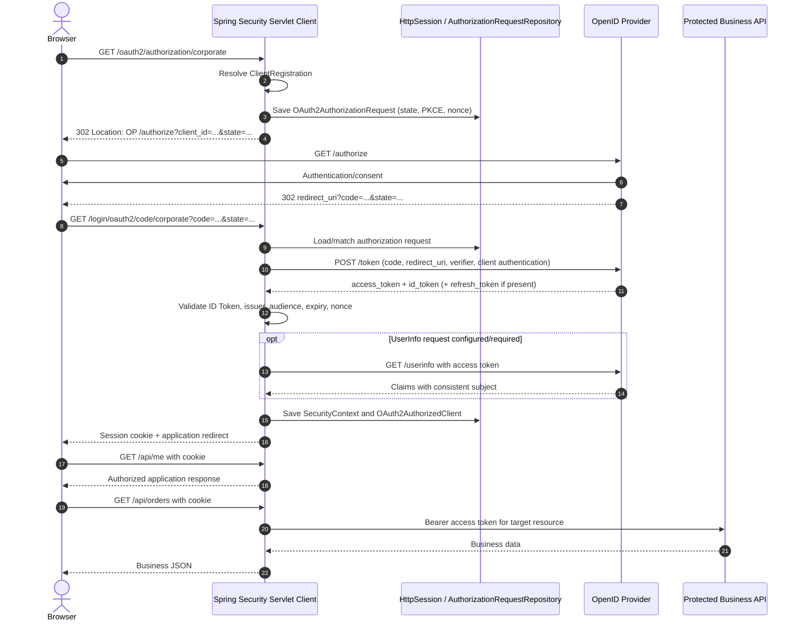
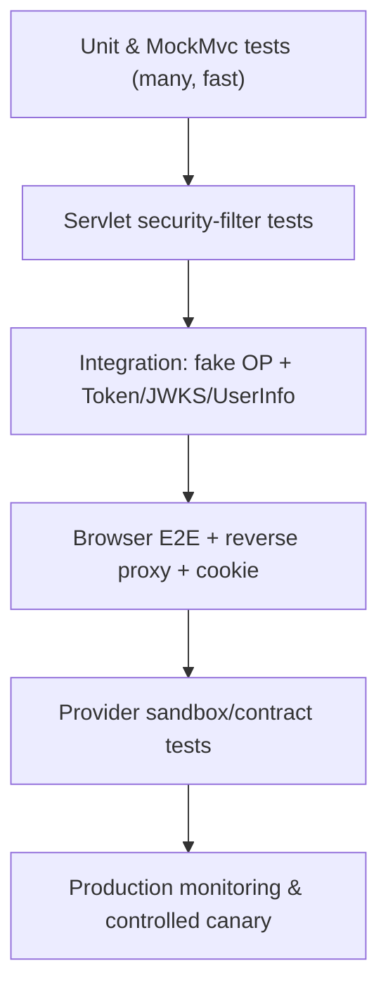

# 29.12. Limitations of Mock Login Compared to Real Redirect and Token Exchange Flows

## 1. The Problem: MockMvc Passes Green, Yet Real OAuth2 Login Still Fails

A Servlet-based **Spring Security OAuth 2.0/OIDC Client** application can pass hundreds of tests:

```java
mockMvc.perform(get("/api/me").with(oidcLogin()))
    .andExpect(status().isOk());
```

However, when opening a browser and selecting **Sign in with corporate account**, users still encounter:

```text
authorization_request_not_found
invalid_state
invalid_grant
invalid_client
invalid_nonce
invalid_issuer
redirect_uri_mismatch
```

There is no contradiction here. `oidcLogin()` in **Spring Security Test** is a *request post-processor* that prepares **a mocked authenticated principal** for the `MockMvc` call. It helps test the part of the application **after authentication is treated as successful**; it does not require a browser to redirect to the IdP, does not exchange an authorization code for tokens, and does not require verifying a JWT against the provider's real public key.

**Core lesson:**

> Tests using `oauth2Login()` or `oidcLogin()` prove how the application reacts to an OAuth2/OIDC principal constructed in the test. They **do not prove** that the full Authorization Code Flow, PKCE, OIDC ID Token validation, or real-world redirect/session/cookie behavior work correctly.

This lesson belongs to chapter **29. Servlet Testing**. It distinguishes what can be verified with `MockMvc`, when you need to run real filters/callbacks alongside a mock Authorization Server or integration environment, and when you need browser end-to-end tests.

### Learning Objectives

After this lesson, you will be able to:

1. Describe the steps of a real OAuth2 Authorization Code/OIDC Login flow.
2. Know how `oauth2Login()`, `oidcLogin()`, `oauth2Client()`, and `@WithMockUser` differ from one another.
3. Avoid confusing a mock principal with valid OAuth2 tokens or a local session established by the login flow.
4. Write MockMvc tests for endpoint authorization, roles, claims, principal mapping, CSRF, and business logic.
5. Verify redirect initiation, `ClientRegistration`, `state`, PKCE, scopes, and redirect URIs at the filter level.
6. Build integration tests with a mock Authorization Server where you control the Token Endpoint, UserInfo, and JWKS.
7. Verify callbacks, session continuity, ID Token issuer/audience/nonce/signature checks, error handling, and token persistence.
8. Know when you need tests with a real browser, HTTPS, cookie policy, reverse proxy, and an IdP sandbox.
9. Build a test matrix so you do not miss bugs that mock login cannot detect.
10. Understand the limitations of both a mock AS and browser E2E tests so you do not make security claims beyond your test evidence.

The URLs, secrets, users, and tokens below are **illustrative** data. Code syntax uses Spring Boot 3.x/Spring Security 6.x Servlet as context; when using a different version line, refer to the corresponding API.

---

## 2. What Does a Real Authorization Code/OIDC Login Flow Consist Of?

A successful OIDC Login flow on Servlet can be represented as:



At every step, there are security or configuration conditions that a mock principal does not automatically verify.

| Stage | Conditions to Verify |
|---|---|
| Login initiation | Registration exists, tenant/provider is allowed, redirect URI is correct |
| Build authorize URL | `response_type=code`, `scope`, `client_id`, `state`, PKCE, nonce when applicable |
| Save request | Authorization request is saved in the right session/repository |
| Browser through IdP | Redirects, cookies, `SameSite`, HTTPS, host/proxy |
| Callback | State matches, no replay, code belongs to the right request/client |
| Token Endpoint | Client auth, code verifier, redirect URI, network/TLS, valid response |
| OIDC ID Token | Signature/JWK, issuer, audience, expiry, nonce, timestamps |
| UserInfo | TLS, access token, issuer/user claims, and `sub` consistency |
| Local account mapping | Stable `(iss,sub)`, tenant, account status |
| Session/authorized client | SecurityContext and tokens saved in the right repository/principal |
| Downstream API | Access token has correct audience/scope, API checks authorization |

**Mock login essentially starts near the end of the diagram:** a pre-mocked `Authentication` already exists, and the request then passes through the application's security filters and controllers.

---

## 3. Four Testing Styles That Are Often Equated

### 3.1. `@WithMockUser`

```java
@Test
@WithMockUser(username = "alice", roles = "USER")
void profileEndpointRequiresUserRole() throws Exception {
    mockMvc.perform(get("/api/me"))
        .andExpect(status().isOk());
}
```

It provides an ordinary mocked Spring Security principal. There is no `OidcUser`, ID Token, `OAuth2AuthenticationToken`, or authorized client in the OAuth2 Login sense.

It is suitable for tests that **only care about an authenticated user and roles**.

### 3.2. `oauth2Login()`

```java
mockMvc.perform(
        get("/api/me").with(oauth2Login())
    )
    .andExpect(status().isOk());
```

It provides an `OAuth2AuthenticationToken` backed by a mocked `OAuth2User`, whose attributes and authorities can be customized. Spring Security Test can also build/register a mocked authorized client for the request via post-processor support.

It **does not call a real provider Authorization Endpoint or Token Endpoint**.

### 3.3. `oidcLogin()`

```java
mockMvc.perform(
        get("/api/me").with(oidcLogin())
    )
    .andExpect(status().isOk());
```

It provides a mocked OIDC principal (`OidcUser`) with test claim/token data. You can customize ID Token claims, UserInfo, and authorities.

It **does not cryptographically verify** the mocked ID Token as it would when receiving a real token response from an OpenID Provider.

### 3.4. `oauth2Client()`

```java
mockMvc.perform(
        get("/api/provider-data").with(oauth2Client("corporate"))
    )
    .andExpect(status().isOk());
```

This post-processor serves tests that need an **OAuth2AuthorizedClient** in the request, such as a controller using `@RegisteredOAuth2AuthorizedClient`.

It does not automatically mean the user has logged in with OIDC; when the endpoint also requires authentication, you must supply an appropriate principal or use the corresponding test configuration.

### 3.5. Overview Comparison Table

| Test Style | Mocks Authentication? | Mocks authorized client? | Real browser redirect? | Real code exchange? |
|---|---|---|---|---|
| `@WithMockUser` | Yes, username/password-style mock | No by default | No | No |
| `oauth2Login()` | Yes, OAuth2 principal | Can attach a test authorized client | No | No |
| `oidcLogin()` | Yes, OIDC principal | Can attach a test authorized client | No | No |
| `oauth2Client()` | Not necessarily logging a user in | Yes | No | No |
| `MockMvc GET /oauth2/authorization/...` | Not yet logged in | Not needed | Verifies **302 is generated**, no browser navigation | No |
| `MockMvc callback + mock OP` | Via Spring OAuth2 filters if full flow is wired | Yes, via real wiring | Simulates HTTP hops | Real HTTP token exchange with mock server |
| Browser E2E + test OP | Via real login | According to real app | Yes | Yes |
| Production-like IdP sandbox | Via real login | According to real app | Yes | Yes with a compatible provider |

**No single test style covers every layer.** The right strategy is to combine layers.

---

## 4. What `oauth2Login()` Actually Helps You Test

A request like:

```java
mockMvc.perform(
    get("/api/orders")
        .with(oauth2Login())
);
```

is typically used to prove that:

- An endpoint requiring `Authentication` can proceed when the user is authenticated.
- `SecurityFilterChain` authorization rules work with the supplied authorities.
- Controllers can receive `Authentication`, `Principal`, or `OAuth2AuthenticationToken`.
- `@AuthenticationPrincipal OAuth2User` has the expected attributes.
- Business services use the principal/claims according to programmed rules.
- API responses do not expose raw tokens/claims unnecessarily.
- Custom authorization checks handle roles/tenants.
- Fast, unit-like tests can run without network access or an IdP.

### 4.1. What It Does Not Prove

`oauth2Login()` **does not automatically prove** that:

1. `/oauth2/authorization/{registrationId}` works.
2. The 302 URL points to the right issuer/provider.
3. State is randomized and stored in `AuthorizationRequestRepository`.
4. The PKCE challenge is generated properly and the verifier is sent accurately to the Token Endpoint.
5. The redirect URI matches the registration at the Authorization Server.
6. The browser sends the cookie/session back on callback.
7. The authorization code is valid, one-time-use, and bound to the right client.
8. `client_secret_basic`, `client_secret_post`, private key JWT, or mTLS works.
9. The Token Endpoint is reachable and handles the OAuth2 protocol properly.
10. The OIDC ID Token signature, JWKS key, `iss`, `aud`, `exp`, and `nonce` are valid.
11. The UserInfo Endpoint returns valid claims.
12. The authorized client is actually persisted to JDBC/Redis/session as in production.
13. Refresh token rotation, expiry, or revoked tokens are handled properly.
14. CDNs/reverse proxies/`X-Forwarded-*` do not corrupt the callback URL.
15. HTTPS/SameSite cookie behavior is compatible with real browsers.
16. Provider tenant/issuer metadata actually matches configuration.

### 4.2. A Common False Conclusion

> “The `oidcLogin()` test is green, so the OIDC configuration is valid.”

Incorrect. This test can pass even if:

```yaml
spring.security.oauth2.client.registration.corporate.client-secret: wrong
spring.security.oauth2.client.provider.corporate.issuer-uri: https://wrong-idp.example
```

provided the test never initiates the flow or calls the provider.

### 4.3. A More Accurate Conclusion

> “The controller and authorization policy were tested with a mocked OIDC principal having the expected claims and authorities.”

That evidence is valuable, but **only within the scope of the test**.

---

## 5. Setting Up a Servlet Test Project

Example Spring Boot 3.x dependencies:

```groovy
dependencies {
    implementation 'org.springframework.boot:spring-boot-starter-web'
    implementation 'org.springframework.boot:spring-boot-starter-security'
    implementation 'org.springframework.boot:spring-boot-starter-oauth2-client'

    testImplementation 'org.springframework.boot:spring-boot-starter-test'
    testImplementation 'org.springframework.security:spring-security-test'
}
```

When integrating a mock Authorization Server or browser E2E, add separate dependencies based on your chosen framework, such as WireMock, MockWebServer, Testcontainers, or Playwright/Selenium.

Do not try to use `spring-security-test` as a **replacement for an Authorization Server implementation**.

### 5.1. Illustrative SecurityFilterChain

```java
import org.springframework.context.annotation.Bean;
import org.springframework.context.annotation.Configuration;
import org.springframework.security.config.Customizer;
import org.springframework.security.config.annotation.web.builders.HttpSecurity;
import org.springframework.security.web.SecurityFilterChain;

@Configuration
public class SecurityConfiguration {

    @Bean
    SecurityFilterChain securityFilterChain(HttpSecurity http)
            throws Exception {

        http
            .authorizeHttpRequests(authorize -> authorize
                .requestMatchers("/", "/login", "/assets/**").permitAll()
                .requestMatchers("/api/admin/**").hasRole("ADMIN")
                .requestMatchers("/api/**").authenticated()
                .anyRequest().authenticated()
            )
            .oauth2Login(Customizer.withDefaults())
            .oauth2Client(Customizer.withDefaults());

        // Keep default CSRF protection.
        return http.build();
    }
}
```

This code lets you test login authorization after a mock authentication is injected into the request; it does not yet define provider configuration, controllers, or an IdP.

### 5.2. `MockMvc` Must Have the Security Filter Chain

With `@SpringBootTest` and `@AutoConfigureMockMvc`, Spring Boot typically configures MockMvc alongside the application's filters.

If you build a standalone `MockMvcBuilders.standaloneSetup(...)`, you need appropriate Spring Security integration; test post-processors might not produce the same behavior as a full `FilterChainProxy`.

For example:

```java
MockMvcBuilders.webAppContextSetup(context)
    .apply(springSecurity())
    .build();
```

Import `SecurityMockMvcConfigurers.springSecurity` accordingly.

A test that hits a controller without going through the security filters **does not prove that SecurityFilterChain is protecting the endpoint**.

---

## 6. MockMvc Example with `oauth2Login()`

Suppose you have an endpoint:

```java
import java.util.Map;

import org.springframework.security.core.annotation.AuthenticationPrincipal;
import org.springframework.security.oauth2.core.user.OAuth2User;
import org.springframework.web.bind.annotation.GetMapping;
import org.springframework.web.bind.annotation.RestController;

@RestController
class ProfileController {

    @GetMapping("/api/me")
    Map<String, Object> me(
            @AuthenticationPrincipal OAuth2User user) {

        return Map.of(
            "name", user.getAttribute("name") == null
                ? "Unknown" : user.getAttribute("name"),
            "providerUserId", user.getName()
        );
    }
}
```

Test:

```java
import static org.springframework.security.test.web.servlet.request
    .SecurityMockMvcRequestPostProcessors.oauth2Login;
import static org.springframework.test.web.servlet.request
    .MockMvcRequestBuilders.get;
import static org.springframework.test.web.servlet.result
    .MockMvcResultMatchers.jsonPath;
import static org.springframework.test.web.servlet.result
    .MockMvcResultMatchers.status;

import org.junit.jupiter.api.Test;
import org.springframework.beans.factory.annotation.Autowired;
import org.springframework.boot.test.autoconfigure.web.servlet.AutoConfigureMockMvc;
import org.springframework.boot.test.context.SpringBootTest;
import org.springframework.test.web.servlet.MockMvc;

@SpringBootTest
@AutoConfigureMockMvc
class ProfileMvcTest {

    @Autowired
    MockMvc mockMvc;

    @Test
    void oauth2UserCanReadProfile() throws Exception {
        mockMvc.perform(
                get("/api/me")
                    .with(oauth2Login()
                        .attributes(attributes -> {
                            attributes.put("sub", "provider-user-42");
                            attributes.put("name", "Alice");
                        }))
            )
            .andExpect(status().isOk())
            .andExpect(jsonPath("$.name").value("Alice"));
    }
}
```

### 6.1. What This Test Confirms

It shows that the controller and security rules allow a mocked OAuth2 principal with attribute `name=Alice` to access `/api/me`, and that the controller serializes the response as expected.

### 6.2. What This Test Does Not Confirm

It **does not** verify:

- That the provider actually returns the `name` claim.
- That `sub` was verified from the IdP.
- That `client-id`/`client-secret` are valid.
- That there is a real session cookie.
- Browser redirects or callbacks.
- The UserInfo HTTP response and a stable user-name attribute.
- That the OAuth2 token actually grants access to downstream APIs.

### 6.3. Do Not Assume `getName()` Is Always the OIDC sub

For pure OAuth2 providers, `OAuth2User.getName()` depends on the `userNameAttributeName`/user service configuration. Some providers return `id`, while others return a username.

If business logic uses `getName()` as a local account ID, tests must verify the mapping specifically; do not assume identical semantics across all providers.

---

## 7. MockMvc Example with `oidcLogin()` and ID Token Claims

```java
import static org.springframework.security.test.web.servlet.request
    .SecurityMockMvcRequestPostProcessors.oidcLogin;

@Test
void oidcPrincipalContainsExpectedClaims() throws Exception {
    mockMvc.perform(
            get("/api/me")
                .with(oidcLogin()
                    .idToken(token -> token
                        .claim("sub", "alice-sub-42")
                        .claim("email", "alice@example.test")
                        .claim("email_verified", true)
                    ))
        )
        .andExpect(status().isOk());
}
```

You can add `.authorities(...)` or user info claims according to the API of your Spring Security Test version.

### 7.1. Why Does a Mock ID Token Not Prove JWT Validation?

A mock ID Token can carry any `iss`, `aud`, and `sub` set by the test. The test does not necessarily construct a signed JWT and **does not invoke the validator** of OAuth2/OIDC Login.

For example:

```java
.with(oidcLogin().idToken(token ->
    token.claim("iss", "https://untrusted.example")
))
```

can construct a test principal that the controller receives. It **does not prove** that the production application would accept that issuer. Conversely, it also **does not prove** that Spring Security would reject that issuer in a protocol flow, because the validator never ran.

### 7.2. Distinguishing Claim-Level Tests from Signature-Level Tests

| Question | Appropriate Tool |
|---|---|
| Does the controller display the email already present in the principal? | `oidcLogin()` |
| Does the business mapper check `email_verified`? | `oidcLogin()` + service unit tests |
| Does the ID Token JWT have a valid signature? | OIDC provider/decoder integration test |
| Does `iss` match the configured issuer? | OIDC validation integration |
| Does `aud` contain the client ID? | OIDC validation integration |
| Does `nonce` match the authorization request? | OIDC full flow integration |
| Is JWKS key rotation handled? | OIDC/JWKS contract integration |
| Does a real browser carry the session across redirects? | Browser E2E |

### 7.3. Do Not “Upgrade” a Mock Test by Adding More Claims

Adding:

```java
.claim("nonce", "expected")
.claim("aud", List.of("portal-client"))
```

does not automatically make spring-security-test verify the nonce or audience like a real ID Token received from the Token Endpoint.

---

## 8. Mock Authorities and Business Authorization

A test:

```java
import static org.springframework.security.test.web.servlet.request
    .SecurityMockMvcRequestPostProcessors.oidcLogin;
import static org.springframework.security.test.web.servlet
    .request.SecurityMockMvcRequestPostProcessors.csrf;

import org.springframework.security.core.authority.SimpleGrantedAuthority;

@Test
void adminCanUpdateSetting() throws Exception {
    mockMvc.perform(
            post("/api/admin/settings")
                .with(oidcLogin().authorities(
                    new SimpleGrantedAuthority("ROLE_ADMIN")
                ))
                .with(csrf())
                .contentType("application/json")
                .content("{\"enabled\":true}")
        )
        .andExpect(status().is2xxSuccessful());
}
```

The test confirms that a request with role `ROLE_ADMIN` and a mocked CSRF token passes the corresponding rule.

### 8.1. Test Role Mapping Separately

If production derives `ROLE_ADMIN` from:

- An OIDC group claim.
- A local database.
- A tenant policy.
- A custom `OidcUserService`/success handler.

then the test above **does not prove that the role-mapping mechanism actually produces that role**.

You must add tests for the component mapping claims/groups → local authorities, including negative cases:

```text
Untrusted group claim
Wrong issuer
Wrong tenant
Account disabled
Similar group name not in the allowlist
Missing required claim
```

### 8.2. Do Not Treat `hasRole("ADMIN")` as Proof the Provider Grants Admin

A mocked authority only proves that the Spring Security rule takes effect **once the authority already exists**. It does not check the provenance or trust level of that authority.

### 8.3. A Test CSRF Token Does Not Prove the Browser Sends the Right Token

`.with(csrf())` equips the MockMvc request with a CSRF token valid under Spring Security Test. A real browser still has to obtain the token, send the right header/form field name, and obey cookie/SameSite policies.

Therefore, you need negative tests (missing CSRF must be rejected) and integration/frontend tests for CSRF delivery.

---

## 9. `oauth2Client()` and `@RegisteredOAuth2AuthorizedClient`

For outbound API integration, a controller can use:

```java
import org.springframework.security.oauth2.client.OAuth2AuthorizedClient;
import org.springframework.security.oauth2.client.annotation
    .RegisteredOAuth2AuthorizedClient;

@GetMapping("/api/provider-data")
public String providerData(
        @RegisteredOAuth2AuthorizedClient("corporate")
        OAuth2AuthorizedClient authorizedClient) {

    return authorizedClient.getAccessToken() == null
        ? "missing-token" : "token-present";
}
```

A MockMvc test can provide a mocked authorized client:

```java
import static org.springframework.security.test.web.servlet.request
    .SecurityMockMvcRequestPostProcessors.oauth2Client;
import static org.springframework.security.test.web.servlet.request
    .SecurityMockMvcRequestPostProcessors.oidcLogin;

@Test
void endpointSeesAuthorizedClient() throws Exception {
    mockMvc.perform(
            get("/api/provider-data")
                .with(oidcLogin())
                .with(oauth2Client("corporate"))
        )
        .andExpect(status().isOk());
}
```

This snippet shows how to use the post-processors; details of how the repository binds the request, registration/principal, and authorized client resolver must be verified in your application's own test setup.

### 9.1. Mock Tokens Can Be Customized

Spring Security Test supports building test authorized clients/tokens according to your version's API. For example, scopes:

```text
openid
profile
orders.read
```

However, a test token with scope `orders.read` **does not prove that the Token Endpoint will issue that scope**, nor does it prove that the Orders Resource Server accepts the token.

### 9.2. Tests Must Not Expose Raw Tokens

Do not write assertions printing:

```java
System.out.println(
    authorizedClient.getAccessToken().getTokenValue()
);
```

Even for fake tokens, production code can end up copying habits that log credentials. Tests should assert that responses **do not contain** `access_token`, `refresh_token`, or a bearer token string.

### 9.3. If the Controller Attaches the Token to an HTTP Client

To verify that the BFF sends:

```http
Authorization: Bearer fake-access-token
```

to the right Orders API, you must **mock outbound HTTP** using WireMock/MockWebServer or mock at the service boundary, rather than merely asserting controller 200.

---

## 10. Mock Login Is Not Like a Real Session

A request post-processor injects authentication into the test request environment. It **does not necessarily**:

- Create an HTTP session following a successful OAuth2 Login.
- Rotate the session ID after login according to the session fixation policy.
- Persist `SecurityContext` into `HttpSessionSecurityContextRepository`.
- Send `Set-Cookie: JSESSIONID/SESSION` like a real container.
- Restore login on a second request using only the session cookie.
- Reconstruct the session from Redis/JDBC when a request hits a different pod.
- Enforce idle timeout/absolute lifetime.
- Guarantee `SameSite`/`Secure`/`HttpOnly` flags on a real browser.

### 10.1. Two Requests with Mock Are Not Proof of Persistence

Flawed reasoning:

```java
mockMvc.perform(get("/api/me").with(oidcLogin()))
    .andExpect(status().isOk());

mockMvc.perform(get("/api/me").with(oidcLogin()))
    .andExpect(status().isOk());
```

Both requests **explicitly attach Authentication themselves**. This does not prove that the second request can be authenticated solely via the session cookie created by the first request.

### 10.2. What Does a Real Session Continuity Test Need to Do?

An integration test needs to:

```text
1. Initiate the OAuth2 authorization request.
2. Retain the same MockHttpSession/browser cookie for the callback.
3. Complete the code exchange and authentication.
4. Access /api/me WITHOUT attaching oidcLogin().
5. Verify that SecurityContext/session was persisted.
```

If using Spring Session/Redis across multiple nodes, you need to test against the appropriate session repository, not just an in-memory `MockHttpSession`.

### 10.3. Cookie Behavior Still Requires a Browser

`MockHttpSession` does not fully simulate the cookie policies of Chrome/Firefox/Safari, especially with cross-site OIDC redirects and `response_mode=form_post`.

---

## 11. Testing the Redirect Initiation Endpoint with MockMvc

Not every OAuth2-related test requires a mock login. You can test the real **first step** through the security filter:

```java
@Test
void authorizationEndpointRedirectsToIdp() throws Exception {
    mockMvc.perform(
            get("/oauth2/authorization/corporate")
        )
        .andExpect(status().is3xxRedirection())
        .andExpect(header().string(
            "Location",
            org.hamcrest.Matchers.containsString(
                "https://login.example-idp.com"
            )
        ));
}
```

This test requires `ClientRegistrationRepository` to have the `corporate` registration and the OAuth2 Login filters to be configured.

### 11.1. What This Test Proves

Spring's OAuth2 Authorization Request Redirect Filter has:

- Resolved the registration from the URL.
- Constructed the authorization URL.
- Returned an HTTP redirect.

You can also inspect query parameters:

```text
response_type=code
client_id=...
redirect_uri=...
scope=...
state=...
code_challenge_method=S256 (if PKCE is enabled)
```

### 11.2. What It Does Not Yet Prove

- Whether a real browser reaches the IdP.
- Whether the IdP accepts the redirect URI.
- Whether the user can log in/consent successfully.
- Whether state can be recovered after the callback.
- Whether token exchange is valid.

### 11.3. Do Not Assert an Exact Full URL When State Is Random

`state` and `code_challenge` must change appropriately between requests. Use a query parser or URI matcher rather than hardcoding the state value.

Example of a meaningful test:

```text
Location must contain:
    response_type=code
    client_id=portal-client
    redirect_uri=app callback
    non-empty state
```

With PKCE, check `code_challenge_method=S256` and a non-empty `code_challenge` when the flow is configured to use PKCE.

### 11.4. PKCE for Confidential Clients Is Not Always Enabled by Default

Different Spring Security versions/configurations have different rules. When testing PKCE, verify that your **application configuration** enables PKCE per policy (e.g., via `OAuth2AuthorizationRequestCustomizers.withPkce()` if needed).

Do not write a test demanding PKCE S256 for every confidential registration and assume every version/framework enables it by default.

---

## 12. Testing `OAuth2AuthorizationRequestRepository`

Spring Security Servlet typically stores the authorization request to correlate with the callback:

```java
HttpSessionOAuth2AuthorizationRequestRepository
```

It holds information such as:

```text
state
authorization URI
client ID
redirect URI
scopes
additional parameters
attributes
PKCE code verifier (per configuration)
OIDC nonce (per flow)
```

### 12.1. Testing Request Initiation and Session

Conceptual example:

```java
MvcResult result = mockMvc.perform(
        get("/oauth2/authorization/corporate")
    )
    .andExpect(status().is3xxRedirection())
    .andReturn();

MockHttpSession session =
    (MockHttpSession) result.getRequest().getSession(false);
```

When a session is created to store the authorization request, `session` must be non-null. The test continues inspecting the repository using the exact API/implementation of the Spring Security version in use.

### 12.2. No Need to Log `state` or Verifier for Debugging

You can verify:

```text
state present
state unguessable/changes between flows
code_challenge present
code_verifier remains server-side
```

without writing `state` or `verifier` into CI log output.

### 12.3. Callback Replay

An integration test should send the same callback/code a second time. Once the authorization request has been consumed or the code has been used, the second attempt **must not produce another successful login**.

The mock login request post-processor does not perform consumption or replay protection.

### 12.4. Session Loss Between Redirect and Callback

A practical test:

```text
Initiate login with session A.
Call callback using unrelated session B.
Expected: failure, no Authentication accepted.
```

This catches `authorization_request_not_found` errors and verifies there is no dangerous fallback like “skip state validation for login convenience”.

---

## 13. PKCE: Test Both the Challenge and the Verifier

PKCE (RFC 7636) protects the authorization code through the relationship:

```text
code_verifier
    --SHA-256 + base64url-->
code_challenge

authorize request:
    code_challenge=<derived>
    code_challenge_method=S256

token request:
    code_verifier=<original>
```

### 13.1. Mock Login Does Not Need a Verifier

`oidcLogin()` creates an `Authentication` without sending a token request; therefore, it cannot detect if the backend:

- Fails to store `code_verifier`.
- Sends the wrong verifier.
- Sends a challenge with the wrong method.
- Generates a fixed challenge/verifier.
- Loses the verifier across the redirect.
- Uses the wrong authorization request across multiple tabs.

### 13.2. Appropriate Test Layers

- **Resolver/unit test:** PKCE customization generates `code_challenge`, `code_challenge_method=S256`.
- **Filter integration:** authorization request saves the verifier server-side.
- **Mock AS contract:** Token Endpoint checks that the verifier matches the challenge from the authorize request.
- **Browser E2E:** real session/callback preserves the PKCE transaction.

### 13.3. Negative Test

```text
Token request code_verifier wrong
    -> AS returns invalid_grant
    -> Spring login fails
    -> no authenticated session
```

This is verification that `.with(oidcLogin())` alone cannot perform.

---

## 14. OAuth2 `state`: Transaction Protection, Not Just a Query Parameter

`state` binds the authorization response to the initiated authorization request; it is a critical line of defense against login CSRF and flow confusion.

### 14.1. Tests to Include

1. Each initiation generates an appropriate, unguessable state.
2. State is saved with the right browser session.
3. A callback with the right state is accepted **when all other conditions are valid**.
4. A callback with the wrong state is rejected.
5. A callback missing state is rejected per the expected flow.
6. Replaying a callback/state after consumption is rejected.
7. A callback for tenant/provider A is not processed as B.
8. Two concurrent tabs have behavior defined by policy.

### 14.2. Do Not Invent a `state` in the Callback Test and Conclude the Flow Works

A valid callback integration test should take the state from **the preceding authorization initiation**; do not fabricate a static state without repository backing.

### 14.3. Session/Cookie Bugs Often Cause State Errors

Production scenario:

```text
Authorize started with HttpSession A.
Browser returns from IdP.
Cookie session not sent because SameSite/Domain/Secure/proxy issue.
```

Spring cannot retrieve the authorization request from session A and the callback fails. Mock login passes because it **does not require a callback session**.

---

## 15. OIDC `nonce`, Issuer, Audience, and Signature

OIDC ID Token validation is one of the strongest reasons to write integration tests.

### 15.1. Illustrative ID Token

```json
{
  "iss": "https://login.example-idp.com",
  "sub": "alice-stable-sub",
  "aud": "portal-client",
  "iat": 1980000000,
  "exp": 1980003600,
  "nonce": "nonce-correlated-with-login"
}
```

You cannot treat an ID Token as valid simply because the JSON contains these fields. It must be signed and verified according to OpenID Connect and the expected issuer/client configuration.

### 15.2. Conditions to Test

| Check | Negative Example |
|---|---|
| JWT signature | ID Token signed with a key not in JWKS |
| Algorithm policy | JWT uses a disallowed algorithm |
| `iss` | Issuer does not match the configured provider |
| `aud` | Audience does not contain the client ID |
| `azp` when applicable | Invalid authorized party |
| `exp` | Expired token |
| `iat`/time validation | Anomalous timestamps |
| `nonce` | Token does not match the sent nonce |
| `sub` | Missing/invalid subject |
| JWK selection | Non-existent `kid` or broken key rotation |
| UserInfo subject | `sub` differs from ID Token `sub` |

### 15.3. Mock `OidcUser` Bypasses Most of These

When you write:

```java
.with(oidcLogin().idToken(token ->
    token.claim("iss", "https://wrong-issuer.example")))
```

the test merely builds an ID Token object with that claim. Spring's OIDC Login validation pipeline **does not automatically run** to reject the issuer.

### 15.4. Test Instead of Manually Parsing Tokens

Do not write a custom unit test like:

```java
String sub = parseBase64UrlPayload(idToken).get("sub");
```

and assume OIDC is tested. Parsing the payload proves nothing about signature/issuer/audience/nonce.

To test realistically, produce a **signed test JWT** from a fake OP with discoverable public JWKs, and let Spring Security validate it.

---

## 16. UserInfo Endpoint: Mock Attributes Differ from Real Responses

For OIDC or OAuth2 Login using UserInfo, Spring Security can call the remote UserInfo Endpoint to retrieve claims.

An `oauth2Login().attributes(...)` call merely places attributes into a mock principal:

```java
.with(oauth2Login().attributes(a -> {
    a.put("id", "4421");
    a.put("login", "alice-dev");
}))
```

It **does not verify**:

- Whether the UserInfo URL is correct.
- Whether the access token is sent in the proper bearer header.
- TLS/provider availability.
- JSON parsing/claim types.
- Configured `user-name-attribute`.
- That UserInfo `sub` matches the ID Token in OIDC.
- Error handling on 401/403/timeout.
- Whether the provider actually returns this attribute in reality.

### 16.1. Contract Test with Mock UserInfo

```http
GET /userinfo
Authorization: Bearer test-access-token
```

```json
{
  "sub": "alice-stable-sub",
  "name": "Alice",
  "email": "alice@example.test",
  "email_verified": true
}
```

Tests should also return:

```text
401 Unauthorized
500 Internal Server Error
slow response/timeout
malformed JSON
missing sub
different sub
```

and verify that Spring OAuth2 Login fails **safely** when identity claims can no longer be trusted.

### 16.2. Do Not “Fix Tests” by Skipping `sub` Comparison

A UserInfo subject mismatch is an integrity issue under OIDC. When it happens, investigate the provider/mapping rather than disabling validation so users can log in.

---

## 17. Where Can a Real Token Endpoint Fail?

An Authorization Code Token Request typically contains:

```http
POST /token HTTP/1.1
Content-Type: application/x-www-form-urlencoded
Authorization: Basic <client credentials, if using client_secret_basic>

grant_type=authorization_code
&code=one-time-code
&redirect_uri=https%3A%2F%2Fportal.example%2Flogin%2Foauth2%2Fcode%2Fcorporate
&code_verifier=...
```

Critical details:

- Client authentication method (`client_secret_basic`, `client_secret_post`, private key JWT, mTLS, etc.) per registration/IdP.
- Authorization code actually belongs to the client and issued redirect URI.
- PKCE verifier matches the challenge.
- Token Endpoint uses TLS with proper trust.
- Correct response type/JSON.
- Access token, ID Token, refresh token (if issued), `expires_in`, token type.
- Error codes and HTTP status.
- Timeouts, retries, malformed responses.

### 17.1. `oidcLogin()` Does Not Call `/token`

Because of this, tests with only `oidcLogin()` will not detect:

```text
invalid_client: bad client secret
invalid_grant: code expired/reused/PKCE mismatch
invalid_request: redirect_uri incorrect
unsupported_grant_type
TLS certificate unknown
Token Endpoint network timeout
```

### 17.2. Wrong Client Secret Still Passes Mock Tests

Even with YAML:

```yaml
spring.security.oauth2.client.registration.corporate.client-secret: wrong
```

a `.with(oidcLogin())` test can still pass, because token exchange never took place.

### 17.3. Secret Rotation and Multiple Pods

One pod has secret v1 while another pod has secret v2; a callback routed to the other pod can fail depending on the provider. Integration tests/release checks must verify configuration consistency and routing, which cannot rely solely on a mock principal.

---

## 18. Integration Layer Using a Mock Authorization Server

To exercise nearly the entire flow without calling a real IdP on every CI run, you can stand up a **local fake OP/Authorization Server**.

### 18.1. Options

- WireMock/MockWebServer HTTP stubs for discovery, JWKS, Token Endpoint, and UserInfo.
- A test authorization server such as Spring Authorization Server configured for integration tests.
- An OIDC-compatible IdP test container, if the product relies on specific provider behavior.
- A real IdP contract sandbox for end-of-pipeline checks.

**There is no universal fake OP** that automatically behaves like every IdP, especially regarding tenant discovery, custom claims, refresh rotation, and consent UX.

### 18.2. Minimal Endpoints for OIDC Tests

A fake OP typically needs:

```text
/.well-known/openid-configuration
/jwks
/authorize
/token
/userinfo (if needed)
```

Example discovery JSON (URLs on the same fake server):

```json
{
  "issuer": "http://127.0.0.1:9009",
  "authorization_endpoint": "http://127.0.0.1:9009/authorize",
  "token_endpoint": "http://127.0.0.1:9009/token",
  "jwks_uri": "http://127.0.0.1:9009/jwks",
  "userinfo_endpoint": "http://127.0.0.1:9009/userinfo",
  "response_types_supported": ["code"],
  "subject_types_supported": ["public"],
  "id_token_signing_alg_values_supported": ["RS256"],
  "token_endpoint_auth_methods_supported": ["client_secret_basic"]
}
```

Loopback HTTP is only an example for local test environments. Production OIDC providers/token endpoints must comply with TLS and corresponding security policies.

### 18.3. JWK and Signed ID Token

To give the validator real work to do:

1. The fake OP holds a test **private key** to sign JWTs.
2. The JWKS endpoint publishes the corresponding **public JWK**.
3. The Token Endpoint returns a signed ID Token with `iss`, `aud`, `sub`, `nonce`, and `exp`.
4. Spring Security fetches JWKS and verifies the signature.
5. Negative tests alter issuer/audience/nonce/key/expiry to confirm login fails.

**Never put production private keys into the test repository.** Use dedicated test keys or generate them inside test fixtures.

### 18.4. Do Not Hardcode the Wrong Nonce

Nonce is typically generated in the authorization request. The fake OP needs to capture the **expected nonce** from the authorize request or the initiated test transaction and place the matching claim in the signed ID Token.

If you create a mock ID Token with a static nonce while Spring sent a different nonce, the integration callback must fail — that is the correct behavior.

---

## 19. Integration Test Structure: Calling Redirect Then Callback

A Servlet/filter-level test can follow this flow:

```java
// Illustrative pseudocode, not a standalone full test.

MvcResult initiate = mockMvc.perform(
        get("/oauth2/authorization/corporate")
    )
    .andExpect(status().is3xxRedirection())
    .andReturn();

MockHttpSession session =
    (MockHttpSession) initiate.getRequest().getSession(false);

String location = initiate.getResponse()
    .getHeader("Location");

String state = parseQuery(location, "state");

// Fake OP issues a short-lived code bound to state,
// client_id, redirect_uri, and PKCE challenge.
String code = fakeOp.issueCodeFromAuthorizationRequest(location);

MvcResult callback = mockMvc.perform(
        get("/login/oauth2/code/corporate")
            .param("code", code)
            .param("state", state)
            .session(session)
    )
    .andExpect(status().is3xxRedirection())
    .andReturn();

// Subsequent request does NOT use .with(oidcLogin()):
mockMvc.perform(
        get("/api/me")
            .session(
                (MockHttpSession) callback.getRequest()
                    .getSession(false)
            )
    )
    .andExpect(status().isOk());
```

`parseQuery` and `fakeOp` are test helpers **implemented by the project itself**. This snippet illustrates the structure, not a directly compilable Java test file.

### 19.1. What Actually Gets Tested?

When the fake OP has complete HTTP endpoints/validation and Spring's security chain uses real configuration, the test exercises:

```text
OAuth2AuthorizationRequestRedirectFilter
OAuth2LoginAuthenticationFilter
Authorization request repository
OAuth2 token response client
OIDC token validator
OIDC user service (per config)
SecurityContext persistence
OAuth2AuthorizedClientRepository/Service
```

Which components are actually exercised also depends on your Spring Security version's configuration, custom handlers, and test environment.

### 19.2. Do Not Manually Inject a Session After the Callback

If a test after the callback attaches:

```java
.with(oidcLogin())
```

then it loses its value in proving **authentication persistence**. The subsequent request must go through the repository/session created by the login flow.

### 19.3. The Fake OP Must Validate the Code

If the fake OP always returns a token response for any `code`, the test will not catch a code exchange using the wrong redirect URI or a replay.

A sufficiently useful fake OP needs to check:

```text
code is one-time
code belongs to client_id
code belongs to redirect_uri
PKCE challenge/verifier match
code expiry
issuer/client authentication policy
```

You can control its behavior per test to verify failure paths.

---

## 20. Browser E2E: How Does It Differ from MockMvc?

MockMvc runs the Servlet pipeline in a test environment without a full browser or network server. Browser E2E executes navigation and cookies under a real browser runtime.

### 20.1. Bugs Easily Caught Only by Browser/Proxy Tests

| Issue | Why Is MockMvc Not Enough? |
|---|---|
| `SameSite=Lax` and cross-site callbacks | MockMvc does not fully simulate browser cookie policy |
| `Secure` cookies with HTTPS termination | MockMvc does not replicate real TLS/proxy topology |
| Wrong redirect URI from `X-Forwarded-Proto` | Requires a reverse proxy resembling deployment |
| Host-only cookies and subdomains | The real browser decides whether to send cookies |
| IdP `form_post` callback | Browser cross-site POST and cookie behavior |
| Consent screen/account chooser | Mock HTTP does not test provider UI/interaction |
| Browser privacy restrictions | Third-party cookies and tracking prevention |
| Multiple tabs/history | State/session concurrency and navigation behavior |
| CSP, mixed content | Browsers enforce security headers |
| SPA fetch receiving login HTML | Browser CORS/redirect behavior |
| Logout across domains | Browser redirects and OP session cookies |

### 20.2. Realistic E2E Flow

```text
Playwright/Selenium:
    Open https://portal.test.example
    Click "Sign in"
    Follow redirect to test OP
    Complete test OP login
    Return to app callback
    Assert session cookie flags
    Navigate /api/me without injecting mock Authentication
    Refresh page
    Call protected API
    Logout
    Confirm old session no longer authorizes
```

### 20.3. Use Test Accounts and an IdP Sandbox

Do not run CI tests with production accounts containing real data or privileged scopes. With an IdP test sandbox, manage credentials properly in a secret manager and include cleanup/revocation.

### 20.4. Browser E2E Also Has Limitations

Even a passing E2E test does not prove:

- That all JWT tampering paths are rejected.
- That multi-node refresh races cannot happen.
- That the provider will always have the same uptime.
- That all tenants/issuers work.
- Timely token revocation across all dependencies.

Supplement with negative tests, load/concurrency tests, and observability to monitor production.

---

## 21. Testing Login with HTTP Session State in Servlet

Spring Security typically manages the security context and OAuth2 authorization request via the HTTP session during browser login flows.

### 21.1. Worthwhile Tests

1. Begin login -> session contains the authorization request.
2. Browser retains session -> callback succeeds.
3. Callback on a different session -> rejected.
4. Session expired -> restart login, do not skip state check.
5. Session fixation protection -> session ID changes according to configured policy.
6. `SecurityContext` persists after login and across subsequent requests.
7. Logout -> session invalidated; old cookie no longer authenticates.
8. With Redis/JDBC Spring Session -> requests on another node recover it.
9. Cookie flags `HttpOnly`, `Secure`, `SameSite`, `Path` are accurate across browser/proxy.
10. Concurrent login tabs -> policy/routing is unambiguous.

### 21.2. `SessionCreationPolicy.STATELESS` Can Break OAuth2 Login

If a security chain is misconfigured with:

```java
.sessionManagement(session ->
    session.sessionCreationPolicy(
        SessionCreationPolicy.STATELESS
    )
)
```

then a session-based login flow may fail to save/restore the authorization request or `SecurityContext` as expected.

Mock `oidcLogin()` can still let controllers pass green because authentication is injected directly. Only integration tests through initiation/callback will catch this.

### 21.3. Stateful Browser Login and Stateless Bearer APIs Are Two Separate Flows

An application may have two security chains:

```text
Browser:
    OAuth2 Login + HttpSession/Cookie

Machine API:
    OAuth2 Resource Server + Bearer JWT
```

Testing `oidcLogin()` on the browser chain **does not prove** JWT Resource Server decoder validation on the machine API chain; you need `jwt()` mocks and separate JWT decoder integration tests suited to each target.

---

## 22. Token Persistence Is Not the Same as Mock Principal Persistence

A system may use:

```text
AuthenticatedPrincipalOAuth2AuthorizedClientRepository
    -> OAuth2AuthorizedClientService
       -> InMemory / JDBC / custom

HttpSessionOAuth2AuthorizedClientRepository
    -> authorized clients in HTTP session
```

### 22.1. Post-Processors Do Not Prove the DB Stored the Token

A request with:

```java
.with(oauth2Login())
```

may set up a test authorized client for the request, but it does not guarantee that the production service/repository saves the record to JDBC/Redis after a real flow.

### 22.2. Integration Tests Must Confirm

```text
After real callback:
    repository.loadAuthorizedClient(
        registrationId,
        authenticatedPrincipal,
        request
    )
```

returns the expected authorized client from the chosen storage, and that access token/refresh token fields match the AS response.

### 22.3. The Principal Key Matters Greatly

`OAuth2AuthorizedClientService` is typically keyed by:

```text
(registrationId, principalName)
```

If custom local principal mapping changes `getName()` after login, the token might be saved under the external principal while the manager looks it up under the internal account ID.

Mock tests using `oauth2Client()` typically supply the record the way the test expects and can **mask real-world mismatches**.

### 22.4. One Token Is Not Valid for Every API

Testing a fake access token carrying `orders.read` does not prove it has `aud=orders-api`. You need Resource Server integration or wire-protocol contracts to verify the BFF sends the token to the right API and that the API rejects the wrong audience.

---

## 23. Refresh Tokens: Mock Login Does Not Test the Lifecycle

`oidcLogin()` does not require a refresh token, does not call the `refresh_token` grant, and does not check expiry or rotation.

### 23.1. Scenarios Requiring Separate Tests

| Scenario | Expectation |
|---|---|
| Access token still valid | Reuse token, do not refresh unnecessarily |
| Access token near expiry | Refresh according to manager/provider config |
| No refresh token | Reauthorize or fail per policy |
| Refresh Token Endpoint `invalid_grant` | Clean up/reconnect properly |
| Refresh token rotation RT1→RT2 | Store new token atomically |
| Two requests use RT1 concurrently | Do not lose new token due to stale failure |
| Client secret changed | Refresh with new credentials/roll back per policy |
| User revokes consent | Do not retry infinitely with the same RT |
| Logout/disconnect during refresh | Do not “resurrect” the authorized client |
| API returns 401 after refresh | Classify issuer/audience/token issue |
| Multi-node authorized client store | Updated data is visible across pods |

### 23.2. Mock Authorized Client Helps Test App Logic but Does Not Prove Refresh

If a test attaches an unexpired token, the downstream client may return 200. A production token expiring after 5 minutes will expose the failure. You must control `Clock` and a fake Token Endpoint to test refresh.

### 23.3. Rotation Races Are Hard to Reproduce with a Single MockMvc Request

They involve concurrency, persistence, and the external AS's one-time-use policy. Test them with deterministic concurrency tests, barriers/latches, and a fake AS that checks RT reuse.

---

## 24. `@WithMockUser`, `oauth2Login()`, and `oidcLogin()` Can Create False Expectations About Claims

### 24.1. `@WithMockUser` Has No OIDC Claims

If a controller expects:

```java
@AuthenticationPrincipal OidcUser user
```

a test using `@WithMockUser` may receive null or a principal of a different type than expected. This is where `oidcLogin()` is more appropriate.

### 24.2. `oauth2Login()` Does Not Necessarily Include an OIDC ID Token

A non-OIDC OAuth2 provider may only supply `OAuth2User`, not `OidcUser`.

If the app requires `OidcUser` while the test only creates `oauth2Login()`, pay attention to the principal type. Do not force all OAuth2 providers into OIDC semantics.

### 24.3. `oidcLogin()` Lets You Set Claims Directly

This is useful for testing:

```text
email_verified = false
groups = []
tenant = tenant-a
role = limited
```

but a test with `email_verified=true` does not mean the production provider actually returns that claim.

### 24.4. Default Test Authorities Are Not Production Authorities

Post-processors have default principals/authorities for convenience; do not treat them as business role mappings enforced by the IdP.

If production uses a custom `OidcUserService` to map groups to `ROLE_ADMIN`, you must test the mapping service and issuer/tenant trust policy separately.

---

## 25. Multiple Providers and Tenants: Why Mocks Easily Miss Bugs

In SaaS, you might have:

```text
tenant-alpha:
    registrationId=t_alpha__workforce
    issuer=https://id.alpha.example

tenant-beta:
    registrationId=t_beta__workforce
    issuer=https://id.beta.example
```

A mock test:

```java
.with(oidcLogin())
```

usually builds a single principal without traversing dynamic registration resolution or tenant-specific login initiation.

### 25.1. Real-World Bugs

- Alpha request uses Beta's registration ID.
- Issuer B issues `sub=123`, and the app mistakenly maps it to issuer A's `sub=123`.
- Callback arrives at a shared host and fails to locate the tenant context.
- `ClientRegistrationRepository` caches a stale version.
- Tenant is disabled, yet the callback still creates a session.
- Redirect URI uses a hostname belonging to a different tenant.
- Authorized client store is keyed too broadly.
- Provider group claims are treated as internal permissions without checking tenant.

### 25.2. Tests Must Use a Trusted Tenant Context

Do not just send:

```http
X-Tenant-ID: tenant-alpha
```

and treat authentication/authorization as having verified the tenant. Integration tests must use the application's actual tenant resolution policy: validated host, path, session, or account membership.

### 25.3. OIDC `(iss,sub)` Must Be Tested

Two signed ID Tokens:

```text
iss=A, sub=123
iss=B, sub=123
```

must not be treated as the same external identity merely because they share `sub`.

Tests with `oidcLogin()` can check **mapping business logic**, while issuer validation and callback tenant binding require integration tests.

---

## 26. OAuth2 Login Failure Handler: Mocks Do Not Trigger Callback Failures

Configuration:

```java
http.oauth2Login(oauth2 -> oauth2
    .failureHandler(customFailureHandler)
);
```

A test:

```java
mockMvc.perform(
        get("/api/me").with(oidcLogin())
    )
    .andExpect(status().isOk());
```

does not invoke `customFailureHandler`. No OAuth2 callback failure occurs here.

### 26.1. Failure Paths That Should Be Tested

- Authorization Server returns `error=access_denied`.
- Callback `state` does not match.
- Authorization request is no longer in the session.
- Token Endpoint returns `invalid_client`.
- Token Endpoint returns `invalid_grant`.
- ID Token signature is invalid.
- Wrong issuer/audience/nonce.
- Invalid UserInfo response.
- Local account is disabled.
- Session DB cannot be written.

### 26.2. Public Responses Must Be Safe

Verify:

```text
Redirect /login?reason=LOGIN_NOT_COMPLETED
Correlation ID is emitted
No client secret/raw error_description/token in the response
```

### 26.3. Do Not Test Errors by Mocking Successful Authentication

If the goal is to see how the failure handler handles `invalid_grant`, you must generate **a real exception through the login filter/callback** or test the handler directly with a simulated exception, backed by an integration test proving the wiring.

---

## 27. `MockMvc` Is Still Very Powerful: Use the Right Layer

Do not interpret mock login's limitations as a reason to avoid it. On the contrary, it is an excellent tool for writing many fast tests.

### 27.1. When to Choose `oidcLogin()`?

- Endpoints needing an OIDC principal/claims.
- Verifying roles/authorities and account mapping with known inputs.
- UI BFF `/api/me`, `/api/profile`, settings.
- Controller argument resolving.
- API response shaping/redaction.
- CSRF and post-login route authorization.

### 27.2. When to Choose `oauth2Login()`?

- Apps using OAuth2 Login that do not require OIDC.
- Controllers relying on `OAuth2User`.
- Mapping provider attributes/authorities.
- Authorization rules that do not depend on cryptographic validation.
- Fast-running tests for service policies.

### 27.3. When to Choose `oauth2Client()`?

- Controllers needing an authorized client and access token metadata.
- Outbound API clients needing a mock token header to verify HTTP requests.
- Testing scopes, target API selection, and error mapping.
- Avoiding browser redirects in every test.

### 27.4. When Is It Not Enough?

If the test requirement mentions:

```text
redirect
authorization code
state
PKCE
nonce
issuer
JWKS
token exchange
session cookie
refresh grant
real provider behavior
```

then **mock login alone** is insufficient to prove the objective.

---

## 28. Multi-Layer Test Planning

A balanced strategy:



Layers do not necessarily execute in the exact order shown in every pipeline, but each layer provides a distinct kind of evidence.

### 28.1. Recommended Test Pyramid

| Layer | Objective | Relative Speed/Cost |
|---|---|---|
| Unit tests | Claim mapping, business policies, error mappers | Fastest |
| MockMvc `oauth2Login`/`oidcLogin` | Security rules/controllers with authenticated principals | Fast |
| Servlet redirect tests | Authorize URL, registration, state/PKCE storage | Moderate |
| Fake OP integration | Code/token exchange, OIDC validation, persistence | Moderate–slow |
| Browser E2E | Cookies, redirects, login UX, proxy topology | Slower |
| Provider sandbox | Vendor-specific behavior, certificates, consent | Slow/harder to stabilize |
| Production observability | Real-world failures and drift | Continuous, does not replace tests |

### 28.2. Do Not Test Every Business Controller via Browser

If you have 200 controllers, you do not need to run 200 interactive OIDC login flows. Use mock login for most authorization/controller tests; use fewer, carefully designed integration flows for protocol verification.

### 28.3. Do Not Rely on Just One E2E Happy Path

A single successful E2E login does not prove the app rejects a JWT with a bad signature, OAuth2 state replay, or the wrong issuer. You need negative cases in fake OP/filter integration tests.

---

## 29. Matrix: Which Test Can Catch Which Bug?

| Bug to Detect | Mock login | Redirect filter test | Fake OP integration | Browser E2E |
|---|---|---|---|---|
| Controller requires role `USER` | **Yes** | Not necessarily | Yes | Yes |
| Principal mapper handles missing claim | **Yes**, if tested directly | No | Yes | Yes when provider produces the case |
| Registration does not exist | No | **Yes** | Yes | Yes |
| Wrong redirect URI | No | Can inspect URL | **Yes**, if fake OP validates | **Yes** with provider |
| Authorization request state not saved | No | **Yes** | **Yes** | Yes |
| State mismatch accepted | No | Incomplete | **Yes** | Possibly |
| Wrong PKCE code_verifier | No | Challenge only | **Yes** | Yes with test OP |
| Wrong client secret | No | No | **Yes** | Yes |
| Token Endpoint TLS error | No | No | Yes if transport simulated | **Yes** in topology |
| Wrong ID Token signature | No | No | **Yes** | Yes if test IdP supports it |
| Wrong issuer/audience | No | No | **Yes** | Yes if intentionally misconfigured |
| OIDC nonce mismatch | No | No | **Yes** | Yes if test OP supports it |
| UserInfo subject mismatch | No | No | **Yes** | Yes if provider supports test case |
| Wrong session cookie SameSite | No | No | Incomplete | **Yes** |
| SecurityContext fails to persist | No if every request attaches mock | No | **Yes** | Yes |
| Authorized client DB key mismatch | Can unit-test service | No | **Yes** | Yes |
| Refresh token rotation race | No | No | **Yes** with fake AS/concurrency | Hard to reproduce deterministically |
| IdP custom consent screen | No | No | Possibly not | **Yes** |
| Wrong proxy forwarded headers | No | Can test custom headers | Possibly | **Yes** |
| BFF leaks access token in JSON | **Yes** | No | Yes | Yes |
| Business authorization bypass | **Yes** | Not necessarily | Yes | Yes |

“Yes” is not automatic: a test must actually be written to assert that condition. This is a capability map of the layers, not a security certificate.

---

## 30. Testing Negative Cases and Fail-Closed Behavior

Security integration tests are especially critical for **fail-closed behavior**.

### 30.1. Tests That Must Never Be Skipped

```text
Callback from wrong session -> deny.
Wrong state -> deny.
Wrong PKCE verifier -> token request rejected -> deny.
Wrong issuer -> deny.
Wrong audience -> deny.
Invalid JWT signature -> deny.
Expired ID Token -> deny.
Mismatched nonce -> deny.
UserInfo subject mismatch -> deny.
Disabled local account -> deny.
Disabled tenant -> deny.
Wrong tenant registration -> deny.
Logout session -> subsequent API unauthorized.
```

### 30.2. Never Make a Test Pass by Disabling Validation

If an integration test fails due to a nonce mismatch, do not fix the app by turning off nonce validation. Fix the fake OP/test harness to produce the right nonce for positive cases and the wrong nonce for negative ones.

### 30.3. Distinguishing 401 and 403 After Callback

Unauthenticated → API 401 per contract.

Authenticated but lacking permissions → API 403.

Downstream Resource Server 401/403 is yet another layer and requires appropriate error mapping.

### 30.4. Testing Provider `access_denied`

An AS may return a callback:

```text
?error=access_denied&state=<issued-state>
```

The application should translate this into a safe login/consent error, create no session, and avoid echoing an untrusted raw `error_description`.

---

## 31. When Mocking an AS, an Overly Simple Fake Creates False Confidence

A fake OP along the lines of:

```text
POST /token -> always 200, fixed fake ID Token
```

may prove that the Spring client can call the endpoint, but it **does not verify** code binding, PKCE, expiry, client authentication, nonce, or issuer.

### 31.1. What Contracts Does a Good Fake OP Need?

- Exact issuer.
- One-time, expiring authorization codes.
- Codes bound to `client_id` and `redirect_uri`.
- PKCE challenge/verifier verification.
- Client authentication method validation.
- JWT signing/JWKS publishing.
- ID Token issuer/audience/nonce and timestamps.
- Optional UserInfo subject consistency.
- Token error responses/statuses.
- Consent denial and provider-specific parameters when needed.
- Refresh token `invalid_grant`/rotation behavior if testing refresh.

### 31.2. Not Every Fake Can Simulate Real Users

A mock HTTP server can reply to OAuth2 redirects, but it does not simulate browser account choosers, IdP SSO cookies, MFA, consent UX, or third-party cookie restrictions.

### 31.3. Be Careful with Metadata Discovery in Tests

If `issuer-uri` points to a fake OP, discovery metadata must advertise the exact issuer/authorization/token/JWKS endpoints. With Spring Security, a mismatched issuer will cause registration discovery or ID Token validation to fail as intended.

Do not fix this by disabling issuer validation across environments.

---

## 32. HTTPS, Reverse Proxies, Session Cookies, and Test Environments

Production typically looks like:

```text
Browser HTTPS
    |
    v
CDN / Load Balancer TLS termination
    |
    v
Spring Boot container HTTP internal
```

If forwarded headers are misconfigured:

```text
Expected redirect:
  https://portal.example/login/oauth2/code/corporate

Actual redirect:
  http://internal-service:8080/login/oauth2/code/corporate
```

The provider rejects the callback or the browser loses the session cookie.

### 32.1. Default MockMvc Is Insufficient

A test lacking proxy topology and HTTPS/cookie policy easily misses:

- `X-Forwarded-Proto` trust.
- Spoofed `X-Forwarded-Host`.
- `Secure` flag.
- Host-only cookies/Domain.
- SameSite cross-site redirects.
- Multi-node shared session stores.
- Load balancer/session affinity.

### 32.2. Integration Tests Can Simulate Forwarded Headers

Use trusted proxy configuration, appropriate request host/scheme headers, and assert the generated redirect URI. Even so, this is still **not equal to a browser test** for cookie semantics and network routing.

### 32.3. Never Trust Forwarded Headers from the Internet

If the app reads raw user-supplied `X-Forwarded-Host`, an attacker can alter the redirect URI or create an open redirect. Negative tests must ensure only headers supplied by trusted proxies are honored.

---

## 33. Bugs When MockMvc and Browser Use Different Security Chains

A project might define:

```java
@Order(1)
SecurityFilterChain apiSecurity(...);

@Order(2)
SecurityFilterChain browserSecurity(...);
```

If a MockMvc test uses a simplified security chain or `@WebMvcTest` without importing custom security configuration, results can diverge from production.

### 33.1. Risks

- MockMvc does not load the chain handling `/oauth2/**`.
- The `/api/**` EntryPoint returns a redirect instead of 401.
- CSRF is disabled in tests yet enabled in production, or vice versa.
- Custom `OAuth2UserService` is not autowired in the test slice.
- `ClientRegistrationRepository` is replaced with an overly permissive mock.
- Production `SecurityContextRepository` is not used.
- The real authorized client manager/store is replaced.

### 33.2. Choose the Test Slice According to Goal

- `@WebMvcTest` is useful for controller slices, provided you explicitly import/mock relevant security dependencies.
- `@SpringBootTest + @AutoConfigureMockMvc` is better when you need realistic application security wiring.
- `@SpringBootTest(webEnvironment = RANDOM_PORT)` with a browser/HTTP client is suitable when you need an embedded server and real cookies.
- Testcontainers/IdP sandboxes fit dependency integration.

### 33.3. Do Not Mock Everything at Once and Call It End-to-End

If you mock `ClientRegistrationRepository`, the token response client, user service, controller, and `SecurityContext` simultaneously, the test may only verify a self-constructed object graph. Document clearly which components are real and which are faked in each test layer.

---

## 34. Testing Authorization Failures Independently of the Login Flow

One strength of mock login is easily checking rules with controlled principals.

```java
import static org.springframework.security.test.web.servlet.request
    .SecurityMockMvcRequestPostProcessors.oidcLogin;

@Test
void nonAdminCannotAccessAdminApi() throws Exception {
    mockMvc.perform(
        get("/api/admin/report")
            .with(oidcLogin().authorities(
                new SimpleGrantedAuthority("ROLE_USER")
            ))
    )
    .andExpect(status().isForbidden());
}
```

### 34.1. When Is Mock Login Sufficient?

For the question:

> If a principal has `ROLE_USER` but lacks `ROLE_ADMIN`, is `/api/admin/report` denied?

You can use MockMvc with a mock principal and the full `SecurityFilterChain`; a real IdP is unnecessary to prove the rule.

### 34.2. When Is Mock Login Insufficient?

For the question:

> Can a user in tenant A logging in via the Corporate IdP ever receive `ROLE_ADMIN` for tenant B?

You must test trusted claim/tenant mapping, issuer validation, and local account policies. Injecting a mock role alone does not check provenance.

---

## 35. Principles for Building OAuth2/OIDC Test Fixtures

A readable set of fixtures:

```text
User:
  internal account id = user-a
  tenant = tenant-a

External OIDC identity:
  issuer = https://fake-op.example
  sub = opaque-sub-a

Client registration:
  registrationId = corporate
  clientId = portal-test
  redirectUri = /login/oauth2/code/corporate

Tokens:
  access token = fake-access-token-A
  ID Token = signed test JWT
  refresh token = fake-refresh-token-A
```

### 35.1. Do Not Use Production Credentials

Never copy real refresh tokens, real client secrets, or real user JWTs into test fixtures or CI artifacts.

### 35.2. Test JWTs Should Use Dedicated Test Keys

Generate test RSA/EC keypairs or use deterministic fixture keys in test resources per security policy. Never use production private keys. If storing a fixture private key, it is **strictly for testing** and must never sign production tokens.

### 35.3. Use Distinct Names to Catch Mapping Mix-Ups

For example:

```text
sub-A
sub-B
tenant-A
tenant-B
registration-A
registration-B
```

If every fixture uses `"user"` and `"client"`, a cross-tenant lookup bug can easily go undetected.

### 35.4. Fake Access Tokens Do Not Need to Be JWTs When a Mock API Only Checks the Bearer Header

If the goal is testing BFF outbound headers, a dummy opaque string suffices. But if the goal is Resource Server JWT validation, you must use a JWT with valid/invalid signatures and claims according to the test.

**Fixture choices must match the evidence you need to gather.**

---

## 36. Testing Token Endpoint Failure Mapping

A fake Token Endpoint may return:

```http
HTTP/1.1 400 Bad Request
Content-Type: application/json
Cache-Control: no-store
```

```json
{
  "error": "invalid_grant",
  "error_description": "Test authorization code rejected"
}
```

Tests must confirm that:

1. OAuth2 Login is not treated as successful.
2. The app's failure handler is invoked.
3. No valid authenticated session is created.
4. The user receives a public error code without exposing `error_description`.
5. Logs contain a sanitized stage/error family and correlation ID.
6. No raw client secret/code/token appears in output.

### 36.1. `invalid_client`

The fake OP returns HTTP 401/400 and `invalid_client` per provider contract. Tests verify that client auth failure is handled safely; do not prompt the user to “re-enter their password”.

### 36.2. Timeouts

Simulate a slow or unresponsive Token Endpoint. Spring's HTTP client needs configured timeouts; login must fail gracefully rather than hanging servlet threads indefinitely.

### 36.3. Retries Must Not Irresponsibly Replay Codes

Authorization codes are typically one-time-use. When a token request times out, do not blindly replay the same code indefinitely. Test retry policies per RFC/provider behavior and UX flow restart when the outcome is indeterminate.

---

## 37. Mock Login and Diagnostic Data

A passing mock test does not measure Token Endpoint latency, redirect URI errors, state mismatches, or JWKS lookup failures.

Observability tests should separate:

```text
Stage = LOGIN_INITIATION
Stage = AUTHORIZATION_CALLBACK
Stage = TOKEN_ENDPOINT
Stage = ID_TOKEN_VALIDATION
Stage = USERINFO_ENDPOINT
Stage = SESSION_PERSISTENCE
Stage = AUTHORIZED_CLIENT_LOOKUP
```

### 37.1. Do Not Log Raw Auth Artifacts

Never write:

```text
access_token
refresh_token
id_token
authorization_code
code_verifier
state
session cookie
client_secret
```

to CI logs, APM/traces, or exception messages. On test failure, print **safe metadata**: stage, error family, registration alias, test case, and correlation ID.

### 37.2. Browser Test Screenshots

Screenshots of the IdP or callback page may contain email addresses, session identifiers, or authorization URLs. Restrict storage/retention and redact before sharing outside the engineering team.

### 37.3. Debug Mode Must Not Disable Security

Never enable acceptance of unsigned JWTs, skip nonce/issuer validation, or disable TLS just to make tests pass green. The test harness must conform to the protocol properly.

---

## 38. A Practical Test Program for a BFF Application

### 38.1. Group A: Controller/Role Tests Using Mock Login

```text
A1. Unauthenticated /api/me -> 401.
A2. Authenticated oidcLogin -> profile OK.
A3. ROLE_USER calling /api/admin -> 403.
A4. ROLE_ADMIN calling /api/admin -> success.
A5. Missing expected claim -> safe behavior.
A6. Wrong tenant in local account mapping -> deny.
A7. No access/refresh token in API JSON response.
A8. POST without csrf -> 403.
```

### 38.2. Group B: Authorization Request Tests

```text
B1. GET /oauth2/authorization/corporate -> 302.
B2. Location points to correct authorization endpoint.
B3. client_id and redirect_uri match registration.
B4. State non-empty and persisted.
B5. PKCE S256 challenge when required.
B6. OIDC nonce generation/association when configured.
B7. Unknown registration -> safe failure.
B8. Disabled tenant registration -> deny.
B9. Untrusted return URL not accepted.
```

### 38.3. Group C: Fake OP Integration

```text
C1. Full Authorization Code Flow success.
C2. Token Endpoint receives expected client auth.
C3. Redirect URI/code binding.
C4. PKCE verifier success/failure.
C5. State mismatch/session mismatch/replay rejected.
C6. ID Token issuer/audience/nonce/signature checks.
C7. UserInfo subject consistency.
C8. OAuth2AuthorizedClient stored under expected principal.
C9. Subsequent request authorized WITHOUT oidcLogin().
C10. Local disabled user denied after external login.
C11. Callback token error maps to safe failure.
C12. Refresh token rotation and cleanup.
```

### 38.4. Group D: Browser E2E

```text
D1. Login through IdP and return to app.
D2. HTTPS redirect URI and trusted proxy scheme.
D3. Cookie HttpOnly/Secure/SameSite/Path.
D4. Page refresh retains session.
D5. Logout invalidates session.
D6. SPA API 401 behavior when session expires.
D7. Cross-site callback GET/form_post if supported.
D8. Multiple tabs and account chooser.
D9. Consent denied UX.
D10. No OAuth2 tokens in browser storage/HTML.
```

### 38.5. Group E: Provider Sandbox/Contract

```text
E1. Correct issuer/discovery metadata.
E2. Real provider token endpoint client auth method.
E3. Expected claims and user-name attribute.
E4. Scopes/audience accepted.
E5. Refresh token issuance and rotation semantics.
E6. Consent/admin policy behavior.
E7. Account chooser and reauthentication.
E8. Logout/revocation contract.
```

---

## 39. Typical False Positives

### Example 1: Login Test Passes, Yet Client ID Is Wrong

```java
mockMvc.perform(
    get("/api/me").with(oidcLogin())
).andExpect(status().isOk());
```

The production `client_id` has not been registered with the IdP.

**Root cause:** the test never initiates the authorization redirect or exchanges a code.

**Layer to add:** provider sandbox or fake OP client-registration contract.

### Example 2: Test Has `sub`, Production UserInfo Lacks `sub`

The test adds `sub` via `.attributes(...)`, while the pure OAuth2 provider returns `id`.

**Root cause:** test fixture differs from the provider response contract.

**Layer to add:** UserInfo contract test and stable user-name attribute mapping.

### Example 3: Test Returns 200, Production Fails with `authorization_request_not_found`

Mock login requires no browser session continuity.

**Layer to add:** authorization request repository test, browser cookie/redirect E2E.

### Example 4: Test Returns 200, Production Fails with `invalid_nonce`

Mock ID Token bypasses the nonce validator.

**Layer to add:** signed ID Token + fake OP callback with valid/invalid nonce.

### Example 5: Test Returns 200, Production Access Token Cannot Call API

Mock outbound token has `orders.read`, but the AS issues a token with the wrong audience.

**Layer to add:** provider permission contract and Resource Server token-validation integration.

### Example 6: Test Returns 200, Production Refresh Causes Random Logouts

Two pods use refresh token rotation RT1 concurrently and a stale failure deletes the new record.

**Layer to add:** concurrency test with fake AS one-time-use refresh tokens and shared store.

### Example 7: Admin Test Returns 200, No One Gets `ROLE_ADMIN` in Production

The test attaches `.authorities(ROLE_ADMIN)` directly, while the production custom group mapper fails to produce the role.

**Layer to add:** real OIDC claims → local authority mapping integration.

### Example 8: Test Returns 401, Browser Hits HTML/Redirect Loop

The controller test uses a custom mocked entry point, while the real filter chain/proxy redirects to the IdP.

**Layer to add:** full security chain, browser fetch, and redirect tests.

---

## 40. False Negatives to Avoid as Well

Mock tests can also fail despite a valid production flow if the test mocks things inaccurately.

### 40.1. `OidcUser` Missing Expected Claims/Config

A real provider sends:

```text
email_verified = true
```

but the mock test omits the claim and the app rejects it. This may simply be a fixture that does not reflect the contract. Still, **the app should handle missing claims safely** rather than blindly inserting a trusted default.

### 40.2. Wrong Principal Type

The app only supports OIDC, while the test uses `oauth2Login()` and the controller casts to `OidcUser`, causing a failure unrepresentative of production. Use the post-processor matching the expected principal type.

### 40.3. Omitting `SecurityFilterChain`

A standalone MVC test returns 200 when production requires authentication. This is false security confidence rather than a true false negative, so inspect the setup carefully.

### 40.4. Protocol-Incompatible Fake OP

A fake OP missing metadata/JWKS or returning a fixed-nonce ID Token can cause integration tests to fail **due to a buggy test server**, not a Spring Security defect.

Keep the fake OP faithful to the protocol and separate expected failures from harness failures.

---

## 41. Troubleshooting by Symptom

| Symptom | Detected by Mock Login? | Suggested Additional Testing |
|---|---|---|
| `/api/me` 200 in test but 302 in browser | No | EntryPoint/security chain/browser session |
| `authorization_request_not_found` | No | State/session/cookie persistence |
| `invalid_state` | No | Callback state correlation test |
| `invalid_grant` during code exchange | No | Fake Token Endpoint, PKCE, redirect URI |
| `invalid_client` | No | Real client auth at token endpoint |
| OIDC signature/JWKS error | No | Signed JWT/JWKS integration |
| Wrong issuer | No | OIDC issuer validation test |
| Wrong audience | No | ID Token audience/JWT decoder |
| Invalid nonce | No | Full redirect callback integration |
| No refresh token in production | No | Provider token contract |
| Wrong `principalName` in token store | Uncertain | Persistence after actual callback |
| CSRF 403 in SPA | MockMvc `.with(csrf())` can mask the bug | Negative CSRF + frontend E2E |
| Cookie `SameSite` `form_post` issue | No | Browser cross-site callback test |
| Wrong proxy redirect URI | No | HTTPS reverse proxy E2E |
| Wrong tenant provider | Mock claims can ignore this | Tenant resolver and callback integration |
| Wrong role mapping | Only when testing mapper separately | Real claims + local policy integration |
| API `insufficient_scope` | No if fake token grants itself scopes | Resource Server API contract |
| Logout fails to clear token | No | Session + authorized client revocation tests |
| Token leaked in `/api/me` response | **Yes**, if asserted | JSON redaction test |
| Missing authenticated route check | **Yes**, with full filter chain | Unauthenticated negative test |

---

## 42. Practical Scenarios

### Scenario A — “The `oidcLogin()` test is green; do I still need redirect tests?”

**Yes.** A mock principal proves nothing about `ClientRegistration`, authorization redirects, `state`, PKCE, or callbacks.

### Scenario B — “Does `oidcLogin().idToken(...)` test signatures?”

**No.** Claim objects are assembled for the request; you need a signed JWT and real validator integration to test signatures.

### Scenario C — “Can group-based permissions be tested with `oidcLogin()`?”

**Yes**, to test the mapper/authorization logic with controlled input claims. However, you must separately test issuer trustworthiness and the origin of group claims.

### Scenario D — “Must every controller test log in through a real OP?”

**No.** Use mock principals for most controller/security-rule tests; reserve a focused suite of integration/E2E tests for the protocol.

### Scenario E — “Does GET `/oauth2/authorization/corporate` returning 302 mean login works?”

**No.** It only shows authorization request initiation; token exchange and OIDC validation have not happened yet.

### Scenario F — “Calling the callback with a fake code and arbitrary state”

**Insufficient.** State must tie back to a saved authorization request, and the code must be validly issued by the fake OP with one-time/PKCE/client checks.

### Scenario G — “`oauth2Client()` gives the controller a token and the API returns 200”

This test is suitable for checking how the app handles an authorized client, but it does not prove a real token is issued by the AS or accepted by the Resource Server.

### Scenario H — “A BFF app uses HttpOnly cookies; what do mock tests need?”

MockMvc checks authorized endpoints and CSRF; browser E2E verifies cookie flags, cross-site redirects, and session continuity.

### Scenario I — “The OIDC Provider rotates its signing key”

Requires JWKS/key rotation integration tests, not just `oidcLogin()`.

### Scenario J — “The provider returns `invalid_client` after secret rotation”

Requires token endpoint contract/config tests; mock users will not detect a secret mismatch.

### Scenario K — “Mock admin role works, yet production users are not admins”

Inspect the custom OIDC user service, local account, and tenant authority mapping instead of tweaking `.authorities(...)` to make the test pass.

### Scenario L — “MockMvc `.with(csrf())` passes, yet frontend POST gets 403”

The real frontend is not receiving or sending the CSRF token properly. Needs CSRF endpoint/frontend integration and negative tests.

### Scenario M — “After callback, the browser switches to a different provider account”

Needs account/tenant identity binding tests with a signed ID Token belonging to the wrong `(iss,sub)`; mock login on the expected account can hide this bug.

### Scenario N — “Refresh token `invalid_grant` happens intermittently”

Could be due to rotation/replay/concurrency; needs a fake AS enforcing one-time-use RTs and multi-threaded/multi-node tests.

### Scenario O — “Safari browsers lose the session on callback”

Test `SameSite`/third-party cookie policies and `form_post` redirect mode with a real browser; MockMvc cannot substitute for this.

### Scenario P — “The app reports login success, yet the JDBC authorized client table has no record”

Use full callback integration and query the real authorized client repository/service rather than relying solely on `.with(oidcLogin())`.

### Scenario Q — “A test mocks both the user service and decoder yet is labeled E2E”

That is a partial-stack mock integration test. Document the mocked boundaries explicitly and add protocol/browser tests.

### Scenario R — “Testing the token endpoint with a hardcoded HTTP 200”

Needs a fake OP validating client, redirect URI, code, PKCE, and JWT to provide real protocol security value.

---

## 43. Self-Check Questions

**1. Does `oidcLogin()` call the Authorization Server?**  
No. It creates test OIDC principal/authorized-client data via Spring Security Test without performing redirects or code exchanges.

**2. How does `oauth2Login()` differ from `oidcLogin()` in principal type?**  
`oauth2Login()` primarily uses `OAuth2User`; `oidcLogin()` uses `OidcUser` with mocked ID Token/UserInfo data.

**3. Is `@WithMockUser` an OAuth2 Login test?**  
No. It mocks a generic authenticated principal with no OAuth2 protocol flow.

**4. What is `oauth2Client()` used for?**  
Providing test `OAuth2AuthorizedClient` data for the request without necessarily logging a user in.

**5. When using `oidcLogin()` with ID Token claims, is the signature verified?**  
Not automatically through the OIDC Login cryptographic validator.

**6. What does a 302 test on `/oauth2/authorization/...` prove?**  
The registration resolves and Spring returns an authorization redirect; callback and token exchange are not tested yet.

**7. How do you test valid and invalid `state`?**  
Initiate a real authorization request, keep or swap the session, extract `state` from the redirect, and test valid, invalid, and replayed callbacks.

**8. Why must a mock Token Endpoint validate the code?**  
To verify one-time-use codes, client binding, redirect URI, and PKCE instead of having a fake server blindly return 200.

**9. How should `nonce` be tested?**  
With a signed ID Token in an integration flow testing both matching and mismatched nonces against the authorization request.

**10. Why is Browser E2E necessary for `SameSite` cookies?**  
MockMvc does not fully emulate browser cookie policies during cross-site redirects.

**11. When is `@WebMvcTest` sufficient?**  
For targeted controller slices once security wiring/filters are properly configured; it is insufficient to prove provider flows.

**12. When should you use `@SpringBootTest + @AutoConfigureMockMvc`?**  
When you want to test the real `SecurityFilterChain` and application wiring inside the Servlet test context.

**13. Does an authorized client from a post-processor prove JDBC persistence?**  
No. You need an integration test through a real callback followed by reading back from the repository/service.

**14. Does a mock access token with `orders.read` prove the API will accept the token?**  
No. The API also enforces issuer, audience, signature/introspection, and business permissions.

**15. If a user selects the wrong account at the IdP during consent, what should tests verify?**  
Matching external identity `(iss,sub)`/provider stable ID binding against the pending intent or internal account.

**16. Will a wrong `client_secret` cause an `oidcLogin()` test to fail?**  
Not necessarily. The token endpoint is never called.

**17. How should session continuity work in a full callback integration test?**  
The callback uses the session/authorization request from initiation, and the subsequent post-login request must not attach mock `Authentication`.

**18. Why shouldn't you disable issuer validation to make fake OP tests pass?**  
Because it is a critical production security check; fixing the fake OP's metadata/JWT is the right approach.

**19. Is one browser E2E happy path enough for full OIDC security?**  
No. Dedicated negative JWT/state/nonce/PKCE tests are required.

**20. When can a fake opaque access token be used instead of a signed JWT?**  
When only testing that the BFF attaches a Bearer header to an HTTP mock; do not use it to test JWT validation.

**21. Why must token refresh be tested separately?**  
Mock login does not exercise expiry, RT rotation, `invalid_grant`, or concurrent storage updates.

**22. Should a session persistence test attach `oidcLogin()` on the second request?**  
No, if the goal is to prove `SecurityContext` was saved and restored from the login callback.

**23. Can `Secure` cookies be tested solely with MockMvc?**  
MockMvc can inspect `Set-Cookie` headers in certain setups, but real browser/proxy HTTPS behavior requires E2E.

**24. Are provider account/tenant mappings tested when injecting a mock role?**  
Not completely. Custom mapping plus issuer/tenant validation tests are required.

**25. What is the accurate conclusion from a passing MockMvc `oidcLogin` test?**  
The application handles a mocked OIDC principal as expected for that request; it does not yet prove the OAuth2/OIDC login flow end-to-end.

---

## 44. Test Suite Design Checklist (For Planning, Not a Substitute for Protocol Validation)

| Topic | Minimum Evidence to Have |
|---|---|
| Security routes | MockMvc with authenticated/unauthenticated principals and full filter chain |
| OIDC principal claims | `oidcLogin()` positive/negative claim tests |
| Non-OIDC OAuth2 principal | `oauth2Login()` provider-specific attributes |
| Role/tenant mapping | Unit/service tests + integrated claims context |
| Authorization URL | Real filter initiation GET and `Location` assertions |
| State storage | Authorization request repository/session tests |
| PKCE | S256 challenge + verifier/code exchange contract |
| Client credentials | Fake/real Token Endpoint rejects incorrect auth |
| JWT/OIDC validation | Signed ID Token + JWKS; negative issuer/aud/nonce/exp/signature |
| UserInfo | HTTP mock contract and subject checks |
| Session continuity | Callback success → later request without mock principal |
| CSRF | Negative POST and browser/frontend token handling |
| Authorized client | Real repository/service after callback |
| Refresh | Expiry, rotation, `invalid_grant`, and concurrency |
| Tenant isolation | Distinct registration IDs/issuers/principals |
| Browser cookies | HTTPS, `HttpOnly`, `Secure`, `SameSite`, `Path`, host |
| Reverse proxy | Redirect URI and forwarded header trust |
| API tokens | Audience/scope validation at downstream Resource Server |
| Error UX | Safe failure handler, no provider/raw secrets |
| Logout/revocation | Session invalidation and token cleanup policy |
| Provider sandbox | Vendor-specific redirects/claims/scopes/consent |
| Observability | Safe trace/log correlation and redaction |

### Conclusion

`oauth2Login()`, `oidcLogin()`, and `oauth2Client()` are **very useful** Spring Security Test tools for quickly and reliably verifying controllers, authorization policies, claims, authorities, and how an application consumes authorized clients.

However, **mock login does not execute the Authorization Code/OIDC Login protocol**. It does not automatically verify:

- Browser redirects and session cookies.
- OAuth2 authorization requests/state.
- PKCE challenges/verifiers.
- Token Endpoint/client authentication/authorization code exchange.
- OIDC ID Token issuer/audience/signature/JWKS/nonce.
- UserInfo endpoints.
- Server-side `SecurityContext` and authorized client persistence.
- Refresh token lifecycles or provider-specific behavior.

Therefore, a strong test suite should **combine**: MockMvc post-processors for business/security rules; redirect/filter tests for request construction; fake OP integration for code/token/JWT validation and persistence; browser E2E for redirects/cookies/proxies; and a provider sandbox for vendor contracts.

**The properly scoped takeaway:** a green mock login proves that application logic works given an already mocked authenticated principal. To confirm that real OAuth2/OIDC Login is secure and functional, you must also test every step that mocks bypass.

## Official References

- [Spring Security — Testing OAuth 2.0 Login](https://docs.spring.io/spring-security/reference/servlet/test/mockmvc/oauth2.html) — `oauth2Login()`, `oidcLogin()`, and `oauth2Client()` post-processors.
- [Spring Security — MockMvc Authentication Testing](https://docs.spring.io/spring-security/reference/servlet/test/mockmvc/authentication.html) — principals, security context, and request testing.
- [Spring Security — MockMvc Setup](https://docs.spring.io/spring-security/reference/servlet/test/mockmvc/setup.html) — Spring Security filter chain integration.
- [Spring Security — OAuth2 Login](https://docs.spring.io/spring-security/reference/servlet/oauth2/login/index.html) — Authorization Code login, session, and callback.
- [Spring Security — OAuth2 Login Advanced Configuration](https://docs.spring.io/spring-security/reference/servlet/oauth2/login/advanced.html) — custom request resolvers/user services/handlers.
- [Spring Security — OAuth2 Client Authorized Clients](https://docs.spring.io/spring-security/reference/servlet/oauth2/client/authorized-clients.html) — authorized client repository, service, and token lifecycle.
- [Spring Security — CSRF Tests](https://docs.spring.io/spring-security/reference/servlet/test/mockmvc/csrf.html) — CSRF request post-processor.
- [Spring Security — Session Management](https://docs.spring.io/spring-security/reference/servlet/authentication/session-management.html) — sessions and security context.
- [Spring Security — Servlet Architecture](https://docs.spring.io/spring-security/reference/servlet/architecture.html) — security filter chain model.
- [OpenID Connect Core 1.0](https://openid.net/specs/openid-connect-core-1_0.html) — ID Token/nonce/issuer/audience/UserInfo validation.
- [OpenID Connect Discovery 1.0](https://openid.net/specs/openid-connect-discovery-1_0.html) — provider metadata and JWKS discovery.
- [RFC 6749 — OAuth 2.0 Authorization Framework](https://www.rfc-editor.org/rfc/rfc6749) — authorization code grant, token endpoint, error responses.
- [RFC 7636 — Proof Key for Code Exchange](https://www.rfc-editor.org/rfc/rfc7636) — PKCE challenge/verifier.
- [RFC 9700 — OAuth 2.0 Security Best Current Practice](https://www.rfc-editor.org/rfc/rfc9700) — OAuth2 threat model and flow protections.
- [RFC 6750 — OAuth 2.0 Bearer Token Usage](https://www.rfc-editor.org/rfc/rfc6750) — downstream API Bearer auth.
- [Spring Authorization Server Documentation](https://docs.spring.io/spring-authorization-server/reference/) — running a real AS implementation for test environments if appropriate.
