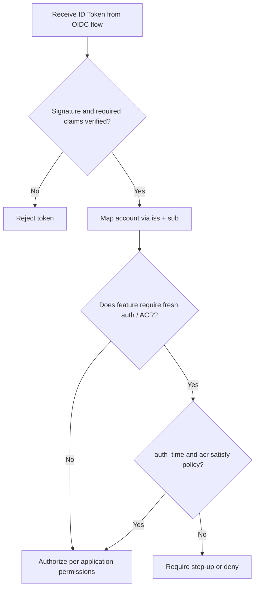

# 3.4. Claims `sub`, `iss`, `aud`, `exp`, `iat`, `auth_time`, `acr`, and `amr`

## 1. What Are Claims in OIDC and Why Distinguish Them?

**OpenID Connect (OIDC)** extends OAuth 2.0 so a client application can authenticate users through an **OpenID Provider (OP)**. When logging in via the Authorization Code Flow, the client exchanges the authorization code at the token endpoint and receives an **ID Token**. The ID Token is typically a signed JSON Web Token (JWT) containing *claims*—name/value pairs describing the token issuer, the user, the intended recipient, timestamps, and the authentication context.

The group of claims covered in this lesson comprises eight fields:

- **Identity and trust scope:** `sub`, `iss`, `aud`.
- **Token and authentication session timestamps:** `exp`, `iat`, `auth_time`.
- **Authentication context and methods:** `acr`, `amr`.

These are **ID Token** claims in the context of an OIDC Client. A JWT-formatted access token may also have similarly named claims, but those fields serve the resource server's trust model and **do not turn an access token into an ID Token**. The client must use the ID Token for its intended purpose: verifying a user's login result at a configured OP.

Running example throughout:

- Spring Boot application: `https://app.example.com`
- OpenID Provider: `https://id.example.com`
- Client ID: `spring-web-client`
- User with internal OP identifier: `pairwise-839e4a`

The following domains, identifiers, and token values are for illustration only.

## 2. Overview of an ID Token

Suppose the OP issues a JWT with the following decoded payload:

```json
{
  "iss": "https://id.example.com",
  "sub": "pairwise-839e4a",
  "aud": "spring-web-client",
  "exp": 1800003600,
  "iat": 1800000000,
  "auth_time": 1799999700,
  "acr": "urn:example:assurance:level2",
  "amr": ["pwd", "otp"],
  "nonce": "random-nonce-for-this-login"
}
```

The payload above is **illustrative decoded content only**, not a usable real ID Token. A JWT typically has the Base64URL form `header.payload.signature`; decoding the payload only lets you read the data. **Decoding does not mean verifying the signature or validating the token.** Spring Security must validate the token before the application uses its claims for authentication or security decisions.

| Claim | Value Type in OIDC | Required in ID Token? | Primary Meaning |
|---|---|---|---|
| `iss` | Issuer URL string | **Yes** | Which OpenID Provider issued the token. |
| `sub` | Subject identifier string | **Yes** | Which user the OP is describing. |
| `aud` | String or array of strings | **Yes** | Which client the ID Token was issued for. |
| `exp` | *NumericDate* number | **Yes** | Deadline after which the token is no longer accepted. |
| `iat` | *NumericDate* number | **Yes** | Time at which the ID Token was issued. |
| `auth_time` | *NumericDate* number | Conditional | Time at which the user was actually authenticated by the OP. |
| `acr` | String | Optional | Authentication assurance class/context achieved. |
| `amr` | Array of strings | Optional | Authentication methods used. |

Regarding `auth_time`: it is generally optional, but **must be returned per OIDC rules** when the authorization request includes a `max_age` parameter or when the client requests `auth_time` as an Essential Claim via a `claims` request. The `acr` and `amr` claims do not appear automatically just because the application logged in with OIDC.

To keep them clear, ask three separate questions:

1. **Who is it, and confirmed by whom?** → `iss` + `sub`.
2. **Who is this token for, and is it still valid?** → `aud` + `exp` + `iat`.
3. **When, in what context, and by what means did the user authenticate?** → `auth_time` + `acr` + `amr`.

## 3. `sub` — Subject: User Identifier at the Issuer

### 3.1. Role of `sub`

`sub` (subject) is the identifier assigned by an OP to an End-User. Within the scope of a single issuer, it must be stable and never reassigned to another user per OIDC guarantees.

Example:

```json
{
  "iss": "https://id.example.com",
  "sub": "pairwise-839e4a"
}
```

These two claims answer: "Issuer `https://id.example.com` authenticated subject `pairwise-839e4a`."

**The pair `(iss, sub)` is the proper OIDC identity key for linking to an internal account.** Never store `sub` alone when the system permits login from multiple OPs, because different issuers may generate the exact same `sub` string for two completely different people.

An account-linking table might look like:

```text
external_identity
----------------------------
provider_issuer  TEXT NOT NULL
subject          TEXT NOT NULL
local_user_id    UUID NOT NULL

UNIQUE (provider_issuer, subject)
```

Mapping example:

| `provider_issuer` | `subject` | `local_user_id` |
|---|---|---|
| `https://id.example.com` | `pairwise-839e4a` | `u-1001` |
| `https://other-id.example.net` | `pairwise-839e4a` | `u-2099` |

Even though `subject` is identical in both rows, they are two distinct external identities because the issuers differ.

### 3.2. Do Not Confuse `sub` with Email or Username

Emails, phone numbers, and display names can change, be recycled, remain unverified, or be omitted. Therefore:

- Do not use `email` instead of `sub` as the OIDC account key.
- Do not assume `sub` is formatted as an email, UUID, or human-readable user ID.
- Do not infer roles, permission groups, personal details, or trust level solely from the `sub` string.
- Do not use a `sub` from an unfamiliar issuer to match an account linked to another issuer.

### 3.3. Public Subject and Pairwise Subject

OIDC supports two common types of subject identifiers:

- **Public subject:** the same user may receive the same `sub` value across clients sharing an OP, depending on OP policy.
- **Pairwise subject:** the OP issues different `sub` values for the same user per *sector identifier*, helping prevent multiple independent clients from correlating user activity via a shared ID.

Therefore, **the same person logging into two clients does not necessarily have the same `sub`**, especially when the OP uses pairwise identifiers. To link accounts across applications, use flows and permissions supported by the OP/architecture; never match by email on your own or guess `sub` generation rules.

## 4. `iss` — Issuer: Identifying the Trusted Provider

### 4.1. Meaning

`iss` is the identifier string of the OpenID Provider issuing the ID Token. In typical OIDC deployments, this value is an HTTPS URL such as:

```json
{
  "iss": "https://id.example.com"
}
```

This is a trust boundary: the client only accepts an ID Token issued by an issuer that has been **configured and trusted** for the client registration being processed. A token with a valid signature under *another issuer's* key is still unauthorized for the current client registration.

Example:

```text
Issuer expected by client:  https://id.example.com
iss in ID Token:            https://attacker-id.example.net
Result:                     reject, even if the payload has a sub matching an existing user
```

Never determine a trusted issuer by reading `iss` from an unverified token and arbitrarily downloading keys from that URL. This is foundational to preventing **issuer confusion** and accepting tokens issued by an untrusted OP.

### 4.2. Relationship Between Issuer and OIDC Discovery

An OpenID Provider can publish metadata via OIDC Discovery. In Spring Boot, an example configuration is:

```yaml
spring:
  security:
    oauth2:
      client:
        provider:
          company-idp:
            issuer-uri: https://id.example.com
```

Spring Security uses this issuer to discover metadata/endpoints and token verification details according to relevant configuration, version, and policies. The `iss` claim in the ID Token must **match exactly** the expected issuer from metadata/configuration. Do not compare by "same domain is close enough", strip paths, or concatenate URLs and accept partial matches.

For example, `https://id.example.com/tenant-a` and `https://id.example.com/tenant-b` can represent two distinct issuers; they are not automatically equivalent just because they share a host.

## 5. `aud` — Audience: Which Client Was the ID Token Issued For?

### 5.1. Why Is `aud` Important?

`aud` (audience) specifies the intended recipient of the ID Token. For an OIDC ID Token, this claim **must contain the `client_id` of the Relying Party** performing authentication.

Single-audience example:

```json
{
  "aud": "spring-web-client"
}
```

Multi-audience example:

```json
{
  "aud": ["spring-web-client", "another-registered-client"],
  "azp": "spring-web-client"
}
```

The specification allows `aud` to be a JSON **string** or **array of strings**. When multiple audiences are present, the client must also handle the **authorized party** claim `azp` per OIDC rules and verify that the current client is the authorized party, if `azp` is present. The second sample only illustrates syntax; whether an OP allows multi-audience ID Tokens depends on policy.

A token issued for client A cannot be accepted by client B simply because the signature is valid:

```text
Current client:  spring-web-client
aud in token:    mobile-client
Result:          reject ID Token
```

### 5.2. Distinguishing `aud` of an ID Token vs. an Access Token

Both token types may use the same claim name `aud`, yet their intended recipients differ:

| Token | Who Checks `aud` | What `aud` Usually Indicates |
|---|---|---|
| **ID Token** | OAuth 2.0/OIDC Client, i.e., Relying Party | Client ID authorized to consume the authentication result. |
| **JWT Access Token** | Resource Server / API | API/resource authorized to accept the token, per system configuration. |

Do not send an ID Token to an API in place of an access token. If an API uses an ID Token's `aud` to authorize a Bearer request, that design conflates token purposes and introduces **token substitution** risk.

## 6. `exp`, `iat`, `auth_time` — Three Timestamps to Distinguish

All three claims use **NumericDate** format: seconds since the Unix epoch `1970-01-01T00:00:00Z` (not milliseconds). They describe **three different events**, so they must not be used interchangeably.

| Claim | Interpretation | Question Answered |
|---|---|---|
| `auth_time` | Time the OP actually authenticated the user | "When did the user most recently authenticate?" |
| `iat` | Time the OP issued the ID Token | "When was this token created?" |
| `exp` | Expiration boundary of the ID Token | "After what time is the token no longer accepted?" |

### 6.1. `exp` — Expiration Time

Example:

```json
{
  "exp": 1800003600
}
```

The client must reject an expired ID Token. Conceptually, the token is only valid if the current time has not passed `exp`, accounting for a small allowed clock skew per the token validation policy. The ID Token's lifetime does not have to equal the lifetime of:

- The access token;
- The refresh token;
- The application session cookie;
- The SSO session at the OP.

**An expired ID Token does not mean all browser sessions must be immediately terminated**, nor does an active application session mean an old ID Token can re-authenticate a new request. Session and token validation rules must be designed separately.

### 6.2. `iat` — Issued At

Example:

```json
{
  "iat": 1800000000
}
```

`iat` records when the token was issued. It helps determine the token's age, and the client can enforce an additional max-age policy on the token where appropriate. It **does not prove the user just re-entered a password or completed MFA** at that moment.

Suppose the user already has an SSO session at the OP. When a new application requests an ID Token, the OP may issue a token with a very recent `iat` without any re-login action. Do not use `iat` to conclude that a sensitive request has **fresh authentication**.

### 6.3. `auth_time` — Authentication Time

Example:

```json
{
  "auth_time": 1799999700
}
```

`auth_time` specifies when the OP authenticated the user. It is typically earlier than or equal to `iat`; for example, the user logged into the OP earlier, then used an existing SSO session to obtain an ID Token.

In the initial illustrative payload:

```text
1799999700  ── user authenticated at OP (auth_time)
1800000000  ── OP issued ID Token (iat)
1800003600  ── ID Token expires (exp)
          | 5 min |                 | 60 min |
```

The difference `iat - auth_time = 300` seconds in the example is the interval between the user authentication event and when the new token was issued, **not** authorization code processing time.

A common business example: a user logs in during the morning and transfers funds in the afternoon. Even if the application just received a new ID Token with a recent `iat`, the system still needs to inspect `auth_time` to know whether the login session is recent enough for the sensitive action.

### 6.4. When Is `auth_time` Required?

In OIDC, the client can send `max_age` to request an upper bound on the time elapsed since the user actively authenticated:

```http
GET /authorize?response_type=code
    &client_id=spring-web-client
    &scope=openid
    &redirect_uri=https%3A%2F%2Fapp.example.com%2Flogin%2Foauth2%2Fcode%2Fdemo
    &state=STATE_VALUE
    &nonce=NONCE_VALUE
    &max_age=300 HTTP/1.1
Host: id.example.com
```

This is wrapped across lines for readability; the actual transmitted URL is a single line. `max_age=300` asks that the user's active authentication be no older than **300 seconds** per the OP's OIDC handling. When the request contains `max_age`, the OP must include `auth_time` in the ID Token for client verification. `max_age=0` requires the user to re-authenticate.

The application must verify the returned value rather than assuming the OP honored it merely because a new ID Token arrived. Illustration of the business check:

```text
Is auth_time present?
    No  -> insufficient proof of fresh authentication
    Yes -> now - auth_time <= max_age + clock_skew?
               Yes -> satisfies time requirement
               No  -> require re-authentication / deny sensitive action
```

In the example, `clock_skew` is a small clock drift allowance defined by the system, not a way to arbitrarily relax security requirements. Server, OP, and resource server clocks should be synchronized.

### 6.5. Converting Unix Seconds to Time in Java

In Java applications, do not use `Instant.ofEpochMilli(...)` when the claim value is NumericDate seconds:

```java
import java.time.Instant;

long issuedAtSeconds = 1800000000L;

Instant issuedAt = Instant.ofEpochSecond(issuedAtSeconds);
// Correct: OIDC NumericDate is seconds since the Unix epoch.
```

Calling `ofEpochMilli` instead of `ofEpochSecond` produces a vastly wrong timestamp, leading to incorrect decisions about token expiration or authentication freshness.

In Spring Security, ID Token accessors typically already expose timestamps as `Instant`, so prefer those APIs when available instead of manually parsing JSON numbers.

## 7. `acr` — Authentication Context Class Reference

### 7.1. What Does `acr` Express?

`acr` is a string identifying the **Authentication Context Class** that the OP asserts was satisfied during user authentication. The "context" may reflect an authentication assurance policy, control requirements, or a set of criteria defined by an organization or OP.

Example:

```json
{
  "acr": "urn:example:assurance:level2"
}
```

Key point: OIDC **does not by default** mandate that every `acr` value worldwide shares the same meaning. The string `urn:example:assurance:level2` is only an example; to know what "level2" means, the client must have an agreement or official documentation with the OP.

Do not make assumptions such as:

- `acr = "2"` means "MFA completed" across all IdPs;
- A larger numeric `acr` is always more secure;
- Any non-empty `acr` satisfies sensitive-action requirements.

### 7.2. Requesting ACR in the Authorization Request

The client can suggest `acr` values via `acr_values`:

```http
GET /authorize?response_type=code
    &client_id=spring-web-client
    &scope=openid
    &redirect_uri=https%3A%2F%2Fapp.example.com%2Flogin%2Foauth2%2Fcode%2Fdemo
    &state=STATE_VALUE
    &acr_values=urn%3Aexample%3Aassurance%3Alevel2 HTTP/1.1
Host: id.example.com
```

`acr_values` expresses a **protocol preference/desired requirement**. Whether the OP supports it, satisfies that level, and returns the expected `acr` must be verified in the response. **Never treat having sent `acr_values` as proof of authentication assurance.**

OIDC also has the `claims` request mechanism, allowing `acr` to be marked as an *Essential Claim* with requested values if the OP supports this extension:

```json
{
  "id_token": {
    "acr": {
      "essential": true,
      "values": ["urn:example:assurance:level2"]
    }
  }
}
```

This is the JSON content of the `claims` parameter, which must be encoded when placed in an authorization request or passed via a supported request object mechanism. The client must still **inspect the claim in the validated ID Token** and enforce a denial policy if the value does not meet requirements. Support details for `claims`, `acr_values`, and step-up depend on the provider.

## 8. `amr` — Authentication Methods References

### 8.1. `amr` Describes How the OP Authenticated the User

`amr` is an **array of strings** containing references to the authentication methods used in the user's authentication session. Example:

```json
{
  "amr": ["pwd", "otp"]
}
```

Common codes seen in some systems include:

| Example Code | Common Meaning |
|---|---|
| `pwd` | Password-based authentication. |
| `otp` | One-time password used. |
| `mfa` | Label indicating multi-factor authentication per the OP's convention. |
| `hwk` | Hardware-based cryptographic key used. |
| `swk` | Software-based cryptographic key used. |
| `fpt` | Fingerprint used, when published by the OP. |

This list illustrates codes you may encounter; **it is not a guarantee that every OP returns these exact codes**. An OP may use registry-defined codes or custom values, may return different `amr` values for similar login flows, or may omit `amr` from the ID Token.

### 8.2. Do Not Equate `amr` with `acr`

Example:

```json
{
  "acr": "urn:example:assurance:level2",
  "amr": ["pwd", "otp"]
}
```

Within the same authentication event:

- `amr` answers: "Which **methods** does the OP report were used?"
- `acr` answers: "Which **context class/policy** does the OP report the authentication session satisfies?"

The two claims complement each other, but one cannot be inferred from the other in general. For example, seeing `["pwd", "otp"]` is **not sufficient** on its own to confirm the flow met a specific assurance level regarding phishing resistance, device security, timing, or factor independence.

An application may inspect `amr` if it has a strict semantic contract with the OP. However, for policies requiring a specific authentication assurance level, the OP-defined and attested `acr` is usually the more appropriate datum; combine it with `auth_time` when the action requires recent authentication.

### 8.3. Both `acr` and `amr` May Be Absent

A valid ID Token may carry only the required claims and a few others:

```json
{
  "iss": "https://id.example.com",
  "sub": "pairwise-839e4a",
  "aud": "spring-web-client",
  "exp": 1800003600,
  "iat": 1800000000
}
```

Never write logic like "if `amr` is missing, the user definitely logged in with single-factor" or "missing `acr` means login failed". Omitting an optional claim **does not automatically invalidate the ID Token** in general; it means the application lacks the evidence needed to make a decision that depends on that claim.

If a feature has a mandatory requirement on `acr` or `auth_time`, the application must proactively request it via a provider-supported mechanism, inspect the ID Token, and **deny or trigger additional authentication** when the returned information does not meet the requirement.

## 9. Full Analysis of a Login Example

Suppose a payment-processing application receives an ID Token with these claims:

```json
{
  "iss": "https://id.example.com",
  "sub": "customer-5821",
  "aud": "spring-web-client",
  "exp": 1800003600,
  "iat": 1800000000,
  "auth_time": 1799999700,
  "acr": "urn:example:assurance:level2",
  "amr": ["pwd", "otp"]
}
```

To use this token, the client must pass through these validation layers:

1. **Issuer origin:** Does `iss` match the issuer configured by the client for registration `spring-web-client`?
2. **Signature and integrity:** Was the token verified using an acceptable algorithm, trusted key, and appropriate metadata? Simply parsing the JWT is insufficient.
3. **Audience:** Does `aud` contain the exact `client_id`; is there an `azp` constraint to check when multiple audiences exist?
4. **Time validity:** Is `exp` still valid, is `iat` reasonable per policy, and is clock skew handled appropriately?
5. **Login session binding:** Did the authorization response's `state` match the prior request; did `nonce` in the ID Token match if a nonce was sent?
6. **User identification:** Use `(iss, sub)` to look up the linked internal account.
7. **Action policy:** If the operation requires authentication within the last 5 minutes and ACR `level2`, inspect `auth_time` and `acr` per the OP contract; `amr` only adds supplementary explanation.

**Protocol validation and business policy are two separate layers.** An ID Token can be completely valid for normal login while failing the conditions for a sensitive action. For instance, it expires in 60 minutes, yet `auth_time` is over 10 minutes old; for a 5-minute step-up requirement, the application must request fresh authentication or reject the transaction.

Decision flowchart:



The diagram does not skip post-login application authorization checks: even when the token is valid and ACR passes, the user still needs permission to perform the specific action.

## 10. Reading Claims in Spring Security OIDC Client

### 10.1. Minimal Configuration for OIDC Login

Example using Spring Boot with Spring Security for a Servlet-based web application.

Gradle:

```groovy
dependencies {
    implementation 'org.springframework.boot:spring-boot-starter-web'
    implementation 'org.springframework.boot:spring-boot-starter-security'
    implementation 'org.springframework.boot:spring-boot-starter-oauth2-client'
}
```

`application.yml`:

```yaml
spring:
  security:
    oauth2:
      client:
        registration:
          demo:
            provider: demo-provider
            client-id: ${OIDC_CLIENT_ID}
            client-secret: ${OIDC_CLIENT_SECRET}
            authorization-grant-type: authorization_code
            redirect-uri: "{baseUrl}/login/oauth2/code/{registrationId}"
            scope:
              - openid
              - profile
        provider:
          demo-provider:
            issuer-uri: https://id.example.com
```

In this configuration, `demo` is the registration ID. You must pre-register the client with the OP and set the exact redirect URI for the runtime environment. The example uses `client-secret` for a confidential web client; never expose the secret to the browser. The `openid` scope requests OIDC, while `profile` is an optional scope depending on the provider.

A basic `SecurityFilterChain`:

```java
import org.springframework.context.annotation.Bean;
import org.springframework.context.annotation.Configuration;
import org.springframework.security.config.Customizer;
import org.springframework.security.config.annotation.web.builders.HttpSecurity;
import org.springframework.security.web.SecurityFilterChain;

@Configuration
class SecurityConfig {

    @Bean
    SecurityFilterChain securityFilterChain(HttpSecurity http) throws Exception {
        http
            .authorizeHttpRequests(authorize -> authorize
                .requestMatchers("/", "/public/**").permitAll()
                .anyRequest().authenticated()
            )
            .oauth2Login(Customizer.withDefaults());
        return http.build();
    }
}
```

Spring Security handles the redirect flow, code exchange, and OIDC authentication via its filters/providers. On successful OIDC login, a controller can receive an `OidcUser`. Exact APIs and customization hooks may vary across Spring Security versions, while OIDC claims retain the same protocol semantics.

### 10.2. Accessing the Verified Underlying ID Token

Example endpoint returning only a small subset of information for illustration, without returning the raw token:

```java
import java.time.Instant;
import java.util.LinkedHashMap;
import java.util.Map;

import org.springframework.security.core.annotation.AuthenticationPrincipal;
import org.springframework.security.oauth2.core.oidc.OidcIdToken;
import org.springframework.security.oauth2.core.oidc.user.OidcUser;
import org.springframework.web.bind.annotation.GetMapping;
import org.springframework.web.bind.annotation.RestController;

@RestController
class IdentityController {

    @GetMapping("/me/identity")
    Map<String, Object> identity(@AuthenticationPrincipal OidcUser user) {
        OidcIdToken idToken = user.getIdToken();

        Map<String, Object> result = new LinkedHashMap<>();
        result.put("issuer", idToken.getClaims().get("iss"));
        result.put("subject", user.getSubject());
        result.put("audience", idToken.getClaims().get("aud"));
        result.put("issuedAt", idToken.getIssuedAt());
        result.put("expiresAt", idToken.getExpiresAt());
        result.put("authenticatedAt", idToken.getAuthenticationTime());
        result.put("acr", idToken.getAuthenticationContextClass());
        result.put("amr", idToken.getAuthenticationMethods());

        return result;
    }
}
```

Points to note:

- `user.getIdToken()` provides the ID Token attached to the OIDC authentication; `getClaims()` lets you read claims in the token.
- `user.getSubject()` retrieves the user's subject. When storing a long-term identity link, combine the subject with the trusted issuer.
- `getIssuedAt()` and `getExpiresAt()` return `Instant` for Java time handling, avoiding manual NumericDate conversion.
- `getAuthenticationTime()`, `getAuthenticationContextClass()`, and `getAuthenticationMethods()` read `auth_time`, `acr`, and `amr` if supplied by the OP; calling code should tolerate optional values being absent.
- `LinkedHashMap` can hold `null` values, making it suitable for optional claims; Java's `Map.of(...)` does not allow `null` values.

This endpoint only makes sense when the request is authenticated via OIDC and the principal is actually an `OidcUser`. Do not cast to this type in a plain OAuth 2.0 flow without `openid`.

In real usage, return only the fields the application truly needs. Do not expose a public endpoint dumping the entire ID Token/JWT or log all claims: some claims may contain personal information or sensitive data.

### 10.3. Why Read `user.getIdToken()` Instead of All Attributes?

Spring Security can aggregate user attributes from the ID Token, UserInfo Endpoint, and other sources depending on configuration. When the specific question is **"Which `acr` or `auth_time` did the OP issue in this ID Token?"**, read from `user.getIdToken()` to keep the data source explicit.

`user.getAttributes()` or `user.getClaims()` provide a convenient combined view for profile display, but do not always reflect the exact boundary between ID Token and UserInfo sources across all configurations. They do not replace ID Token validation.

If the UserInfo Endpoint is called, `sub` from UserInfo must also be verified against `sub` from the ID Token per OIDC, never merging information from a different subject into the current session.

### 10.4. Example Checking Recent Authentication and ACR Before a Sensitive Action

Suppose a feature only allows users authenticated within the last 5 minutes who achieved an ACR defined by the OP as `urn:example:assurance:level2`:

```java
import java.time.Duration;
import java.time.Instant;

import org.springframework.security.oauth2.core.oidc.OidcIdToken;
import org.springframework.security.oauth2.core.oidc.user.OidcUser;

final class AuthenticationAssurance {

    private static final String REQUIRED_ACR =
            "urn:example:assurance:level2";

    static boolean allowsSensitiveAction(OidcUser user, Instant now) {
        OidcIdToken idToken = user.getIdToken();

        Instant authTime = idToken.getAuthenticationTime();
        String acr = idToken.getAuthenticationContextClass();

        if (authTime == null || !REQUIRED_ACR.equals(acr)) {
            return false;
        }

        Duration age = Duration.between(authTime, now);

        // Authentication timestamps too far in the future must also be rejected.
        Duration allowedClockSkew = Duration.ofSeconds(60);

        return !age.isNegative()
                || (age.isNegative()
                    && age.abs().compareTo(allowedClockSkew) <= 0)
                ? age.compareTo(Duration.ofMinutes(5)) <= 0
                : false;
    }
}
```

This snippet demonstrates an **additional policy check after Spring Security has validated the ID Token**. The `now` parameter can come from `Instant.now()` in the service layer and is easy to control in integration tests. The ACR value, 5-minute window, and 60-second clock skew are illustrative policies; real systems must define them based on business requirements and the OP contract.

This code does not trigger step-up by itself. When it returns `false`, the application must deny the operation or restart the OIDC flow with appropriate parameters such as `max_age=0` and/or `acr_values`, then inspect the new ID Token. If the application needs to block **initial login** when ACR is insufficient, integrate the check into the authentication/login-routing pipeline instead of waiting until the controller.

Only use `amr` as a check condition when the system has a clear, consistent definition for each code issued by the OP. For example, `amr` containing `mfa` cannot automatically substitute for all ACR policies or phishing-resistant authentication requirements.

## 11. ID Token Validation Rules to Remember

An OIDC Client must evaluate an ID Token within a complete trust context, rather than checking claims in isolation.

### 11.1. Mandatory Validation Group for ID Tokens

In a standard Authorization Code Flow, essential checks include:

1. **Integrity and signature/token protection verification:** use an accepted algorithm, the trusted key belonging to the OP, and ID Token processing matching configuration.
2. **`iss`:** the issuer must match the issuer registered/trusted by the client.
3. **`aud`:** must contain the application's `client_id`; also evaluate `azp` when multiple audiences exist or when the claim is present.
4. **`exp`:** the token has not expired, accounting for a small permitted clock skew.
5. **`iat`:** issuance time is reasonable per the trust model and application token-age policy.
6. **`nonce`:** must match the nonce from the authorization request when the client sent a nonce.
7. **`sub`:** once the ID Token is valid, use it together with issuer to map to the right internal identity.

Depending on the flow, signing algorithm, ID Token encryption, and other fields such as `azp`, `at_hash`, or `c_hash`, additional OIDC specification conditions apply. For instance, `at_hash` is not always required in an ID Token of a pure Authorization Code Flow. Spring Security handles most ID Token validation for standard login flows; the application must still configure the OP properly and enforce its own business policies.

### 11.2. Business-Policy Validation Group

| Business Requirement | Data to Check | Behavior When Unmet |
|---|---|---|
| Login from the right organization/OP | `iss` and client configuration | Reject ID Token from another issuer. |
| Link to the right internal account | `(iss, sub)` | Never auto-match by email or display name. |
| Only the current client may use the ID Token | `aud` and `azp` if present | Reject tokens issued for other clients. |
| Token is still valid | `exp` | Reject expired tokens. |
| Token is not too old per custom policy | `iat` | Reject or request a new token depending on context. |
| User authenticated recently | `auth_time` and desired `max_age` | Trigger re-authentication or deny action. |
| Require a specific authentication assurance level | `acr` with OP-committed semantics | Require step-up or deny action. |
| Require a specific authentication method per contract | `amr` with clear OP semantics | Do not guess when claim is missing/inconsistent. |

**Never turn `amr` or `acr` checks into the sole resource authorization mechanism.** A user may authenticate with a very high ACR yet still lack permission to access someone else's invoice. Identity authentication, authentication assurance level, and authorization are three related but distinct decisions.

## 12. Common Mistakes When Implementing an OIDC Client

### Mistake 1: Using `sub` as a Global Key While Ignoring `iss`

Two providers can both issue `sub = "12345"`. If the database only keys on `sub`, a user from provider B risks being mistakenly linked to provider A's account.

**How to handle:** use a unique key or mapping on the `(iss, sub)` pair.

### Mistake 2: Checking Only the JWT Signature and Forgetting Audience and Issuer

A valid signature proves the token was signed by a specific key; it does not by itself prove the token was meant for the **current client** or issued by the **right OP**.

**How to handle:** enforce verification of `iss`, `aud`, related constraints, and key/algorithm configuration.

### Mistake 3: Using `iat` to Conclude the User Just Re-Authenticated

An OP can issue a new token based on an existing SSO session. A fresh `iat` does not tell you when the user entered a password or completed MFA.

**How to handle:** request and check `auth_time`, combined with `max_age` if a feature needs fresh authentication.

### Mistake 4: Confusing NumericDate Seconds with Milliseconds

JWT `exp` and `iat` use seconds since the Unix epoch. A unit conversion bug can turn a valid token into an expired one or vice versa.

**How to handle:** use the framework's time APIs or `Instant.ofEpochSecond()`.

### Mistake 5: Assuming `amr = ["pwd", "otp"]` Always Satisfies High ACR

Using a password and OTP does not automatically confirm the authentication complies with an internal policy's or industry standard's assurance level.

**How to handle:** rely on the OP-committed ACR definition and verify the actual `acr`, alongside `auth_time`.

### Mistake 6: Trusting the `acr_values` Sent Without Reading the Returned ID Token

The Authorization Server might not support a given ACR value, might apply a different policy, or might return a result below the requested level.

**How to handle:** inspect `acr` after the token has been validated; allow the action only if the received value meets policy.

### Mistake 7: Using an ID Token as a Bearer Token to Call APIs

An ID Token is meant for the client and is not meant to be accepted by APIs by default. An ID Token's audience is also not the same as an access token's audience.

**How to handle:** call APIs with an access token carrying the right scope/audience, and let the resource server enforce its own authorization.

### Mistake 8: Thinking a Decoded Token Is a Validated Token

Anyone holding a JWT payload can read its claims via Base64URL. Without signature/token validation, values like `sub`, `acr`, and `amr` can be forged.

**How to handle:** obtain claims from Spring Security's OIDC authentication components after login completes, rather than arbitrarily parsing a JWT and trusting its contents.

### Mistake 9: Failing to Account for Missing Optional Claims

Not every ID Token includes `acr`, `amr`, or `auth_time`. If code assumes those claims are always present, the application can crash or silently bypass security checks.

**How to handle:** read null-safely; deny actions that require a missing claim; request the information from the OP when needed.

### Mistake 10: Treating Identically Named Claims Across All Tokens as Equivalent

Claim names `iss`, `sub`, and `aud` appear in many types of JWTs. A token's contents may resemble an ID Token while being issued for an API, another client, or a different purpose.

**How to handle:** validate tokens according to their expected type and purpose, rather than sharing an arbitrary generic validator for both ID Tokens and access tokens.

## 13. Applied Scenarios

### Scenario A — Two Users with the Same `sub` at Two Providers

One account logs in from `https://id-a.example.com`, another from `https://id-b.example.com`. Both tokens carry `sub = "742"`.

**Interpretation:** this is not proof they are the same person. The identity key is `(iss, sub)`, so the two pairs are completely distinct.

### Scenario B — Fresh Token, Stale Authentication

A newly issued ID Token has an `iat` from one minute ago and `exp` 50 minutes from now, but `auth_time` is 12 hours ago.

**Interpretation:** the token may still be valid for authenticating a normal OIDC session. If a funds transfer requires authentication within the last 5 minutes, that condition is unmet; step-up and validation of the new ID Token are required.

### Scenario C — User Entered OTP, Yet ACR Is Low

The OP issues:

```json
{
  "acr": "urn:example:assurance:level1",
  "amr": ["pwd", "otp"]
}
```

**Interpretation:** the client must not promote it to level2 based on `amr`. If the action requires level2, compare the `acr` claim against the OP-defined value and reject or ask the OP to perform the appropriate authentication step.

### Scenario D — ID Token Has Another Application's `aud`

The current client has ID `spring-web-client`, while the token contains:

```json
{
  "aud": "another-client"
}
```

**Interpretation:** reject the ID Token even if `iss` and `sub` match a known account and the signature is valid.

### Scenario E — Missing `auth_time`

The application checks an operation requiring recent authentication, yet the ID Token lacks `auth_time`.

**Interpretation:** you cannot prove authentication freshness using `iat`. The application must re-request OIDC authentication with `max_age` or an equivalent provider-supported mechanism, and deny the operation if the required proof is still not returned.

## 14. Remembering Claims by Purpose

| Need to Answer | Claim | Proper Usage |
|---|---|---|
| Who issued the ID Token? | `iss` | Compare against the configured trusted issuer. |
| Who is the user within the OP's scope? | `sub` | Link accounts via the `(iss, sub)` pair. |
| Which client was the token issued for? | `aud` | Verify it contains the client ID; evaluate `azp` if applicable. |
| Is the ID Token still valid? | `exp` | Reject expired tokens. |
| When was the ID Token issued? | `iat` | Understand token age; never use instead of `auth_time`. |
| When was the user authenticated? | `auth_time` | Assess authentication freshness and `max_age` requirements. |
| What assurance level/context was reached? | `acr` | Compare with OP-defined ACR values under agreement. |
| What methods does the OP report using? | `amr` | Consult method list per provider convention. |

When building a **Spring Security OAuth 2.0 OIDC Client**, read claims from `OidcUser.getIdToken()` after a successful OIDC flow, let the framework handle core protocol validation, and have your application verify any additional authentication assurance requirements. The user identity axis is **`iss + sub`**, the token trust axis is **`iss + aud + exp` plus signature**, and the authentication freshness/assurance axis is **`auth_time + acr + amr` under known policy**.
