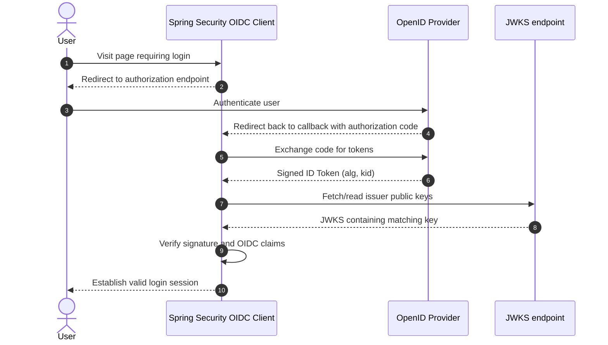

# 3.6. JWKS, Digital Signatures, and Key Rotation

## 1. Why Does OIDC Need JWKS and Digital Signatures?

When a user logs in with OpenID Connect (OIDC), the application (Relying Party / OIDC Client) receives an **ID Token** from the OpenID Provider (OP). The application needs to know whether this token was genuinely issued by the trusted OP, whether its contents were tampered with, and whether the token is intended for this exact application.

A common approach is for the OP to **digitally sign** the ID Token using a **private key**, while the application verifies the signature using a **public key**. The OP publishes its public keys as a **JSON Web Key Set (JWKS)** at an endpoint. This allows the application to verify tokens without holding any private key and without manually hardcoding a fixed public key in configuration.

However, signing keys may need to change periodically or immediately upon a security incident. **Key rotation** directly affects when the OP signs tokens with a new key, which keys appear in the JWKS, and whether the application recognizes the new key in time.

Running use case throughout:

- **OIDC Provider** at `https://login.example.com/realms/company` signs ID Tokens for logging-in users.
- **Spring Security OIDC Client** at `https://portal.example.com` receives the ID Token after the Authorization Code flow and verifies its signature.
- The OP is currently using key `key-2026-01` and preparing to transition to `key-2026-02` without disrupting logins.

> **Core takeaway:** JWT/JWS carries the **signature**, JWKS publishes the **public keys to verify signatures**, and key rotation is a controlled key-replacement process so in-flight tokens continue to verify during the transition period.

## 2. Distinguishing JWT, JWS, JWK, JWKS, and `kid`

These terms are related but not synonymous:

| Term | Full Name | Role |
| --- | --- | --- |
| **JWT** | JSON Web Token | Token format containing claims, commonly represented compactly as Base64URL-encoded segments |
| **JWS** | JSON Web Signature | Mechanism for signing and verifying data, including signed JWTs; guarantees integrity and provenance under a trusted key |
| **JWK** | JSON Web Key | JSON representation of a cryptographic key |
| **JWKS** | JSON Web Key Set | A JSON object with a `keys` array containing one or more JWKs |
| **`kid`** | Key ID | Identifier helping the verifier select the matching key from a key set |
| **`alg`** | Algorithm | Signing/verification algorithm, such as `RS256` or `ES256` |
| **`jwks_uri`** | JWKS endpoint URI | Address where the OP publishes its public key set; typically obtained from OIDC Discovery |

Relationship:

```text
OIDC Provider
  ├─ Private key K1 ── signs ──> ID Token (JWS/JWT)
  │                                └─ Header: kid = "key-2026-01"
  └─ JWKS endpoint
       └─ keys: [Public JWK of K1, Public JWK of K2, ...]
                                      │
                                      ▼
                            Spring Security OIDC Client
                            selects JWK by kid + alg
                            and verifies signature
```

**JWT does not automatically mean signed JWT.** A JWT may be signed using JWS or encrypted using JWE depending on context. When referring to an asymmetrically signed JWT ID Token, we typically mean JWS in **Compact Serialization** consisting of three parts. JWS **does not encrypt** its contents: anyone holding the token can Base64URL-decode the header and payload to read the claims.

### 2.1. Structure of a Signed ID Token

A compact JWS has the form:

```text
BASE64URL(Protected Header)
.
BASE64URL(Payload)
.
BASE64URL(Signature)
```

Illustrative header:

```json
{
  "alg": "RS256",
  "kid": "key-2026-01",
  "typ": "JWT"
}
```

Illustrative ID Token payload:

```json
{
  "iss": "https://login.example.com/realms/company",
  "sub": "user-4821",
  "aud": "web-portal",
  "iat": 1794700000,
  "exp": 1794700600,
  "nonce": "nonce-stored-in-login-session"
}
```

These values only illustrate the structure, not a real ID Token. Depending on the flow and OIDC requirements, a token may also include `auth_time`, `azp`, `at_hash`, and other claims. `typ` is not a mandatory field for every ID Token.

With `RS256`:

1. The OP builds the header and payload, Base64URL-encodes them, and joins them with a dot.
2. The OP computes an RSA/SHA-256 signature over `BASE64URL(header).BASE64URL(payload)` using its **private key**.
3. The OIDC Client reads `kid` in the header to locate the corresponding public key and uses a trusted algorithm to verify the signature.
4. Once the signature is valid, the Client must still **validate OIDC claims** such as issuer, audience, timestamps, and nonce.

Modifying a single character in the signed header/payload invalidates the signature. Conversely, a valid signature **is not enough** to permit login: the token could be expired, belong to another issuer, or have been issued for a different application.

### 2.2. Asymmetric and Symmetric Signatures

| Signing Type | Examples | Signer | Verifier | Relation to JWKS |
| --- | --- | --- | --- | --- |
| Asymmetric RSA | `RS256`, `PS256` | Private key | Public key | Common with public JWKS |
| Asymmetric EC | `ES256` | Private key | Public key | Public JWK uses `kty: EC` |
| EdDSA (if supported) | `EdDSA` | Private key | Public key | Depends on library and OP |
| Symmetric HMAC | `HS256` | Shared secret | Same shared secret | Signing secret is never published in public JWKS |

OIDC Providers typically issue ID Tokens using **asymmetric** algorithms so multiple clients can verify them without knowing the private key. In OIDC, a client can also use HMAC algorithms under corresponding configuration and rules; in that case, there is no public JWKS model like RSA/EC.

**Never trust an algorithm just because the header states `alg`.** The Client must verify the algorithm is in the trusted allowlist for the issuer/client, reject `alg=none` when disallowed, and avoid confusing symmetric and asymmetric keys.

## 3. What Data Do JWK and JWKS Contain?

### 3.1. Example Public Key Set

Illustrative response from a JWKS endpoint:

```json
{
  "keys": [
    {
      "kty": "RSA",
      "use": "sig",
      "kid": "key-2026-01",
      "alg": "RS256",
      "n": "<base64url-modulus-of-public-key-1>",
      "e": "AQAB"
    },
    {
      "kty": "RSA",
      "use": "sig",
      "kid": "key-2026-02",
      "alg": "RS256",
      "n": "<base64url-modulus-of-public-key-2>",
      "e": "AQAB"
    }
  ]
}
```

The example intentionally uses placeholders for `n`; these strings are **not valid JWKs for running code**. A real JWKS contains a Base64URL-encoded `n` corresponding accurately to the actual key.

Common properties:

| Property | Meaning |
| --- | --- |
| `keys` | Array of keys in the JWKS; typically holds both the active key and keys supporting transition periods |
| `kty` | Key type: `RSA`, `EC`, `OKP`, etc. |
| `kid` | Key identifier used to match the key against the token header |
| `use` | Intended usage: `sig` for signatures, `enc` for encryption |
| `key_ops` | Allowed cryptographic operations, when declared |
| `alg` | Intended algorithm associated with the key; does not replace the client's algorithm policy |
| `n` and `e` | Modulus and exponent of an **RSA public key** |
| `crv`, `x`, `y` | Public key parameters when using elliptic curves, depending on key type |
| `x5c`, `x5t` | Optional X.509 certificate chain / thumbprint fields in some configurations |

**A public JWKS must never contain private keys.** For RSA, private parameters such as `d`, `p`, `q`, `dp`, `dq`, and `qi` must be kept private; private keys should reside in a KMS/HSM or equivalent secret-protection system.

### 3.2. Exact Role of `kid`

Suppose the OP publishes two JWKs with `kid` values `key-2026-01` and `key-2026-02`. When an ID Token has the header:

```json
{ "alg": "RS256", "kid": "key-2026-02" }
```

The Client locates the key with `kid=key-2026-02` compatible with the expected algorithm, key type, and usage. Then the Client verifies the signature.

Remember:

- `kid` is a **routing hint to a key**; the `kid` string itself does not prove the token is trustworthy.
- `kid` is not required to be globally unique across the Internet; it must be interpreted within the **JWKS belonging to the trusted issuer**.
- When rotating keys, assign a new `kid` to the new key and keep the `kid → key material` mapping consistent; avoid reusing the same `kid` for a different key while caches and old tokens remain live.
- If `kid` is not found, the Client may safely refresh the JWKS and retry. Never accept a token solely because it carries a `kid` or because some arbitrary key happened to exist.

### 3.3. Where Does the Client Learn the JWKS Endpoint?

OIDC supports **Discovery**: the application configures the trusted issuer, fetches metadata at the corresponding `/.well-known/openid-configuration` URL, and reads `jwks_uri`.

Abbreviated metadata example:

```json
{
  "issuer": "https://login.example.com/realms/company",
  "authorization_endpoint": "https://login.example.com/realms/company/protocol/openid-connect/auth",
  "token_endpoint": "https://login.example.com/realms/company/protocol/openid-connect/token",
  "jwks_uri": "https://login.example.com/realms/company/protocol/openid-connect/certs",
  "id_token_signing_alg_values_supported": ["RS256"]
}
```

The trusted workflow is: **configure issuer → fetch issuer metadata → verify issuer matches configuration → read `jwks_uri` → fetch JWKS over HTTPS**.

The Client must never allow an unverified JWT header to dictate an arbitrary key-fetch URL (such as `jku` or `x5u`). Trusting a URL from an attacker-supplied token could cause the application to verify against an attacker-hosted key or issue network requests to dangerous destinations.

## 4. From OIDC Login to ID Token Verification

This diagram uses the **Authorization Code flow** for a web application with Spring Security:



In practice, JWKS is normally **cached**, so an HTTP request to fetch JWKS does not necessarily occur on every login.

### 4.1. Mandatory Checks Beyond the Signature

| Check | Purpose |
| --- | --- |
| **JWS signature** | Confirms contents were not altered and were signed by a trusted key |
| **`iss` (issuer)** | Token originates from the exact configured OP |
| **`aud` (audience)** | Token is intended for the application's exact `client_id` |
| **`exp`, `iat`** | Token is within its validity window; reasonable clock skew may apply |
| **`nonce`** | Binds the ID Token to the initial authentication request when the flow uses a nonce; helps prevent replay and session mix-up |
| **`azp`** | Validates authorized party when required by OIDC rules, especially with multiple audiences |
| **`auth_time` / `max_age`** | Enforces authentication recency requirements if the application requested recent authentication |
| **Algorithm and token type** | Prevents confusing an ID Token with an access token or accepting disallowed algorithms |

`state` and PKCE protect the **authorization flow**, whereas signature and claim validation protect the **ID Token**. These mechanisms complement each other and are not interchangeable.

### 4.2. ID Token Differs from Access Token

- **ID Token** conveys user authentication information to the **OIDC Client**. Its audience is primarily the application (client ID).
- **Access token** is used to access a **Resource Server/API**. Its audience and permission scopes depend on the API and Authorization Server design.

An API must not accept an ID Token merely because its signature is valid. Likewise, an OIDC Client must not use an access token in place of an ID Token to determine user identity. Both may use JWS/JWKS, yet **their intended recipients, claims, and validation rules differ**.

## 5. Signing Key Rotation Process

Private keys should not be used indefinitely. Rotation limits key lifetime, reduces exposure if a key is compromised, and supports operational/security policies.

Separate two operations:

- **Issuing tokens:** the OP picks the **current active private key** to sign new tokens.
- **Verifying tokens:** the Client locates the **corresponding public key** in JWKS to verify in-flight tokens.

Because older tokens remain valid for some time, the OP normally must **publish both old and new public keys concurrently**. Having multiple keys in JWKS does not mean the OP signs new tokens with all of them; typically, the OP has one active signing key per token type/algorithm.

### 5.1. Four-Phase Planned Rotation

Suppose:

- Old key is `K1`, `kid=key-2026-01`.
- New key is `K2`, `kid=key-2026-02`.
- ID Token maximum lifetime is 10 minutes (assumed for example).
- Client caches JWKS for up to 5 minutes (assumed).
- System allows 1 minute of clock skew (assumed).

| Phase | Key Used to **Sign New Tokens** | Public Keys Present in **JWKS** | Meaning |
| --- | --- | --- | --- |
| **T0: Normal** | `K1` | `K1` | All ID Tokens are signed with the old key |
| **T1: Pre-publish** | `K1` | `K1`, `K2` | Clients have a chance to pick up the new public key before it is needed |
| **T2: Switch signing key** | `K2` | `K1`, `K2` | New tokens carry `kid=key-2026-02`; old tokens signed by K1 remain valid |
| **T3: End transition** | `K2` | `K2` | Remove K1 only when no valid tokens require K1 and operational conditions are met |

```text
Time ──────────────────────────────────────────────────────────────>

T0                   T1                    T2                    T3
│                    │                     │                     │
Sign: K1             Sign: K1              Sign: K2              Sign: K2
JWKS: [K1]           JWKS: [K1, K2]        JWKS: [K1, K2]        JWKS: [K2]
                     ▲                     ▲                     ▲
                     Publish K2            Switch signing to K2  Safely remove K1
                     before use            keep K1 to verify     after waiting period
```

**At T1:** generate K2 and publish K2's **public key** in JWKS; K2's private key must still remain protected. You can wait at least one JWKS cache interval before signing new tokens with K2, especially when some clients do not automatically reload JWKS immediately upon seeing an unfamiliar `kid`.

**At T2:** the OP starts signing ID Tokens with K2. Clients with updated JWKS verify immediately. Clients still caching the old JWKS may encounter `kid not found`; the verification library should allow an appropriate rate-limited JWKS refresh and retry verification with the new key.

**At T3:** remove K1 only when **the last token signed with K1 can no longer be accepted** given token lifetime, clock skew limits, and validation policies. For instance, if the last K1 token was issued right before T2 with a 10-minute max lifetime and 1-minute clock skew, wait at least roughly 11 minutes after T2 before considering removing K1. Actual waiting times also depend on system setup, caches, revocation rules, other token types sharing the key, and deployment lag.

You cannot derive a safe rotation schedule from JWKS cache TTL alone. **Token lifetime, last issuance time under the old key, clock skew, and all token types signed** all influence when the old key can be removed.

### 5.2. Why Pre-Publish the New Key Before Signing?

Suppose a client just fetched JWKS containing only K1 and cached it for 5 minutes. The OP immediately begins signing new tokens with K2, while the client still knows only K1. If the library does not refresh upon seeing `kid=K2`, users logging in could be rejected even though their tokens are genuinely valid.

Publishing K2 early lets clients update their caches. For clients that support refreshing upon encountering a new `kid`, the transition window may be shorter; even so, the rollout should be planned around the behavior of all real-world clients.

### 5.3. JWKS Caching and Refresh

Libraries may cache JWKS based on HTTP cache headers, internal policies, or application configuration. Key considerations:

- **TTL / cache lifetime:** a long cache reduces load on the JWKS endpoint but extends how long clients see an outdated key set.
- **`kid` missing from cache:** many libraries can reload JWKS; do not assume every library does this automatically.
- **Controlled refresh:** if a key is not found, refresh once under an appropriate policy and retry verification; rate limiting / backoff is needed to prevent attackers from sending floods of random `kid` values to DoS the JWKS endpoint.
- **Network errors:** if the signature cannot be verified with a trusted key, **reject the token**. Never disable signature validation to avoid disruption.
- **Multi-instance synchronization:** distributed application instances may have JWKS caches at different ages; monitor `unknown kid` errors per instance during rotation.
- **CDN / proxy caching:** inspect intermediary caches as well; publishing K2 at the origin JWKS does not guarantee every client sees it immediately.

JWKS contains **public keys**, so publishing them over HTTPS does not leak private keys. Even so, metadata/JWKS must still be fetched from a trusted endpoint and protected against tampering in transit.

## 6. Scheduled Rotation vs. Compromised Key Handling

These two scenarios have different goals:

| Aspect | Scheduled Rotation | Emergency Rotation on Suspected Private Key Compromise |
| --- | --- | --- |
| Goal | Orderly key replacement while keeping login sessions working | Minimize an attacker's ability to forge tokens |
| Publish new public key | Usually pre-published | May need immediate deployment |
| Keep old public key | Kept while old tokens remain valid | Consider removing / rejecting the old key as soon as possible per incident policy |
| Impact on old tokens | Avoids invalidating valid tokens prematurely | May intentionally render old tokens unverifiable |
| Additional actions | Monitor error rates, caches, transition window | Investigate incident, revoke/destroy signing key, assess forged tokens, shorten TTLs, notify affected systems |

During an **emergency rotation**, keeping K1 merely to keep old tokens working could allow an attacker to keep forging tokens with K1's private key. Therefore, isolating and invalidating the compromised key takes priority; rejecting K1 tokens may force users to log in again or cause some API requests to fail. This is a deliberate trade-off based on incident severity.

A sound operational workflow includes: generating a new key pair in KMS/HSM, updating JWKS and the active signing key, monitoring authentication and `kid` errors, destroying the old key only when rotation policy allows (or acting immediately during an incident), and logging timestamps and changes. JWKS-consuming applications should have their refresh behavior tested before rolling out a live rotation schedule.

## 7. How Does Spring Security OIDC Client Use JWKS?

### 7.1. Dependencies and OIDC Discovery Configuration

Example for Spring Boot 3.x / Spring Security 6.x, with a Servlet web application logging in via OIDC.

Add Maven dependencies:

```xml
<dependencies>
    <dependency>
        <groupId>org.springframework.boot</groupId>
        <artifactId>spring-boot-starter-web</artifactId>
    </dependency>
    <dependency>
        <groupId>org.springframework.boot</groupId>
        <artifactId>spring-boot-starter-security</artifactId>
    </dependency>
    <dependency>
        <groupId>org.springframework.boot</groupId>
        <artifactId>spring-boot-starter-oauth2-client</artifactId>
    </dependency>
</dependencies>
```

Configure `application.yml`:

```yaml
spring:
  security:
    oauth2:
      client:
        registration:
          company-oidc:
            provider: company
            client-id: ${OIDC_CLIENT_ID}
            client-secret: ${OIDC_CLIENT_SECRET}
            authorization-grant-type: authorization_code
            redirect-uri: "{baseUrl}/login/oauth2/code/{registrationId}"
            scope:
              - openid
              - profile
        provider:
          company:
            issuer-uri: https://login.example.com/realms/company
```

Configuring `issuer-uri` lets Spring Security discover OP endpoints from metadata, including `jwks_uri`. For integration, the OP must serve valid metadata and the client registration must have matching redirect URI, grant, and scopes.

`client-secret` is the **OIDC Client** secret used for client authentication (per registration), **not the private key the OP uses to sign ID Tokens**.

### 7.2. Protecting Endpoints with OIDC Login

```java
import org.springframework.context.annotation.Bean;
import org.springframework.context.annotation.Configuration;
import org.springframework.security.config.Customizer;
import org.springframework.security.config.annotation.web.builders.HttpSecurity;
import org.springframework.security.web.SecurityFilterChain;

@Configuration
public class WebSecurityConfiguration {

    @Bean
    SecurityFilterChain webSecurity(HttpSecurity http) throws Exception {
        http.authorizeHttpRequests(requests -> requests
                .requestMatchers("/", "/health").permitAll()
                .anyRequest().authenticated());

        http.oauth2Login(Customizer.withDefaults());

        return http.build();
    }
}
```

When a user logs in, Spring Security OAuth2 Login receives the ID Token and uses OP details and OIDC processors to **verify the signature and required claims** before establishing the principal/login session. For asymmetrically signed ID Tokens, the decoder/verifier fetches keys from the discovered JWKS endpoint; the application does not need to manually extract `kid` and write RSA verification code.

A controller reading principal details after login:

```java
import java.util.Map;

import org.springframework.security.core.annotation.AuthenticationPrincipal;
import org.springframework.security.oauth2.core.oidc.user.OidcUser;
import org.springframework.web.bind.annotation.GetMapping;
import org.springframework.web.bind.annotation.RestController;

@RestController
public class ProfileController {

    @GetMapping("/me")
    public Map<String, String> me(@AuthenticationPrincipal OidcUser user) {
        return Map.of("subject", user.getSubject());
    }
}
```

`OidcUser` is only present after the corresponding OIDC authentication process succeeds. There is no need to return the raw ID Token in an API response or log it to prove the user is logged in.

### 7.3. When the Application Acts as a Resource Server

If a system has an API accepting **JWT access tokens**, that is the job of **Spring Security OAuth2 Resource Server**, not `oauth2Login`. It can be configured separately:

```yaml
spring:
  security:
    oauth2:
      resourceserver:
        jwt:
          issuer-uri: https://login.example.com/realms/company
```

With an issuer supporting discovery/JWKS properly, Spring Security Resource Server can verify JWT signatures against the JWK Set and refresh keys based on its decoder/cache mechanism. The API must still check the audience and permissions (scopes/roles) of the **access token**, according to the API's token contract.

For example, if you want to enforce explicit **audience validation** for JWT access tokens from a known JWKS URI, you can configure a decoder like this:

```java
import org.springframework.context.annotation.Bean;
import org.springframework.context.annotation.Configuration;
import org.springframework.security.oauth2.core.DelegatingOAuth2TokenValidator;
import org.springframework.security.oauth2.core.OAuth2Error;
import org.springframework.security.oauth2.core.OAuth2TokenValidator;
import org.springframework.security.oauth2.core.OAuth2TokenValidatorResult;
import org.springframework.security.oauth2.jwt.Jwt;
import org.springframework.security.oauth2.jwt.JwtDecoder;
import org.springframework.security.oauth2.jwt.JwtValidators;
import org.springframework.security.oauth2.jwt.NimbusJwtDecoder;
import org.springframework.security.oauth2.jose.jws.SignatureAlgorithm;

@Configuration
public class ApiJwtConfiguration {

    private static final String ISSUER =
            "https://login.example.com/realms/company";
    private static final String JWKS_URI =
            "https://login.example.com/realms/company/protocol/openid-connect/certs";
    private static final String EXPECTED_AUDIENCE = "inventory-api";

    @Bean
    JwtDecoder jwtDecoder() {
        NimbusJwtDecoder decoder = NimbusJwtDecoder
                .withJwkSetUri(JWKS_URI)
                .jwsAlgorithm(SignatureAlgorithm.RS256)
                .build();

        OAuth2TokenValidator<Jwt> issuerAndTime =
                JwtValidators.createDefaultWithIssuer(ISSUER);

        OAuth2TokenValidator<Jwt> audience = token ->
                token.getAudience().contains(EXPECTED_AUDIENCE)
                        ? OAuth2TokenValidatorResult.success()
                        : OAuth2TokenValidatorResult.failure(
                                new OAuth2Error(
                                        "invalid_token",
                                        "Unexpected token audience",
                                        null));

        decoder.setJwtValidator(new DelegatingOAuth2TokenValidator<>(
                issuerAndTime, audience));
        return decoder;
    }
}
```

The URLs, `RS256` algorithm, and `inventory-api` audience in the example must match your Authorization Server's actual configuration. When manually creating a `JwtDecoder`, the application is responsible for ensuring required validators are not omitted. In the example, `JwtValidators.createDefaultWithIssuer` includes the default and issuer validators, combined with an audience check. An API's `SecurityFilterChain` still needs to enable `oauth2ResourceServer(...jwt...)` and configure endpoint authorization.

The library's JWKS refresh/caching behavior depends on the Spring Security/Nimbus version and active cache configuration. When deploying a system with strict rotation requirements, verify the exact behavior of the version you are running.

## 8. Illustrative Inspection of Discovery and JWKS

You can use `curl` and `jq` to inspect metadata/JWKS on an **authorized** environment:

```bash
# OIDC Provider metadata (illustrative URL).
curl --fail --silent --show-error \
  "https://login.example.com/realms/company/.well-known/openid-configuration" \
  | jq '{issuer, jwks_uri, id_token_signing_alg_values_supported}'

# JWKS URL obtained from metadata; this example uses Keycloak's URL structure.
curl --fail --silent --show-error \
  "https://login.example.com/realms/company/protocol/openid-connect/certs" \
  | jq '{keys: [.keys[] | {kid, kty, use, alg}]}'
```

Read only the **public** information needed to verify the issuer, JWKS URI, and available `kid` values. Never download private keys, use secrets, or print user ID Tokens/access tokens onto shared screens.

While tracking rotation, you can record the **list of published `kid` values and timestamps**:

| Stage | Published JWKS | `kid` on New Tokens | Observation |
| --- | --- | --- | --- |
| Before rotation | `key-2026-01` | `key-2026-01` | Normal state |
| Pre-publish | `key-2026-01`, `key-2026-02` | `key-2026-01` | New key is ready for verification |
| Switch signing | `key-2026-01`, `key-2026-02` | `key-2026-02` | New key is issuing tokens |
| Complete | `key-2026-02` | `key-2026-02` | Old key's verification window has ended |

This is **illustrative** data, not output from running against a specific real OP.

## 9. Common Errors Related to JWKS and Signatures

| Symptom | Possible Cause | How to Handle |
| --- | --- | --- |
| `kid not found` / `Unable to resolve signing key` | OP just switched to K2 while client still caches JWKS containing only K1 | Confirm new JWKS includes K2; check client refresh/cache policy |
| `Invalid signature` | Wrong public key, tampered token, mismatched issuer/key, or algorithm mismatch | Verify issuer, `kid`, algorithm, and key material; never disable signature validation |
| `Algorithm not allowed` | OP changed algorithm or client only permits a different algorithm | Check metadata, client registration, and allowlist; enable only approved algorithms |
| `Issuer mismatch` | Token `iss` does not match configured issuer | Compare issuer exactly, including scheme, host, path, and tenant/realm |
| `Audience validation failed` | `aud` lacks expected client ID / API audience | Use the proper client registration and token type meant for the system |
| `Token expired` | `exp` has passed or machine clock is skewed | Check system time, token lifetime, and reasonable clock skew |
| Login failures on only some instances | Different JWKS caches, different app versions, or stale proxy/CDN cache | Compare `kid` values seen per instance, TTL/cache settings, and deployment config |
| Old tokens expire early right after rotation | OP removed old public key before all K1-signed tokens expired | Restore public key K1 if uncompromised and allowed by policy; adjust overlap window |
| Cannot fetch JWKS | DNS/TLS/firewall/proxy/JWKS endpoint error | Fix trusted connectivity; never switch to a mode that skips signature checks |
| `nonce mismatch` or invalid claims | Session mismatch or token does not satisfy authentication request | Check flow, state, nonce, and session state without leaking tokens |

When investigating, **pinpoint which stage failed**: fetching metadata, fetching/refreshing JWKS, selecting a key by `kid`, verifying the signature, or validating claims. Each stage has different root causes. Log only non-sensitive details (known issuer, `kid`, error code, correlation ID, timestamp); strictly avoid logging raw tokens or secret keys.

## 10. Key Principles to Remember

1. **JWKS publishes public keys**, not private keys. The OP's private key is used for signing and must be protected separately.
2. **`kid` only helps select a key**; trust comes from the configured issuer/JWKS and signature verification under a permitted algorithm.
3. **A valid signature is not enough to log in**: the ID Token must also pass issuer, audience, expiration, and relevant OIDC claim checks, especially nonce when requested.
4. **Safe rotation has an overlap window**: publish the new key before signing, and keep publishing the old public key until old tokens expire.
5. **JWKS caching determines smoothness** when the OP switches keys. Clients need a controlled refresh policy and must reject unverifiable tokens.
6. **Spring Security OIDC Client** uses OIDC/OAuth2 Client mechanisms to verify ID Tokens; **Resource Server** uses JWT decoders for API access tokens. Never swap the roles of these two token types.

Understanding the chain **private signing key → JWS in ID Token → `kid` → public JWK in JWKS → signature and claim validation** explains how an application can automatically trust tokens issued by an OP while continuing to operate seamlessly during planned signing key rotation.
