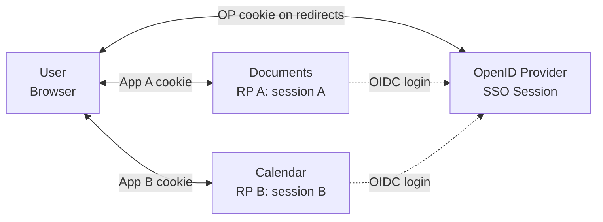
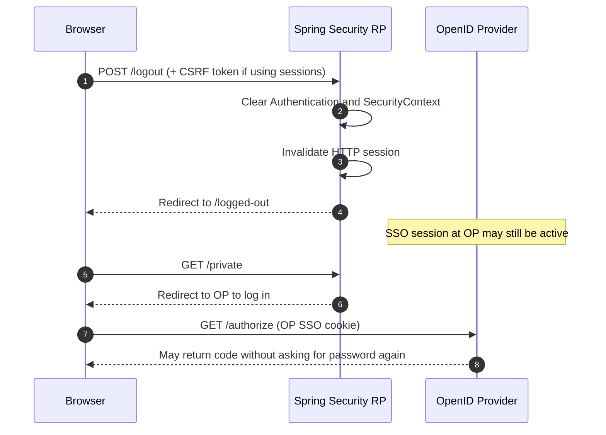
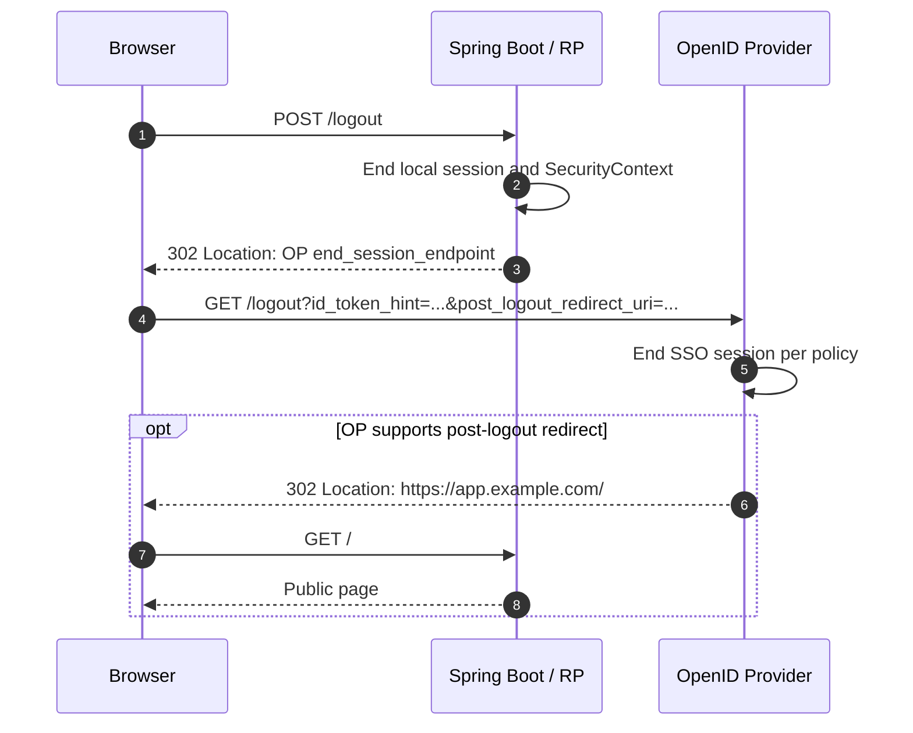

# 3.11. Concepts of Local Logout and Provider Logout

When a Spring Security application supports **OpenID Connect (OIDC) login**, the user typically has at least two login states: the **application session** and the **session at the OpenID Provider (OP)**. Therefore, clicking "Log out" does not automatically mean the same thing everywhere.

- **Local logout:** terminates the session at the current application, i.e., the **Relying Party (RP)**.
- **Provider logout / OP logout:** asks the OpenID Provider to terminate the user's SSO login session at the OP.
- **Federated logout / single logout:** coordinates notifications so other RPs also terminate their own sessions, if the systems jointly support a suitable mechanism.

Key point: **OIDC authenticates users through an OP, yet does not automatically merge all sessions into a single session**. You must clarify which session the application wants to end, who holds which cookies or tokens, and whether the systems support logout notification protocols.

## 1. Components and State Present After OIDC Login

In a typical system:

| Component | Role | State That May Be Maintained |
|---|---|---|
| **Browser** | The user's browser | App A cookie, App B cookie, OP cookie |
| **Relying Party (RP)** | Spring Security app using `oauth2Login()` | `SecurityContext`, HTTP session, authorized client/tokens |
| **OpenID Provider (OP)** | Authenticates users, issues ID tokens | SSO session at the OP and related authentication state |
| **Resource Server (API)** | API verifying access tokens | Access control per access token; typically has no RP web session |

For example, a user logs into `https://documents.example.com` through OP `https://login.example.com`:

1. The browser visits the Spring Boot application.
2. Spring redirects to the OP and completes the OIDC Authorization Code Flow.
3. The OP issues an **ID token** proving the authentication event and may issue an **access token** to call APIs.
4. Spring Security creates the authenticated principal and saves the security context in the session.
5. The browser holds the session cookie for `documents.example.com`, while potentially also retaining the SSO cookie for `login.example.com`.

The RP's cookies and the OP's cookies belong to different domains/origins. The RP **cannot** simply delete the OP's cookies via an HTTP response from its own domain.

### 1.1. Two Independent Sessions Create the SSO Experience

Suppose two applications, `Documents` and `Calendar`, share an OP:



If the user clicks **Log out** in `Documents`:

- `Documents`'s session may be destroyed.
- `Calendar`'s session can still remain active.
- The SSO session at the OP can still remain active.
- The next time `Documents` is opened, the RP redirects to the OP and the OP can re-authenticate the user **without showing a password prompt**, thanks to the still-valid SSO session.

This is not a bug in Spring Security. It accurately reflects the boundary between the **application session** and the **provider session**.

## 2. What Is Local Logout?

**Local logout** is the action where an application ends authentication state **at the RP itself**. For a session-based Spring MVC application, the typical flow is:

1. Receive the logout request from the user.
2. Trigger Spring Security's logout filter/handlers.
3. Remove `Authentication` from `SecurityContext`.
4. Invalidate the current HTTP session, if present.
5. Invalidate or delete the browser-side session cookie per configured mechanism.
6. Redirect to a public page or a "Logged out" notice.

Spring Security provides this out of the box via `logout()` in the filter chain; an application should not merely create a `GET /logout` controller and manually remove a few session attributes.

### 2.1. What Local Logout Does and Does Not Affect

| Target | After Local Logout at RP A |
|---|---|
| Current `SecurityContext` of RP A | Cleared by the logout mechanism |
| HTTP session of RP A | Invalidated if logout is configured with default/proper settings |
| Session cookie of RP A | No longer usable for the invalidated session |
| SSO session at the OP | **Not automatically terminated** |
| Session of RP B logged in via the same OP | **Not automatically terminated** |
| Already-issued JWT access tokens | **Not automatically revoked** |
| Refresh tokens issued by the OP | Not revoked by default merely because the RP cleared its session |
| Cookies and sessions on other devices | Not altered by default |

Even if the application deletes the `JSESSIONID` cookie, that is only the RP's cookie (scoped to its domain/path). Deleting the browser cookie also **does not replace invalidating the session on the server**.

In multi-instance deployments, consider a shared session store (such as Spring Session with Redis) so logout takes effect consistently even if the next request hits another node.

### 2.2. Local Logout Flow



In this scenario, **logging out of the application succeeded** even though returning to log in again did not require a password. If the product requires the user to re-authenticate, add the appropriate policy at the OP/RP rather than relying solely on local logout.

## 3. What Is OpenID Provider Logout?

**OP logout** terminates the user's authentication session **at the identity provider**. The RP can redirect the browser to the OP's logout endpoint; OIDC defines **RP-Initiated Logout** for this scenario.

OP logout aims to prevent the OP's SSO session from being reused on the next interaction. When the user returns to an RP requiring login, the OP may prompt for re-authentication, unless another automatic login mechanism or an upstream federated identity session remains active.

**Do not equate** "logging out of the OP" with "clearing every session across all RPs". RPs maintain their own sessions and may not know the OP session ended. Synchronizing that state requires a multi-application logout notification mechanism or suitable session policies.

### 3.1. RP-Initiated Logout

**OpenID Connect RP-Initiated Logout 1.0** allows an RP to initiate a request to terminate the user's session at the OP via the **End Session Endpoint**.

A common sequence:

1. The user clicks **Log out** in the RP.
2. The RP ends its local session.
3. The RP redirects the browser to the OP's `end_session_endpoint` with appropriate parameters.
4. The OP identifies the session and handles logout; the OP may ask the user for confirmation depending on policy.
5. If supported and permitted by the OP, the browser is redirected back to the RP's registered `post_logout_redirect_uri`.



These are **two consecutive actions**: local logout at the RP and OP logout at the provider. Only redirecting to the OP without clearing the local session can leave an active RP session behind if the user does not finish the flow on the OP side.

### 3.2. Key Parameters

| Parameter | Purpose | Notes |
|---|---|---|
| `id_token_hint` | Hints to the OP the prior ID token of the session being logged out | Recommended per RP-Initiated Logout; never manually craft a fake ID token |
| `post_logout_redirect_uri` | Address where the OP may return the browser after logout | Must be registered/allowed at the OP per provider rules |
| `state` | Binds the post-logout redirect response to the RP-initiated request | Optional per protocol; RP should verify it if used |
| `client_id` | Identifies the client, especially when `id_token_hint` is omitted and the OP needs to distinguish clients | Optional in the spec; depends on OP policy |

An illustrative URL:

```text
https://login.example.com/oidc/logout
  ?id_token_hint=<the-previously-issued-id-token>
  &post_logout_redirect_uri=https%3A%2F%2Fdocuments.example.com%2F
  &state=<random-request-state>
```

The RP must follow the OP's rules. Not every OP supports all parameters or identical redirect/confirmation behavior. Avoid constructing `post_logout_redirect_uri` from arbitrary user input, which could introduce an **open redirect**.

**Note:** `id_token_hint` is the ID token issued by the OP to the **RP** during login, not an access token and not a string representing the user's password.

### 3.3. Discovering the End Session Endpoint

When the OP supports OIDC Discovery and publishes a logout endpoint, metadata may contain:

```json
{
  "issuer": "https://login.example.com",
  "authorization_endpoint": "https://login.example.com/oidc/authorize",
  "token_endpoint": "https://login.example.com/oidc/token",
  "jwks_uri": "https://login.example.com/oidc/jwks",
  "end_session_endpoint": "https://login.example.com/oidc/logout"
}
```

This information is typically fetched via the issuer's discovery metadata, for example:

```text
GET https://login.example.com/.well-known/openid-configuration
```

`end_session_endpoint` does not necessarily appear on every OP. When a provider does not support RP-Initiated Logout or does not advertise the endpoint in a way Spring Security can use, the application must choose an explicit fallback: still end the local session and send the user to a logout page, while avoiding claiming that the OP SSO session was terminated.

## 4. Local Logout, OP Logout, and Single Logout Are Not the Same Thing

These terms are often used interchangeably, yet their scopes differ:

| Mechanism | Who Initiates? | Who Receives the Signal? | Scope of Impact |
|---|---|---|---|
| **Local logout** | User or RP | The RP itself | Session in the current application |
| **RP-Initiated Logout** | RP redirecting after logout | OP | SSO session at OP; other RPs depend on integration |
| **OP-Initiated / Front-Channel Logout** | OP | RPs via the browser | Asks RPs to end related sessions; browser-dependent |
| **OP-Initiated / Back-Channel Logout** | OP | Backends of RPs | Server-to-server notification for RPs to end related sessions |
| **Token revocation** | Authorized client/subject | Authorization Server | Revokes specified token per AS semantics/policy |

### 4.1. Front-Channel Logout

**OpenID Connect Front-Channel Logout 1.0** allows an OP to trigger logout requests to RPs through the **user agent**, typically using iframes or a browser navigation mechanism. RPs must expose an endpoint to receive logout requests and identify the matching session.

Advantage: uses the browser to notify participating RPs without necessarily requiring direct connectivity from the OP to every backend.

Limitations:

- Browsers may block third-party cookies or resources inside iframes.
- The user may close the tab or navigate away mid-flow.
- Cookies/sessions may not be sent as expected by OP/RP due to `SameSite` settings and browser policies.
- Not all RPs register and implement this mechanism.

Hence, OP logout **does not guarantee** all RP sessions are cleared solely through front-channel mechanisms.

### 4.2. Back-Channel Logout

**OpenID Connect Back-Channel Logout 1.0** allows the OP to send logout notifications directly to RP backends, **without relying on the browser remaining open**.

The OP sends a **Logout Token** (a JWT with special semantics for a logout event) to the back-channel logout URI registered by the RP. The RP must:

- Verify signature, issuer, audience, timestamps, and related protocol requirements.
- Verify it is a valid logout token, including `events` for back-channel logout, and never accept it as a login ID token.
- Protect against replay using `jti` / an appropriate mechanism.
- Identify the associated session via `sid` or subject identifier per spec/OP rules.
- Terminate the corresponding local session/login in the session store.

A Logout Token is not an access token for calling APIs, nor does it mean the RP should wipe every user's sessions. You must map from the verified `sid` or `sub` to the **exact RP session**.

Illustrative Logout Token payload structure (for illustration, unsigned):

```json
{
  "iss": "https://login.example.com",
  "aud": "documents-client",
  "iat": 1924996000,
  "jti": "logout-event-8df4c5",
  "sid": "op-session-92a3",
  "events": {
    "http://schemas.openid.net/event/backchannel-logout": {}
  }
}
```

Back-channel is more reliable than front-channel when browsers restrict cookies, yet still depends on both OP and RP support, delivery/receipt of the event, endpoint availability, and accurate session mapping. Exact support in Spring Security depends on framework version and requires dedicated configuration; **never assume `oauth2Login()` automatically enables back-channel logout**.

### 4.3. "Single Logout" Is an Integration Goal, Not a Default Side Effect

Scenario: a user logs in once at the OP and opens three systems A, B, and C. The user logs out at A and expects the other systems to log out too.

This can only be achieved if:

1. A can initiate logout at the OP per policy.
2. The OP ends the SSO session and sends notifications to relevant RPs.
3. B and C register, receive, validate, and act on the notification.
4. RPs have a way to locate and invalidate the exact affected sessions.
5. Offline apps or delayed/failed notifications are accounted for.

If any link is missing, the outcome may be that **the OP logged out while B/C still hold valid sessions**. Therefore, products should describe the exact scope of the action—such as "Log out of this application" or "Log out of your company account"—instead of using the same "Logout" label for two different intents.

## 5. Spring Security: Configuring Local Logout

### 5.1. Spring MVC Application Using OIDC Login

Example using Spring Boot with the Servlet stack:

```groovy
dependencies {
    implementation 'org.springframework.boot:spring-boot-starter-security'
    implementation 'org.springframework.boot:spring-boot-starter-oauth2-client'
}
```

OIDC client configuration (illustrative values):

```yaml
spring:
  security:
    oauth2:
      client:
        registration:
          company:
            provider: company
            client-id: ${OIDC_CLIENT_ID}
            client-secret: ${OIDC_CLIENT_SECRET}
            authorization-grant-type: authorization_code
            client-authentication-method: client_secret_basic
            redirect-uri: "{baseUrl}/login/oauth2/code/{registrationId}"
            scope:
              - openid
              - profile
        provider:
          company:
            issuer-uri: ${OIDC_ISSUER_URI}
```

Here the RP performs OIDC login without configuring OP logout yet. To perform only local logout:

```java
import org.springframework.context.annotation.Bean;
import org.springframework.context.annotation.Configuration;
import org.springframework.security.config.Customizer;
import org.springframework.security.config.annotation.web.builders.HttpSecurity;
import org.springframework.security.web.SecurityFilterChain;

@Configuration
public class SecurityConfig {

    @Bean
    SecurityFilterChain securityFilterChain(HttpSecurity http) throws Exception {
        http
            .authorizeHttpRequests(auth -> auth
                .requestMatchers("/", "/logged-out", "/error").permitAll()
                .anyRequest().authenticated())
            .oauth2Login(Customizer.withDefaults())
            .logout(logout -> logout
                .logoutUrl("/logout")
                .logoutSuccessUrl("/logged-out")
                .invalidateHttpSession(true)
                .clearAuthentication(true)
                .deleteCookies("JSESSIONID"));

        return http.build();
    }
}
```

Behavior:

- `POST /logout` triggers Spring Security's logout handlers.
- The session at the RP is invalidated; authentication/security context is cleared.
- Then the RP redirects to `/logged-out`.
- The OP **does not receive any session-termination request** from this configuration alone.

`deleteCookies("JSESSIONID")` can be useful if the application uses a cookie with that exact name/path. In real systems, cookies may have different names or paths; invalidating the server-side session is what truly matters. For applications with alternative session mechanisms or multiple filter chains, configure logout wherever it is actually processed.

### 5.2. Safe Logout Button in the UI

For cookie-backed web applications, use **POST** for the logout action so Spring Security's CSRF protection works normally.

Thymeleaf example:

```html
<form th:action="@{/logout}" method="post">
    <input type="hidden"
           th:name="${_csrf.parameterName}"
           th:value="${_csrf.token}" />
    <button type="submit">Log out of application</button>
</form>
```

This template assumes a CSRF token is supplied to the view per Spring Security configuration. Do not turn logout into `GET /logout` just to make a link easier to write, and never disable CSRF application-wide just to make a logout button work.

When Spring Security is unauthenticated, the logout endpoint/entry point or public landing page must be configured to fit the user experience; do not place those pages behind an authentication-required rule if they should display after logout.

## 6. Spring Security: Logging Out Both RP and OP with RP-Initiated Logout

Spring Security provides **`OidcClientInitiatedLogoutSuccessHandler`** to support redirecting the browser to the OpenID Provider's logout endpoint after local logout handling completes.

### 6.1. Configuration Example

```java
import org.springframework.context.annotation.Bean;
import org.springframework.context.annotation.Configuration;
import org.springframework.security.config.Customizer;
import org.springframework.security.config.annotation.web.builders.HttpSecurity;
import org.springframework.security.oauth2.client.oidc.web.logout.OidcClientInitiatedLogoutSuccessHandler;
import org.springframework.security.oauth2.client.registration.ClientRegistrationRepository;
import org.springframework.security.web.SecurityFilterChain;

@Configuration
public class SecurityConfig {

    @Bean
    SecurityFilterChain securityFilterChain(
            HttpSecurity http,
            ClientRegistrationRepository clientRegistrations) throws Exception {

        var oidcLogoutSuccessHandler =
            new OidcClientInitiatedLogoutSuccessHandler(clientRegistrations);

        // This URL must be permitted by the OP as a post_logout_redirect_uri.
        oidcLogoutSuccessHandler.setPostLogoutRedirectUri("{baseUrl}/");

        http
            .authorizeHttpRequests(auth -> auth
                .requestMatchers("/", "/error").permitAll()
                .anyRequest().authenticated())
            .oauth2Login(Customizer.withDefaults())
            .logout(logout -> logout
                .logoutUrl("/logout")
                .invalidateHttpSession(true)
                .clearAuthentication(true)
                .deleteCookies("JSESSIONID")
                .logoutSuccessHandler(oidcLogoutSuccessHandler));

        return http.build();
    }
}
```

Here:

1. Spring Security's **logout filter** handles terminating the RP session.
2. **`OidcClientInitiatedLogoutSuccessHandler`** uses the OIDC authentication info, `ClientRegistrationRepository` config, and OP metadata to determine where to redirect.
3. When the OP publishes `end_session_endpoint` and a suitable OIDC context exists, the handler builds a redirect to the OP, optionally including **`id_token_hint`** and **`post_logout_redirect_uri`** as configured.
4. The OP processes the SSO session and may redirect the browser back to `{baseUrl}/`.

`{baseUrl}` is the application's base URL resolved from the request / forwarded headers supported by Spring. When running behind a reverse proxy or load balancer, configure forwarded headers **only from trusted proxies** to prevent deriving wrong hostnames/schemes and causing redirect errors or abuse.

**Do not promise remote logout when prerequisites are missing:** if the principal is not a valid OIDC login, the registration lacks logout metadata, or the OP does not provide the feature, never assume the handler actually terminated the session at the OP. Add a status page or fallback appropriate for the product experience.

### 6.2. OpenID Provider Prerequisites

Depending on the provider, the OP administrator must:

- Register the exact client ID and OIDC login method.
- Enable RP-Initiated Logout.
- Configure the allowed **post-logout redirect URI**, e.g. `https://documents.example.com/`.
- Ensure discovery metadata returns a usable `end_session_endpoint`.
- Choose logout/confirmation policies and notifications to other RPs (if single logout is desired).

Having `issuer-uri` and logging in with `oauth2Login()` is **not enough** for OP logout to work if the OP does not implement the endpoint or has not registered the post-logout callback.

### 6.3. Keep the ID Token Long Enough to Build the Logout Request

RP-Initiated Logout commonly uses `id_token_hint`. Spring Security needs the OIDC login context to retrieve the ID token issued in that session.

Therefore, when customizing a logout pipeline, do not wipe all OIDC data or replace the principal with another object **before** the logout success handler has a chance to construct the request. In standard Spring Security setups, logout components receive the request's `Authentication` to execute in proper order.

If your system stores distributed sessions, uses encrypted cookies, or builds a custom authentication adapter, ensure the handler still receives the **OIDC principal tied to the right client registration**. Avoid replacing `Authentication` with a principal that retains only an email and loses the ID token if provider logout is still needed.

### 6.4. UI Experience Should Clearly State the Scope

In enterprise applications, logout options can follow policy:

| Use Case | Appropriate Action | Suggested Copy |
|---|---|---|
| User only wants to leave the current RP | Local logout | "Log out of application" |
| User on a shared device wants to end SSO | Local + RP-Initiated OP logout | "Log out of company account" |
| Product requires all linked apps to terminate sessions | OP logout + front/back-channel and RP session invalidation | Only show "Log out of all applications" when the system truly guarantees it |
| User wants to end sessions on all devices | OP session management/revocation feature per product design | "Log out of all devices" if genuinely supported by OP and RPs |

Especially on shared devices, local logout **does not guarantee the next person will have to enter a password** if the SSO session remains active. Conversely, OP logout can affect other applications sharing that identity session.

## 7. Logout Does Not Equal Token Revocation

OAuth 2.0 and OIDC involve several token types, each with a different lifecycle:

| Artifact | Local Logout | RP-Initiated OP Logout | Notes |
|---|---|---|---|
| HTTP session at RP | Typically invalidated | Invalidated when RP performs local logout before redirect | Controlled by RP |
| SSO cookie at OP | Unchanged | Handled by OP per policy | Controlled by OP |
| Already-issued ID token | Cannot be "deleted everywhere" by RP | Not automatically marked revoked | ID token records an authentication event |
| Access token | Not revoked by default | Not guaranteed invalidated | RS may accept until expiry without revocation/denylist checks |
| Refresh token | Not revoked by default | May be revoked by OP depending on provider/policy | Verify OP semantics |
| Other RP sessions | Unchanged | Only change if logout notifications are received and applied | May require front/back-channel |
| Sessions on other devices | Unchanged | Not guaranteed cleared | "Log out all devices" needs dedicated support |

### 7.1. Token Revocation Is a Separate Mechanism

**RFC 7009** defines **OAuth 2.0 Token Revocation** so a client can ask the Authorization Server to revoke a token when supported by the AS.

Illustrative request (client authentication and token are not real data):

```http
POST /oauth2/revoke HTTP/1.1
Host: login.example.com
Content-Type: application/x-www-form-urlencoded
Authorization: Basic <client-credentials>

token=<refresh-token>&token_type_hint=refresh_token
```

Notes:

- The endpoint, client authentication method, and actual impact depend on the AS.
- Revoking a refresh token may also affect related tokens per AS policy; never assume all JWT access tokens become invalid immediately.
- If a Resource Server only checks JWT signature and `exp` offline, an unexpired token may still be accepted without revocation checks or a separate invalidation policy.
- Strong security actions such as account lockouts, emergency privilege revocation, or logging out all devices typically require additional policies at the OP, API, and RP.

Applications must distinguish clearly: **deleting tokens locally**, **calling token revocation**, and **ending an SSO session** are separate operations.

### 7.2. SPAs and Stateless APIs Handle Logout Differently from Web Sessions

In a pure SPA (public client), the application typically holds tokens in the browser environment. Local logout can stop using tokens, clear frontend state, and wipe appropriate storage/memory; OP logout can redirect via a provider-supported mechanism. An SPA cannot keep a client secret secure inside its bundle.

In a **stateless Spring Resource Server** accepting only `Authorization: Bearer ...`:

- The API does not necessarily create an HTTP session to invalidate on logout.
- Clearing cookies/sessions at an RP does not automatically invalidate already-issued bearer tokens at the API.
- The API must validate access tokens and permissions on every request by design.
- If immediate token invalidation is needed, consider revocation, opaque-token introspection, short-lived tokens, or a session/denylist mechanism depending on architecture.

Never add a `POST /logout` endpoint to a stateless API that returns HTTP 200 and assume all clients' JWTs are now invalidated.

## 8. Real-World Scenarios and Expected Behavior

### Scenario A — Local Logout Yet Logging Back In Requires No Password

A user on a Spring MVC RP logged in via the OP. They click logout and return to the home page. Then they visit `/profile`; the browser redirects through the OP and returns to the RP without asking for a password.

**Explanation:** the local session at the RP was destroyed, yet the OP's SSO session cookie remained valid. When the RP started a new login, the OP reused that session.

**How to handle if product requires ending SSO:** integrate RP-Initiated Logout or request fresh authentication using OIDC parameters and check `auth_time` per policy; never alter Spring Security logic to pretend the OP session is the RP session.

### Scenario B — Logged Out of App A, Yet App B Still Works

A and B are two RPs of the same OP. A has `OidcClientInitiatedLogoutSuccessHandler`, while B does not support OP-initiated logout or the user has not navigated in B yet.

**Explanation:** the session at the OP may have ended, yet App B's own session still exists. If B does not receive and execute a logout notification, subsequent requests to B can still appear logged in at B.

**How to handle:** if single logout is the goal, verify Front-Channel/Back-Channel Logout capabilities on the OP and each RP, and design session mapping and invalidation on B.

### Scenario C — Logout Finished, Yet API Still Accepts the Old Token

After logging out of the web RP, an old JWT access token is still unexpired and the Resource Server verifies its signature successfully.

**Explanation:** the token was issued prior to logout; expiring the local session does not alter the token's `exp` or signature. Nor does RP-Initiated Logout guarantee revoking access tokens.

**How to handle:** token lifetime policies, revocation/denylist/introspection, or dynamic permission checks at the API must be designed if immediate access termination is required.

### Scenario D — OP Logout Succeeds, Yet Callback Does Not Return to RP

The RP redirects to the OP; the OP displays a "You are signed out" page instead of redirecting to `https://documents.example.com/`.

**Possible causes:** the OP does not support post-logout redirects in that configuration, the URL was not registered accurately, parameter handling is incompatible, or the OP requires another condition.

**How to handle:** check `end_session_endpoint` metadata, the OP's allowed post-logout URI list, and provider requirements. The RP's local session must still be invalidated before redirecting.

### Scenario E — User Wants to Log Out of One Device While Keeping Another

If this is a business requirement, **do not default** to triggering an all-devices logout policy at the OP. You may only need local logout for the RP session on the current device, or OP logout targeting only that device session if supported by the provider.

"Log out on all devices" is a broader requirement needing OP/RP session management with per-device session tracking and corresponding invalidation capabilities.

## 9. Essential Security Factors in Logout Design

### 9.1. Protecting the Logout Endpoint

State-changing requests from browsers carrying session cookies should use `POST` and appropriate CSRF protection. With Spring Security's default CSRF enabled, POST logout is recommended; users should never be logged out simply by loading an image or clicking an external link.

An application using a pure stateless bearer-token API has a different CSRF model than a session-based web app; evaluate each security filter chain individually rather than disabling CSRF everywhere at once.

### 9.2. Preventing Open Redirects

`post_logout_redirect_uri` must be tightly registered at the OP and built from trusted URLs at the RP. Never let users pass an arbitrary URL such as:

```text
/logout?returnTo=https://untrusted.example/phishing
```

and feed it directly into callback/logout redirects without allowlist validation. For apps behind a proxy, accept `Forwarded`/`X-Forwarded-*` headers only from trusted sources.

### 9.3. Do Not Put Tokens in Logs

`id_token_hint` can appear in browser redirect URLs; endpoints and logging systems may record query strings. Never print full ID tokens/access tokens/refresh tokens in application logs, tracing, or analytics. Use HTTPS and control access-log retention.

Never pass access tokens or refresh tokens arbitrarily in query strings solely to perform logout.

### 9.4. Do Not Confuse "Redirected to OP" with "OP Logout Succeeded"

The RP server returning `302 Location: <end_session_endpoint>` only proves the RP **instructed the browser to navigate to the OP**. The user might close the browser, lose network connectivity, or the OP might decline the request or not terminate the session as expected.

The application can conclude the local session was destroyed after logout handlers finish; **never display a guarantee that all SSO sessions were invalidated** without an explicit signal/contract from the OP or other RPs.

### 9.5. When the OP Sends Logout Notifications

A back-channel logout endpoint accepting network requests must strictly validate the Logout Token before invalidating sessions. Never trust an unsigned JSON containing `sub`, never wipe all sessions based solely on email, and never assume an OP event applies across all users in all tenants.

When using `sid`, ensure session mapping matches the issuer, OP session, and RP. When using `sub` per spec/configuration, accurately scope which sessions are invalidated and enforce multi-device policies.

## 10. Rules for Choosing Mechanisms in a Spring Security System

A practical approach is to define the **business meaning of the Logout button** first:

1. **Exit only the current application?** Use Spring Security local logout, invalidate the RP session, and redirect to a public page.
2. **End the SSO session at the provider?** Add `OidcClientInitiatedLogoutSuccessHandler` and verify the OP supports RP-Initiated Logout.
3. **Log out all applications signed in via the OP?** Require OP and RP support for logout notifications (typically front-channel/back-channel) and integrate session invalidation.
4. **Revoke API access immediately?** Design AS/RS revocation/introspection or token policies independently of redirect-based logout.
5. **End all sessions across all devices?** Require OP and RP session-management features with clear device/user scoping.

| Goal | Configuration Needed at Spring RP? | OP Support Needed? | Resource Server Changes Needed? |
|---|---|---|---|
| Log out of current RP | Yes: `logout()` / session | No | Usually no |
| End SSO at OP | Yes: redirect via RP-Initiated Logout | Yes: `end_session_endpoint` | Not by default |
| Other RPs also log out | Yes: front/back-channel receiver endpoint & session mapping | Yes: send notifications | Not necessarily |
| Revoke tokens | Possibly: call revocation endpoint per client permissions | Yes: revocation/policy | May need introspection or invalidation mechanism |
| Log out all devices | Yes: manage associated sessions | Yes: session management or cross-device logout | Depends on token design |

In Spring Security, **`logout()` and `oauth2Login()` handle two different parts of the login lifecycle**: one creates the principal/session after OIDC authentication, while the other ends local authentication state. **`OidcClientInitiatedLogoutSuccessHandler`** bridges that local termination step with OP-side logout when supported by the OP. Single logout and token revocation are separate extensions chosen according to system goals.

## 11. References

- [OpenID Connect RP-Initiated Logout 1.0](https://openid.net/specs/openid-connect-rpinitiated-1_0.html): OP logout endpoint and parameters `id_token_hint`, `post_logout_redirect_uri`, `state`, `client_id`.
- [OpenID Connect Front-Channel Logout 1.0](https://openid.net/specs/openid-connect-frontchannel-1_0.html): browser-based logout notifications.
- [OpenID Connect Back-Channel Logout 1.0](https://openid.net/specs/openid-connect-backchannel-1_0.html): Logout Token and server-to-server notifications.
- [OpenID Connect Discovery 1.0](https://openid.net/specs/openid-connect-discovery-1_0.html): OpenID Provider metadata.
- [RFC 7009 — OAuth 2.0 Token Revocation](https://www.rfc-editor.org/rfc/rfc7009): revoking access/refresh tokens when supported by the Authorization Server.
- [RFC 9700 — Best Current Practice for OAuth 2.0 Security](https://www.rfc-editor.org/rfc/rfc9700): OAuth/OIDC security guidance.
- [Spring Security — Handling Logouts](https://docs.spring.io/spring-security/reference/servlet/authentication/logout.html): logout mechanisms in Spring web applications.
- [Spring Security — OIDC Logout](https://docs.spring.io/spring-security/reference/servlet/oauth2/login/logout.html): integrating OIDC logout in Servlet applications.
