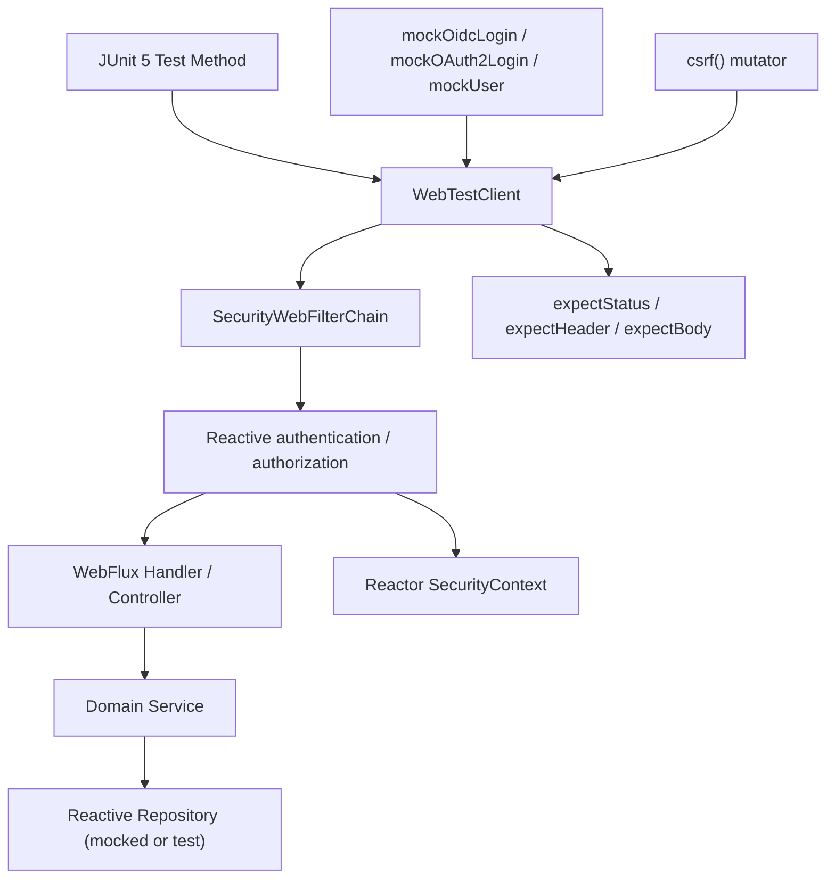

# 30.1. Setting Up spring-security-test and WebTestClient

## 1. The Problem: Testing an OAuth2/OIDC Client in a Spring WebFlux Application

When a **Spring Security OAuth 2.0/OIDC Client** application is built on **Spring WebFlux**, controllers typically return `Mono` or `Flux`, the security layer processes requests using `SecurityWebFilterChain`, and user information is maintained via the **Reactor Context**.

A simple controller:

```java
@RestController
class IdentityController {

    @GetMapping("/api/me")
    Mono<MeResponse> me(
            @AuthenticationPrincipal OidcUser user) {

        return Mono.just(new MeResponse(
            user.getSubject(),
            user.getIdToken().getClaimAsString("iss")));
    }

    record MeResponse(String subject, String issuer) {}
}
```

When testing this controller, we want to verify that:

1. The request goes through the WebFlux security configuration.
2. The authenticated request has the right `OidcUser`.
3. `@AuthenticationPrincipal` receives that principal.
4. The controller returns JSON matching the contract.
5. Unauthenticated requests are rejected or redirected according to the configured `AuthenticationEntryPoint`.
6. Authorization, CSRF, and HTTP errors are handled according to the security chain.

However, we **do not want** every test to have to start an OpenID Provider (OP), a browser, a consent step, an authorization code, a token exchange, and JWT signature verification. Spring Security provides the **`spring-security-test`** library and `WebTestClient` to test the appropriate layers without simulating the entire protocol.

Core example:

```java
client.mutateWith(
        SecurityMockServerConfigurers.mockOidcLogin()
            .idToken(token -> token.claim(
                "sub", "customer-user-42")))
    .get()
    .uri("/api/me")
    .exchange()
    .expectStatus().isOk()
    .expectBody()
    .jsonPath("$.subject").isEqualTo("customer-user-42");
```

**Rule of thumb:** the `mockOidcLogin()` test helper creates a **mocked authentication context** with the right principal type; it **does not prove** that a real OP issued a valid token, that `iss`/`aud`/`nonce`/signature were verified, or that an authorization code was exchanged for a token.

### 1.1. Learning Objectives

After this lesson, you will be able to:

1. Identify the required dependencies for Spring WebFlux, Spring Security OAuth2 Client, and reactive testing.
2. Create a basic `SecurityWebFilterChain` for your application/tests.
3. Distinguish between `WebTestClient` and `MockMvc`, and between `SecurityWebFilterChain` and `SecurityFilterChain`.
4. Set up `WebTestClient` from an `ApplicationContext` with `.apply(springSecurity())`.
5. Understand how `@WebFluxTest`, `@SpringBootTest`, and `@AutoConfigureWebTestClient` load the context.
6. Use `mockUser()`, `@WithMockUser`, `mockOAuth2Login()`, and `mockOidcLogin()` in the right scenarios.
7. Use `mockOAuth2Client()` to test authorized-client resolution.
8. Use `mockJwt()` and `mockOpaqueToken()` when testing Resource Server APIs.
9. Use `csrf()` for CSRF-protected POST/PUT/DELETE requests.
10. Understand `ReactiveSecurityContextHolder` and why it does not rely on `ThreadLocal` like Servlet.
11. Write `WebTestClient` assertions for response status, headers, JSON, and errors.
12. Troubleshoot missing beans in `@WebFluxTest`, unimported security chains, and wrong principal types in tests.
13. Know the limitations of mocked `WebTestClient` compared to real HTTP tests over a server.
14. Build a test matrix for authentication, authorization, principal claims, and CSRF.
15. Keep fixtures and logs free of real tokens/client secrets.

## 2. Placing Components Correctly in the WebFlux Ecosystem

A reactive application has many components that look similar to Servlet ones, but they are not interchangeable:

| Role | Servlet | Spring WebFlux |
| --- | --- | --- |
| HTTP security configuration | `HttpSecurity` | `ServerHttpSecurity` |
| Filter chain | `SecurityFilterChain` | `SecurityWebFilterChain` |
| Security context | Typically uses `SecurityContextHolder` on a thread | Uses `ReactiveSecurityContextHolder` in Reactor Context |
| User HTTP request | `HttpServletRequest` | `ServerWebExchange` |
| Client registration lookup | `ClientRegistrationRepository` | `ReactiveClientRegistrationRepository` |
| Authorized-client manager | `OAuth2AuthorizedClientManager` | `ReactiveOAuth2AuthorizedClientManager` |
| Authorized-client repository | `OAuth2AuthorizedClientRepository` | `ServerOAuth2AuthorizedClientRepository` |
| Test HTTP client | `MockMvc` | `WebTestClient` |
| Login test helper | `oidcLogin()` / `oauth2Login()` | `mockOidcLogin()` / `mockOAuth2Login()` |
| Test JWT Bearer | `jwt()` | `mockJwt()` |
| Setup Security Test | `springSecurity()` for MockMvc | `springSecurity()` for WebTestClient, **different package** |

**Important:** having the same helper name `springSecurity()` does not mean using the same class. The reactive import is:

```java
import static org.springframework.security.test.web.reactive.server
    .SecurityMockServerConfigurers.springSecurity;
```

In real Java source files, you can put the entire `import static ...springSecurity;` on one line; line breaks in this document are purely for readability.

### 2.1. Do Not Confuse the Two Clients

- `WebTestClient`: Spring Framework's HTTP **test client**, used to send requests to controllers/routers and assert responses.
- `WebClient`: Spring WebFlux's HTTP **runtime client**, used to call the OP/token endpoint or downstream APIs.

A Spring Security OAuth2 Client app may use **both**. Do not assume `WebTestClient` automatically handles the OAuth2 Authorization Code flow just because its name includes "Client".

### 2.2. Testing Layer Model



Depending on your test setup, `WebTestClient` can invoke the application **in-process without an HTTP socket**, or call a **real running server**. This is an important distinction when using test mutators.

## 3. Gradle Dependencies

Example for a Spring Boot WebFlux application using OAuth2/OIDC Login:

```gradle
plugins {
    id 'java'
    id 'org.springframework.boot' version '<project-version>'
    id 'io.spring.dependency-management' version '<compatible-version>'
}

dependencies {
    implementation 'org.springframework.boot:spring-boot-starter-webflux'
    implementation 'org.springframework.boot:spring-boot-starter-security'
    implementation 'org.springframework.boot:spring-boot-starter-oauth2-client'

    testImplementation 'org.springframework.boot:spring-boot-starter-test'
    testImplementation 'org.springframework.security:spring-security-test'
    testImplementation 'io.projectreactor:reactor-test'
}

tasks.named('test') {
    useJUnitPlatform()
}
```

`<project-version>` and `<compatible-version>` are **placeholders**, not literal buildable version strings. In practice, use your project's Spring Boot BOM/plugin versions; do not pin a separate `spring-security-test` version that diverges from the runtime Spring Security version.

**Version note:** Spring Boot 4 reorganizes several test starters/modules and packages compared to Spring Boot 3. For Boot 4 projects, check the recommended test starter modules (e.g., dedicated WebFlux test starters) and the actual packages of `@WebFluxTest` and `@AutoConfigureWebTestClient`. The Java API examples focus on Spring Security Test and Spring Framework, while Boot test annotation imports should match the BOM you are using.

### 3.1. Role of Each Dependency

| Dependency | Purpose |
| --- | --- |
| `spring-boot-starter-webflux` | Spring WebFlux, Reactor Netty, and WebFlux infrastructure |
| `spring-boot-starter-security` | Core Spring Security and WebFlux security integration |
| `spring-boot-starter-oauth2-client` | OAuth2 Login, OIDC Client, and authorized-client support |
| `spring-boot-starter-test` or Boot version-specific test starters | JUnit, assertions, Spring Test, mocking support |
| `spring-security-test` | Security test integrations and `SecurityMockServerConfigurers` |
| `reactor-test` | `StepVerifier`, `TestPublisher`, virtual time for reactive services |
| `spring-boot-starter-oauth2-resource-server` | Only needed if the app also accepts bearer tokens as an API Resource Server |

### 3.2. No Real OP Needed for Every Test

With `mockOidcLogin()` or `mockOAuth2Login()`:

- No production client secret is needed.
- No browser needs to go through the OP.
- No real Discovery Metadata call is needed.
- No ID Token with a real signature needs to be issued.
- No real Token Endpoint or UserInfo Endpoint is needed.
- Controller/HTTP authorization logic can be tested quickly.

Conversely, when verifying **issuer/audience/signature/PKCE/redirect_uri/token exchange**, these test helpers are **insufficient**. You need a test OP, token decoder tests, and a dedicated integration suite.

## 4. Equivalent Maven Dependencies

If the project uses Maven:

```xml
<dependencies>
    <dependency>
        <groupId>org.springframework.boot</groupId>
        <artifactId>spring-boot-starter-webflux</artifactId>
    </dependency>
    <dependency>
        <groupId>org.springframework.boot</groupId>
        <artifactId>spring-boot-starter-security</artifactId>
    </dependency>
    <dependency>
        <groupId>org.springframework.boot</groupId>
        <artifactId>spring-boot-starter-oauth2-client</artifactId>
    </dependency>
    <dependency>
        <groupId>org.springframework.boot</groupId>
        <artifactId>spring-boot-starter-test</artifactId>
        <scope>test</scope>
    </dependency>
    <dependency>
        <groupId>org.springframework.security</groupId>
        <artifactId>spring-security-test</artifactId>
        <scope>test</scope>
    </dependency>
    <dependency>
        <groupId>io.projectreactor</groupId>
        <artifactId>reactor-test</artifactId>
        <scope>test</scope>
    </dependency>
</dependencies>
```

Versions should be managed consistently via the Spring Boot parent/BOM. For Boot 4, check the appropriate modular test dependencies in that version's documentation.

You do not need both Gradle and Maven; the two examples merely show how to declare the dependencies.

## 5. `SecurityWebFilterChain` for a WebFlux Application

Before testing, you need to know how the real application protects routes.

```java
@Configuration
@EnableWebFluxSecurity
public class ReactiveSecurityConfiguration {

    @Bean
    SecurityWebFilterChain securityWebFilterChain(
            ServerHttpSecurity http) {

        return http
            .authorizeExchange(exchanges -> exchanges
                .pathMatchers("/", "/assets/**").permitAll()
                .pathMatchers("/api/admin/**")
                    .hasAuthority("SCOPE_admin")
                .anyExchange().authenticated())
            .oauth2Login(Customizer.withDefaults())
            .oauth2Client(Customizer.withDefaults())
            .build();
    }
}
```

Typical imports:

```java
import org.springframework.context.annotation.Bean;
import org.springframework.context.annotation.Configuration;
import org.springframework.security.config.annotation.method.configuration.EnableReactiveMethodSecurity;
import org.springframework.security.config.annotation.web.reactive.EnableWebFluxSecurity;
import org.springframework.security.config.web.server.ServerHttpSecurity;
import org.springframework.security.web.server.SecurityWebFilterChain;
import org.springframework.security.config.Customizer;
```

`@EnableReactiveMethodSecurity` is **not required** for `.authorizeExchange(...)`; add it only when the application uses annotations such as `@PreAuthorize` on reactive methods/services.

### 5.1. Note When Enabling OAuth2 Login in Tests

When `.oauth2Login(...)` is enabled, the security infrastructure usually needs a `ReactiveClientRegistrationRepository` with a valid `ClientRegistration`. If `@WebFluxTest` loads only the controller without the repository, the test context may fail to start.

A controller slice test that **does not test the login protocol** can use a minimal test `SecurityWebFilterChain` with `httpBasic()` to verify principal injection/authentication. Tests that need to prove the real OIDC Login configuration should import the production security config or provide a test `ReactiveClientRegistrationRepository`.

Do not remove security filters altogether and claim the test verified access controls.

## 6. What Binding Modes Does `WebTestClient` Have?

`WebTestClient` can be built in several ways:

| Creation method | Target | Real socket/server? | When to use |
| --- | --- | --- | --- |
| `bindToController(...)` | Specified controllers | No | Simple WebFlux controller tests; security setup is not automatically complete |
| `bindToRouterFunction(...)` | Functional `RouterFunction` | No | Testing functional endpoints |
| `bindToApplicationContext(context)` | WebFlux `ApplicationContext` | No | Security/controller integration with real filters in context |
| `bindToServer()` | Running HTTP server | Yes | Testing network/cookies/proxy/browser-facing behavior |
| `@WebFluxTest` autowired client | MVC-less WebFlux slice | No | Fast controller tests with test security config |
| `@SpringBootTest(MOCK)` + `@AutoConfigureWebTestClient` | Full app context, mock exchange | No | Testing multi-bean wiring without opening a port |
| `@SpringBootTest(RANDOM_PORT)` + client | Real embedded server | Yes | HTTP integration on a random port |

`@SpringBootTest(MOCK)` is shorthand for `webEnvironment = SpringBootTest.WebEnvironment.MOCK`.

**Key boundary:** `SecurityMockServerConfigurers` place mock authentication into the **mocked `ServerWebExchange` of an in-process `WebTestClient`**. By default, they do not work over the **HTTP network** against a real server on `RANDOM_PORT`: a test mutator does not automatically convert a mock `SecurityContext` into valid headers/cookies for the server on the other end to authenticate.

### 6.1. Choosing Setup Based on Goal

If you need to test:

```text
@AuthenticationPrincipal OidcUser
Response JSON
URL authorization rules
CSRF
```

→ typically choose **`@WebFluxTest` + `WebTestClient` bound to application context**.

If you need:

```text
Production SecurityWebFilterChain
Multiple controllers/services
Reactive repositories
Oauth2Client registrations wiring
```

→ **`@SpringBootTest` + `@AutoConfigureWebTestClient`**, choosing mock exchange if networking is unnecessary.

If you need:

```text
Real bearer authorization headers
Real browser redirect URL
Cookies/HTTP/TLS/proxy behavior
Authorization Code callback or test OP
```

→ **server-bound integration/E2E** with a server/test OP, without relying on `mockOidcLogin()` as protocol proof.

## 7. Manually Setting Up `WebTestClient` with `springSecurity()`

This is the foundation of the lesson.

```java
import org.junit.jupiter.api.BeforeEach;
import org.springframework.beans.factory.annotation.Autowired;
import org.springframework.context.ApplicationContext;
import org.springframework.test.web.reactive.server.WebTestClient;

import static org.springframework.security.test.web.reactive.server
    .SecurityMockServerConfigurers.springSecurity;

class ReactiveSecurityTests {

    @Autowired
    ApplicationContext context;

    WebTestClient client;

    @BeforeEach
    void setUp() {
        client = WebTestClient
            .bindToApplicationContext(context)
            .apply(springSecurity())
            .configureClient()
            .build();
    }
}
```

This is a **skeleton**; the test class needs a Spring context annotation such as `@SpringBootTest`, `@WebFluxTest`, or `@ContextConfiguration`, and the context must contain an appropriate `SecurityWebFilterChain`.

The key call:

```java
.apply(springSecurity())
```

integrates Spring Security Test support into `WebTestClient`. After that, you can use mutators such as:

```java
client.mutateWith(mockUser())
client.mutateWith(mockOidcLogin())
client.mutateWith(mockOAuth2Login())
client.mutateWith(mockJwt())
client.mutateWith(csrf())
```

### 7.1. Where Do `configureClient()` and `build()` Fit?

The chain:

```java
WebTestClient.bindToApplicationContext(context)
    .apply(springSecurity())
    .configureClient()
    .build();
```

reflects Spring Framework's builder workflow. After `.apply(...)`, `.configureClient()` lets you customize `WebTestClient` HTTP client options (response timeout, base URL, filters, etc.) before `.build()`.

Do not replace it with:

```java
WebTestClient.bindToServer()
    .apply(springSecurity());
```

because the server-bound builder does not share the same mocked `ServerWebExchange` mechanism used by in-process WebFlux integration.

### 7.2. Why Must You Use the Context?

`bindToApplicationContext(...)` routes requests through the WebFlux infrastructure and filters loaded in the context, including `SecurityWebFilterChain` if configured.

If you only use:

```java
WebTestClient.bindToController(new IdentityController())
    .build();
```

the controller can run without the proper security filter chain, producing misleading results for anonymous requests or access controls.

You can configure `bindToController` with custom `WebFilter` instances and argument resolvers when needed, but it does not automatically become a security integration test simply because `WebTestClient` is used.

## 8. `@WebFluxTest`: Fast Controller Slice Tests

`@WebFluxTest` loads only WebFlux MVC-like infrastructure and the relevant controllers/advice/formatters. It usually auto-configures `WebTestClient` and does not start an HTTP server.

Example controller:

```java
@RestController
class GreetingController {

    @GetMapping("/api/greeting")
    Mono<Map<String, String>> greeting(
            @AuthenticationPrincipal OidcUser user) {

        return Mono.just(Map.of(
            "message", "hello",
            "subject", user.getSubject()));
    }
}
```

### 8.1. A Standalone Illustrative Test Class

```java
@WebFluxTest(GreetingController.class)
@Import(GreetingControllerTest.TestSecurity.class)
class GreetingControllerTest {

    @Autowired
    ApplicationContext context;

    WebTestClient client;

    @BeforeEach
    void setUp() {
        client = WebTestClient
            .bindToApplicationContext(context)
            .apply(springSecurity())
            .configureClient()
            .build();
    }

    @TestConfiguration
    @EnableWebFluxSecurity
    static class TestSecurity {

        @Bean
        SecurityWebFilterChain chain(ServerHttpSecurity http) {
            return http
                .authorizeExchange(exchanges -> exchanges
                    .pathMatchers("/api/greeting")
                        .authenticated()
                    .anyExchange().permitAll())
                .httpBasic(Customizer.withDefaults())
                .build();
        }
    }

    @Test
    void authenticatedOidcUserCanReadGreeting() {
        client
            .mutateWith(mockOidcLogin()
                .idToken(token -> token
                    .claim("sub", "user-21")))
            .get()
            .uri("/api/greeting")
            .exchange()
            .expectStatus().isOk()
            .expectBody()
            .jsonPath("$.message").isEqualTo("hello")
            .jsonPath("$.subject").isEqualTo("user-21");
    }
}
```

To compile, add the JUnit 5, Spring Boot test annotation, Spring WebFlux, Spring Security imports, and static imports for `mockOidcLogin()`/`springSecurity()`. The package paths for `@WebFluxTest` and `@TestConfiguration` vary by Spring Boot version; choose them according to your BOM.

### 8.2. Why Does the Test-Only Chain Use `httpBasic()`?

Because this test only checks that:

- The reactive `SecurityContext` has the right `OidcUser`.
- `@AuthenticationPrincipal` works.
- The controller returns JSON.
- Unauthenticated requests are blocked by the security filter.

It **does not** test Authorization Code Login. `httpBasic` can serve as a simple **test-only entry point** returning `401` instead of a login redirect.

If you want to test the **production OAuth2 Login `SecurityWebFilterChain`**, do not replace it with this test chain; instead, import the real configuration and supply an appropriate fake/test `ReactiveClientRegistrationRepository`.

### 8.3. Does `@WebFluxTest` Automatically Import a Custom `SecurityWebFilterChain`?

Do not assume so. Spring Boot docs note that `@WebFluxTest` may **not automatically detect** your application's custom `@Bean SecurityWebFilterChain`; you should explicitly import the configuration with `@Import(...)` or use `@SpringBootTest`.

If the production chain is missing, the test might:

- Run with an unexpected default security config.
- Lack method security.
- Lack OAuth2/OIDC client registration beans.
- Return `401`/`403`/`302` differently from production.
- Not apply custom URL rules.

### 8.4. Mocking Collaborators with `@MockitoBean`

If a controller calls a service:

```java
@RestController
class ReportController {

    private final ReportService service;

    ReportController(ReportService service) {
        this.service = service;
    }

    @GetMapping("/api/reports/{id}")
    Mono<ReportDto> report(
            @PathVariable String id,
            @AuthenticationPrincipal OidcUser user) {

        return service.findForUser(
            id, user.getSubject());
    }
}
```

In an MVC/WebFlux slice, you can use:

```java
@MockitoBean
ReportService service;
```

and:

```java
when(service.findForUser("r-1", "alice"))
    .thenReturn(Mono.just(new ReportDto("r-1", "ok")));
```

`@MockitoBean` is part of Spring Framework TestContext bean override support (Spring Framework 6.2+). On older Spring Boot versions, `@MockBean` may be used according to the corresponding API.

Do not mock the entire `SecurityWebFilterChain` into an empty object; the security filter chain is what must actually execute when testing authorization.

## 9. `@SpringBootTest` and `@AutoConfigureWebTestClient`

A broader setup:

```java
@SpringBootTest(
    webEnvironment = SpringBootTest.WebEnvironment.MOCK)
@AutoConfigureWebTestClient
class FullContextReactiveSecurityTest {

    @Autowired
    ApplicationContext context;

    WebTestClient client;

    @BeforeEach
    void setup() {
        client = WebTestClient
            .bindToApplicationContext(context)
            .apply(springSecurity())
            .configureClient()
            .build();
    }

    @Test
    void endpointRequiresAuthentication() {
        client.get()
            .uri("/api/secured")
            .exchange()
            .expectStatus().isUnauthorized();
    }
}
```

**Assumption:** the test context's security chain uses an authentication entry point that returns `401` for `/api/secured`. If the app uses OAuth2 Login for browsers, an unauthenticated request may return `302` to the login page instead of `401`. Tests must assert the **app's contract**, not guess a default.

### 9.1. What Else Does the Full Context Load?

- Application configurations and beans.
- Production-style `SecurityWebFilterChain` if not overridden.
- Reactive service/repository beans.
- OAuth2/OIDC registration and authorized-client infrastructure.
- External clients/connection factories initialized by the application.

The downside is that the test may require a database/Testcontainers, OP configuration, or fake servers. Therefore, you should not use a full context for every simple DTO mapping test.

### 9.2. Testing Against a Real HTTP Server

```java
@SpringBootTest(
    webEnvironment = SpringBootTest.WebEnvironment.RANDOM_PORT)
@AutoConfigureWebTestClient
class RealHttpSmokeTest {

    @Autowired
    WebTestClient client;

    @Test
    void publicHealthPageIsReachable() {
        client.get()
            .uri("/public/health")
            .exchange()
            .expectStatus().isOk();
    }
}
```

In `RANDOM_PORT` mode, the client calls a real server. **Do not combine a test mutator that fakes identity and assume the real server received an OIDC login**. Testing a protected endpoint over real HTTP requires credentials accepted by the server, or an appropriate test OP/JWT setup.

### 9.3. If Both Spring MVC and WebFlux Are on the Classpath

Spring Boot usually prefers Servlet MVC when both `spring-webmvc` and `spring-webflux` are present. To test a reactive application in that case, you can set:

```java
@SpringBootTest(
    properties = "spring.main.web-application-type=reactive")
```

This does not mean every application using `WebClient` is a **reactive web server**. A Servlet app using `WebClient` is still a Servlet app; in that case, `MockMvc` is usually appropriate for controller tests.

## 10. Using `mockUser()` and `@WithMockUser`

For controllers that only need a principal name or generic roles, without OIDC attributes:

```java
@RestController
class MessageController {

    @GetMapping("/api/message")
    Mono<String> message(Principal principal) {
        return Mono.just("Hello " + principal.getName());
    }
}
```

Test:

```java
@Test
void mockUserProvidesPrincipalName() {
    client.mutateWith(mockUser("bob"))
        .get()
        .uri("/api/message")
        .exchange()
        .expectStatus().isOk()
        .expectBody(String.class)
        .isEqualTo("Hello bob");
}
```

`mockUser()` sets up an `Authentication` with a synthetic `UserDetails` principal. You can customize it:

```java
client.mutateWith(
        mockUser("bob").roles("ADMIN"))
    .get().uri("/api/admin")
    .exchange()
    .expectStatus().isOk();
```

A `200` result is only valid if the endpoint, service, and security chain allow that role.

### 10.1. The `@WithMockUser` Annotation

Spring Security Test also supports:

```java
@Test
@WithMockUser(username = "bob", roles = "ADMIN")
void mockAdminCanReadEndpoint() {
    client.get()
        .uri("/api/admin")
        .exchange()
        .expectStatus().isOk();
}
```

**Preconditions:** the test class integrates Spring TestContext/Spring Security Test, `WebTestClient` Security support is set up, and the security chain matches.

### 10.2. When Is `@WithMockUser` Not Enough?

If a controller requires:

```java
@AuthenticationPrincipal OidcUser user
```

then `@WithMockUser` **does not automatically create an `OidcUser`**. The Spring MVC/WebFlux argument resolver may return `null` for a mismatched principal type, or throw an error if `errorOnInvalidType=true`.

For OIDC Login, choose **`mockOidcLogin()`**. For a generic `OAuth2User`, choose **`mockOAuth2Login()`**.

## 11. Using `mockOidcLogin()` for an OIDC Principal

Reactive test helper:

```java
import static org.springframework.security.test.web.reactive.server
    .SecurityMockServerConfigurers.mockOidcLogin;
```

Default test:

```java
client.mutateWith(mockOidcLogin())
    .get()
    .uri("/api/me")
    .exchange()
    .expectStatus().isOk();
```

Spring Security creates a simple `OidcUser` containing a synthetic ID Token, UserInfo, and authorities. The default principal has a sample `sub`; therefore, when testing business logic, **explicitly set the claims that the controller actually uses**.

### 11.1. Custom ID Token Claims

```java
@Test
void readsSubjectAndIssuerFromOidcUser() {
    client
        .mutateWith(mockOidcLogin()
            .idToken(token -> token
                .claim("sub", "acme-user-9")
                .claim("iss",
                    "https://idp.example.test/realms/acme")
                .claim("aud", List.of("portal-web"))
                .claim("email", "user9@example.test")))
        .get()
        .uri("/api/me")
        .exchange()
        .expectStatus().isOk()
        .expectBody()
        .jsonPath("$.subject").isEqualTo("acme-user-9")
        .jsonPath("$.issuer").isEqualTo(
            "https://idp.example.test/realms/acme");
}
```

Domain values and claims here are **synthetic data**. You do not need production ID Tokens to test controllers.

### 11.2. Custom Authorities

```java
client
    .mutateWith(mockOidcLogin()
        .authorities(
            new SimpleGrantedAuthority(
                "SCOPE_reports.read")))
    .get()
    .uri("/api/reports")
    .exchange()
    .expectStatus().isOk();
```

This test assumes the security rule accepts that authority. **Do not assume** `scope=reports.read` on the OP will always map to `SCOPE_reports.read` in OIDC Login; that behavior must be verified in the corresponding user authorities mapper/client integration.

### 11.3. Complete Custom `OidcUser`

When a controller uses `getName()`, `UserInfo`, custom claims mapping, or complex authorities:

```java
OidcIdToken idToken =
    OidcIdToken.withTokenValue("FAKE_ID_TOKEN")
        .claim("iss", "https://idp.example.test")
        .claim("sub", "subject-7")
        .claim("preferred_username", "alice")
        .build();

OidcUser oidcUser = new DefaultOidcUser(
    List.of(new SimpleGrantedAuthority("ROLE_USER")),
    idToken,
    "preferred_username");

client
    .mutateWith(mockOidcLogin()
        .oidcUser(oidcUser))
    .get()
    .uri("/api/me")
    .exchange()
    .expectStatus().isOk();
```

Here `getName()` can use `preferred_username` instead of `sub`, while `getSubject()` remains `sub`.

`FAKE_ID_TOKEN` is not a signed JWT. The test helper intentionally bypasses the real protocol to test the controller.

### 11.4. UserInfo Claims

You can use `mockOidcLogin().userInfo(...)` according to your Spring Security Test version's builder/consumer API to add `email`, `locale`, `picture`, or custom attributes to UserInfo. Do not assume every claim appears in the ID Token.

Also test cases with **missing email or UserInfo** if the business logic can encounter them. Do not use email by default as a unique identifier key; a safe OIDC identity typically derives from `(issuer, subject)`.

### 11.5. Reactive Context and `@AuthenticationPrincipal`

`mockOidcLogin()` sets an `OAuth2AuthenticationToken` with an `OidcUser` principal in the test **`ServerWebExchange`** security context. Spring Security makes that principal available to `@AuthenticationPrincipal`.

Do not manually call:

```java
SecurityContextHolder.setContext(...)
```

in WebFlux controller tests. Reactive security uses the Reactor Context and has a different lifecycle from Servlet's `ThreadLocal`.

## 12. Using `mockOAuth2Login()` for a Non-OIDC `OAuth2User`

For OAuth2 Login with a provider that does not supply an ID Token, a controller may receive:

```java
@RestController
class OAuthProfileController {

    @GetMapping("/api/provider-name")
    Mono<String> name(
            @AuthenticationPrincipal OAuth2User user) {

        return Mono.just(user.getName());
    }
}
```

Test:

```java
client
    .mutateWith(mockOAuth2Login()
        .attributes(attributes -> {
            attributes.put("sub", "provider-user-17");
            attributes.put("name", "Alice");
        }))
    .get()
    .uri("/api/provider-name")
    .exchange()
    .expectStatus().isOk();
```

**Understand the name attribute key:** `OAuth2User.getName()` depends on `DefaultOAuth2User`/provider mapping and is not necessarily `name`, `email`, or `sub`. If a test needs to assert `getName()` precisely, choose a fixture/client registration/custom `OAuth2User` with the same name attribute as production.

### 12.1. Differences Between OIDC and OAuth2 User

| What to test | Suitable helper |
| --- | --- |
| Controller needs `OidcUser.getIdToken()` | `mockOidcLogin()` |
| Controller reads OIDC `sub`, `iss`, `email` | `mockOidcLogin().idToken(...)` or `.oidcUser(...)` |
| Controller needs `OAuth2User.getAttributes()` | `mockOAuth2Login()` |
| Controller only needs generic username | `mockUser()` |
| Controller needs bearer `Jwt` principal | `mockJwt()` |
| Controller needs opaque bearer authentication | `mockOpaqueToken()` |

`OidcUser` is a subtype of `OAuth2User`, but you should not replace an OIDC fixture with a non-OIDC `OAuth2User` and assume an ID Token is present.

## 13. `mockOAuth2Client()` and `@RegisteredOAuth2AuthorizedClient`

Some endpoints need to use a stored OAuth2 **access token**:

```java
@RestController
class TokenMetadataController {

    @GetMapping("/api/client/scopes")
    Mono<Set<String>> scopes(
        @RegisteredOAuth2AuthorizedClient("reports")
        OAuth2AuthorizedClient authorizedClient) {

        return Mono.just(
            authorizedClient.getAccessToken().getScopes());
    }
}
```

Here:

- `@AuthenticationPrincipal` returns the identity.
- `@RegisteredOAuth2AuthorizedClient` resolves the authorized client by registration/principal/repository.
- `OAuth2AuthorizedClient.getAccessToken()` is the access token for calling APIs, **not the ID Token**.

You can test:

```java
client
    .mutateWith(mockOidcLogin())
    .mutateWith(
        mockOAuth2Client("reports")
            .accessToken(token -> token
                .scopes("reports.read")))
    .get()
    .uri("/api/client/scopes")
    .exchange()
    .expectStatus().isOk()
    .expectBody()
    .jsonPath("$").isArray();
```

`mockOAuth2Client("reports")` creates a synthetic authorized client in a **mock `ServerOAuth2AuthorizedClientRepository`**. It does not perform a real `client_credentials`, Authorization Code, or refresh-token grant.

**API note:** configuring `accessToken(...).scopes(...)` must match the API of your Spring Security Test version. When you do not need custom scopes, just use `.mutateWith(mockOAuth2Client("reports"))` and assert a simple contract.

### 13.1. Avoiding the Mistake "Every OAuth2 Client Has a User"

A `client_credentials` registration usually represents a workload/service, without an end-user browser `OidcUser`. When testing a backend manager:

- Choose the right grant type.
- Choose a stable principal name for the service.
- Test token cache/lifecycle separately.
- Do not use `mockOidcLogin()` as proof that a machine-to-machine grant worked.

### 13.2. Outbound `WebClient` Is Not Tested by `mockOAuth2Client`

A controller with a faked authorized client does not prove the backend **sent the right access token to the right API**.

For outbound `WebClient`, test with a fake downstream HTTP server or a test `ExchangeFunction`, asserting:

- The `Authorization` header contains an **access token**, not an ID Token.
- The URL is an approved API host.
- Tenant/registration/resource audience matches policy.
- Tokens are not sent to arbitrary URIs.
- Retry/refresh/error handling works properly.
- Tokens are not logged.

## 14. `mockJwt()` and `mockOpaqueToken()` for Resource Server

An application may support both OIDC Login for browsers and bearer access tokens for APIs:

```java
@GetMapping("/api/token-subject")
Mono<String> subject(
        @AuthenticationPrincipal Jwt jwt) {

    return Mono.just(jwt.getSubject());
}
```

Test:

```java
client
    .mutateWith(mockJwt()
        .jwt(jwt -> jwt
            .claim("sub", "api-user-3")
            .claim("aud", List.of("reports-api"))
            .claim("scope", "reports.read"))
        .authorities(
            new SimpleGrantedAuthority(
                "SCOPE_reports.read")))
    .get()
    .uri("/api/token-subject")
    .exchange()
    .expectStatus().isOk()
    .expectBody(String.class)
    .isEqualTo("api-user-3");
```

`mockJwt()` sets up JWT-based authentication for the **mock request**; it does not send a signed JWT over the network and does not verify the JWT signature, issuer, audience, or timestamps.

For an opaque token:

```java
client
    .mutateWith(mockOpaqueToken()
        .attributes(attributes ->
            attributes.put("sub", "opaque-user-4")))
    .get()
    .uri("/api/opaque-subject")
    .exchange();
```

The controller must actually handle `BearerTokenAuthentication`/the appropriate principal. Do not confuse `OidcUser` with `Jwt` or an opaque principal just because all three have `sub`.

### 14.1. JWT Controller Tests Differ from JWT Decoder Integration Tests

If you want to prove the API rejects:

```text
wrong signature
wrong issuer
wrong audience
expired token
invalid token type
```

then **do not** use `mockJwt()` to claim validation, because the helper bypasses the real decoder.

You need an integration test of `ReactiveJwtDecoder` with signed test JWTs/JWKS or real test security infrastructure, asserting `401 invalid_token`/authorization failure per API policy.

## 15. Using `mockAuthentication()` for Custom Principals

Not every principal is an `OidcUser`. An application might construct a domain principal:

```java
record PortalPrincipal(
    String issuer,
    String subject,
    String tenantId) {}
```

If you want to test the security chain/controller with a custom `Authentication`:

```java
PortalPrincipal principal = new PortalPrincipal(
    "https://idp.example.test",
    "subject-1",
    "acme");

Authentication authentication =
    new UsernamePasswordAuthenticationToken(
        principal,
        "N/A",
        List.of(
            new SimpleGrantedAuthority("ROLE_USER")));

client
    .mutateWith(mockAuthentication(authentication))
    .get()
    .uri("/api/domain-me")
    .exchange()
    .expectStatus().isOk();
```

This is a fixture; using `UsernamePasswordAuthenticationToken` in a test does not mean production uses username/password login. If a custom `Authentication` class has special semantics, construct that exact class.

Using `mockAuthentication(...)` helps test code that expects an `Authentication.getPrincipal()` outside the standard helper types.

## 16. Configuring CSRF for `WebTestClient`

CSRF protection generally applies to **state-changing** requests relying on browser cookies/sessions:

- `POST`
- `PUT`
- `PATCH`
- `DELETE`

If the app uses WebFlux OAuth2 Login and session cookies, CSRF should normally remain enabled per policy.

Spring Security Test provides the reactive mutator:

```java
import static org.springframework.security.test.web.reactive.server
    .SecurityMockServerConfigurers.csrf;
```

### 16.1. Valid POST with CSRF

Suppose the controller is:

```java
@PostMapping("/api/preferences")
Mono<ResponseEntity<Void>> save(
        @AuthenticationPrincipal OidcUser user,
        @RequestBody Preferences preferences) {

    return service.save(user.getSubject(), preferences)
        .thenReturn(ResponseEntity.noContent().build());
}
```

Test:

```java
client
    .mutateWith(mockOidcLogin()
        .idToken(t -> t.claim("sub", "user-42")))
    .mutateWith(csrf())
    .post()
    .uri("/api/preferences")
    .contentType(MediaType.APPLICATION_JSON)
    .bodyValue(Map.of("theme", "dark"))
    .exchange()
    .expectStatus().isNoContent();
```

Service dependencies must be provided/mocked to return `Mono.empty()` or an appropriate result.

### 16.2. Missing CSRF Token

```java
client
    .mutateWith(mockOidcLogin())
    .post()
    .uri("/api/preferences")
    .bodyValue(Map.of("theme", "dark"))
    .exchange()
    .expectStatus().isForbidden();
```

Expecting `403` here is **only valid** when CSRF protection is enabled in the security chain, the route is not on the CSRF ignore list, and the request is a state-changing request requiring a token under policy.

### 16.3. Distinguishing CSRF from OIDC `state`

| Mechanism | When used? | Purpose |
| --- | --- | --- |
| CSRF token | POST/PUT/DELETE in browser-session apps | Prevent cross-site state-changing requests |
| OAuth2 `state` | Authorization request/callback | Correlate login response with request |
| PKCE | Authorization Code flow | Protect code exchange |
| OIDC `nonce` | OIDC authorization/ID Token | Bind authentication request and ID Token |
| Logout state | Optional RP-Initiated Logout callback | Correlate logout request and redirect |

Adding `.mutateWith(csrf())` to a controller POST test **does not test OAuth2 login `state`/`nonce`/PKCE**.

## 17. `WebTestClient` Assertions: Status, Headers, JSON, and Body

`WebTestClient` offers a DSL suited to reactive HTTP tests.

### 17.1. Status Code

```java
client.get().uri("/public/ping")
    .exchange()
    .expectStatus().isOk();
```

```java
client.get().uri("/api/private")
    .exchange()
    .expectStatus().isUnauthorized();
```

```java
client.mutateWith(mockUser("alice"))
    .get().uri("/api/admin")
    .exchange()
    .expectStatus().isForbidden();
```

**Do not rigidly assume** unauthenticated is always `401`: if the security chain enables `oauth2Login`, a browser request may redirect `302` to the login page.

### 17.2. Headers, Content Type, Body

```java
client.mutateWith(mockOidcLogin())
    .get()
    .uri("/api/me")
    .accept(MediaType.APPLICATION_JSON)
    .exchange()
    .expectStatus().isOk()
    .expectHeader()
        .contentTypeCompatibleWith(MediaType.APPLICATION_JSON)
    .expectBody()
        .jsonPath("$.subject").isEqualTo("user");
```

When checking redirects:

```java
client.get()
    .uri("/api/private")
    .exchange()
    .expectStatus().is3xxRedirection()
    .expectHeader().exists("Location");
```

If you need to inspect the URI, parse `Location` and check **scheme, host, path, registration ID, and decoded `redirect_uri`**; do not log full URLs containing `state`, code, or tokens.

### 17.3. Multi-Element Responses

For a controller returning `Flux<ReportDto>` as a JSON array:

```java
client.mutateWith(mockOidcLogin())
    .get().uri("/api/reports")
    .exchange()
    .expectStatus().isOk()
    .expectBody()
    .jsonPath("$[0].id").isEqualTo("r-1")
    .jsonPath("$[1].id").isEqualTo("r-2");
```

Test data/service fixtures must emit in order if the API contract guarantees ordering. Do not assert order when a stream has concurrency and business requirements do not specify ordering.

### 17.4. SSE/Streaming

For an infinite `Flux` or Server-Sent Events, do not use `expectBody()` in a way that waits for the entire response if the stream never completes. You can use:

```java
client.get().uri("/api/events")
    .exchange()
    .expectStatus().isOk()
    .returnResult(String.class)
    .getResponseBody();
```

Then use `StepVerifier` with an appropriate cancel/timeout condition or `take(n)`. `StepVerifier` is a Reactor tool; do not confuse it with `WebTestClient`'s HTTP status assertions.

## 18. Differences Between `StepVerifier` and `WebTestClient`

| Tool | Test target | Strengths |
| --- | --- | --- |
| `StepVerifier` | `Publisher` (`Mono`/`Flux`) | Assert emissions, completion, errors, cancellation, virtual time |
| `WebTestClient` | Reactive HTTP request/response | Test routing, filters, headers, status, JSON, `SecurityContext` |
| `MockWebServer`/WireMock | Outbound HTTP interactions | Test `WebClient` calls to API/OP, headers/body/retries |
| Testcontainers/OP sandbox | Real infrastructure | Integration testing of DB/IdP/API within scope |
| Browser E2E | End-user flow | Cookies, redirects, SSO UX, proxy |

Example service unit test with `StepVerifier`:

```java
@Test
void reportServiceEmitsOneRecord() {
    Mono<ReportDto> result =
        reportService.findForUser("r-1", "user-42");

    StepVerifier.create(result)
        .assertNext(report ->
            assertEquals("r-1", report.id()))
        .verifyComplete();
}
```

Example HTTP contract for the same business behavior:

```java
client.mutateWith(mockOidcLogin()
        .idToken(t -> t.claim("sub", "user-42")))
    .get().uri("/api/reports/r-1")
    .exchange()
    .expectStatus().isOk()
    .expectBody()
    .jsonPath("$.id").isEqualTo("r-1");
```

A `WebTestClient` test **can** trigger Reactor processing, but it does not replace cases where you need to verify backpressure, retry timing, cancellation, or deep Reactor Context propagation inside services.

## 19. Reactor Context Instead of `ThreadLocal`

In Servlet, much code gets the user via:

```java
SecurityContextHolder.getContext()
    .getAuthentication();
```

In WebFlux, however:

- A request can switch across multiple threads.
- A Reactor chain does not bind identity to a fixed thread.
- Spring Security maintains the reactive `SecurityContext` via **Reactor Context**.
- Prefer injecting the principal/authentication into controllers or using `ReactiveSecurityContextHolder` inside reactive operators.

Service example:

```java
Mono<String> currentSubject() {
    return ReactiveSecurityContextHolder
        .getContext()
        .map(SecurityContext::getAuthentication)
        .map(Authentication::getPrincipal)
        .cast(OidcUser.class)
        .map(OidcUser::getSubject);
}
```

This example applies when a service genuinely needs to read `SecurityContext`. In domain design, it is usually better to pass the **verified subject/issuer** as method parameters rather than having deep service layers silently read global context.

### 19.1. A Test for Reactive Context

```java
@Test
void securityContextIsAvailableInReactiveController() {
    client
        .mutateWith(mockOidcLogin()
            .idToken(t -> t.claim("sub", "reactive-user")))
        .get()
        .uri("/api/context-subject")
        .exchange()
        .expectStatus().isOk()
        .expectBody(String.class)
        .isEqualTo("reactive-user");
}
```

Corresponding test controller:

```java
@GetMapping("/api/context-subject")
Mono<String> contextSubject() {
    return ReactiveSecurityContextHolder.getContext()
        .map(SecurityContext::getAuthentication)
        .map(Authentication::getPrincipal)
        .cast(OidcUser.class)
        .map(OidcUser::getSubject);
}
```

If the test does not properly apply `springSecurity()`, or uses a wrong mock authentication type, the `Publisher` may complete empty or fail with a cast error instead of emitting the subject.

### 19.2. Do Not `.block()` in a WebFlux Handler

Wrong in application code:

```java
String subject = currentSubject().block();
```

inside a WebFlux event-loop handler. It risks blocking the event loop and breaks the reactive context model.

Better:

```java
@GetMapping("/api/context-subject")
Mono<String> contextSubject() {
    return currentSubject();
}
```

In **tests**, `WebTestClient`/`StepVerifier` handle synchronous waiting for assertions, but that is no reason to put `.block()` into production handlers/services.

## 20. Testing Authentication and Authorization Separately

Authenticated does not mean authorized.

Suppose the security rules are:

```java
return http
    .authorizeExchange(exchanges -> exchanges
        .pathMatchers("/api/reports/admin/**")
            .hasAuthority("SCOPE_reports.admin")
        .pathMatchers("/api/reports/**")
            .hasAuthority("SCOPE_reports.read")
        .anyExchange().authenticated())
    .build();
```

Test read authority:

```java
client.mutateWith(
        mockOidcLogin().authorities(
            new SimpleGrantedAuthority("SCOPE_reports.read")))
    .get().uri("/api/reports/r-1")
    .exchange()
    .expectStatus().isOk();
```

Test missing admin authority:

```java
client.mutateWith(
        mockOidcLogin().authorities(
            new SimpleGrantedAuthority("SCOPE_reports.read")))
    .get().uri("/api/reports/admin/r-1")
    .exchange()
    .expectStatus().isForbidden();
```

Test admin authority:

```java
client.mutateWith(
        mockOidcLogin().authorities(
            new SimpleGrantedAuthority("SCOPE_reports.admin")))
    .get().uri("/api/reports/admin/r-1")
    .exchange()
    .expectStatus().isOk();
```

These assertions are only valid when the routes/controllers exist in the test context and the security rules under test are actually loaded.

### 20.1. Method Security Is Another Layer

`@PreAuthorize` on a reactive service/method requires enabling:

```java
@EnableReactiveMethodSecurity
```

and the test must load the necessary proxy/configuration. A `@WebFluxTest` that does not import method security may **not enforce** this annotation.

Separate the layers:

1. HTTP request authentication.
2. URL path authorization via `authorizeExchange`.
3. Reactive method authorization via `@PreAuthorize`/method interceptors.
4. Domain authorization by tenant/owner/entitlements.
5. Downstream Resource Server authorization.

Do not just test `.authenticated()` and assume tenant membership has been checked.

## 21. Multi-Tenant/OIDC Claims: Checking Issuer and Subject

In multi-tenant SaaS:

```text
Tenant A:
  issuer = https://sso.example.test/realms/acme
  sub    = user-17

Tenant B:
  issuer = https://sso.example.test/realms/beta
  sub    = user-17
```

Two identical `sub` values **do not guarantee the same user**. The identity key should include `(issuer, subject)` or equivalent.

Controller test:

```java
client.mutateWith(mockOidcLogin()
        .idToken(t -> t
            .claim("iss",
                "https://sso.example.test/realms/acme")
            .claim("sub", "user-17")))
    .get()
    .uri("/api/tenants/acme/profile")
    .exchange()
    .expectStatus().isOk();
```

However, when the user accesses tenant Beta, a domain membership check is required, not just reading `sub`.

### 21.1. Mock Services at the Right Scope

In `@WebFluxTest`, you can mock:

```java
@MockitoBean
TenantAuthorization tenantAuthorization;
```

And:

```java
when(tenantAuthorization.canRead(
        "acme",
        "https://sso.example.test/realms/acme",
        "user-17"))
    .thenReturn(Mono.just(true));
```

This tests that the controller **calls the right service and handles the response**. It does not prove `TenantAuthorization`'s policy is secure; the service needs its own tests.

### 21.2. Do Not Treat `mockOidcLogin` as Issuer Verification

The test helper sets claims as requested; it does not verify that a real OP signed the ID Token or that the issuer was approved by a trusted `ClientRegistration`.

To test OIDC token validation, use integration tests with a test OP/JWKS or production-matching JWT validators; do not create a fake `OidcUser` and conclude "issuer spoofing is blocked."

## 22. Sources of Test Flakiness

Some tests pass in isolation but fail when run in the full suite:

- Sharing a mutable `WebTestClient` field across tests and mutating configuration without isolation.
- Putting `@WithMockUser` on the class while also using `.mutateWith(mockOidcLogin())` per request.
- Tests using an in-memory reactive repository with shared state that is not cleaned up.
- Unexpected reuse of session/`WebSession` cookies.
- Mocks retaining unreset stubbing/interactions.
- Server tests running on a random port while test mutators only affect mock exchanges.
- `@SpringBootTest` loading real IdP discovery and depending on the network.
- Test fixtures using real-time token expiry without controlling the clock.
- Non-deterministic `Flux` data order paired with assertions expecting a fixed order.
- `@WebFluxTest` missing the security chain import, causing behavior to differ from the full context.
- Reactive publishers not subscribed to, or tests finishing before verification.

### 22.1. Keeping Fixtures Independent

Each test should use:

```java
WebTestClient requestClient =
    baseClient.mutateWith(
        mockOidcLogin().idToken(t -> t
            .claim("sub", "user-for-this-test")));
```

and then use `requestClient` in the method, rather than overwriting a static `WebTestClient` carrying global authentication.

Similarly, create dedicated synthetic JWTs/claims/tenant IDs for tests, avoiding real tokens or customer data.

### 22.2. Timeouts and Streaming

For reactive streams or network integration, use bounded timeouts rather than calling `.verify()` indefinitely on non-completing `Publisher`s. `StepVerifier` supports `verify(Duration)` and virtual time as appropriate.

Do not use arbitrary `Thread.sleep(...)` calls to "wait for Reactor to run"; it makes tests slow, flaky, and proves nothing about ordering.

## 23. Layer-Organized Test Project Structure

Example:

```text
src/main/java/
  example/portal/
    PortalApplication.java
    security/ReactiveSecurityConfiguration.java
    web/IdentityController.java
    web/ReportController.java
    service/ReportService.java

src/test/java/
  example/portal/
    web/IdentityControllerWebFluxTest.java
    web/ReportControllerAuthorizationTest.java
    security/ReactiveSecurityFilterChainTest.java
    security/OidcLoginFlowIntegrationTest.java
    client/ReportsWebClientTest.java
    resource/JwtAudienceValidationTest.java

src/test/resources/
  application-test.yml
```

| Test | Test tool | Primary scope |
| --- | --- | --- |
| Identity controller | `@WebFluxTest` + `WebTestClient` | Principal injection/JSON |
| Report controller | `WebTestClient` + mocked service | HTTP authz/domain service interaction |
| Security chain | `@SpringBootTest` mock exchange | Production WebFlux filter chains |
| OIDC Login flow | Test OP + real HTTP/JWT | Authorization Code, state, PKCE, issuer/audience |
| Outbound OAuth2 `WebClient` | MockWebServer/WireMock | Bearer header, target API, token handling |
| JWT Resource Server | Test `JwtDecoder`/JWKS | Signature, issuer, audience, expiry |
| Reactive service | `StepVerifier` | Publisher/error/cancellation/retry |

You do not need to turn a test into a full E2E suite just to assert one JSON field. Conversely, never use a WebFlux slice with a fake principal to claim OAuth2 protocol integration is secure.

## 24. Initial Test Matrix

| ID | Case | Tool/setup | Expected outcome |
| --- | --- | --- | --- |
| T01 | GET public endpoint | `WebTestClient` | `200` |
| T02 | GET protected anonymous | `WebTestClient` + real security chain | `401`/`302` per entry point |
| T03 | Generic authenticated user | `mockUser()` | Authenticated request |
| T04 | User with role ADMIN | `mockUser().roles("ADMIN")` | Route authorized per policy |
| T05 | User missing role | `mockUser().roles("USER")` | `403` |
| T06 | Method annotation username | `@WithMockUser` | Correct generic principal |
| T07 | OIDC principal | `mockOidcLogin()` | Injects `OidcUser` |
| T08 | OIDC custom sub | `mockOidcLogin().idToken(...)` | Correct JSON subject |
| T09 | OIDC issuer/tenant claim | `mockOidcLogin().idToken(...)` | Mapper/DTO receives expected claim |
| T10 | OIDC missing optional email | Custom OIDC user/ID Token fixture | Nullable contract holds |
| T11 | OIDC custom authority | `.authorities(...)` | Scope/role policy enforced |
| T12 | Non-OIDC OAuth2 User | `mockOAuth2Login()` | Injects `OAuth2User` |
| T13 | Wrong principal type | `mockUser()` for `OidcUser` param | Does not silently accept fake OIDC user |
| T14 | Authorized client registration | `mockOAuth2Client("reports")` | Resolver gets expected authorized client |
| T15 | Controller JWT principal | `mockJwt()` | Injects `Jwt` |
| T16 | Controller opaque token | `mockOpaqueToken()` | Injects opaque principal/authentication |
| T17 | POST authenticated + CSRF | `mockOidcLogin()` + `csrf()` | 2xx per handler |
| T18 | POST authenticated, missing CSRF | Without `csrf()` | `403` if CSRF enabled |
| T19 | Reactive `SecurityContext` | OIDC mock + controller reads Reactor Context | Reads expected subject |
| T20 | WebFlux slice missing collaborator | `@WebFluxTest` | Context failure until properly mocked/imported |
| T21 | Production security chain | Full-context test | Actual URL rules |
| T22 | Reactive method security | Import `@EnableReactiveMethodSecurity` | Annotation authorization works |
| T23 | Wrong tenant membership | Mock service denial + separate service test | No cross-tenant data leak |
| T24 | Real HTTP server | `RANDOM_PORT` + real credential | Does not rely on mock exchange |
| T25 | Wrong ID Token signature | OIDC integration/real validator | Authentication rejected |
| T26 | Wrong API JWT audience | JWT decoder integration | API rejects |
| T27 | Token refresh behavior | Reactive authorized-client manager test | Correct refresh/expiry |
| T28 | Real OP callback wrong state | Test OP + authorization request store | Callback rejected |
| T29 | Multi-pod/state cookie behavior | Integration/E2E | Session/correlation not lost |
| T30 | Security logging | Sanitization observability test | No tokens/secrets in logs |

Choose the cases that match **each endpoint's contract**, rather than trying to maximize the number of test methods.

## 25. Troubleshooting: `WebTestClient` Does Not Behave as Expected

### 25.1. `NoSuchBeanDefinitionException: ReactiveClientRegistrationRepository`

Common cause: the test enables `.oauth2Login()` but the context lacks an appropriate OAuth2 client registration, or `@WebFluxTest` does not load the application's registration configuration.

How to handle:

- If testing only controller principal handling: use a minimal test security chain and create a mock OIDC principal.
- If testing the production `OAuth2Login` configuration: import the necessary configuration and provide an approved test `ReactiveClientRegistrationRepository`.
- Do not use production issuers/secrets in tests.
- Do not remove security filters to "solve" a missing bean.

### 25.2. `mockOidcLogin()` Used, but Controller Still Receives `null`

Check:

1. Did you call `.apply(springSecurity())` when manually creating `WebTestClient`?
2. Is the test actually **WebFlux**, or is Spring MVC taking precedence?
3. Does the controller parameter have `@AuthenticationPrincipal OidcUser`?
4. Is the test using the reactive helper from `SecurityMockServerConfigurers`?
5. Is another test annotation overriding authentication?
6. Does the controller/API use a custom `Authentication`/principal converter?
7. Is the test running in-process or calling a real server over HTTP?
8. Is `SecurityWebFilterChain` loaded?

Do not fix this by calling `SecurityContextHolder.setContext(...)` inside a reactive handler.

### 25.3. `@WebFluxTest` Returns 401/403 Differently from Production

The production `SecurityWebFilterChain` may not be in the slice, or the test chain uses `httpBasic()` so anonymous requests return `401` instead of a `302` OIDC login redirect.

How to handle: clarify the **test goal**:

- Controller-only: assert against the test chain, and keep separate tests for the production chain.
- Security configuration: import the real chain or use a full context; assert the actual entry point.

### 25.4. CSRF POST Returns 403

If an authenticated OIDC mock is present yet POST still returns 403, check CSRF:

```java
client.mutateWith(mockOidcLogin())
    .mutateWith(csrf())
    .post()...
```

Do not disable CSRF app-wide just to make a test pass. Distinguish business POST endpoints from the OIDC login callback; each has its own protocol/security policy.

### 25.5. JWT Audience Test Passes with `mockJwt()` Even Though Production Fails

`mockJwt()` does not verify the JWT signature/issuer/audience through a real decoder. If you want to test audience validation, use real decoders/validators in a separate test.

### 25.6. `.mutateWith(mockOidcLogin())` Has No Effect Over `RANDOM_PORT`

The test is using a server-bound client. A mock configurer cannot pass a Java `SecurityContext` directly over HTTP to a real server. You need real requests with credentials/cookies or a test IdP/JWT setup.

### 25.7. Controller Returns an Empty Body

If a controller returns `Mono.empty()`, `WebTestClient` may observe `200` with no body if the code has not specified `404`/a business response. Check the reactive chain, mock service return values, and expected HTTP contract.

Do not use `Mono.just(null)`: Reactor forbids emitting `null`; use `Mono.empty()` or return an explicit error/DTO.

### 25.8. Controller Test Passes, but `@PreAuthorize` Is Not Enforced

Method security may not be enabled or proxies may not be loaded in the slice. You need `@EnableReactiveMethodSecurity` and a test context containing the appropriate service/controller proxies.

### 25.9. `WebTestClient` Deadlocks or Times Out

Production code may be calling `.block()` on the event loop, using a blocking JDBC client without switching schedulers, leaving a `Publisher` waiting indefinitely, or missing timeout configuration.

Inspect the Reactor chain, `StepVerifier`, logs, and fake external services instead of raising timeouts indefinitely.

### 25.10. Multiple `SecurityWebFilterChain`s

If the app has separate chains for `/api/**` and browser `/web/**`, tests must target the right paths and ensure matchers/ordering match production. A mocked OIDC principal will not force a request through a different chain if it matched the wrong one.

## 26. Anti-Patterns to Avoid

### 26.1. Bringing `MockMvc` Helpers to WebFlux

Wrong:

```java
webTestClient.mutateWith(oidcLogin());
```

`oidcLogin()` is a Servlet `MockMvc` request postprocessor, not a `WebTestClient` reactive configurer.

Right:

```java
webTestClient.mutateWith(mockOidcLogin());
```

### 26.2. Not Applying Spring Security to a Manually Created `WebTestClient`

If you use `bindToApplicationContext(context)` and forget `.apply(springSecurity())`, test mutators/security contexts may not work as expected.

### 26.3. Using `@WithMockUser` for a Controller Requiring `OidcUser`

This easily yields the wrong Java principal type, missing the ID Token and claims. Choose `mockOidcLogin()` instead.

### 26.4. Using `mockOidcLogin()` as Proof That the OP Authenticated the User

The helper involves no real authorization code, TLS, JWKS, token exchange, or signature verification.

### 26.5. Enabling OAuth2 Login in a Slice Without `ClientRegistrationRepository`

You must provide a test repository or scope the controller test properly with a minimal chain.

### 26.6. Disabling WebFlux Security Filters to Get `200`

Without security filters running, tests prove nothing about URL permissions, CSRF, or principal injection.

### 26.7. Adding `.block()` to a Controller to Make Test Assertions Easier

WebFlux endpoints should return a `Publisher`; tests use `WebTestClient`/`StepVerifier` to wait and assert.

### 26.8. Creating a Shared Static Authenticated `WebTestClient` Field

This risks leaking identity between tests. `mutateWith` should be applied per request/individual test.

### 26.9. Using `mockJwt()` for OIDC Login

Resource Server JWT authentication is not the same as browser OIDC Login `OidcUser`.

### 26.10. Using `mockOAuth2Client()` to Test Real Refresh Token Grants

The helper provides an authorized-client fixture; it does not run the Token Endpoint or token lifecycle.

### 26.11. Mocking the Entire Authorization Service and Concluding Tenant Isolation Is Safe

Controller tests only verify wiring and calls; the policy/entitlement service needs its own tests.

### 26.12. Skipping CSRF Tests Because All Requests Are Authenticated

Authentication and CSRF mitigate different risks in browser-session applications.

### 26.13. Trying to Attach a Mock `SecurityContext` to a Real Server via Mutators

`mutateWith` for a mock exchange is not an OAuth2 authorization grant or a network JWT bearer token.

### 26.14. Ignoring the Default `ClientRegistration` in Mock OIDC Tests

If a controller requires a registration ID/authorized-client store, the fixture must bind it properly. Do not assume a principal with `sub` selected the right issuer/client registration.

### 26.15. Logging `OidcUser`, Bearer Tokens, or Full Redirect URLs in Tests

This can expose tokens/PII. Use fake data and log sanitized metrics.

## 27. Hands-On Exercises

### Exercise 1 — Basic WebFlux Controller

Create the endpoint:

```text
GET /api/me
```

returning only:

```json
{
  "subject": "user-42",
  "issuer": "https://idp.example.test/realms/acme"
}
```

Requirements:

- `@WebFluxTest` loads the controller.
- Import a test `SecurityWebFilterChain`.
- Build `WebTestClient` bound to `ApplicationContext` + `.apply(springSecurity())`.
- Use `mockOidcLogin()` with custom `sub` and `iss`.
- Assert HTTP 200 and exact JSON.
- Do not return the raw ID Token.

### Exercise 2 — Protected Endpoint and Anonymous Requests

Create:

```text
GET /api/protected
```

Choose `httpBasic()` as the test entry point. Write tests:

```text
anonymous -> 401
mockUser -> 200
```

Then switch the security config to OIDC Login and observe how anonymous requests may redirect differently. Explain why the expected status changes.

### Exercise 3 — Authority Matrix

Create:

```text
GET /api/reports
GET /api/reports/admin
```

Rules:

```text
/api/reports           -> SCOPE_reports.read
/api/reports/admin     -> SCOPE_reports.admin
```

Use `mockOidcLogin().authorities(...)` to verify 200/403 per policy.

### Exercise 4 — CSRF

Create:

```text
POST /api/preferences
```

Write two tests:

```text
OIDC user + csrf() -> 204
OIDC user without csrf() -> 403
```

Keep the service mock non-blocking (`Mono.empty()`/`Mono.just(...)`).

### Exercise 5 — Non-OIDC OAuth2 User

Create the controller:

```java
@GetMapping("/api/oauth2-name")
Mono<String> name(
        @AuthenticationPrincipal OAuth2User user) {
    return Mono.just(user.getName());
}
```

Test with `mockOAuth2Login()` using a fixture with a valid name attribute. Try substituting `mockUser()`/`mockOidcLogin()` and explain the Java type differences.

### Exercise 6 — JWT Resource Server

Create the endpoint:

```text
GET /api/jwt-subject
```

accepting `@AuthenticationPrincipal Jwt`.

- Test the controller with `mockJwt()`.
- Write a separate decoder/integration test verifying that a JWT with wrong `aud`/`iss` is rejected.
- Explain why a `mockJwt()` test is not sufficient for the validator.

### Exercise 7 — Multi-Tenant

Use `mockOidcLogin()` to create two principals:

```text
Acme issuer + sub=user-1
Beta issuer + sub=user-1
```

The controller calls `TenantAuthorization` with `(tenantId, issuer, subject)`. Assert:

- Acme user accessing Acme: allow.
- Acme user accessing Beta without membership: deny.
- Matching `sub` alone does not mean the same identity.

### Exercise 8 — Replacing a Test Slice with HTTP Integration

Run the application on a random port with a test identity provider. Do not use `mockOidcLogin()` as a credential sent over the network. Verify cookies/sessions, redirects, callbacks, real token validation, and the authorized-client lifecycle at the appropriate integration level.

## 28. Review Questions

**1. What is `spring-security-test`?**

A library providing test helpers/annotations/configurers to set up an authentication context and test Spring Security without running the entire protocol with a real provider.

**2. What is `WebTestClient` used for?**

Sending test requests to WebFlux handlers/apps/servers and asserting the HTTP response, status, headers, and body.

**3. Should WebFlux controller tests use `MockMvc` or `WebTestClient`?**

Typically `WebTestClient`. `MockMvc` is for Servlet MVC.

**4. What do you call to attach Spring Security support to a manually created `WebTestClient`?**

`.apply(SecurityMockServerConfigurers.springSecurity())` on the builder bound to the application context.

**5. Does `bindToApplicationContext` start an HTTP server?**

No. It uses a mock exchange in the same process.

**6. Does `bindToServer` accept `mockOidcLogin()` as a real login?**

Not automatically. The mutator creates context for a mock exchange; a real HTTP server needs credentials that the server authenticates.

**7. What is `@WebFluxTest` used for?**

Loading a WebFlux controller slice and auto-configuring `WebTestClient` for fast tests.

**8. Does `@WebFluxTest` automatically import the app's custom `SecurityWebFilterChain`?**

Do not assume so; you typically need `@Import` or `@SpringBootTest` when you want the real chain.

**9. When is `@AutoConfigureWebTestClient` used?**

To auto-configure `WebTestClient` in an appropriate Spring Boot test context, especially full-context WebFlux tests.

**10. Why can `@WebFluxTest` fail with a missing `ReactiveClientRegistrationRepository`?**

The slice does not load the full OAuth2 Login infrastructure/config, while the chain enables `.oauth2Login()`.

**11. What kind of principal does `mockUser()` create?**

A generic authenticated user fixture for tests, which does not include an OIDC ID Token by default.

**12. When do you use `mockOidcLogin()`?**

When a controller/handler needs an `OidcUser` and OIDC claims in an in-process reactive test.

**13. When do you use `mockOAuth2Login()`?**

When a controller needs an `OAuth2User` that does not necessarily have an OIDC ID Token.

**14. Is `@WithMockUser` sufficient for `@AuthenticationPrincipal OidcUser`?**

No. A `UserDetails` principal does not automatically become an OIDC principal.

**15. Does `mockOidcLogin()` verify the ID Token signature?**

No. It creates an OIDC authentication fixture.

**16. What is `mockOidcLogin().idToken(...)` used for?**

Customizing OIDC ID Token test claims, such as `sub`, `iss`, and `email`.

**17. Why should email not be used as the identity key in all tests?**

Email can be missing, change, or not be globally unique; `(issuer, sub)` is better suited for OIDC identity.

**18. Does `mockOAuth2Client()` call the Token Endpoint?**

No. It creates an authorized-client fixture in a mock repository.

**19. How does `@RegisteredOAuth2AuthorizedClient` differ from `@AuthenticationPrincipal`?**

One retrieves the authorized client containing tokens; the other retrieves the user principal from authentication.

**20. When do you use `mockJwt()`?**

When a controller or authorization rule needs JWT Resource Server authentication in a mock exchange.

**21. Does `mockJwt()` verify the real access token audience?**

No. A separate JWT decoder/integration test is required.

**22. Does WebFlux use a Servlet-style `SecurityContextHolder` or the Reactor Context?**

Primarily `ReactiveSecurityContextHolder`/Reactor Context.

**23. Why should you not call `.block()` in a WebFlux handler?**

It can block the event loop, cause deadlocks/timeouts, and break the reactive execution model.

**24. When a POST returns 403 despite `mockOidcLogin()`, what should you check?**

CSRF protection and `.mutateWith(csrf())`, then check URL authorization rules.

**25. Does a CSRF token replace OAuth2 `state`?**

No. CSRF protects state-changing browser requests; OAuth2 `state` correlates the authorization request/response.

**26. Why can an anonymous request return `302` instead of `401`?**

The `oauth2Login()` authentication entry point can redirect the browser to the login page/OP.

**27. Why might a method security test pass falsely when using only `@WebFluxTest`?**

Method security config/proxies may not be loaded; you need `@EnableReactiveMethodSecurity` enabled and tests at the appropriate layer.

**28. When is `StepVerifier` used?**

When you need to verify emissions/errors/cancellation/timing of a `Publisher`, not just HTTP responses.

**29. Why should you not use a shared authenticated `WebTestClient` across all tests?**

It can leak identity between tests and make fixtures unclear.

**30. When do you need a test OP sandbox instead of `mockOidcLogin()`?**

When you want to verify Authorization Code, redirect URI, state, PKCE, ID Token signature/issuer/audience/nonce, or the refresh/logout lifecycle.

## 29. WebFlux + Spring Security Test Initialization Checklist

- [ ] The project is a WebFlux server, not Servlet MVC using `WebClient`.
- [ ] `spring-security-test` is in test dependencies.
- [ ] Dependency versions are managed consistently via the Spring Boot BOM.
- [ ] `@WebFluxTest` or `@SpringBootTest` is chosen with the right scope.
- [ ] `WebTestClient` is bound to the right context if using a mock exchange.
- [ ] Custom builder includes `.apply(springSecurity())`.
- [ ] The expected `SecurityWebFilterChain` is actually loaded.
- [ ] If OAuth2 Login is enabled, the necessary registration/test repository is present.
- [ ] The right helper is chosen: `mockUser`, `mockOAuth2Login`, `mockOidcLogin`, `mockJwt`, `mockOAuth2Client`.
- [ ] Controller principal type matches the fixture.
- [ ] Anonymous and authenticated requests are tested separately.
- [ ] Authorities/authorization are tested, not only authentication.
- [ ] POST/PUT/DELETE have CSRF tests if CSRF is enabled.
- [ ] Test fixtures use fake claims/tokens, with no customer PII/real secrets.
- [ ] `.block()` is not called in production handlers.
- [ ] If testing `@PreAuthorize`, method security is enabled.
- [ ] If testing Resource Server JWT validation, separate decoder integration tests exist.
- [ ] If testing the OIDC protocol, a test OP/JWKS/real HTTP interaction is used.
- [ ] Mock mutators are not assumed to work over `RANDOM_PORT`.
- [ ] Logs/metrics do not contain ID/access/refresh tokens or authorization codes.
- [ ] Test runs are independent, without relying on shared mutable `Authentication` state.

## 30. References

- [Spring Security Reference — Testing, Reactive](https://docs.spring.io/spring-security/reference/reactive/test/index.html)
- [Spring Security Reference — WebTestClient Security Setup](https://docs.spring.io/spring-security/reference/reactive/test/web/setup.html)
- [Spring Security Reference — Testing Authentication, Reactive](https://docs.spring.io/spring-security/reference/reactive/test/web/authentication.html)
- [Spring Security Reference — Testing OAuth2/OIDC/JWT, Reactive](https://docs.spring.io/spring-security/reference/reactive/test/web/oauth2.html)
- [Spring Security Reference — Testing CSRF, Reactive](https://docs.spring.io/spring-security/reference/reactive/test/web/csrf.html)
- [Spring Security Reference — WebFlux Security](https://docs.spring.io/spring-security/reference/reactive/configuration/webflux.html)
- [Spring Security Reference — OAuth2 Login, Reactive](https://docs.spring.io/spring-security/reference/reactive/oauth2/login/index.html)
- [Spring Security Reference — OAuth2 Client, Reactive](https://docs.spring.io/spring-security/reference/reactive/oauth2/client/index.html)
- [Spring Security API — SecurityMockServerConfigurers](https://docs.spring.io/spring-security/reference/api/java/org/springframework/security/test/web/reactive/server/SecurityMockServerConfigurers.html)
- [Spring Framework Reference — WebTestClient](https://docs.spring.io/spring-framework/reference/testing/webtestclient.html)
- [Spring Boot Reference — Testing Spring Boot Applications](https://docs.spring.io/spring-boot/reference/testing/spring-boot-applications.html)
- [Project Reactor Reference — Testing with StepVerifier](https://projectreactor.io/docs/core/release/reference/testing.html)
- [OpenID Connect Core 1.0](https://openid.net/specs/openid-connect-core-1_0.html)
- [RFC 9700 — OAuth 2.0 Security Best Current Practice](https://www.rfc-editor.org/rfc/rfc9700)

**Key takeaway:** With Spring Security **Reactive**, use **`spring-security-test` + `WebTestClient`** and attach Security Test support with `.apply(springSecurity())` when manually binding an `ApplicationContext`. Choose the right mutator for the principal/controller: `mockUser()` for a generic user, `mockOidcLogin()` for `OidcUser`, `mockOAuth2Login()` for `OAuth2User`, `mockOAuth2Client()` for an authorized client, `mockJwt()`/`mockOpaqueToken()` for Resource Server, and `csrf()` for state-changing requests when needed. `@WebFluxTest` enables fast controller tests but requires importing the right security config; `@SpringBootTest` fits broader wiring. These mocks **do not replace testing the OAuth2/OIDC protocol, token signature/issuer/audience, authorized-client refresh, or real HTTP/browser flows**.
