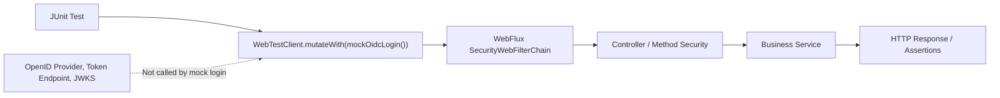

# 30.3. mockOidcLogin() with ID Token, UserInfo, and Authorities

## 1. Why Do We Need `mockOidcLogin()` When Testing Spring Security Reactive?

In a **Spring Security OAuth 2.0 / OpenID Connect (OIDC) Client** application built with **Spring WebFlux**, controllers and services typically read logged-in user information via `Authentication`, `@AuthenticationPrincipal OidcUser`, or the Reactive Security Context.

For example, an endpoint `/api/me` needs to return an employee's name, email, and department. Another endpoint only allows users with the `ROLE_MANAGER` authority. When testing these two endpoints, the goal is usually **not** to launch a browser, visit an OpenID Provider, perform the Authorization Code Flow, call the Token Endpoint, fetch JWKS, and verify the ID Token signature on every test.

Spring Security Test provides **`mockOidcLogin()`** to simulate an authenticated OIDC login session **within the `WebTestClient` context**. Tests can specify:

- **ID Token** contents: `sub`, `iss`, `aud`, `email`, `name`, tenant claims, etc.
- **UserInfo** contents: additional profile information such as `preferred_username`, `department`, `locale`, etc.
- **Granted authorities**: `ROLE_MANAGER`, `ROLE_ADMIN`, `SCOPE_employee.read`, or application-defined business permissions.
- A custom **`OidcUser`** when simulating a complex principal.
- The **`ClientRegistration`** associated with the mocked login when checking registration binding.

A short test example:

```java
client.mutateWith(mockOidcLogin()
                .idToken(token -> token
                        .claim("sub", "employee-4821")
                        .claim("email", "employee@example.test"))
                .userInfoToken(info -> info
                        .claim("department", "Engineering"))
                .authorities(
                        new SimpleGrantedAuthority("ROLE_MANAGER")))
        .get()
        .uri("/api/me")
        .exchange()
        .expectStatus().isOk();
```

Here, `mockOidcLogin()` **does not connect to a real OP and does not prove that an ID Token was validly signed**. It places a mocked, authenticated `Authentication` into the test environment so you can test **post-login logic**: principal mapping, authorization rules, how the controller reads claims, and API responses.

> **Core rule:** Use `mockOidcLogin()` to test **the application assuming a valid OIDC `Authentication` for the test**. To test Authorization Code, `state`/`nonce`, Token Endpoint, JWKS, JWS signature, or real OIDC ID Token validation, use integration tests with a mock/real test OpenID Provider and the corresponding security filters.

This lesson is part of chapter **30. Reactive Testing** in the **Spring Security OAuth 2.0 OIDC Client** module. It focuses on Java 17+, Spring Boot 3.x, Spring Security 6.x, and **WebFlux + WebTestClient**. Some overloads/behaviors may vary across Spring Security versions; standalone snippets are written with clear boundaries so they can be adapted to your actual BOM.

### Learning Objectives

After this lesson, you will be able to:

1. Explain the role of `mockOidcLogin()` in Spring Security Test Reactive.
2. Create a `WebTestClient` with `springSecurity()` and use `mutateWith(mockOidcLogin())` properly.
3. Customize ID Token claims with `idToken(...)` without manually creating real JWTs/JWKS.
4. Customize UserInfo with `userInfoToken(...)` and distinguish ID Token claims from UserInfo claims.
5. Use `authorities(...)` to test `hasRole`, `hasAuthority`, and 200/403 responses.
6. Read `OidcUser` via `@AuthenticationPrincipal` in WebFlux controllers.
7. Pass a custom `OidcUser` when testing `DefaultOidcUser`/name attributes.
8. Distinguish `mockOidcLogin()`, `mockOAuth2Login()`, `mockJwt()`, and `@WithMockUser`.
9. Design positive/negative tests while avoiding state leakage and false positives.
10. Understand the boundary between mocked login, authorized-client token stores, tenant authorization, and the real OIDC protocol.

---

## 2. Four Distinct Objects in an OIDC Login Session

When a user logs in with OIDC, distinguish the following components.

| Component | Meaning | How is it used in tests? |
| --- | --- | --- |
| **`OidcIdToken`** | ID Token with claims about the authentication event, issued by the OP in a real flow | Mock `sub`, `iss`, `aud`, `name`, `email`, and custom claims |
| **`OidcUserInfo`** | Claims returned by the OP's UserInfo Endpoint in a real flow | Mock profile/department/locale used by the application |
| **`OidcUser`** | Principal built by Spring Security OIDC Login after verification | Read profile, ID Token, and UserInfo in controllers/services |
| **`GrantedAuthority`** | Permission attached to `Authentication`/principal in Spring Security | Test `hasRole`, `hasAuthority`, `@PreAuthorize` |

A typical OIDC login session in Spring Security OAuth2 Client also involves `ClientRegistration` and `OAuth2AuthorizedClient`; however, they are not synonymous with the four objects above.

### 2.1. An ID Token Is Not an Access Token

- **ID Token** describes the user's authentication to the OIDC client.
- **Access Token** is used to call a Resource Server per scopes/audience.
- **Refresh Token** is used to obtain new tokens per OP policy.

If a controller only reads `OidcUser.getIdToken()`, you do not need a real access token to test the controller. If a service calls a downstream API with a bearer token from `OAuth2AuthorizedClient`, `mockOidcLogin()` **does not automatically prove** token exchange or authorized-client persistence is working.

### 2.2. UserInfo Is Not an Automatic "Privilege Escalation" Mechanism

A mocked claim:

```json
{
  "sub": "employee-4821",
  "department": "Engineering",
  "locale": "vi-VN"
}
```

can be read by a controller to display a profile. However, `department=Engineering` **does not automatically grant `ROLE_MANAGER`**. If your product maps claims to authorities, unit-test **that mapper** separately and test authorization with explicit authorities.

### 2.3. An Authority Is Not the Same as a Claim

| String | Kind | Meaning in Spring Security |
| --- | --- | --- |
| `email=employee@example.test` | Claim | Profile data; does not grant permissions by itself |
| `roles=["manager"]` | Custom claim | Only meaningful if processed by an application mapper |
| `ROLE_MANAGER` | `GrantedAuthority` | Matched by `hasRole("MANAGER")` with the default role prefix |
| `SCOPE_employee.read` | `GrantedAuthority` | Can be matched by `hasAuthority("SCOPE_employee.read")` |
| `employee:approve` | Custom `GrantedAuthority` | Can be matched by `hasAuthority("employee:approve")` |
| `OidcUserAuthority` | OIDC authority holding ID Token/UserInfo | Does not automatically mean `ROLE_ADMIN` |

**Do not assume** that modifying a `roles` claim with `idToken(...)` will make `hasRole(...)` succeed in a test. The test mutator primarily mocks the principal/`Authentication`; your application's authority mapping logic must be tested separately.

---

## 3. Which Toolkit Does `mockOidcLogin()` Belong To?

### 3.1. Required Dependencies

Gradle Kotlin DSL:

```kotlin
dependencies {
    implementation("org.springframework.boot:spring-boot-starter-webflux")
    implementation("org.springframework.boot:spring-boot-starter-security")
    implementation("org.springframework.boot:spring-boot-starter-oauth2-client")

    testImplementation("org.springframework.boot:spring-boot-starter-test")
    testImplementation("org.springframework.security:spring-security-test")
}
```

Maven:

```xml
<dependencies>
    <dependency>
        <groupId>org.springframework.boot</groupId>
        <artifactId>spring-boot-starter-webflux</artifactId>
    </dependency>
    <dependency>
        <groupId>org.springframework.boot</groupId>
        <artifactId>spring-boot-starter-security</artifactId>
    </dependency>
    <dependency>
        <groupId>org.springframework.boot</groupId>
        <artifactId>spring-boot-starter-oauth2-client</artifactId>
    </dependency>

    <dependency>
        <groupId>org.springframework.boot</groupId>
        <artifactId>spring-boot-starter-test</artifactId>
        <scope>test</scope>
    </dependency>
    <dependency>
        <groupId>org.springframework.security</groupId>
        <artifactId>spring-security-test</artifactId>
        <scope>test</scope>
    </dependency>
</dependencies>
```

`spring-security-test` provides the security testing utilities; WebFlux/`WebTestClient` requires the corresponding Reactive Web server stack. Use the Spring Boot BOM/dependency management to keep the test library at the same version as Spring Security runtime.

### 3.2. Important Static Imports

In **WebFlux + `WebTestClient`**, import:

```java
import static org.springframework.security.test.web.reactive.server
        .SecurityMockServerConfigurers.mockOidcLogin;

import static org.springframework.security.test.web.reactive.server
        .SecurityMockServerConfigurers.springSecurity;
```

These two imports are wrapped for readability; in Java, you can write them on one line:

```java
import static org.springframework.security.test.web.reactive.server.SecurityMockServerConfigurers.mockOidcLogin;
import static org.springframework.security.test.web.reactive.server.SecurityMockServerConfigurers.springSecurity;
```

**Do not confuse** with Servlet `MockMvc`:

```java
// Servlet/MockMvc — NOT a WebTestClient mutator:
import static org.springframework.security.test.web.servlet.request.SecurityMockMvcRequestPostProcessors.oidcLogin;
```

Both APIs aim to simulate OIDC login, but they are designed for two different test stacks.

### 3.3. Key Class Names

| API | Stack | Role |
| --- | --- | --- |
| `SecurityMockServerConfigurers.mockOidcLogin()` | Reactive WebFlux | Creates a test mutator for OIDC `Authentication` |
| `SecurityMockServerConfigurers.springSecurity()` | Reactive WebFlux | Applies Spring Security test integration to `WebTestClient` |
| `WebTestClient.mutateWith(...)` | WebFlux testing | Creates a client with additional test configuration |
| `SecurityMockMvcRequestPostProcessors.oidcLogin()` | Servlet `MockMvc` | Request post-processor for OIDC login |
| `SecurityMockServerConfigurers.mockOAuth2Login()` | Reactive | OAuth2 Login user that is not necessarily OIDC |
| `SecurityMockServerConfigurers.mockJwt()` | Reactive Resource Server | Simulates inbound Bearer JWT `Authentication` |
| `@WithMockUser` | Method/security tests | Username/password style principal, without OIDC claims by default |

### 3.4. Test Boundary: What Is Simulated?



The mutator provides the security principal/authorities for the **test request**. It does not trigger a full browser login redirect and does not use the OP's private signing key.

Therefore, `expectStatus().isOk()` with `mockOidcLogin()` proves the endpoint works when given the test's **mocked `Authentication`**; it **does not prove** the production application would accept an unsigned ID Token.

---

## 4. Setting Up an Illustrative WebFlux Environment

### 4.1. Application `SecurityWebFilterChain`

Consider a WebFlux app with these endpoints:

- `GET /api/me`: requires a logged-in user.
- `GET /api/managers`: requires `ROLE_MANAGER`.
- `GET /api/reports`: requires `SCOPE_employee.read`.
- `GET /public/ping`: public.

```java
package com.example.employee.security;

import org.springframework.context.annotation.Bean;
import org.springframework.context.annotation.Configuration;
import org.springframework.http.HttpStatus;
import org.springframework.security.config.Customizer;
import org.springframework.security.config.annotation.web.reactive.EnableWebFluxSecurity;
import org.springframework.security.config.web.server.ServerHttpSecurity;
import org.springframework.security.web.server.SecurityWebFilterChain;
import org.springframework.security.web.server.authentication.HttpStatusServerEntryPoint;

@Configuration
@EnableWebFluxSecurity
public class WebSecurityConfig {

    @Bean
    SecurityWebFilterChain securityWebFilterChain(ServerHttpSecurity http) {
        return http
                .authorizeExchange(exchanges -> exchanges
                        .pathMatchers("/public/**").permitAll()
                        .pathMatchers("/api/managers").hasRole("MANAGER")
                        .pathMatchers("/api/reports")
                            .hasAuthority("SCOPE_employee.read")
                        .pathMatchers("/api/**").authenticated()
                        .anyExchange().permitAll())
                .exceptionHandling(errors -> errors
                        .authenticationEntryPoint(
                                new HttpStatusServerEntryPoint(
                                        HttpStatus.UNAUTHORIZED)))
                .oauth2Login(Customizer.withDefaults())
                .build();
    }
}
```

**Note:** `oauth2Login()` requires a valid `ReactiveClientRegistrationRepository` in the application context, or the corresponding Spring Boot OAuth2 client registration configuration. Section 4.2 provides a synthetic registration in the test environment so the context can start **without contacting a real OP**.

`HttpStatusServerEntryPoint(UNAUTHORIZED)` is configured so anonymous API tests can expect HTTP 401 rather than being redirected to a login page. This is an explicit choice for the example; in a real browser web app, the entry point may redirect 302 and tests must reflect the real configuration.

### 4.2. Offline Test `ClientRegistration`

```java
package com.example.employee.security;

import org.springframework.boot.test.context.TestConfiguration;
import org.springframework.context.annotation.Bean;
import org.springframework.security.oauth2.client.registration.ClientRegistration;
import org.springframework.security.oauth2.client.registration.InMemoryReactiveClientRegistrationRepository;
import org.springframework.security.oauth2.client.registration.ReactiveClientRegistrationRepository;
import org.springframework.security.oauth2.core.AuthorizationGrantType;
import org.springframework.security.oauth2.core.ClientAuthenticationMethod;

@TestConfiguration
public class TestOidcRegistrations {

    @Bean
    ReactiveClientRegistrationRepository testClientRegistrations() {
        ClientRegistration corporate =
                ClientRegistration.withRegistrationId("corporate-oidc")
                        .clientId("employee-portal-test")
                        .clientSecret("synthetic-test-secret")
                        .clientAuthenticationMethod(
                                ClientAuthenticationMethod.CLIENT_SECRET_BASIC)
                        .authorizationGrantType(
                                AuthorizationGrantType.AUTHORIZATION_CODE)
                        .redirectUri(
                                "{baseUrl}/login/oauth2/code/{registrationId}")
                        .authorizationUri(
                                "https://issuer.example.test/oauth2/authorize")
                        .tokenUri("https://issuer.example.test/oauth2/token")
                        .jwkSetUri(
                                "https://issuer.example.test/.well-known/jwks.json")
                        .issuerUri("https://issuer.example.test")
                        .userInfoUri("https://issuer.example.test/userinfo")
                        .userNameAttributeName("sub")
                        .scope("openid", "profile", "email")
                        .build();

        return new InMemoryReactiveClientRegistrationRepository(corporate);
    }
}
```

Here we intentionally **configure endpoints explicitly** instead of using `issuer-uri` to trigger discovery at startup. The `example.test` URLs are test fixtures, not a real OP.

If the application already has a `ReactiveClientRegistrationRepository` in the test context, **do not register a second bean of the same type** unintentionally. Depending on the Spring Boot version, `@MockBean`/`@MockitoBean` or a test profile may be used, keeping configuration consistent so tests focus on the logic under test.

### 4.3. Controller Reading ID Token and UserInfo

```java
package com.example.employee.web;

import java.util.LinkedHashMap;
import java.util.Map;

import org.springframework.security.core.annotation.AuthenticationPrincipal;
import org.springframework.security.oauth2.core.oidc.user.OidcUser;
import org.springframework.web.bind.annotation.GetMapping;
import org.springframework.web.bind.annotation.RestController;

import reactor.core.publisher.Mono;

@RestController
public class EmployeeProfileController {

    @GetMapping("/public/ping")
    public Mono<String> ping() {
        return Mono.just("pong");
    }

    @GetMapping("/api/me")
    public Mono<Map<String, String>> me(
            @AuthenticationPrincipal OidcUser oidcUser) {

        Map<String, String> response = new LinkedHashMap<>();

        response.put("subject",
                oidcUser.getIdToken().getSubject());

        response.put("issuer",
                oidcUser.getIdToken().getClaimAsString("iss"));

        response.put("name",
                oidcUser.getIdToken().getClaimAsString("name"));

        if (oidcUser.getUserInfo() != null) {
            response.put("department",
                    oidcUser.getUserInfo().getClaimAsString("department"));
            response.put("locale",
                    oidcUser.getUserInfo().getClaimAsString("locale"));
        }

        return Mono.just(response);
    }

    @GetMapping("/api/managers")
    public Mono<String> managers() {
        return Mono.just("manager-visible");
    }

    @GetMapping("/api/reports")
    public Mono<String> reports() {
        return Mono.just("report-visible");
    }
}
```

`@AuthenticationPrincipal OidcUser` is where `mockOidcLogin()` shines. The endpoint does not need to parse a JWT or fetch UserInfo itself: Spring Security provides the mocked `OidcUser` for the test request.

In production, the controller must receive an `OidcUser` **from the OIDC authentication pipeline**, never constructing a user from a self-decoded JWT JSON.

---

## 5. Creating a `WebTestClient` Integrated with Spring Security

### 5.1. Using `springSecurity()` with `ApplicationContext`

A common pattern:

```java
import org.junit.jupiter.api.BeforeEach;
import org.springframework.beans.factory.annotation.Autowired;
import org.springframework.context.ApplicationContext;
import org.springframework.test.web.reactive.server.WebTestClient;

import static org.springframework.security.test.web.reactive.server.SecurityMockServerConfigurers.springSecurity;

class EmployeeSecurityTest {

    @Autowired
    ApplicationContext applicationContext;

    WebTestClient client;

    @BeforeEach
    void setUp() {
        client = WebTestClient
                .bindToApplicationContext(applicationContext)
                .apply(springSecurity())
                .configureClient()
                .build();
    }
}
```

This is a fragment of a test class that already has the Spring Test/JUnit extension or an appropriate `@SpringBootTest`/`@Import`. It cannot run standalone without annotations that initialize the test context.

**`apply(springSecurity())` is crucial**: it wires Spring Security test integration into `WebTestClient`. If you bind only a controller without the proper `SecurityWebFilterChain` or use a client without `springSecurity()`, mutators may not take effect as expected.

### 5.2. A Standalone Test Class with Spring Boot

```java
package com.example.employee.web;

import com.example.employee.security.TestOidcRegistrations;
import com.example.employee.security.WebSecurityConfig;

import org.junit.jupiter.api.BeforeEach;
import org.junit.jupiter.api.Test;
import org.springframework.beans.factory.annotation.Autowired;
import org.springframework.boot.test.context.SpringBootTest;
import org.springframework.context.ApplicationContext;
import org.springframework.context.annotation.Import;
import org.springframework.test.web.reactive.server.WebTestClient;

import static org.springframework.security.test.web.reactive.server.SecurityMockServerConfigurers.mockOidcLogin;
import static org.springframework.security.test.web.reactive.server.SecurityMockServerConfigurers.springSecurity;

@SpringBootTest(webEnvironment = SpringBootTest.WebEnvironment.MOCK)
@Import(TestOidcRegistrations.class)
class EmployeeProfileSecurityTest {

    @Autowired
    ApplicationContext context;

    WebTestClient client;

    @BeforeEach
    void setUp() {
        client = WebTestClient
                .bindToApplicationContext(context)
                .apply(springSecurity())
                .configureClient()
                .build();
    }

    @Test
    void mockedOidcLoginCanReadIdTokenSubject() {
        client.mutateWith(mockOidcLogin()
                        .idToken(idToken -> idToken
                                .claim("sub", "employee-4821")))
                .get()
                .uri("/api/me")
                .exchange()
                .expectStatus().isOk()
                .expectBody()
                .jsonPath("$.subject")
                    .isEqualTo("employee-4821");
    }
}
```

The test above assumes the application context includes `EmployeeProfileController` and `WebSecurityConfig` via component scanning. If the test has no `@SpringBootApplication` bootstrap class, provide `@ContextConfiguration` or the corresponding test configuration.

Key points to notice:

- Each `mutateWith(mockOidcLogin())` creates a client carrying security test state for that test request.
- `idToken(...)` updates the `sub` claim in the mock ID Token.
- The controller receives an `OidcUser` with the mocked ID Token.
- The test uses no real HTTP server because of `bindToApplicationContext`; filter/security behavior is still exercised in the in-memory WebFlux stack.
- No JWS signature verification, JWKS HTTP call, or Token Endpoint call is made by the mutator.

### 5.3. Why Not Use `with(oidcLogin())` on `WebTestClient`?

This is a **Servlet `MockMvc`** example:

```java
mockMvc.perform(get("/api/me")
        .with(oidcLogin()))
        .andExpect(status().isOk());
```

With WebFlux, the correct syntax is:

```java
webTestClient
        .mutateWith(mockOidcLogin())
        .get()
        .uri("/api/me")
        .exchange();
```

Do not mix test infrastructure APIs; they have different filters, contexts, and request abstractions.

---

## 6. Customizing the ID Token with `idToken(...)`

### 6.1. Goal: Testing Claim-Reading Logic

Spring Security Test allows:

```java
mockOidcLogin()
        .idToken(idToken -> idToken
                .claim("sub", "employee-4821")
                .claim("iss", "https://issuer.example.test")
                .claim("aud", java.util.List.of("employee-portal-test"))
                .claim("name", "Lan Nguyen")
                .claim("email", "lan@example.test"));
```

In this snippet, `idToken` is a **builder consumer** used by the test mutator to build a mock `OidcIdToken`. These synthetic values let the controller receive the expected `OidcUser.getIdToken()`.

**This does not produce a signed JWT.** The mutator does not run the real sequence: JWS signing, JWKS retrieval, issuer verification, nonce validation, or Authorization Code Flow redirects.

### 6.2. Testing Multiple Claims in One Request

Assuming the `/api/me` controller from section 4.3, test:

```java
@Test
void meReadsSubjectIssuerAndNameFromMockIdToken() {
    client.mutateWith(mockOidcLogin()
                    .idToken(token -> token
                            .claim("sub", "employee-4821")
                            .claim("iss", "https://issuer.example.test")
                            .claim("aud", java.util.List.of("employee-portal-test"))
                            .claim("name", "Lan Nguyen")
                            .claim("email", "lan@example.test")))
            .get()
            .uri("/api/me")
            .exchange()
            .expectStatus().isOk()
            .expectBody()
            .jsonPath("$.subject").isEqualTo("employee-4821")
            .jsonPath("$.issuer")
                .isEqualTo("https://issuer.example.test")
            .jsonPath("$.name").isEqualTo("Lan Nguyen");
}
```

When this test passes, you know:

- Reactive `WebTestClient` delivers the mock OIDC `Authentication` to the controller.
- `@AuthenticationPrincipal OidcUser` can access the ID Token.
- The controller maps those claims into the response properly.
- `SecurityWebFilterChain` allows the authenticated request through to the endpoint.

You **have not proven** that an OP actually issues those claims, that the claims had their signature verified, or that the ID Token was issued to the right client.

### 6.3. Mock Claims Should Use Realistic Data Types

| Claim | Common type | Notes |
| --- | --- | --- |
| `sub` | String | Identity within an issuer; not automatically unique across issuers |
| `iss` | String URL | Expected issuer in the OIDC protocol |
| `aud` | String or array of Strings in JSON | Must contain the OAuth client ID in real validation |
| `exp` | Number/Instant in decoder abstraction | Token expiration; not verified by mock mutators |
| `iat` | Number/Instant | Issued-at timestamp |
| `nonce` | String | Binds the authorization request in real flows |
| `email` | String | May come from ID Token or UserInfo |
| `email_verified` | Boolean | Should not be mocked as String `"true"` if code expects a boolean |
| `roles` | Array/Set per OP contract | Not a `GrantedAuthority` without mapping |
| `tenant_id` | String (custom) | Requires a tenant authorization policy beyond the claim |

If a controller executes:

```java
boolean verified = Boolean.TRUE.equals(
        oidcUser.getIdToken().getClaimAsBoolean("email_verified"));
```

then the test should use:

```java
.idToken(token -> token
        .claim("email_verified", true))
```

rather than using the string `"true"` and masking type-conversion bugs.

### 6.4. `sub` from ID Token vs. `OidcUser.getName()`

In OIDC, `sub` is the issuer-assigned subject. `OidcUser.getName()` can be derived from a configured `nameAttributeKey` (often related to `sub`), so **do not arbitrarily equate `getName()` with email or `preferred_username`**.

If the application uses `sub` as the identity key:

```java
String subject = oidcUser.getIdToken().getSubject();
```

If the application has a verified mapping from `(iss, sub)` to an internal user ID, test the application's mapper/authorization separately; `mockOidcLogin` only constructs a principal from the test-supplied data.

### 6.5. Can You Mock an Expired ID Token or Wrong Issuer?

You can create **fake claims** with any timestamp or issuer:

```java
mockOidcLogin().idToken(token -> token
        .claim("iss", "https://wrong-issuer.example.test")
        .claim("sub", "employee-4821"));
```

Importantly, however, **the test mutator does not verify the issuer or signature** before placing `Authentication` on the request. Therefore, if a test expects Spring Security OIDC Login to automatically reject the login merely because `iss` differs in the mock, that is **testing at the wrong layer**.

Only use a wrong-issuer case in `mockOidcLogin` when **testing a custom business guard** that reads the expected issuer from an existing `Authentication`. To test OIDC protocol validation, run the flow against a mock OP/Token Endpoint/JWKS or test the real decoder/provider.

### 6.6. Do Not Edit a Role via an ID Token Claim and Expect Authorization

For example:

```java
mockOidcLogin()
        .idToken(token -> token
                .claim("roles", java.util.List.of("MANAGER")));
```

this **does not satisfy** `hasRole("MANAGER")` unless the app converts the `roles` claim into an authority. That is why `authorities(...)` has its own dedicated usage in section 8.

---

## 7. Customizing UserInfo with `userInfoToken(...)`

### 7.1. What Is UserInfo in Real OIDC?

In OIDC, the **UserInfo Endpoint** is an OP endpoint that allows an RP to retrieve additional claims about the end user using an appropriate access token. When UserInfo is present in Spring Security OIDC Login, those claims can be represented as `OidcUserInfo` and attached to `OidcUser`.

Example UserInfo payload:

```json
{
  "sub": "employee-4821",
  "preferred_username": "lan",
  "department": "Engineering",
  "locale": "vi-VN",
  "picture": "https://images.example.test/avatar/4821.png"
}
```

In the real protocol, `sub` from UserInfo must match `sub` in the ID Token per OIDC rules. UserInfo claims may also be omitted depending on scopes, consent, or OP policy.

### 7.2. Using `userInfoToken(...)` in Reactive Tests

```java
@Test
void meReadsProfileFromMockUserInfo() {
    client.mutateWith(mockOidcLogin()
                    .idToken(idToken -> idToken
                            .claim("sub", "employee-4821")
                            .claim("name", "Lan Nguyen"))
                    .userInfoToken(info -> info
                            .claim("sub", "employee-4821")
                            .claim("department", "Engineering")
                            .claim("locale", "vi-VN")
                            .claim("preferred_username", "lan")))
            .get()
            .uri("/api/me")
            .exchange()
            .expectStatus().isOk()
            .expectBody()
            .jsonPath("$.subject").isEqualTo("employee-4821")
            .jsonPath("$.department").isEqualTo("Engineering")
            .jsonPath("$.locale").isEqualTo("vi-VN");
}
```

Here:

- `idToken(...)` defines ID Token claims.
- `userInfoToken(...)` defines UserInfo claims.
- The controller reads `getUserInfo().getClaimAsString("department")`.
- No real UserInfo HTTP GET request occurs.

### 7.3. Why Test ID Token and UserInfo Separately?

A claim can appear in both sources. If a controller only calls:

```java
oidcUser.getClaimAsString("name")
```

a test may miss that you are reading from the wrong source when values are duplicated. To test clearly:

```java
String nameFromIdToken =
        oidcUser.getIdToken().getClaimAsString("name");

String departmentFromUserInfo =
        oidcUser.getUserInfo() == null
                ? null
                : oidcUser.getUserInfo()
                          .getClaimAsString("department");
```

In production, using `OidcUser.getClaims()`/`getClaimAsString(...)` may involve merging ID Token and UserInfo depending on the implementation. **Do not assume one source always takes precedence over the other if your application has a strict policy on trusted sources.**

### 7.4. UserInfo May Be Absent

Not every OIDC Login returns UserInfo. The application must decide:

- If UserInfo is absent, is a minimal profile from the ID Token acceptable?
- Does a missing `department` cause the app to deny a sensitive operation?
- If the UserInfo HTTP call fails, does the login flow fail or fall back per OP/framework policy?
- Should a default department be used, and could that default accidentally grant permissions?

In section 4's controller, `userInfo != null` is checked, so tests can verify responses without `department` or with `null` depending on the controller's Jackson serialization. Do not let `NullPointerException` become an unexpected production failure.

### 7.5. Mock UserInfo Does Not Test the Real UserInfo Endpoint

If a test passes with:

```java
.userInfoToken(info -> info
        .claim("department", "Engineering"))
```

you **still do not know**:

- Whether the AS issued an access token suitable for UserInfo.
- Whether the UserInfo Endpoint is reachable.
- Whether `OidcUserService`/`ReactiveOidcUserService` calls the right HTTP endpoint.
- Whether the HTTP response `sub` matches the ID Token.
- Whether the server returns `department` when only `openid profile` is requested.
- Whether the OP's claim mapper/security controls are configured properly.

Those require a separate test with a fake OP or integration environment.

### 7.6. Do Not Use Custom UserInfo Claims as a Substitute for Policy

For example, `department=Finance` or `tenant=north` may be profile data. If an operation requires invoice-approval permissions, verify the claim source/issuer, authority mapping, and real account authorization.

In tests especially, `mockOidcLogin()` allows assigning any claim without source verification; this helps test edge cases, **not provide production security guarantees**.

---

## 8. `authorities(...)`: Testing Roles and Permissions Accurately

### 8.1. What Is an Authority?

In Spring Security, `GrantedAuthority` exposes `getAuthority()`, returning a string.

Examples:

```java
new SimpleGrantedAuthority("ROLE_MANAGER");
new SimpleGrantedAuthority("SCOPE_employee.read");
new SimpleGrantedAuthority("employee:approve");
```

Two common authorization expressions:

```java
hasRole("MANAGER")
hasAuthority("SCOPE_employee.read")
```

By default, `hasRole("MANAGER")` corresponds to the authority `ROLE_MANAGER`. `hasAuthority(...)` matches the exact string provided.

### 8.2. Testing That a User with `MANAGER` Role Can Access the Endpoint

```java
import org.springframework.security.core.authority.SimpleGrantedAuthority;

@Test
void managerRoleCanAccessManagersEndpoint() {
    client.mutateWith(mockOidcLogin()
                    .authorities(
                            new SimpleGrantedAuthority("ROLE_MANAGER")))
            .get()
            .uri("/api/managers")
            .exchange()
            .expectStatus().isOk()
            .expectBody(String.class)
            .isEqualTo("manager-visible");
}
```

Security rule in section 4:

```java
.pathMatchers("/api/managers").hasRole("MANAGER")
```

This test proves the rule accepts the `ROLE_MANAGER` authority without needing a real OP or signing key.

### 8.3. Testing That a User Without the Role Gets 403

```java
@Test
void userWithoutManagerRoleIsForbidden() {
    client.mutateWith(mockOidcLogin()
                    .authorities(
                            new SimpleGrantedAuthority("ROLE_VIEWER")))
            .get()
            .uri("/api/managers")
            .exchange()
            .expectStatus().isForbidden();
}
```

This is an **important negative test**. If you only test that a manager gets 200 without testing that a viewer gets 403, the rule could be misconfigured as `permitAll()` and the happy-path test would still pass.

### 8.4. Testing Scope-Style Authorities

```java
@Test
void readerScopeCanAccessReports() {
    client.mutateWith(mockOidcLogin()
                    .authorities(
                            new SimpleGrantedAuthority(
                                    "SCOPE_employee.read")))
            .get()
            .uri("/api/reports")
            .exchange()
            .expectStatus().isOk()
            .expectBody(String.class)
            .isEqualTo("report-visible");
}

@Test
void wrongScopeCannotAccessReports() {
    client.mutateWith(mockOidcLogin()
                    .authorities(
                            new SimpleGrantedAuthority(
                                    "SCOPE_employee.write")))
            .get()
            .uri("/api/reports")
            .exchange()
            .expectStatus().isForbidden();
}
```

**Note:** `SCOPE_employee.read` is a **mock `GrantedAuthority` string**. It does not prove the application was granted a real scope by the OP or that an Access Token is accepted by a Resource Server. Those belong to token/grant/integration tests.

### 8.5. Assigning Multiple Authorities

```java
mockOidcLogin().authorities(
        new SimpleGrantedAuthority("ROLE_MANAGER"),
        new SimpleGrantedAuthority("SCOPE_employee.read"),
        new SimpleGrantedAuthority("employee:approve"));
```

When an endpoint requires both a role and a permission, tests should cover at least:

- Has all required permissions → 200.
- Has role but lacks permission → 403.
- Has permission but lacks role → 403.
- Has no permissions → 403.
- Anonymous → 401/redirect depending on entry point.

### 8.6. A `roles` Claim Does Not Automatically Become `ROLE_*`

Example:

```java
mockOidcLogin()
        .idToken(token -> token
                .claim("roles", java.util.List.of("MANAGER")))
        .authorities(new SimpleGrantedAuthority("ROLE_VIEWER"));
```

With a `SecurityWebFilterChain` using `hasRole("MANAGER")`, the test **should return 403** because the `Authentication` only holds `ROLE_VIEWER` as configured in the mock.

If the real app uses a custom `GrantedAuthoritiesMapper` to turn ID Token/UserInfo claims into `ROLE_MANAGER`, the mutator test **should not be treated as proof that the mapper ran**. Separate them:

1. Unit-test the mapper with synthetic claims.
2. Test authorization in `WebTestClient` with mapped authorities.
3. Run an OIDC Login integration test when you need to confirm the mapper is wired into the login pipeline.

### 8.7. `OidcUserAuthority` and Scopes

A real OIDC principal typically receives authorities from OIDC login mapping, which may include `OidcUserAuthority` and scope-based authorities depending on framework/configuration. However, when you call `authorities(...)` on the mutator, think of the test as **explicitly specifying the permissions to simulate**, rather than relying on every default authority of a production login session.

Do not rely on an assumption such as:

```text
ID Token claim scope=employee.read
    -> mockOidcLogin automatically grants SCOPE_employee.read
```

if the application has not explicitly verified the mapping process. Specify explicit authorities so the test clearly states its intent.

### 8.8. Role Prefix

By default in many configurations:

```text
hasRole("MANAGER")  -> expects ROLE_MANAGER
hasAuthority("ROLE_MANAGER") -> expects exact ROLE_MANAGER
hasAuthority("MANAGER") -> expects exact MANAGER
```

If your project customizes the role prefix, adjust expectations to match the real configuration. Never "fix a test" by giving every user `ROLE_ADMIN` when code checks a specific permission.

---

## 9. Combining ID Token, UserInfo, and Authorities in One Test

A typical test:

```java
@Test
void managerWithEngineeringProfileCanReadHerProfile() {
    client.mutateWith(mockOidcLogin()
                    .idToken(token -> token
                            .claim("sub", "employee-4821")
                            .claim("iss", "https://issuer.example.test")
                            .claim("name", "Lan Nguyen")
                            .claim("email", "lan@example.test"))
                    .userInfoToken(info -> info
                            .claim("sub", "employee-4821")
                            .claim("department", "Engineering")
                            .claim("locale", "vi-VN"))
                    .authorities(
                            new SimpleGrantedAuthority("ROLE_MANAGER"),
                            new SimpleGrantedAuthority(
                                    "SCOPE_employee.read")))
            .get()
            .uri("/api/me")
            .exchange()
            .expectStatus().isOk()
            .expectBody()
            .jsonPath("$.subject").isEqualTo("employee-4821")
            .jsonPath("$.issuer")
                .isEqualTo("https://issuer.example.test")
            .jsonPath("$.name").isEqualTo("Lan Nguyen")
            .jsonPath("$.department").isEqualTo("Engineering")
            .jsonPath("$.locale").isEqualTo("vi-VN");
}
```

Within the same test, you can verify permissions:

```java
@Test
void sameMockedAuthoritiesPermitBothManagerAndReportsEndpoints() {
    var oidcManager = mockOidcLogin()
            .idToken(token -> token.claim("sub", "employee-4821"))
            .authorities(
                    new SimpleGrantedAuthority("ROLE_MANAGER"),
                    new SimpleGrantedAuthority(
                            "SCOPE_employee.read"));

    WebTestClient authenticatedClient =
            client.mutateWith(oidcManager);

    authenticatedClient.get()
            .uri("/api/managers")
            .exchange()
            .expectStatus().isOk();

    authenticatedClient.get()
            .uri("/api/reports")
            .exchange()
            .expectStatus().isOk();
}
```

In real problems, you should also give **each test a clear mock identity** so one test cannot "leak permissions" to another via a mutated client. Never use a shared mutable static `WebTestClient` with changing `Authentication` across the test suite.

---

## 10. Adding Negative Tests for Anonymous and Wrong Authorities

### 10.1. Anonymous Users Cannot Read Profile

With section 4's `SecurityWebFilterChain` configured with a 401 entry point:

```java
@Test
void anonymousCannotReadProfile() {
    client.get()
            .uri("/api/me")
            .exchange()
            .expectStatus().isUnauthorized();
}
```

If the real application has an OIDC redirect-to-login entry point, the status may be **302**. In that case, tests must verify the redirect rather than forcing the app to change its security config just to assert 401.

### 10.2. Logged-In User Lacking Permissions → 403

```java
@Test
void authenticatedViewerCannotReadManagerData() {
    client.mutateWith(mockOidcLogin()
                    .authorities(
                            new SimpleGrantedAuthority("ROLE_VIEWER")))
            .get()
            .uri("/api/managers")
            .exchange()
            .expectStatus().isForbidden();
}
```

**401 vs 403:**

- 401 typically means missing valid authentication under an HTTP API policy.
- 403 means authenticated, but insufficient permissions.
- Browser OAuth2 Login may use a 302 redirect instead of 401.
- Apps with custom entry points/access-denied handlers may behave differently; tests must reflect the real contract.

### 10.3. Do Not Rely on Default Mock Authorities in Negative Tests

If you want to test missing `ROLE_MANAGER`, provide explicit authorities excluding that role:

```java
.authorities(new SimpleGrantedAuthority("ROLE_VIEWER"))
```

Do not write:

```java
.mutateWith(mockOidcLogin())
```

and assume the default certainly contains no authorities. Default mock principals/authorities can vary by version or mutator configuration.

### 10.4. When an Endpoint Has Both Authentication and Business Authorization

Suppose `/api/employees/{id}` is accessible only when the user views **themselves** or holds `employee:read:any`. Tests should cover:

- User `sub=employee-4821` reading `employee-4821` → 200.
- User `sub=employee-4821` reading `employee-9274` → 403.
- User with `employee:read:any` reading another user → 200 per policy.
- User lacking valid registration/tenant membership → 403.
- Anonymous → 401/redirect.

`mockOidcLogin()` provides an identity for these cases, but **the business service must still enforce object-level authorization**; do not rely solely on `hasRole` in the security filter.

---

## 11. Using a Custom `OidcUser` to Simulate Complex Principals

### 11.1. When Are `idToken(...)` and `userInfoToken(...)` Not Enough?

In most controller tests, the built-in mutator methods suffice. However, you may want to simulate:

- An `OidcUser` with a `nameAttributeKey` other than `sub`.
- A principal with authorities pre-computed by a mapper.
- A `DefaultOidcUser` object with pre-built ID Token and UserInfo.
- A custom `OidcUser` implementation used by the application.
- A special claim-mapping case that the default builders do not model as desired.

In those cases, use `mockOidcLogin().oidcUser(customUser)`.

### 11.2. Creating `OidcIdToken` and `OidcUserInfo` with Synthetic Data

```java
import java.time.Instant;
import java.util.List;
import java.util.Map;

import org.springframework.security.core.GrantedAuthority;
import org.springframework.security.core.authority.SimpleGrantedAuthority;
import org.springframework.security.oauth2.core.oidc.OidcIdToken;
import org.springframework.security.oauth2.core.oidc.OidcUserInfo;
import org.springframework.security.oauth2.core.oidc.user.DefaultOidcUser;
import org.springframework.security.oauth2.core.oidc.user.OidcUser;

Instant issued = Instant.now();
Instant expires = issued.plusSeconds(600);

OidcIdToken idToken = new OidcIdToken(
        "synthetic-test-id-token",
        issued,
        expires,
        Map.of(
                "iss", "https://issuer.example.test",
                "sub", "employee-4821",
                "aud", List.of("employee-portal-test"),
                "name", "Lan Nguyen"));

OidcUserInfo userInfo = new OidcUserInfo(Map.of(
        "sub", "employee-4821",
        "preferred_username", "lan",
        "department", "Engineering"));

List<GrantedAuthority> authorities = List.of(
        new SimpleGrantedAuthority("ROLE_MANAGER"),
        new SimpleGrantedAuthority("SCOPE_employee.read"));

OidcUser customUser = new DefaultOidcUser(
        authorities,
        idToken,
        userInfo,
        "preferred_username");
```

These are mock objects **for tests only**. The string `synthetic-test-id-token` is not a real JWS and must never be sent to an OP/Resource Server.

In `DefaultOidcUser`:

- `getIdToken()` returns the supplied `idToken`.
- `getUserInfo()` returns the supplied `userInfo`.
- `getAuthorities()` holds the test-defined authorities.
- `getName()` is controlled by the name attribute key when the corresponding constructor is used.
- `getIdToken().getSubject()` remains the OIDC subject; it is not automatically replaced with the display username.

### 11.3. Passing a Custom User into `WebTestClient`

```java
client.mutateWith(mockOidcLogin().oidcUser(customUser))
        .get()
        .uri("/api/me")
        .exchange()
        .expectStatus().isOk()
        .expectBody()
        .jsonPath("$.subject").isEqualTo("employee-4821")
        .jsonPath("$.department").isEqualTo("Engineering");
```

If a test needs to verify `Authentication.getName()` instead of `OidcIdToken.getSubject()`, build a dedicated endpoint/test to inspect the name attribute per the app's contract; section 4's sample controller intentionally reads `sub` directly.

### 11.4. Avoid Using a Custom User to Mask Mapper Bugs

If the app has a `GrantedAuthoritiesMapper` converting `OidcUserAuthority` into `ROLE_MANAGER`, yet a test pre-constructs:

```java
new DefaultOidcUser(
        List.of(new SimpleGrantedAuthority("ROLE_MANAGER")),
        idToken,
        userInfo);
```

then the endpoint test only confirms **the provided role leads to the expected behavior**. It does not confirm the mapper derives the right role from OP claims.

Write separate tests for the mapper and, where needed, integration tests exercising the real authentication provider. Do not treat `mockOidcLogin` as a complete OIDC login test.

---

## 12. Customizing `ClientRegistration` in Mocked Login

### 12.1. Why Does the Registration ID Matter?

A multi-OP/multi-tenant app may register:

```text
north-oidc  -> https://login.north.example.test
south-oidc  -> https://login.south.example.test
```

`OAuth2AuthenticationToken` is tied to an authorized-client registration ID, while `OidcUser` holds ID Token/UserInfo claims. If a controller or service checks **which registration** the user signed in with, tests must simulate the right registration.

Do not use a mocked North user with a default registration ID and conclude tenant authorization has been tested.

### 12.2. Specifying the Registration Explicitly

Suppose the test constructs a valid `ClientRegistration`:

```java
ClientRegistration corporate = ClientRegistration
        .withRegistrationId("corporate-oidc")
        .clientId("employee-portal-test")
        .clientSecret("synthetic-test-secret")
        .authorizationGrantType(AuthorizationGrantType.AUTHORIZATION_CODE)
        .redirectUri("{baseUrl}/login/oauth2/code/{registrationId}")
        .authorizationUri("https://issuer.example.test/oauth2/authorize")
        .tokenUri("https://issuer.example.test/oauth2/token")
        .jwkSetUri("https://issuer.example.test/jwks")
        .issuerUri("https://issuer.example.test")
        .scope("openid")
        .build();

client.mutateWith(mockOidcLogin()
                .clientRegistration(corporate)
                .idToken(token -> token
                        .claim("sub", "employee-4821")
                        .claim("iss", "https://issuer.example.test")))
        .get()
        .uri("/api/me")
        .exchange()
        .expectStatus().isOk();
```

Import `ClientRegistration` and `AuthorizationGrantType`. When the app has explicit config, you can reuse the `ClientRegistration` defined in `TestOidcRegistrations` to avoid duplication.

**Limitation:** Custom `clientRegistration(...)` in a test **does not verify** that the client was actually authorized by the OP, that the redirect URI is valid at the OP, or that the ID Token audience was validated by a decoder. It mocks the registration context for controllers and security rules.

### 12.3. Checking Tenant or Registration in the Service at the Right Layer

Example application guard:

```java
public void requireRegistration(
        String expectedRegistrationId,
        Authentication authentication) {

    if (!(authentication instanceof OAuth2AuthenticationToken oauth2)) {
        throw new AccessDeniedException("OIDC login required");
    }

    if (!expectedRegistrationId.equals(
            oauth2.getAuthorizedClientRegistrationId())) {
        throw new AccessDeniedException("Wrong client registration");
    }
}
```

Tests should run with:

- Corporate registration → allowed on the corporate route.
- North registration → denied on the South route.
- Missing/different `Authentication` type → denied.
- ID Token `iss` not matching expected issuer → denied by a separate guard if the app enforces additional policy.
- Claims match, but user lacks membership → denied.

**Do not simply read `iss` from an unverified payload to decide which client to trust.** In production, `OidcUser` must be produced by OIDC Login after protocol validation, whereas the test mutator bypasses that step.

### 12.4. Multiple Issuers Can Share the Same `sub`

Example:

```text
North:
  iss = https://login.north.example.test
  sub = 12345

South:
  iss = https://login.south.example.test
  sub = 12345
```

Even with matching `sub`, these can be two distinct identities. Authorization/tenant isolation tests must not compare only `sub` while ignoring issuer/registration/tenant membership.

---

## 13. Testing Reactive Method Security with Mocked OIDC `Authentication`

### 13.1. `SecurityWebFilterChain` and `@PreAuthorize` Protect Different Layers

`SecurityWebFilterChain` checks HTTP paths:

```java
.pathMatchers("/api/managers").hasRole("MANAGER")
```

Method Security can check directly at the service layer:

```java
@PreAuthorize("hasAuthority('employee:approve')")
public Mono<String> approve(String requestId) {
    return Mono.just("approved:" + requestId);
}
```

In WebFlux reactive method security, protected methods normally return Reactor `Mono`/`Flux` or a compatible `Publisher`; security evaluation occurs in the reactive context. If a test omits the method security proxy/configuration, it can pass even though the permission check never runs.

### 13.2. Enabling Reactive Method Security

```java
import org.springframework.context.annotation.Configuration;
import org.springframework.security.config.annotation.method.configuration.EnableReactiveMethodSecurity;

@Configuration
@EnableReactiveMethodSecurity
public class MethodSecurityConfig {
}
```

Service:

```java
import org.springframework.security.access.prepost.PreAuthorize;
import org.springframework.stereotype.Service;

import reactor.core.publisher.Mono;

@Service
public class ApprovalService {

    @PreAuthorize("hasAuthority('employee:approve')")
    public Mono<String> approve(String id) {
        return Mono.just("approved:" + id);
    }
}
```

Controller:

```java
@GetMapping("/api/approvals/{id}")
public Mono<String> approve(@PathVariable String id) {
    return approvalService.approve(id);
}
```

Here `approvalService` is a dependency injected into the controller via constructor; the controller snippet is a **fragment**, not a complete class.

For tests to hit the endpoint, cover this path with `.pathMatchers("/api/**").authenticated()` and include the service/controller in the Spring application context.

### 13.3. Testing Sufficient Permissions

```java
@Test
void approverCanApprove() {
    client.mutateWith(mockOidcLogin()
                    .authorities(
                            new SimpleGrantedAuthority(
                                    "employee:approve")))
            .get()
            .uri("/api/approvals/42")
            .exchange()
            .expectStatus().isOk()
            .expectBody(String.class)
            .isEqualTo("approved:42");
}
```

### 13.4. Testing Insufficient Permissions

```java
@Test
void readerCannotApprove() {
    client.mutateWith(mockOidcLogin()
                    .authorities(
                            new SimpleGrantedAuthority(
                                    "SCOPE_employee.read")))
            .get()
            .uri("/api/approvals/42")
            .exchange()
            .expectStatus().isForbidden();
}
```

This test is only trustworthy if:

- `@EnableReactiveMethodSecurity` is actually active in the context.
- `ApprovalService` is a Spring bean proxied/intercepted by the framework.
- The controller calls the **injected bean**, not a manually instantiated `new ApprovalService()`.
- `SecurityWebFilterChain` also runs.
- No `permitAll()`/test config accidentally bypasses security annotations.
- The reactive `Publisher` is subscribed to by WebFlux/`WebTestClient`.

### 13.5. Why Does Reactor Context Matter?

In WebFlux, `SecurityContext` is normally propagated via the **Reactor Context**, not a simple `ThreadLocal` readable from arbitrary background threads.

`mockOidcLogin()` for `WebTestClient` puts `Authentication` into the test request's security context. However, if the application manually calls `subscribe()` to run background work, or spawns threads without carrying the Reactor Context, method security or caller identity may disappear.

Do not "fix" tests with a global static `Authentication`. Instead, compose `Publisher`s, use framework-supported context propagation, and design background service identities explicitly.

---

## 14. Testing `@AuthenticationPrincipal` and Ways to Read the OIDC User

### 14.1. Controller Reading `OidcUser` Directly

```java
@GetMapping("/api/subject")
public Mono<String> subject(
        @AuthenticationPrincipal OidcUser user) {

    return Mono.just(user.getIdToken().getSubject());
}
```

Test:

```java
client.mutateWith(mockOidcLogin()
                .idToken(t -> t.claim("sub", "employee-4821")))
        .get()
        .uri("/api/subject")
        .exchange()
        .expectStatus().isOk()
        .expectBody(String.class)
        .isEqualTo("employee-4821");
```

### 14.2. Reading `Authentication` or `Principal` in Handlers

In WebFlux, a controller can accept `Principal`/`Authentication` via the appropriate resolvers or read from `ReactiveSecurityContextHolder` in the business layer when genuinely necessary.

Example reactive service reading `Authentication`:

```java
import org.springframework.security.core.Authentication;
import org.springframework.security.core.context.ReactiveSecurityContextHolder;

import reactor.core.publisher.Mono;

public Mono<String> currentPrincipalName() {
    return ReactiveSecurityContextHolder.getContext()
            .map(context -> context.getAuthentication())
            .map(Authentication::getName);
}
```

If the application uses `OidcUser.getName()` based on a custom name attribute key, tests must verify the name matches configuration. Do not assume `getName()` and `getIdToken().getSubject()` are always identical.

### 14.3. Avoid Unchecked `Authentication` Casts

Anti-pattern:

```java
// ANTI-PATTERN: not every Authentication is an OAuth2AuthenticationToken.
OAuth2AuthenticationToken oauth2 =
        (OAuth2AuthenticationToken) authentication;
```

An endpoint may encounter anonymous users, Resource Server JWTs, mock users, or custom authentications. If business logic requires OIDC Login, check the `Authentication` and principal types explicitly or configure appropriate matchers/policies.

### 14.4. Reading Claim Names from the Right Source

Example:

```java
String verifiedSubject = oidcUser.getIdToken().getSubject();
String preferredUsername = oidcUser.getUserInfo() == null
        ? null
        : oidcUser.getUserInfo()
                  .getClaimAsString("preferred_username");
```

If profile data comes from UserInfo, do not assume it is already present in the ID Token. Tests should simulate **both cases: with and without UserInfo**.

---

## 15. `mockOidcLogin()` Does NOT Guarantee Token Storage or Token Exchange

### 15.1. Authenticated Principal Differs from Authorized Client

The objects:

```text
OIDC Authentication:
  OAuth2AuthenticationToken / OidcUser / authorities
        |
        |  user is mocked as authenticated
        v
Business endpoint

OAuth2AuthorizedClient:
  ClientRegistration
  Access Token
  Optional Refresh Token
        |
        |  managed by authorized-client repository/service
        v
Outbound OAuth2 Client
```

`mockOidcLogin()` is for **mocking `Authentication`**. It is not an end-to-end test of:

- Authorization Code redirect and callback.
- Token Endpoint responses.
- Refresh Token lifecycle.
- `OAuth2AuthorizedClientService` / repository persistence.
- JWKS/ID Token signature verification.
- Outbound access token audience and Resource Server validation.

Some test mutators/versions may create a synthetic OAuth2 test context/authorized client depending on implementation. However, **never rely on mock login automatically storing valid tokens in the real production store**; if business logic needs an authorized client, explicitly set up/mock the repository or manager and verify the exact contract.

### 15.2. Example Controller Calling a Downstream API

Suppose `EmployeeApiClient` uses:

```java
ReactiveOAuth2AuthorizedClientManager manager;
WebClient apiClient;
```

to obtain an access token and call an API. If the test only does:

```java
client.mutateWith(mockOidcLogin())
        .get()
        .uri("/api/employee-data")
        .exchange()
        .expectStatus().isOk();
```

without setting up an authorized-client manager or HTTP server stub, the test may fail due to missing token/registration/API dependencies. Conversely, if the service is completely mocked to return static data, the test can pass **without verifying OAuth2 token routing**.

Separate the goals:

| Test | Tool |
| --- | --- |
| Controller receives OIDC user | `mockOidcLogin()` |
| Controller permits/denies route | `mockOidcLogin().authorities(...)` |
| Claim → authority mapper | Mapper unit test with `OidcUserAuthority`/claims |
| Authorized client load/save/refresh | Mock/fake `ReactiveOAuth2AuthorizedClientService` or manager integration |
| `WebClient` attaches Bearer token to right host | Mock `WebClient`/server + explicit authorized client |
| Token Endpoint/refresh grant | Fake OP/Token Endpoint |
| ID Token signature/issuer/aud/nonce | OIDC provider/decoder integration test |
| Resource Server inbound JWT validation | `mockJwt()` for authorization unit tests; separate full JWT verifier test |

### 15.3. Avoid Using the ID Token as a Bearer Token for APIs

Although `OidcUser.getIdToken().getTokenValue()` may exist in tests, do not use it as a default access token for a Resource Server. In OAuth2/OIDC:

- The ID Token is for the OIDC RP.
- The Access Token is for the authorized API/audience.
- The UserInfo Endpoint has its own access token usage.

A test can generate a synthetic ID Token string, but **never attach it as `Authorization: Bearer` to an API** just to make a downstream call succeed.

### 15.4. Avoid a Shared Singleton Storing the "Last Logged-In User"

If a service stores:

```java
// ANTI-PATTERN.
private OidcUser currentUser;
```

and updates it on each request, concurrent WebFlux requests can read another user's identity and token. A single-request test with `mockOidcLogin()` may not catch this; write multi-user/multi-tenant concurrency tests and read identity properly from the Reactor Context/request.

---

## 16. Distinguishing `mockOidcLogin()` from Other Security Testing Approaches

| Tool | When to use | Principal/token typically simulated |
| --- | --- | --- |
| **`mockOidcLogin()`** | WebFlux app acting as OIDC Client with logged-in user | `OidcUser` + OIDC claims + authorities |
| **`mockOAuth2Login()`** | WebFlux OAuth2 Login where principal is not necessarily OIDC | `OAuth2User` + OAuth2 attributes/authorities |
| **`mockJwt()`** | WebFlux Resource Server receiving Bearer JWT access token | `JwtAuthenticationToken`/JWT claims + authorities |
| **`mockOpaqueToken()`** | WebFlux Resource Server introspecting opaque token | Token principal + attributes/authorities |
| **`mockUser()`** | Simple WebFlux username/password `Authentication` | Mock `UserDetails`/`Authentication` |
| **`@WithMockUser`** | Method security / compatible test contexts | Username/password style principal |
| **`oidcLogin()`** | Servlet `MockMvc` OIDC Login tests | Servlet request post-processor |

### 16.1. OIDC Client Differs from Resource Server

If your application endpoint accepts:

```http
Authorization: Bearer <JWT-access-token>
```

and uses `oauth2ResourceServer().jwt()` to validate inbound tokens, tests normally use `mockJwt()`, **not `mockOidcLogin()`**.

If your application is a web RP using browser sessions and `oauth2Login()` to produce OIDC `Authentication`, `mockOidcLogin()` fits better.

A system can play both roles across different `SecurityWebFilterChain`s. Match the test mutator to the **role of the endpoint** under test.

### 16.2. Why Is `@WithMockUser` Not Enough?

`@WithMockUser` can provide an authenticated `Authentication` with roles:

```java
@WithMockUser(roles = "USER")
```

However, the principal is not an `OidcUser` by default. A controller such as:

```java
@GetMapping("/api/me")
Mono<String> me(@AuthenticationPrincipal OidcUser user) {
    return Mono.just(user.getIdToken().getSubject());
}
```

cannot expect OIDC claims from `@WithMockUser` alone. Choose `mockOidcLogin()` when code needs the ID Token/UserInfo.

### 16.3. `mockJwt()` and Issuer Validation

`mockJwt()` likewise simulates JWT `Authentication` without verifying JWS/JWKS in the request test. If your goal is to **test the real `JwtDecoder`**, test the decoder/inbound Bearer validation with synthetic keys/signed tokens. Similarly, `mockOidcLogin()` does not test OIDC signature validation.

### 16.4. When an App Has Both OIDC User Login and Outbound OAuth Client

An endpoint might:

1. Receive OIDC `Authentication` from a browser session.
2. Check user permissions.
3. Load `OAuth2AuthorizedClient`.
4. Use the access token to call a downstream API.

In that case, maintain **two test groups**:

- `WebTestClient` + `mockOidcLogin()` testing endpoint authentication/authorization.
- Service/integration tests with a fake OAuth authorized client manager, API stub, and token grant logic testing the outbound flow.

Keeping this boundary clear prevents tests from passing falsely because one mock hides the entire token lifecycle.

---

## 17. Choosing `@WebFluxTest`, `@SpringBootTest`, or Pure Service Tests

### 17.1. WebFlux Slice Test

`@WebFluxTest` works well when you only need an MVC-style slice for WebFlux controllers, routing, serialization, and basic web infrastructure. However, **it does not automatically guarantee the full production `SecurityWebFilterChain` and OIDC beans are loaded**.

Example:

```java
@WebFluxTest(controllers = EmployeeProfileController.class)
@Import({WebSecurityConfig.class, TestOidcRegistrations.class})
class EmployeeProfileWebFluxSliceTest {

    @Autowired
    ApplicationContext context;

    WebTestClient client;

    @BeforeEach
    void init() {
        client = WebTestClient.bindToApplicationContext(context)
                .apply(springSecurity())
                .configureClient()
                .build();
    }

    @Test
    void profileCanReadMockIdToken() {
        client.mutateWith(mockOidcLogin()
                        .idToken(token -> token
                                .claim("sub", "employee-4821")))
                .get().uri("/api/me")
                .exchange()
                .expectStatus().isOk()
                .expectBody()
                .jsonPath("$.subject").isEqualTo("employee-4821");
    }
}
```

Add imports for `@WebFluxTest`, `@Import`, JUnit, and `WebTestClient`. **Do not register `TestOidcRegistrations` twice** if a test profile already creates the repository.

If the controller has service dependencies, use test mocks or import the real service so the slice can start. However, if you mock the entire authorization service and bypass `SecurityWebFilterChain`, a `200` test does not demonstrate that real security works.

### 17.2. `@SpringBootTest`

Appropriate when testing:

- The application's full `SecurityWebFilterChain`.
- Custom authorization rules and registered beans.
- Reactive Method Security proxies.
- Controller + service + application configuration interactions.

Requirement: the test context must configure the OAuth2 client so it does not unexpectedly contact a real OP. If startup requires OIDC discovery/remote dependencies, use a test profile/fake registration or a controlled mock OP.

### 17.3. Pure Service Tests

If you only need to test a mapper:

```java
Set<GrantedAuthority> mapAuthorities(
        OidcUserInfo userInfo);
```

then a plain JUnit unit test with `new OidcUserInfo(Map.of(...))` may be enough. There is no need to start a WebFlux server, OAuth2 Login config, or use `WebTestClient`.

### 17.4. Three Testing Approaches Do Not Replace Each Other

| Goal | Suitable test level |
| --- | --- |
| JSON response from claims | WebFlux controller slice + `mockOidcLogin` |
| HTTP authorization rules | `WebTestClient` with real `SecurityWebFilterChain` |
| Reactive method security | `@SpringBootTest` or context loading method security proxies |
| Claim-to-authority mapper | Mapper unit test |
| OIDC Login callbacks/JWKS | Full integration with mock OP |
| Authorized client refresh | Manager/service test with fake token endpoint |
| Resource Server access token validation | JWT/decoder integration test |

Not every test needs to be end-to-end, but **never report a mock-only test as proof that token protocol validation works**.

---

## 18. Test Isolation: Which Identity Does a Request Use?

### 18.1. Each Test Should Specify Its Identity Explicitly

Example with two users:

```java
@Test
void northAndSouthUsersHaveIndependentSubjects() {
    WebTestClient northClient =
            client.mutateWith(mockOidcLogin()
                    .idToken(t -> t.claim("sub", "north-123")));

    WebTestClient southClient =
            client.mutateWith(mockOidcLogin()
                    .idToken(t -> t.claim("sub", "south-987")));

    northClient.get().uri("/api/me").exchange()
            .expectStatus().isOk()
            .expectBody()
            .jsonPath("$.subject").isEqualTo("north-123");

    southClient.get().uri("/api/me").exchange()
            .expectStatus().isOk()
            .expectBody()
            .jsonPath("$.subject").isEqualTo("south-987");
}
```

In this test, `mutateWith` gives each client its own security test context. This is a test client identity isolation mechanism; **it does not replace** multi-tenant token store/session design in the real application.

### 18.2. Do Not Share Static `Authentication` Between Tests

Anti-pattern:

```java
// ANTI-PATTERN: mutable global identity.
static OidcUser currentTestUser;
```

When tests run in parallel, mutable global identity can make tests pass or fail intermittently. Each test should build an explicit mock principal, minimize shared state, or reset fixtures cleanly per lifecycle.

### 18.3. `mutateWith` Does Not Create a Real Login Session

A request using `mockOidcLogin` does not mean:

- The browser received a valid `Set-Cookie`/`JSESSIONID`.
- The OP created an SSO session.
- The Authorization Code callback completed.
- Logout will revoke tokens.
- Subsequent requests from a new client will retain identity like a browser session.

If your goal is to test session persistence, login redirects, or logout, use the corresponding integration tests instead of merely mocking `Authentication` on every request.

### 18.4. Do Not Use Real Credentials in Tests

Use synthetic values:

```text
sub=employee-4821
email=employee@example.test
issuer=https://issuer.example.test
client_id=employee-portal-test
id_token=synthetic-id-token
```

Never copy real ID Tokens, access tokens, refresh tokens, client secrets, or real user PII into fixtures. In particular, test failure logs can persist for a long time in CI artifacts.

---

## 19. Testing Missing, Null, Wrong-Type, and Cross-Source Claims

### 19.1. Case Where `department` Is Absent

Section 4's controller only returns `department` when UserInfo and that claim exist. If UserInfo exists without `department`, the `Map` may contain a `null` value and JSON serialization depends on Jackson configuration.

Tests must verify an explicit product contract:

- Omit the field from the response.
- Return `null`.
- Return `"unknown"`.
- Deny the operation if `department` is required for authorization.

**Never fall back to `department=Finance` or `role=ADMIN` when a claim is missing.** Fallback values are only for display when meaningful, never for privilege elevation.

### 19.2. Wrong-Type Claims

Suppose the application expects a string list of roles:

```json
{
  "roles": ["MANAGER", "AUDITOR"]
}
```

A wrong-type payload:

```json
{
  "roles": "MANAGER"
}
```

Write unit tests for the parser/mapper covering:

- Valid string array.
- Empty array.
- Missing claim.
- `null`/number/object instead of an array.
- Disallowed role values.
- Case sensitivity per policy.
- Duplicate values.

If tests only attach `ROLE_MANAGER` via `authorities(...)`, the role parser never runs and type bugs go undetected.

### 19.3. UserInfo `sub` Differs from ID Token `sub`

In the OIDC protocol, the RP must ensure UserInfo `sub` matches the ID Token subject per spec. When you write:

```java
mockOidcLogin()
        .idToken(token -> token
                .claim("sub", "employee-4821"))
        .userInfoToken(info -> info
                .claim("sub", "employee-9274"));
```

the test mutator may still place a synthetic principal onto the request. **Do not treat that as proof that Spring Security in production would accept a UserInfo mismatch**.

To test protocol behavior, use a fake OP returning a mismatched `sub` from the UserInfo Endpoint in a real flow and verify the OIDC client rejects/handles it per spec.

### 19.4. Conflicting Claims Between ID Token and UserInfo

Example:

```text
ID Token:
  name = "Lan Nguyen"

UserInfo:
  name = "Another Name"
```

If the application defines rules on which profile source is trusted, tests should read the corresponding source directly or test the dedicated mapper. Do not rely on accidental claim merge order and accept "either source" for security decisions.

### 19.5. Sensitive Claims and Multi-Tenant Apps

When testing a multi-tenant application:

```java
.idToken(t -> t
        .claim("iss", "https://north.example.test/oidc")
        .claim("sub", "12345")
        .claim("tenant_id", "north"))
```

include the contrasting case:

```java
.idToken(t -> t
        .claim("iss", "https://south.example.test/oidc")
        .claim("sub", "12345")
        .claim("tenant_id", "south"))
```

**Matching `sub` does not prove the same user across two issuers.** Application identity mapping should use verified `(issuer, subject)` and membership; mocked tokens only test application policy on synthetic data.

---

## 20. `mockOidcLogin()` Test Scenario Matrix

The cases below describe **design expectations**, not executed test results.

| Case | Mocked ID Token / UserInfo | Authorities | Request | Expected |
| --- | --- | --- | --- | --- |
| A. Basic profile | `sub=employee-4821` | Basic user role | `GET /api/me` | 200; correct JSON subject |
| B. UserInfo department | `department=Engineering` | Authenticated | `GET /api/me` | 200; correct department |
| C. UserInfo absent | No UserInfo per fixture | Authenticated | Profile endpoint | No NPE; matches fallback contract |
| D. Manager | Any synthetic ID Token | `ROLE_MANAGER` | `GET /api/managers` | 200 |
| E. Viewer | Any synthetic ID Token | `ROLE_VIEWER` | `GET /api/managers` | 403 |
| F. Reports scope | Synthetic ID Token | `SCOPE_employee.read` | `GET /api/reports` | 200 |
| G. Wrong scope | Synthetic ID Token | `SCOPE_employee.write` | `GET /api/reports` | 403 |
| H. Anonymous | No mock `Authentication` injected | None | `GET /api/me` | 401 or redirect per config |
| I. Role claim without authority | `roles=["MANAGER"]` | `ROLE_VIEWER` | `GET /api/managers` | 403; mapper is not assumed |
| J. Method approve | Synthetic ID Token | `employee:approve` | Approve endpoint | 200 |
| K. Method approve forbidden | Synthetic ID Token | `SCOPE_employee.read` | Approve endpoint | 403 |
| L. Wrong registration | North user + South registration | Has roles | Tenant-protected endpoint | Denied by business guard |
| M. Same `sub`/different issuer | Two synthetic OIDC users | Varies | Tenant identity mapping | Identities not merged |
| N. Missing required claim | Missing `department`/`tenant_id` | Varies | Business operation | Fail-safe handling per policy |
| O. Invalid data type | `email_verified="yes"` instead of boolean | Varies | Claim mapper | No privilege granted |
| P. Custom `OidcUser` | Custom `nameAttributeKey` | Varies | Endpoint reading principal name | Matches custom user |
| Q. Resource Server endpoint | OIDC login mock unsuitable | — | Inbound Bearer JWT route | Use `mockJwt()` or JWT integration |
| R. Real invalid JWS | `mockOidcLogin` skips signature check | Varies | OIDC callback | Must test via fake OP/real decoder |
| S. UserInfo subject mismatch | ID Token `sub` != UserInfo `sub` | Varies | OIDC login protocol | Real test with fake OP |
| T. Token refresh | Mock OIDC principal | Varies | Outbound OAuth2 Client | Fake manager/Token Endpoint, not just mock login |

### 20.1. Why Are Negative Cases Needed?

If every test does:

```java
.mutateWith(mockOidcLogin()
        .authorities(new SimpleGrantedAuthority("ROLE_ADMIN")))
```

and only expects HTTP 200, you may accidentally turn the entire test suite into **one super-privileged user**, missing 403 logic and tenant isolation.

Security tests must deliberately pass missing permissions, wrong registrations, wrong tenants, and anonymous requests to confirm the app **denies** when required.

---

## 21. Troubleshooting: When `mockOidcLogin()` "Does Not Work"

| Symptom | Possible cause | How to fix |
| --- | --- | --- |
| Cannot find `mockOidcLogin()` | Missing `spring-security-test`, wrong import, or version | Add test dependency, import reactive configurer |
| Cannot find `springSecurity()` | Wrong package/import | Use `SecurityMockServerConfigurers.springSecurity` |
| Test uses `oidcLogin()` and `WebTestClient` rejects it | Using Servlet `MockMvc` API | Switch to `mutateWith(mockOidcLogin())` |
| Test gets 401 despite mock | Security test integration/filter chain not applied | Call `apply(springSecurity())` and bind right context |
| Test gets 302 instead of 401 | OAuth2 Login redirect entry point | Align expected status with `SecurityWebFilterChain` |
| Test returns 200 despite missing role | Security chain not running or route matcher is `permitAll` | Add negative tests and load real chain |
| Test gets 403 despite claim `roles=["MANAGER"]` | Claims do not automatically become authorities | Use explicit `authorities` and test mapper |
| Test gets 403 with `MANAGER` | `hasRole` expects `ROLE_MANAGER` per default prefix | Fix authority or policy consistently |
| Test gets 403 with `SCOPE_employee.read` | Missing/mismatched exact authority string | Check `hasAuthority` and mock |
| `@AuthenticationPrincipal OidcUser` is null | Different `Authentication` type or wrong test context | Use `mockOidcLogin` and security integration |
| `ClassCastException` reading principal | Test uses `@WithMockUser`/`mockJwt` | Choose mock matching auth type |
| `getUserInfo()` is null | Fixture lacks UserInfo | Add `userInfoToken` or null-safe handler |
| JSON missing claim | Claim placed in wrong source or wrong key name | Distinguish `idToken` and `userInfoToken` |
| JSON value wrong type | Synthetic claim uses String instead of boolean/list | Use proper data types |
| Login test context fails on startup | `oauth2Login` missing `ReactiveClientRegistrationRepository` | Configure synthetic test registration |
| Test startup tries to reach discovery URL | `issuer-uri` triggers remote discovery | Configure explicit test provider endpoints or fake OP |
| Two `ReactiveClientRegistrationRepository` beans | Test bean collides with production bean | Use test profile/conditional bean cleanly |
| Method security annotation has no effect | Missing `@EnableReactiveMethodSecurity` or proxy bypassed | Load config, call Spring-injected bean |
| Reactor context lost in service | Manual `subscribe()`/thread or uncomposed async code | Propagate context properly, avoid global `Authentication` |
| Authorization test passes, production login fails JWKS | Mock skips signature/JWKS | Write OIDC integration test |
| Production UserInfo differs from fake | Different OP scope/consent/claim mapper | Fake OP/UserInfo HTTP integration |
| Mocked registration differs from expected | Forgot right `clientRegistration(...)` | Set matching test registration |
| Downstream API token missing | Mock login does not issue valid tokens to manager/store | Set up authorized client/HTTP stub separately |
| 401 from Resource Server | Inbound Bearer JWT differs from OIDC session | `mockJwt()` or full decoder test |
| Tests interfere with each other | Shared mutable client/principal/security state | Build client per test, avoid static state |
| Parallel tests flaky | Application singleton holds `OidcUser` or credentials | Remove mutable global state, isolate fixtures |
| Mock OIDC user missing name attribute | Custom `DefaultOidcUser` uses wrong key | Pick `nameAttributeKey` with matching claim |
| 200 from sensitive endpoint | Route config unprotected or mock overly privileged | Negative tests, method security, path order |

### 21.1. Diagnostic Tree

```text
WebTestClient test is failing
       |
       v
Testing WebFlux or Servlet?
       |
       +-- Servlet -> MockMvc .with(oidcLogin())
       |
       v
spring-security-test present with reactive import?
       |
       +-- No -> dependency/import
       |
       v
WebTestClient bound to application context
and apply(springSecurity()) called?
       |
       +-- No -> test infrastructure
       |
       v
SecurityWebFilterChain loaded?
       |
       +-- No -> @Import, @WebFluxTest slice, config
       |
       v
mockOidcLogin() mutates client for request?
       |
       +-- No -> .mutateWith(...)
       |
       v
Controller expects OidcUser or JWT/username principal?
       |
       +-- JWT Resource Server -> mockJwt()
       +-- Non-OIDC OAuth2User -> mockOAuth2Login()
       |
       v
ID Token/UserInfo claims placed in right source?
       |
       +-- No -> idToken / userInfoToken
       |
       v
Endpoint uses hasRole/hasAuthority/PreAuthorize?
       |
       +-- Yes -> explicit authorities,
       |          verify role prefix / method security
       |
       v
Does test expect JWS/JWKS/Token Endpoint?
       |
       +-- Yes -> wrong test level; use fake OP/integration
       |
       v
Check response contract and business authorization
```

---

## 22. Checklist for Designing Tests Without False Confidence

When adding a test using `mockOidcLogin()`, clarify three things:

**(1) What is the test assuming already happened?**

- The user authenticated via OIDC.
- ID Token/UserInfo were populated with synthetic claims.
- Authorities were explicitly defined.
- The test request runs through the configured `SecurityWebFilterChain`.

**(2) What does the test actually verify?**

- The controller/service reads the right principal.
- Security rules block or allow the right authorities.
- Business policy processes claims from the right source.
- Response status/JSON is correct.
- Reactor Context carries `Authentication` during the request.

**(3) What remains untested?**

- Authorization Code, PKCE, `state`/`nonce`.
- OP discovery/Token Endpoint.
- Real ID Token JWS signature/JWKS/issuer/audience validation.
- Real UserInfo HTTP exchange and `sub` matching.
- Claims-to-authorities mapping in the real authentication provider if the test supplies pre-built authorities.
- Authorized client persistence/refresh/revocation.
- Resource Server access token validation.
- Multi-session logout, session persistence, cross-tenant token cache isolation.

An important test can be **valid yet insufficient**. That is not a reason to abandon `mockOidcLogin()`, but a reason to place it **at the right layer in the test pyramid**.

---

## 23. Frequently Asked Questions

### 23.1. Does `mockOidcLogin()` perform a real OIDC login?

**No.** It mocks `Authentication` in `WebTestClient`. No browser redirect, authorization code, Token Endpoint call, JWS signature verification, JWKS fetch, or UserInfo HTTP call is performed by this mutator.

### 23.2. Which package do you import `mockOidcLogin()` from?

For WebFlux:

```java
import static org.springframework.security.test.web.reactive.server.SecurityMockServerConfigurers.mockOidcLogin;
```

Do not use Servlet `SecurityMockMvcRequestPostProcessors.oidcLogin` for `WebTestClient`.

### 23.3. Why is `springSecurity()` needed with `WebTestClient`?

It wires Spring Security test infrastructure into a `WebTestClient` bound to the application context. Without it, security mutators/filters may not behave as expected. The right `SecurityWebFilterChain` must also be loaded.

### 23.4. Can `mockOidcLogin()` be used with `@WebFluxTest`?

Yes, provided the test slice includes the required security/configuration beans—such as importing `SecurityWebFilterChain` and a synthetic `ClientRegistration` if `oauth2Login` requires one. Do not assume a slice test loads all production security automatically.

### 23.5. Does `idToken(...)` sign a mock JWT with a private key?

No. It sets claims on a mock `OidcIdToken`. To test JWS signatures, use a cryptographic decoder/integration test with test keys or a fake OP.

### 23.6. Does `userInfoToken(...)` call a real UserInfo Endpoint?

No. It creates synthetic UserInfo data to test code reading `OidcUserInfo`. Testing the UserInfo HTTP exchange and real `sub` matching requires a separate test.

### 23.7. What happens if `idToken(...)` is not set?

The mutator can build a mock ID Token with version-dependent defaults. Tests requiring a specific subject/issuer/name should set claims **explicitly** instead of relying on defaults.

### 23.8. If `userInfoToken(...)` is not set, is `OidcUser.getUserInfo()` null?

Behavior depends on how the mutator/custom user is constructed and the version. When code uses UserInfo, explicitly set `userInfoToken(...)` or a custom `OidcUser`, and add a test for the absent-UserInfo case. Do not rely on unverified defaults.

### 23.9. Does `authorities(...)` accept roles or scopes?

It accepts **`GrantedAuthority`** objects. You can pass `ROLE_MANAGER`, `SCOPE_employee.read`, or custom permission strings. Matching depends on `hasRole`/`hasAuthority` and application policy.

### 23.10. Is setting `roles=["MANAGER"]` in the ID Token enough for `hasRole("MANAGER")` to pass?

**Not automatically.** A claim-to-authority mapper is required in the app; the test mutator does not count as running the real mapper. To test routes, assign `ROLE_MANAGER` via `authorities(...)`; test the mapper separately.

### 23.11. What authority does `hasRole("MANAGER")` expect?

With Spring Security's default role prefix, it expects `ROLE_MANAGER`. `hasAuthority("MANAGER")`, by contrast, checks the exact string `MANAGER`. Custom role prefix configuration can change this behavior.

### 23.12. Why does a user with mock login still get 403?

It may be missing a required authority, using the wrong role prefix, failing a method security check, failing a tenant policy, or failing additional business authorization. That is often a good sign: `Authentication` exists, yet lacks the **expected permission**.

### 23.13. Why does an anonymous test get 302 instead of 401?

The application may use an OIDC redirect entry point for browsers. In this lesson, the sample chain explicitly configures HTTP 401. Tests must reflect the real application's behavior rather than assuming every unauthenticated HTTP request returns 401.

### 23.14. When should you use `mockOAuth2Login()` instead of `mockOidcLogin()`?

When code handles an OAuth2 Login `OAuth2User` and **does not need OIDC ID Token/UserInfo**. For `@AuthenticationPrincipal OidcUser`, `mockOidcLogin()` is a better fit.

### 23.15. When should you use `mockJwt()` instead of `mockOidcLogin()`?

When the endpoint acts as an **OAuth2 Resource Server** accepting inbound Bearer JWT Access Tokens. `mockOidcLogin()` simulates an OIDC web login principal, not JWT Resource Server `Authentication`.

### 23.16. Can `@WithMockUser` replace `mockOidcLogin()`?

Not when code requires `OidcUser`, `OidcIdToken`, or `OidcUserInfo`. `@WithMockUser` typically supplies username/password-style `Authentication` with roles, without OIDC claims.

### 23.17. Can you use `mockOidcLogin().oidcUser(...)`?

Yes. This lets you supply a custom `OidcUser` such as `DefaultOidcUser` built from a mock ID Token, UserInfo, and authorities. Ensure the name attribute key and claims align with the test's assumptions.

### 23.18. Are `OidcUser.getName()` and the ID Token `sub` always the same?

Do not assume so, especially with a custom `nameAttributeKey`. If business logic needs the OIDC subject, read `user.getIdToken().getSubject()`; if it needs the application principal key, verify the mapping separately.

### 23.19. Can one test mock both ID Token and UserInfo?

Yes. Chain `.idToken(...)` and `.userInfoToken(...)` before `.authorities(...)` when needed. To avoid contradictions, use the same `sub` in both sources per OIDC semantics, unless intentionally testing a guard against mismatches.

### 23.20. Why must UserInfo `sub` match the ID Token in the real protocol?

OIDC requires applications not to associate UserInfo claims with a different end user than the one identified by the ID Token. However, `mockOidcLogin` is not a UserInfo protocol validator; a mocked mismatch is only synthetic data for app logic tests.

### 23.21. What does `ClientRegistration` in `mockOidcLogin` do?

It simulates the registration context for `Authentication`/OAuth client logic, especially with multiple issuers/tenants. It **does not verify** that the OP issued the client ID or that the ID Token has the right issuer/audience.

### 23.22. Does `mockOidcLogin()` automatically save a refresh token into `ReactiveOAuth2AuthorizedClientService`?

Do not treat this mutator as a test of persistence/refresh. Even if a version supports a synthetic OAuth2 authorized client context, tests should explicitly manage/mock the manager and repository/service to verify real token storage/refresh.

### 23.23. Can `mockOidcLogin()` be used to test logout?

It can provide an **authenticated starting state** for some logout handler/route tests. However, it provides no real OP SSO session, real signed ID Token, or RFC7009 revocation. End-to-end logout tests must simulate external steps and the token store.

### 23.24. Can `mockOidcLogin()` test an ID Token with a bad signature or unavailable JWKS?

No. A mock ID Token with bad claims can still be injected as `Authentication` because the security test mutator bypasses the decoder. Use a fake OP/JOSE decoder test for cryptographic/claims validation.

### 23.25. Does the test require network access or a real OP?

Not for `mockOidcLogin()` if the test context is configured without startup auto-discovery. With `issuer-uri` auto-discovery or other beans, the context may still attempt network calls—use explicit test registrations/a fake OP to isolate tests.

### 23.26. Should email be used as the identity key in tests?

No, because email can change or collide across issuers. For identity-sensitive rules, use verified `(issuer, subject)` or an explicit internal account mapping. Tests should include cases with the same email but different issuer/`sub`.

### 23.27. Why can security tests pass while production users still cannot log in?

Mock tests do not exercise Authorization Code, redirect URI, client secret, JWKS, `iss/aud/nonce` validation, UserInfo availability, or OP configuration. Integration/OIDC interoperability tests are required; never infer from mock tests that full login works.

### 23.28. Can tests run multiple identities in parallel?

Yes, provided you avoid shared mutable `OidcUser`/`Authentication` or a singleton storing the last user. Build independent test clients/mutators and verify request context isolation and business token/cache segmentation by design.

### 23.29. Should you log the full mock ID Token for debugging?

No need. Even though synthetic tokens are not production credentials, keep the habit of **never logging full tokens**. That reduces the risk of test/debug code with raw token logging being copied into production.

### 23.30. What if a test needs both a role and a scope?

Pass multiple `SimpleGrantedAuthority` instances:

```java
mockOidcLogin().authorities(
        new SimpleGrantedAuthority("ROLE_MANAGER"),
        new SimpleGrantedAuthority("SCOPE_employee.read"));
```

If authorization requires a conjunction, add tests missing each individual authority to prove both conditions are enforced.

---

## 24. Summary

In **Spring Security WebFlux**, `mockOidcLogin()` is a purposeful tool for simulating a **successful OIDC `Authentication`** on requests executed by `WebTestClient`. It is especially useful when testing controllers, WebFlux filters, route authorization, and Reactive Method Security without running an OpenID Provider on every test.

Key points:

1. **Right stack:** `SecurityMockServerConfigurers.mockOidcLogin()` pairs with `WebTestClient.mutateWith(...)` and typically `springSecurity()` when binding an application context.
2. **ID Token:** use `.idToken(token -> token.claim(...))` to define subject, issuer, name/email, or custom claims.
3. **UserInfo:** use `.userInfoToken(info -> info.claim(...))` to mock profile/department/locale without a real UserInfo HTTP request.
4. **Authorities:** use `.authorities(new SimpleGrantedAuthority(...))` to test `ROLE_*`, `SCOPE_*`, or custom permissions.
5. **Principal:** `@AuthenticationPrincipal OidcUser` accesses ID Token/UserInfo in controllers just like production code.
6. **Custom user:** `.oidcUser(...)` simulates a `DefaultOidcUser` with a specific name attribute and authorities.
7. **Registration:** `.clientRegistration(...)` helps test registration-aware policies, especially in multi-tenant apps.
8. **Negative tests:** include anonymous, missing role/scope, wrong tenant/registration, and wrong claim type cases.
9. **Reactive context:** avoid `ThreadLocal`/static users or detached `subscribe()` calls that lose `Authentication`.
10. **Limitations:** the mutator **does not verify ID Token signatures/JWKS, does not call the Token Endpoint, does not guarantee authorized-client storage/refresh, and does not test Resource Server validation**.

### Code Template to Remember

```java
import static org.springframework.security.test.web.reactive.server.SecurityMockServerConfigurers.mockOidcLogin;
import static org.springframework.security.test.web.reactive.server.SecurityMockServerConfigurers.springSecurity;

// WebTestClient bound to ApplicationContext with apply(springSecurity()).
client.mutateWith(
        mockOidcLogin()
                .idToken(token -> token
                        .claim("sub", "employee-4821")
                        .claim("iss", "https://issuer.example.test")
                        .claim("name", "Lan Nguyen"))
                .userInfoToken(info -> info
                        .claim("sub", "employee-4821")
                        .claim("department", "Engineering"))
                .authorities(
                        new SimpleGrantedAuthority("ROLE_MANAGER"),
                        new SimpleGrantedAuthority(
                                "SCOPE_employee.read")))
        .get()
        .uri("/api/me")
        .exchange()
        .expectStatus().isOk()
        .expectBody()
        .jsonPath("$.subject").isEqualTo("employee-4821")
        .jsonPath("$.department").isEqualTo("Engineering");
```

**Conclusion:** `mockOidcLogin()` makes tests **fast and focused on post-login behavior**. Using it well means testing claims/authorities explicitly, adding negative tests, and **never mistaking mocked data for an ID Token verified by the real OIDC protocol**.

### References

- [Spring Security — Testing OAuth2 Reactive](https://docs.spring.io/spring-security/reference/reactive/test/web/oauth2.html)
- [Spring Security — WebFlux Testing](https://docs.spring.io/spring-security/reference/reactive/test/web/index.html)
- [Spring Security — Reactive OAuth2 Login](https://docs.spring.io/spring-security/reference/reactive/oauth2/login/index.html)
- [Spring Security — Reactive OAuth2 Client](https://docs.spring.io/spring-security/reference/reactive/oauth2/client/index.html)
- [Spring Security — Reactive Method Security](https://docs.spring.io/spring-security/reference/reactive/authorization/method.html)
- [Spring Security — Servlet Testing OAuth2 (for comparison)](https://docs.spring.io/spring-security/reference/servlet/test/mockmvc/oauth2.html)
- [Spring Security API — SecurityMockServerConfigurers](https://docs.spring.io/spring-security/reference/api/java/org/springframework/security/test/web/reactive/server/SecurityMockServerConfigurers.html)
- [Spring Security API — OidcUser](https://docs.spring.io/spring-security/reference/api/java/org/springframework/security/oauth2/core/oidc/user/OidcUser.html)
- [Spring Security API — DefaultOidcUser](https://docs.spring.io/spring-security/reference/api/java/org/springframework/security/oauth2/core/oidc/user/DefaultOidcUser.html)
- [Spring Security API — OidcIdToken](https://docs.spring.io/spring-security/reference/api/java/org/springframework/security/oauth2/core/oidc/OidcIdToken.html)
- [Spring Security API — OidcUserInfo](https://docs.spring.io/spring-security/reference/api/java/org/springframework/security/oauth2/core/oidc/OidcUserInfo.html)
- [Spring Security API — ClientRegistration](https://docs.spring.io/spring-security/reference/api/java/org/springframework/security/oauth2/client/registration/ClientRegistration.html)
- [Spring Framework — Testing WebFlux with WebTestClient](https://docs.spring.io/spring-framework/reference/testing/webtestclient.html)
- [Spring Boot — Testing](https://docs.spring.io/spring-boot/reference/testing/index.html)
- [Project Reactor — Reactor Core Reference](https://projectreactor.io/docs/core/release/reference/)
- [OpenID Connect Core 1.0 — ID Token and UserInfo](https://openid.net/specs/openid-connect-core-1_0.html)
- [OAuth 2.0 Security Best Current Practice — RFC 9700](https://www.rfc-editor.org/rfc/rfc9700)
