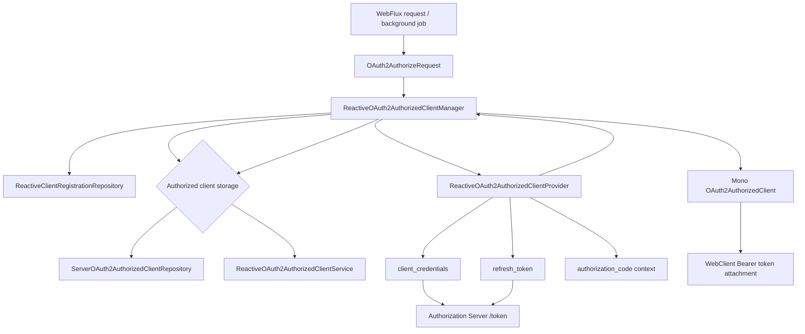
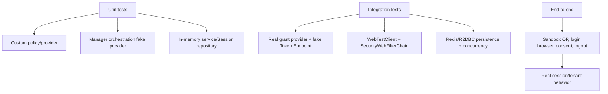

# 30.7. Testing the Reactive Manager, Provider, and Authorized Client Store

When a **Spring Security OAuth 2.0 / OpenID Connect (OIDC) Client** application runs on **Spring WebFlux**, it often needs to call APIs on behalf of a user or using an application identity. To send an access token, the application can use `ReactiveOAuth2AuthorizedClientManager`. The manager coordinates one or more `ReactiveOAuth2AuthorizedClientProvider` instances with an `OAuth2AuthorizedClient` store, deciding whether to reuse a token, request a new token, refresh a token, or report an error.

A test that only asserts an endpoint returns HTTP 200 does not necessarily confirm the OAuth2 Client flow is correct. The access token might already be cached; `WebClient` might not have called the Token Endpoint at all; an old refresh token might have been overwritten; or user A's authorized client might have been retrieved accidentally under account B. **Testing the reactive manager, provider, and authorized client store** requires separating those responsibilities and verifying both positive and negative cases.

This lesson belongs to **30. Reactive Testing**, using **Spring Boot 3.x, Spring Security 6.x, Reactor, JUnit 5, Mockito, `StepVerifier`, and `WebTestClient`**. The illustrative code uses fake tokens/endpoints and intentionally avoids calling a production Authorization Server. Spring Security evolves some APIs across versions, so when integrating into your project, use class names and signatures matching your locked dependencies.

> **Principle:** Testing the manager/provider/store proves **how the application selects grants, stores authorized clients, and handles errors**. It **does not automatically** prove the browser Authorization Code Flow, ID Token signature, PKCE, `nonce`, issuer validation, OP cookies, or downstream Resource Server authorization.

## 1. Learning Objectives

After this lesson, you will be able to:

1. Distinguish `ReactiveOAuth2AuthorizedClientManager`, `ReactiveOAuth2AuthorizedClientProvider`, `ReactiveOAuth2AuthorizedClientService`, and `ServerOAuth2AuthorizedClientRepository`.
2. Choose the right manager for a **WebFlux request** or a **background job without a `ServerWebExchange`**.
3. Build completely synthetic `ClientRegistration` and `OAuth2AuthorizedClient` fixtures.
4. Use `StepVerifier` to verify a `Mono<OAuth2AuthorizedClient>` or `Mono<Void>`.
5. Use fake/Mockito providers to decouple manager orchestration from Token Endpoint HTTP calls.
6. Test `Mono.empty()`, valid tokens, expired tokens, successful refreshes, unsupported grants, and AS errors.
7. Verify authorized clients are saved, loaded, and removed by **registration ID and principal name**.
8. Test session repositories and service-backed repositories along the right data boundaries.
9. Test success/failure handlers, especially the policy for handling `invalid_grant`.
10. Test WebFlux controller/`WebClient` integration without mixing in Servlet APIs.
11. Detect race conditions caused by concurrent refresh-token rotation or multiple instances.
12. Build a test suite with clear boundaries between **unit**, **fake-AS integration**, and **browser E2E** tests.

## 2. Map of Reactive OAuth2 Client Components



This is a **logical responsibility diagram**, not a guarantee that every `authorize(...)` call invokes all components. For example, if a token is still usable, the provider may return `Mono.empty()` and the manager reuses the stored authorized client; if no client exists yet, the manager looks up the registration and asks the provider to obtain a token.

### 2.1. Comparing Interfaces

| Component | Role | Key return type |
| --- | --- | --- |
| `ReactiveOAuth2AuthorizedClientManager` | Orchestrates authorize/reauthorize requests | `Mono<OAuth2AuthorizedClient>` |
| `ReactiveOAuth2AuthorizedClientProvider` | Handles one or more grants and decides whether to authorize | `Mono<OAuth2AuthorizedClient>`; may be empty |
| `ReactiveClientRegistrationRepository` | Looks up client metadata by registration ID | `Mono<ClientRegistration>` |
| `ReactiveOAuth2AuthorizedClientService` | Saves/loads/removes authorized clients by registration + principal | `Mono<OAuth2AuthorizedClient>`, `Mono<Void>` |
| `ServerOAuth2AuthorizedClientRepository` | Saves/loads/removes authorized clients within a request and `ServerWebExchange` context | Reactive `Mono`s |
| `OAuth2AuthorizedClient` | Client registration + principal + access token + optional refresh token | Data object |
| `OAuth2AuthorizeRequest` | Request asking the manager to authorize a registration for a specific principal | Input object |
| `OAuth2AuthorizationContext` | Provider context: registration, principal, authorized client, attributes | Provider input object |
| `ReactiveOAuth2AuthorizationSuccessHandler` | Handles successful authorization, typically saving the authorized client | `Mono<Void>` |
| `ReactiveOAuth2AuthorizationFailureHandler` | Handles authorization failures, e.g., cleaning up an invalid client | `Mono<Void>` |

There is no single monolithic "token cache." Persistence varies across session-scoped requests, authenticated principals, and system jobs.

### 2.2. Servlet and Reactive APIs Are Not Interchangeable

| Servlet | Reactive/WebFlux |
| --- | --- |
| `OAuth2AuthorizedClientManager` | **`ReactiveOAuth2AuthorizedClientManager`** |
| `OAuth2AuthorizedClientProvider` | **`ReactiveOAuth2AuthorizedClientProvider`** |
| `ClientRegistrationRepository` | **`ReactiveClientRegistrationRepository`** |
| `OAuth2AuthorizedClientService` | **`ReactiveOAuth2AuthorizedClientService`** |
| `OAuth2AuthorizedClientRepository` | **`ServerOAuth2AuthorizedClientRepository`** |
| `HttpServletRequest` | **`ServerWebExchange`** |
| `MockMvc` | **`WebTestClient`** |
| `CompletableFuture` or synchronous return | **`Mono`/`Flux`** |

This lesson focuses on **Reactive**. A test using `MockMvc` or `HttpServletRequest` targets the wrong stack, even if the app happens to have both Spring MVC and WebFlux dependencies.

## 3. Two Manager Types to Distinguish Up Front

Spring Security provides two common implementations:

### 3.1. `DefaultReactiveOAuth2AuthorizedClientManager`

Designed for authorization **within a WebFlux request context**. It takes:

```java
DefaultReactiveOAuth2AuthorizedClientManager(
    ReactiveClientRegistrationRepository registrations,
    ServerOAuth2AuthorizedClientRepository repository)
```

With this type, the manager can use `ServerWebExchange` to load/save authorized clients via a repository bound to the request or `WebSession`.

Use when:

- A logged-in browser request calls a downstream API.
- The controller/filter has a valid `ServerWebExchange`.
- Authorized clients should be stored per session or request repository policy.

### 3.2. `AuthorizedClientServiceReactiveOAuth2AuthorizedClientManager`

Designed for **contexts outside `ServerWebExchange`**, such as `@Scheduled` tasks, workers, queue consumers, or a service client using only `client_credentials`.

```java
AuthorizedClientServiceReactiveOAuth2AuthorizedClientManager(
    ReactiveClientRegistrationRepository registrations,
    ReactiveOAuth2AuthorizedClientService service)
```

No HTTP session is required to save/load authorized clients.

Use when:

- Running scheduled jobs.
- Processing queue messages in a worker.
- Using client credentials representing the application.
- No browser cookie or `ServerWebExchange` exists.
- The authorized client must outlive any single request.

### 3.3. Decision Matrix

| Context | Suggested manager | Suggested store | Principal |
| --- | --- | --- | --- |
| Alice's browser request | `DefaultReactiveOAuth2AuthorizedClientManager` | `ServerOAuth2AuthorizedClientRepository` | Alice's `Authentication` |
| Web request with `WebSession` | Default reactive manager | `WebSessionServerOAuth2AuthorizedClientRepository` per policy | Related session/principal |
| Web request of authenticated user with service-backed tokens | Default reactive manager | Appropriate repository, possibly service-backed | User identity |
| Background `client_credentials` | `AuthorizedClientServiceReactiveOAuth2AuthorizedClientManager` | `ReactiveOAuth2AuthorizedClientService` | Stable application principal |
| Background job truly acting on Alice's behalf | Service manager + durable user delegation context | Persistent service, revocation policy | Alice's identity, never disguised as a system token |
| Provider unit test | Manager not required | Store not required | `OAuth2AuthorizationContext` fixture |

A common testing mistake is using the service manager everywhere and concluding that the **session repository** also works. You only tested the service store, not the request repository.

## 4. Authorize Lifecycle: What Does the Manager Do?

A call to:

```java
OAuth2AuthorizeRequest request =
        OAuth2AuthorizeRequest
                .withClientRegistrationId("worker")
                .principal("notification-worker")
                .build();

Mono<OAuth2AuthorizedClient> result =
        manager.authorize(request);
```

can lead to these steps:

1. The manager looks up an existing stored authorized client for the registration/principal.
2. If none exists, it looks up the `ClientRegistration`.
3. It builds an `OAuth2AuthorizationContext`.
4. It invokes an appropriate `ReactiveOAuth2AuthorizedClientProvider`.
5. The provider may issue a new token, refresh a token, or do nothing.
6. When the provider produces a new authorized client, the manager's success handler can save it to the store.
7. Upon certain errors, the failure handler can remove an unusable record.
8. The manager returns `Mono<OAuth2AuthorizedClient>`, not a bare token string.

**Note:** Exact ordering, when providers return empty, attribute mapping, and failure-handler behavior depend on the manager/configuration. Tests should assert **the contract the application relies on**, rather than trying to mirror every internal implementation detail.

### 4.1. What Does `Mono.empty()` Mean?

By the provider contract, `Mono.empty()` usually indicates the provider:

- Does not support the grant/configuration in the context, **or**
- Does not need to authorize/reauthorize, e.g., the existing authorized client is still valid.

Do not assume `Mono.empty()` means the Token Endpoint returned an "empty access token", and do not immediately delete the client when a provider returns empty. The manager may reuse the existing authorized client.

### 4.2. `Mono.error(...)` Differs from `Mono.empty()`

`Mono.error(...)` signals a failure, such as the Token Endpoint returning `invalid_client`/`invalid_grant` or a network exception.

`Mono.empty()` **is not an error**, so tests must verify both cases separately. If your service code calls `.switchIfEmpty(Mono.error(...))`, that is an **application policy**, not a universal rule of every manager.

## 5. Dependencies for Unit and Integration Tests

### 5.1. Maven

```xml
<dependencies>
    <dependency>
        <groupId>org.springframework.boot</groupId>
        <artifactId>spring-boot-starter-webflux</artifactId>
    </dependency>
    <dependency>
        <groupId>org.springframework.boot</groupId>
        <artifactId>spring-boot-starter-security</artifactId>
    </dependency>
    <dependency>
        <groupId>org.springframework.boot</groupId>
        <artifactId>spring-boot-starter-oauth2-client</artifactId>
    </dependency>

    <dependency>
        <groupId>org.springframework.boot</groupId>
        <artifactId>spring-boot-starter-test</artifactId>
        <scope>test</scope>
    </dependency>
    <dependency>
        <groupId>org.springframework.security</groupId>
        <artifactId>spring-security-test</artifactId>
        <scope>test</scope>
    </dependency>
    <dependency>
        <groupId>io.projectreactor</groupId>
        <artifactId>reactor-test</artifactId>
        <scope>test</scope>
    </dependency>
</dependencies>
```

Spring Boot dependency management should keep Spring Security, Reactor, JUnit, and Mockito versions compatible. Do not mix incompatible major versions of JUnit or the Reactive stack arbitrarily.

### 5.2. Gradle

```groovy
dependencies {
    implementation 'org.springframework.boot:spring-boot-starter-webflux'
    implementation 'org.springframework.boot:spring-boot-starter-security'
    implementation 'org.springframework.boot:spring-boot-starter-oauth2-client'

    testImplementation 'org.springframework.boot:spring-boot-starter-test'
    testImplementation 'org.springframework.security:spring-security-test'
    testImplementation 'io.projectreactor:reactor-test'
}

tasks.named('test') {
    useJUnitPlatform()
}
```

You do not need a real Authorization Server just to test token save/load logic. Use fixtures and test doubles first; use a fake HTTP AS at the integration tier when verifying real Token Endpoint behavior.

### 5.3. What Is `StepVerifier`?

`StepVerifier` from `reactor-test` subscribes to a `Publisher` and asserts the sequence of signals:

```java
import reactor.core.publisher.Mono;
import reactor.test.StepVerifier;

StepVerifier.create(Mono.just("ok"))
        .expectNext("ok")
        .verifyComplete();

StepVerifier.create(Mono.empty())
        .verifyComplete();

StepVerifier.create(
        Mono.error(new IllegalStateException("offline")))
        .expectError(IllegalStateException.class)
        .verify();
```

In manager/repository tests, **do not forget to subscribe**. Simply calling `manager.authorize(request)` without `StepVerifier`, `block()` in tests, or another subscriber can leave reactive operations unexecuted. `StepVerifier` is usually the clearest option for unit tests.

## 6. Building a Fake `ClientRegistration` Without Network Calls

First we need a fixture for an application client using `client_credentials`.

```java
import org.springframework.security.oauth2.client.registration
        .ClientRegistration;
import org.springframework.security.oauth2.core.AuthorizationGrantType;
import org.springframework.security.oauth2.core.ClientAuthenticationMethod;

public final class OAuth2ClientFixtures {

    private OAuth2ClientFixtures() {}

    public static ClientRegistration worker() {
        return ClientRegistration
                .withRegistrationId("worker")
                .clientId("worker-test-client")
                .clientSecret("dummy-secret-only-for-tests")
                .clientAuthenticationMethod(
                        ClientAuthenticationMethod.CLIENT_SECRET_BASIC)
                .authorizationGrantType(
                        AuthorizationGrantType.CLIENT_CREDENTIALS)
                .tokenUri("https://auth.example.test/oauth2/token")
                .scope("notification.send")
                .clientName("Worker Test")
                .build();
    }
}
```

`https://auth.example.test/oauth2/token` is purely a fixture URL. `ClientRegistration` does not send HTTP requests merely by being built. Real requests happen only when code invokes the corresponding token response client/provider.

### 6.1. Why Not Use `issuer-uri` in Simple Fixtures?

APIs creating client registrations from issuer discovery can fetch metadata at runtime. In pure manager tests, we just need a complete `ClientRegistration`, so we supply a fake `tokenUri` directly to keep tests offline.

When testing OIDC Discovery/issuer pinning, create **separate tests with a fake OP server**.

### 6.2. Fixture for Authorization Code + Refresh Token

```java
public static ClientRegistration browserUser() {
    return ClientRegistration
            .withRegistrationId("calendar-user")
            .clientId("calendar-test-client")
            .clientSecret("dummy-calendar-test-secret")
            .clientAuthenticationMethod(
                    ClientAuthenticationMethod.CLIENT_SECRET_BASIC)
            .authorizationGrantType(
                    AuthorizationGrantType.AUTHORIZATION_CODE)
            .authorizationUri(
                    "https://auth.example.test/oauth2/authorize")
            .tokenUri("https://auth.example.test/oauth2/token")
            .redirectUri(
                    "{baseUrl}/login/oauth2/code/{registrationId}")
            .scope("calendar.read")
            .clientName("Calendar Test")
            .build();
}
```

This example **omits OIDC `openid`** to stay focused on the manager/token lifecycle. To test ID Token/`nonce`/claims, use an OIDC Login integration test with proper OIDC fixtures.

## 7. Building a Fake `OAuth2AuthorizedClient`

`OAuth2AuthorizedClient` holds a `ClientRegistration`, principal name, access token, and optional refresh token.

```java
import java.time.Instant;
import java.util.Set;

import org.springframework.security.oauth2.client.OAuth2AuthorizedClient;
import org.springframework.security.oauth2.client.registration
        .ClientRegistration;
import org.springframework.security.oauth2.core.OAuth2AccessToken;
import org.springframework.security.oauth2.core.OAuth2RefreshToken;

public final class AuthorizedClientFixtures {

    private AuthorizedClientFixtures() {}

    public static OAuth2AuthorizedClient accessOnly(
            ClientRegistration registration,
            String principalName) {

        Instant issued = Instant.now().minusSeconds(5);
        Instant expiry = Instant.now().plusSeconds(300);

        OAuth2AccessToken access = new OAuth2AccessToken(
                OAuth2AccessToken.TokenType.BEARER,
                "test-access-token-not-production",
                issued,
                expiry,
                Set.of("notification.send"));

        return new OAuth2AuthorizedClient(
                registration,
                principalName,
                access);
    }

    public static OAuth2AuthorizedClient withRefreshToken(
            ClientRegistration registration,
            String principalName) {

        Instant issued = Instant.now().minusSeconds(30);
        Instant expiry = Instant.now().plusSeconds(300);

        OAuth2AccessToken access = new OAuth2AccessToken(
                OAuth2AccessToken.TokenType.BEARER,
                "test-user-access-token",
                issued,
                expiry,
                Set.of("calendar.read"));

        OAuth2RefreshToken refresh = new OAuth2RefreshToken(
                "test-refresh-token-not-production",
                issued);

        return new OAuth2AuthorizedClient(
                registration,
                principalName,
                access,
                refresh);
    }
}
```

This fixture **does not need a validly signed JWT**. The Spring manager/service manages the object and token lifetime; it does not act as a Resource Server decoding the access token.

### 7.1. Protecting Test Data

- Use only dummy tokens/secrets.
- Never write `getAccessToken().getTokenValue()` to CI logs.
- Never capture HTTP requests containing tokens without redaction.
- Never put real client secrets into `src/test/resources`.
- Never use a production `https://id.company.example` as a Token Endpoint in unit tests.
- Never send token fixtures to real APIs.

## 8. Layer 1 Testing: `ReactiveOAuth2AuthorizedClientService`

A service-backed store typically retrieves authorized clients by **registration ID + principal name**. Built-in in-memory implementation:

```java
InMemoryReactiveOAuth2AuthorizedClientService
```

Testing the service requires neither a manager nor an HTTP server.

### 8.1. Save, Load, and Remove

```java
import static org.assertj.core.api.Assertions.assertThat;

import org.junit.jupiter.api.Test;
import org.springframework.security.authentication
        .TestingAuthenticationToken;
import org.springframework.security.oauth2.client.OAuth2AuthorizedClient;
import org.springframework.security.oauth2.client
        .InMemoryReactiveOAuth2AuthorizedClientService;
import org.springframework.security.oauth2.client.registration
        .InMemoryReactiveClientRegistrationRepository;
import reactor.test.StepVerifier;

class ReactiveAuthorizedClientServiceTest {

    @Test
    void saveLoadAndRemoveAuthorizedClient() {

        var registration = OAuth2ClientFixtures.worker();
        var registrations =
                new InMemoryReactiveClientRegistrationRepository(
                        registration);
        var service =
                new InMemoryReactiveOAuth2AuthorizedClientService(
                        registrations);

        var principal = new TestingAuthenticationToken(
                "notification-worker",
                "ignored",
                "ROLE_SYSTEM");

        OAuth2AuthorizedClient expected =
                AuthorizedClientFixtures.accessOnly(
                        registration, principal.getName());

        StepVerifier.create(
                service.saveAuthorizedClient(expected, principal))
                .verifyComplete();

        StepVerifier.create(
                service.loadAuthorizedClient(
                        "worker", principal.getName()))
                .assertNext(actual -> {
                    assertThat(actual.getClientRegistration()
                            .getRegistrationId()).isEqualTo("worker");
                    assertThat(actual.getPrincipalName())
                            .isEqualTo("notification-worker");
                    assertThat(actual.getAccessToken())
                            .isNotNull();
                })
                .verifyComplete();

        StepVerifier.create(
                service.removeAuthorizedClient(
                        "worker", principal.getName()))
                .verifyComplete();

        StepVerifier.create(
                service.loadAuthorizedClient(
                        "worker", principal.getName()))
                .verifyComplete();
    }
}
```

**Key point:** `saveAuthorizedClient` and `removeAuthorizedClient` return `Mono<Void>`, so assert `verifyComplete()` rather than expecting an emitted item. `loadAuthorizedClient` returns the authorized client or completes empty if not found.

### 8.2. Test That Service Keys Isolate Principals

Two users sharing registration `calendar-user` must never read each other's refresh tokens:

```java
@Test
void sameRegistrationMustNotShareAuthorizedClientAcrossUsers() {

    var registration = OAuth2ClientFixtures.browserUser();
    var registrations =
            new InMemoryReactiveClientRegistrationRepository(registration);
    var service =
            new InMemoryReactiveOAuth2AuthorizedClientService(
                    registrations);

    var alice = new TestingAuthenticationToken(
            "alice", "ignored", "ROLE_USER");
    var bob = new TestingAuthenticationToken(
            "bob", "ignored", "ROLE_USER");

    var client = AuthorizedClientFixtures.withRefreshToken(
            registration, alice.getName());

    StepVerifier.create(
            service.saveAuthorizedClient(client, alice))
            .verifyComplete();

    StepVerifier.create(
            service.loadAuthorizedClient(
                    "calendar-user", bob.getName()))
            .verifyComplete();

    StepVerifier.create(
            service.loadAuthorizedClient(
                    "calendar-user", alice.getName()))
            .assertNext(found ->
                    assertThat(found.getPrincipalName())
                            .isEqualTo("alice"))
            .verifyComplete();
}
```

This test verifies **how the in-memory service partitions data** at the object level. It does not replace tests for custom database/Redis repositories, backups, encryption, or multi-tenant authorization. If a custom service uses `tenantId`, test the tenant dimension as well.

### 8.3. Do Not Infer Safety Solely from Principal Name

In a multi-tenant system, the string `alice` may exist in multiple organizations. If a custom store keys only by `principalName = alice` without normalized tenant/issuer namespacing, collisions remain possible.

Design a stable principal key—for example, an **internal user ID mapped from validated `(issuer, subject)`**—and bind registration/tenant per business policy. Never use a user-claimed email as a trust key.

## 9. Layer 2 Testing: Fake `ReactiveOAuth2AuthorizedClientProvider`

To test manager persistence **without calling the Token Endpoint**, supply a fake provider returning an authorized client fixture.

### 9.1. Fake Provider Returning a Token for the Right Registration/Principal

```java
import org.springframework.security.oauth2.client.OAuth2AuthorizedClient;
import org.springframework.security.oauth2.client
        .ReactiveOAuth2AuthorizedClientProvider;
import org.springframework.security.oauth2.core.AuthorizationGrantType;

import reactor.core.publisher.Mono;

ReactiveOAuth2AuthorizedClientProvider fakeProvider = context -> {
    if (!AuthorizationGrantType.CLIENT_CREDENTIALS.equals(
            context.getClientRegistration().getAuthorizationGrantType())) {
        return Mono.empty();
    }

    OAuth2AuthorizedClient created =
            AuthorizedClientFixtures.accessOnly(
                    context.getClientRegistration(),
                    context.getPrincipal().getName());

    return Mono.just(created);
};
```

This is a test implementation of **`ReactiveOAuth2AuthorizedClientProvider`**, not a production provider. It does not hit a Token Endpoint, does not refresh tokens, and intentionally uses test-only values.

### 9.2. Testing the Manager and Persistence Behavior

```java
import static org.assertj.core.api.Assertions.assertThat;

import org.junit.jupiter.api.Test;
import org.springframework.security.oauth2.client
        .AuthorizedClientServiceReactiveOAuth2AuthorizedClientManager;
import org.springframework.security.oauth2.client
        .InMemoryReactiveOAuth2AuthorizedClientService;
import org.springframework.security.oauth2.client
        .OAuth2AuthorizeRequest;
import org.springframework.security.oauth2.client
        .ReactiveOAuth2AuthorizedClientProvider;
import org.springframework.security.oauth2.client.registration
        .InMemoryReactiveClientRegistrationRepository;
import org.springframework.security.oauth2.core.AuthorizationGrantType;

import reactor.core.publisher.Mono;
import reactor.test.StepVerifier;

class ReactiveManagerTest {

    @Test
    void successfulAuthorizationIsPersistedByServiceManager() {

        var registration = OAuth2ClientFixtures.worker();
        var registrations =
                new InMemoryReactiveClientRegistrationRepository(
                        registration);
        var service =
                new InMemoryReactiveOAuth2AuthorizedClientService(
                        registrations);

        var manager =
                new AuthorizedClientServiceReactiveOAuth2AuthorizedClientManager(
                        registrations, service);

        ReactiveOAuth2AuthorizedClientProvider fakeProvider = context -> {
            if (!AuthorizationGrantType.CLIENT_CREDENTIALS.equals(
                    context.getClientRegistration()
                            .getAuthorizationGrantType())) {
                return Mono.empty();
            }
            return Mono.just(
                    AuthorizedClientFixtures.accessOnly(
                            context.getClientRegistration(),
                            context.getPrincipal().getName()));
        };

        manager.setAuthorizedClientProvider(fakeProvider);

        OAuth2AuthorizeRequest request =
                OAuth2AuthorizeRequest
                        .withClientRegistrationId("worker")
                        .principal("notification-worker")
                        .build();

        StepVerifier.create(manager.authorize(request))
                .assertNext(client -> {
                    assertThat(client.getPrincipalName())
                            .isEqualTo("notification-worker");
                    assertThat(client.getClientRegistration()
                            .getRegistrationId()).isEqualTo("worker");
                })
                .verifyComplete();

        StepVerifier.create(
                service.loadAuthorizedClient(
                        "worker", "notification-worker"))
                .assertNext(saved ->
                        assertThat(saved.getAccessToken())
                                .isNotNull())
                .verifyComplete();
    }
}
```

What this test actually covers:

- The manager resolves the `worker` registration.
- The principal name is `notification-worker`.
- The provider is called to produce an authorized client.
- By default, the manager persists the client into the service.
- The saved data can be reloaded using the right key.

What it **does not** cover:

- Whether the AS accepts the client secret.
- Which scopes the token endpoint returns.
- Whether the production `client_credentials` provider is configured properly.
- Whether the token's JWT has a valid signature or audience.
- Whether `WebClient` attaches the Bearer token properly.

### 9.3. What If the Provider Returns `Mono.empty()`?

You can write standalone provider unit tests with `OAuth2AuthorizationContext` or mock the provider via Mockito. When the provider returns empty, check whether the manager already holds an existing client.

A test without an existing client can verify that the manager receives no new authorized client, but **do not treat that as HTTP 204/401**: `Mono.empty()` is an internal reactive signal.

## 10. Testing the Provider Independently of the Manager

The provider receives `OAuth2AuthorizationContext`. When testing a provider in isolation, you do not necessarily need a repository or manager.

### 10.1. Building an Authorization Context

```java
import org.springframework.security.authentication
        .TestingAuthenticationToken;
import org.springframework.security.oauth2.client
        .OAuth2AuthorizationContext;

var registration = OAuth2ClientFixtures.worker();
var principal = new TestingAuthenticationToken(
        "worker", "ignored", "ROLE_SYSTEM");

OAuth2AuthorizationContext context =
        OAuth2AuthorizationContext
                .withClientRegistration(registration)
                .principal(principal)
                .build();
```

This object holds the metadata and principal the provider needs. When testing a **refresh provider**, build the context with `withAuthorizedClient(existingClient)` to simulate a client already holding access/refresh tokens.

### 10.2. Providers That Do Not Support a Grant Must Return Empty

```java
@Test
void fakeProviderDoesNotHandleAuthorizationCode() {
    var authCodeRegistration = OAuth2ClientFixtures.browserUser();
    var principal = new TestingAuthenticationToken(
            "alice", "ignored", "ROLE_USER");

    var context =
            OAuth2AuthorizationContext
                    .withClientRegistration(authCodeRegistration)
                    .principal(principal)
                    .build();

    ReactiveOAuth2AuthorizedClientProvider credentialsOnly =
            c -> AuthorizationGrantType.CLIENT_CREDENTIALS
                            .equals(c.getClientRegistration()
                                    .getAuthorizationGrantType())
                    ? Mono.just(
                            AuthorizedClientFixtures.accessOnly(
                                    c.getClientRegistration(),
                                    c.getPrincipal().getName()))
                    : Mono.empty();

    StepVerifier.create(credentialsOnly.authorize(context))
            .verifyComplete();
}
```

This tests **the contract of the fake provider built in the test**. It shows how to verify unsupported-grant behavior, rather than testing Spring's built-in provider. With production providers, test with a fake token response client to verify the real logic.

### 10.3. Verifying Callbacks Are Skipped When the Provider Returns Empty

If the app has a custom provider with side effects, verify it neither writes tokens nor calls the AS on the `Mono.empty()` branch. Use `AtomicInteger`/Mockito `verifyNoInteractions(...)` with fake collaborators, making sure to **subscribe to the publisher with `StepVerifier`** so counts are accurate.

## 11. Mockito and Interaction Tests

A test can mock `ReactiveOAuth2AuthorizedClientProvider` instead of writing a custom fake:

```java
import static org.mockito.ArgumentMatchers.any;
import static org.mockito.Mockito.verify;
import static org.mockito.Mockito.when;

import org.junit.jupiter.api.Test;
import org.mockito.Mockito;
import org.springframework.security.oauth2.client
        .OAuth2AuthorizationContext;
import org.springframework.security.oauth2.client
        .ReactiveOAuth2AuthorizedClientProvider;

import reactor.core.publisher.Mono;
import reactor.test.StepVerifier;

@Test
void providerIsInvokedWithAuthorizationContext() {
    var provider = Mockito.mock(
            ReactiveOAuth2AuthorizedClientProvider.class);

    var registration = OAuth2ClientFixtures.worker();
    var context = OAuth2AuthorizationContext
            .withClientRegistration(registration)
            .principal(new TestingAuthenticationToken(
                    "worker", "ignored", "ROLE_SYSTEM"))
            .build();

    when(provider.authorize(any(OAuth2AuthorizationContext.class)))
            .thenReturn(Mono.just(
                    AuthorizedClientFixtures.accessOnly(
                            registration, "worker")));

    StepVerifier.create(provider.authorize(context))
            .assertNext(client ->
                    assertThat(client.getPrincipalName())
                            .isEqualTo("worker"))
            .verifyComplete();

    verify(provider).authorize(
            any(OAuth2AuthorizationContext.class));
}
```

This is basic Mockito usage. For manager integration, building the real manager and injecting a mock provider is a **stronger approach** to confirm the manager invokes the provider at the right time; avoid calling a mock directly and only verifying that the mock was called, since that exercises no Spring logic.

### 11.1. When to Use Mockito?

| What to verify | What to use |
| --- | --- |
| Custom provider logic | Real provider + fake HTTP collaborator |
| Manager orchestration | Real manager + fake/mock provider/service |
| Repository semantics | Real repository + exchange/session fixtures |
| Counting Token Endpoint calls | Fake server or HTTP mock |
| Delegation to right provider | Mockito argument capture or fake |
| End-to-end browser OAuth2 Login | OP test double/browser integration |
| Session/multi-instance persistence | Integration with real storage |

**Mock sparingly and in the right places.** A test that mocks the manager, provider, and service and asserts hardcoded data tests Mockito rather than application behavior.

## 12. Realistic Provider Chain Configuration

Spring Security provides a builder:

```java
ReactiveOAuth2AuthorizedClientProvider provider =
        ReactiveOAuth2AuthorizedClientProviderBuilder.builder()
                .authorizationCode()
                .refreshToken()
                .clientCredentials()
                .build();
```

Each grant has a distinct role:

| Provider | When helpful? | Testing notes |
| --- | --- | --- |
| `authorizationCode()` | Context already has authorized client from browser login | Browser redirect/callback is still handled by OAuth2 Login filters |
| `refreshToken()` | Existing authorized client has RT and needs refresh | Test token expiry/clock skew, RT rotation, `invalid_grant` |
| `clientCredentials()` | Application client needs a service identity token | Test client authentication, scopes, expiry, retry policy |
| Custom provider | Grant/profile supported by AS and integrated by app | Separate unit contract + fake AS integration |

**Do not confuse:** Including `.authorizationCode()` in the manager does not allow a background job to perform a browser login. The Authorization Code Flow still requires a user agent, `state`, redirect URI, consent/OP authentication, and callback handling.

### 12.1. Example Bean for a Background Client

```java
import org.springframework.context.annotation.Bean;
import org.springframework.context.annotation.Configuration;
import org.springframework.security.oauth2.client
        .AuthorizedClientServiceReactiveOAuth2AuthorizedClientManager;
import org.springframework.security.oauth2.client
        .ReactiveOAuth2AuthorizedClientManager;
import org.springframework.security.oauth2.client
        .ReactiveOAuth2AuthorizedClientProvider;
import org.springframework.security.oauth2.client
        .ReactiveOAuth2AuthorizedClientProviderBuilder;
import org.springframework.security.oauth2.client
        .ReactiveOAuth2AuthorizedClientService;
import org.springframework.security.oauth2.client.registration
        .ReactiveClientRegistrationRepository;

@Configuration
class BackgroundOAuth2ManagerConfig {

    @Bean("backgroundAuthorizedClientManager")
    ReactiveOAuth2AuthorizedClientManager backgroundManager(
            ReactiveClientRegistrationRepository registrations,
            ReactiveOAuth2AuthorizedClientService service) {

        ReactiveOAuth2AuthorizedClientProvider provider =
                ReactiveOAuth2AuthorizedClientProviderBuilder.builder()
                        .clientCredentials()
                        .build();

        var manager =
                new AuthorizedClientServiceReactiveOAuth2AuthorizedClientManager(
                        registrations, service);
        manager.setAuthorizedClientProvider(provider);

        return manager;
    }
}
```

A background job can call:

```java
OAuth2AuthorizeRequest request =
        OAuth2AuthorizeRequest
                .withClientRegistrationId("worker")
                .principal("notification-worker")
                .build();

return backgroundManager.authorize(request)
        .switchIfEmpty(Mono.error(
                new IllegalStateException(
                        "No authorized client available")))
        .map(client -> client.getAccessToken().getTokenValue());
```

This is an application usage example only. **Never return tokens to controllers/browsers**; token values should only be used internally to call the right Resource Server, kept out of logs/metrics. When callers use `WebClient` filter integration, let the filter attach the Bearer token rather than concatenating headers manually.

### 12.2. Example Bean for WebFlux Requests

```java
@Bean("requestAuthorizedClientManager")
ReactiveOAuth2AuthorizedClientManager requestManager(
        ReactiveClientRegistrationRepository registrations,
        ServerOAuth2AuthorizedClientRepository repository) {

    ReactiveOAuth2AuthorizedClientProvider provider =
            ReactiveOAuth2AuthorizedClientProviderBuilder.builder()
                    .authorizationCode()
                    .refreshToken()
                    .clientCredentials()
                    .build();

    var manager =
            new DefaultReactiveOAuth2AuthorizedClientManager(
                    registrations, repository);

    manager.setAuthorizedClientProvider(provider);
    return manager;
}
```

This configuration uses a **different** manager from the background example. Bean qualifiers help prevent injecting the wrong manager in apps that have both browser requests and scheduled jobs.

## 13. Testing `DefaultReactiveOAuth2AuthorizedClientManager` Requires `ServerWebExchange`

The request manager needs exchange/session context so the repository can load/save.

### 13.1. Creating an Exchange in WebFlux Tests

```java
import org.springframework.mock.http.server.reactive
        .MockServerHttpRequest;
import org.springframework.mock.web.server.MockServerWebExchange;

MockServerWebExchange exchange =
        MockServerWebExchange.from(
                MockServerHttpRequest.get("/api/me").build());
```

You can build a separate test `Authentication`. When invoking the manager directly, pass the exchange inside the authorization request per your version's contract, e.g.:

```java
OAuth2AuthorizeRequest request =
        OAuth2AuthorizeRequest
                .withClientRegistrationId("calendar-user")
                .principal(authentication)
                .attribute(ServerWebExchange.class.getName(), exchange)
                .build();
```

Import `org.springframework.web.server.ServerWebExchange`. In some integrations, Spring Security/`WebClient` attaches the exchange to context automatically; tests invoking the manager directly must supply all attributes the manager/repository expects.

### 13.2. Why Can a Test Without an Exchange Fail or Misbehave?

If you instantiate `DefaultReactiveOAuth2AuthorizedClientManager` with a session repository and call `authorize(...)` from a scheduled job **without a WebFlux exchange**, loading/saving may not work as intended.

Never "fix" this by constructing a fake `MockServerWebExchange` inside a production background worker. The right architecture is choosing `AuthorizedClientServiceReactiveOAuth2AuthorizedClientManager` for out-of-request jobs.

### 13.3. What to Assert

- The manager finds the right registration ID.
- The repository loads the client from **the right exchange/session**.
- The authorized client is saved in the corresponding exchange upon successful authorization.
- Different browsers' `WebSession`s are never mixed.
- On logout/session invalidation, session-scoped tokens are no longer usable per policy.
- For authenticated principals, composite repositories may delegate to a service-backed path depending on configuration.

Do not infer from a passing service manager test that the request manager also works: the two storage boundaries are distinct.

## 14. Layer 3 Testing: `WebSessionServerOAuth2AuthorizedClientRepository`

A common WebFlux repository:

```java
org.springframework.security.oauth2.client.web.server
        .WebSessionServerOAuth2AuthorizedClientRepository
```

It binds authorized clients to a **`WebSession`**, not to a global database keyed by `principalName`.

### 14.1. Testing Save/Load/Remove Within the Same Exchange

```java
import static org.assertj.core.api.Assertions.assertThat;

import org.junit.jupiter.api.Test;
import org.springframework.mock.http.server.reactive
        .MockServerHttpRequest;
import org.springframework.mock.web.server.MockServerWebExchange;
import org.springframework.security.authentication
        .TestingAuthenticationToken;
import org.springframework.security.oauth2.client.web.server
        .WebSessionServerOAuth2AuthorizedClientRepository;

import reactor.test.StepVerifier;

class WebSessionAuthorizedClientRepositoryTest {

    @Test
    void authorizedClientIsScopedToWebSession() {

        var registration = OAuth2ClientFixtures.browserUser();
        var repository =
                new WebSessionServerOAuth2AuthorizedClientRepository();

        var alice = new TestingAuthenticationToken(
                "alice", "ignored", "ROLE_USER");

        var firstExchange = MockServerWebExchange.from(
                MockServerHttpRequest.get("/").build());

        var secondExchange = MockServerWebExchange.from(
                MockServerHttpRequest.get("/").build());

        var client = AuthorizedClientFixtures.withRefreshToken(
                registration, "alice");

        StepVerifier.create(
                repository.saveAuthorizedClient(
                        client, alice, firstExchange))
                .verifyComplete();

        StepVerifier.create(
                repository.loadAuthorizedClient(
                        "calendar-user", alice, firstExchange))
                .assertNext(saved ->
                        assertThat(saved.getPrincipalName())
                                .isEqualTo("alice"))
                .verifyComplete();

        StepVerifier.create(
                repository.loadAuthorizedClient(
                        "calendar-user", alice, secondExchange))
                .verifyComplete();

        StepVerifier.create(
                repository.removeAuthorizedClient(
                        "calendar-user", alice, firstExchange))
                .verifyComplete();

        StepVerifier.create(
                repository.loadAuthorizedClient(
                        "calendar-user", alice, firstExchange))
                .verifyComplete();
    }
}
```

This is a **`WebSession` isolation test**: two independent `MockServerWebExchange` instances hold distinct `WebSession`s. It is not a token refresh test, calls no AS, and uses no real browser cookies.

### 14.2. Warning When Switching Accounts in the Same `WebSession`

`WebSessionServerOAuth2AuthorizedClientRepository` scopes data **per session**. Do not assume it always applies the same `(registrationId, principalName)` partitioning as `ReactiveOAuth2AuthorizedClientService`.

If a `WebSession` is reused when Alice logs out and Bob logs in, test **session invalidation/clearing of authorized clients** under your actual configuration. Do not just check `principalName` in a test and conclude Bob cannot see Alice's token.

When account switching is a product requirement, verify:

- Do logout handlers invalidate the `WebSession`?
- Are authorized clients cleared from the session?
- Are custom session attributes from Alice never kept for Bob?
- Does the login callback establish a fresh security context per policy?
- Is there any service-backed storage needing separate cleanup/revocation?

## 15. `AuthenticatedPrincipalServerOAuth2AuthorizedClientRepository`

Spring Security includes a repository that uses **`ReactiveOAuth2AuthorizedClientService`** for authenticated principals and falls back to a session repository for anonymous users.

```java
new AuthenticatedPrincipalServerOAuth2AuthorizedClientRepository(
        reactiveAuthorizedClientService);
```

**Do not assume every configuration uses this repository.** How Boot/Spring creates beans and default repositories can vary depending on custom configuration. In tests, verify which repository is actually injected into the request manager.

### 15.1. Branches to Test

| Principal | Expected storage per composite config | Required test |
| --- | --- | --- |
| Authenticated Alice | Service-backed by principal | Alice reloads saved client |
| Authenticated Bob | Service-backed for Bob | Cannot read Alice's token |
| Anonymous | `WebSession` fallback | User token never saved under shared principal |
| Account switching | Session/state changed | Never reuses client from prior session |
| Logout | Session/service cleanup per policy | Authorized client no longer usable |
| Suspended tenant | Old record in token store | Authorization policy still blocks access |

These branches require testing with the **real repository** or spies placed at the right layer, rather than mocking the interface and assuming behavior.

## 16. Testing Refresh Tokens: A Different Flow from `client_credentials`

In user-delegated OAuth2 flows, `OAuth2AuthorizedClient` may hold an `OAuth2RefreshToken`. When the access token is expired or near expiry, the refresh provider can call the Token Endpoint.

### 16.1. Illustrative Timeline

```text
T0: Browser user Alice has access token AT1 and refresh token RT1
T1: AT1 nears expiry per clock-skew policy
T2: Manager invokes appropriate provider
T3: POST /token grant_type=refresh_token, RT1, client auth
T4: AS returns AT2 and (optionally) RT2
T5: Manager saves new authorized client for Alice
T6: Subsequent calls never reuse RT1 if rotated
```

### 16.2. Behaviors to Test Separately

- If AT is still valid, no unnecessary refresh occurs.
- If AT is near expiry, the provider refreshes per configured **clock skew**.
- If no RT is present, the provider does not fabricate a refresh token.
- If RT rotates, the store saves RT2 in place of RT1.
- If the AS returns `invalid_grant`, the manager's failure handler reacts per policy.
- If the AS times out, POST Token Endpoint is not retried endlessly.
- If the client secret is wrong, `invalid_client` **differs** from `invalid_grant`.
- If two refreshes run concurrently, avoid overwriting the new RT with an older client.

### 16.3. Expired Token Fixture

```java
import java.time.Instant;
import java.util.Set;

OAuth2AccessToken expiredAccessToken =
        new OAuth2AccessToken(
                OAuth2AccessToken.TokenType.BEARER,
                "expired-test-token",
                Instant.now().minusSeconds(600),
                Instant.now().minusSeconds(60),
                Set.of("calendar.read"));

OAuth2RefreshToken refreshToken =
        new OAuth2RefreshToken(
                "refresh-test-1",
                Instant.now().minusSeconds(900));

OAuth2AuthorizedClient oldClient =
        new OAuth2AuthorizedClient(
                OAuth2ClientFixtures.browserUser(),
                "alice",
                expiredAccessToken,
                refreshToken);
```

This is synthetic data. Simply creating `oldClient` **does not invoke the refresh provider**. To test a production provider, configure a **fake Token Endpoint**, pass the client through the authorization context/manager, and verify `RT2` is stored properly.

### 16.4. Use a Fake HTTP Server When Testing Real Refresh Providers

Contract test outline:

```text
Given:
  ClientRegistration: calendar-user
  Stored client: AT1 expired, RT1
  Fake Token Endpoint expects:
    grant_type = refresh_token
    refresh_token = RT1
    proper client authentication

Fake AS response:
  access_token = AT2
  token_type   = Bearer
  expires_in   = 300
  refresh_token = RT2
  scope        = calendar.read

Then:
  Provider/manager emits authorized client AT2/RT2
  Store holds AT2/RT2 for Alice
  No RT1 reuse after rotation per concurrency policy
```

This is a **contract test specification**, not a runnable unit test without a fake HTTP server. Use WireMock, MockWebServer, or a fake `ExchangeFunction`/`WebClient` compatible with your Spring Security version's Token Response Client.

## 17. Testing the Real `client_credentials` Provider with a Fake Token Endpoint

A real provider can acquire/renew access tokens via `client_credentials` without a user browser.

### 17.1. Requests to Verify

```http
POST /oauth2/token HTTP/1.1
Host: auth.example.test
Content-Type: application/x-www-form-urlencoded
Authorization: Basic <redacted-test-client-credentials>

grant_type=client_credentials&scope=notification.send
```

Fake response:

```json
{
  "access_token": "fake-worker-token-2",
  "token_type": "Bearer",
  "expires_in": 300,
  "scope": "notification.send"
}
```

Do not assume the Authorization Server always returns a refresh token for client credentials; typically it **does not**. Tests must accept an authorized client with no refresh token in this flow.

### 17.2. Meaningful Assertions

- The Token Endpoint is called **exactly once** when a new token is needed.
- It is not called again while the existing AT remains valid per policy.
- The request sends the right `client_id`/authentication method.
- The client secret is never placed in the query string.
- Scopes come only from the allowed registration.
- The response token is saved under the right stable application principal.
- Tokens across different tenants/registrations are never shared.
- Controlled errors are returned on `invalid_client`, 429, or 5xx.

A test that only asserts `manager.authorize(...)` returns `Mono.just(...)` with a fake provider **does not** prove the HTTP Token Endpoint contract. Keep the two test layers distinct.

## 18. Testing Success/Failure Handlers

Authorized-client managers provide hooks to handle success and failure. Depending on manager and configuration, the success handler may **persist** the authorized client, while the failure handler may **remove** the client when certain errors indicate the grant is no longer valid.

### 18.1. Success Handler

Test objective:

```text
Given:
  Provider returns newly authorized client AT2/RT2
When:
  Manager authorize completes successfully
Then:
  Appropriate store.saveAuthorizedClient(...) is invoked
  Registration/principal binding is preserved
  Store contains new generation
```

This is why the manager test in section 9 **checks both the returned result and reloading from the service**. Asserting only the returned token without verifying persistence can miss bugs where the next call reuses a stale token.

### 18.2. Failure Handler and `invalid_grant`

`invalid_grant` can occur when a refresh token is revoked/expired/reused or an authorization code is invalid. Spring Security managers have default behaviors for removing authorized clients in certain cases, notably `invalid_grant`; exact wiring depends on manager/version.

An important contract test:

```text
Given:
  Stored AuthorizedClient(registration=calendar-user,
                         principal=alice, RT1)
And:
  Refresh provider emits OAuth2AuthorizationException(invalid_grant)

When:
  Manager.authorize(request for alice)

Then:
  Error surfaces according to contract
And:
  Failure handler performs configured cleanup of invalid client
And:
  Bob's authorized client remains intact
And:
  No fallback to another user's token
```

**Never delete all authorized clients just because of an HTTP 500 error.** When an AS is temporarily unavailable, refresh tokens may still be valid. Cleanup policies must follow error semantics and the provider contract, never unconditional deletion.

### 18.3. Distinguishing Error Types

| Error | Typically related to | What to verify |
| --- | --- | --- |
| `invalid_grant` | Invalid/expired/reused RT/code/grant | Cleanup per policy; reauthorization if needed |
| `invalid_client` | Client secret/mTLS/assertion/registration | Alert on config; never wipe all user tokens |
| `invalid_scope` | Disallowed scope | Never retry the same scope endlessly |
| HTTP 429 | AS rate limit | Bounded backoff; avoid retry storms |
| HTTP 5xx | AS outage | Do not assume token was revoked |
| Timeout | Unknown whether request was processed | Avoid replay/RT races; bounded retries |
| Network TLS error | Trust/endpoint configuration | Never disable TLS validation |
| `Mono.empty()` | Provider need not/cannot authorize | Handle empty by context; do not treat as grant failure |

### 18.4. Tests Should Never Swallow Errors

Wrong:

```java
manager.authorize(request)
        .onErrorResume(ex -> Mono.empty());
```

if callers then treat empty as "user not logged in" and automatically fall back to another registration/system token.

Instead, classify errors and provide **explicit application-level error handling** with redaction; never swap a user-delegated token for a client-credentials token without an explicit business policy.

## 19. `Mono.empty()`, Valid Tokens, and Reauthorization

A provider may avoid issuing a new token when the current client is still valid. Tests must confirm **no unnecessary Token Endpoint calls occur**.

### 19.1. Sample Contract

```text
Given:
  AuthorizedClient AT1 expires in 10 minutes
  Clock skew = 60 seconds
When:
  Manager.authorize(...)
Then:
  Client AT1 is reused
  No refresh_token/token HTTP call
  Store is not overwritten without reason
```

When AT1 nears expiry:

```text
Given:
  AT1 expires in 20 seconds
  Clock skew = 60 seconds
When:
  Manager.authorize(...)
Then:
  Provider may perform refresh/reacquire according to grant and policy
```

This reflects **expectations for a provider configured with clock skew**, not that every provider uses exactly 60 seconds. In tests, use the actual provider/config or a fake clock.

### 19.2. Never Use `Thread.sleep` for Token Expiry

A test waiting 5 minutes for a token to expire is slow and flaky. Instead:

- Construct tokens whose `expiresAt` is already in the past or near expiry.
- Inject a `Clock` in **custom providers/services** you implement.
- For library providers, configure clock skew via your version's API.
- Use a fake AS and deterministic responses.
- Do not assume `StepVerifier.withVirtualTime` automatically controls `Instant.now()` inside every Spring Security provider.

Virtual time controls compatible Reactor schedulers; it **does not change system wall-clock time** if code calls `Instant.now()` directly.

## 20. Right Principal for Background Jobs

`client_credentials` represents **the application**, not a consenting user. A job can use a stable principal:

```java
OAuth2AuthorizeRequest request =
        OAuth2AuthorizeRequest
                .withClientRegistrationId("worker")
                .principal("notification-worker")
                .build();
```

Key requirements:

- The principal should remain stable across job runs.
- The same registration/principal may reuse the authorized client if policy permits.
- Never use a random user's email as the principal for an application token.
- Never share one principal across **tenant trust boundaries** needing separate tokens.
- Partition by registration/tenant when needed.
- Jobs must check tenant state and configuration revisions when using tokens.

### 20.1. Testing a Stable Principal

```text
Run 1:
  registrationId=worker
  principal=notification-worker
  -> issue token AT1, save

Run 2:
  same registrationId + principal
  AT1 still valid
  -> reuse according to provider policy

Run 3:
  principal=unexpected-worker-name
  -> separate authorized client key, may fetch new token
```

This test catches bugs where a job generates a random UUID principal on every run, preventing token reuse and overloading the AS.

### 20.2. Jobs "Acting on Behalf of a User" Are Not `client_credentials`

If a background job needs Alice's Calendar data, the token needs **user delegation** via Authorization Code/Refresh Token, consent, and policy. Never use a system `client_credentials` token and add an `X-User-Id: alice` header to impersonate Alice's privileges.

In tests, verify Alice's and Bob's clients are stored separately and the service never sends Alice's token when processing Bob's job.

## 21. Race Conditions During Refresh Token Rotation

A serious issue in multi-instance deployments:

```mermaid
sequenceDiagram
    participant A as Node A
    participant B as Node B
    participant DB as AuthorizedClientStore
    participant AS as AuthorizationServer
    A->>DB: load RT1 for Alice
    B->>DB: load RT1 for Alice
    A->>AS: refresh RT1
    AS-->>A: AT2 + RT2
    B->>AS: refresh RT1
    AS-->>B: invalid_grant / replay detection
    A->>DB: save AT2 + RT2
    Note over A,B: Not just a WebFlux bug; a concurrency/token lifecycle issue
```

### 21.1. What to Test?

- Two concurrent requests both requiring refresh.
- Token Endpoint call count is bounded per principal + registration.
- The winning refresh saves RT2.
- The failing refresh does not delete/overwrite the new RT2 if cleanup runs on stale RT1.
- No overwrites from an older authorized client generation.
- When the OP detects RT reuse and revokes the token family, the app handles reauthorization per policy.
- Alice's token is never transferred to Bob.
- Multiple instances do not rely on local Java `synchronized` assuming cluster-wide locking.

### 21.2. Design Directions for Handling Races

Consider:

- **Single-flight** per `(registration, principal, tenant)` in-process.
- Distributed lock/lease with fencing tokens when needed.
- Compare-and-swap/versioning on persistent authorized client stores.
- Re-reading records before and after refresh; avoiding stale overwrites.
- Error handling distinguishing `invalid_grant` from transient HTTP failures.
- Idempotency/retry policies aligned with the AS contract.

**Spring Security managers do not automatically guarantee exactly-once refresh across multi-node topologies.** Test your actual storage strategy; never assume distributed concurrency guarantees just because the return type is `Mono`.

## 22. `ServerOAuth2AuthorizedClientExchangeFilterFunction` and `WebClient`

The standard way for `WebClient` to attach Bearer tokens to outgoing requests:

```java
ServerOAuth2AuthorizedClientExchangeFilterFunction oauth =
        new ServerOAuth2AuthorizedClientExchangeFilterFunction(
                requestAuthorizedClientManager);

WebClient webClient = WebClient.builder()
        .filter(oauth)
        .build();
```

This is an **integration filter**. It can use attributes/request context to pick the registration/authorized client; configure the right manager for WebFlux requests vs. background jobs.

### 22.1. Testing Against a Fake Downstream API

An integration test should verify:

1. `WebClient` picks the right registration.
2. The manager is invoked per configured policy.
3. The access token goes to **the right resource host**.
4. The `Authorization` header uses proper `Bearer` syntax.
5. Tokens are never sent to hosts chosen by user input.
6. Resource Server 401/403 responses are handled per policy.
7. On `invalid_token`, authorized client removal/retry does not cause a loop.

Use a fake `ExchangeFunction` or an HTTP test server accepting `Authorization: Bearer fake-token`. Never call production APIs.

### 22.2. Never Let `WebClient` Unconditionally Attach Tokens to Every Request

If an app has a `WebClient` calling multiple hosts, casually configuring a default authorized client/registration can leak tokens to unintended destinations.

Tests should include an **untrusted destination negative case**: requests to hosts not on the allowlist must be blocked or carry no Bearer credential, per application architecture.

### 22.3. Why Testing the Filter Differs from Testing the Manager

- Manager test: is the right authorized client obtained for the registration/principal?
- Exchange filter test: is the access token attached to the right outgoing request?
- Downstream contract test: does the Resource Server accept the token/scope/audience?

A manager returning the right client **does not prove the `WebClient` filter is wired properly**.

## 23. `WebTestClient` and Mock OAuth2 Login

In a WebFlux controller, you can simulate a user logged in via OAuth2 to test post-login behavior:

```java
import static org.springframework.security.test.web.reactive.server
        .SecurityMockServerConfigurers.mockOAuth2Login;

webTestClient
        .mutateWith(mockOAuth2Login())
        .get()
        .uri("/api/me")
        .exchange()
        .expectStatus()
        .isOk();
```

This helper creates a **mock `Authentication`** for the WebFlux test. It does not automatically test the Token Endpoint, manager, provider, or persistence in an external database.

### 23.1. Do Not Confuse Test Layers

| Test helper | Target | Does NOT prove |
| --- | --- | --- |
| `mockOAuth2Login()` | Controller after OAuth2 login | Authorization Code/Token Endpoint |
| `mockOidcLogin()` | Controller needing mock OIDC principal/ID Token | Real signature/issuer/`nonce` |
| `mockOAuth2Client()` | Client/authorized client fixture in Reactive web test | Real token issuance |
| `StepVerifier` + real manager | Manager orchestration/persistence | Browser/OP login |
| `StepVerifier` + real provider + fake Token Endpoint | Grant/token response contract | Downstream API authorization |
| `WebTestClient` + fake `WebClient` | Security/web integration | Production AS/OP availability |
| Browser E2E + sandbox OP | SSO/cookies/redirects/consent | All production failure modes |

For the manager/provider/store, **`StepVerifier` and fake collaborators** are usually the first tier. `WebTestClient` adds HTTP security context; it does not replace authorization provider tests.

### 23.2. Verify Routes Cannot Be Bypassed

If the app has an endpoint:

```java
@GetMapping("/api/jobs/status")
Mono<String> status() {
    return Mono.just("ok");
}
```

and the security chain requires `Authentication`, test:

```java
webTestClient
        .get().uri("/api/jobs/status")
        .exchange()
        .expectStatus()
        .isUnauthorized();
```

**This is only true if the entry point is configured to return 401 for APIs.** With OAuth2 browser login, unauthenticated requests may redirect 302 to login. Base tests on the real security configuration, rather than assuming every WebFlux API returns 401.

## 24. Testing Custom Repositories with R2DBC/Redis

An in-memory service works for unit tests, while production often needs persistence across replicas. That requires integration tests against the real store:

- **R2DBC:** transactions, optimistic locking, unique keys, and retention.
- **Redis:** key namespaces, TTL, serialization, encryption/ACL, and invalidation.
- **Custom database:** compound key `registrationId + principal + tenant` and versioning.
- **Distributed `WebSession`:** session invalidation, cookie/session ID, multi-node.
- **Vault/secret storage:** client secrets belong outside the authorized client store; never mix them carelessly.

### 24.1. Persistence Matrix

| Test | In-memory | DB/Redis integration |
| --- | --- | --- |
| save/load/remove | Yes | Yes |
| principal partitioning | Yes | Yes |
| token survives application restart | No | Should be tested when policy requires |
| simultaneous refresh CAS | Hard to represent cluster | Mandatory for multi-node architectures |
| encryption at rest | Does not reflect production | Yes |
| TTL/retention | Limited | Yes |
| malformed/corrupt record | Can be faked | Yes |
| schema migration | No | Yes |
| multi-instance session sharing | No | Yes |
| revocation cleanup | Can be mocked | Yes |

### 24.2. Never Store Plaintext Credentials in Broad-Access Caches

Authorized clients can contain long-lived **refresh tokens**. When using Redis or a database, enforce:

- TLS in transit.
- ACL/IAM for service accounts.
- Encryption at rest and backup policies.
- Never place tokens in cache keys/metric labels.
- TTL, removal, and retention per policy.
- Never serialize raw `OAuth2AuthorizedClient` into HTTP responses/logs.
- Partition strictly by user/tenant/registration.
- Key/version management during client secret or schema rotations.

These requirements belong to both security design and storage integration tests.

## 25. Testing Token Expiration and Clock Skew

OAuth2 access tokens carry `issuedAt` and `expiresAt`. Providers may apply clock skew to avoid using nearly expired tokens.

### 25.1. Critical Boundaries

```text
T_now --------------------------- T_expires
   |                               |
   +-- token usable?               +-- expired

If clockSkew = 60s:
    provider may consider the token due for refresh
    from T_expires - 60s onward
```

Boundary tests:

| Test | Expiry relative to now | Expected per policy |
| --- | --- | --- |
| Fresh | +15 minutes | Reuse |
| Near expiry | +20 seconds, skew 60 seconds | Reauthorize/refresh |
| Exact expiry | now | Do not use as valid token |
| Expired | -1 minute | Refresh/reacquire if grant permits |
| No refresh token | Expired user token | Do not fabricate RT; reauthorization behavior |
| Clock moved backwards | Invalid times | Fail or handle per explicit policy |
| OP returns negative `expires_in` | Malformed token response | Reject/handle error |

### 25.2. Avoid Flaky Tests

Never use sleeps to wait out wall-clock time. Use timestamps with wide enough margins or a controlled clock in custom code.

When testing the framework's refresh provider, use a fake token response client and clear time windows; do not assume `StepVerifier.withVirtualTime` alters `Instant.now()` JVM-wide.

## 26. Error Propagation and Cancellation in Reactor

`Mono` is a lazy publisher. That creates testing considerations different from blocking code.

### 26.1. Error Signals

```java
Mono<OAuth2AuthorizedClient> result =
        manager.authorize(request);

StepVerifier.create(result)
        .expectError()
        .verify();
```

Better tests verify **the exact exception type and OAuth2 error code** with `expectErrorSatisfies(...)`, rather than only `expectError()`, when business code has multiple branches.

### 26.2. Never Call `subscribe()` Manually Inside a Manager Adapter

Wrong:

```java
manager.authorize(request)
        .subscribe(client -> saveSomewhere(client));
return Mono.empty();
```

This creates a side effect **outside the request reactive chain**. Tests may pass intermittently, saves may still be pending, or errors may vanish.

Right:

```java
return manager.authorize(request)
        .flatMap(client ->
                saveSomewhere(client).thenReturn(client));
```

Here, `saveSomewhere` is an application helper returning `Mono<Void>`. Composing ensures `StepVerifier` tracks completion/errors of both authorization and saving.

### 26.3. Never Call `block()` in WebFlux Requests

A unit test may call `block()` to inspect a result in a controlled setting, yet WebFlux application code must never call `block()` on the Reactor event loop. Testing with `StepVerifier` encourages keeping code true to reactive semantics.

### 26.4. Cancellation Tests

If an HTTP client cancels the publisher before the Token Endpoint responds, consider:

- Did token issuance already happen at the AS?
- Did the success handler already save the token?
- Are there any connection/resource leaks?
- Will retries cause duplicate requests?
- Was refresh token RT1 already rotated?

Tests using `StepVerifier`/a fake HTTP server can simulate delayed responses/cancellation, while the remote AS outcome still depends on protocol/transport. Never assume Reactor cancellation rolls back a token request already processed by the AS.

## 27. Security Boundaries When Testing Authorized Clients

### 27.1. Principal Identity

Never use a generic principal name like `"user"` for all users in a production service-backed store. If all test fixtures use `"user"`, isolation bugs go unnoticed.

Use:

```text
registration=calendar-user, principal=internal-user-101
registration=calendar-user, principal=internal-user-202
```

and assert zero cross-reads.

### 27.2. Tenant Identity

If two tenants share a provider registration or issuer, business authorization must still check tenant membership. Never rely solely on principal email:

```text
tenant=alpha, subject=123 -> internal account A
tenant=beta, subject=123  -> may not be same account
```

Trusted external identity is typically bound by **issuer + subject**, then mapped to an internal user/tenant. Token stores and policies must prevent collisions.

### 27.3. Grant Identity

Tokens from `client_credentials` belong to the application, not a user's delegated consent. Never treat a service token as Alice's token just because a test passed principal `alice` into `OAuth2AuthorizeRequest`.

### 27.4. Resource Destination

Even valid tokens should only be sent to approved API hosts/audiences. Outbound `WebClient` or service gateway tests should block **untrusted URLs/SSRF**, never attaching Bearer tokens to arbitrary user-supplied URLs.

### 27.5. Secrets and Logs

Never log:

- Raw access/refresh/ID tokens.
- Client secrets/private keys.
- `Authorization` headers.
- Authorization codes/PKCE verifiers/`nonce`.
- `WebSession` cookies.
- Token Endpoint request/response bodies in test reports.
- Sensitive user emails/subjects in metric labels.

Use fake token fixtures and redaction. Verify production loggers/APMs never auto-serialize `OAuth2AuthorizedClient`.

## 28. Common Test Failures

| Symptom | Possible cause | Resolution |
| --- | --- | --- |
| `StepVerifier` sees no result | Publisher not subscribed or fake returned empty | Use `StepVerifier.create(...)` and inspect provider |
| Manager returns empty | No existing authorized client; provider doesn't support grant | Check grant/provider chain and registration |
| `No ClientRegistration` | Wrong registration ID or missing repository | Use `InMemoryReactiveClientRegistrationRepository` fixture |
| `DefaultReactiveOAuth2AuthorizedClientManager` does not save | Missing `ServerWebExchange` or incompatible repository | Supply valid exchange or use service manager |
| Job throws session-related error | Used request manager outside WebFlux request | Use `AuthorizedClientServiceReactiveOAuth2AuthorizedClientManager` |
| Store save passes yet load returns empty | Mismatched `principalName`/`registrationId` | Assert compound key and session context |
| Alice reads Bob's token | Custom token store mis-partitioned | Test isolation and fix key/trust mapping |
| Refresh is never called | AT still valid or missing RT/unconfigured provider | Use expired fixture and right provider |
| Refresh called continuously | Token clock skew/expiry or random principal per run | Check `expiresAt`/provider/store |
| HTTP API returns 200 despite wrong secret | Reusing cached access token | Probe Token Endpoint acquisition |
| `invalid_grant` | RT expired/reused/invalid | Test RT rotation/concurrency; don't assume wrong secret |
| `invalid_client` | AS rejected client authentication | Check secret/key/mTLS/registration |
| `WebClient` test sends no Bearer header | Filter missing or no authorized client | Check attributes/manager wiring |
| Controller test lacks `Authentication` | Missing `mockOAuth2Login()` or security chain | Use `WebTestClient` + reactive helpers |
| "Login" test passes yet OP fails | Mock login bypasses protocol | Write AS/OP integration tests |
| Exception swallowed | Code calls `subscribe()` or `onErrorResume(empty)` | Compose errors in reactive chain |
| Tests too slow/flaky | `Thread.sleep`/production OP/network | Use fake endpoints and deterministic fixtures |
| Tests cross-contaminate data | Shared mutable in-memory store/session | Fresh fixtures per test; isolate DB/keys |
| WebFlux event loop blocked | Blocking token client/secret manager | Use reactive HTTP, bounded offloading when needed |
| Cleanup deletes new RT2 | Failure handler reacts to stale RT1 after concurrent refresh | Use versioning/CAS/conditional removal |

### 28.1. Troubleshooting Workflow

1. Confirm the app uses **WebFlux** and the right reactive interfaces.
2. Confirm the manager matches a WebFlux request vs. a background job.
3. Confirm `registrationId` and `ClientRegistration`.
4. Confirm principal name/tenant context.
5. Check whether the store saved the authorized client and under which key.
6. Check token expiry and refresh token presence.
7. Inspect the provider chain and `Mono.empty()`/`Mono.error()`.
8. Check whether the Token Endpoint was actually called.
9. Inspect success/failure handlers and persistence.
10. Under concurrency, check RT generations/conditional writes.
11. When using `WebClient`, check token attachment and destination allowlist.
12. Distinguish manager unit tests from protocol integration tests.

## 29. What Should the Test Suite Cover?

| ID | Target | Scenario | Expected |
| --- | --- | --- | --- |
| T01 | Provider | Unsupported grant | `Mono.empty()` |
| T02 | Provider | Initial client credentials | Token issued per fake AS contract |
| T03 | Provider | Valid AT | No Token Endpoint call |
| T04 | Provider | AT near expiry | Reacquires/refreshes per policy |
| T05 | Provider | Valid user RT | AT2 and optional RT2 |
| T06 | Provider | No RT | Does not fabricate refresh |
| T07 | Provider | AS `invalid_client` | Error; no fallback to another client |
| T08 | Provider | AS `invalid_grant` | Appropriate error; cleanup per policy |
| T09 | Provider | Timeout/429/5xx | Bounded retries; no storm |
| T10 | Manager | Provider yields new authorized client | Returns client and saves to right store |
| T11 | Manager | Provider empty + existing client | Does not issue unnecessary new token |
| T12 | Manager | Unknown registration ID | Does not authorize arbitrarily |
| T13 | Manager | User request manager missing exchange | Does not assume a session exists |
| T14 | Manager | Background service manager | Works without `WebSession` |
| T15 | Service | save/load/remove | Persists/clears accurately |
| T16 | Service | Same registration, different users | No cross-reads |
| T17 | `WebSession` repository | Two distinct sessions | No shared data |
| T18 | `WebSession` repository | Logout/account switch | Does not retain prior user's token |
| T19 | Custom store | Token generation update | No stale overwrites |
| T20 | Custom store | Concurrent RT refresh | CAS/single-flight per policy |
| T21 | Multi-tenant | Same subject across issuers | Tokens never mixed |
| T22 | `WebClient` | Correct registration/token | Bearer attached to right downstream |
| T23 | `WebClient` | User-controlled host | No token leakage |
| T24 | Reactive chain | Error propagation | No swallowing or detached `subscribe()` |
| T25 | Reactive chain | Cancellation | No leaked resources |
| T26 | `WebTestClient` | Mock OAuth2 login | Controller sees right principal |
| T27 | OIDC | Mock OIDC login | Does not treat fake token as verified |
| T28 | Protocol | Authorization Code callback/state | Dedicated OP test double |
| T29 | Security | Logs/traces | No tokens/secrets |
| T30 | Distributed | Mixed revisions/instances | Authorized client isolation preserved |

A good suite does not test every line of Spring Security. It tests **each responsibility configured or depended upon by the application**.

## 30. Sensible Separation of Test Layers



### 30.1. Unit Tests — Fast, No Network Calls

- Fake `ClientRegistration`.
- Fake `OAuth2AuthorizedClient`.
- Fake provider returning `Mono.just`/`Mono.empty`/`Mono.error`.
- Real manager.
- In-memory authorized client service.
- `StepVerifier` and Mockito.
- Assert right principal/registration/persistence.

### 30.2. Contract Tests — Fake Authorization Server

- Token Endpoint HTTP body/authentication.
- `client_credentials` token issuance.
- `refresh_token`/RT rotation.
- `invalid_client`, `invalid_grant`, 429/5xx.
- Clock skew/expiry policy.
- No secret leakage.

### 30.3. WebFlux Integration Tests

- `SecurityWebFilterChain`.
- `mockOAuth2Login()`/`mockOidcLogin()` for controllers.
- Request manager + exchange/repository.
- Outbound `WebClient` filter.
- CSRF and authorization policies.
- Session/account switching.

### 30.4. Persistence/Distributed Tests

- Redis/R2DBC schema/TTL.
- Multi-instance refresh concurrency.
- Atomic replacement/CAS/fencing.
- Tenant deletion/logout cleanup.
- Stale failure handler not deleting a newer token.

### 30.5. Browser/OP E2E

- Authorization Code redirect + `state` + PKCE.
- OIDC `nonce` and ID Token validation.
- Provider SSO cookie, consent, MFA, logout.
- Reverse proxy, `SameSite`, and callback behavior.
- Production-like client registration without real secrets in automation.

## 31. Anti-Patterns to Avoid

### 31.1. Using `MockMvc` to Conclude a WebFlux Manager Works

`MockMvc` is for Servlet. For Reactive, use `StepVerifier`/`WebTestClient` and the right repositories.

### 31.2. Using the Request Manager in a Scheduled Job

`DefaultReactiveOAuth2AuthorizedClientManager` depends on a WebFlux request context. Use the service manager for background jobs.

### 31.3. Calling `authorize(...)` in Tests Without Subscribing

Reactive pipelines are lazy; without a subscription, there is no guarantee the provider or save ran.

### 31.4. Mocking Every Component and Asserting a Hardcoded Token

This tests neither the manager, persistence, nor real provider. Keep at least one **real** layer aligned with the test goal.

### 31.5. Treating `Mono.empty()` as a Token Endpoint Error

Empty may simply mean "provider does not need to reauthorize." Distinguish empty from error.

### 31.6. Skipping Principal Partitioning Tests

This easily lets another user's/tenant's authorized client be reused. Test store keys and authorization.

### 31.7. Assuming In-Memory Service Tests Prove Redis/DB Safety

Multi-instance behavior, CAS, encryption/retention, and schema migrations must be tested against real storage.

### 31.8. Treating a Downstream 200 as Proof of Token Acquisition

The token might come from cache. Contract tests must force acquiring a new token from a fake AS.

### 31.9. Treating OAuth2 Login Helpers as OIDC Cryptographic Validation

`mockOAuth2Login()` checks neither signatures, issuers, audiences, nor `nonce`. Write separate protocol tests.

### 31.10. Using `Thread.sleep` to Test Token Expiry

Flaky and slow. Use synthetic timestamps and a controlled clock whenever possible.

### 31.11. Calling `block()` or `subscribe()` in Production WebFlux Flows

Easily blocks the event loop and drops error propagation. Compose publishers and test with `StepVerifier`.

### 31.12. Deleting the Current Token on a Stale Refresh Failure

Another concurrent refresh may already have saved RT2. Use versioning/CAS and generation-aware cleanup.

### 31.13. Retrying Every Token Endpoint Error Indefinitely

`invalid_grant`/`invalid_client` are not network timeouts. Retrying can trigger RT reuse errors or AS rate-limit storms.

### 31.14. Logging Fake or Real Tokens

`OAuth2AuthorizedClient` holds credentials. Never serialize the full object; test logs should redact.

### 31.15. Using `client_credentials` as a User-Delegated Token

Service identity differs from user consent. Tests must reflect the right grant and principal.

## 32. Hands-On Exercises

**Exercise 1 — Choosing a manager.** A `@Scheduled` job uses `client_credentials` with no `ServerWebExchange`. Which manager should it use?

> `AuthorizedClientServiceReactiveOAuth2AuthorizedClientManager` with `ReactiveOAuth2AuthorizedClientService`.

**Exercise 2 — Testing Reactive.** The manager returns `Mono<OAuth2AuthorizedClient>`. Which tool should you use?

> `StepVerifier` to subscribe and assert next/error/completion. Never just call the method and end the test.

**Exercise 3 — No matching grant.** A provider receives an authorization context it does not support. What should it emit?

> Normally `Mono.empty()`. Do not invent a new token or throw an error if the contract defines "not applicable."

**Exercise 4 — Valid token.** The manager already holds a valid AT1 and the provider does not need to reauthorize. Should it call the Token Endpoint?

> No, under normal reuse policy. Fake-server tests should confirm no unnecessary HTTP calls happen.

**Exercise 5 — Testing the service.** `saveAuthorizedClient(...)` returns `Mono<Void>`. What do you assert?

> `StepVerifier.create(...).verifyComplete()`, followed by `loadAuthorizedClient(...)` to verify the saved contents.

**Exercise 6 — Bob reading Alice.** Both use registration `calendar-user`. The store keys only by registration and loads Alice's token for Bob.

> Isolation bug. Key by authorized principal/context and add negative cross-user tests.

**Exercise 7 — `WebSession`.** Two browser sessions use the same registration. Should session B be able to read A's token?

> No. Test with two independent `MockServerWebExchange`/`WebSession`s and verify the repository does not share state.

**Exercise 8 — Account switching.** Alice logs out, Bob logs in on the same `WebSession`; Alice's token remains in `WebSession`.

> Session invalidation/authorized client cleanup is needed per policy. Never assume service-backed principal-name partitioning applies automatically to session stores.

**Exercise 9 — `client_credentials` principal.** A worker generates a fresh UUID principal on every run.

> Cached tokens are never reused because the principal name changes. Use a stable application principal and proper namespace.

**Exercise 10 — Unauthorized job.** A job needs Alice's Calendar data yet uses a system `client_credentials` token.

> That is not user delegation. Use a user-authorized client/refresh token or token exchange per AS contract.

**Exercise 11 — Token near expiry.** Expiry is 20 seconds away, provider clock skew is 60 seconds.

> The provider may decide to refresh early. Tests must exercise the actual policy/clock, not just compare expiration with now.

**Exercise 12 — Refresh-token race.** Two nodes both use RT1; one gets RT2, the other gets `invalid_grant`.

> Test CAS/single-flight and prevent stale failure handlers from deleting the new RT2.

**Exercise 13 — `invalid_client`.** The Token Endpoint rejects the client secret. Should all authorized clients across the tenant be deleted?

> Not automatically. That is a client authentication/configuration error; handle per policy and avoid baseless mass cleanup.

**Exercise 14 — `invalid_grant`.** RT1 is revoked. The manager keeps RT1 indefinitely.

> A failure handler is likely needed to remove invalid authorized clients and trigger reauthorization; test cleanup per principal/registration.

**Exercise 15 — Async test.** Code calls `subscribe()` and returns `Mono.empty()`, so the test does not wait for save completion.

> Broken reactive composition. Use `flatMap(...).thenReturn(...)` and `StepVerifier` to confirm completion.

**Exercise 16 — `WebClient`.** The manager returns the right AT1, yet outbound requests lack the Bearer header.

> Test `ServerOAuth2AuthorizedClientExchangeFilterFunction` wiring/attributes, not only the manager.

**Exercise 17 — Token leakage.** A downstream URL is user-supplied and `WebClient` attaches the Bearer token by default.

> Credential leakage/SSRF risk. Enforce a host/audience allowlist and write negative tests.

**Exercise 18 — Mock login.** `mockOAuth2Login()` makes the controller return 200. Has the Token Endpoint been tested?

> No. It mocks post-login authentication. Test real providers against an AS test double.

**Exercise 19 — OIDC signature.** A `mockOidcLogin()` test passes; does it prove real ID Tokens are verified?

> No. Test the OIDC protocol/decoder with real keys and exact issuer/audience/`nonce` checks.

**Exercise 20 — In-memory vs. Redis.** In-memory service unit tests pass, yet the Redis schema lacks a tenant column.

> Unit tests do not cover real persistence isolation; add Redis/DB integration tests with compound keys.

**Exercise 21 — Empty vs. error.** A provider returns empty because no refresh is needed, and the service treats it as `invalid_grant`.

> Semantic bug. Distinguish empty (not applicable/no reauthorization) from error.

**Exercise 22 — Scope.** A `client_credentials` test sets scope `admin` on a token even though the registration only requests `notification.send`.

> A fake fixture is just data; it does not prove the AS grants `admin`. Test actual HTTP requests/responses and business scope policies separately.

**Exercise 23 — Multiple registrations.** The same principal uses `worker` and `calendar-user`. The token store mixes the two clients.

> Keys must include the registration; client credentials and delegated tokens must never be conflated.

**Exercise 24 — Cancellation.** The publisher is canceled after `POST /token`. Are you sure the AS did not issue a token?

> No. Reactive cancellation does not roll back remote AS side effects. Test idempotency/retry/reconciliation policies.

**Exercise 25 — Multi-instance.** Java `synchronized` prevents an RT1 refresh race on node A. Is node B protected?

> No. Distributed coordination or conditional persistence/CAS is required when sharing token storage.

## 33. Implementation Checklist by Responsibility

- [ ] Clearly distinguish request manager vs. service-backed background manager.
- [ ] Use `ReactiveClientRegistrationRepository` and matching Reactive interfaces.
- [ ] `ClientRegistration` fixtures have valid registration ID/client ID/grant/URIs.
- [ ] Token fixture data contains no production credentials.
- [ ] `StepVerifier` subscribes to every `Mono` under test.
- [ ] Provider tests cover `Mono.just`, `Mono.empty`, and `Mono.error`.
- [ ] Manager tests verify **persistence**, not only the returned token.
- [ ] Happy-path tests verify registration and principal name.
- [ ] Service store tests cover save/load/remove and cross-principal isolation.
- [ ] `WebSession` repository tests use independent exchanges/sessions.
- [ ] Account switching/logout performs accurate cleanup.
- [ ] Token reuse/refresh tests cover expiry and clock skew.
- [ ] A fake Token Endpoint is used when testing real provider grants.
- [ ] `invalid_client` and `invalid_grant` have separate error policies.
- [ ] Concurrent RT rotation prevents stale failure cleanup from deleting a new RT.
- [ ] Background jobs use stable application principals.
- [ ] User delegation is never replaced by a service token.
- [ ] Outbound `WebClient` attaches Bearer tokens only to allowed hosts.
- [ ] `WebTestClient`/mocked login covers only controller/filter scope.
- [ ] Mock tests are not treated as OIDC signature/PKCE/`nonce` verification.
- [ ] Redis/R2DBC/cluster integration tests exist if used in production.
- [ ] No access/refresh tokens or client secrets appear in logs/metrics.
- [ ] Negative tests cover anonymous, wrong tenant, unknown registration, and provider failure.

## 34. Summary

```text
                  REACTIVE OAUTH2 CLIENT TESTING
                             |
          +------------------+-------------------+
          |                  |                   |
          v                  v                   v
    Provider tests       Manager tests        Store tests
          |                  |                   |
   Grant decision      OAuth2AuthorizeRequest   Save/load/remove
   Empty / error       ClientRegistration        Principal/registration
   AT expiry/refresh   Success/failure hooks     Session isolation
          |                  |                   |
          +------------------+-------------------+
                             |
                             v
               StepVerifier + fake collaborators
                             |
               +-------------+--------------+
               |                            |
               v                            v
         WebTestClient                Fake Token Endpoint
         Reactive filters             Real provider/token client
         MockOAuth2Login              client_credentials/refresh
               |                            |
               +-------------+--------------+
                             |
                             v
                 Persistence / WebClient tests
                 Multi-instance concurrency
                 Token/tenant isolation
                             |
                             v
                 OP/browser E2E as needed
                 state, PKCE, nonce, ID Token,
                 cookies, SSO, logout

Critical separation:
  - DefaultReactiveOAuth2AuthorizedClientManager -> ServerWebExchange
  - AuthorizedClientServiceReactiveOAuth2AuthorizedClientManager -> jobs
  - ReactiveOAuth2AuthorizedClientProvider -> grant/refresh decision
  - ReactiveOAuth2AuthorizedClientService -> user/application token storage
  - ServerOAuth2AuthorizedClientRepository -> request/session storage
```

**Ten key takeaways:**

1. **The manager orchestrates**, **the provider decides authorization per grant**, and **the service/repository stores authorized clients**. Test each responsibility separately.
2. **`DefaultReactiveOAuth2AuthorizedClientManager`** is for WebFlux requests; **`AuthorizedClientServiceReactiveOAuth2AuthorizedClientManager`** fits background jobs.
3. **`StepVerifier` subscribes to and verifies `Mono`s**: `just`, `empty`, `error`, and `Void` completion.
4. **Fake provider + real manager + real store** is an effective combination to test orchestration and persistence without calling an AS.
5. **`InMemoryReactiveOAuth2AuthorizedClientService`** partitions by registration/principal; session repositories partition by `WebSession` — never extrapolate one layer's behavior to the other.
6. **Test token expiry/refresh**, `invalid_grant`/`invalid_client`, and refresh-token rotation; never test only the happy path.
7. **Concurrent refresh across multiple nodes** needs proper versioning/CAS/coordination; Reactor `Mono` alone does not guarantee distributed exactly-once behavior.
8. **`mockOAuth2Login()`/`mockOidcLogin()` only simulate completed login**, without verifying OIDC protocol, token exchange, or JWT signatures.
9. **Outbound `WebClient` must be tested for where tokens are attached and which hosts are targeted**, rather than assuming every Bearer token is sent safely.
10. **Never put real credentials in fixtures/logs**, and verify principal/tenant/registration isolation before relying on an authorized client store in production.

### References

- [Spring Security Reference — Reactive OAuth2 Client](https://docs.spring.io/spring-security/reference/reactive/oauth2/client/index.html).
- [Spring Security Reference — Reactive OAuth2 Login](https://docs.spring.io/spring-security/reference/reactive/oauth2/login/index.html).
- [Spring Security Reference — Testing Reactive OAuth2](https://docs.spring.io/spring-security/reference/reactive/test/web/oauth2.html).
- [Spring Security Reference — WebTestClient Security Testing](https://docs.spring.io/spring-security/reference/reactive/test/web/index.html).
- [Spring Security API — ReactiveOAuth2AuthorizedClientManager](https://docs.spring.io/spring-security/reference/api/java/org/springframework/security/oauth2/client/ReactiveOAuth2AuthorizedClientManager.html).
- [Spring Security API — DefaultReactiveOAuth2AuthorizedClientManager](https://docs.spring.io/spring-security/reference/api/java/org/springframework/security/oauth2/client/web/DefaultReactiveOAuth2AuthorizedClientManager.html).
- [Spring Security API — AuthorizedClientServiceReactiveOAuth2AuthorizedClientManager](https://docs.spring.io/spring-security/reference/api/java/org/springframework/security/oauth2/client/AuthorizedClientServiceReactiveOAuth2AuthorizedClientManager.html).
- [Spring Security API — ReactiveOAuth2AuthorizedClientProvider](https://docs.spring.io/spring-security/reference/api/java/org/springframework/security/oauth2/client/ReactiveOAuth2AuthorizedClientProvider.html).
- [Spring Security API — ReactiveOAuth2AuthorizedClientProviderBuilder](https://docs.spring.io/spring-security/reference/api/java/org/springframework/security/oauth2/client/ReactiveOAuth2AuthorizedClientProviderBuilder.html).
- [Spring Security API — InMemoryReactiveOAuth2AuthorizedClientService](https://docs.spring.io/spring-security/reference/api/java/org/springframework/security/oauth2/client/InMemoryReactiveOAuth2AuthorizedClientService.html).
- [Spring Security API — WebSessionServerOAuth2AuthorizedClientRepository](https://docs.spring.io/spring-security/reference/api/java/org/springframework/security/oauth2/client/web/server/WebSessionServerOAuth2AuthorizedClientRepository.html).
- [Spring Security API — AuthenticatedPrincipalServerOAuth2AuthorizedClientRepository](https://docs.spring.io/spring-security/reference/api/java/org/springframework/security/oauth2/client/web/server/AuthenticatedPrincipalServerOAuth2AuthorizedClientRepository.html).
- [Spring Security API — ServerOAuth2AuthorizedClientExchangeFilterFunction](https://docs.spring.io/spring-security/reference/api/java/org/springframework/security/oauth2/client/web/reactive/function/client/ServerOAuth2AuthorizedClientExchangeFilterFunction.html).
- [Project Reactor Reference — Testing](https://projectreactor.io/docs/core/release/reference/testing.html).
- [Reactor Test — StepVerifier](https://projectreactor.io/docs/test/release/api/reactor/test/StepVerifier.html).
- [Spring Framework Reference — Testing WebFlux](https://docs.spring.io/spring-framework/reference/testing/webtestclient.html).
- [RFC 6749 — The OAuth 2.0 Authorization Framework](https://www.rfc-editor.org/rfc/rfc6749).
- [RFC 9700 — OAuth 2.0 Security Best Current Practice](https://www.rfc-editor.org/rfc/rfc9700).
- [OpenID Connect Core 1.0](https://openid.net/specs/openid-connect-core-1_0.html).
