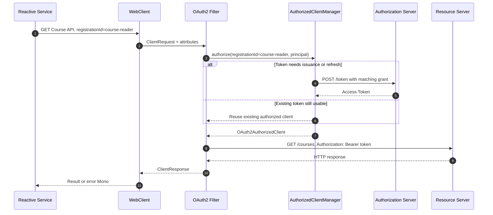

# 30.8. Testing WebClient Filters and Registration Selection

## Lesson Objectives

In a **Spring Security OAuth 2.0/OIDC Client application running on WebFlux**, `WebClient` frequently calls a Resource Server on behalf of a user or calls APIs using the **Client Credentials Grant**. Selecting the wrong OAuth2 `ClientRegistration` can send the wrong Access Token, trigger `401/403`, mix permissions across tenants, or—even worse—leak tokens to an untrusted API.

After this lesson, you will be able to:

- Understand what **`ServerOAuth2AuthorizedClientExchangeFilterFunction`** does in the `WebClient` pipeline and the boundary between the filter, `ReactiveOAuth2AuthorizedClientManager`, providers, repositories, and the Token Endpoint.
- Distinguish **`registrationId`**, `clientId`, issuer, token audience, current `Authentication`, and an **`OAuth2AuthorizedClient`** holding an issued token.
- Select a registration explicitly with `.attributes(ServerOAuth2AuthorizedClientExchangeFilterFunction.clientRegistrationId(...))` when a request needs a specific OAuth2 client.
- Understand precedence among an explicit authorized client, explicit registration, configured default registration, and the option to use the current OAuth2 `Authentication`'s authorized client.
- Write **offline filter unit tests** using a fake `ExchangeFunction`, Mockito, Reactor `StepVerifier`, and `Authorization` header assertions.
- Verify **the manager receives the right registration ID**, rather than only asserting an HTTP call returns 200.
- Test branches for **valid token, missing token, expired token, manager error, API 401/403, and wrong registration**.
- Distinguish filter-layer tests from **Token Endpoint integration tests** using a mock HTTP server and **`WebTestClient`** layer tests.
- Choose the right manager for **requests with a `ServerWebExchange`** versus **scheduled/background jobs** without a browser session.
- Handle Reactor Context, `ReactiveSecurityContextHolder`, concurrency, and multi-tenant token isolation while avoiding `.block()` in WebFlux.
- Prevent Access Token leakage caused by overly broad default authorized clients, dynamic URLs, redirects, HTTP logging, or filters reused across multiple domains.
- Build a test matrix and diagnostic workflow to verify that the OAuth2 Client works properly across **security, permissions, and token lifecycle**.

---

## 1. Scenario: Two APIs, Two `ClientRegistration`s

Suppose **Learning Portal** uses Spring Boot WebFlux:

```text
Browser
   |
   v
Learning Portal (Reactive OAuth2 Client)
   |
   +----> Course API
   |        requires Access Token for course-api
   |        scope: courses.read
   |
   +----> Reporting API
            requires Access Token for reporting-api
            scope: reports.write
```

The application defines two registrations:

```text
registrationId = course-reader
    clientId    = learning-course-client
    token target / audience = course-api
    allowed scope = courses.read

registrationId = report-publisher
    clientId    = learning-report-client
    token target / audience = reporting-api
    allowed scope = reports.write
```

From the server, two requests are sent using the same framework:

```java
webClient.get()
    .uri("https://course.example.org/api/courses")
    .retrieve()
    .bodyToMono(String.class);
```

```java
webClient.post()
    .uri("https://reporting.example.org/api/reports")
    .retrieve()
    .bodyToMono(String.class);
```

If an OAuth2 filter is attached **without selecting a registration explicitly**, behavior may depend on the current `Authentication` or a configured default. A request to the Reporting API might accidentally receive the Course API's token.

Symptom:

```text
Course API       -> 200
Reporting API    -> 401 invalid_token
```

Or worse, an API with weak audience verification might accept a token intended for a different purpose.

**Tests must prove two distinct things:**

1. `WebClient` sends the right `Authorization: Bearer ...` to the **valid target API**.
2. The OAuth2 filter requested **the right `ClientRegistration`**, not merely attached an arbitrary token.

> **Principle:** A test asserting only `HTTP 200` does not prove OAuth2 registration selection is right. Inspect both **`OAuth2AuthorizeRequest.getClientRegistrationId()`** and the **outbound `Authorization` header**, plus Resource Server validation in integration tests.

## 2. Reactive OAuth2 Client Component Overview

Key classes:

| Component | Responsibility |
| --- | --- |
| `WebClient` | Sends non-blocking HTTP requests |
| `ExchangeFilterFunction` | Intercepts outbound requests/responses |
| `ServerOAuth2AuthorizedClientExchangeFilterFunction` | Selects/authorizes the OAuth2 client and attaches the Bearer token |
| `ReactiveOAuth2AuthorizedClientManager` | Looks up or acquires/reacquires an authorized client |
| `ReactiveOAuth2AuthorizedClientProvider` | Handles grants such as `authorization_code`, `refresh_token`, `client_credentials` |
| `ReactiveClientRegistrationRepository` | Looks up OAuth2 client configuration by `registrationId` |
| `ServerOAuth2AuthorizedClientRepository` | Saves/loads authorized clients per `ServerWebExchange` in server requests |
| `ReactiveOAuth2AuthorizedClientService` | Service-level authorized client storage without `ServerWebExchange` |
| `OAuth2AuthorizedClient` | Registration + `principalName` + Access Token + optional Refresh Token |
| `ReactiveSecurityContextHolder` | Provides `SecurityContext`/`Authentication` via Reactor Context |
| `WebTestClient` | Tests reactive inbound endpoints |
| `StepVerifier` | Asserts `Mono`/`Flux` emissions and asynchronous errors |

### 2.1. Request Flow



In practice, the filter may need `ServerWebExchange`, `Authentication`, and a repository depending on the constructor/manager. This is a **logical view**; it does not mean the filter calls `/token` on every request.

### 2.2. Distinguishing Three Identities

```text
registrationId = course-reader
clientId       = learning-course-client
principalName  = report-worker-prod
```

- `registrationId` is Spring Security's internal key.
- `clientId` is the OAuth Client identifier issued by the Authorization Server.
- `principalName` is the persistence key for authorized clients; in M2M flows it is usually a stable service name, not an end user.

Never assume all three values are identical.

## 3. What Is `ServerOAuth2AuthorizedClientExchangeFilterFunction`?

In Spring Security Reactive, the filter:

```java
ServerOAuth2AuthorizedClientExchangeFilterFunction
```

can be registered on `WebClient.Builder`:

```java
WebClient client = WebClient.builder()
    .filter(oauth2Filter)
    .build();
```

Primary duties:

1. Locate the `OAuth2AuthorizedClient` or registration requested by the call.
2. Ask the manager to retrieve or acquire an authorized client when needed.
3. Attach the Bearer Access Token to the outbound HTTP request.
4. Handle authorization failures per configuration.
5. Return the response in the reactive chain without turning `WebClient` into a Servlet client.

### 3.1. Two Constructor Forms to Distinguish

One form takes a manager:

```java
new ServerOAuth2AuthorizedClientExchangeFilterFunction(
    reactiveAuthorizedClientManager
);
```

Another form takes repositories:

```java
new ServerOAuth2AuthorizedClientExchangeFilterFunction(
    clientRegistrationRepository,
    authorizedClientRepository
);
```

Important difference: when passing a manager directly, **an authorization failure handler is not always configured by default the same way as the repository constructor**. If your app needs to remove an authorized client when an API reports an invalid token, verify or configure `setAuthorizationFailureHandler(...)` per contract.

Do not use the Servlet class:

```java
ServletOAuth2AuthorizedClientExchangeFilterFunction
```

in a pure WebFlux project.

### 3.2. The Filter Is Not a Resource Server Validator

The filter **sends tokens**; it does not prove a Resource Server receives tokens with the right issuer/audience/scope. The Resource Server must still validate tokens and enforce authorization.

### 3.3. The Filter Is Not an Identity Provider

The filter does not choose which user to impersonate. A `ClientCredentials` token represents the client/workload, not a student's identity without delegated authorization.

## 4. Ways to Select an Authorized Client

Common approaches:

```java
.attributes(
    ServerOAuth2AuthorizedClientExchangeFilterFunction
        .clientRegistrationId("course-reader")
)
```

Or pass an already-resolved authorized client:

```java
.attributes(
    ServerOAuth2AuthorizedClientExchangeFilterFunction
        .oauth2AuthorizedClient(authorizedClient)
)
```

Or configure a default:

```java
oauth2Filter.setDefaultClientRegistrationId(
    "course-reader"
);
```

Additionally:

```java
oauth2Filter.setDefaultOAuth2AuthorizedClient(true);
```

lets the filter use the authorized client tied to the current OAuth2 `Authentication` in supported scenarios.

### 4.1. Explicit Registration Selection Is Easy to Test

For a `WebClient` serving a specific API:

```java
webClient.get()
    .uri("/api/courses")
    .attributes(
        ServerOAuth2AuthorizedClientExchangeFilterFunction
            .clientRegistrationId("course-reader")
    )
    .retrieve()
    .bodyToMono(CourseResponse.class);
```

This request expresses clear intent: use the `course-reader` registration.

### 4.2. Explicit Authorized Client Is a Distinct Case

An `OAuth2AuthorizedClient` already holding an Access Token and registration:

```java
webClient.get()
    .uri("/api/courses")
    .attributes(
        ServerOAuth2AuthorizedClientExchangeFilterFunction
            .oauth2AuthorizedClient(authorizedClient)
    )
    .retrieve()
    .bodyToMono(String.class);
```

This is useful when a business service **already authorized** the right user/grant upstream. Ensure the authorized client belongs to the right principal, registration, and resource; never accept objects/tokens from untrusted HTTP inputs.

### 4.3. Default Registration Is Convenient Yet Increases Risk

```java
oauth2Filter.setDefaultClientRegistrationId(
    "course-reader"
);
```

When a `WebClient` is shared across multiple APIs, a request that forgets `.attributes(...)` may automatically send the `course-reader` token to an unintended endpoint.

### 4.4. `setDefaultOAuth2AuthorizedClient(true)` Requires Extra Care

When enabled:

```java
oauth2Filter.setDefaultOAuth2AuthorizedClient(true);
```

the filter can pick the authorized client of the **current OAuth2 user** from Reactor `SecurityContext`. If the same `WebClient` calls multiple URLs, a user token can leak to an unintended Resource Server.

Enable it only when all outbound destinations are tightly controlled and policy permits. In many systems, **explicit per-request selection** or **a dedicated `WebClient` per API** is safer to govern.

### 4.5. Precedence Order Must Be Tested Against Your Version and Config

When an explicit authorized client, explicit registration ID, default registration ID, and default current-user client coexist, the filter follows selection precedence defined by your Spring Security version.

Do not rely on vague guesses like "default always wins" or "current user always wins." Write tests against **your real configuration** and assert which authorized client/registration the manager processed.

## 5. Spring Boot WebFlux Example with Two Registrations

```yaml
spring:
  security:
    oauth2:
      client:
        registration:
          course-reader:
            provider: campus
            client-id: ${COURSE_READER_CLIENT_ID}
            client-secret: ${COURSE_READER_CLIENT_SECRET}
            client-authentication-method: client_secret_basic
            authorization-grant-type: client_credentials
            scope:
              - courses.read

          report-publisher:
            provider: campus
            client-id: ${REPORT_PUBLISHER_CLIENT_ID}
            client-secret: ${REPORT_PUBLISHER_CLIENT_SECRET}
            client-authentication-method: client_secret_basic
            authorization-grant-type: client_credentials
            scope:
              - reports.write

        provider:
          campus:
            token-uri: https://idp.example.org/oauth2/token
```

This is an example configuration for the Client Credentials Grant, not OIDC Login; M2M needs neither `openid` nor browser redirects.

### 5.1. Registration ID and Token Audience Differ

```text
registrationId = course-reader
scope          = courses.read
```

does not guarantee the Access Token contains:

```text
aud = course-api
```

Audience is determined by the Authorization Server per client/API policy or resource indicator/provider-specific token request. **Filter-level tests do not prove the real token's audience.**

### 5.2. Never Reuse the Same Client Secret Across All Registrations

Credentials for `report-publisher` should hold minimal scopes/resources and must not be valid for Admin APIs. Also separate dev, staging, and production secrets.

## 6. Manager for Background Jobs Without `ServerWebExchange`

For a scheduled job, there is no inbound browser request. A suitable choice:

```java
AuthorizedClientServiceReactiveOAuth2AuthorizedClientManager
```

with `ReactiveOAuth2AuthorizedClientService`.

Example:

```java
@Configuration
class OutboundOAuth2Configuration {

    @Bean
    ReactiveOAuth2AuthorizedClientManager
    serviceAuthorizedClientManager(
            ReactiveClientRegistrationRepository registrations,
            ReactiveOAuth2AuthorizedClientService service) {

        ReactiveOAuth2AuthorizedClientProvider provider =
            ReactiveOAuth2AuthorizedClientProviderBuilder.builder()
                .clientCredentials()
                .build();

        AuthorizedClientServiceReactiveOAuth2AuthorizedClientManager
            manager =
                new AuthorizedClientServiceReactiveOAuth2AuthorizedClientManager(
                    registrations,
                    service
                );

        manager.setAuthorizedClientProvider(provider);
        return manager;
    }

    @Bean
    WebClient courseWebClient(
            ReactiveOAuth2AuthorizedClientManager manager) {

        ServerOAuth2AuthorizedClientExchangeFilterFunction oauth2 =
            new ServerOAuth2AuthorizedClientExchangeFilterFunction(
                manager
            );

        return WebClient.builder()
            .baseUrl("https://course.example.org")
            .filter(oauth2)
            .build();
    }
}
```

`ReactiveClientRegistrationRepository` and `ReactiveOAuth2AuthorizedClientService` beans must exist in the context, provided by Boot auto-configuration or the project.

### 6.1. Why Not Use `DefaultReactiveOAuth2AuthorizedClientManager` Everywhere?

`DefaultReactiveOAuth2AuthorizedClientManager` handles authorization in a **`ServerWebExchange` context**, using `ServerOAuth2AuthorizedClientRepository` and session/request context.

Scheduled jobs lack that request. If a test supplies a mock `ServerWebExchange` while production runs outside web requests, tests may pass yet runtime fails or loses the authorized client.

### 6.2. Principal for Client Credentials

When using the service authorized client manager, the principal can be set to a stable service identity:

```java
OAuth2AuthorizeRequest request =
    OAuth2AuthorizeRequest
        .withClientRegistrationId("course-reader")
        .principal("course-sync-job")
        .build();
```

`principal` here is the persistence key and token-issuance context, **not an end user with an OIDC session**.

### 6.3. Filter Still Needs Appropriate Context

When using `ServerOAuth2AuthorizedClientExchangeFilterFunction`, callers must select the registration and supply `Authentication`/`ServerWebExchange` per the manager/filter contract; test with a reactive security context or explicit manager authorization to avoid implicit behavior.

For complex scheduled jobs, a clean, testable pattern is **authorizing explicitly** via the service manager and attaching `oauth2AuthorizedClient` to the request, rather than relying on a nonexistent user context.

## 7. Dedicated `WebClient` Per Resource Server

A design that reduces token exposure:

```text
courseWebClient
    baseUrl = https://course.example.org
    intended registration = course-reader

reportingWebClient
    baseUrl = https://reporting.example.org
    intended registration = report-publisher
```

Factory example:

```java
@Bean
WebClient reportingWebClient(
        ReactiveOAuth2AuthorizedClientManager manager) {

    ServerOAuth2AuthorizedClientExchangeFilterFunction oauth2 =
        new ServerOAuth2AuthorizedClientExchangeFilterFunction(
            manager
        );

    oauth2.setDefaultClientRegistrationId(
        "report-publisher"
    );

    return WebClient.builder()
        .baseUrl("https://reporting.example.org")
        .filter(oauth2)
        .build();
}
```

Configuring a default is only reasonable if the `WebClient` **is never used to call arbitrary URLs**; HTTP redirects to other hosts must also be controlled.

### 7.1. Per-Request Explicit Registration

An alternative avoiding defaults:

```java
Mono<CourseDto[]> loadCourses(WebClient courseWebClient) {
    return courseWebClient.get()
        .uri("/api/courses")
        .attributes(
            ServerOAuth2AuthorizedClientExchangeFilterFunction
                .clientRegistrationId("course-reader")
        )
        .retrieve()
        .bodyToMono(CourseDto[].class);
}
```

This is a method where tests should verify the manager is called with `course-reader` and the outbound request carries the right Bearer token.

## 8. Four-Layer Testing Strategy

| Layer | Tools | Goal | Does NOT prove |
| --- | --- | --- | --- |
| **Filter unit test** | Fake `ExchangeFunction`, Mockito, `StepVerifier` | Registration selection, Bearer header attachment, error propagation | Real Token Endpoint, signature/audience |
| **Token manager integration** | Fake Token Endpoint, `MockWebServer`/WireMock | Client Credentials request/response, scopes, cache/expiry | Browser OIDC Login, RS policy |
| **Reactive inbound test** | `WebTestClient`, `spring-security-test` | Controller → service → `WebClient`, `SecurityContext`/Reactor Context | OP/browser redirect E2E if login is mocked |
| **End-to-end** | Test AS + test RS + browser when OIDC is used | Full token issuance, HTTP transport, and audience/authorization | Production always matches test policy if config differs |

Good tests **draw clear boundaries**. Unit testing a `WebClient` filter is not testing JWT decoding. Mocking `oidcLogin()` does not prove OAuth2 Authorization Code/PKCE/token validation actually ran.

## 9. Reactive Testing Tools

Typical libraries for JUnit 5:

```groovy
dependencies {
    implementation 'org.springframework.boot:spring-boot-starter-webflux'
    implementation 'org.springframework.boot:spring-boot-starter-oauth2-client'

    testImplementation 'org.springframework.boot:spring-boot-starter-test'
    testImplementation 'org.springframework.security:spring-security-test'
    testImplementation 'io.projectreactor:reactor-test'
}
```

If using an HTTP mock server:

```groovy
testImplementation 'com.squareup.okhttp3:mockwebserver'
```

Choosing `MockWebServer` or WireMock depends on your project stack/versions. Align dependency names/versions in examples with your Spring Boot BOM and Spring Security version.

### 9.1. Why Use `StepVerifier`?

`WebClient` returns `Mono<T>` or `Flux<T>`. `StepVerifier` lets you subscribe and assert:

```text
expectNext
expectComplete
expectError
verify
```

No need to put `.block()` inside reactive services to write tests.

### 9.2. Do Not Test by "Creating a `Mono` and Leaving It Unsubscribed"

A lazy `Publisher`:

```java
Mono<String> response = webClient.get()
    .uri("/api/courses")
    .retrieve()
    .bodyToMono(String.class);
```

has not sent any HTTP request yet. Tests must subscribe with `StepVerifier.create(response)...verifyComplete()` or an equivalent subscriber.

## 10. Building `ClientRegistration` Test Fixtures

A Client Credentials registration:

```java
private static ClientRegistration registration(
        String registrationId,
        String clientId,
        String scope) {

    return ClientRegistration
        .withRegistrationId(registrationId)
        .clientId(clientId)
        .clientSecret("test-secret-not-production")
        .clientAuthenticationMethod(
            ClientAuthenticationMethod.CLIENT_SECRET_BASIC
        )
        .authorizationGrantType(
            AuthorizationGrantType.CLIENT_CREDENTIALS
        )
        .tokenUri(
            "https://idp.test.example/oauth2/token"
        )
        .scope(scope)
        .build();
}
```

Using the fixture:

```java
ClientRegistration course = registration(
    "course-reader",
    "course-client-test",
    "courses.read"
);

ClientRegistration reporting = registration(
    "report-publisher",
    "report-client-test",
    "reports.write"
);
```

In unit tests, `ClientRegistration` does not need OP discovery. Using `withRegistrationId(...)` keeps tests independent of the network or real OAuth2 vendor config.

### 10.1. A Registration Is Not a Token

The fixture above holds only client config, not an Access Token. To test filter headers, construct a fake `OAuth2AuthorizedClient` or mock the manager returning an authorized client.

## 11. Building `OAuth2AuthorizedClient` Test Fixtures

```java
private static OAuth2AuthorizedClient authorizedClient(
        ClientRegistration registration,
        String principalName,
        String tokenValue,
        String scope) {

    Instant now = Instant.now();

    OAuth2AccessToken accessToken = new OAuth2AccessToken(
        OAuth2AccessToken.TokenType.BEARER,
        tokenValue,
        now.minusSeconds(10),
        now.plusSeconds(300),
        Set.of(scope)
    );

    return new OAuth2AuthorizedClient(
        registration,
        principalName,
        accessToken
    );
}
```

Usage:

```java
OAuth2AuthorizedClient courseClient = authorizedClient(
    courseRegistration,
    "course-sync-job",
    "test-course-token",
    "courses.read"
);

OAuth2AuthorizedClient reportClient = authorizedClient(
    reportRegistration,
    "report-sync-job",
    "test-report-token",
    "reports.write"
);
```

These token strings are **fake unit-test values**. Never use production credentials or tokens copied from real accounts in fixtures.

### 11.1. What the Unit Test Assumes

The mock manager returns an authorized client with a fixture-valid Bearer token. The filter's job is attaching that token to the HTTP request. Unit tests **do not verify** the Access Token's signature/issuer/audience.

## 12. Building a Fake `ExchangeFunction` to Capture Outbound Requests

One way to test the filter without an HTTP server is replacing the terminal `ExchangeFunction`.

```java
AtomicReference<ClientRequest> sent =
    new AtomicReference<>();

ExchangeFunction fakeExchange = request -> {
    sent.set(request);

    return Mono.just(
        ClientResponse
            .create(HttpStatus.OK)
            .body("ok")
            .build()
    );
};
```

When `WebClient` executes a request, the fake exchange receives **`ClientRequest` after the filter ran** and returns a fake `ClientResponse`.

### 12.1. What Can Be Asserted?

```text
request.url()
request.method()
request.headers().getFirst(HttpHeaders.AUTHORIZATION)
request.attributes()
```

This is the ideal observation point to confirm whether the final Bearer header was attached.

### 12.2. No Real HTTP Server Required

Filter unit tests:

```text
WebClient -> OAuth2 filter -> fake ExchangeFunction
```

open no network connections and call no real OP or API.

### 12.3. A Fake Exchange Does Not Replace the Manager

If a mock manager returns an arbitrary token, the test does not know whether real authorization grant/token requests carry the right scopes. Write separate integration tests for that.

## 13. Complete Unit Test: Selecting Registration and Sending Bearer Token

JUnit 5, Mockito, and Reactor Test example (imports omitted to focus on behavior):

```java
class WebClientOAuth2SelectionTest {

    private ReactiveOAuth2AuthorizedClientManager manager;

    private AtomicReference<ClientRequest> sent;

    private WebClient webClient;

    @BeforeEach
    void setUp() {
        manager = mock(
            ReactiveOAuth2AuthorizedClientManager.class
        );

        sent = new AtomicReference<>();

        ClientRegistration course = registration(
            "course-reader",
            "course-client-test",
            "courses.read"
        );

        ClientRegistration reporting = registration(
            "report-publisher",
            "report-client-test",
            "reports.write"
        );

        OAuth2AuthorizedClient courseClient = authorizedClient(
            course,
            "course-sync-job",
            "test-course-token",
            "courses.read"
        );

        OAuth2AuthorizedClient reportClient = authorizedClient(
            reporting,
            "report-sync-job",
            "test-report-token",
            "reports.write"
        );

        when(manager.authorize(
            any(OAuth2AuthorizeRequest.class)
        )).thenAnswer(invocation -> {

            OAuth2AuthorizeRequest request =
                invocation.getArgument(0);

            return switch (request.getClientRegistrationId()) {
                case "course-reader" -> Mono.just(courseClient);
                case "report-publisher" -> Mono.just(reportClient);
                default -> Mono.empty();
            };
        });

        ExchangeFunction exchange = request -> {
            sent.set(request);

            return Mono.just(
                ClientResponse.create(HttpStatus.OK)
                    .body("ok")
                    .build()
            );
        };

        ServerOAuth2AuthorizedClientExchangeFilterFunction oauth2 =
            new ServerOAuth2AuthorizedClientExchangeFilterFunction(
                manager
            );

        webClient = WebClient.builder()
            .filter(oauth2)
            .exchangeFunction(exchange)
            .build();
    }

    @Test
    void selectsCourseRegistrationAndAddsCourseToken() {
        Mono<String> response = webClient.get()
            .uri("https://course.test.example/api/courses")
            .attributes(
                ServerOAuth2AuthorizedClientExchangeFilterFunction
                    .clientRegistrationId("course-reader")
            )
            .retrieve()
            .bodyToMono(String.class)
            .contextWrite(
                ReactiveSecurityContextHolder.withAuthentication(
                    new TestingAuthenticationToken(
                        "course-sync-job",
                        "n/a",
                        "ROLE_SYSTEM"
                    )
                )
            );

        StepVerifier.create(response)
            .expectNext("ok")
            .verifyComplete();

        ArgumentCaptor<OAuth2AuthorizeRequest> captor =
            ArgumentCaptor.forClass(
                OAuth2AuthorizeRequest.class
            );

        verify(manager).authorize(captor.capture());

        assertThat(
            captor.getValue().getClientRegistrationId()
        ).isEqualTo("course-reader");

        assertThat(
            sent.get().headers().getFirst(
                HttpHeaders.AUTHORIZATION
            )
        ).isEqualTo("Bearer test-course-token");
    }
}
```

Helpers `registration(...)` and `authorizedClient(...)` are the fixtures defined in earlier sections. Add imports for JUnit, AssertJ, Mockito, Reactor, Spring HTTP, `WebClient`, Spring Security OAuth2/Reactive, and Java types.

### 13.1. What the Test Proves

- `.attributes(clientRegistrationId("course-reader"))` triggers manager authorization with that exact ID.
- The filter attaches the Access Token from the returned authorized client.
- Results are processed as `Mono` without `.block()` in the service.
- The fake exchange makes zero network calls.

### 13.2. What the Test Does Not Prove

- That the Authorization Server issued a real token.
- That the token is validly signed.
- That the Access Token has `aud=course-api`.
- That the Resource Server actually accepts the token.
- That `client_secret` or `private_key_jwt` is sent properly.
- That token refresh/caching works over real time.

Those points must be tested in subsequent layers.

### 13.3. Why Add `ReactiveSecurityContextHolder`?

In a server environment, the filter/manager may expect an `Authentication` from Reactor `SecurityContext`. The test supplies a technical principal so behavior has deterministic context. This **does not** turn the Client Credentials Grant into user-delegated OAuth2.

In production scheduled jobs, configure the service manager with an explicit principal/service policy or authorize explicitly, rather than implicitly expecting a browser user context.

## 14. Testing Selecting the Second Registration

Independent test:

```java
@Test
void selectsReportRegistrationAndAddsReportToken() {
    Mono<String> response = webClient.post()
        .uri("https://report.test.example/api/reports")
        .attributes(
            ServerOAuth2AuthorizedClientExchangeFilterFunction
                .clientRegistrationId("report-publisher")
        )
        .retrieve()
        .bodyToMono(String.class)
        .contextWrite(
            ReactiveSecurityContextHolder.withAuthentication(
                new TestingAuthenticationToken(
                    "report-sync-job",
                    "n/a",
                    "ROLE_SYSTEM"
                )
            )
        );

    StepVerifier.create(response)
        .expectNext("ok")
        .verifyComplete();

    ArgumentCaptor<OAuth2AuthorizeRequest> captor =
        ArgumentCaptor.forClass(OAuth2AuthorizeRequest.class);

    verify(manager).authorize(captor.capture());

    assertThat(
        captor.getValue().getClientRegistrationId()
    ).isEqualTo("report-publisher");

    assertThat(
        sent.get().headers().getFirst(
            HttpHeaders.AUTHORIZATION
        )
    ).isEqualTo("Bearer test-report-token");
}
```

When both tests share a single `WebClient` instance, selecting registrations via **per-request attributes** must still yield two distinct tokens.

### 14.1. Do Not Only Check Any Token String

If tests mock the manager to return `"token-abc"` for every registration, Bearer header assertions can pass even when the wrong registration is chosen. Use **distinct token fixtures** so selection bugs are immediately observable.

### 14.2. Never Share a Single `AtomicReference` Across Parallel Tests

The fixture above uses one `AtomicReference` per sequential test instance. If concurrent tests share a `WebClient`/fixture, one request can overwrite another.

For concurrency tests:

- Capture into a thread-safe collection.
- Attach a non-sensitive test request ID.
- Assert each request by URI/registration.
- Avoid static mutable state.

## 15. Verifying the Manager Receives the Right `registrationId`

The core check can be asserted explicitly:

```java
ArgumentCaptor<OAuth2AuthorizeRequest> captor =
    ArgumentCaptor.forClass(
        OAuth2AuthorizeRequest.class
    );

verify(manager).authorize(captor.capture());

assertThat(
    captor.getValue().getClientRegistrationId()
).isEqualTo("course-reader");
```

Reason: the `Authorization` header verifies the **output**, whereas `OAuth2AuthorizeRequest` verifies the **registration selection decision**.

### 15.1. Asserting Other Fields

When needed:

```java
Authentication principal =
    captor.getValue().getPrincipal();

assertThat(principal).isNotNull();
```

You can assert principal name/context per app contract. Do not assume `principal.getName()` equals the OAuth2 `clientId` when the job uses a separate service key.

### 15.2. Request Attributes Do Not Modify `ClientRegistrationRepository`

`.attributes(clientRegistrationId(...))` selects a registration key. It **does not create** a new `ClientRegistration` or alter the scopes/token URI of a managed registration.

If the ID does not exist, the manager/provider/repository must handle the error or return no authorized client per implementation; test that it fails closed.

## 16. Testing Requests That Specify No Registration

Two valid policies exist, depending on the application:

**Policy A — Explicit selection required:**

```text
No clientRegistrationId
No explicit authorized client
No default configuration
    -> Do not attach an Access Token
```

**Policy B — Dedicated `WebClient` for one API:**

```text
No explicit registration
Default registration course-reader configured
    -> Automatically select course-reader
```

Write tests for the policy you chose rather than relying implicitly on framework defaults.

### 16.1. When There Is No Default

```java
Mono<String> response = webClient.get()
    .uri("https://public.test.example/health")
    .retrieve()
    .bodyToMono(String.class);

StepVerifier.create(response)
    .expectNext("ok")
    .verifyComplete();

assertThat(
    sent.get().headers().containsKey(
        HttpHeaders.AUTHORIZATION
    )
).isFalse();
```

This assumes the filter has no default configured and no explicit OAuth2 authorized client/current OAuth2 client applies. If your environment enables default-user behavior, test against your real configuration.

### 16.2. If a Request Missing a Registration Should Fail Business Logic

For a `WebClient` dedicated to calling secured APIs, you may want to **fail fast** when the ID is forgotten instead of sending an anonymous request and getting 401.

Example service wrapper:

```java
Mono<String> fetchWithRegistration(
        String registrationId) {

    if (!ALLOWED_REGISTRATIONS.contains(registrationId)) {
        return Mono.error(
            new IllegalArgumentException(
                "Registration is not allowed"
            )
        );
    }

    return webClient.get()
        .uri("/api/reports")
        .attributes(
            ServerOAuth2AuthorizedClientExchangeFilterFunction
                .clientRegistrationId(registrationId)
        )
        .retrieve()
        .bodyToMono(String.class);
}
```

Never take `registrationId` directly from arbitrary user input without checking a business allowlist.

## 17. Testing Default Client Registration

Suppose:

```java
oauth2.setDefaultClientRegistrationId(
    "course-reader"
);
```

Request:

```java
webClient.get()
    .uri("https://course.test.example/api/courses")
    .retrieve()
    .bodyToMono(String.class);
```

Expected test result:

```text
manager.authorize request.registrationId == course-reader
Authorization == Bearer test-course-token
```

### 17.1. Testing Explicit Override

When the default is `course-reader`, a request to the reporting API explicitly chooses:

```java
.attributes(
    ServerOAuth2AuthorizedClientExchangeFilterFunction
        .clientRegistrationId("report-publisher")
)
```

Tests must prove the manager receives `report-publisher` rather than accidentally using the default.

### 17.2. Never Use a Default on an Uncontrolled Multi-Domain `WebClient`

A client with a default token that allows:

```java
webClient.get()
    .uri(userSuppliedUrl)
```

risks sending Access Tokens to user-specified hosts. Filter/wrapper unit tests should verify non-allowlisted URLs are rejected, typically in the service wrapper or HTTP client configuration.

## 18. Testing Explicit `OAuth2AuthorizedClient`

When a service already authorized a client explicitly:

```java
OAuth2AuthorizedClient authorized =
    ...; // trusted authorized client

Mono<String> response = webClient.get()
    .uri("https://course.test.example/api/courses")
    .attributes(
        ServerOAuth2AuthorizedClientExchangeFilterFunction
            .oauth2AuthorizedClient(authorized)
    )
    .retrieve()
    .bodyToMono(String.class);
```

You can assert:

```text
Authorization header == Bearer <trusted authorized token>
Object's registration is course-reader
Does not accidentally pick a token from another principal/registration
```

### 18.1. Testing Authorized Client Ownership Mismatch

If user A's `OAuth2AuthorizedClient` object is passed into user B's request, the filter will use token A. The framework cannot infer every application ownership rule.

Therefore, authorized client retrieval must be controlled, with tests asserting:

```text
User B cannot obtain User A's authorized client from the store
```

### 18.2. Never Accept an Authorized Client from HTTP Clients

Browser users must never be allowed to send a raw Access Token or serialized authorized client in a request and trick the backend into forwarding it to a downstream API without proper authentication/authorization.

## 19. Testing `setDefaultOAuth2AuthorizedClient(true)`

Configuration:

```java
oauth2.setDefaultOAuth2AuthorizedClient(true);
```

lets the filter use the current OAuth2 `Authentication`'s authorized client as a default in supported contexts.

Required tests:

1. Request has a current `OAuth2AuthenticationToken` belonging to registration `campus-login`.
2. Request specifies no explicit client registration.
3. The filter selects the current authorized client per contract.
4. An unfamiliar or unapproved API **must not receive the user's token** just because the `WebClient` was reused.

### 19.1. When Is This Especially Dangerous?

A service using:

```text
WebClient with defaultOAuth2AuthorizedClient=true
```

and calling:

```text
https://untrusted.example/preview
```

can expose the user's Access Token. It is generally better to enable this only when destinations are strictly fixed, or pick the registration/authorized client explicitly per API.

### 19.2. Testing Without `Authentication`

When the current `SecurityContext` is absent:

```text
Never grab a previous user's token from a singleton/global state
```

A filter using Reactor Context properly must never cache a user token in a static field across requests.

### 19.3. Testing When Current `Authentication` Is Not OIDC/OAuth2

If the principal is a `TestingAuthenticationToken` or anonymous authentication, do not assume an end-user OAuth2 authorized client exists. Behavior depends on policy/default manager; assert it never accidentally picks an old user's token.

## 20. `ReactiveSecurityContextHolder` in Tests

A Reactive HTTP request carries `SecurityContext` via Reactor Context, not Servlet thread locals.

Example:

```java
Authentication authentication =
    new TestingAuthenticationToken(
        "test-user", "n/a", "ROLE_USER"
    );

Mono<String> publisher =
    webClient.get()
        .uri("https://course.test.example/api/courses")
        .attributes(
            ServerOAuth2AuthorizedClientExchangeFilterFunction
                .clientRegistrationId("course-reader")
        )
        .retrieve()
        .bodyToMono(String.class)
        .contextWrite(
            ReactiveSecurityContextHolder
                .withAuthentication(authentication)
        );
```

In WebFlux tests, you can use `spring-security-test`'s `WebTestClient` configurers to mock `Authentication` on the inbound side, then verify the outbound `WebClient`/manager.

### 20.1. Context Is Not a Global Variable

Never do:

```java
static Authentication currentUser;
```

Never place a token into a `ThreadLocal` and assume Reactor preserves it across `publishOn` and concurrent requests.

### 20.2. `contextWrite` Applies Along the Subscription Chain

Test:

```java
StepVerifier.create(publisher)
    .expectNext("ok")
    .verifyComplete();
```

`contextWrite` only takes effect when the publisher is subscribed along the right chain. If a service calls `.subscribe()` internally, context and errors can escape the outer chain.

## 21. Testing Errors When a Registration Is Not Found

A nonexistent registration ID:

```java
.attributes(
    ServerOAuth2AuthorizedClientExchangeFilterFunction
        .clientRegistrationId("missing-registration")
)
```

Do not write brittle tests assuming the framework **always** throws one specific exception class across all Spring Security versions. Depending on manager/provider, it may be an authorization error or no authorized client returned.

What you must prove is **failing closed** per application policy:

- Never fall back to `platform-admin`.
- Never pick the first registration in the repository.
- Never send another tenant's token.
- Never cache an out-of-context token.
- If continuing anonymously, the protected API must not return protected data.
- Logs must not leak credentials.

### 21.1. Mock Manager Simulating an Error

```java
when(manager.authorize(any()))
    .thenReturn(Mono.error(
        new IllegalArgumentException(
            "Unknown registration"
        )
    ));
```

Then:

```java
StepVerifier.create(
    webClient.get()
        .uri("https://course.test.example/api/courses")
        .attributes(
            ServerOAuth2AuthorizedClientExchangeFilterFunction
                .clientRegistrationId("missing-registration")
        )
        .retrieve()
        .bodyToMono(String.class)
)
.expectError()
.verify();
```

This tests that **the filter propagates manager errors**; it does not prove the real repository throws that same exception.

### 21.2. Never Work Around Missing Registrations with a High-Privilege Default

Wrong pattern:

```text
unknown registration -> fallback platform-admin
```

This turns a typo or configuration bug into a severe privilege escalation flaw.

## 22. Testing Manager Returning `Mono.empty()`

A `ReactiveOAuth2AuthorizedClientManager` may return no authorized client when no provider can authorize for the context.

Test:

```java
when(manager.authorize(any()))
    .thenReturn(Mono.empty());
```

Expectations to verify:

```text
No fake Bearer token attached
No stale token reused from a prior request
Protected API does not return data
```

Depending on filter/contract, the request may proceed without a `Bearer` header; the app can proactively **fail fast** in a service wrapper if a token is mandatory.

### 22.1. Failing Fast When a Token Is Mandatory

If an API always requires OAuth2, a service wrapper can authorize upfront and fail explicitly on `Mono.empty()`:

```java
Mono<OAuth2AuthorizedClient> acquireClient(
        ReactiveOAuth2AuthorizedClientManager manager,
        String registrationId,
        String principal) {

    OAuth2AuthorizeRequest request =
        OAuth2AuthorizeRequest
            .withClientRegistrationId(registrationId)
            .principal(principal)
            .build();

    return manager.authorize(request)
        .switchIfEmpty(
            Mono.error(
                new IllegalStateException(
                    "OAuth2 authorization was not granted"
                )
            )
        );
}
```

Then attach the authorized client explicitly to the `WebClient` request or pass the token through a properly configured client. Never call `.block()` in reactive services.

## 23. Testing the Real Token Endpoint with a Mock HTTP Server

Filter unit tests with a mock manager **skip** the Client Credentials Grant itself.

To test real token issuance, stand up a fake Authorization Server:

```text
POST /oauth2/token
    grant_type=client_credentials
    Authorization: Basic ...
    scope=courses.read
```

Fake server returns:

```http
HTTP/1.1 200 OK
Content-Type: application/json

{
  "access_token": "stub-course-token",
  "token_type": "Bearer",
  "expires_in": 300,
  "scope": "courses.read"
}
```

This is a **test-only token response**, not a production token.

### 23.1. Registration Pointing to the Mock Server

```java
ClientRegistration course = ClientRegistration
    .withRegistrationId("course-reader")
    .clientId("course-test-client")
    .clientSecret("test-secret")
    .clientAuthenticationMethod(
        ClientAuthenticationMethod.CLIENT_SECRET_BASIC
    )
    .authorizationGrantType(
        AuthorizationGrantType.CLIENT_CREDENTIALS
    )
    .tokenUri(mockServer.url("/oauth2/token").toString())
    .scope("courses.read")
    .build();
```

This assumes a mock server exposing `url(...)` such as `MockWebServer`. Then create the real reactive registrations/service/manager for the test.

### 23.2. Tests Should Assert the Request Sent to the AS

Verify:

```text
Method POST
Path /oauth2/token
Form grant_type=client_credentials
Request scope=courses.read
Client authentication matches registration
No OIDC nonce or user password sent
```

Do not assume `client_secret_basic` is the only method: providers may use `private_key_jwt`, mTLS, or workload identity federation. Tests must match the real contract.

### 23.3. Never Write Token Responses to Logs

Fake token strings are harmless, yet logging tests must confirm production code never logs raw tokens or Basic auth headers. If a mock server framework logs full requests, use only fake credentials and limit CI artifact retention.

## 24. Creating a Real Manager for Client Credentials Integration Tests

Logical test wiring:

```java
ReactiveClientRegistrationRepository registrations =
    new InMemoryReactiveClientRegistrationRepository(
        courseRegistration,
        reportRegistration
    );

ReactiveOAuth2AuthorizedClientService authorizedClients =
    new InMemoryReactiveOAuth2AuthorizedClientService(
        registrations
    );

AuthorizedClientServiceReactiveOAuth2AuthorizedClientManager manager =
    new AuthorizedClientServiceReactiveOAuth2AuthorizedClientManager(
        registrations,
        authorizedClients
    );

ReactiveOAuth2AuthorizedClientProvider provider =
    ReactiveOAuth2AuthorizedClientProviderBuilder.builder()
        .clientCredentials()
        .build();

manager.setAuthorizedClientProvider(provider);
```

Then:

```text
WebClient -> OAuth2 filter -> manager
    -> registration store
    -> Client Credentials token client
    -> fake AS /token
    -> authorized client service
    -> mock Resource Server
```

### 24.1. Conditions for Deterministic Tests

- Start the OP mock server before building registrations.
- Point registration Token URIs to localhost/mock server.
- Use finite timeouts; never depend on the public internet.
- Use a fresh service store per test or reset state.
- Use distinct token values per registration.
- Never use real credentials.

### 24.2. Client Credentials Is Not OIDC Login

This Token Endpoint integration test needs neither `/authorize`, `state`, `nonce`, nor `/login/oauth2/code/{registrationId}`. Those belong to Authorization Code/OIDC Login, not Client Credentials.

## 25. Testing Two Independent Token Requests

Have the mock AS return:

```text
course-reader:
    access_token = stub-course-token
    scope = courses.read

report-publisher:
    access_token = stub-report-token
    scope = reports.write
```

Run two outbound requests and verify:

```text
Course API receives Bearer stub-course-token
Reporting API receives Bearer stub-report-token
```

At the same time, the fake AS should observe:

```text
token request for course client ID
token request for report client ID
```

### 25.1. Token Caching

If the Course API is called a second time before the token expires using the same authorized-client key, the manager can **reuse** the token instead of calling `/token` again.

Test:

```text
First call  -> token endpoint invoked
Second call -> no new token request when current token reusable
```

Do not assert `/token` call counts without accounting for clock skew/expiry and provider behavior.

### 25.2. Never Share Cache Across Registrations

Two registrations with different Client IDs and scopes must maintain separate token states, even when sharing the same issuer and Token Endpoint.

## 26. Token Expiry and Refresh Behavior

An Access Token has:

```text
issuedAt
expiresAt
scopes
```

The provider/manager decides whether re-acquisition is needed near expiry, typically applying clock-skew handling.

### 26.1. Testing Valid Tokens

```text
Given:
  token expires far in future
When:
  same registration/principal calls again
Then:
  manager returns reusable authorized client
  token endpoint need not be called again
```

### 26.2. Testing Expired Tokens

```text
Given:
  token expires/within configured skew
When:
  new request arrives
Then:
  manager obtains new client credentials token
  outbound request uses newly issued token
```

### 26.3. Avoid Long `Thread.sleep(...)` Calls in Tests

A test waiting 300 seconds is slow and flaky. Better:

- Build expired token fixtures.
- Use a controllable clock where provider/implementation allows.
- Separate expiry-decision unit tests from HTTP integration.
- Assert behavior instead of waiting out wall-clock time.

### 26.4. Client Credentials Normally Has No Refresh Token

Per the OAuth2 spec, a refresh token **should not be included** in a Client Credentials Grant response. When the Access Token expires, the client simply uses the Client Credentials Grant again.

Do not write tests assuming every service account has a Refresh Token.

## 27. Testing the OAuth2 Filter with Token Endpoint Errors

A mock AS may return:

```http
HTTP/1.1 400 Bad Request
Content-Type: application/json

{
  "error": "invalid_client"
}
```

Or:

```http
HTTP/1.1 503 Service Unavailable
```

Expected behavior:

- `Mono` emits an appropriate authorization error.
- The protected HTTP request is never sent with a fake token or another registration's token.
- No fallback to an admin client.
- Logs record a safe error code/registration alias, never secrets.
- Retries are bounded by error type; never retry `invalid_client` endlessly.

### 27.1. Distinguish AS Errors from Resource Server Errors

```text
Token Endpoint /token -> 400 invalid_client
```

differs from:

```text
Resource Server /api/courses -> 401 invalid_token
```

AS errors occur **before** the filter has a token to attach to the outbound request. Resource Server 401 occurs **after** the request is sent.

### 27.2. Assert the Resource Server Is Not Called When Token Acquisition Fails

With a fake exchange counting calls:

```java
AtomicInteger apiCalls = new AtomicInteger();

ExchangeFunction exchange = request -> {
    apiCalls.incrementAndGet();

    return Mono.just(
        ClientResponse.create(HttpStatus.OK)
            .body("ok")
            .build()
    );
};
```

When the mock manager returns `Mono.error(...)`, the test expects:

```java
assertThat(apiCalls.get()).isZero();
```

This proves the filter never uses a fallback token or sends requests before authorization completes.

## 28. HTTP 401/403 from the Resource Server and Failure Handlers

A `WebClient` request sends a Bearer token, yet the API replies:

```http
HTTP/1.1 401 Unauthorized
WWW-Authenticate: Bearer error="invalid_token"
```

or:

```http
HTTP/1.1 403 Forbidden
WWW-Authenticate: Bearer error="insufficient_scope"
```

Review **authorized-client failure handling**:

- Should the stale authorized client be removed from the repository/service?
- Should the next call request a new token?
- Should authorization be retained on a plain business 403?
- Is there a risk of a retry loop?
- With delegated grants, could a newly refreshed token be deleted by mistake?

### 28.1. Different Constructors Have Different Defaults

When building the filter with repositories, Spring Security may auto-configure a handler that removes authorized clients on Bearer failures in HTTP responses.

When building the filter with a manually constructed `ReactiveOAuth2AuthorizedClientManager`, **do not assume the same handler is installed automatically**. If removal is required, configure `setAuthorizationFailureHandler(...)` with the right handler and test its behavior.

### 28.2. 401 Cannot Always Be Fixed by Refreshing

If a token has the wrong audience or scopes, requesting a new token with the same configuration may keep failing. Fix the AS policy/`ClientRegistration`/resource indicator instead.

### 28.3. 403 Does Not Automatically Delete Every Token

A business 403 from an API may reflect missing resource permissions rather than an invalid Access Token. Failure handlers must inspect `WWW-Authenticate`/OAuth2 errors and policy to avoid wiping tokens for all users.

### 28.4. Testing Eviction Followed by Reauthorization

An integration test can verify:

```text
Call 1:
    manager returns token T1
    API returns 401 invalid_token
    failure handler removes T1 if policy configured

Call 2:
    manager obtains fresh token T2
    API receives T2
```

Do not just assert Call 1 returns 401; assert the store or Call 2 when testing token eviction/recovery.

### 28.5. 401 Can Be Converted into an Exception by `retrieve()`

With `retrieve().bodyToMono(...)`, Spring `WebClient` normally turns 4xx/5xx into `WebClientResponseException`. With `exchangeToMono`, code may handle statuses differently.

Filter failure handling and caller error mapping are **two layers**; tests must verify both the repository/token manager reaction and the resulting `Mono` seen by the service.

## 29. Testing the Distinction Between `401` and `403`

A fake exchange returning 401:

```java
ExchangeFunction unauthorized = request ->
    Mono.just(
        ClientResponse
            .create(HttpStatus.UNAUTHORIZED)
            .header(
                HttpHeaders.WWW_AUTHENTICATE,
                "Bearer error=\"invalid_token\""
            )
            .body("denied")
            .build()
    );
```

Calling:

```java
webClient.get()
    .uri("https://course.test.example/api/courses")
    .attributes(
        ServerOAuth2AuthorizedClientExchangeFilterFunction
            .clientRegistrationId("course-reader")
    )
    .retrieve()
    .bodyToMono(String.class);
```

receives HTTP 401 at the HTTP layer. Expect the service to error/handle per policy, never silently returning `"ok"`.

### 29.1. Do Not Assert Auto-Removal Without Configuring a Handler

If the test builds the filter via the manager constructor without calling `setAuthorizationFailureHandler`, do not assume the authorized client service removed the token.

### 29.2. Test Bearer Challenges Safely

Never dump raw `WWW-Authenticate` values from untrusted servers if they contain provider-specific details that could leak data. Logs should record `invalid_token`, `insufficient_scope`, or a safe category.

## 30. Testing That Access Tokens Are Never Sent to Untrusted Hosts

The filter attaches a Bearer token to outbound requests. Target URLs must therefore belong to approved destinations.

Wrong:

```java
Mono<String> proxy(String userSuppliedUrl) {
    return oauthWebClient.get()
        .uri(userSuppliedUrl)
        .retrieve()
        .bodyToMono(String.class);
}
```

An attacker could pass:

```text
https://attacker.example/collect
```

to steal the token.

### 30.1. Safer Design

- Give each `WebClient` a fixed `baseUrl` per Resource Server.
- Never accept arbitrary absolute URLs from browsers.
- When endpoint selection is needed, map IDs/enums to a server-side allowlist.
- Control HTTP redirects, especially across hosts.
- Never log `Authorization` headers.
- Enforce TLS/hostname validation and egress controls where appropriate.

### 30.2. Testing a URL Allowlist

A service wrapper:

```java
Mono<String> fetch(
        TargetApi target) {

    return switch (target) {
        case COURSE ->
            courseWebClient.get()
                .uri("/api/courses")
                .attributes(
                    ServerOAuth2AuthorizedClientExchangeFilterFunction
                        .clientRegistrationId("course-reader")
                )
                .retrieve()
                .bodyToMono(String.class);

        case REPORTING ->
            reportingWebClient.get()
                .uri("/api/reports")
                .attributes(
                    ServerOAuth2AuthorizedClientExchangeFilterFunction
                        .clientRegistrationId("report-publisher")
                )
                .retrieve()
                .bodyToMono(String.class);
    };
}
```

Here `TargetApi` is a backend-controlled enum. Tests confirm no third user-injected destination is possible.

### 30.3. Never Forward Tokens Across Uncontrolled Redirects

A Resource Server could return 302/307 to another domain. Never assume the HTTP client will or will not strip the `Authorization` header by default; test your `ClientConnector`/HTTP stack's actual behavior and enforce policy.

## 31. Testing Filter Ordering and Logging Filters

A `WebClient` may register multiple filters:

```text
request-ID filter
logging filter
OAuth2 token filter
retry filter
metrics filter
```

Application order determines whether a filter sees **`ClientRequest` before or after the Bearer token is added**.

### 31.1. Never Log the `Authorization` Header

A dangerous logging filter:

```java
ExchangeFilterFunction logging = (request, next) -> {
    log.info("Headers: {}", request.headers());
    return next.exchange(request);
};
```

If it runs after the OAuth2 filter, logs can contain:

```text
Authorization: Bearer ...
```

Redact headers and log only safe metadata:

```text
registrationId
HTTP method
target service alias
status
duration
request correlation ID
```

### 31.2. Testing That Logs Contain No Tokens

Use fixture `"test-course-token"`, capture logs, and assert the token string **never appears**. This tests security hygiene, not authorization correctness.

### 31.3. Verify Filters Are Not Duplicated

If the OAuth2 filter is added twice, requests may authorize or set headers twice or behave unpredictably.

Check bean configuration and request tests so only the intended filter chain is present.

## 32. `WebTestClient` Testing Controllers That Call `WebClient`

`WebTestClient` tests **inbound WebFlux endpoints**; it does not directly replace the outbound `ExchangeFunction`.

Example flow:

```text
WebTestClient GET /api/my-courses
  -> WebFlux Controller
  -> CourseService
  -> WebClient with OAuth2 filter
  -> Fake Course API
```

Tests must:

1. Bind `WebTestClient` to the application context or controller under test.
2. Set up Security mocks if the endpoint requires `Authentication`.
3. Inject a `WebClient` configured with the OAuth2 filter and fake exchange/API server.
4. Assert the API response.
5. Assert the manager selected `course-reader` and attached the right token header.

### 32.1. What Does `mockOidcLogin()` Help With?

In Reactive Spring Security Test, `mockOidcLogin()` builds a mock OIDC `Authentication` for the inbound controller:

```java
WebTestClient authenticated =
    webTestClient.mutateWith(
        SecurityMockServerConfigurers.mockOidcLogin()
    );
```

Then invoke the endpoint and assert output.

However, `mockOidcLogin()` **does not actually run** the Authorization Code callback, Token Endpoint, or ID Token signature/JWKS validation.

### 32.2. Do Not Treat a Mock User Login as a Client Credentials Test

If `CourseService` uses a service-account token, inbound `mockOidcLogin()` only mocks the UI/API caller's principal. The M2M outbound token must still be acquired via registration `course-reader`, never using the mocked user's ID Token to call the Course API.

### 32.3. WebFlux Security with Reactor Context

If the controller/service reads current `Authentication`, `WebTestClient` tests must configure the Spring Security filter chain/context properly, rather than calling a plain POJO controller method and assuming Reactor Context works.

## 33. Testing Authorization Code / OIDC User-Delegated Tokens

Not every `WebClient` call uses `client_credentials`. A BFF may use the **Access Token of an OIDC-logged-in user**.

Flow:

```text
Browser OIDC Login
  -> OAuth2AuthenticationToken
  -> OAuth2AuthorizedClient for user + registration
  -> WebClient calls API with user Access Token
```

### 33.1. Selecting an Explicit Authorized Client

In a controller/service with trusted context, retrieve the user's authorized client for the right registration via repository/manager, then pass it to `WebClient`:

```java
.attributes(
    ServerOAuth2AuthorizedClientExchangeFilterFunction
        .oauth2AuthorizedClient(authorizedClient)
)
```

Never use an OIDC ID Token to call APIs.

### 33.2. Testing User A and User B

When authorized clients are stored per principal:

```text
User A -> Access Token TA
User B -> Access Token TB
```

Concurrent tests with two requests must prove A receives TA and B receives TB, without static tokens or global caches.

### 33.3. Testing Current OAuth2 `Authentication` Logged In Across Multiple Providers

```text
campus-login -> Campus issuer
partner-login -> Partner issuer
```

Never let a Campus user's request accidentally send a Partner token. If an API only accepts the Campus AS/audience, control selection via an API/provider mapping.

### 33.4. A User Token Is Not Automatically a Service Token

An M2M API may require client-only permissions, while a user's token carries delegated scopes. Likewise, a Client Credentials token should not automatically be accepted on `/api/me`.

## 34. Testing Registration Selection in Multi-Tenant Apps

Suppose there are two application tenants:

```text
Tenant A -> course-reader-a
Tenant B -> course-reader-b
```

Risk:

```text
Incoming request /tenants/B/courses
  -> routing picks registration course-reader-a
  -> Tenant A's API token goes to Tenant B's API
```

### 34.1. Tenant ID in the URL Does Not Grant Permission

A user sending:

```http
GET /tenants/B/courses
```

does not prove the user is authorized to use B's credentials.

The server must:

```text
Resolve canonical AppTenant B
Authenticate caller
Authorize membership/action in B
Map B -> allowed registration
Call WebClient with explicit registration
```

### 34.2. Backend-Managed Mapping

A service:

```java
interface TenantOAuth2Routing {
    String allowedRegistrationFor(
        String appTenantId,
        String targetApi
    );
}
```

Tests:

```text
Tenant A + Course API -> course-reader-a
Tenant B + Course API -> course-reader-b
Tenant A + Reporting API -> report-publisher-a
Unknown tenant/provider -> deny, not fallback
```

### 34.3. Never Share One Default Registration Across All Tenants

A singleton `WebClient` with default `course-reader-a` can leak token A if a tenant B request omits the explicit attribute.

Depending on architecture, you can:

- Build `WebClient` instances scoped per target API/tenant.
- Require explicit registration per request.
- Use a facade enforcing mapping/ownership.
- Add negative cross-tenant tests.

### 34.4. Cache Keys and Principal

`OAuth2AuthorizedClient` is typically stored by registration/principal context. If multiple audiences/tenants share one `"system"` principal and the same registration, tokens can be reused across wrong contexts.

Understand your actual authorized-client store/grant binding. When tokens carry resource-specific audiences, key/store architecture must distinguish resource/tenant contexts if grants differ.

## 35. Testing a Registration Misconfigured with the Wrong Audience

A `WebClient` filter may select the right registration ID while the AS issues an Access Token with the wrong audience.

Example:

```text
registrationId = course-reader
AS issues token:
    aud = reporting-api
```

Filter unit tests still pass because:

```text
Authorization: Bearer <token>
```

Only integration tests/token inspection/Resource Server validation catch the wrong audience.

### 35.1. JWT vs. Opaque Access Tokens

An Access Token may be a JWT or opaque. For JWTs, integration tests must **verify signatures and claims**, not just Base64-decode and trust the payload.

For opaque tokens, use introspection or a fake RS/AS contract to verify audience/scopes.

### 35.2. Scope Differs from Audience

```text
scope = courses.read
aud = reporting-api
```

is still invalid for the Course API if the Course API requires `aud=course-api`.

### 35.3. Do Not Invent a YAML `audience` Property and Assume It Works

Spring Security does not automatically understand an arbitrary `registration.course-reader.audience` property. Audience/resource requests must be supported by the AS and configured on the client/provider-specific token request, e.g., per RFC 8707 Resource Indicators.

## 36. Reactor Concurrency and Context Isolation

A reactive server can execute many outbound requests concurrently:

```text
Request A:
    registration course-reader-a
    principal U-A

Request B:
    registration course-reader-b
    principal U-B
```

Never use:

```java
static String selectedRegistrationId;
static String lastAccessToken;
```

because A and B can interleave on the same event-loop or scheduler threads.

### 36.1. Concurrency Test

A concurrency test:

```text
Mono.zip(
    fetchCoursesForTenantA(),
    fetchCoursesForTenantB()
)
```

with a fake exchange capturing requests by URI/metadata, then asserting each request carries the right Bearer token.

### 36.2. Do Not Rely on HTTP Request Ordering

In reactive execution, completion order is non-deterministic. Tests should match **mappings** between URL/registration/token instead of asserting response A always finishes before B.

### 36.3. Reactor Context Differs from `ThreadLocal`

`ReactiveSecurityContextHolder` relies on subscriber context. Calling `.subscribe()` manually to fork a new chain or using uninstrumented APIs can lose context.

### 36.4. A `Mono` Subscribed Twice

Many `WebClient` publishers are **cold**; subscribing twice can send two HTTP requests, triggering two manager authorizations (even if a token is reused).

Do not assert "authorize is called only once" if the test deliberately subscribes to the publisher twice without caching/sharing per policy.

## 37. Testing Retries and Token Handling

A `retryWhen` operator can resend a `WebClient` request:

```java
webClient.get()
    .uri("/api/courses")
    .retrieve()
    .bodyToMono(String.class)
    .retryWhen(
        Retry.backoff(2, Duration.ofMillis(100))
    );
```

Do not copy this retry policy blindly for every OAuth2 error.

### 37.1. Never Retry Every 401/403

- `401 invalid_token` may need eviction/token refresh per policy.
- `403 insufficient_scope` usually cannot be fixed by re-requesting the same grant.
- Business `403` is not a token lifecycle error.
- `invalid_client` from the Token Endpoint is a configuration/credential error.
- `429/503` may be retried with bounds if the request is idempotent.

### 37.2. Never Retry Write Requests Indefinitely

A POST already processed by the API whose response was lost can cause duplicate side effects if retried blindly.

Retry tests must verify idempotency and replay policies.

### 37.3. Never Leak Tokens in Exception Messages

Retry/logging hooks must never dump full `ClientRequest.headers()` or token error response bodies containing credentials.

## 38. Intentional Failure Handling Configuration

When a Resource Server returns Bearer error `invalid_token`, a removal handler can evict the authorized client from the repository/service so the next call obtains a fresh one.

However, if the service uses the **service-manager constructor**, verify whether a handler is configured.

### 38.1. Test Expectations Should Be Explicit

```text
Given:
  authorized client T1 persisted
  API returns 401 Bearer invalid_token

When:
  WebClient exchange completes

Then:
  policy handler invoked (if configured)
  T1 removed from right principal/registration key
  tokens of other registrations untouched
```

### 38.2. Never Wipe All Authorized Clients

Never delete other users' or tenants' tokens simply because one API returned 401.

### 38.3. Never Treat Every 403 as `invalid_token`

`403` can mean missing membership/role/resource ownership, not necessarily an authentication rejection of the token.

## 39. Tracing and Diagnosability for the Filter

Safe logging:

```text
event=webclient.oauth2.authorization
registrationId=course-reader
targetService=course-api
grantType=client_credentials
outcome=success
traceId=...
```

Or:

```text
event=webclient.oauth2.authorization_failed
registrationId=report-publisher
errorCategory=invalid_client
targetService=reporting-api
```

Never log:

```text
access_token
refresh_token
client_secret
Authorization header
raw Token Endpoint body
client_assertion
```

### 39.1. Observe the Right Stage

```text
Authorization failure before outbound API call
```

differs from:

```text
API call returned HTTP 401
```

Each failure stage needs its own error category/metric.

### 39.2. Never Use Tokens as Correlation IDs

Use a request ID/trace ID or job execution ID to correlate logs; an Access Token is a credential, not a tracing key.

### 39.3. `WebClient` `ExchangeFilterFunction` Order

Placing a logging filter before vs. after the OAuth2 filter changes which headers the logger sees. Tests must confirm tokens are always redacted regardless of filter order.

## 40. Comprehensive Test Matrix

| # | Scenario | Expected |
| --- | --- | --- |
| 1 | Explicit `course-reader` | Manager receives `course-reader`; Bearer course token sent |
| 2 | Explicit `report-publisher` | Manager receives `report-publisher`; Bearer report token sent |
| 3 | Two APIs called with same `WebClient` | Tokens never mixed |
| 4 | No registration/default | No Bearer token attached automatically |
| 5 | Default `course-reader` | Selects default per config |
| 6 | Explicit registration differs from default | Explicit wins per contract |
| 7 | Explicit `OAuth2AuthorizedClient` | Sends token from trusted supplied object |
| 8 | Unknown registration | Never falls back to privileged registration |
| 9 | Manager `Mono.empty()` | Never uses stale/wrong token |
| 10 | Manager `Mono.error()` | Error propagates; protected API not called |
| 11 | Manager returns token A for registration B | Test catches mismatch per policy |
| 12 | Client Credentials token request | Right client auth, `grant_type`, scopes |
| 13 | AS `invalid_client` | Fails; no API request sent |
| 14 | AS 503/timeout | Proper error category and retry budget |
| 15 | Reusable token | No redundant `/token` call per manager policy |
| 16 | Expired token | Acquires new token; request uses new token |
| 17 | API 401 `invalid_token` | Response/eviction handled per policy |
| 18 | API 403 `insufficient_scope` | Never escalates scopes or retries endlessly |
| 19 | API business 403 | Does not mistakenly delete all tokens |
| 20 | `defaultOAuth2AuthorizedClient=true` | Never leaks user token to other hosts |
| 21 | User-controlled URL | Denied/allowlisted before attaching token |
| 22 | Redirect to external host | Does not forward token outside policy |
| 23 | Two current users | Authorized clients never mixed |
| 24 | Two tenant registrations | Tokens never mixed across tenants |
| 25 | Background scheduled job | Does not require `ServerWebExchange` |
| 26 | WebFlux context propagation | Right `Authentication`/context |
| 27 | Concurrency/parallel calls | URI ↔ registration ↔ token match |
| 28 | Subscribing to `Mono` twice | HTTP/token call counts understood per semantics |
| 29 | Wrong JWT audience | Resource Server rejects |
| 30 | Missing scope | API rejects per policy |
| 31 | Logging filter | Never logs Bearer token |
| 32 | `WebTestClient` inbound | Reactive endpoint calls right outbound registration |
| 33 | Mock OIDC principal | Not mistaken for full OIDC integration |
| 34 | Failure handler removal | Removes only the right authorized client |
| 35 | Multi-instance token store | Principal/registration states never confused |

## 41. Debugging Workflow When an API Returns 401/403

An effective investigation order:

1. **Destination:** Which hostname/URL is `WebClient` calling?
2. **Registration ID:** Is `.attributes(clientRegistrationId(...))` set, or a default?
3. **Principal:** What is the current Reactive `Authentication` or service principal?
4. **Manager:** Does the manager type fit `ServerWebExchange` vs. background jobs?
5. **Registration lookup:** Does the repository contain this registration?
6. **Grant:** Is it `client_credentials` or delegated `authorization_code`/`refresh_token`?
7. **Token request:** Was the AS called? Did client authentication succeed?
8. **Scope:** Which scopes did the AS issue?
9. **Audience:** Which API was the token issued for?
10. **Cache:** Did the manager reuse a token from the wrong key?
11. **Headers:** Was the Bearer token attached to the right request?
12. **Filter ordering:** Did logging/retry filters alter or expose the `Authorization` header?
13. **Resource Server:** Are issuer, signature, audience, expiry, and scopes valid?
14. **Business permission:** Does the user/service account have tenant/resource access?
15. **401/403 handling:** Did the failure handler remove the right client, or is there a retry loop?
16. **Observability:** Do logs contain only safe registration/error categories and zero secrets?

Never "fix" a `401` by disabling audience/issuer validation or blindly granting admin scopes.

## 42. Common Design Mistakes

| Mistake | Consequence | Fix |
| --- | --- | --- |
| Test asserts only HTTP 200 | Misses wrong registration/token | Capture manager request + `Authorization` |
| Same token fixture for all registrations | Test misses wrong selection | Separate token per registration |
| Using Servlet filter in WebFlux | Wrong API/context | Use `ServerOAuth2AuthorizedClientExchangeFilterFunction` |
| App-wide default authorized client | Can leak user tokens | Explicit selection / dedicated `WebClient` |
| Reading registration from raw query | User picks another tenant's credential | Backend allowlist |
| Request-scoped manager in scheduled job | Missing `ServerWebExchange`/session | Service reactive manager |
| Treating mock login as token signing test | No JWS/JWKS verification | AS/RS integration tests |
| Calling `.block()` in reactive service | Blocks event loop | Compose publishers |
| Manually calling `.subscribe()` on token acquisition | Loses error/context propagation | Compose `Mono` |
| Forgetting to subscribe in tests | Request never runs | `StepVerifier` |
| Mockito manager returns fixed token | Doesn't test registration selection | Conditional answer + captor |
| Fake HTTP ignores headers | Masks Bearer injection bugs | Capture `ClientRequest` |
| API 401 without testing failure handler | Stale token reuse | Test eviction/recovery |
| Retrying indefinitely on API 403 | Doesn't fix missing permissions | Separate scope/business denial |
| `ClientCredentials` using user token | Wrong identity boundary | Dedicated service principal/grant |
| Static token cache | Cross-user/tenant leak | Manager + scoped store |
| `WebClient` accepts arbitrary URLs | Token exfiltration | Server-side destination allowlist |
| Logging all headers | Leaks Access Token | Redaction |
| Audience unverified by API | Cross-API token reuse | RS audience validator |
| `.setDefaultClientRegistrationId` on multi-API client | Picks wrong token | Explicit per request |
| Testing token expiry with long sleeps | Slow/flaky | Controlled expiry fixtures |
| Concurrency test using shared `AtomicReference` | Flaky test | Thread-safe per-request capture |

## 43. Hands-On Exercises

### Exercise 1 — Selecting a Registration

**Prompt:** One `WebClient` calls the Course API with `course-reader` and the Reporting API with `report-publisher`.

**Requirement:** Use a mock manager returning two different tokens. Assert `OAuth2AuthorizeRequest.getClientRegistrationId()` and the `Authorization` header for both requests.

**Hint:** Use a fake `ExchangeFunction` and `ArgumentCaptor`, setting per-request `clientRegistrationId`.

### Exercise 2 — No Explicit Registration

**Prompt:** `WebClient` has no default configured and the request passes no attributes.

**Requirement:** Ensure it never automatically sends a previous user's token or a high-privilege registration's token.

**Hint:** Inspect outbound headers and manager invocations per filter policy.

### Exercise 3 — Explicit Overrides Default

**Prompt:** Default is `course-reader`; the request targets `report-publisher`.

**Requirement:** Assert the manager selects `report-publisher` and the header carries the reporting token, not the course token.

### Exercise 4 — Manager Error

**Prompt:** Mock manager returns `Mono.error(new IllegalStateException(...))`.

**Requirement:** Test that the service receives the error and the fake Resource Server is never called.

### Exercise 5 — Token Endpoint Returns 400

**Prompt:** Fake AS returns `invalid_client`.

**Requirement:** Verify no Bearer token is sent; logs contain only safe `errorCode` and `registrationId`.

### Exercise 6 — Resource Server 401

**Prompt:** API returns `401` with Bearer `invalid_token`.

**Requirement:** Verify the error response and eviction of the right registration's authorized client when a failure handler is configured.

### Exercise 7 — Token Expiry

**Prompt:** Token is expired; AS stub issues a new token.

**Requirement:** Subsequent request uses the new token; no long `Thread.sleep`.

### Exercise 8 — Scope

**Prompt:** Client Credentials token has scope `courses.read`, yet the grading API requires `grades.write`.

**Requirement:** API rejects; do not fix by granting an admin token.

### Exercise 9 — Audience

**Prompt:** Reporting API's token is sent to the Course API.

**Requirement:** Filter unit test catches wrong registration selection; Resource Server integration test rejects wrong audience.

### Exercise 10 — Multi-Tenant

**Prompt:** Tenants A and B have separate registrations; a request for B mistakenly passes `course-reader-a`.

**Requirement:** Tenant routing service rejects before the outbound call, preventing use of A's credential.

### Exercise 11 — Scheduled Job

**Prompt:** A job has no HTTP request yet uses a manager requiring `ServerWebExchange`.

**Requirement:** Switch to the service reactive manager with a technical principal and test without a browser session.

### Exercise 12 — Logging Filter

**Prompt:** `WebClient` has a logging filter after the OAuth2 filter.

**Requirement:** Logs contain neither `test-course-token` nor any `Authorization` header.

### Exercise 13 — Reactive Concurrency

**Prompt:** Call Course A and Report B in parallel.

**Requirement:** Capture both requests independently, asserting matching URI/registration/token even if completion order varies.

### Exercise 14 — `mockOidcLogin()`

**Prompt:** `WebTestClient` tests a controller with mocked OIDC Login.

**Question:** Does this prove OP token signature/PKCE validation?

**Answer:** No. A full OIDC integration test with a fake/real test OP is required.

### Exercise 15 — Cold `Mono`

**Prompt:** A test creates `Mono<String>` and calls `verify(...)` on the manager without subscribing.

**Answer:** Incorrect. Use `StepVerifier` or subscribe deliberately; reactive pipelines are lazy.

## 44. Review Questions

**1. Which stack is `ServerOAuth2AuthorizedClientExchangeFilterFunction` for?**

> Spring Security Reactive/WebFlux OAuth2 Client.

**2. Is `registrationId` the same as `clientId`?**

> No. Registration ID is Spring's internal key; Client ID is issued by the Authorization Server.

**3. Why assert that the manager received the right `registrationId`?**

> A Bearer header could come from another registration's token; you must verify the client-selection decision.

**4. What can offline filter tests use?**

> A fake `ExchangeFunction`, mocked `ReactiveOAuth2AuthorizedClientManager`, and `StepVerifier`.

**5. Should token fixtures be identical across all registrations?**

> No. Use distinct tokens to catch registration mix-ups.

**6. What problem does `StepVerifier` solve?**

> Subscribes to and asserts emissions/errors of `Mono`/`Flux` cleanly.

**7. What does `.attributes(clientRegistrationId(...))` do?**

> Specifies the OAuth2 client registration for a single `WebClient` request.

**8. How does `.oauth2AuthorizedClient(authorizedClient)` differ?**

> Supplies an already-authorized client with an Access Token, preserving the exact identity/grant already obtained.

**9. What risk does a default registration carry?**

> Sending the default token to the wrong API when a `WebClient` serves multiple purposes.

**10. Why does `setDefaultOAuth2AuthorizedClient(true)` require caution?**

> It can send the current OAuth2 `Authentication`'s Access Token to unintended destinations.

**11. Which manager fits a background scheduled Client Credentials job?**

> `AuthorizedClientServiceReactiveOAuth2AuthorizedClientManager` with a service store and `clientCredentials` provider.

**12. Which manager is typically for `ServerWebExchange`?**

> `DefaultReactiveOAuth2AuthorizedClientManager`.

**13. What does a mock manager returning `Mono.empty()` prove?**

> That the filter/service handles missing authorized clients without reusing an old token.

**14. Do filter unit tests prove the Token Endpoint issues the right audience?**

> No. Token Endpoint/Resource Server validation integration tests are required.

**15. Why is `mockOidcLogin` insufficient for testing real OIDC logins?**

> It does not run the Authorization Code Flow, `state`/`nonce`, or JWS validation.

**16. Can a user's token be used automatically for any API?**

> No. Valid issuer/audience/scopes and business authorization are required.

**17. If an API returns 401 `invalid_token`, what should you check?**

> Token validity, audience/issuer, failure handler eviction, and authorization/reauthorization policy.

**18. If an API returns 403 due to business roles, should you keep requesting new tokens?**

> No. Check/fix business permissions or scope policies.

**19. Why never accept an outbound URL from a user and attach a Bearer token?**

> Risk of token exfiltration/SSRF to an attacker-controlled domain.

**20. When two requests run concurrently, why avoid `static selectedRegistration`?**

> Shared mutable state can cross-contaminate tokens/registrations across requests or tenants.

**21. What happens when a Client Credentials token expires?**

> A new Access Token is requested via Client Credentials Grant per manager/AS contract.

**22. Does Client Credentials require a Refresh Token?**

> No. The specification recommends against issuing refresh tokens in Client Credentials.

**23. Does a token eviction test need to assert against the store?**

> Yes, if the goal is verifying the handler removed the right authorized client and the next call reauthorizes.

**24. Does the `WebClient` filter validate the Resource Server's audience itself?**

> No. The Resource Server validates the token; the filter mainly selects and attaches it.

**25. What is the most important behavior to prove in this lesson?**

> Every outbound API request uses the right `ClientRegistration`, the right authorized client/token, and the right security context, with zero token leakage to other APIs or tenants.

---

## Key Takeaways

Testing **WebClient OAuth2 filters and registration selection** in Spring Security WebFlux requires verifying both the **decision** and the **outcome**: whether `ServerOAuth2AuthorizedClientExchangeFilterFunction` selects the right `clientRegistrationId` or explicit `OAuth2AuthorizedClient`, whether the manager authorizes the right principal/grant, and whether the outbound request attaches the right `Authorization: Bearer ...` header. Use **mocked `ReactiveOAuth2AuthorizedClientManager` + fake `ExchangeFunction` + `StepVerifier`** for unit tests; use a **fake Token Endpoint** to test the Client Credentials Grant, token caching/expiry, and AS errors; use **`WebTestClient`** for inbound reactive `SecurityContext`/controllers; and use **Resource Server integration tests** to verify issuer, audience, scopes, and resource permissions.

Prefer **explicit per-request registrations** or API-dedicated `WebClient`s. Exercise caution with `setDefaultClientRegistrationId` and especially `setDefaultOAuth2AuthorizedClient(true)` when clients call multiple domains. Separate **`ServerWebExchange`** managers from **scheduled/background job** managers, avoid blocking in Reactor, never share tokens or static mutable state across tenants/users, never log Bearer tokens, and never let untrusted URLs dictate where tokens are sent. Test negative paths including `Mono.empty`, manager errors, Token Endpoint 400/503, API 401/403, eviction/retry, concurrency, and cross-tenant selection.

## References

- [Spring Security — Reactive OAuth2 Client Core](https://docs.spring.io/spring-security/reference/reactive/oauth2/client/core.html): authorized clients, managers, and filters with `WebClient`.
- [Spring Security — Reactive OAuth2 Client](https://docs.spring.io/spring-security/reference/reactive/oauth2/client/index.html): Reactive OAuth2 Client overview.
- [Spring Security API — ServerOAuth2AuthorizedClientExchangeFilterFunction](https://docs.spring.io/spring-security/reference/api/java/org/springframework/security/oauth2/client/web/reactive/function/client/ServerOAuth2AuthorizedClientExchangeFilterFunction.html): request attributes, default behavior, and failure handlers.
- [Spring Security API — AuthorizedClientServiceReactiveOAuth2AuthorizedClientManager](https://docs.spring.io/spring-security/reference/api/java/org/springframework/security/oauth2/client/AuthorizedClientServiceReactiveOAuth2AuthorizedClientManager.html): manager independent of `ServerWebExchange`.
- [Spring Security API — DefaultReactiveOAuth2AuthorizedClientManager](https://docs.spring.io/spring-security/reference/api/java/org/springframework/security/oauth2/client/web/DefaultReactiveOAuth2AuthorizedClientManager.html): manager for server requests.
- [Spring Security — Reactive Testing](https://docs.spring.io/spring-security/reference/reactive/test/index.html): `WebTestClient` and security test configurers.
- [Spring Framework — WebClient](https://docs.spring.io/spring-framework/reference/web/webflux-webclient.html): `WebClient`, filters, exchange, and retrieve.
- [Project Reactor — Reactor Test](https://projectreactor.io/docs/test/release/reference/): `StepVerifier` and test publishers.
- [OAuth 2.0 — RFC 6749](https://www.rfc-editor.org/rfc/rfc6749): Client Credentials, scopes, and token issuance.
- [OAuth 2.0 Bearer Token Usage — RFC 6750](https://www.rfc-editor.org/rfc/rfc6750): `Authorization` Bearer header and 401/403 challenges.
- [RFC 8707 — Resource Indicators](https://www.rfc-editor.org/rfc/rfc8707): resource-restricted Access Tokens.
- [OAuth2 Security BCP — RFC 9700](https://www.rfc-editor.org/rfc/rfc9700): protecting Access Tokens and authorization boundaries.
- [OWASP — Authorization Cheat Sheet](https://cheatsheetseries.owasp.org/cheatsheets/Authorization_Cheat_Sheet.html): least privilege, deny by default, and resource access checks.
