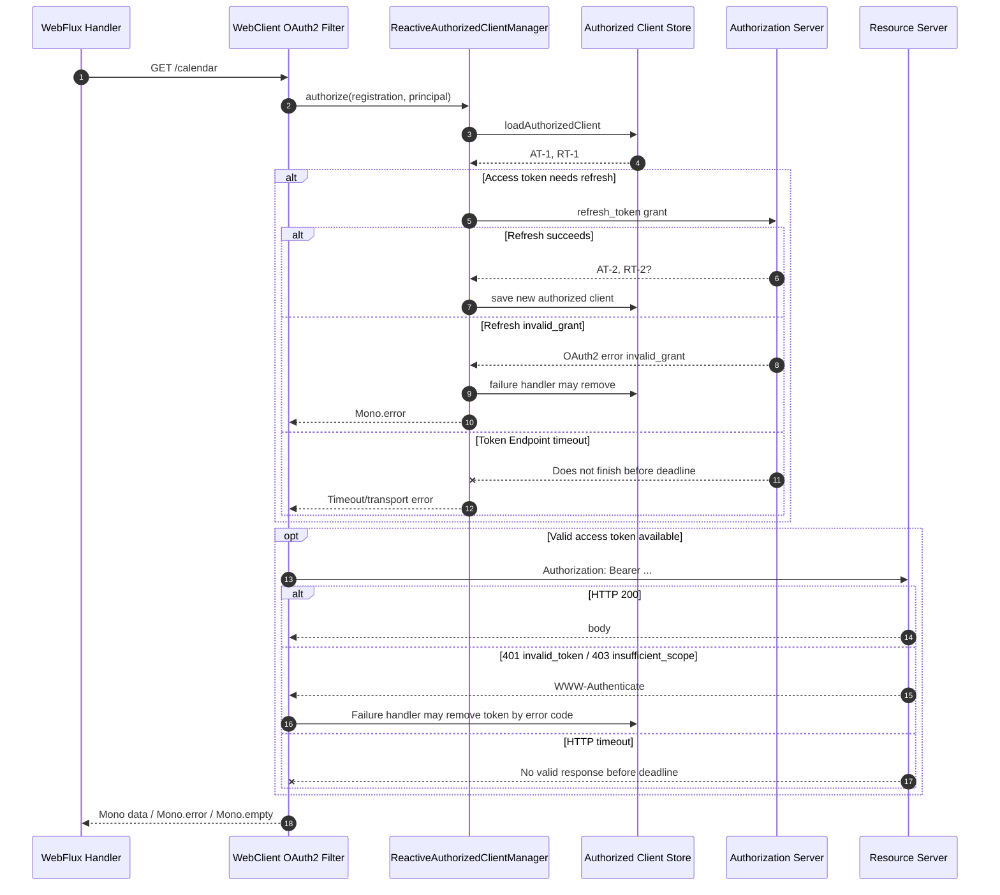
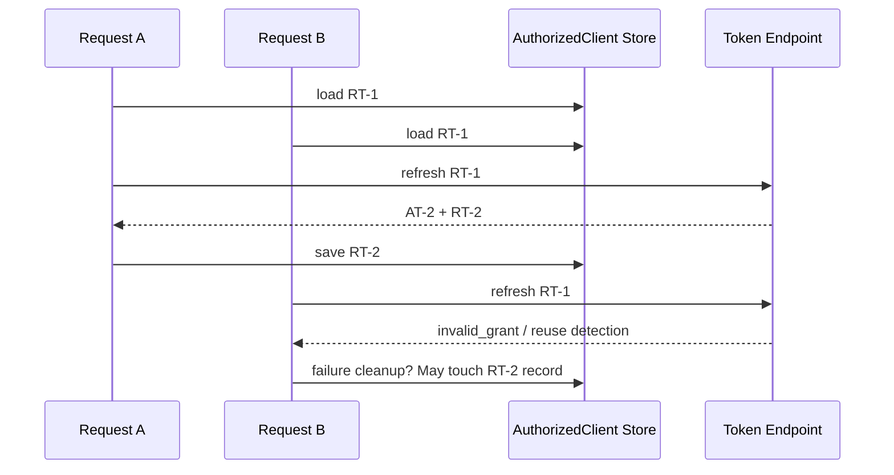

# 30.9. Testing Timeouts, Refresh Failures, and Failure Handlers

In a **Spring Security OAuth 2.0/OIDC Client on WebFlux**, API calls via `WebClient` typically involve multiple asynchronous steps: looking up `OAuth2AuthorizedClient`, possibly refreshing an access token, sending an HTTP request to a Resource Server, reading the response, and invoking a failure handler. A slow request or a failure at one stage may produce similar symptoms in the UI while requiring **completely different remedies**.

For example, when an application calls a user's Calendar API:

- **Token Endpoint timeout** during refresh: it is unknown whether the Authorization Server processed the refresh request.
- **Token Endpoint returns `invalid_grant`**: the refresh token may be expired, revoked, or replaced by token rotation.
- **Resource Server returns 401 `invalid_token`**: the access token in use was rejected by the API.
- **Resource Server returns 403 `insufficient_scope`**: the token lacks permissions; refreshing the same grant will not automatically add scopes.
- **HTTP client timeout**: may occur before any status code or response body arrives.
- **Custom failure handler that only logs**: if cleanup is omitted, subsequent calls may keep reusing the bad token.

For **Reactive** applications, tests must also verify **when a `Publisher` is subscribed**, cancellation, timeout boundaries, retry policies, and persistence side effects. Simply calling `Mono.block()` in a test and asserting an exception is not enough to protect a multi-provider system using refresh token rotation.

This lesson explains systematic testing with **Reactor Test `StepVerifier`, virtual time, `WebClient` mocks/fake servers, `WebTestClient`, reactive authorized-client managers, failure handlers, and authorized-client stores**. Code snippets use standard Java/Spring Security 6.x APIs; when running on another version, check the exact API of your locked dependencies. This is instructional material; examples are not claimed to have been executed against a project.

> **Goal:** Classify failures by **stage, endpoint, and grant type**; ensure timeouts do not trigger dangerous retries, refresh `invalid_grant` cleans up the right principal/registration, and Resource Server 401/403 responses are never confused with OIDC login failures or trigger automatic privilege expansion.

## 1. Learning Objectives

After this lesson, you will be able to:

1. Distinguish connect, response, body-processing, connection-pool acquire, and overall `Mono` timeouts.
2. Use `StepVerifier` and `StepVerifier.withVirtualTime` to test timeouts/retries/cancellation without wall-clock waits where applicable.
3. Stand up fake Authorization Servers/Resource Servers to test HTTP timeouts and OAuth2 error responses.
4. Build expired `ClientRegistration` and `OAuth2AuthorizedClient` fixtures carrying a refresh token for tests.
5. Understand how `DefaultReactiveOAuth2AuthorizedClientManager` and `AuthorizedClientServiceReactiveOAuth2AuthorizedClientManager` differ in storage and request context.
6. Test `ReactiveOAuth2AuthorizationFailureHandler`, including cleanup on `invalid_grant`.
7. Test `ServerOAuth2AuthorizedClientExchangeFilterFunction` against Resource Server 401/403 responses.
8. Distinguish safe retries from dangerous retries in Authorization Code/Refresh Token Grants.
9. Test side effects, idempotency, concurrent refreshes, and token rotation.
10. Design telemetry and test cases that never leak access tokens, refresh tokens, codes, `state`, `nonce`, or client secrets.

## 2. Identifying the Reactive Flow Under Test



**Two distinct failure handler locations:**

- **Authorized-client manager failure handler** is invoked when **authorize/re-authorize** fails, typically Refresh Token Grant `invalid_grant`.
- **OAuth2 `WebClient` filter failure handler** can handle **HTTP 401/403 from the Resource Server** (when an appropriate OAuth2 Bearer error is present).

Make sure tests target the right layer; do not call either one a "login failure handler." `ServerAuthenticationFailureHandler` in `oauth2Login` belongs to the **login** phase and does not replace these two.

## 3. Error Map

| Failure point | Example | Type/how observed | Typical appropriate recovery |
|---|---|---|---|
| DNS/Connect | Cannot reach Token Endpoint | `WebClientRequestException`/transport cause | Check network; bounded retry if safe |
| TLS | Invalid certificate/hostname | SSL/handshake cause | Fix trust/certificate; never bypass |
| Response timeout | Server too slow | Timeout/read timeout cause | Deadline, alert, backoff/circuit breaker |
| Overall reactive deadline | `Mono.timeout(...)` | `TimeoutException` or mapped error | Cancel upstream; decide retry by operation |
| Token Endpoint | `invalid_client` | `OAuth2AuthorizationException`/`OAuth2Error` | Fix client credentials/config |
| Token Endpoint refresh | `invalid_grant` | OAuth2 error | Never reuse old token; cleanup/reconnect |
| Resource Server | 401 `invalid_token` | `WWW-Authenticate`, `WebClient` 401 | Clean up token properly; no infinite retry |
| Resource Server | 403 `insufficient_scope` | `WWW-Authenticate`, `WebClient` 403 | Scope/consent/authorization policy |
| Reactive repository | Redis/JDBC down | Storage error | Fail closed; never use another principal/token |
| Application mapping | Connection not owned by user | Business/authorization error | 403; never try another registration |
| OIDC login | Invalid `state`/`nonce`/ID Token | Login authentication failure | Reject login; never bypass protocol |

**Important:** `invalid_grant` and `invalid_token` are **protocol error codes**. A "timeout" usually carries no OAuth2 error body because no response may have been received.

## 4. Choosing the Right Testing Tools

| Goal | Tool | What it does NOT verify |
|---|---|---|
| Testing `Mono.timeout` | Reactor `StepVerifier` with virtual time | Real TLS/HTTP sockets |
| Testing error-handling operators | `StepVerifier` + fake publisher | Real Token Endpoint |
| Testing manager & store | Fake/in-memory reactive service/repository | Real multi-node compatibility |
| Testing HTTP 401/403 responses | `WebClient` fake `ExchangeFunction` or `MockWebServer` | Browser OP login |
| Testing real transport deadlines | `MockWebServer`/WireMock + Reactor Netty client | Full production DNS/firewall/latency |
| Testing WebFlux endpoints | `WebTestClient` | Full OAuth2 protocol details if principal is mocked |
| Testing token refresh E2E | Mock Token Endpoint + real reactive token client | Production OP policy |
| Testing rotation races | Controlled publishers + DB/Redis integration | Full multi-region production |

A solid test suite combines **cheap/fast unit tests**, **integration tests with fake servers**, and a few **end-to-end contract tests** against a test tenant.

### 4.1. Typically Needed Test Libraries

A Spring Boot Reactive/OAuth2 Client application typically includes:

```text
spring-boot-starter-webflux
spring-boot-starter-oauth2-client
spring-boot-starter-test
spring-security-test
reactor-test
mockwebserver or WireMock (test-only)
```

Artifact names and versions vary with your Spring Boot BOM and build system. This list **does not require running Gradle** in this lesson; real projects need compatible versions. For `MockWebServer`, ensure you use the API matching your selected OkHttp version.

## 5. Distinguishing Timeout Layers

The word "timeout" has at least five distinct meanings:

1. **Connect timeout:** TCP connection fails to establish within the limit.
2. **TLS handshake timeout:** handshake does not finish; may be caused by certificates/network.
3. **Connection pool acquire timeout:** waiting too long for an idle connection.
4. **Response/read timeout:** server does not send data within the HTTP client's limit.
5. **Overall operation timeout:** the entire `Mono` — including lookup, refresh, API call, and response processing — exceeds the application's deadline.

### 5.1. Meaning and How to Test Each

| Timeout | Configured on | Suitable test | What to avoid |
|---|---|---|---|
| Connect | Reactor Netty `HttpClient` | Controlled destination refusing/dropping connect, or mock network | Depending on an arbitrary external public IP |
| TLS | SSL/network configuration | Fake TLS server/test certificate | Disabling TLS verification |
| Pool acquire | Reactor Netty `ConnectionProvider` | Small pool + concurrent delayed calls | Uncontrolled delays/sleeps |
| Response | `HttpClient.responseTimeout` | `MockWebServer` delaying response headers/body | Confusing HTTP 503 with timeout |
| Overall | Reactor `Mono.timeout` | `StepVerifier.withVirtualTime` | Assuming virtual time simulates real sockets |
| Retry budget | Application workflow | `Retry` + `StepVerifier` | Infinitely retrying Token Endpoint grants |

**Virtual time only shifts the schedule of Reactor operators using compatible schedulers**; it does not fast-forward TCP sockets/Netty I/O, DNS, or thread sleeps in other libraries.

### 5.2. Why Need Both HTTP Timeouts and an Overall Deadline?

An HTTP client response timeout alone does not bound time spent in token store lookups, refreshes, connection acquisition, and transformations. Conversely, an outer `Mono.timeout` can cancel the pipeline yet does not replace HTTP client connect or TLS timeouts.

```text
WebFlux handler budget: 3 seconds
  -> authorized-client lookup
  -> refresh token request
  -> downstream API request
  -> decode/transform response
```

You must decide whether **3 seconds covers the entire operation** or **each individual HTTP call**. If each dependency has a 3-second timeout across 3 sequential steps, total latency can exceed the handler's budget.

## 6. Configuring `WebClient` Transport Timeouts

Reactor Netty example for outbound APIs:

```java
import java.time.Duration;

import io.netty.channel.ChannelOption;
import reactor.netty.http.client.HttpClient;

import org.springframework.http.client.reactive.ReactorClientHttpConnector;
import org.springframework.web.reactive.function.client.WebClient;

public final class TimedWebClientFactory {

    public static WebClient forTrustedApi(String baseUrl) {
        HttpClient httpClient = HttpClient.create()
            .option(ChannelOption.CONNECT_TIMEOUT_MILLIS, 1_000)
            .responseTimeout(Duration.ofSeconds(2));

        return WebClient.builder()
            .baseUrl(baseUrl)
            .clientConnector(
                new ReactorClientHttpConnector(httpClient)
            )
            .build();
    }
}
```

Here:

- `CONNECT_TIMEOUT_MILLIS` applies to TCP connect.
- `responseTimeout` configures response reception timeout per Reactor Netty semantics.
- `baseUrl` must be chosen by the backend from trusted configuration—never from an arbitrary browser URL if Bearer tokens will be attached.
- Values of 1–2 seconds are test/architectural illustrations, **not universal recommendations** for every provider/API.

### 6.1. Separate the Token Endpoint Client from Resource Server Clients

The Token Endpoint handles issuing/refreshing tokens; Resource Servers serve business data. Maintain **separate deadlines, retry policies, metrics, and failure handling** for each.

Do not apply a global retry filter to every `POST /token` merely because of a shared `WebClient`. An authorization code may already have been consumed before a response timeout occurred.

### 6.2. Do Not Treat `timeout()` as Token Revocation

If a client does:

```java
Mono<String> result = callCalendarApi()
    .timeout(Duration.ofSeconds(3));
```

when the deadline expires, the subscription is canceled and downstream observes cancellation; however, the remote server **may already have processed the request**. For mutating requests, a timeout does not mean "failed to execute"—consider idempotency keys or indeterminate outcome states.

## 7. Unit Testing Timeouts with `StepVerifier.withVirtualTime`

`StepVerifier` from Reactor Test lets you assert data/error/completion sequences.

```java
import java.time.Duration;
import java.util.concurrent.TimeoutException;

import org.junit.jupiter.api.Test;
import reactor.core.publisher.Mono;
import reactor.test.StepVerifier;

class ReactiveTimeoutTest {

    @Test
    void slowPublisherTimesOutWithoutRealWaiting() {
        StepVerifier.withVirtualTime(
                () -> Mono.delay(Duration.ofMinutes(5))
                    .timeout(Duration.ofSeconds(1))
            )
            .expectSubscription()
            .thenAwait(Duration.ofSeconds(1))
            .expectError(TimeoutException.class)
            .verify();
    }
}
```

**Explanation:**

1. `withVirtualTime` installs a virtual scheduler for Reactor operators created **inside the supplier**.
2. `Mono.delay(5 minutes)` simulates a very slow task.
3. `timeout(1 second)` emits an error earlier.
4. `thenAwait(1 second)` advances the virtual clock without real sleeping.
5. `expectError(TimeoutException.class)` verifies the observed `timeout` error.

### 7.1. Common Mistake: Building the `Publisher` Before Enabling Virtual Time

Unreliable:

```java
Mono<Long> slow = Mono.delay(Duration.ofMinutes(5));

StepVerifier.withVirtualTime(() ->
    slow.timeout(Duration.ofSeconds(1))
);
```

Some operators/schedulers were already captured before the virtual scheduler took effect. **Construct the pipeline inside the supplier** so the virtual scheduler controls time.

### 7.2. Testing Timeout Boundaries

```java
@Test
void resultBeforeDeadlineSucceeds() {
    StepVerifier.withVirtualTime(() ->
            Mono.delay(Duration.ofMillis(200))
                .map(ignored -> "ok")
                .timeout(Duration.ofSeconds(1))
        )
        .expectSubscription()
        .thenAwait(Duration.ofMillis(200))
        .expectNext("ok")
        .verifyComplete();
}
```

Testing both sides of the deadline catches timeouts configured too short or attached outside the right sequence.

### 7.3. Avoid Asserting Exact Error Messages

`TimeoutException` messages can vary across Reactor versions. Assert exception types/outcomes rather than exact English message text or real timestamps.

## 8. Testing Cancellation and Resource Cleanup

In Reactive code, when `Mono.timeout` errors, the upstream subscription can be canceled. For HTTP clients, releasing connections/body buffers and handling cancellation properly is essential.

An offline test:

```java
import java.time.Duration;
import java.util.concurrent.TimeoutException;
import java.util.concurrent.atomic.AtomicBoolean;

import org.junit.jupiter.api.Test;
import reactor.core.publisher.Mono;
import reactor.test.StepVerifier;

import static org.assertj.core.api.Assertions.assertThat;

class CancellationTest {

    @Test
    void timeoutCancelsUpstream() {
        AtomicBoolean cancelled = new AtomicBoolean();

        StepVerifier.withVirtualTime(() ->
                Mono.<String>never()
                    .doOnCancel(() -> cancelled.set(true))
                    .timeout(Duration.ofSeconds(2))
            )
            .expectSubscription()
            .thenAwait(Duration.ofSeconds(2))
            .expectError(TimeoutException.class)
            .verify();

        assertThat(cancelled).isTrue();
    }
}
```

`Mono.never()` never completes, leaving timeout as the only exit. The test proves **upstream receives cancellation**, not that remote servers rolled back.

### 8.1. Cancellation Is Not an OAuth2 Success/Failure Handler

An upstream timeout can happen before any OAuth2 error JSON arrives. Without an `OAuth2AuthorizationException` carrying `invalid_grant`, **never arbitrarily delete a refresh token just because of a timeout**.

A refresh request may have succeeded at the OP while the response was lost. Define a provider-specific recovery policy, limit retries, and handle indeterminate outcomes explicitly.

### 8.2. Never Swallow Cancellation

Avoid this pattern:

```java
Mono<String> fallback = slowCall()
    .onErrorResume(any -> Mono.just("success"));
```

It turns every error, including security failures and timeouts, into fake success. Where business degradation is allowed, fall back only on explicitly classified errors and return an unambiguous degraded state.

## 9. Testing Retry Policies with Virtual Time

Reactor's `Retry` supports backoff, yet errors must be classified first.

```java
import java.time.Duration;
import java.util.concurrent.TimeoutException;
import java.util.concurrent.atomic.AtomicInteger;

import reactor.core.publisher.Mono;
import reactor.util.retry.Retry;
import reactor.test.StepVerifier;

AtomicInteger attempts = new AtomicInteger();

StepVerifier.withVirtualTime(() ->
        Mono.defer(() -> {
                attempts.incrementAndGet();
                return Mono.<String>error(
                    new TimeoutException("test-only")
                );
            })
            .retryWhen(
                Retry.backoff(2, Duration.ofMillis(100))
                    .filter(ex -> ex instanceof TimeoutException)
                    .jitter(0.0)
            )
    )
    .expectSubscription()
    .thenAwait(Duration.ofSeconds(2))
    .expectError()
    .verify();

org.assertj.core.api.Assertions.assertThat(attempts.get())
    .isEqualTo(3);
```

Here `retryWhen(Retry.backoff(2, ...))` allows **2 retries after the initial attempt** → at most 3 attempts. `jitter(0.0)` keeps test timing deterministic; in production, consider jitter to prevent retry storms.

### 9.1. Watch the Final Exception Type

When retries are exhausted, Reactor may emit a retry-exhausted wrapper exception holding the underlying cause. Tests should therefore verify attempt counts and error outcomes rather than assuming the exact outer exception class is `TimeoutException`.

### 9.2. Never Retry Every Token Endpoint Error

Avoid:

```java
tokenClient.getTokenResponse(request)
    .retryWhen(Retry.backoff(10, Duration.ofMillis(50)));
```

because:

- `invalid_grant` will not be fixed by retrying the old token.
- `invalid_client` is a client authentication/configuration error.
- Authorization codes are single-use.
- Refresh token rotation can cause retries to trigger reuse detection.
- Timeouts can happen **after the OP already processed** the request.

Define a policy distinguishing idempotent resource `GET`s from `POST /token`, matching the provider contract and threat model.

## 10. HTTP Timeout Tests with `MockWebServer`

Virtual time does not simulate sockets. To test Reactor Netty `responseTimeout`, run a local fake HTTP server.

Example with OkHttp `MockWebServer` (test-only dependency):

```java
import java.time.Duration;
import java.util.concurrent.TimeUnit;

import io.netty.channel.ChannelOption;
import okhttp3.mockwebserver.MockResponse;
import okhttp3.mockwebserver.MockWebServer;

import org.junit.jupiter.api.Test;
import org.springframework.http.client.reactive.ReactorClientHttpConnector;
import org.springframework.web.reactive.function.client.WebClient;

import reactor.netty.http.client.HttpClient;
import reactor.test.StepVerifier;

class WebClientHttpTimeoutIT {

    @Test
    void delayedHeadersExceedResponseTimeout() throws Exception {
        try (MockWebServer server = new MockWebServer()) {
            server.start();

            server.enqueue(
                new MockResponse()
                    .setHeadersDelay(2, TimeUnit.SECONDS)
                    .setBody("{\"status\":\"ok\"}")
            );

            HttpClient http = HttpClient.create()
                .option(ChannelOption.CONNECT_TIMEOUT_MILLIS, 1_000)
                .responseTimeout(Duration.ofMillis(150));

            WebClient client = WebClient.builder()
                .clientConnector(
                    new ReactorClientHttpConnector(http)
                )
                .build();

            StepVerifier.create(
                    client.get()
                        .uri(server.url("/slow").toString())
                        .retrieve()
                        .bodyToMono(String.class)
                )
                .expectError()
                .verify(Duration.ofSeconds(5));
        }
    }
}
```

**Verification:** response headers are delayed longer than `responseTimeout`; the client must terminate with an error instead of waiting indefinitely.

### 10.1. Why Not Assert the Lowest-Level Exception Class?

Depending on Reactor Netty/`WebClient` version, errors may be wrapped in `WebClientRequestException` or various timeout causes. Integration tests should usually verify:

- An error occurs with no success body.
- The request reached the right fake server.
- The deadline falls within a reasonable bound.
- No retries exceed the budget.
- Application error mapping works properly.

If the app defines a stable domain exception, assert the **app-defined domain-level exception**.

### 10.2. Real Transport Tests Do Not Use Virtual Time

`MockWebServer` uses real networking and delays headers in wall-clock time. `StepVerifier.withVirtualTime` does not speed up `setHeadersDelay`. Never combine both expecting HTTP socket tests to finish instantaneously.

### 10.3. Test Connection Timeouts Independently

A fake server that accepts connections and delays responses tests **response timeout**, not connect timeout. Testing connect timeout requires a controlled network harness simulating an incomplete TCP connect; avoid arbitrary public IPs due to flaky CI/network behavior.

## 11. Test Retry Counts as Well as Timeouts

A fake server can enqueue:

```text
1st request: delayed response / 503
2nd request: HTTP 200
```

When policy permits retries for an idempotent operation, tests should:

1. Assert the final response succeeds.
2. Assert the fake server received the expected request count.
3. Assert order and HTTP method remained unchanged.
4. Assert the token header matches the right registration and is not logged.
5. Assert retries never hit another origin.
6. Assert total duration fits within the deadline.

For `POST /token`, **do not blindly apply** the same retry test pattern. Test each grant type and policy permitted by the Authorization Server separately.

## 12. Reactive OAuth2 Client: Key Components to Know

| Component | Role |
|---|---|
| `ReactiveClientRegistrationRepository` | Looks up `ClientRegistration` by registration ID |
| `ReactiveOAuth2AuthorizedClientService` | Saves/queries authorized clients by registration/principal |
| `ServerOAuth2AuthorizedClientRepository` | Saves/queries authorized clients within WebFlux requests/exchanges |
| `ReactiveOAuth2AuthorizedClientManager` | Coordinates authorization, reauthorization, and handlers |
| `ReactiveOAuth2AuthorizedClientProvider` | Grant strategy such as `refresh_token`/`client_credentials` |
| `ReactiveOAuth2AccessTokenResponseClient<OAuth2RefreshTokenGrantRequest>` | Executes Token Endpoint refresh |
| `WebClientReactiveRefreshTokenTokenResponseClient` | `WebClient`-based token response client |
| `ReactiveOAuth2AuthorizationFailureHandler` | Handles authorize/reauthorize failures |
| `RemoveAuthorizedClientReactiveOAuth2AuthorizationFailureHandler` | Removes authorized clients for configured OAuth2 error codes |
| `ServerOAuth2AuthorizedClientExchangeFilterFunction` | Selects tokens, attaches Bearer headers, and handles certain Resource Server errors |

### 12.1. Two Manager Types

**With HTTP `ServerWebExchange`:**

```java
DefaultReactiveOAuth2AuthorizedClientManager
```

Typically paired with:

```java
ReactiveClientRegistrationRepository
ServerOAuth2AuthorizedClientRepository
```

**Running outside requests, e.g., scheduled jobs:**

```java
AuthorizedClientServiceReactiveOAuth2AuthorizedClientManager
```

Typically paired with:

```java
ReactiveClientRegistrationRepository
ReactiveOAuth2AuthorizedClientService
```

Do not assume a background worker always has a `WebSession`/Reactive `SecurityContext` from an earlier HTTP request.

### 12.2. Keying Model

`OAuth2AuthorizedClient` is keyed by:

```text
clientRegistration.registrationId
principalName
accessToken
refreshToken?
```

If a test invokes the manager with a different `principalName` than when saved, it may miss the token. That is a **test setup/ownership key** bug, not necessarily a refresh bug.

## 13. `ClientRegistration` Fixtures for Refresh Tests

Avoid connecting to a real OP; create a registration with a fake Token Endpoint:

```java
import org.springframework.security.oauth2.client.registration.ClientRegistration;
import org.springframework.security.oauth2.client.registration.InMemoryReactiveClientRegistrationRepository;
import org.springframework.security.oauth2.core.AuthorizationGrantType;
import org.springframework.security.oauth2.core.ClientAuthenticationMethod;

public final class ReactiveClientFixtures {

    private ReactiveClientFixtures() {}

    public static ClientRegistration calendar() {
        return ClientRegistration.withRegistrationId("calendar")
            .clientId("calendar-test-client")
            .clientSecret("test-only-client-secret")
            .clientAuthenticationMethod(
                ClientAuthenticationMethod.CLIENT_SECRET_BASIC
            )
            .authorizationGrantType(
                AuthorizationGrantType.AUTHORIZATION_CODE
            )
            .authorizationUri(
                "https://id.example.test/authorize"
            )
            .tokenUri(
                "https://id.example.test/token"
            )
            .redirectUri(
                "{baseUrl}/login/oauth2/code/{registrationId}"
            )
            .scope("calendar.read")
            .build();
    }

    public static InMemoryReactiveClientRegistrationRepository registrations() {
        return new InMemoryReactiveClientRegistrationRepository(
            calendar()
        );
    }
}
```

This fixture uses an Authorization Code registration because the user previously granted Calendar access, and the test stores an `OAuth2AuthorizedClient` with a refresh token. **Refresh grants do not require creating a separate `ClientRegistration`**: they renew an existing authorized client.

### 13.1. Why Avoid Real Credentials?

- No real API billing or token issuance.
- No dependence on an online OP.
- No real refresh tokens sitting in test reports.
- Easy to mock `invalid_grant`, timeouts, and rotation.
- No secrets leaked into CI artifacts.

### 13.2. Deterministically Building an Expired Token

```java
import java.time.Instant;
import java.util.Set;

import org.springframework.security.oauth2.client.OAuth2AuthorizedClient;
import org.springframework.security.oauth2.core.OAuth2AccessToken;
import org.springframework.security.oauth2.core.OAuth2RefreshToken;

public final class AuthorizedClientFixtures {

    private AuthorizedClientFixtures() {}

    public static OAuth2AuthorizedClient expiredCalendar(
            String principalName) {

        Instant now = Instant.now();

        OAuth2AccessToken expiredAccess = new OAuth2AccessToken(
            OAuth2AccessToken.TokenType.BEARER,
            "FAKE_EXPIRED_ACCESS_TOKEN",
            now.minusSeconds(3600),
            now.minusSeconds(1800),
            Set.of("calendar.read")
        );

        OAuth2RefreshToken refresh = new OAuth2RefreshToken(
            "FAKE_REFRESH_TOKEN",
            now.minusSeconds(3600)
        );

        return new OAuth2AuthorizedClient(
            ReactiveClientFixtures.calendar(),
            principalName,
            expiredAccess,
            refresh
        );
    }
}
```

The expired access token routes the manager into the refresh path **when the right provider is configured**. Fake values must never be usable against a real OP.

### 13.3. Testing Clock Skew Without Waiting for Real Expiration

In tests targeting expiry boundaries, build `OAuth2AccessToken` with exact `issuedAt`/`expiresAt` values or inject a `Clock` into supported providers. Never `Thread.sleep` for minutes waiting for a token to expire.

## 14. Configuring the Authorized-Client Manager in WebFlux

Example for an HTTP request context:

```java
import org.springframework.context.annotation.Bean;
import org.springframework.security.oauth2.client.ReactiveOAuth2AuthorizedClientManager;
import org.springframework.security.oauth2.client.ReactiveOAuth2AuthorizedClientProvider;
import org.springframework.security.oauth2.client.ReactiveOAuth2AuthorizedClientProviderBuilder;
import org.springframework.security.oauth2.client.registration.ReactiveClientRegistrationRepository;
import org.springframework.security.oauth2.client.web.DefaultReactiveOAuth2AuthorizedClientManager;
import org.springframework.security.oauth2.client.web.server.ServerOAuth2AuthorizedClientRepository;

@Bean
ReactiveOAuth2AuthorizedClientManager clientManager(
        ReactiveClientRegistrationRepository registrations,
        ServerOAuth2AuthorizedClientRepository clients) {

    ReactiveOAuth2AuthorizedClientProvider provider =
        ReactiveOAuth2AuthorizedClientProviderBuilder.builder()
            .authorizationCode()
            .refreshToken()
            .clientCredentials()
            .build();

    var manager = new DefaultReactiveOAuth2AuthorizedClientManager(
        registrations, clients
    );
    manager.setAuthorizedClientProvider(provider);

    return manager;
}
```

**Important default behavior:** per the Spring Security reference, `DefaultReactiveOAuth2AuthorizedClientManager` persists authorized clients upon successful issuance/refresh and removes stored authorized clients when reauthorization fails with `invalid_grant` via its default failure handler. This behavior changes if the app calls `setAuthorizationSuccessHandler`/`setAuthorizationFailureHandler`.

### 14.1. Service Manager for Background Tasks

```java
import org.springframework.security.oauth2.client.AuthorizedClientServiceReactiveOAuth2AuthorizedClientManager;
import org.springframework.security.oauth2.client.ReactiveOAuth2AuthorizedClientProviderBuilder;

var manager =
    new AuthorizedClientServiceReactiveOAuth2AuthorizedClientManager(
        registrations,
        authorizedClientService
    );

manager.setAuthorizedClientProvider(
    ReactiveOAuth2AuthorizedClientProviderBuilder.builder()
        .refreshToken()
        .clientCredentials()
        .build()
);
```

In background tasks, user delegation requires a trusted connection record and `principalName`; never read registration/principal directly from an unverified queue payload without ownership checks.

## 15. Testing Refresh `invalid_grant` with a Fake Provider

To test manager and cleanup policy without hitting a real Token Endpoint, supply a fake `ReactiveOAuth2AuthorizedClientProvider` that emits an error.

```java
import java.util.List;

import org.junit.jupiter.api.Test;
import org.springframework.security.authentication.UsernamePasswordAuthenticationToken;
import org.springframework.security.core.Authentication;
import org.springframework.security.core.authority.SimpleGrantedAuthority;
import org.springframework.security.oauth2.client.AuthorizedClientServiceReactiveOAuth2AuthorizedClientManager;
import org.springframework.security.oauth2.client.InMemoryReactiveOAuth2AuthorizedClientService;
import org.springframework.security.oauth2.client.OAuth2AuthorizeRequest;
import org.springframework.security.oauth2.core.OAuth2AuthorizationException;
import org.springframework.security.oauth2.core.OAuth2Error;

import reactor.core.publisher.Mono;
import reactor.test.StepVerifier;

class RefreshInvalidGrantTest {

    @Test
    void invalidGrantRemovesPreviouslySavedAuthorizedClient() {
        var registrations = ReactiveClientFixtures.registrations();
        var service =
            new InMemoryReactiveOAuth2AuthorizedClientService(
                registrations
            );

        Authentication principal =
            new UsernamePasswordAuthenticationToken(
                "user-42",
                "not-a-real-password",
                List.of(new SimpleGrantedAuthority("ROLE_USER"))
            );

        var expired =
            AuthorizedClientFixtures.expiredCalendar(principal.getName());

        StepVerifier.create(
                service.saveAuthorizedClient(expired, principal)
            )
            .verifyComplete();

        var manager =
            new AuthorizedClientServiceReactiveOAuth2AuthorizedClientManager(
                registrations, service
            );

        manager.setAuthorizedClientProvider(context ->
            Mono.error(
                new OAuth2AuthorizationException(
                    new OAuth2Error("invalid_grant")
                )
            )
        );

        var request = OAuth2AuthorizeRequest
            .withClientRegistrationId("calendar")
            .principal(principal)
            .build();

        StepVerifier.create(manager.authorize(request))
            .expectErrorSatisfies(error -> {
                org.assertj.core.api.Assertions.assertThat(error)
                    .isInstanceOf(OAuth2AuthorizationException.class);
            })
            .verify();

        StepVerifier.create(
                service.loadAuthorizedClient(
                    "calendar", principal.getName()
                )
            )
            .verifyComplete();
    }
}
```

**What is tested:** an old authorized client exists, reauthorization emits `invalid_grant`, the manager propagates the error, and default failure cleanup removes the authorized client from the service.

### 15.1. Limitations of the Fake Provider Test

- Sends no real HTTP request to the Token Endpoint.
- Does not verify form parameter `grant_type=refresh_token`.
- Does not verify client authentication or response parsing.
- Does not prove race behavior across multiple pods.
- Does not check Resource Server `WWW-Authenticate`.

This is a **manager + service unit/integration test**, not a full Refresh Token Grant test.

### 15.2. If the Test Does Not Enter the Refresh Path

Check:

1. Is the access token fixture actually expired?
2. Do `ClientRegistration` and `principalName` match the stored record?
3. Was `ReactiveOAuth2AuthorizedClientProvider` registered on the manager?
4. Did the test accidentally instantiate a different manager or store?
5. Does the manager expect special auth/attributes?
6. Did a custom handler override default behavior?

Never force the outcome by manually calling `removeAuthorizedClient(...)` before the test; that tests your test code rather than the manager.

## 16. Testing Successful Refresh and Token Rotation

Testing only `invalid_grant` is not enough. For a successful refresh, verify:

- A new token is returned from the fake provider or fake Token Endpoint.
- The new authorized client is saved under the right registration/principal.
- The access token is actually replaced.
- The **new** refresh token is stored when the provider rotates tokens.
- When the provider omits a new refresh token, retention/non-retention matches protocol/framework configuration.
- Concurrent accesses never overwrite the new token with a stale snapshot.
- Subsequent API requests use the **new access token**, not the old one.

### 16.1. New Token Response Example

```java
import java.time.Duration;

import org.springframework.security.oauth2.core.OAuth2AccessToken;
import org.springframework.security.oauth2.core.endpoint.OAuth2AccessTokenResponse;

OAuth2AccessTokenResponse response =
    OAuth2AccessTokenResponse.withToken("FAKE_AT_2")
        .tokenType(OAuth2AccessToken.TokenType.BEARER)
        .expiresIn(3600)
        .refreshToken("FAKE_RT_2")
        .scope("calendar.read")
        .build();
```

This is a token response fixture, not proof a real OP accepts the token. When testing against a fake server, assert the refresh request carries the right form/client authentication **without dumping token bodies into logs**.

### 16.2. Token Rotation During a Response Timeout

Dangerous scenario:

```text
RP sends RT-1 -> OP returns RT-2, invalidates RT-1
                   |
                   + response lost on the network

RP still holds RT-1, retries RT-1
  -> OP returns invalid_grant / triggers reuse detection
```

Retry policy tests must distinguish **timeouts from "OP never processed it"**; you cannot infer non-execution from a `TimeoutException`. Product recovery may require reauthorization or a provider-specific recovery mechanism instead of retrying the old token endlessly.

## 17. Default Failure Handler vs. Custom Handlers

Spring provides the interface:

```java
ReactiveOAuth2AuthorizationFailureHandler
```

with signature:

```java
Mono<Void> onAuthorizationFailure(
    OAuth2AuthorizationException exception,
    Authentication principal,
    Map<String, Object> attributes
);
```

And the implementation:

```java
RemoveAuthorizedClientReactiveOAuth2AuthorizationFailureHandler
```

which removes the authorized client when the OAuth2 error code matches a configured set.

### 17.1. Mistake: Replacing the Default Handler Just to Log

Avoid:

```java
manager.setAuthorizationFailureHandler(
    (exception, principal, attributes) -> {
        logger.warn("Refresh failed");
        return Mono.empty();
    }
);
```

This **replaces** the default cleanup handler. As a result, the `invalid_grant` refresh token stays in the store and jobs keep failing repeatedly.

### 17.2. Composing Telemetry with the Removal Handler

A better pattern:

```java
import org.springframework.security.oauth2.client.RemoveAuthorizedClientReactiveOAuth2AuthorizationFailureHandler;
import org.springframework.security.oauth2.client.ReactiveOAuth2AuthorizationFailureHandler;

ReactiveOAuth2AuthorizationFailureHandler cleanup =
    new RemoveAuthorizedClientReactiveOAuth2AuthorizationFailureHandler(
        (registrationId, principal, attributes) ->
            authorizedClientService.removeAuthorizedClient(
                registrationId, principal.getName()
            )
    );

manager.setAuthorizationFailureHandler(
    (exception, principal, attributes) -> {
        String errorCode =
            exception.getError().getErrorCode();

        // Record metric with normalized error code; never log refresh tokens.
        return cleanup.onAuthorizationFailure(
            exception, principal, attributes
        );
    }
);
```

This illustrates configuration for a **service-backed manager**: `authorizedClientService` must be the same service used by the manager. For a **WebFlux HTTP request-backed manager**, the remover must operate on the right `ServerOAuth2AuthorizedClientRepository`/exchange context rather than an unrelated service.

**Never delete all of a user's authorized clients** when a single Calendar connection gets `invalid_grant`. Cleanup must target the exact registration and principal/connection.

### 17.3. Custom Handler Tests Must Verify Side Effects

A test that only checks `logger.warn(...)` was called **is insufficient**. Verify:

- `invalid_grant` → cleanup is called for the exact key.
- Transient timeout errors → token is **not** removed if policy forbids it.
- `invalid_client` → does not silently wipe all user tokens as a blanket fix.
- Storage cleanup failure → reflected properly in result and telemetry.
- The handler returns `Mono<Void>` and does not subscribe internally.
- Handler exceptions are not swallowed, making the app think refresh succeeded.
- Client secrets, raw tokens, and credential-bearing exception bodies are never logged.

## 18. Testing a Failure Handler with a Fake Remover

Instead of testing through the manager directly, you can isolate handler logic with a fake remover:

```java
import java.util.Map;
import java.util.concurrent.atomic.AtomicInteger;

import org.junit.jupiter.api.Test;
import org.springframework.security.authentication.UsernamePasswordAuthenticationToken;
import org.springframework.security.oauth2.client.RemoveAuthorizedClientReactiveOAuth2AuthorizationFailureHandler;
import org.springframework.security.oauth2.core.OAuth2AuthorizationException;
import org.springframework.security.oauth2.core.OAuth2Error;

import reactor.core.publisher.Mono;
import reactor.test.StepVerifier;

import static org.assertj.core.api.Assertions.assertThat;

class ReactiveFailureHandlerTest {

    @Test
    void invalidGrantInvokesRemover() {
        AtomicInteger removed = new AtomicInteger();

        var handler =
            new RemoveAuthorizedClientReactiveOAuth2AuthorizationFailureHandler(
                (registrationId, principal, attributes) -> {
                    removed.incrementAndGet();
                    return Mono.empty();
                }
            );

        var principal =
            new UsernamePasswordAuthenticationToken(
                "user-42", "unused", java.util.List.of()
            );

        var error = new OAuth2AuthorizationException(
            new OAuth2Error("invalid_grant")
        );

        // Test invokes the handler per the contract and context provided by the manager.
        // In real integration tests, attributes must carry the exact
        // clientRegistrationId (per Spring Security version) and context.
        StepVerifier.create(
                handler.onAuthorizationFailure(
                    error,
                    principal,
                    Map.of("clientRegistrationId", "calendar")
                )
            )
            .verifyComplete();

        assertThat(removed.get()).isEqualTo(1);
    }
}
```

**Note on attributes:** The removal handler requires a registration ID and context such as repository/exchange. The `"clientRegistrationId"` key in this illustrative snippet must match **your Spring Security version's** contract in real tests; a safer option is testing through the manager supplying the context rather than building an arbitrary Map. If your API version uses another key name, update the fixture to the documented constant rather than changing business logic.

### 18.1. Why Not Subscribe Inside the Handler?

Wrong:

```java
// Wrong: fire-and-forget side effect
service.removeAuthorizedClient(id, principalName).subscribe();
return Mono.empty();
```

Calling `subscribe()` manually runs cleanup outside the manager's reactive chain; tests may finish before cleanup completes, storage errors fail to propagate, and cancellation/transaction context is lost. **Return the `Mono`** so the caller manages subscription.

### 18.2. Separate Metrics from Token Removal

If metric/telemetry emission fails, it should not necessarily block cleanup, yet cleanup failures must never be swallowed. Design ordering and error policies explicitly; test metric sink errors and storage errors separately.

## 19. Testing HTTP OAuth2 Errors from a Fake Token Endpoint

With `WebClientReactiveRefreshTokenTokenResponseClient`, you can point a `WebClient` to a fake Token Endpoint.

### 19.1. Dedicated `WebClient` for Refresh

```java
import java.time.Duration;

import reactor.netty.http.client.HttpClient;
import org.springframework.http.client.reactive.ReactorClientHttpConnector;
import org.springframework.web.reactive.function.client.WebClient;

import org.springframework.security.oauth2.client.endpoint.WebClientReactiveRefreshTokenTokenResponseClient;

HttpClient http = HttpClient.create()
    .responseTimeout(Duration.ofSeconds(1));

WebClient timedTokenWebClient = WebClient.builder()
    .clientConnector(
        new ReactorClientHttpConnector(http)
    )
    .build();

var refreshClient =
    new WebClientReactiveRefreshTokenTokenResponseClient();

refreshClient.setWebClient(timedTokenWebClient);
```

`WebClientReactiveRefreshTokenTokenResponseClient` executes the Refresh Token Grant. In tests, the `ClientRegistration` `tokenUri` should point to the fake server.

### 19.2. The `invalid_grant` Case

Fake server returns:

```http
HTTP/1.1 400 Bad Request
Content-Type: application/json
Cache-Control: no-store

{
  "error": "invalid_grant",
  "error_description": "Test token was revoked"
}
```

Tests must:

1. Construct an `OAuth2RefreshTokenGrantRequest` from the `ClientRegistration` and authorized client fixture.
2. Subscribe to `refreshClient.getTokenResponse(grantRequest)`.
3. Assert the error carries an `OAuth2Error` with `errorCode="invalid_grant"`.
4. Assert the fake server received `grant_type=refresh_token`.
5. Assert credentials and refresh token were sent via the proper form/auth method, **without logging raw values**.
6. When integrating with the manager, assert the authorized client is cleaned up per policy.

### 19.3. The Token Endpoint Timeout Case

Fake server delays headers past the response timeout. Tests must distinguish:

```text
Timeout/transport failure:
  No trustworthy OAuth2 error code
  Must not assume invalid_grant

HTTP 400 JSON invalid_grant:
  Valid response received from OP
  Can clean up/mark connection for reconnect
```

Never synthesize a fake `OAuth2Error("invalid_grant")` for timeouts; that deletes valid tokens during transient network blips.

### 19.4. Custom Response Parsers

If you replace the reactive token client's `BodyExtractor`, you are responsible for handling **OAuth2 Error Responses** properly instead of treating HTTP 400 JSON as token success. Test `invalid_grant`, `invalid_client`, malformed JSON, and 5xx separately.

## 20. Two 401/403 Sources Distinct from Refresh Errors

Once an access token exists, the OAuth2 `WebClient` sends a Bearer token to the Resource Server.

Examples:

```http
HTTP/1.1 401 Unauthorized
WWW-Authenticate: Bearer error="invalid_token"
```

or:

```http
HTTP/1.1 403 Forbidden
WWW-Authenticate: Bearer error="insufficient_scope"
```

These are **not** Token Endpoint `invalid_grant` errors.

| HTTP / Bearer error | Common meaning | Action |
|---|---|---|
| 401 `invalid_token` | Access token rejected by Resource Server | Check audience/issuer/expiry; cleanup/retry policy |
| 403 `insufficient_scope` | Missing scope/permission | Needs consent/role; do not auto-retry old token |
| 401 without Bearer error | May be another API auth layer or gateway | Classify before cleaning up |
| 503/429 | Resource Server error/rate limit | Retry/backoff if idempotent |
| Response timeout | No HTTP status received | Do not label as `invalid_token` |

### 20.1. `ServerOAuth2AuthorizedClientExchangeFilterFunction`

Reactive OAuth2 `WebClient` filter:

```java
import org.springframework.security.oauth2.client.registration.ReactiveClientRegistrationRepository;
import org.springframework.security.oauth2.client.web.server.ServerOAuth2AuthorizedClientRepository;
import org.springframework.security.oauth2.client.web.reactive.function.client.ServerOAuth2AuthorizedClientExchangeFilterFunction;
import org.springframework.web.reactive.function.client.WebClient;

var oauth2 = new ServerOAuth2AuthorizedClientExchangeFilterFunction(
    clientRegistrations,
    authorizedClientRepository
);

WebClient calendarApi = WebClient.builder()
    .baseUrl("https://api.calendar.example.test")
    .filter(oauth2)
    .build();
```

When using the constructor taking **`ReactiveClientRegistrationRepository` + `ServerOAuth2AuthorizedClientRepository`**, Spring Security configures a default failure handler for certain OAuth2 Bearer 401/403 errors. With the constructor taking only **`ReactiveOAuth2AuthorizedClientManager`**, **no Resource Server failure handler is configured automatically**—consider setting `setAuthorizationFailureHandler` explicitly.

### 20.2. Do Not Conflate the Manager Handler with the `WebClient` Filter Handler

The manager handler handles **token issuance/refresh errors from the Authorization Server**. The `WebClient` filter handler handles **Bearer authentication/authorization errors from the Resource Server**. Both may implement `ReactiveOAuth2AuthorizationFailureHandler`, yet they run at **different stages**.

A manager `invalid_grant` unit test **does not prove** that Resource Server 401 responses automatically delete tokens; write separate HTTP filter tests.

### 20.3. Selecting an Authorized Client Explicitly

```java
import static org.springframework.security.oauth2.client.web.reactive.function.client.ServerOAuth2AuthorizedClientExchangeFilterFunction.clientRegistrationId;

Mono<String> result = calendarApi.get()
    .uri("/v1/events")
    .attributes(clientRegistrationId("calendar"))
    .retrieve()
    .bodyToMono(String.class);
```

Never enable a default authorized client on a `WebClient` shared across multiple HTTP origins if there is any risk of attaching a Bearer token to the wrong host. **Right token sent to the wrong destination is still a credential leak**.

## 21. Testing Resource Server `401 invalid_token` at the Right Layer

Suggested integration test:

1. Save an `OAuth2AuthorizedClient` with fake access token `AT-OLD` for registration `calendar` and principal `user-42`.
2. Use the `WebClient` OAuth2 filter to attach the token to a request hitting a fake Calendar Resource Server.
3. Have the fake server return `401` with `WWW-Authenticate: Bearer error="invalid_token"`.
4. Verify the initial request carried the Bearer header with the fake token.
5. Verify the configured failure handler was invoked.
6. Verify the old token was removed/invalidated per removal policy.
7. Verify a subsequent request does not silently reuse the old token.
8. Verify the user's local Portal login session is not deleted merely because the Calendar API returned 401.
9. Ensure the test never logs tokens.

### 21.1. Testing 403 `insufficient_scope` Separately

For 403, the critical requirement is **never automatically escalating privileges or cycling through all `ClientRegistration`s**. Whether removal occurs depends on the filter's error code handling and removal policy. Tests should confirm there is no retry loop, no forced login redirect while the Portal session remains valid, and a clear domain-level missing-permission response.

### 21.2. Do Not Assume Every 401 Produces `OAuth2AuthorizationException`

`WebClient` `retrieve()` may emit `WebClientResponseException.Unauthorized`. The OAuth2 filter can forward Bearer challenges to its failure handler when the response carries matching information. A 401 from an API gateway lacking a valid `WWW-Authenticate` header may not be handled the same way as an OAuth2 Resource Server error.

### 21.3. Mocking HTTP Responses at the `WebClient` Layer

Example test without the OAuth2 filter, illustrating only HTTP status classification in `retrieve()`:

```java
import org.junit.jupiter.api.Test;
import org.springframework.http.HttpHeaders;
import org.springframework.http.HttpStatus;
import org.springframework.web.reactive.function.client.ClientResponse;
import org.springframework.web.reactive.function.client.WebClient;
import org.springframework.web.reactive.function.client.WebClientResponseException;
import reactor.core.publisher.Mono;
import reactor.test.StepVerifier;

class BearerChallengeTest {

    @Test
    void invalidTokenResponseIsNotTreatedAsSuccess() {
        WebClient client = WebClient.builder()
            .exchangeFunction(request -> Mono.just(
                ClientResponse.create(HttpStatus.UNAUTHORIZED)
                    .header(
                        HttpHeaders.WWW_AUTHENTICATE,
                        "Bearer error=\"invalid_token\""
                    )
                    .build()
            ))
            .build();

        StepVerifier.create(
                client.get()
                    .uri("https://api.calendar.example.test/events")
                    .retrieve()
                    .bodyToMono(String.class)
            )
            .expectError(WebClientResponseException.Unauthorized.class)
            .verify();
    }
}
```

**Explicit limitation:** The test above **has no OAuth2 filter installed**, so it does not prove authorized-client cleanup. It only tests `WebClient.retrieve()` handling 401. To test the filter, install the filter along with an appropriate fake or real authorized client/repository/manager.

## 22. Testing the Failure Handler When Using the Manager Constructor

If you construct the filter with a manager:

```java
var oauth2 =
    new ServerOAuth2AuthorizedClientExchangeFilterFunction(
        reactiveAuthorizedClientManager
    );
```

do not assume Resource Server 401/403 responses automatically trigger authorized-client removal. Spring Security API docs note that this constructor **does not auto-configure a removal handler**.

Configure it explicitly if required by policy:

```java
oauth2.setAuthorizationFailureHandler(
    resourceServerFailureHandler
);
```

Here `resourceServerFailureHandler` must remove the authorized client from the **same repository/service** used by the manager, filtered by appropriate OAuth2 error codes/registrations/principals.

### 22.1. Regression Tests to Include

- Repository + registrations constructor → verify default behavior when API returns Bearer 401.
- Manager constructor → verify the explicitly configured handler.
- 401 `invalid_token` → removes stale token under the right key per policy.
- 403 `insufficient_scope` → no infinite retry loop.
- 401 from an API **not using Bearer** → never deletes tokens without cause.
- HTTP timeout → never triggers `invalid_grant` cleanup.
- Multiple `ClientRegistration`s → Calendar failure does not delete CRM.
- Two principals → user A's failure does not delete user B's token.

### 22.2. Never Use Auth Tokens Alone to Determine Business Ownership

Knowing `registrationId="calendar"` is not enough to delete arbitrary authorized clients. The handler needs the current trusted principal and repository/connection context. In multi-tenant systems, tests should protect tenant ownership and never accept principals from user-controlled query parameters.

## 23. Combining Timeouts and Failure Handlers Without Swallowing Errors

An API service may map failures to domain errors:

```java
import java.time.Duration;
import java.util.concurrent.TimeoutException;

import org.springframework.web.reactive.function.client.WebClientResponseException;
import reactor.core.publisher.Mono;

public Mono<String> loadCalendar() {
    return calendarApi.get()
        .uri("/v1/events")
        .attributes(
            ServerOAuth2AuthorizedClientExchangeFilterFunction
                .clientRegistrationId("calendar")
        )
        .retrieve()
        .bodyToMono(String.class)
        .timeout(Duration.ofSeconds(3))
        .onErrorMap(
            TimeoutException.class,
            ex -> new CalendarUnavailableException(
                "Calendar request exceeded deadline", ex
            )
        );
}
```

This snippet assumes `calendarApi` is injected and `CalendarUnavailableException` is an application-defined exception. In production, also map Reactor Netty transport timeout exceptions and status errors per policy.

### 23.1. Testing Domain Mapping

```java
import java.time.Duration;
import java.util.concurrent.TimeoutException;

import reactor.core.publisher.Mono;
import reactor.test.StepVerifier;

StepVerifier.withVirtualTime(() ->
        Mono.<String>never()
            .timeout(Duration.ofSeconds(1))
            .onErrorMap(
                TimeoutException.class,
                ex -> new CalendarUnavailableException(
                    "deadline", ex
                )
            )
    )
    .thenAwait(Duration.ofSeconds(1))
    .expectError(CalendarUnavailableException.class)
    .verify();
```

This tests the mapping operator, not real HTTP/`WebClient` I/O. Also verify the corresponding `WebTestClient` endpoint response (e.g., 503/504 per API contract) in integration tests.

### 23.2. Never Map Every Exception to 503

If an API returns 403 for missing permissions, mapping it to "service unavailable" hides an authorization failure. Refresh `invalid_grant` usually requires reconnecting. Wrong issuer/tenant is a security rejection. Define a clear domain exception hierarchy.

## 24. Testing WebFlux Endpoints with `WebTestClient`

`WebTestClient` verifies the HTTP contract of reactive controllers/routers:

- 200 with success body.
- 503/504 on downstream timeout per policy.
- 409 or an appropriate app code when an external connection needs reconnection.
- 403 when the user does not own the external connection.
- Never return raw `OAuth2AuthorizationException`/token responses to browsers.
- Never wipe `WebSession` due to an external API error outside policy.

### 24.1. Testing with a Mocked Service Without Calling a Real OP

```java
import java.util.concurrent.TimeoutException;

import org.junit.jupiter.api.Test;
import org.springframework.beans.factory.annotation.Autowired;
import org.springframework.boot.test.autoconfigure.web.reactive.WebFluxTest;
import org.springframework.boot.test.mock.mockito.MockBean;
import org.springframework.test.web.reactive.server.WebTestClient;
import reactor.core.publisher.Mono;

import static org.mockito.Mockito.when;

@WebFluxTest(CalendarController.class)
class CalendarControllerWebTest {

    @Autowired
    WebTestClient client;

    @MockBean
    CalendarService calendarService;

    @Test
    void timeoutMapsToServiceUnavailable() {
        when(calendarService.load())
            .thenReturn(Mono.error(
                new CalendarUnavailableException("deadline")
            ));

        client.get()
            .uri("/calendar")
            .exchange()
            .expectStatus().is5xxServerError();
    }
}
```

The snippet assumes `CalendarController`/`CalendarService` and exception mapping exist. `@MockBean` is used in many Spring Boot 3.x projects; newer versions may prefer `@MockitoBean`—check your active dependency.

### 24.2. Mocked Reactive Controllers Do Not Test Token Lifecycle

A `@WebFluxTest` with a mocked service proves neither manager refresh, token cleanup, Bearer header attachment, nor Token Endpoint error parsing. Combine:

- Controller `WebTestClient` tests.
- Manager/service `StepVerifier` tests.
- `WebClient`/Token Endpoint integration tests.
- Full OIDC Login/Resource Server contract tests when needed.

### 24.3. HTTP Status Is a Business Contract

There is no universal rule that refresh `invalid_grant` must become HTTP 401 at the Portal. If the user remains logged into the Portal while the Calendar connection was revoked, you can return a domain error and display "Reconnect Calendar" instead of forcing the user to log out.

## 25. Testing Side-Effect Ordering in a Reactive Chain

Because `Mono` is typically **lazy**, creating a `Publisher` has not yet run persistence or HTTP calls:

```java
Mono<Void> removal = service.removeAuthorizedClient(
    "calendar", "user-42"
);

// At this point, storage removal may not have happened yet.
```

Subscribe via the caller or test:

```java
StepVerifier.create(removal)
    .verifyComplete();
```

### 25.1. Avoid Side Effects Running Outside the Chain

Wrong:

```java
service.removeAuthorizedClient("calendar", "user-42")
    .subscribe();

return Mono.empty();
```

In a failure handler, this makes cleanup fire-and-forget; Redis/JDBC errors never reach the manager, tests turn flaky, and context/transactions/cancellation are lost.

Better:

```java
return service.removeAuthorizedClient(
    "calendar", "user-42"
);
```

### 25.2. `doOnError` Does Not Handle Errors

`doOnError` only performs an observational side effect; it does not turn an error into success, retry, or clean up tokens. For recovery, use `onErrorResume` or handlers returning `Mono`, governed by an explicit policy.

### 25.3. Checking Save and API Call Ordering

When refresh succeeds, ensure the new token is saved before or consistently with the next API call. Tests can use a fake service recording an event log:

```text
load_client
refresh_request
save_refreshed_client
api_request
```

However, avoid asserting every internal method call order unless it is a business/security contract; prefer asserting output data, exact token keys, and absence of stale writes.

## 26. Concurrent Refresh and Rotation Races

Two concurrent requests may fetch the same stale authorized client:



**Easy-to-miss flaw:** if B receives `invalid_grant` from using the old token, a cleanup that does not check version may **delete the fresh RT-2 record saved by A**. Tests must therefore ask not only "does `invalid_grant` delete the token," but also **"is deletion conditional on the matching version/ownership"** under concurrent refreshes.

### 26.1. Controlled Concurrency Tests

Instead of `Thread.sleep`, use `Sinks.One`/`Sinks.Many` or a fake provider returning `Mono`s triggered by signals:

1. Seed RT-1 in the store.
2. Let requests A and B both read snapshot RT-1.
3. Let A refresh successfully, creating and saving RT-2.
4. Let B receive `invalid_grant`.
5. Assert policy prevents losing RT-2 via optimistic locking/compare-and-remove.
6. Assert RT-1 is never retried endlessly.
7. Assert logs never print raw RT-1/RT-2.
8. If provider policy reports token-family compromise, follow the dedicated playbook.

**Default manager cleanup does not solve distributed concurrency/atomicity automatically.** Proper storage/versioning/locking architecture is required.

### 26.2. Using Optimistic Versioning

A custom authorized client record can include:

```text
connection_id=calendar-42
registration_id=calendar
principal_name=user-42
version=19
refresh_token=(encrypted RT-1)
```

Once refresh finishes, save with compare-and-swap `WHERE version=19`. If the version is already 20, the slower request must not overwrite it. Cleanup after `invalid_grant` must also respect version; never run an unscoped `DELETE WHERE registration_id=calendar` without principal/connection predicates.

### 26.3. Fail-Closed Testing Does Not Mean Mass Deletion

When storage is uncertain, never use another principal's token. Yet do not wipe all external connections just because of a Token Endpoint timeout. Fail closed for the active request, log a safe category, and update connection state per policy.

## 27. Retry Policy: Distinguishing Idempotency and Grant Semantics

| Operation | Default retry? | Reason |
|---|---|---|
| Idempotent Resource Server `GET` | Bounded retry on timeout/503 | Account for rate limits and total deadline |
| Mutating business `POST` | Requires idempotency key/contract | Timeout may occur after server execution |
| Authorization Code token exchange | Never blind-retry | Single-use code |
| Refresh Token Grant | Never blind-retry | Rotation/reuse detection |
| Client Credentials Token Grant | Allowed per AS policy | Avoid token storms/rate exhaustion |
| OIDC ID Token validation failure | Never retry by skipping validation | Security boundary |
| 401 `invalid_token` | Never loop infinitely | Bounded cleanup/token reacquisition |
| 403 `insufficient_scope` | Never auto-retry with same privileges | Needs consent/scope/role |
| TLS invalid certificate | Never retry to bypass verification | Fix trust/certificate |

### 27.1. Testing Retry Counts and Budgets

Tests should verify:

- At most N retries.
- Total deadline for an inbound HTTP request.
- Appropriate backoff/jitter.
- Retries never cross outside trusted downstream origins.
- Cancellation occurs when the caller's deadline expires.
- 4xx OAuth2 errors are not retried like 5xx.
- Stale refresh tokens are never auto-retried after `invalid_grant`.
- POST requests do not create duplicate business side effects.

### 27.2. `invalid_client` Is Not Caused by a User's Wrong Password

Token Endpoint `invalid_client` usually signals a client authentication, secret, key, or auth-method error. Never display "Incorrect password" or let users retry login endlessly, worsening an outage.

## 28. Failure Handling by External Connection State

A helpful domain model:

```text
CONNECTED
  - Valid access/refresh tokens
  - API calls can proceed

RECONNECT_REQUIRED
  - Refresh token revoked/expired (invalid_grant)
  - Stop using broken credentials

TEMPORARILY_UNAVAILABLE
  - Token Endpoint/API timeout or 503
  - No evidence token was revoked

DISCONNECTED
  - User actively unlinked/revoked
  - Tokens cleaned up per policy
```

### 28.1. Never Turn Timeouts into `RECONNECT_REQUIRED` Without Evidence

A Token Endpoint timeout can be a transient infrastructure glitch. Immediately deleting the refresh token forces mass user reconnections after a brief outage.

Conversely, receiving an authentic `invalid_grant` from the Token Endpoint signals an invalid token/grant, typically leading to cleanup/reconnect.

### 28.2. API 403 Differs from Revocation

A still-valid access token missing `calendar.write` may return 403. Reconnecting with the same scopes will not grant extra permissions. The UI should distinguish "Missing write permission" from "Connection expired."

### 28.3. Local Login May Still Be Valid

A user logs into the Portal via Corp OP while an external Calendar connection hits `invalid_grant`. Do not log out the Corp session automatically just because Calendar failed, unless business/security policy requires reauthentication.

## 29. Logging and Metrics Security When Testing Failures

A safe event:

```json
{
  "event": "oauth2_refresh_failure",
  "stage": "TOKEN_REFRESH",
  "registration_id": "calendar",
  "error_category": "INVALID_GRANT",
  "grant_type": "refresh_token",
  "principal_category": "user_delegated",
  "connection_state": "RECONNECT_REQUIRED",
  "correlation_id": "independent-random-id"
}
```

Another timeout event:

```json
{
  "event": "oauth2_token_transport_failure",
  "stage": "TOKEN_REFRESH",
  "registration_id": "calendar",
  "error_category": "TIMEOUT",
  "connection_state": "TEMPORARILY_UNAVAILABLE",
  "duration_ms": 1000
}
```

### 29.1. Never Log

```text
raw access_token / refresh_token / id_token
Authorization header
Client secret / private key
authorization code
state, nonce, PKCE verifier
Cookie / Set-Cookie
full token request/response
full callback/logout URL with secrets
raw UserInfo payload
```

Even in tests, never snapshot full `WebClient` requests since they may contain credential headers or bodies.

### 29.2. Low-Cardinality Metric Labels

Suggested:

```text
oauth2.refresh.attempts{registration="calendar",outcome="failure",error="invalid_grant"}
oauth2.http.timeouts{dependency="token_endpoint",registration="calendar"}
oauth2.resource_server.errors{service="calendar",status="401"}
oauth2.failure_handler.cleanup{registration="calendar",outcome="success"}
```

Never use user IDs, full URLs, tokens, `state`, or `error_description` as metric labels. In tests, assert labels come from a bounded enum/allowlist.

### 29.3. A Lost Response Is Not an OAuth2 Error

Avoid logging:

```text
error=invalid_grant
```

when the actual failure was `ReadTimeoutException`. That misleads dashboards and incident response.

## 30. Runbook When a Reactive Integration Fails

1. **Identify the stage:** OAuth2 Login, refresh, resource-server call, or UserInfo.
2. **Identify the failing endpoint:** Token Endpoint vs. Resource Server, not just the HTTP status.
3. **Inspect the grant type:** `authorization_code`, `refresh_token`, or `client_credentials`.
4. **Verify `ClientRegistration` and trusted principal/connection.**
5. **If timeout:** check connect/response/pool/overall deadlines and OP/API latency.
6. **If `invalid_grant`:** check refresh token expiry/revocation/rotation and concurrency.
7. **If `invalid_client`:** check client secret/key/auth method; never tell users to change passwords.
8. **If Resource Server 401/403:** inspect `WWW-Authenticate`, audience, and scopes.
9. **Check manager/filter failure handlers** are configured so default cleanup is not lost.
10. **Check token store** actually saves/removes under the right registration/principal.
11. **Check retries/cancellation:** ensure no loops or duplicate POSTs.
12. **Verify logs are redacted:** no tokens, secrets, `state`, or cookies.
13. **Take the right action:** retry transient glitches, reconnect invalid grants, fix config, or report missing permissions.
14. **Run regression tests** before deploying policy changes.

### 30.1. Quick Troubleshooting Table

| Symptom | Possible cause | Resolution |
|---|---|---|
| `StepVerifier` virtual time still runs slowly | `Publisher`/scheduler built outside supplier or real I/O | Move pipeline into supplier; separate integration tests |
| `Mono.timeout` never triggers | `Publisher` emits before deadline or timeout misplaced | Test boundary and operator placement |
| HTTP client timeout test flaky | Depends on public IP/network or delay near threshold | Local fake server; clear margin |
| Refresh `invalid_grant` repeats | Custom handler dropped cleanup | Check manager failure handler |
| Token not removed after 401 | Used `WebClient` filter manager constructor without setting failure handler | Configure handler for right repository/service |
| 403 triggers retry storm | Retry filter catches all 4xx | Retry only transient errors per policy |
| RT-1 reused after rotation | Race/stale write | Single-flight, optimistic lock/CAS |
| B's `invalid_grant` deletes new RT-2 | Cleanup ignores version | Conditional remove and race tests |
| Calendar timeout logs out Portal | Conflates API connection failure with local auth | Separate connection state from session |
| Background job misses token | Wrong principal/store or missing `ServerWebExchange` | Service-based manager, trusted context |
| Manager test skips refresh | Access token not expired / provider not configured | Expired fixture, right provider |
| OAuth2 error not parsed | Fake server wrong `Content-Type`/JSON or custom extractor | Test standard Token Endpoint error contract |
| HTTP 401 skips OAuth2 handler | Missing matching Bearer challenge or filter not installed | Check `WWW-Authenticate`/wiring |
| `WebTestClient`-only tests stay green | Token manager mocked | Add `StepVerifier`/integration token tests |

## 31. Hands-On Practice Scenarios

### Exercise 1 — Timeout with `Mono.never()`

Write `StepVerifier.withVirtualTime` testing `Mono.never().timeout(2s)`.

**Hint:** build the `Publisher` inside the supplier, call `thenAwait(2s)` and `expectError(TimeoutException.class)`.

### Exercise 2 — Result Before Deadline

`Mono.delay(100ms)` with a 1s timeout.

**Hint:** use virtual time and assert one emitted value/completion with no error.

### Exercise 3 — Real HTTP vs. Virtual Time

`MockWebServer` delays response 2s; Reactor `responseTimeout` is 200ms.

**Hint:** this is a real I/O test. Do not use a virtual scheduler expecting Netty sockets to fast-forward.

### Exercise 4 — Retry Count

`Retry.backoff(2, ...)` on a `Mono` that always emits `TimeoutException`.

**Hint:** maximum 3 total attempts, not 2.

### Exercise 5 — Token Endpoint Returns `invalid_grant`

Calendar refresh token was revoked.

**Hint:** test manager failure cleanup and `RECONNECT_REQUIRED` state; never retry the old RT indefinitely.

### Exercise 6 — Token Endpoint Timeout

Refresh request times out before JSON arrives.

**Hint:** do not assume `invalid_grant` and delete the token; treat outcome as indeterminate with safe retry policy.

### Exercise 7 — Log-Only Handler

A developer calls `manager.setAuthorizationFailureHandler((error,p,a) -> Mono.empty())`.

**Hint:** the default handler may have been replaced. Write a test showing the stale token remains after `invalid_grant` and fix by composing with cleanup.

### Exercise 8 — Fire-and-Forget Reactive Cleanup

Handler runs `service.removeAuthorizedClient(...).subscribe()` and returns `Mono.empty()`.

**Hint:** broken reactive chain; return the `Mono` so the caller awaits it and handles errors.

### Exercise 9 — HTTP 401 from Resource Server

API returns `WWW-Authenticate: Bearer error="invalid_token"`.

**Hint:** test the `WebClient` OAuth2 filter handler, not only the manager refresh handler.

### Exercise 10 — 401 Without Bearer Challenge

API gateway returns a 401 HTML page.

**Hint:** do not assume an OAuth2 error; inspect response classification before deleting tokens.

### Exercise 11 — HTTP 403 Missing Scope

Calendar API returns `insufficient_scope`.

**Hint:** requires permission/consent; do not keep refreshing the same token.

### Exercise 12 — Two Users Sharing a Registration

User A's refresh fails while user B still holds a good token.

**Hint:** clean up by exact registration + principal, never deleting the entire registration.

### Exercise 13 — Refresh Race

A saves RT-2; B hits `invalid_grant` on RT-1 and deletes the new record.

**Hint:** versioned conditional cleanup/CAS and concurrency tests.

### Exercise 14 — `WebClient` Filter Constructor

Team constructs `new ServerOAuth2AuthorizedClientExchangeFilterFunction(manager)`.

**Hint:** set a failure handler explicitly if Resource Server 401/403 should trigger removal; unlike the repository+registrations constructor, none is installed by default.

### Exercise 15 — `MockWebServer` Returns Token 400

Body `{"error":"invalid_client"}`.

**Hint:** assert OAuth2 error code and confirm credential-bearing bodies are never logged; alert integration owner.

### Exercise 16 — Background Scheduled Job

Job uses `DefaultReactiveOAuth2AuthorizedClientManager` without a `ServerWebExchange`.

**Hint:** switch to `AuthorizedClientServiceReactiveOAuth2AuthorizedClientManager` with a trusted principal/connection context.

### Exercise 17 — Timeout After Server Processed POST

RP times out creating a Calendar event, yet the event was actually created.

**Hint:** timeout does not prove rollback; use idempotency keys/reconciliation per API contract.

### Exercise 18 — `WebTestClient` with Mocked Service

Controller test returns 503 when mocked service emits `TimeoutException`.

**Hint:** tests controller contract only, not token refresh, OAuth2 filter, or OP error parsing.

### Exercise 19 — Wrong HTTP Host

`WebClient` uses the `calendar` authorized client, yet a browser-supplied URI points to an attacker host.

**Hint:** token leak despite the right registration; enforce allowlisted origins/redirects.

### Exercise 20 — Error Telemetry

Metrics attach the raw refresh token as a label.

**Hint:** strictly forbidden; use only registration/stage/normalized error/status tags.

## 32. Pre-Production Testing Checklist

- [ ] Distinguish connect, TLS, pool acquire, response, and overall timeouts.
- [ ] Use `StepVerifier.withVirtualTime` for Reactor timers; do not assume it controls sockets.
- [ ] Test both completion before deadline and timeout after deadline.
- [ ] Test cancellation, cleanup, and zero out-of-chain `Publisher`/fire-and-forget calls.
- [ ] Use `MockWebServer`/WireMock to test real HTTP timeouts/429/5xx.
- [ ] Use fake `ClientRegistration`s and tokens; never use production secrets.
- [ ] Access token fixtures are genuinely expired when testing refresh.
- [ ] Test matching principal/registration and authorized client store.
- [ ] Test refresh success, saving new access/refresh tokens, and token rotation.
- [ ] Test Token Endpoint `invalid_grant`, `invalid_client`, and timeouts separately.
- [ ] Test manager default cleanup on `invalid_grant`.
- [ ] Custom manager handlers preserve cleanup policy.
- [ ] Test that handlers return `Mono` rather than subscribing internally for side effects.
- [ ] Test Resource Server HTTP 401 `invalid_token` through the OAuth2 filter.
- [ ] Test Resource Server HTTP 403 `insufficient_scope` without retry loops.
- [ ] Verify failure handler differences across `ServerOAuth2AuthorizedClientExchangeFilterFunction` constructors.
- [ ] Test that 401s without an OAuth2 Bearer challenge are not misclassified.
- [ ] Retries have bounded attempts, backoff, and total deadlines.
- [ ] Never blindly retry Authorization Code/Refresh Token Grants on indeterminate outcomes.
- [ ] Test two pods/requests refreshing the same token under a controlled race.
- [ ] Cleanup does not delete a new RT saved by another request under versioning policy.
- [ ] Test storage failures and post-error consistency.
- [ ] Test background jobs outside WebFlux HTTP request contexts.
- [ ] Test that external API failures do not log out Portal users against policy.
- [ ] `WebTestClient` checks domain status/response without leaking exceptions/raw tokens.
- [ ] Logs/traces contain no tokens, codes, `nonce`, PKCE verifiers, or cookies.
- [ ] Metrics contain no high-cardinality user IDs or secrets.
- [ ] Never send Bearer tokens to arbitrary user-controlled URLs.
- [ ] Clearly separate unit tests, integration tests, and contract tests.
- [ ] Never equate passing mock tests with a working production provider.

## 33. References

1. [Spring Security Reference — Reactive OAuth2 Client](https://docs.spring.io/spring-security/reference/reactive/oauth2/client/index.html): OAuth2 Client/WebFlux structure.
2. [Spring Security Reference — Reactive OAuth2 Client Core](https://docs.spring.io/spring-security/reference/reactive/oauth2/client/core.html): `ReactiveOAuth2AuthorizedClientManager`, providers, success/failure handlers.
3. [Spring Security Reference — Reactive Authorization Grants](https://docs.spring.io/spring-security/reference/reactive/oauth2/client/authorization-grants.html): Refresh Token Grant and reactive token response clients.
4. [Spring Security API — DefaultReactiveOAuth2AuthorizedClientManager](https://docs.spring.io/spring-security/reference/api/java/org/springframework/security/oauth2/client/web/DefaultReactiveOAuth2AuthorizedClientManager.html): default persistence and `invalid_grant` cleanup.
5. [Spring Security API — AuthorizedClientServiceReactiveOAuth2AuthorizedClientManager](https://docs.spring.io/spring-security/reference/api/java/org/springframework/security/oauth2/client/AuthorizedClientServiceReactiveOAuth2AuthorizedClientManager.html): background/service-tier manager.
6. [Spring Security API — ReactiveOAuth2AuthorizationFailureHandler](https://docs.spring.io/spring-security/reference/api/java/org/springframework/security/oauth2/client/ReactiveOAuth2AuthorizationFailureHandler.html): failure handler contract.
7. [Spring Security API — RemoveAuthorizedClientReactiveOAuth2AuthorizationFailureHandler](https://docs.spring.io/spring-security/reference/api/java/org/springframework/security/oauth2/client/RemoveAuthorizedClientReactiveOAuth2AuthorizationFailureHandler.html): removal by OAuth2 error codes.
8. [Spring Security API — ServerOAuth2AuthorizedClientExchangeFilterFunction](https://docs.spring.io/spring-security/reference/api/java/org/springframework/security/oauth2/client/web/reactive/function/client/ServerOAuth2AuthorizedClientExchangeFilterFunction.html): bearer tokens, Resource Server 401/403, and constructor-specific handlers.
9. [Spring Security API — WebClientReactiveRefreshTokenTokenResponseClient](https://docs.spring.io/spring-security/reference/api/java/org/springframework/security/oauth2/client/endpoint/WebClientReactiveRefreshTokenTokenResponseClient.html): reactive refresh Token Endpoint client.
10. [Project Reactor — Testing](https://projectreactor.io/docs/core/release/reference/testing.html): `StepVerifier`, virtual time.
11. [Reactor Netty Reference](https://projectreactor.io/docs/netty/release/reference/index.html): connect/response timeouts and HTTP client.
12. [Spring Framework — WebClient](https://docs.spring.io/spring-framework/reference/web/webflux-webclient.html): reactive HTTP client and error handling.
13. [Spring Framework — WebTestClient](https://docs.spring.io/spring-framework/reference/testing/webtestclient.html): WebFlux HTTP endpoint testing.
14. [RFC 6749 — OAuth 2.0](https://www.rfc-editor.org/rfc/rfc6749): Token Endpoint `invalid_grant`, `invalid_client`, and grants.
15. [RFC 6750 — Bearer Token Usage](https://www.rfc-editor.org/rfc/rfc6750): 401 `invalid_token`, 403 `insufficient_scope`.
16. [RFC 9700 — OAuth 2.0 Security Best Current Practice](https://www.rfc-editor.org/rfc/rfc9700): refresh token rotation, replay, and token security.
17. [OWASP Logging Cheat Sheet](https://cheatsheetseries.owasp.org/cheatsheets/Logging_Cheat_Sheet.html): logging without credential leakage.

## 34. Summary

Testing failures in a **Reactive OAuth2/OIDC Client** must cover **timing, token lifecycle, and side effects**. `StepVerifier.withVirtualTime` fits testing `Mono.timeout`, retry/backoff, and cancellation; fake HTTP servers test `WebClient` connect/response behavior; fake token providers and authorized-client stores verify cleanup and refresh; and `WebTestClient` verifies the application's HTTP contract.

Keep **transport timeout errors**, **Token Endpoint `invalid_grant`**, **Resource Server 401 `invalid_token`**, and **403 `insufficient_scope`** clearly separated. Each has a different root cause: timeouts may lack any OAuth2 error body; `invalid_grant` usually calls for cleaning up/reconnecting that connection; 401 may invalidate the authorized client; and 403 usually requires proper scopes/consent/authorization.

In particular, never replace the default failure handler just to log and accidentally lose cleanup behavior. At the same time, default cleanup alone does not solve **concurrent refresh/rotation races**: a slower request can delete a fresh token if storage lacks version control. Test with controlled publishers, assert exact registration/principal keys, enforce bounded retries, and verify token store consistency.

When every failure case is tagged with **stage + error category + grant type + registration + principal/connection context** (with zero credential logging), the system can distinguish transient outages from revoked tokens, handle failures without crossing security boundaries, and keep the Portal experience resilient even when external providers misbehave.
