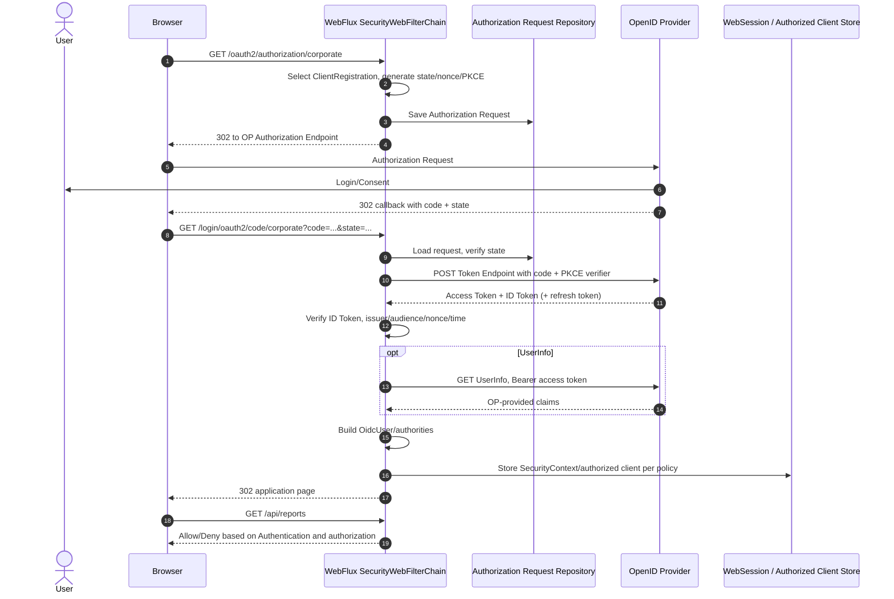
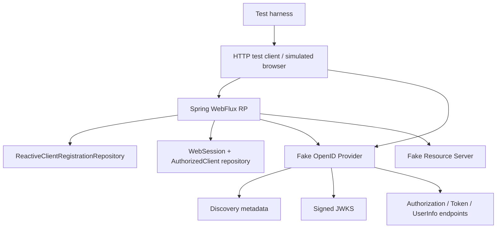

# 30.11. Limitations of Mock Authentication Compared to Testing a Real Provider

> **Module:** Spring Security OAuth 2.0 OIDC Client  
> **Chapter:** 30. Reactive Testing  
> **Context:** Spring Boot, Spring Security WebFlux, `WebTestClient`, `SecurityWebFilterChain`, OAuth2 Login, OpenID Connect (OIDC), OAuth2 Client, and integration with a real OpenID Provider (OP)/Authorization Server (AS) or provider sandbox environment.

A WebFlux application might have hundreds of tests using `mockOidcLogin()` that all pass: users with `ROLE_ADMIN` can reach the admin page, users missing `SCOPE_reports.read` receive 403, and the `/me` endpoint returns the expected principal info. Yet when deployed, users clicking Login hit `invalid_redirect_uri`, callbacks report `authorization_request_not_found`, ID Tokens are rejected due to an `issuer` mismatch, or the provider returns a `groups` format different from the test fixture.

Those failures do not contradict Mock Authentication results. **Mock authentication only simulates an already-existing Authentication** — typically skipping the browser's trip to the Authorization Endpoint, saving `state`, logging in/consenting at the OP, exchanging the authorization code, verifying the ID Token, fetching UserInfo, real authority mapping, and persisting the authorized client.

Conversely, testing against a real provider (usually a **provider sandbox/non-production tenant**) observes many real behaviors such as metadata, `redirect_uri` registration, SSO cookies, Client authentication, claims mapping, response codes, and provider policies. However, live-provider tests also have drawbacks: flaky networks, locked or MFA-enabled test users, quotas/rate limits, non-deterministic data, configuration drift, and difficulty reproducing specific failure cases.

This lesson does not seek to eliminate mock tests. Its goal is to **choose the right test layer for the right question**, combining unit tests, WebFlux security tests, fake OP integration tests, sandbox-provider contract tests, and targeted realistic smoke tests to gain confidence while keeping CI fast, secrets safe, and runs reliable.

---

## 1. Learning Objectives

After this lesson, you will be able to:

1. Explain which step of OIDC Login Mock Authentication replaces in Spring Security Test.
2. Distinguish `mockOidcLogin()`, `mockOAuth2Login()`, `mockJwt()`, `mockOpaqueToken()`, and `@WithMockUser`.
3. Use `WebTestClient.bindToApplicationContext(...).apply(springSecurity())` to test `SecurityWebFilterChain` on WebFlux.
4. Understand the limitations of using `WebTestClient.bindToServer()` with mock security configurers.
5. Write URL authorization tests for a principal that already has authorities, CSRF, and method-specific rules.
6. Distinguish mocked `OidcUser`/ID Token claims from genuinely verified OIDC claims.
7. Explain why `mockOidcLogin().idToken(...)` does not automatically invoke custom mappers, the UserInfo Endpoint, or the Token Endpoint.
8. List what mocks cannot verify: OIDC Discovery, issuer, audience, JWT signature, `nonce`, `state`, PKCE, and Client authentication.
9. Design a fake OP/AS capable of executing a real Authorization Code Flow against the application.
10. Distinguish a fake OP, a local identity provider container, a real sandbox, and a production tenant.
11. Write negative tests for wrong `iss`/`aud`, JWKS rotation, expired ID Tokens, invalid `state`, and invalid PKCE.
12. Understand browser/cookie/redirect issues that mock tests fail to detect.
13. Test user authorities and tenant mapping derived from verified provider claims along the real pipeline.
14. Distinguish an OIDC browser session from a Reactive OAuth2 Client used to call APIs and a Resource Server JWT.
15. Test Reactive method authorization, Reactor Context, and subscription timing.
16. Manage test secrets, test accounts, rate limits, CI retries, and personal data when using a real provider.
17. Establish a multi-layered test strategy with explicit criteria for what is guaranteed and what is not.

## 2. Three Different Questions Require Three Types of Tests

Suppose a user accesses:

```text
GET /api/reports
```

The questions:

**Question A — Policy:** Given an existing `Authentication` with `PERM_REPORT_READ`, does the application return the right result and reject unauthorized users?

Use `WebTestClient` + `mockOidcLogin().authorities(...)`. No need to spin up a real OP.

**Question B — Protocol/wiring:** When the OP returns a valid ID Token containing group `reports-readers`, does Spring Security verify the token, invoke the mapper, and produce `PERM_REPORT_READ`?

Use an integration test running the **OIDC Authorization Code Flow** against a fake OP/AS signing tokens with a test key, or test individual components alongside a representative login integration test.

**Question C — Provider contract:** With the client configuration registered in the real OP's sandbox, do discovery endpoints, redirect URI, Client authentication, claims, UserInfo, logout, and refresh behave as expected?

Use a provider sandbox/non-production tenant to verify real capabilities and policies; do not try to simulate everything with hand-written fixtures.

**The three questions do not replace one another.**

## 3. Multi-Layer Testing Model

| Test layer | Network call to OP? | Fast/stable | Proves best | Does not prove |
|---|---|---|---|---|
| Unit test of policy/mapper | No | Very high | Mapping functions and business rules | OAuth2 Login wiring |
| WebFlux Mock Authentication | No | Very high | URL/method authorization for a given principal | Authorization Code/OIDC protocol |
| Spring context + fake OP | Local/test network | Good if well-designed | Redirect, code exchange, state, PKCE, OIDC JWT validation, mapping | Quirks of real vendors |
| Local OP container | Local/test network | Moderate | A realistic OP implementation | Other provider-specific contracts |
| Real provider sandbox | Yes | Can be slow/flaky | Provider metadata, client registration, claims, consent, policies | Identical production SSO/session policies |
| Browser E2E + sandbox | Yes, real browser | Slower | Browser navigation, cookies, callback, sandbox UX/MFA behavior | Edge cases the provider does not reproduce |
| Approved production smoke/monitoring | Yes | High risk/cost | Real deployment health signals | Never use to test real credentials or negative attacks |

Ideal pyramid: **many small tests**, **a set of controlled integration tests**, and **a focused set of contract/smoke tests** per critical provider.

## 4. Which Components Does WebFlux OIDC Login Pass Through?

Simplified flow:



`mockOidcLogin()` essentially jumps straight to the **final step**: the request carries a fake OIDC Authentication and `SecurityWebFilterChain` evaluates access. Earlier steps do not execute just because a test invokes this post-processor.

## 5. Mock Authentication Concept in Reactive Security

In Spring Security WebFlux, `Authentication` flows through the reactive security context; security components read it from `ReactiveSecurityContextHolder`.

A test configurer like `mockOidcLogin()` attaches an appropriate principal/Authentication to the test request, letting rules like:

```java
.pathMatchers("/api/admin/**").hasRole("ADMIN")
.pathMatchers("/api/reports/**").hasAuthority("PERM_REPORT_READ")
```

work without hitting an Authorization Server.

### 5.1. Simulating Identity Is Not Verifying Identity

If a mock fixture has:

```text
issuer=https://login.corporate.test/oidc
sub=user-123
groups=["admins"]
```

that **does not prove** the token was signed by the corporate OP; it is simply data declared by the test itself. An attacker cannot be allowed to send similar JSON in production; production must run the real security pipeline to verify origin.

### 5.2. Mock Authentication Is Not "Bypass All Security"

When properly attached to a `WebTestClient` bound to Spring Security, the request still traverses the filters and rules in the application context. Therefore mocks are genuinely valuable for testing **authorization**. Only the **authentication protocol** steps are simulated/replaced.

## 6. Commonly Confused Test Helpers

| Test helper | What does it simulate? | When to use? |
|---|---|---|
| `mockOidcLogin()` | OIDC Login principal/Authentication for WebFlux | URL rules, claims presentation, session user |
| `mockOAuth2Login()` | Non-OIDC OAuth2 Login without requiring an OIDC ID Token | Apps using plain OAuth2 Login |
| `mockJwt()` | Resource Server Bearer JWT authentication | APIs validating JWT tokens |
| `mockOpaqueToken()` | Opaque Bearer token authentication | APIs using token introspection |
| `mockUser()` / `@WithMockUser` | Spring Security user Authentication | Service/method policies or generic authentication |
| Fake OP over HTTP | Authorization, token, UserInfo, and JWT signature tests | Testing OAuth2/OIDC login wiring |
| Provider sandbox | Real OP contract/capabilities | Validating production-like integration |

Helper APIs vary slightly across Spring Security versions. For WebFlux, use the **reactive `WebTestClient`** namespace/test utilities rather than applying Servlet `MockMvc` helpers directly.

## 7. `WebTestClient`: `bindToApplicationContext` and `springSecurity()`

To use WebFlux security test configurers, a common pattern is building the client from the Spring application context:

```java
package example.reactive;

import org.junit.jupiter.api.BeforeEach;
import org.junit.jupiter.api.Test;
import org.springframework.beans.factory.annotation.Autowired;
import org.springframework.boot.test.context.SpringBootTest;
import org.springframework.context.ApplicationContext;
import org.springframework.test.web.reactive.server.WebTestClient;

import static org.springframework.security.test.web.reactive.server
    .SecurityMockServerConfigurers.springSecurity;
import static org.springframework.security.test.web.reactive.server
    .SecurityMockServerConfigurers.mockOidcLogin;

@SpringBootTest(webEnvironment = SpringBootTest.WebEnvironment.MOCK)
class ReactiveUrlSecurityTest {

    @Autowired
    ApplicationContext context;

    WebTestClient client;

    @BeforeEach
    void setUp() {
        client = WebTestClient
            .bindToApplicationContext(context)
            .apply(springSecurity())
            .configureClient()
            .build();
    }

    @Test
    void example() {
        client.mutateWith(mockOidcLogin())
            .get().uri("/api/profile")
            .exchange()
            .expectStatus().isOk();
    }
}
```

Condition: the test application context has the WebFlux endpoints and an appropriate `SecurityWebFilterChain`. Spring Boot auto-configuration can also inject `WebTestClient` when using the right test annotations, though manual setup above makes it explicit that **Spring Security test integration is attached to the client**.

### 7.1. Do Not Forget `.apply(springSecurity())`

If you use `WebTestClient.bindToApplicationContext(context)` without applying the security configurer, mock security mutators or filter-chain behaviors may not work as expected. A misconfigured test might return "200" simply because `SecurityWebFilterChain` was not properly applied.

### 7.2. `mutateWith` Requires a Mock-Server-Bound Test Client

`mockOidcLogin()` creates a test authentication context inside the in-memory server exchange. When using:

```java
WebTestClient.bindToServer().baseUrl("http://localhost:8080").build()
```

that is an HTTP client calling **a real server over the network**; a client-side test post-processor cannot inject a server-side `SecurityContext` into another process. For full HTTP E2E, execute real login/session/cookies through endpoints or use an isolated, controlled test-auth mechanism absent from production.

**Do not confuse `WebTestClient` binding modes.**

## 8. Illustrative `SecurityWebFilterChain`

Suppose the application requires:

- `/public/**` public.
- `GET /api/reports/**` requires `PERM_REPORT_READ`.
- `POST /api/reports/**` requires `PERM_REPORT_WRITE`.
- `/api/admin/**` requires `ROLE_ADMIN`.
- Other requests require authentication.

```java
import org.springframework.context.annotation.Bean;
import org.springframework.context.annotation.Configuration;
import org.springframework.http.HttpMethod;
import org.springframework.security.config.web.server.ServerHttpSecurity;
import org.springframework.security.web.server.SecurityWebFilterChain;

@Configuration
class ReactiveSecurityConfiguration {

    @Bean
    SecurityWebFilterChain filterChain(ServerHttpSecurity http) {
        return http
            .authorizeExchange(exchanges -> exchanges
                .pathMatchers("/public/**").permitAll()
                .pathMatchers("/api/admin/**").hasRole("ADMIN")
                .pathMatchers(
                    HttpMethod.POST, "/api/reports/**"
                ).hasAuthority("PERM_REPORT_WRITE")
                .pathMatchers(
                    HttpMethod.GET, "/api/reports/**"
                ).hasAuthority("PERM_REPORT_READ")
                .anyExchange().authenticated()
            )
            .oauth2Login(oauth2 -> {})
            .build();
    }
}
```

This snippet illustrates Servlet-independent **Reactive** security configuration. A real application needs client registrations, exception handling, logout, session and authorized-client storage, CSRF, security headers, and further policies depending on its threat model.

### 8.1. Matcher Order

If `/api/**.authenticated()` is placed before `/api/admin/**.hasRole("ADMIN")`, the broader rule can match first and admit regular users. Mock tests are ideal for catching this bug with a **negative case** (reader denied on admin), even though they do not verify the OP.

## 9. Testing URL Authorization with `mockOidcLogin()`

Example request holding `PERM_REPORT_READ`:

```java
import org.junit.jupiter.api.Test;
import org.springframework.security.core.authority.SimpleGrantedAuthority;

import static org.springframework.security.test.web.reactive.server
    .SecurityMockServerConfigurers.mockOidcLogin;

@Test
void reportReaderCanRead() {
    client.mutateWith(
        mockOidcLogin().authorities(
            new SimpleGrantedAuthority("PERM_REPORT_READ")
        )
    )
    .get().uri("/api/reports/42")
    .exchange()
    .expectStatus().isOk();
}

@Test
void reportReaderCannotReadAdmin() {
    client.mutateWith(
        mockOidcLogin().authorities(
            new SimpleGrantedAuthority("PERM_REPORT_READ")
        )
    )
    .get().uri("/api/admin/audit")
    .exchange()
    .expectStatus().isForbidden();
}
```

Condition: the application context has controllers for the routes and handlers returning matching HTTP statuses.

**Verified:** `SecurityWebFilterChain` handles a principal with `READ` authority per policy.

**Not verified:** whether the provider actually returns the reader group, whether Spring Security constructs that authority from the group, whether the Client ID/redirect URI are right, or whether the ID Token has a valid signature.

## 10. CSRF in Reactive Tests

In browser/session applications, `POST`/`PUT`/`PATCH`/`DELETE` requests can be rejected by CSRF protection even when the `Authentication` holds `WRITE` permission.

Example:

```java
import static org.springframework.security.test.web.reactive.server
    .SecurityMockServerConfigurers.csrf;

@Test
void writerCanCreateWithCsrf() {
    client.mutateWith(
        mockOidcLogin().authorities(
            new SimpleGrantedAuthority("PERM_REPORT_WRITE")
        )
    ).mutateWith(csrf())
     .post().uri("/api/reports")
     .exchange()
     .expectStatus().isCreated();
}

@Test
void readerCannotCreateEvenWithCsrf() {
    client.mutateWith(
        mockOidcLogin().authorities(
            new SimpleGrantedAuthority("PERM_REPORT_READ")
        )
    ).mutateWith(csrf())
     .post().uri("/api/reports")
     .exchange()
     .expectStatus().isForbidden();
}
```

### 10.1. Two 403 Errors with Different Meanings

| Request | CSRF | Authority | Expectation |
|---|---|---|---|
| POST report, writer | Valid | WRITE | 201 if controller contract matches |
| POST report, writer | Missing | WRITE | 403 due to CSRF under default config |
| POST report, reader | Valid | READ | 403 due to authorization |
| GET report, reader | Not required by default | READ | 200 |
| GET report, anonymous | None | None | Login redirect/challenge depending on entry point |

If a reader `POST` test omits CSRF, 403 still appears even if the URL policy is wrong. Therefore, to prove authorization enforcement, supply a valid CSRF token in negative tests.

### 10.2. Stateless Resource Servers Are a Different Case

A bearer-only API may disable CSRF for stateless routes after a threat-model review. In browser OIDC Login apps, do not globally disable CSRF just to turn tests green.

## 11. Default `mockOidcLogin()` Authorities Are Not Real Permissions

A mock OIDC principal gets default authorities generated by the test library; it does not automatically include business permissions like `PERM_REPORT_READ` or `ROLE_ADMIN`.

When a test requires a specific authority, declare it explicitly:

```java
mockOidcLogin().authorities(
    new SimpleGrantedAuthority("ROLE_ADMIN")
)
```

Do not write tests relying on assumptions about default fixture attributes. If Spring Security Test is upgraded and defaults shift, explicit tests continue reflecting policy.

### 11.1. Roles and Authorities

Under Spring Security conventions:

```java
.hasRole("ADMIN")
```

typically expects `ROLE_ADMIN`, whereas:

```java
.hasAuthority("ADMIN")
```

expects the exact string `ADMIN`.

Mocks do not hide prefix mismatches. Test both that `ROLE_ADMIN` is permitted and bare `ADMIN` is rejected when default role prefixes are configured.

## 12. Mock ID Token Claims Do Not Automatically Map Permissions

You can customize fixture claims:

```java
client.mutateWith(
    mockOidcLogin().idToken(token -> token
        .claim("iss", "https://login.corporate.test/oidc")
        .claim("groups", java.util.List.of("finance-readers"))
    )
)
.get().uri("/api/reports/42")
.exchange();
```

However, **merely putting `groups=["finance-readers"]` in the mock token does not invoke your custom `GrantedAuthoritiesMapper` or `OidcReactiveOAuth2UserService`** to produce `PERM_REPORT_READ`.

If the URL rule requires `PERM_REPORT_READ`, the fixture must supply the authority explicitly **or** a separate unit/integration test must exercise the mapper directly.

### 12.1. Three Essential Tests

- **Mapper unit test:** `finance-readers` claim from a trusted issuer -> `PERM_REPORT_READ`.
- **`WebTestClient` mock test:** `Authentication` with `PERM_REPORT_READ` -> allowed to read reports.
- **OIDC integration test:** fake OP issues signed ID Token + UserInfo per contract -> login pipeline yields a principal with `PERM_REPORT_READ`.

The first two tests alone do not prove production wiring actually invokes the mapper.

## 13. `mockOAuth2Login()` Differs From `mockOidcLogin()`

`mockOAuth2Login()` suits non-OIDC OAuth2 Login when the principal is an `OAuth2User` without requiring an OIDC ID Token.

Example:

```java
import static org.springframework.security.test.web.reactive.server
    .SecurityMockServerConfigurers.mockOAuth2Login;

client.mutateWith(
    mockOAuth2Login().authorities(
        new SimpleGrantedAuthority("ROLE_USER")
    )
)
.get().uri("/api/profile")
.exchange()
.expectStatus().isOk();
```

If an app supports plain OAuth2 Login with a non-OIDC provider alongside OIDC Login with an OP, test both principal types because claim shapes and authority mapping differ.

Never use `mockOidcLogin()` to claim an OAuth2-only provider returns an ID Token; it does no such thing.

## 14. `mockJwt()` Is Not `mockOidcLogin()`

A WebFlux application can act as both an OIDC Client (browser SSO) and an OAuth2 Resource Server (Bearer JWT API).

| Context | Typical `Authentication` | Test helper |
|---|---|---|
| Browser logged in via OIDC | `OAuth2AuthenticationToken` / `OidcUser` | `mockOidcLogin()` |
| Non-OIDC OAuth2 Login | `OAuth2AuthenticationToken` / `OAuth2User` | `mockOAuth2Login()` |
| API receiving Bearer JWT | `JwtAuthenticationToken` | `mockJwt()` |
| API using Bearer opaque token | Opaque-token authentication | `mockOpaqueToken()` |

Resource Server test example:

```java
import static org.springframework.security.test.web.reactive.server
    .SecurityMockServerConfigurers.mockJwt;

client.mutateWith(
    mockJwt().authorities(
        new SimpleGrantedAuthority("SCOPE_reports.read")
    )
)
.get().uri("/api/bearer-reports")
.exchange()
.expectStatus().isOk();
```

A `mockJwt()` test does not exercise OIDC browser login, session cookies, or a custom `OidcUserService`. Conversely, `mockOidcLogin()` does not verify a Resource Server's JWT decoder.

## 15. Anonymous Requests and Login Entry Points

In OIDC browser login, an anonymous request to a protected endpoint may redirect to a login page or login entry point.

```java
client.get().uri("/api/reports/42")
    .exchange()
    .expectStatus().is3xxRedirection();
```

However, this is only expected when `SecurityWebFilterChain`/the authentication entry point is configured for browser redirects. An API-specific entry point might return 401.

Do not hardcode 302 across every app; assert the exact contract of the target chain, including the `Location` response header where applicable.

### 15.1. Multiple Chains Under the Same Base URL

An application might configure:

- `/api/**` accepting Bearer JWTs with 401.
- `/web/**` using an OIDC session and login redirect.

In that setup, pair the right helper with each chain. Running `mockOidcLogin()` against a Bearer-only chain may not reflect real production traffic.

## 16. Reactive Method Security

Spring Security WebFlux supports reactive method authorization, for example:

```java
import org.springframework.security.access.prepost.PreAuthorize;
import org.springframework.stereotype.Service;
import reactor.core.publisher.Mono;

@Service
public class ReactiveReportService {

    @PreAuthorize("hasAuthority('PERM_REPORT_EXPORT')")
    public Mono<String> exportReport(long id) {
        return Mono.just("report-" + id);
    }
}
```

With appropriate configuration:

```java
import org.springframework.context.annotation.Configuration;
import org.springframework.security.config.annotation.method.configuration.EnableReactiveMethodSecurity;

@Configuration
@EnableReactiveMethodSecurity
class ReactiveMethodSecurityConfiguration {
}
```

### 16.1. Test Through the Real Spring Bean/Proxy

If a test instantiates:

```java
new ReactiveReportService().exportReport(42)
```

it bypasses the Spring AOP proxy and `@PreAuthorize` is not enforced. Tests must obtain the service bean from the Spring context.

### 16.2. Authentication in Reactor Context

Reactive security relies on Reactor Context, rather than a `ThreadLocal` always available as in much Servlet code. When testing methods directly, prepare the reactive `SecurityContext` properly or integrate via the appropriate security test annotations/utilities.

Illustrative example:

```java
import org.junit.jupiter.api.Test;
import org.springframework.beans.factory.annotation.Autowired;
import org.springframework.boot.test.context.SpringBootTest;
import org.springframework.security.test.context.support.WithMockUser;
import reactor.test.StepVerifier;

@SpringBootTest
class ReactiveReportMethodTest {

    @Autowired ReactiveReportService service;

    @Test
    @WithMockUser(authorities = "PERM_REPORT_EXPORT")
    void exporterCanExport() {
        StepVerifier.create(service.exportReport(42))
            .expectNext("report-42")
            .verifyComplete();
    }
}
```

This example needs `reactor-test` in test dependencies, `@EnableReactiveMethodSecurity`, and test setup supporting mock `SecurityContext` propagation. If your test framework/version requires explicit integration, use `ReactiveSecurityContextHolder.withAuthentication(...)` to pass context explicitly on the publisher.

### 16.3. Do Not Call `subscribe()` Manually in Business Code

If a service calls `subscribe()` internally before framework/tracing/security context is attached, behavior can diverge from expectations. Prefer returning `Mono`/`Flux` and composing operators; test subscribers should use `StepVerifier` when asserting emissions or errors.

### 16.4. Mock Method Security Does Not Prove the OP

A service test using `@WithMockUser` only proves authority policy. It does not prove an ID Token from a real OP maps to the right authority.

## 17. Steps Skipped by Mock Authentication

| Component/test target | Mock Authentication | Fake OP integration | Real provider sandbox |
|---|---|---|---|
| `SecurityWebFilterChain` authorization | Yes | Yes | Yes |
| Reactive method authorization | Yes if context/proxy right | Yes | Yes |
| OP discovery metadata | No | Yes if stub endpoint implemented | Yes |
| Registration Client ID/secret | Protocol not verified | Possible | Yes |
| Authorization Endpoint redirect | No | Yes | Yes |
| OP login/consent UI | No | Usually simulated | Yes |
| State correlation callback | No | Yes | Yes |
| PKCE `code_verifier`/challenge | No | Yes if fake OP verifies | Yes per OP policy |
| Token Endpoint auth/exchange | No | Yes | Yes |
| ID Token JWT signature | No | Yes if fake token signed | Yes |
| Issuer/audience/nonce validation | No | Yes | Yes |
| JWK rotation/caching | No | Yes if simulated | Yes, hard to control |
| UserInfo response | No | Yes if stub endpoint implemented | Yes |
| Real claim shape | Chosen by fixture | Chosen by fixture | Yes |
| Refresh token behavior | No | Yes if simulated | Yes |
| Browser cookies/SSO/MFA | No | Partial | Yes (sandbox) |
| Provider-specific errors | No | If simulated | Yes |
| Network/TLS/timeouts | No | Partial | Yes |
| Provider quotas, rate limits | No | If simulated | Yes |
| Redirect host/forwarded headers | Incomplete | Yes with full stack | Yes when topology matches production |

**Mock tests are not faulty** for skipping protocol steps — that is their purpose. The mistake is treating mock results as proof for layers that never ran.

## 18. OIDC Discovery and Client Registration

A real OP typically publishes metadata at a well-known endpoint, e.g.:

```text
https://idp.test.example/realms/acme/.well-known/openid-configuration
```

Metadata may contain:

- `issuer`;
- `authorization_endpoint`;
- `token_endpoint`;
- `jwks_uri`;
- `userinfo_endpoint` if supported;
- `end_session_endpoint` if supported;
- supported signing algorithms;
- token endpoint authentication methods;
- various extended capabilities.

Mock Authentication **does not fetch metadata** and does not verify whether these values match configuration.

### 18.1. Broken Configuration Where Tests Still Pass

Example:

```yaml
spring:
  security:
    oauth2:
      client:
        registration:
          corporate:
            provider: corporate-op
            client-id: wrong-client-id
            client-secret: ${CORPORATE_CLIENT_SECRET}
            authorization-grant-type: authorization_code
            redirect-uri: "{baseUrl}/login/oauth2/code/{registrationId}"
            scope: [openid, profile]
        provider:
          corporate-op:
            issuer-uri: https://wrong-issuer.example.invalid
```

A mock authorization test may rely solely on `SecurityWebFilterChain` + a mock principal and pass; it proves neither that the issuer URI works nor that the OP accepts the Client ID.

If Boot initializes the registration via issuer discovery in the application context and the issuer is unreachable, context startup may fail before the test runs; that is a **configuration detail**, not proof that mocks test remote contracts. Mock tests need an appropriate registration fixture, alongside a dedicated test layer validating non-production/real provider configuration.

## 19. Redirect URI and Reverse Proxy

An app behind a reverse proxy:

```text
Browser: https://app.example.test
Internal WebFlux: http://rp-service:8080
```

If the application generates the redirect URI:

```text
http://rp-service:8080/login/oauth2/code/corporate
```

the OP can reject it because the registered URI is:

```text
https://app.example.test/login/oauth2/code/corporate
```

Mock Authentication never goes through redirects, so it misses this completely.

### 19.1. What Needs Testing?

- Externally visible scheme/host/port.
- Context path/base URL.
- Reverse proxy trusted forwarded headers.
- Exact match with registered redirect URI.
- Prevention of `Host`/`X-Forwarded-Host` injection.
- Tenant-specific domains and allowed callback routes.
- Post-login/post-logout redirects avoiding open redirects.

Fake OP integration can verify the Authorization Request's `redirect_uri`; sandbox provider tests confirm the real OP accepts it.

## 20. `state` and Authorization Request Repository

In the Authorization Code Flow, the RP generates an unpredictable `state`, stores the authorization request, and binds it to the browser session/transaction.

The callback:

```text
/login/oauth2/code/corporate?code=CODE&state=STATE
```

must be matched against the original request. When testing with `mockOidcLogin()`, `ServerAuthorizationRequestRepository` persistence/lookup never executes.

### 20.1. Bugs Missed by Mocks

- Session cookie lost after redirect.
- Browser blocks cookie due to `SameSite`/`Secure`/domain/path.
- Callback hits a node unable to read the shared `WebSession`.
- Two concurrent login tabs overwrite one request.
- Mismatched or replayed `state`.
- Expired Authorization Request.
- Tenant/registration swapped between initiation and callback.
- Callback path mismatches registration.

### 20.2. Negative Tests Requiring a Fake OP

1. Start login and capture `state`.
2. Return callback with valid `state` -> proceeds to token exchange.
3. Return different `state` -> no `Authentication` created.
4. Replay the same callback/code -> rejected per one-time `state`/code policy.
5. Drop cookie/session -> login must not complete illegitimately.
6. Run concurrent logins across two tabs -> honors concurrency policy.
7. Send callback to wrong registration -> never exchanges token using another Client.

These checks are meaningless if you only invoke `mockOidcLogin()`.

## 21. PKCE S256 and Authorization Code

PKCE binds the authorization code to the Client that initiated the request:

```text
code_verifier -> SHA256 -> code_challenge (S256)

Authorization Request:
  code_challenge=...
  code_challenge_method=S256

Token Request:
  code=...
  code_verifier=...
```

Mock Authentication neither generates nor verifies a PKCE verifier with the AS.

### 21.1. A Fake OP Can Test Real PKCE

A proper fake OP integration test should:

- Store the challenge against the test authorization code.
- Reject token requests missing a verifier when PKCE is required.
- Reject an invalid verifier.
- Accept a valid verifier exactly once.
- Reject code reuse.
- Enforce Client ID/redirect URI binding.

Do not write a fake OP that blindly issues tokens regardless of code/verifier; otherwise integration tests prove nothing about PKCE.

### 21.2. Never Log Codes/Verifiers in Tests

Use synthetic credentials and redacted request captures. If you need to assert the verifier, check presence/format or use an in-memory test-specific comparison without printing raw values into CI logs.

## 22. Token Endpoint Client Authentication

Depending on the OP/Client registration, the Token Endpoint may require:

- `client_secret_basic`;
- `client_secret_post`;
- `private_key_jwt`;
- `client_secret_jwt`;
- `none` for public Clients with appropriate protections;
- other extended methods.

Mock Authentication never calls the Token Endpoint, so it tests none of Client ID, secret, signature, clock, JWT assertion audience, or registered method.

### 22.1. Contract Test

An integration/sandbox test must confirm:

1. The Client sends the right authentication method.
2. Credentials come from non-production secret management/config.
3. The real Token Endpoint accepts the request.
4. Secrets never leak in URLs/logs/traces.
5. Secret rotation is supported per policy.
6. `invalid_client` errors are handled safely by the app.

Never embed production Client secrets in fake OP fixtures or test source code.

## 23. ID Token Signature, JWK, and Claims Validation

OIDC Login must validate ID Tokens under the corresponding OIDC rules, including:

- Trusted issuer `iss`;
- Intended audience `aud` containing the Client ID;
- `azp` conditions when applicable;
- `exp`/`iat` and clock skew;
- Signature using an allowed algorithm/key;
- `nonce` when the flow uses nonce;
- Additional requirements by token type/flow;
- Never trusting untrusted JWKS URLs or arbitrary JWT headers.

`mockOidcLogin().idToken(...)` does not invoke the login flow's JWT decoder or token validators. Claims placed in the fixture are trusted for authorization testing.

### 23.1. Fake OP Signed ID Tokens

To test real validation, a fake OP should:

1. Generate a dedicated test signing key, never a production key.
2. Publish the public JWKS at a test endpoint.
3. Sign ID Tokens with the configured/allowed algorithm.
4. Issue valid `iss`, `sub`, `aud`, `iat`, `exp`.
5. Bind `nonce` from the Authorization Request.
6. Return the response via the Token Endpoint after code exchange.
7. Support controlled negative cases: wrong issuer/audience, expired, unknown `kid`, invalid signature.
8. Never disable token verification on the RP just to integrate with the fake OP.

If a fake OP issues unsigned/`alg=none` tokens and the RP "accepts" them by bypassing validators, the test does not represent a secure OIDC Client.

### 23.2. JWKS Rotation/Caching

Testing provider-side rotation requires:

- Initial Key A with `kid=A`.
- OP JWKS serving public key A.
- Rotating to Key B and updating JWKS.
- RP refreshing/caching keys per policy.
- ID Tokens signed with B succeeding after refresh.
- Forged tokens with unknown `kid`/bad signatures rejected.

A sandbox provider may not let your team rotate signing keys on demand, making fake OP integration better suited for these negative/edge cases.

## 24. UserInfo Endpoint and Real Claims

A mock `OidcUser` can be constructed directly with:

```text
email=alice@example.test
groups=["reports-readers"]
department="finance"
```

But a real OP might:

- Omit `groups` from the ID Token.
- Return groups in UserInfo instead of the ID Token.
- Require specific scopes to return `email`/`profile`.
- Return an unverified email or omit `email_verified`.
- Return nested roles like `realm_access.roles`.
- Use provider-namespaced claims.
- Cap group counts and emit overage/reference claims.
- Return UserInfo HTTP 401/403 due to access token/scope rules.
- Alter claims based on consent/tenant settings.

### 24.1. Mapper Unit Tests Alone Are Not Enough

A unit test:

```text
groups=["reports-readers"] -> PERM_REPORT_READ
```

may pass, yet fail to guarantee the OP emits that claim shape. Sandbox contract tests should observe **real claims returned for a test account holding the matching consent/scopes** (within privacy boundaries), then map them into authorities per policy.

### 24.2. Never Grant Permissions From Email Domain Alone

An ID Token with `email=person@company.test` does not automatically prove the user may administer a tenant. Trusted `issuer`/`sub` and membership mapping are required; emails can change, remain unverified, or be reassigned.

## 25. Authority Mapping: Mocks Can Mask Wiring Bugs

Suppose user groups map as:

```text
OIDC groups ["reports-readers"]
    -> GrantedAuthority("PERM_REPORT_READ")
```

A mock test:

```java
client.mutateWith(
    mockOidcLogin().authorities(
        new SimpleGrantedAuthority("PERM_REPORT_READ")
    )
)
.get().uri("/api/reports/42")
.exchange()
.expectStatus().isOk();
```

is valid, yet does not prove the mapper executes during real login.

### 25.1. Recommended Test Trio

1. **Mapping unit:** provider-specific claims fixture -> expected authorities.
2. **Security rule mock:** expected authorities -> HTTP allow/deny.
3. **Fake OP integration:** signed ID Token/UserInfo -> OAuth2 Login pipeline -> Authentication authorities -> URL outcome.

For providers with distinctive claim shapes, add a **sandbox contract test** to confirm real payloads match assumptions.

### 25.2. Registration and Issuer Are Two Distinct Keys

The same issuer can serve multiple Client registrations or tenants. A mapper may need `registrationId`, `iss/sub`, and tenant membership; a mock carrying a single global `ROLE_ADMIN` misses cross-tenant escalation bugs.

## 26. Reactive Sessions, Cookies, and Browser Restrictions

Mock Authentication attaches a security context directly to the exchange; it does not require a browser to preserve an OP session cookie and return to the callback.

Real-world situations:

- `SESSION` cookie dropped after redirecting to the OP.
- Wrong cookie domain/path.
- `SameSite` blocking cross-site callbacks in specific flows.
- Reverse proxy adding/altering `Secure`/forwarded headers.
- Load balancer routing to a node without shared `WebSession` storage.
- Session fixation/rotation causing `state` mismatches.
- Fresh browser profile lacking an SSO session.
- Third-party cookie restrictions affecting front-channel/logout.
- OP account already holds an SSO session so the login form does not appear.

### 26.1. When to Test with a Real Browser?

When questions involve cookie policies, cross-site redirects, MFA UX, Safari/Chrome privacy rules, or browser history, `WebTestClient` alone can fall short. Use browser E2E automation (Playwright/Selenium depending on stack) against a sandbox OP in a topology-accurate environment.

### 26.2. Browser E2E Cannot Cover Every OAuth2 Edge Case Either

It excels at happy paths and cookie UX, yet is brittle around MFA/CAPTCHAs and cannot easily forge invalid-signature ID Tokens. Pair it with fake OP integration tests for controlled negative cases.

## 27. Logout and Session Invalidation

A mock-auth test can call `POST /logout` and verify status/redirect against security config. Yet it does not verify:

- Whether the OP end-session endpoint exists;
- Whether `id_token_hint`/post-logout redirect is accepted by the OP;
- Whether the browser cleared its SSO cookie at the OP;
- Whether Back-Channel Logout Tokens from the OP are verified;
- Whether user sessions on other devices were invalidated;
- Whether refresh tokens/grants were revoked.

### 27.1. Fake OP Logout Test

You can stub the end-session endpoint and verify the generated RP redirect; if using Back-Channel Logout, issue a test-signed Logout Token and verify session revocation.

### 27.2. Sandbox Logout Test

To confirm a real OP supports RP-Initiated Logout, OP cookie behavior, consent, and re-login, you need a sandbox provider test. Never infer from a mocked `OidcUser` that global logout works.

## 28. Refresh Tokens and Authorized-Client Storage

A Reactive OAuth2 Client app may use `ReactiveOAuth2AuthorizedClientManager` or its repository/service to refresh tokens, store authorized clients, and invoke APIs.

`mockOidcLogin()` does not verify:

- Whether the AS issues refresh tokens for the current scopes/policy;
- Refresh token rotation/expiry/revocation;
- Token Endpoint refresh grants;
- Retries/races under concurrent refresh requests;
- Token persistence in Redis/R2DBC/JDBC/custom storage;
- Whether the Resource Server accepts the newly refreshed access token;
- `invalid_grant` refresh-token cleanup.

### 28.1. Split Tests by Responsibility

| What to verify | Approach |
|---|---|
| Authenticated user may call endpoint | Mock OIDC Authentication |
| Client picks right registration when calling API | Unit/integration test reactive authorized-client manager |
| Refresh grant request/body/response | Fake AS Token Endpoint |
| Token persistence | Repository/service integration test |
| Provider rotation/reuse behavior | Sandbox or policy-accurate fake AS |
| API returns 401 on expired token | Fake Resource Server/integration |
| Quotas and real refresh expiry | Sandbox provider contract test |

Never place real refresh tokens in fixtures, source code, or CI logs.

## 29. Provider-Specific Behaviors Invisible to Mocks

OPs differ widely in:

- Metadata discovery paths and tenant-specific issuers.
- Redirect URI registration restrictions.
- Client authentication methods.
- Mandatory vs. optional PKCE by client type.
- Consent screens, `prompt`, `login_hint`, `max_age`.
- Required scopes and optional claims.
- MFA/conditional access.
- Session lifetime and cookie policies.
- Claims in ID Token vs. UserInfo.
- Refresh token rotation.
- Logout support.
- Signing algorithms/JWKS rotation.
- Error codes/descriptions and rate limiting.

No mock principal can represent all of these. Even when a fake OP models many cases, keep **contract smoke tests** for real providers that are critical product dependencies.

## 30. Fake OP vs. Sandbox Provider: Different Purposes

### 30.1. Fake OP

Your app/team controls:

- Endpoints.
- Signing keys.
- User/consent state.
- Code issuance.
- Token claims.
- 4xx/5xx errors.
- Timeouts.
- JWKS rotation.
- Retries/replays.
- Negative cases.

Pros: deterministic, CI-friendly, produces error conditions without abusing a real provider.

Cons: you can accidentally mis-implement the spec or miss vendor quirks.

### 30.2. Real OP Sandbox

The vendor controls:

- Metadata and URLs.
- Real authentication/consent mechanisms.
- Client registration.
- Claim policies.
- Signature/JWKS implementation.
- Operational limits.

Pros: validates the real integration contract.

Cons: hard to force bad-signature tokens on demand, hard to reset state, prone to flakiness, and unsuitable for running frequently on every PR.

### 30.3. Local OP Container

A real OP running locally in a container (e.g., an OIDC server deployment for testing) tests protocol/cookies/consent more deeply than stub fakes. Even so, it **still is not** the customer's target provider if production uses another vendor.

## 31. Fake OP Integration Test Architecture



All endpoints in fixtures use **test domains/localhost ports** and synthetic credentials. The test runner must update `ClientRegistration` issuer/redirect URIs cleanly to match the fake OP's dynamic address.

### 31.1. What a Fake OP Must Expose

Depending on test goals:

- `/.well-known/openid-configuration` with consistent issuer/endpoint URLs.
- Authorization Endpoint returning code/`state` via a valid redirect.
- Token Endpoint authenticating the Client/PKCE and returning token responses.
- JWKS Endpoint publishing the public key matching signed ID Tokens.
- UserInfo Endpoint returning claims per scope when tested.
- Logout Endpoint/Back-Channel messaging when testing logout.
- Token Revocation/refresh grants when testing token lifecycle.

You do not need every endpoint for every test. However, **never claim you tested a step that does not exist in your fake OP**.

## 32. Complete Fake OP Scenario

A test flow might look like:

1. Start the fake OP with test issuer and JWKS.
2. Configure the RP registration pointing to the fake OP.
3. Initiate `GET /oauth2/authorization/corporate` on the RP via an HTTP client.
4. Read the `Location` redirect and assert `client_id`, `redirect_uri`, `scope`, `state`, and `nonce`/PKCE where applicable.
5. Send a request to the fake Authorization Endpoint and issue a code bound to Client/redirect/challenge.
6. The simulated browser preserves the RP session cookie and follows the callback containing code/`state`.
7. The RP calls the fake Token Endpoint, sending code + PKCE verifier/Client authentication.
8. The fake OP returns a signed ID Token and access token; the RP verifies signature/claims.
9. The RP calls UserInfo if configured and required by provider behavior.
10. The RP builds `Authentication` and saves the session/authorized client.
11. The browser calls a protected endpoint using the session cookie.
12. Assert authorities from verified claims match policy, and confirm a user lacking permission is blocked.

### 32.1. Why Preserve Browser Cookies?

The Authorization Request Repository is typically tied to the browser's `WebSession`. If the callback test omits that cookie/session, the RP may fail to look up the request by `state`. This is precisely a class of bug ignored by Mock Authentication.

### 32.2. Never Test the "Happy Path" by Jumping Straight to a Fake Callback

A proper fake OP test must start from the RP's Authorization Request, preserving `state`, code, PKCE, and session. If a test sends `code=synthetic` straight to the callback without a prior request and disables `state` checks just to pass, the test has dismantled the very security control under verification.

## 33. `WebTestClient.bindToServer()` for E2E Over Real HTTP

When the WebFlux RP is running on a test port:

```java
WebTestClient client = WebTestClient
    .bindToServer()
    .baseUrl("http://127.0.0.1:" + port)
    .build();
```

From there, the test must execute the real HTTP flow (redirects, cookies, callback, fake OP). Do not use `mutateWith(mockOidcLogin())` hoping to inject a `SecurityContext` across the network; it is never transmitted to the server process as a valid cookie/session.

### 33.1. When `WebTestClient` Falls Short

OIDC login is a browser-mediated flow involving cross-origin redirects and an OP login UI. `WebTestClient` primarily assists HTTP testing rather than serving as a full browser. For redirects, cookies, or JavaScript-heavy provider screens, use browser automation or an HTTP client with cookie-jar and redirect controls fitting the test design.

### 33.2. Never Auto-Follow Redirects Blindly

Do not let an HTTP client follow every redirect automatically and lose the ability to inspect `state`, `nonce`, and `redirect_uri`. Tests often need step-by-step handling with a cookie store, allowlisted hosts, and explicit assertions.

## 34. Configuring `ReactiveClientRegistrationRepository` for a Fake OP

Example test config:

```yaml
spring:
  security:
    oauth2:
      client:
        registration:
          corporate:
            provider: test-op
            client-id: reactive-rp-test
            client-secret: ${TEST_OIDC_CLIENT_SECRET}
            authorization-grant-type: authorization_code
            redirect-uri: "{baseUrl}/login/oauth2/code/{registrationId}"
            scope:
              - openid
              - profile
        provider:
          test-op:
            issuer-uri: http://127.0.0.1:19090/oidc
```

This configuration is **strictly for local test networks** with a fake OP. Production uses HTTPS and valid provider issuers. If the fake issuer runs on a dynamic port, registration and test properties must align; never hardcode stale ports when the runner allocates dynamically.

### 34.1. Discovery Bootstrap

If the app runs OIDC discovery on startup when initializing Client registrations, the fake OP must be ready before the application context starts, or tests must provide explicit provider endpoints/registration fixtures. That is a common integration setup snag, not a Mock Authorization bug.

## 35. Negative Tests with a Fake OP

| Scenario | Fake OP behavior | Expected RP behavior |
|---|---|---|
| Wrong `state` | Callback `state` differs from request | No `Authentication` created |
| Missing `state` | Callback omits `state` | Rejected |
| Reused authorization code | Code exchanged a second time | AS rejects, RP does not log in |
| Wrong PKCE verifier | Token request mismatches challenge | AS rejects |
| Wrong redirect URI | Token request sends mismatched redirect | AS rejects |
| Wrong Client secret | Token Endpoint returns `invalid_client` | Login fails safely |
| Invalid ID Token signature | JWT signed with unknown key | RP rejects |
| Wrong issuer | `iss` differs from configured issuer | RP rejects |
| Wrong audience | `aud` excludes Client ID | RP rejects |
| Expired ID Token | `exp` is in the past | RP rejects |
| Wrong `nonce` | Nonce mismatches request | RP rejects |
| Unknown JWKS `kid` | Trusted key not found | RP rejects or refreshes per policy |
| UserInfo 401 | OP rejects access token | Login failure/fallback per contract |
| Token Endpoint 503 | AS unavailable | Safe login failure/timeout UX |
| OP timeout | Slow response | Appropriate timeout/retry policy |
| Missing group | ID Token/UserInfo lacks group | Never auto-grant permission |
| Group from another issuer | Same claim name from another OP | Never mis-map across tenants |
| Refresh `invalid_grant` | Refresh token no longer valid | No retry loop, cleanup policy |
| Revocation failure | AS does not confirm revocation | Never claim remote revocation succeeded |

These failure cases must not be "simulated" by calling `mockOidcLogin()` and expecting 403; that only tests authorization policy, not how the RP handles protocol failures.

## 36. Keep Signature and Issuer Tests Separate From Authority Tests

A commonly misaimed test:

```java
client.mutateWith(
    mockOidcLogin().idToken(token ->
        token.claim("iss", "https://evil.example")
    )
)
.get().uri("/admin")
.exchange()
.expectStatus().isForbidden();
```

The 403 result may come from **lacking `ROLE_ADMIN`**, not from Spring Security rejecting the wrong issuer. Because mock authentication is already accepted upfront, this test never invokes ID Token verification.

To test a wrong issuer:

1. Start a real OIDC Authorization Code Flow in an integration test.
2. Have the fake OP issue a signed ID Token with an `iss` differing from the configured issuer.
3. The RP must reject login before granting an authenticated session.
4. Subsequent protected requests have no authenticated principal from the failed flow.

To test authorities, supply mock principal authorities and assert allow/deny.

## 37. Testing Behavior Under Provider Network Failures

Cases only full integration can exercise:

- DNS/TLS failure calling issuer/discovery.
- Token Endpoint connect timeout.
- Token Endpoint 429/rate limit.
- Brief JWKS Endpoint outage.
- UserInfo Endpoint returning 502.
- Connection reset mid-token exchange.
- Partial response/truncated body.
- AS returning HTTP 200 with invalid JSON.
- Clock skew making an ID Token expired/not-yet-valid.
- Race between secret rotation and token requests.

Fake OPs excel at injecting controlled failures. Sandboxes validate select real behaviors, but should never be intentionally disrupted as if attacking production.

### 37.1. Never Retry Every Error Identically

`invalid_client` is rarely fixed by endless retries. `429`/`503` may warrant bounded backoff per policy. `invalid_grant` can signal a reused code or revoked refresh token, where infinite retries add useless load to the OP.

Test error categories, timeouts, retry caps, and UX. Never log Client secrets, auth codes, PKCE verifiers, or token responses for debugging.

## 38. Time, Session Expiry, and Test Clocks

Mock Authentication typically does not enforce ID Token expiration the way real OIDC Login does.

A fake OP can emit:

```json
{
  "iss": "https://idp.test.example/oidc",
  "aud": "reactive-rp-test",
  "sub": "test-user",
  "iat": 1893456000,
  "exp": 1893456300
}
```

This is a payload illustration, **not a complete signed JWT**. Timestamps/clocks must align with test runtime.

### 38.1. Avoid Hardcoding Timestamps That Expire Tests Over Time

Generate time claims from a clock fixture/`Clock` injection whenever possible so tests stay deterministic. Negative tests for expired ID Tokens need `exp` intentionally placed before current time while accounting for clock skew.

### 38.2. Real-World OP Clock Skew

Sandbox OP and client clocks can drift. If you only mock principals, you will never spot nonce/time failures. Verify time synchronization, skew tolerance, and safe logging during deployment.

## 39. Consent, Scopes, and Real User Groups

With `mockOidcLogin()`:

```text
groups=["finance-admins"]
email_verified=true
roles=["editor"]
```

are values supplied directly by the test author.

With a real provider:

- The test user must belong to the exact group.
- The tenant admin must grant the appropriate scopes/claims.
- Consent can vary by Client ID.
- Certain claims appear only in UserInfo.
- `email_verified` may be `false` or absent.
- Role/group claims may drop out when group counts exceed limits.
- Token audience can depend on resource/scope parameters.

### 39.1. Claim Contracts Should Be Documented

Example:

| Field | Expected contract | Test |
|---|---|---|
| `iss` | Registered issuer string | Sandbox metadata + token |
| `sub` | Stable user identifier within issuer | Sandbox test account |
| `aud` | Contains the right Client ID | Token verification integration |
| `email_verified` | Boolean if email is used for display/verification | Sandbox contract |
| `groups` | List of strings, in ID Token or UserInfo per agreement | Mapper unit + sandbox |
| `acr`/`amr` | MFA assurance level/methods when policy requires | Provider-specific test |
| Custom tenant claim | Namespace and trusted source | Sandbox + app authorization |
| Refresh token | Present/absent per scopes/consent policy | Sandbox grant lifecycle |

Never treat a provider group name as a global SaaS role automatically; per-tenant membership remains a business authorization decision.

## 40. Provider Sandbox Accounts and Test Data

Testing against a real provider never means using production accounts.

Rules:

1. Provision a dedicated sandbox tenant/application/client.
2. Create dedicated test users and test groups containing zero real PII.
3. Use non-production Client credentials stored in a secret manager.
4. Never commit Client secrets or refresh tokens to the repository.
5. Never run automated CI using a shared human-admin account.
6. Keep test user/scope permissions minimal.
7. Clean up sessions, grants, and test data.
8. Respect OP rate limits, MFA, and policies.
9. Enable auditing/monitoring on test accounts where allowed.
10. Never brute-force, generate thousands of failed logins, or churn secrets in a tenant shared with real people.

### 40.1. CI Logs Can Leak Credentials Too

Never print HTTP `Authorization` headers, ID Tokens, Client secrets, `code_verifier`, login cookies, or full callback URLs into CI artifacts. On test failures, log status/error category/correlation ID rather than raw requests/responses.

## 41. Test Stability and Causes of Flakiness

Sandbox-provider tests can fail due to:

- Provider maintenance.
- Latency/network timeouts.
- Rate limiting.
- Test user forced password change.
- MFA prompts/CAPTCHAs.
- Changed consent settings.
- Signing key rotation.
- Leftover SSO session from a prior run.
- Clock skew.
- Locked sandbox account.
- IP/region conditional access policies.
- Incomplete test cleanup.

Never "fix" flakiness through infinite retries or dropping security assertions.

### 41.1. Classify Errors Before Retrying

| Error category | Action |
|---|---|
| Contract mismatch (issuer/redirect/client) | Fix config or escalate provider change; do not retry blindly |
| `401 invalid_client` | Inspect secret/method/client; never print secret to logs |
| `429` | Backoff/rate-limit per policy |
| `5xx`/transient network | Bounded retry with observability |
| MFA/consent interaction | Appropriate browser test/fixture account |
| Login `state` mismatch | Inspect cookies/state/session; never bypass |
| Bad signature/`aud`/`nonce` | Fail closed; inspect JWKS/config; never disable validator |
| Missing groups | Check claim contract or tenant membership |

## 42. Test Cadence: Every PR or Daily?

A practical operating cadence:

- **Every commit/PR:** mapper/policy unit tests, `WebTestClient` mock authentication, and deterministic fake OP integration tests.
- **Every staging merge/deploy:** full fake OP E2E and key sandbox-provider smoke tests.
- **Scheduled or pre-release:** provider contract regressions for primary registrations and browser cookie/login/logout UX.
- **After OP config/client secret/scope changes:** targeted provider contract tests.
- **Production:** approved synthetic monitoring only; never run automated negative credential attacks against real users.

This is a suggested cadence rather than a rigid law. Products with strict SLAs or many providers may run sandbox tests more often while controlling quotas, cost, and stability.

## 43. Do Not Replace Mock Unit Tests with a Live Provider

Running real logins for every single condition:

```text
reader allowed
reader denied admin
admin allowed
writer denied export
all HTTP methods
CSRF missing
tenant mismatch
...
```

makes test suites slow, flaky, and network-dependent. Authorization matrix permutations are executed far faster and more accurately with `WebTestClient` mocks.

Reserve provider tests for **protocol/claim contracts**; reserve mock tests for **business policy**. Selective integration tests verify the bridge between the two layers.

## 44. Do Not Replace OP Security Regressions with Mocks

Conversely, a MockMvc/`WebTestClient` mock-only suite will miss:

- OP changing its issuer URI or discovery metadata.
- Client secret expiration.
- Redirect URI removed from registration.
- Provider changing authentication method.
- ID Tokens issued with a new signing algorithm.
- `groups` claim moving from ID Token to UserInfo.
- Refresh token policy changes.
- Logout endpoint no longer supported.
- Provider migrating sandbox tenant/realm.
- Network/proxy blocking a new OP domain.

Any of these events can break production login even while every mock test passes. Keep bounded contract checks to catch them early.

## 45. Multi-Provider and Multi-Tenant: Amplified Risk

A SaaS with multiple OP issuers:

```text
tenant acme   -> registration acme-oidc
tenant globex -> registration globex-oidc
tenant beta   -> registration beta-oidc
```

A mock test can attach `ROLE_ADMIN` to any principal regardless of issuer. If the production mapper fails to namespace permissions by `issuer + subject + tenant`, a user from tenant A can gain privileges in tenant B.

### 45.1. Required Test Suite

- Mock: tenant A admin blocked from accessing tenant B resources.
- Mapper unit: group A from issuer B does not grant role A.
- Fake OP integration: wrong issuer/audience token rejected.
- Sandbox: claim shapes/capabilities of each provider match configuration.
- Callback: registration ID/`state` cannot be swapped across OPs.
- Account linking: identical email/`sub` across distinct issuers never auto-merges.
- Logout/session: logging out of OP A does not implicitly count as logging out of all OPs.

## 46. Security Filters and Test Configuration Drift

Another source of false confidence is test contexts diverging from production:

- Tests disable Spring Security filters to make controllers easier to call.
- Tests use `permitAll()` instead of production authorization rules.
- Tests omit `@EnableReactiveMethodSecurity`.
- Tests inject a mocked `ClientRegistrationRepository` differing from production.
- Tests use wrong chain matchers/order.
- Test profiles globally disable CSRF while assuming CSRF works.
- Tests call a mocked service bypassing the method-security proxy.
- Test auth post-processors get injected on a chain not using real OIDC Login.
- Tests use `@WebFluxTest` without importing required security config.

### 46.1. Separating Goals Cleanly

- Unit tests can use a minimal Spring context.
- `WebTestClient` authorization tests must run the application's **real security policy** or an intentionally aligned, actively maintained config.
- Full integration tests must use production-like security auto-configuration.
- Provider sandbox tests must mirror production client registration/redirect policies while using separate credentials/test accounts.

## 47. Observing Test Failures Without Exposing Tokens

A safe failure log:

```text
test=oidc_corporate_login
phase=token_exchange
registrationId=corporate
result=invalid_client
httpStatus=401
traceId=test-72c
```

Never log:

```text
Authorization: Basic <raw>
refresh_token=<raw>
code=<raw>
code_verifier=<raw>
id_token=<raw-jwt>
session_cookie=<raw>
```

When sandbox tests fail, never attach raw HAR/network dumps containing tokens to public tickets; sanitize them and protect retention/access.

### 47.1. Test Fixture Lifecycle

Synthetic tokens should be short-lived and never incorporate production secrets. Test signing keys can be generated at runtime or stored safely in test fixture storage; public JWKS can be served by the fake OP. Never sign test ID Tokens with a production private key.

## 48. Lab A — `WebTestClient` Mock Authorization

**Goal:** demonstrate authorization policy given an existing OIDC `Authentication`.

1. Create WebFlux controller `GET /api/reports/42`.
2. Configure `SecurityWebFilterChain` requiring `PERM_REPORT_READ`.
3. Bind `WebTestClient` to `ApplicationContext` and apply `springSecurity()`.
4. Test `mockOidcLogin().authorities(PERM_REPORT_READ)` -> 200.
5. Test `mockOidcLogin().authorities(ROLE_USER)` -> 403.
6. Test anonymous request -> matches entry point contract.
7. Test `POST` with and without CSRF.
8. Document clearly that these tests do **not** exercise the OP.

**Outcome:** application authorization rules operate properly on declared authorities.

## 49. Lab B — Claims Fixtures Differ From Real Mapping

**Goal:** see that `mockOidcLogin().idToken(...)` does not invoke the mapper automatically.

1. Define a `READ` rule.
2. Use `mockOidcLogin()` and only add `groups=["reports-readers"]` in the ID Token.
3. Observe the response when `PERM_REPORT_READ` is absent.
4. Unit-test the mapper: group -> `READ`.
5. Use `mockOidcLogin().authorities(PERM_REPORT_READ)` and confirm 200.
6. Add a negative test with a non-allowlisted group.
7. Add a wrong-issuer case for the mapper.
8. Plan an integration test proving the mapper bean is actually invoked.

**Outcome:** claims, authorities, and login wiring are distinct contracts.

## 50. Lab C — Fake OP Authorization Code Flow

**Goal:** exercise the protocol path skipped by mocks.

1. Spin up a fake OP with discovery/authorize/token/JWKS.
2. Configure the RP test registration pointing to the fake OP.
3. Initiate login and inspect the Authorization Request `state`/`nonce`/PKCE.
4. Have the fake OP issue an authorization code bound to Client/challenge.
5. Preserve the browser session cookie across the callback.
6. Let the RP exchange the code at the fake Token Endpoint.
7. Have the fake OP return a valid signed ID Token.
8. Verify the session is authenticated and protected requests succeed.
9. Replay the authorization code; the AS must reject it.
10. Never log raw codes/verifiers/tokens.

**Outcome:** the login pipeline works end-to-end at the RP-protocol layer, even though the OP is a controlled test double.

## 51. Lab D — JWT Validation Negative Cases

**Goal:** prove the application rejects bad signatures/issuers/audiences.

1. Fake OP signs tokens with key A and publishes JWKS A.
2. Valid login succeeds.
3. Issue ID Token with wrong issuer; RP rejects.
4. Issue ID Token with wrong audience; RP rejects.
5. Issue expired ID Token; RP rejects.
6. Issue wrong `nonce`; RP rejects.
7. Issue token with unknown `kid`/bad signature; RP rejects.
8. Rotate JWK and observe cache/refresh behavior.
9. Never disable validators just to pass tests.

**Outcome:** real protocol validation is tested; never use `mockOidcLogin()` with a bogus issuer to conclude the decoder is secure.

## 52. Lab E — Provider Sandbox Contract Test

**Goal:** confirm configuration and app behavior match the customer's OP.

1. Create a dedicated sandbox Client/tenant.
2. Register the callback URI matching the test deployment.
3. Provision a test user/group and minimal scopes.
4. Log in via Authorization Code + PKCE where policy applies.
5. Verify Token Endpoint Client authentication.
6. Verify `iss`/`aud`/`sub` and claim shape.
7. Call UserInfo if the application depends on it.
8. Verify role mapping and protected API calls.
9. Log out and verify behavior matches OP capabilities.
10. Clean up test grants/sessions and never persist real tokens in logs.

**Outcome:** the provider contract is verified against the real system rather than assumptions inside a fake OP.

## 53. Lab F — Browser Cookies and Multi-Session Behavior

**Goal:** catch bugs invisible to `WebTestClient` mocks.

1. Run the WebFlux RP behind a test reverse proxy.
2. Use browser automation against a UI-capable sandbox/fake OP.
3. Sign in using Chrome/Firefox test profiles.
4. Inspect cookie path/domain/`Secure`/`SameSite`.
5. Sign in across two distinct browser profiles.
6. Verify session independence.
7. Log out in one profile and observe session/OP policy.
8. Test callbacks through a proxy modifying host/scheme.
9. Test CSRF and login state in multi-tab flows.

**Outcome:** browser-mediated behavior is evaluated under near-production topology.

## 54. Lab G — Refresh Tokens and API Calls

**Goal:** test the authorized-client lifecycle outside mock authentication.

1. Fake AS issues a short-lived access token and synthetic refresh token.
2. RP persists the authorized client via reactive storage.
3. Call a fake Resource Server with `Authorization: Bearer`.
4. Let the access token expire.
5. Authorized-client manager executes the refresh grant.
6. Fake AS rotates the refresh token and issues a new token.
7. Simulate `invalid_grant`/revocation.
8. Verify the RP stops invalid retries and updates storage per policy.
9. Confirm tokens never leak into logs/URLs.

**Outcome:** refresh/persistence/API authorization flows are tested via HTTP-level fake AS/RS rather than `mockOidcLogin()` alone.

## 55. Lab H — Reactive Method Security

**Goal:** verify `@PreAuthorize` and Reactor Context.

1. Enable `@EnableReactiveMethodSecurity`.
2. Create a Spring service bean returning `Mono<String>`.
3. Annotate with `@PreAuthorize("hasAuthority('PERM_REPORT_EXPORT')")`.
4. Supply a mock authorized principal.
5. Test with `StepVerifier` with `EXPORT` -> succeeds.
6. Test without `EXPORT` -> `AccessDeniedException`.
7. Verify calls go through the Spring proxy, not `new`.
8. Check behavior across `publishOn`/async boundaries if used.
9. Add an HTTP integration test covering controller -> method security.

**Outcome:** method policy is enforced within the reactive pipeline, without confusing it with OP verification.

## 56. Strategic Test Matrix

| Risk/scenario | Mock Auth | Fake OP integration | Sandbox provider |
|---|---|---|---|
| Admin route blocks reader | **Primary** | Possible | Not needed every time |
| Method `@PreAuthorize` | **Primary** | Complementary | Not needed |
| CSRF with web session | **Primary** | Complementary | Browser E2E if needed |
| `state` mismatch | No | **Primary** | Can test in controlled way |
| Wrong PKCE verifier | No | **Primary** | Do not try to abuse shared tenant |
| Token Endpoint `invalid_client` | No | **Primary** | **Contract** with test Client |
| Wrong ID Token signature | No | **Primary** | Hard to trigger on demand |
| Wrong issuer/audience/`nonce` | No | **Primary** | Positive contract |
| JWKS rotation | No | **Primary** | Observe capabilities |
| Group claim mapping | Mapper unit + mock rules | **Wiring** | **Real claim shape** |
| Consent/MFA UI | No | Can simulate | **Primary** |
| Redirect URI allowlist | No | Yes | **Primary** |
| Browser `SameSite` cookies | No | Browser harness | **Browser sandbox** |
| Provider UserInfo quirks | No | Fixture contract | **Primary** |
| Refresh token rotation | No | **Primary** | Contract policy |
| OP OIDC logout behavior | No | Partial | **Primary** |
| Cross-tenant permissions | **Primary** | Complementary | Some contracts |
| Network failures / timeouts | No | **Primary** | Observe only |
| Quotas/rate limits | No | Can simulate | **Primary** |
| Production deployment host/proxy | No | Full-stack proxy test | Staging sandbox |
| Per-PR test reliability | **Very high** | High | Limited by external dependency |

Never label a Mock-Auth-only suite "OIDC end-to-end"; name tests to reflect their true scope.

## 57. Common Test and Setup Mistakes

| Symptom | Likely cause | Fix |
|---|---|---|
| `mockOidcLogin()` has no effect | `WebTestClient` lacks `springSecurity()` or wrong binding | Use `bindToApplicationContext` + `springSecurity()` |
| Mock tests pass yet real login fails | Only authorization tested, not OP flow | Add fake OP/sandbox contract tests |
| Wrong-issuer fixture still reaches endpoint | Mocks do not validate issuers | Use fake OP signed tokens / real login path |
| Group claim present yet missing authority | Mock claims do not invoke mapper | Test mapper, set authorities, or full login integration |
| 403 on `POST` despite writer authority | Missing CSRF token | Add `mutateWith(csrf())` when testing authorization |
| Anonymous returns redirect instead of 401 | Browser OAuth2 Login entry point | Assert per contract |
| `@PreAuthorize` not enforced | Method security disabled or proxy bypassed | `@EnableReactiveMethodSecurity`, Spring bean |
| `WebTestClient.bindToServer()` ignores mock login | Server process cannot receive in-memory test context | Use real HTTP login/cookies or context-bound tests |
| Fake OP flow fails before app startup | Discovery server not ready | Start fake OP before registration bootstrap |
| `invalid_redirect_uri` in sandbox | Registered URI differs from externally visible URI | Check proxy/base URL/registration |
| `invalid_client` only happens in sandbox | Wrong Client secret/method/registration | Contract test and secret config |
| Missing groups in production | Claims live in UserInfo or scope ungranted | Verify provider contract |
| Two tabs cause callback `state` mismatch | Authorization Request Repository/concurrency | Test multi-tab/session store |
| Token decoder passes with mocks, fails live | Mocks skip JWT decoding | Signed fake OP ID Token tests |
| Cookie lost after redirect | `SameSite`/domain/`Secure`/proxy | Browser E2E |
| Refresh storm in staging | Manager concurrency/refresh policy | Fake AS tests + metrics |
| Sandbox tests flaky | Rate limits, MFA, user state, network | Dedicated accounts, bounded retries, separate cadence |
| Wrong tenant still has admin | Mapping only inspects role string | `issuer`/`sub`/tenant membership checks |
| Mock logout passes, SSO persists | Mocks do not touch OP cookies | Sandbox RP-Initiated Logout test |

## 58. Misconceptions to Avoid

| Misconception | Accurate understanding |
|---|---|
| "`mockOidcLogin()` tests the entire OAuth2/OIDC login." | It only mocks `Authentication` to test downstream behavior. |
| "Setting a wrong `iss` in mock and getting 403 proves issuer validation." | 403 may come from missing roles; decoders/protocol never ran. |
| "Mock ID Token groups automatically run the authority mapper." | Mock fixtures do not automatically invoke production mapper wiring. |
| "`WebTestClient.bindToServer()` can inject `SecurityContext` via `mutateWith`." | Test mutators only apply in in-memory/server-bound test integration; standalone HTTP servers ignore that context. |
| "A signed ID Token inside a fixture means the app verified it." | It must actually flow through login token decoders and validators. |
| "Setting the PKCE property means PKCE is tested." | A fake OP must verify challenge/verifier or a sandbox OP must enforce it. |
| "Sandbox login UI is always stable in CI." | MFA, rate limits, network, and user state can cause flakiness. |
| "A fake OP completely replaces the real provider." | Fakes do not guarantee vendor metadata/claims/consent contracts. |
| "A provider sandbox replaces all unit tests." | Sandboxes are ill-suited for testing hundreds of authorization combinations on every PR. |
| "`mockJwt()` tests OIDC browser login." | JWT Resource Server authentication is a different flow. |
| "`@WithMockUser` proves claims came from the OP." | It only constructs a synthetic `Authentication`. |
| "Passing mock method security proves cookie SSO works." | Method proxies/authorization are separate from browser redirects/cookies. |
| "Every OP returns `groups` in the ID Token." | Some return them in UserInfo, in different shapes, or not at all. |
| "Matching email from two OPs means the same user." | Account linking requires verifying `issuer`/`sub` via a trustworthy process. |
| "Real OP tests should use production Client secrets." | Use sandbox credentials/test accounts and separate secret management. |
| "End-to-end tests can skip signature validation for convenience." | Doing so defeats the purpose of security integration testing. |
| "Getting 200 as admin is enough." | You need negative authorization, `state`, protocol failure, and tenant isolation tests. |
| "A green test suite proves every production provider behavior is covered." | Each layer guarantees only what actually executed. |

## 59. Self-Check Questions

**1.** Which part of the Authorization Code Flow does `mockOidcLogin()` replace?

*Hint:* creates an OIDC `Authentication` for the test request, skipping browser/OP/token exchange.

**2.** Why does a `mockOidcLogin().idToken(claim("groups", ...))` test not prove the mapper executes?

*Hint:* test fixtures do not automatically traverse the production UserInfo/mapper pipeline.

**3.** What kind of test is needed to verify a `state` mismatch during callback?

*Hint:* fake OP login integration or protocol test backed by a real Authorization Request Repository.

**4.** Which tool should test `hasRole("ADMIN")` in WebFlux?

*Hint:* context-bound `WebTestClient` with `mockOidcLogin` authorities.

**5.** Why doesn't `mockJwt()` substitute for `mockOidcLogin()`?

*Hint:* Bearer JWT Resource Server vs. OIDC Client browser session.

**6.** Why doesn't `WebTestClient.bindToServer()` automatically inject mock server `Authentication`?

*Hint:* test mutators do not cross the HTTP network boundary as a valid session.

**7.** Why might a real OP reject login even when all mock policy tests pass?

*Hint:* redirect URI, Client credentials, issuer/audience, `nonce`, PKCE, session cookie.

**8.** What does a fake OP need to test ID Token signatures?

*Hint:* test signing key, public JWKS, signed tokens, and the real validation path.

**9.** Why must a fake OP verify PKCE instead of always issuing tokens?

*Hint:* otherwise the test proves nothing about `code_verifier` binding.

**10.** What happens if `groups` arrive in UserInfo while tests only set ID Token claims?

*Hint:* the fixture diverges from the provider contract; test the real claim source.

**11.** Which tests should run most frequently on PRs?

*Hint:* unit + mock authorization + deterministic fake OP integration tests.

**12.** Which credentials and users should sandbox tests use?

*Hint:* dedicated non-production Client/test accounts with minimal scopes.

**13.** If the browser session cookie is lost after an OP redirect, will mocks detect it?

*Hint:* no, because mocks do not execute the redirect/cookie lifecycle.

**14.** Why is an identical `sub` across two issuers insufficient for account linking?

*Hint:* subjects are scoped per issuer.

**15.** What should be expected when testing a wrong ID Token issuer with a fake OP?

*Hint:* the RP rejects authentication before establishing an authenticated session.

**16.** What must a `@PreAuthorize` method test pay attention to in WebFlux?

*Hint:* Spring proxy, `@EnableReactiveMethodSecurity`, Reactor Context, and subscription.

**17.** When a sandbox smoke test times out, should TLS/JWT validation be disabled to make it pass?

*Hint:* no; classify network/OP timeouts and address the true root cause.

**18.** When a provider alters its claims shape, which suite catches it early?

*Hint:* sandbox contract tests, followed by updating mapper unit tests and fake OP fixtures to match the new contract.

## 60. Pre-Confidence Checklist for Your Test Suite

1. **Scope:** Does each test state clearly whether it tests policy, protocol, provider contract, or browser E2E?
2. **Mock setup:** Is `WebTestClient` bound properly to the Spring application context with `springSecurity()`?
3. **Mock principals:** Are you using the right helper for OIDC Login, OAuth2 Login, JWT, or opaque tokens?
4. **Authorities:** Do positive/negative tests declare roles/permissions explicitly?
5. **CSRF:** Are 403s from missing CSRF separated from 403s from missing permissions?
6. **Method security:** Are proxies and Reactor Context tested along the real pipeline?
7. **Mapper:** Are group-to-authority mappings and wrong-issuer/wrong-tenant cases unit-tested?
8. **Wiring:** Does at least one fake OP login prove the mapper is invoked by production configuration?
9. **Discovery:** Do issuer, endpoints, and JWKS in registrations have contract tests?
10. **Redirect:** Are Authorization Request `client_id`, `redirect_uri`, scopes, and base URL verified?
11. **`state`:** Are callback `state` matching, missing cookies, and replays tested?
12. **PKCE:** Does the fake AS verify S256 code challenges/verifiers?
13. **Client authentication:** Are Token Endpoint methods and credentials verified?
14. **ID Token:** Are negative cases covered for signature, issuer, audience, expiry, and `nonce`?
15. **UserInfo:** Are claim sources/shapes and scope requirements checked?
16. **Authorized client:** Are refresh, rotation, persistence, and API calls tested?
17. **Logout:** Are RP local logout, OP SSO, back-channel logout, and token revocation distinguished?
18. **Multi-provider:** Can mismatched issuers/clients/tenants cause privilege escalation or mix-ups?
19. **Browser:** Are cookies, `SameSite`, SSO redirects, and MFA tested when required by the product?
20. **Sandbox:** Dedicated accounts/Clients, secret management, quotas, and cleanup?
21. **Reliability:** Does CI avoid relying on a live OP for every policy permutation, with bounded retries?
2. **Logs:** Are raw authorization codes, tokens, Client secrets, cookies, and PII kept out of test artifacts?
23. **Deployment:** Are proxy/TLS/forwarded headers and callback URLs tested in a suitable staging environment?
24. **Change management:** After provider metadata/scope/claim updates, are contract regressions executed?

## 61. References

- [Spring Security Reference — Reactive Testing](https://docs.spring.io/spring-security/reference/reactive/test/index.html): foundation for testing security in WebFlux.
- [Spring Security Reference — WebTestClient Testing](https://docs.spring.io/spring-security/reference/reactive/test/web/index.html): integrating `WebTestClient` with Spring Security.
- [Spring Security Reference — Reactive OAuth2](https://docs.spring.io/spring-security/reference/reactive/oauth2/index.html): OAuth2 Client/Resource Server roles on the reactive stack.
- [Spring Security Reference — Reactive OAuth2 Login](https://docs.spring.io/spring-security/reference/reactive/oauth2/login/index.html): OIDC/OAuth2 Login on WebFlux.
- [Spring Security Reference — Reactive OAuth2 Client](https://docs.spring.io/spring-security/reference/reactive/oauth2/client/index.html): authorized-client manager and token lifecycle.
- [Spring Security Reference — Reactive Method Security](https://docs.spring.io/spring-security/reference/reactive/authorization/method.html): `@EnableReactiveMethodSecurity` and Reactor Context.
- [Spring Security API — SecurityMockServerConfigurers](https://docs.spring.io/spring-security/reference/api/java/org/springframework/security/test/web/reactive/server/SecurityMockServerConfigurers.html): `springSecurity()` and mock helpers.
- [Spring Framework Reference — WebTestClient](https://docs.spring.io/spring-framework/reference/testing/webtestclient.html): context-bound and server-bound HTTP tests.
- [Spring Framework Reference — WebFlux](https://docs.spring.io/spring-framework/reference/web/webflux.html): reactive security/web stack context.
- [Spring Boot Reference — Testing](https://docs.spring.io/spring-boot/reference/testing/index.html): `@SpringBootTest`, test configuration, and application context.
- [OpenID Connect Core 1.0](https://openid.net/specs/openid-connect-core-1_0.html): ID Token, UserInfo, `nonce`, claims, and token validation.
- [OpenID Connect Discovery 1.0](https://openid.net/specs/openid-connect-discovery-1_0.html): metadata/issuer/JWKS endpoints.
- [RFC 6749 — OAuth 2.0 Authorization Framework](https://www.rfc-editor.org/rfc/rfc6749): Authorization Code and Token Endpoint.
- [RFC 7636 — PKCE](https://www.rfc-editor.org/rfc/rfc7636): code challenge/verifier.
- [RFC 9207 — Authorization Server Issuer Identification](https://www.rfc-editor.org/rfc/rfc9207): issuer identification for multi-AS and mix-up protection where applicable.
- [RFC 9700 — OAuth 2.0 Security Best Current Practice](https://www.rfc-editor.org/rfc/rfc9700): `state`, redirects, PKCE, and token security.
- [OWASP OAuth2 Cheat Sheet](https://cheatsheetseries.owasp.org/cheatsheets/OAuth2_Cheat_Sheet.html): hardening practices for OAuth2 Clients.
- [Project Reactor Reference](https://projectreactor.io/docs/core/release/reference/): Reactor Context/testing and reactive execution.
- [Reactor Test Reference](https://projectreactor.io/docs/core/release/reference/testing.html): `StepVerifier` and testing reactive publishers.

**Conclusion:** `mockOidcLogin()` and mock authentication helpers are fast, clear, and indispensable tools for proving **the application handles an existing `Authentication` properly**. They do not verify whether **that `Authentication` can be safely produced from an OP**. To gain confidence in WebFlux/OIDC integration, you need fake OP tests running the full Authorization Code Flow to verify `state`, PKCE, Token Endpoint, ID Token/JWKS, claim mapping, and sessions, alongside focused sandbox-provider contract tests to confirm issuer metadata, Client registration, consent, cookies, UserInfo, and real provider policies. State the boundaries of every test clearly, pick the right helper for OIDC Client vs. Resource Server, and use browser E2E when redirects, cookies, or SSO are in question. The right strategy is not "mocks or a real provider," but **complementary testing layers** that neither mask security flaws behind permissive fixtures nor turn every CI run into a live network login.
