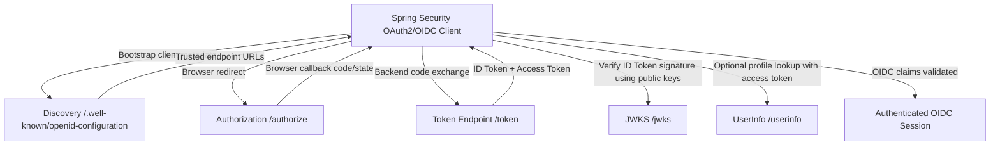

# 31.2. Mocking Discovery, JWKS, Token Endpoint, and UserInfo Endpoint

When integration-testing **Spring Security OAuth 2.0/OIDC Client**, we need more than a mock principal placed directly into `SecurityContext`. A real OIDC Login depends on multiple HTTP endpoints of the OpenID Provider (OP): **Discovery**, **JWKS**, **Token Endpoint**, and sometimes **UserInfo Endpoint**.

For example, a Spring Boot application running at:

```text
https://portal.example.org
```

and logging in through:

```text
https://login.example.org
```

typically uses:

```text
OIDC Discovery:
  https://login.example.org/.well-known/openid-configuration

Authorization Endpoint:
  https://login.example.org/authorize

Token Endpoint:
  https://login.example.org/token

JWKS:
  https://login.example.org/jwks

UserInfo:
  https://login.example.org/userinfo
```

If a test only uses `oidcLogin()` to create an `OidcUser`, Spring Security does not fetch Discovery, does not verify the ID Token signature, and does not inspect an OP's HTTP Token/UserInfo responses. That type of test is useful for controllers, but **does not prove protocol integration**.

This lesson guides you through building a **mock OP on localhost HTTP**, letting Spring Security interact with each endpoint in its proper role, signing ID Tokens with an RSA test key, and executing the authorization callback with the `state`/`nonce` of the actual pending authorization request.

The focus is creating a **deterministic, offline test environment where failure modes can be intentionally induced** without using accounts or credentials from a production identity provider.

---

## 1. Learning Objectives

After this lesson, you will be able to:

1. Explain why an OIDC integration test needs multiple endpoints rather than only the Token Endpoint.
2. Stand up a test OP using WireMock or a similar HTTP mock server.
3. Return Discovery metadata with a consistent `issuer` and endpoints.
4. Return a JWKS public key matching the key used to sign the ID Token.
5. Return an OAuth2 token response containing an access token and a genuinely signed ID Token.
6. Return UserInfo JSON with a `sub` matching the ID Token.
7. Use `MockMvc` to execute authorization start and then callback within the same browser session.
8. Preserve `state`, `nonce`, and PKCE/redirect-uri binding when simulating callbacks.
9. Write negative test cases: wrong issuer, signature, `kid`, `aud`, `nonce`, `sub`, or a Token Endpoint returning `invalid_grant`.
10. Understand the boundaries between HTTP stubs, cryptographic validation, the Servlet application, and real browsers/SSO.
11. Design tests that never call a production OP and never log tokens/client secrets.
12. Diagnose context initialization errors, JWKS caching, UserInfo retrieval, and token response parsing.

## 2. The Big Picture: Endpoints Serve Different Roles

An OIDC Client does not simply receive a "login succeeded" JSON payload. It participates in the Authorization Code Flow and consumes metadata/tokens across multiple steps:



### 2.1. What Does Each Endpoint Provide?

| Endpoint | Request | Primary Response | RP Verification |
|---|---|---|---|
| Discovery | GET metadata | issuer, endpoint URLs, supported algorithms | Metadata matches trusted issuer |
| Authorization | Browser GET | Login/consent then redirect code/state | State and authorization transaction |
| Token | Backend POST | access token, ID Token, optional refresh token | Token response, client auth, protocol |
| JWKS | Backend GET | JWK Set containing public signing keys | ID Token signature, `kid`, algorithm |
| UserInfo | Backend Bearer GET/POST depending on client | End-User claims | `sub` must match ID Token `sub` |

The **Authorization Endpoint** still appears in the flow, but in many MockMvc integration tests you can **simulate the browser redirect/callback** instead of building the OP's full login UI. When the test target is the Spring Security Client, you do not necessarily have to test the OP's login UI.

### 2.2. Roles Must Not Be Mixed

- Discovery determines **the OP's addresses and capabilities**.
- JWKS provides **public keys** for the RP to verify signed tokens.
- The Token Endpoint issues **token responses** for an authorization grant.
- The UserInfo Endpoint provides **profile claims** based on the access token.
- The callback at the RP completes the browser authorization transaction.
- The Resource Server validates the **access token** when APIs are called; it is not the default UserInfo Endpoint.

## 3. When Should You Mock These Endpoints?

Well-suited scenarios:

- Verifying Spring Boot configures `issuer-uri` and discovery metadata.
- Verifying Spring Security selects the right Token Endpoint/JWKS.
- Checking ID Token `iss`, `aud`, `exp`, `nonce`, and signature.
- Testing `OidcUserService` logic when UserInfo is called.
- Simulating Token Endpoint errors like `invalid_client`/`invalid_grant`.
- Simulating key rotation or a nonexistent `kid`.
- Verifying that a UserInfo `sub` mismatch is rejected.
- Verifying the application preserves session `state` across the callback.
- Testing claims/authorities mapping in login integration.
- Verifying the failure handler does not leak internal errors to the browser.

You should not use a mock test OP to claim that:

- The real OP has its client/redirect/scopes configured accurately.
- Production reverse proxies forward Host/Forwarded headers properly.
- Real browsers handle SameSite/cookies/iframes properly.
- MFA/consent UI on the production OP works.
- Access tokens from the mock OP are accepted by the production Resource Server.
- Production network policies/TLS trust have been verified.

Those are contracts that require separate integration/E2E tests.

## 4. Choosing an HTTP Mock Server: WireMock or MockWebServer?

Two popular choices:

| Criterion | WireMock | OkHttp MockWebServer |
|---|---|---|
| HTTP routing | Matching path, headers, form/body, scenarios | Queued responses or custom dispatcher |
| Verifying requests | Built-in request journal and verification DSL | RecordedRequest |
| Fault injection | Delays, disconnects, status/errors | Dispatcher/socket policies |
| JSON stubs | Convenient | Build responses manually |
| Stateful flows | Built-in scenarios and custom transformers | Dispatcher / test state |
| Ease of simulating multiple endpoints | Very well suited | Also well suited |
| Dependency overhead | Separate dependency | Separate dependency |

This lesson uses **WireMock** because endpoints are cleanly separated, you can inspect Token/UserInfo requests, and you can intentionally inject error responses.

WireMock is not mandatory; equivalent tools include MockWebServer, a test Authorization Server, or an OIDC test provider running in a container.

### 4.1. When Do You Need a Full Test OP?

If you need to run a browser login form, consent, token signing, PKCE validation, and spec-compliant logout without hand-rolling fake callbacks, a **test OP/AS with a real protocol implementation** is better suited than HTTP stubs.

Mock endpoints are great for verifying **client behavior**, yet a mock server itself can intentionally return responses a real AS would never produce. Therefore, distinguish **negative protocol tests** from **Authorization Server conformance tests**.

## 5. Illustrative Dependencies

With Gradle, Spring Boot Servlet:

```groovy
dependencies {
    implementation 'org.springframework.boot:spring-boot-starter-web'
    implementation 'org.springframework.boot:spring-boot-starter-security'
    implementation 'org.springframework.boot:spring-boot-starter-oauth2-client'

    testImplementation 'org.springframework.boot:spring-boot-starter-test'
    testImplementation 'org.springframework.security:spring-security-test'

    // Choose a WireMock version compatible with the project's JDK/Boot.
    testImplementation 'org.wiremock:wiremock-standalone:<wiremock-version>'

    // Nimbus JOSE + JWT is usually available via OAuth2 JOSE dependencies;
    // declare it directly if the project's dependency graph does not provide it yet.
}
```

`<wiremock-version>` is a placeholder for a concrete managed version in your build; it is not a literal runnable Gradle coordinate.

Libraries/JDK components used in the examples:

- JUnit 5.
- Spring Boot Test and MockMvc.
- WireMockServer.
- Nimbus JOSE + JWT: `RSAKeyGenerator`, `JWKSet`, `SignedJWT`, `RSASSASigner`.
- Spring Security OAuth2 Client.

### 5.1. Keeping Versions Aligned

The API examples below target Spring Boot 3.x / Spring Security 6.x with JUnit 5 and WireMock 3.x. Projects using other versions must cross-check imports, constructors, property names, and test auto-configuration.

Do not copy versions from old examples and mix them with newer Spring Security releases without checking dependency management.

## 6. OIDC Client Configuration for Testing

In `src/test/resources/application-test.yml`:

```yaml
spring:
  security:
    oauth2:
      client:
        registration:
          company:
            provider: company
            client-id: portal-test-client
            client-secret: not-a-real-secret
            client-authentication-method: client_secret_basic
            authorization-grant-type: authorization_code
            redirect-uri: "{baseUrl}/login/oauth2/code/{registrationId}"
            scope:
              - openid
              - profile
              - email

        provider:
          company:
            # issuer-uri will be provided by @DynamicPropertySource.
            # Never point to a production OP in this test.
```

This is an illustrative test profile structure; if you prefer not to leave the `company` provider key empty in YAML, you can omit the `provider` section entirely and supply the value via dynamic properties at test runtime.

Goal:

```text
registrationId = company
clientId = portal-test-client
grantType = authorization_code
scope = openid profile email
redirectUri = {baseUrl}/login/oauth2/code/company

provider issuer = http://127.0.0.1:<dynamic-port>
```

### 6.1. Why Does the Issuer Use Localhost HTTP?

In isolated tests, WireMock typically opens HTTP on a loopback port. Using HTTP on loopback simplifies testing. **Production OIDC must use HTTPS per trust/security requirements** and must never disable TLS certificate validation.

### 6.2. Why Is the Issuer Provided Dynamically?

WireMock picks a random port so that:

- Multiple tests can run in parallel.
- It does not collide with other service ports on CI.
- There is no need to hardcode `8099`.
- Misconfigurations cannot cause tests to call a production service.

The Spring Boot property must receive the exact base URL **before Spring initializes `ClientRegistrationRepository`**.

## 7. Discovery Must Be Stubbed Before the Spring Context Starts

This is one of the most common integration test failures.

Spring Boot may fetch OIDC Discovery **during `ClientRegistration` bean initialization** when it sees `issuer-uri`. If a test only registers WireMock stubs inside `@BeforeEach`, that moment can be **too late**.

Wrong timeline:

```text
Spring context startup
  -> reads issuer-uri
  -> attempts GET /.well-known/openid-configuration
  -> WireMock not ready / no stub
  -> context startup fails

@BeforeEach
  -> stub discovery (never reached)
```

Right timeline:

```text
Test class initializes mock OP
  -> mock server starts
  -> discovery stub installed
  -> JWKS stub installed

Spring context startup
  -> dynamic issuer URI resolved
  -> GET discovery -> mocked response

Test method
  -> configure token response for scenario
  -> execute MockMvc login flow
```

### 7.1. Not Only Start the Server First, Also Stub Discovery First

A mock server already listening on a port that returns 404 for Discovery can still cause `ClientRegistrationRepository` initialization to fail.

### 7.2. When Using @DynamicPropertySource

`@DynamicPropertySource` supplies the issuer when Spring Test reads properties. However, the property supplier does not automatically set up mock responses.

A clean approach is to initialize the mock server and bootstrap stubs in a **static initializer**, before the context is created.

### 7.3. Cleaning Up the Server and Spring Context Cache

If you use a static mock server and stop it after a test class, Spring Test may cache/reuse the application context for another class; the old context still holds the issuer URL of the stopped server.

Some options:

- `@DirtiesContext(classMode = AFTER_CLASS)` for classes needing teardown.
- Share the mock server lifecycle with the context if using shared test infrastructure.
- Avoid reusing contexts whose dynamic URL is no longer valid.
- Use independent test classes to avoid situations where the port URL changes while old beans remain cached.

## 8. A Simple Mock Test OP with WireMockServer

Setup example:

```java
import com.github.tomakehurst.wiremock.WireMockServer;
import static com.github.tomakehurst.wiremock.client.WireMock.*;
import static com.github.tomakehurst.wiremock.core.WireMockConfiguration.options;

final class MockOidcProvider {

    private final WireMockServer server =
        new WireMockServer(options().dynamicPort());

    void start() {
        server.start();
        installDiscovery();
        installJwks();
        installUserInfo();
    }

    void stop() {
        server.stop();
    }

    String issuer() {
        return server.baseUrl();
    }

    private void installDiscovery() {
        String base = issuer();

        String json = """
            {
              "issuer": "%s",
              "authorization_endpoint": "%s/authorize",
              "token_endpoint": "%s/token",
              "jwks_uri": "%s/jwks",
              "userinfo_endpoint": "%s/userinfo",
              "response_types_supported": ["code"],
              "subject_types_supported": ["public"],
              "id_token_signing_alg_values_supported": ["RS256"],
              "token_endpoint_auth_methods_supported": ["client_secret_basic"]
            }
            """.formatted(base, base, base, base, base);

        server.stubFor(get(urlEqualTo("/.well-known/openid-configuration"))
            .willReturn(okJson(json)));
    }

    private void installJwks() {
        // See the section on creating RSAKey/JWKSet; must serve public JWKS.
    }

    private void installUserInfo() {
        server.stubFor(get(urlEqualTo("/userinfo"))
            .willReturn(okJson("""
                {"sub":"employee-725","name":"Test User"}
                """)));
    }

    WireMockServer server() {
        return server;
    }
}
```

This is an **illustrative test OP class structure**, without the code to build the JWKS key and Token Endpoint yet. We will fill in those parts in the following sections.

### 8.1. Correct Discovery Path

With a root issuer:

```text
http://127.0.0.1:54321
```

OIDC Discovery is typically at:

```text
http://127.0.0.1:54321/.well-known/openid-configuration
```

If the issuer has a path, for example:

```text
https://id.example/realms/alpha
```

Discovery has different path conventions depending on OIDC Discovery/RFC 8414 and helper implementations. Spring Security may try multiple locations. **Do not assume appending `/.well-known/openid-configuration` at the root will always work for issuers with paths.** Tests must stub according to the actual lookup and standard in use.

### 8.2. Metadata Issuer Must Match Trusted Issuer

If the property is:

```text
issuer-uri = http://127.0.0.1:54321
```

but Discovery returns:

```json
{"issuer":"http://127.0.0.1:54321/other"}
```

Spring may reject discovery/client registration due to an issuer mismatch.

Do not change this to "matching hostname is enough": the issuer is an exact identifier, and paths can distinguish tenants/realms.

## 9. What Fields Does OP Discovery JSON Need?

A response for OIDC Authorization Code Flow:

```http
GET /.well-known/openid-configuration HTTP/1.1
Host: 127.0.0.1:54321
```

```http
HTTP/1.1 200 OK
Content-Type: application/json

{
  "issuer": "http://127.0.0.1:54321",
  "authorization_endpoint": "http://127.0.0.1:54321/authorize",
  "token_endpoint": "http://127.0.0.1:54321/token",
  "userinfo_endpoint": "http://127.0.0.1:54321/userinfo",
  "jwks_uri": "http://127.0.0.1:54321/jwks",
  "response_types_supported": ["code"],
  "subject_types_supported": ["public"],
  "id_token_signing_alg_values_supported": ["RS256"],
  "token_endpoint_auth_methods_supported": ["client_secret_basic"],
  "scopes_supported": ["openid", "profile", "email"]
}
```

### 9.1. Key Fields

| Metadata | Purpose |
|---|---|
| `issuer` | Trusted issuer must match configured issuer |
| `authorization_endpoint` | Browser authorization redirect |
| `token_endpoint` | Backend authorization code/refresh token exchange |
| `jwks_uri` | Fetch public keys to verify ID Token signatures |
| `userinfo_endpoint` | Fetch profile claims using the access token |
| `response_types_supported` | Response types supported by the OP |
| `subject_types_supported` | Subject identifier types supported by the OP |
| `id_token_signing_alg_values_supported` | ID Token signing algorithms |
| `token_endpoint_auth_methods_supported` | Client authentication methods |
| `scopes_supported` | Supported scopes, if advertised |

The fields in the example are only sufficient for a specific test profile. Do not assume all real OPs share the same endpoint paths or supported algorithms.

### 9.2. Do Not Mock Arbitrary Metadata and Drop Validation

If a test intentionally returns an issuer mismatch, the expected behavior is client rejection or context initialization failure. **Never disable the issuer check** just to "connect" to a test server.

### 9.3. Discovery and ClientRegistration

`spring.security.oauth2.client.provider.company.issuer-uri` tells Spring to rely on the issuer to build provider metadata. The registration still holds the client ID, authentication method, grant type, redirect URI, and scopes.

Discovery does not know the RP's OAuth client secret.

## 10. JWKS: Expose Only the Public Key

An ID Token is typically a JWT signed by the OP with its private key. The RP downloads JWKS public keys to verify the signature.

```text
OP private RSA key
     |
     v
RS256 sign ID Token
     |
     v
Signed JWT with header kid="test-key-1"

OP public RSA key
     |
     v
GET /jwks -> {"keys":[... public JWK ...]}
     |
     v
Spring Security verifies JWT signature
```

### 10.1. Basic JWKS JSON

An RSA JWK public key looks like:

```json
{
  "keys": [
    {
      "kty": "RSA",
      "kid": "test-key-1",
      "use": "sig",
      "alg": "RS256",
      "n": "<base64url-modulus>",
      "e": "AQAB"
    }
  ]
}
```

The `n` value is an actual base64url-encoded RSA modulus; it is not a placeholder string in a real test run.

**Never send private key fields such as `d`, `p`, `q` in a JWKS response.**

### 10.2. kid and Key Selection

JWT header:

```json
{
  "alg": "RS256",
  "kid": "test-key-1"
}
```

JWKS must contain a key matching the `kid` and algorithm policy. When `kid` does not match or the signature is invalid, Spring must reject the ID Token—never accept "any three-part JWT" as proof of authentication.

## 11. Generating an RSA Test Key with Nimbus JOSE + JWT

A fixture:

```java
import com.nimbusds.jose.JOSEException;
import com.nimbusds.jose.jwk.RSAKey;
import com.nimbusds.jose.jwk.JWKSet;
import com.nimbusds.jose.jwk.gen.RSAKeyGenerator;

public final class OidcTestKeys {

    private OidcTestKeys() {}

    public static RSAKey createRsaKey() {
        try {
            return new RSAKeyGenerator(2048)
                .keyID("test-key-1")
                .generate();
        } catch (JOSEException ex) {
            throw new IllegalStateException(
                "Cannot generate OIDC test RSA key", ex);
        }
    }

    public static String publicJwksJson(RSAKey key) {
        return new JWKSet(key.toPublicJWK()).toString();
    }
}
```

Usage:

```java
RSAKey signingKey = OidcTestKeys.createRsaKey();
String jwksJson = OidcTestKeys.publicJwksJson(signingKey);
```

### 11.1. Matching Public/Private Keys

- `signingKey.toPrivateKey()` is used to sign ID Tokens in the test OP.
- `signingKey.toPublicJWK()` is returned at `GET /jwks`.
- The RP must never receive the private key via Discovery/JWKS.

### 11.2. Generate the Key Once per Fixture

Do not generate a new RSA key on every `GET /jwks` call. If the Token Endpoint signs with key A while JWKS just returned key B, signature validation will fail.

You can generate a fixed key per test class or per test context, but **the token signer and the JWKS stub must use the exact same keypair**.

### 11.3. Never Use Production Private Keys

Never pull the production OP's private key into CI. Test keys should be generated/isolated inside the test environment.

## 12. Stubbing JWKS with WireMock

After generating `RSAKey`:

```java
RSAKey signingKey = OidcTestKeys.createRsaKey();

wireMock.stubFor(get(urlEqualTo("/jwks"))
    .willReturn(okJson(
        OidcTestKeys.publicJwksJson(signingKey)
    )));
```

When Spring Security processes an ID Token with `kid=test-key-1`, it looks up the key via the configured `jwks_uri`.

### 12.1. JWKS Can Be Cached

Once a JWKS response is fetched, it may be cached by the decoder/JWK source. If a test alters the JWKS body after the context has already used the old key, **do not assume the next request will immediately re-fetch it**.

To test key rotation:

- Create a new context/decoder when needed.
- Or use a refresh mechanism supported by the framework.
- Intentionally use a new `kid` to trigger a refresh if the implementation has matching semantics.
- Inspect HTTP requests via WireMock's request journal rather than guessing.

### 12.2. 404 and 500 from JWKS

If JWKS returns 404/500 or invalid JSON, ID Token signature verification can fail. Never disable signature verification because the mock server hasn't stubbed the right path yet.

### 12.3. Unknown kid

When the Token Endpoint signs with a private key having `kid=key-2` while JWKS only contains the public key for `key-1`, the RP must reject the token after failing to find a valid key.

## 13. The Token Endpoint Must Return a Valid OAuth2 Token Response

After the browser authorization callback:

```text
GET /login/oauth2/code/company?code=CODE-1&state=STATE-1
```

The Spring backend calls the Token Endpoint:

```http
POST /token HTTP/1.1
Host: 127.0.0.1:54321
Authorization: Basic <test-client-credentials>
Content-Type: application/x-www-form-urlencoded

grant_type=authorization_code&
code=CODE-1&
redirect_uri=http%3A%2F%2Flocalhost%2Flogin%2Foauth2%2Fcode%2Fcompany
```

The request may include `code_verifier` when PKCE is used.

### 13.1. Response JSON for OIDC Login

```json
{
  "access_token": "test-access-token",
  "token_type": "Bearer",
  "expires_in": 600,
  "scope": "openid profile email",
  "id_token": "<signed-compact-jwt>",
  "refresh_token": "test-refresh-token"
}
```

In the OIDC Authorization Code Flow, the ID Token is the centerpiece of the response. `refresh_token` is optional, depending on grant/scope/provider policy.

### 13.2. Access Token in a Fixture Can Be Opaque

```text
test-access-token
```

does not need to be a JWT if the test only uses it to call a mock UserInfo Endpoint. A production Resource Server will not accept the fake string, and that is intentional.

### 13.3. ID Token Cannot Be an Arbitrary String When Testing Signature Validation

Wrong if the goal is OIDC integration:

```json
{"id_token": "fake-id-token"}
```

Spring must parse/verify the ID Token and will reject any string that is not a valid signed JWT. Use a signed JWT with the mock OP's RSA private key.

## 14. Generating an ID Token with Valid Claims

An ID Token accepted by Spring Security must satisfy OIDC requirements and the corresponding authorization transaction.

Basic claims:

```json
{
  "iss": "http://127.0.0.1:54321",
  "sub": "employee-725",
  "aud": "portal-test-client",
  "iat": 1794800000,
  "exp": 1794800600,
  "nonce": "<nonce-from-authorization-request>"
}
```

### 14.1. iss

`iss` must match the trusted issuer from Discovery/configuration.

### 14.2. aud

`aud` must contain the **OAuth client ID**, for example `portal-test-client`, not `registrationId=company`.

### 14.3. sub

`sub` identifies the End-User within the issuer. If UserInfo is called, `sub` in the UserInfo response must match the ID Token's `sub`.

### 14.4. iat and exp

Use reasonable timestamps, such as `iat=now` and `exp=now+10 minutes`. Do not hardcode an `exp` in the past and wonder why the test always fails.

### 14.5. nonce

If the authorization request contains `nonce`, the ID Token must carry the matching `nonce` claim. Never hardcode `nonce=test` if Spring generated a different random nonce for the transaction.

## 15. Helper Function to Create a Signed ID Token with Nimbus

Example:

```java
import java.time.Instant;
import java.util.Date;
import java.util.List;

import com.nimbusds.jose.JOSEException;
import com.nimbusds.jose.JWSAlgorithm;
import com.nimbusds.jose.JWSHeader;
import com.nimbusds.jose.crypto.RSASSASigner;
import com.nimbusds.jose.jwk.RSAKey;
import com.nimbusds.jwt.JWTClaimsSet;
import com.nimbusds.jwt.SignedJWT;

public final class OidcTestTokenSigner {

    private OidcTestTokenSigner() {}

    public static String signedIdToken(
            RSAKey key,
            String issuer,
            String clientId,
            String subject,
            String nonce) {

        Instant now = Instant.now();

        JWTClaimsSet.Builder claims = new JWTClaimsSet.Builder()
            .issuer(issuer)
            .subject(subject)
            .audience(List.of(clientId))
            .issueTime(Date.from(now))
            .expirationTime(Date.from(now.plusSeconds(600)));

        if (nonce != null) {
            claims.claim("nonce", nonce);
        }

        SignedJWT jwt = new SignedJWT(
            new JWSHeader.Builder(JWSAlgorithm.RS256)
                .keyID(key.getKeyID())
                .build(),
            claims.build()
        );

        try {
            jwt.sign(new RSASSASigner(key.toPrivateKey()));
        } catch (JOSEException ex) {
            throw new IllegalStateException(
                "Cannot sign test ID Token", ex);
        }

        return jwt.serialize();
    }
}
```

Usage:

```java
String idToken = OidcTestTokenSigner.signedIdToken(
    signingKey,
    wireMock.baseUrl(),
    "portal-test-client",
    "employee-725",
    nonceFromAuthorizationRequest
);
```

### 15.1. This Is a Signed Token, Not a Trusted Production Token

The private key is generated inside the test. The RP verifies the signature using the **test issuer's** public JWKS. It has no authentication validity on a real OP.

### 15.2. Why Not Omit Nonce?

If Spring Security includes `nonce` in the authorization request, omitting the nonce or using a different nonce must cause the token to be rejected. This is an important validation against token substitution/replay in OIDC.

### 15.3. Why Not Fake Signature Validation?

If the integration test's goal is to verify Spring used the right JWK, **let Spring verify the real signature** of the test token. Disabling validation strips the test of its core security verification.

## 16. Stubbing the Token Endpoint

Once you have a signed ID Token:

```java
String tokenResponse = """
    {
      "access_token": "test-access-token",
      "token_type": "Bearer",
      "expires_in": 600,
      "scope": "openid profile email",
      "id_token": "%s"
    }
    """.formatted(idToken);

wireMock.stubFor(post(urlEqualTo("/token"))
    .withHeader("Authorization", matching("Basic .*"))
    .withRequestBody(containing("grant_type=authorization_code"))
    .willReturn(okJson(tokenResponse)));
```

### 16.1. Why Must the Stub Match the Exact HTTP Method?

The Token Endpoint uses HTTP POST. If the stub accidentally specifies GET, WireMock returns 404 or an unmatched request, and Spring treats the token exchange as failed.

### 16.2. Checking Client Authentication

With `client_secret_basic`:

```text
Authorization: Basic <base64-encoded-client-id-and-secret>
```

The test can assert the header's presence and method, or compare against fake values when warranted, **without printing the header to public output**.

### 16.3. Reading Form Bodies Correctly

The body is `application/x-www-form-urlencoded`, not JSON, in the Authorization Code Grant. When asserting code, redirect URI, or PKCE verifier, use request matching that accounts for URL encoding.

### 16.4. code_verifier Is Not Always Present

Spring Security enables PKCE by default in certain cases depending on public/confidential client policy and custom resolvers. Do not assert `code_verifier` is always present if the application configuration does not guarantee PKCE is enabled.

If you want to test PKCE specifically, configure the policy/resolver explicitly and assert `code_challenge` in the authorization request, `code_verifier` in the token request, and the corresponding SHA-256 relationship.

## 17. The UserInfo Endpoint Returns Claims, Not an OAuth Token Response

After ID Token validation, Spring Security may call the UserInfo Endpoint with the access token:

```http
GET /userinfo HTTP/1.1
Host: 127.0.0.1:54321
Authorization: Bearer test-access-token
```

Response:

```json
{
  "sub": "employee-725",
  "name": "Test User",
  "email": "employee-725@example.test",
  "email_verified": true
}
```

### 17.1. UserInfo sub Must Match ID Token sub

If the ID Token states:

```text
sub=employee-725
```

but UserInfo returns:

```text
sub=employee-999
```

the RP must reject/fail mapping per OIDC UserInfo subject verification. Never merge claims from two users.

### 17.2. Is UserInfo Always Called?

**No.** Whether an OIDC client retrieves UserInfo can depend on:

- Whether OP metadata includes `userinfo_endpoint`.
- Requested/granted scopes and `OidcUserService` policy.
- Custom `OidcUserService`/`OAuth2UserService` beans in the app.
- The Spring Security version/configuration.
- Whether the application chooses to read claims only from the ID Token instead of UserInfo.

Thus, a test must **explicitly** verify UserInfo is called under that configuration rather than assuming every successful OIDC Login calls UserInfo.

### 17.3. Stubbing UserInfo

```java
wireMock.stubFor(get(urlEqualTo("/userinfo"))
    .withHeader(
        "Authorization",
        equalTo("Bearer test-access-token"))
    .willReturn(okJson("""
        {
          "sub": "employee-725",
          "name": "Test User",
          "email": "employee-725@example.test",
          "email_verified": true
        }
        """)));
```

If `OidcUserService` only calls UserInfo when corresponding access token scopes and the endpoint are available, a test registration with `openid profile email` sets up retrieval in many common configurations.

### 17.4. Do Not Confuse UserInfo with a Resource Server API

`/userinfo` is an OP OIDC endpoint providing user claims. It is not the application's Orders API and does not mean a fake access token would be accepted by a production Resource Server.

## 18. MockMvc Flow: Preserving state and nonce from the Real Authorization Request

A meaningful integration test must let Spring generate the authorization request first:

```text
GET /oauth2/authorization/company
     |
     v
Spring:
  - selects ClientRegistration company
  - builds Authorization Request
  - generates state
  - generates nonce per OIDC config
  - generates PKCE challenge if applicable
  - saves pending request in session/repository
     |
     v
302 Location: http://127.0.0.1:<port>/authorize?...state=...&nonce=...
```

The test extracts **state** and **nonce** from this redirect.

Then the test constructs a signed ID Token with the matching nonce, stubs the Token Endpoint, and calls Spring's callback:

```text
GET /login/oauth2/code/company?code=test-code&state=<captured-state>
```

**Do not invent a static state** and expect Spring to accept it without having saved the original authorization request.

### 18.1. Why Keep the Same Session?

By default, Spring Security may store `OAuth2AuthorizationRequest` in the Servlet session. If the callback runs on a different `MockHttpSession`, the app cannot find the original transaction.

### 18.2. Mocking the Browser Without Going Through the OP Login UI

The test receives the redirect URL pointing to `/authorize`, extracts its parameters, and constructs a valid callback directly. Therefore, it does not actually need a browser rendering the OP's login/consent screens.

### 18.3. What Does This Test Actually Cover?

It tests **client callback/token/JWKS/UserInfo integration** against mocked OP responses. It **does not** prove the OP's Authorization Endpoint authenticated the user properly or that the AS bound the code/PKCE properly: with a mock Token Endpoint, the test itself decides to return the token.

## 19. Client-Layer End-to-End Test Template in MockMvc

A test class can use `@SpringBootTest`, `@AutoConfigureMockMvc`, WireMock on a random port, and `@DynamicPropertySource`.

To avoid Discovery errors during context bootstrap, create the server/stubs before the context starts.

### 19.1. Test OP Initialization Skeleton

```java
import java.time.Instant;

import org.junit.jupiter.api.AfterAll;
import org.junit.jupiter.api.Test;

import org.springframework.beans.factory.annotation.Autowired;
import org.springframework.boot.test.autoconfigure.web.servlet.AutoConfigureMockMvc;
import org.springframework.boot.test.context.SpringBootTest;
import org.springframework.test.annotation.DirtiesContext;
import org.springframework.test.context.DynamicPropertyRegistry;
import org.springframework.test.context.DynamicPropertySource;
import org.springframework.test.web.servlet.MockMvc;

import com.github.tomakehurst.wiremock.WireMockServer;
import com.nimbusds.jose.jwk.RSAKey;

import static com.github.tomakehurst.wiremock.client.WireMock.*;
import static com.github.tomakehurst.wiremock.core.WireMockConfiguration.options;

@SpringBootTest
@AutoConfigureMockMvc
@DirtiesContext(classMode = DirtiesContext.ClassMode.AFTER_CLASS)
class OidcEndpointsIntegrationTest {

    static final WireMockServer OP =
        new WireMockServer(options().dynamicPort());

    static final RSAKey TEST_KEY = OidcTestKeys.createRsaKey();

    static {
        OP.start();

        String issuer = OP.baseUrl();

        String discovery = """
            {
              "issuer":"%s",
              "authorization_endpoint":"%s/authorize",
              "token_endpoint":"%s/token",
              "jwks_uri":"%s/jwks",
              "userinfo_endpoint":"%s/userinfo",
              "response_types_supported":["code"],
              "subject_types_supported":["public"],
              "id_token_signing_alg_values_supported":["RS256"],
              "token_endpoint_auth_methods_supported":["client_secret_basic"]
            }
            """.formatted(
                issuer, issuer, issuer, issuer, issuer);

        OP.stubFor(get(urlEqualTo(
                "/.well-known/openid-configuration"))
            .willReturn(okJson(discovery)));

        OP.stubFor(get(urlEqualTo("/jwks"))
            .willReturn(okJson(
                OidcTestKeys.publicJwksJson(TEST_KEY)
            )));

        OP.stubFor(get(urlEqualTo("/userinfo"))
            .withHeader(
                "Authorization",
                equalTo("Bearer test-access-token"))
            .willReturn(okJson("""
                {
                  "sub":"employee-725",
                  "name":"Test User"
                }
                """)));
    }

    @DynamicPropertySource
    static void oidcProperties(DynamicPropertyRegistry registry) {
        registry.add(
            "spring.security.oauth2.client.provider.company.issuer-uri",
            OP::baseUrl
        );
    }

    @Autowired
    MockMvc mvc;

    @AfterAll
    static void stopOp() {
        OP.stop();
    }
}
```

This is a **test class skeleton**, before adding test methods. Because of the static initializer, Discovery/JWKS are ready before the Spring context looks up metadata.

### 19.2. If Using @ActiveProfiles("test")

```java
@ActiveProfiles("test")
```

ensures `application-test.yml` is loaded. The corresponding import is `org.springframework.test.context.ActiveProfiles`.

### 19.3. Need a Protected Endpoint to Assert Login

For example, the app has:

```java
@RestController
public class SessionInfoController {

    @GetMapping("/session/whoami")
    public String whoami(
            @AuthenticationPrincipal OidcUser user) {
        return user.getSubject();
    }
}
```

The endpoint must be protected with `authenticated()` in the SecurityFilterChain, and the test can call it after the callback to verify the local session.

## 20. Callback Test Template: Capturing state and nonce

The most important part is reading the authorization redirect generated by Spring:

```java
import java.net.URI;

import org.springframework.mock.web.MockHttpSession;
import org.springframework.test.web.servlet.MvcResult;
import org.springframework.web.util.UriComponentsBuilder;

import static org.springframework.test.web.servlet.request.MockMvcRequestBuilders.get;
import static org.springframework.test.web.servlet.result.MockMvcResultMatchers.status;
import static org.springframework.security.test.web.servlet.response.SecurityMockMvcResultMatchers.authenticated;

@Test
void loginWithSignedIdToken() throws Exception {

    MockHttpSession session = new MockHttpSession();

    MvcResult started = mvc.perform(
            get("/oauth2/authorization/company")
                .session(session))
        .andExpect(status().is3xxRedirection())
        .andReturn();

    String authorizationUrl =
        started.getResponse().getRedirectedUrl();

    var query = UriComponentsBuilder
        .fromUri(URI.create(authorizationUrl))
        .build()
        .getQueryParams();

    String state = query.getFirst("state");
    String nonce = query.getFirst("nonce");

    // Create an ID Token signed with the same private key used for JWKS.
    String idToken = OidcTestTokenSigner.signedIdToken(
        TEST_KEY,
        OP.baseUrl(),
        "portal-test-client",
        "employee-725",
        nonce
    );

    String tokenJson = """
        {
          "access_token":"test-access-token",
          "token_type":"Bearer",
          "expires_in":600,
          "scope":"openid profile email",
          "id_token":"%s"
        }
        """.formatted(idToken);

    OP.stubFor(post(urlEqualTo("/token"))
        .withHeader("Authorization", matching("Basic .*"))
        .withRequestBody(containing(
            "grant_type=authorization_code"))
        .willReturn(okJson(tokenJson)));

    mvc.perform(get("/login/oauth2/code/company")
            .session(session)
            .param("code", "test-authorization-code")
            .param("state", state))
        .andExpect(status().is3xxRedirection())
        .andExpect(authenticated());
}
```

**Note on snippet self-containment:** this snippet assumes the enclosing class already defines static `OP`, `TEST_KEY`, `mvc`, and `@DynamicPropertySource`; merge the method into that class rather than copying it into a separate class without fixtures.

### 20.1. Watch Request/Session Persistence

`MockHttpSession` from authorization start is reused for the callback. If your security configuration customizes the session fixation strategy or repository, inspect the session Spring returns after login and use the resulting session when calling protected endpoints.

### 20.2. Do Not Force "nonce" to a Constant

Spring may generate a random nonce. Sign the ID Token with **the nonce of that specific authorization request**, rather than hardcoding `"nonce-123"` for all tests.

### 20.3. Do Not Use oauth2Login()/oidcLogin() in This Same Test Flow

If you add:

```java
.with(oidcLogin())
```

to the callback request, the test can bypass the authentication path you are trying to verify. Let Spring process code/token/JWKS/UserInfo.

### 20.4. Spring Boot Configuration Must Still Be Valid

This test class assumes the app already has:

```java
http.oauth2Login(Customizer.withDefaults());
```

and `ClientRegistration` `company` with scopes `openid profile email` and client ID `portal-test-client`. Copying the test code alone does not create the OAuth2 Login filter chain.

## 21. Verifying the Token Endpoint Was Actually Called

WireMock can verify the request:

```java
OP.verify(postRequestedFor(urlEqualTo("/token"))
    .withRequestBody(
        containing("grant_type=authorization_code")));
```

With Basic authentication:

```java
OP.verify(postRequestedFor(urlEqualTo("/token"))
    .withHeader(
        "Authorization",
        matching("Basic .*")));
```

### 21.1. Do Not Log Raw Basic Credentials

The Authorization header in the Token Endpoint request can contain the encoded client ID/secret. Base64 is not encryption.

Tests should verify presence/method, or compare against fake values when justified, **without printing the header to test output**.

### 21.2. Checking redirect_uri

The Token Endpoint request typically sends `redirect_uri` matching the authorization transaction, depending on grant/profile. In tests, you can inspect the WireMock request's form data and compare it to the callback URL Spring constructed.

Do not hardcode `https://portal.example.org` if MockMvc's default request uses `http://localhost`. When testing reverse proxies/trusted origins, configure `secure`, server name, and forwarded headers intentionally.

### 21.3. Checking code_verifier When PKCE Is Enabled

If the test configuration enables PKCE:

- The authorization redirect contains `code_challenge`/`code_challenge_method=S256`.
- The token request contains `code_verifier`.
- `BASE64URL(SHA256(verifier))` matches the challenge.

Do not substitute an arbitrary `"verifier"` string, and do not disable PKCE because the mock endpoint doesn't validate it yet.

## 22. Verifying JWKS Was Actually Used

If the OIDC ID Token is signed with RS256 and no key was cached beforehand, Spring typically needs to fetch JWKS to verify it.

WireMock verification:

```java
OP.verify(getRequestedFor(urlEqualTo("/jwks")));
```

However, note that:

- The JWK cache may be reused across multiple requests/tests.
- A second login test may not GET JWKS again.
- Caching policy depends on the decoder, Spring Security/Nimbus version, and `kid`.

Therefore, do not assert an exact JWKS request count of `1` in every test class unless you control the cache lifecycle.

### 22.1. Positive Signature Validation

An ID Token signed with private key A + JWKS public key A should be accepted when claims are valid.

### 22.2. Negative Signature Validation

An ID Token signed with private key B when JWKS only has public key A must be rejected.

### 22.3. Do Not Just Decode the Payload and Trust Claims

A JWT payload can be trivially base64url-decoded. Reading `iss`/`sub` from the payload without verifying the signature **is not OIDC authentication**.

## 23. Verifying UserInfo Was Actually Called

If UserInfo integration is configured to fetch profile details, you can verify:

```java
OP.verify(getRequestedFor(urlEqualTo("/userinfo"))
    .withHeader(
        "Authorization",
        equalTo("Bearer test-access-token")));
```

### 23.1. If Verification Sees No Request

Check:

- Is `userinfo_endpoint` present in Discovery?
- Do the access token scopes include `profile`/`email` per UserInfo accessibility policy?
- Was Spring's `OidcUserService` replaced with a custom user service?
- Is there a custom `UserInfoEndpoint` configuration?
- Is application logic using only ID Token claims?
- Does the actual request use GET or another method per the client integration?

**Do not "fix" this by calling `/userinfo` manually inside the test and claiming Spring called it.** The test must verify the request originates from the client integration under test.

### 23.2. UserInfo Is Not Required for Every OIDC Login

OIDC Core does not require the RP to always fetch UserInfo once it has a valid ID Token. If profile claims are not needed, skipping UserInfo retrieval can be the right behavior.

### 23.3. UserInfo sub Equality

A security requirement: when fetching UserInfo, the response `sub` must equal `sub` in the ID Token. Tests should include a negative case returning a different `sub`.

## 24. Testing an API After Login: Verifying the Real Local Session

After a successful callback, you can call a protected endpoint:

```java
MvcResult callbackResult = mvc.perform(
        get("/login/oauth2/code/company")
            .session(session)
            .param("code", "test-authorization-code")
            .param("state", state))
    .andExpect(status().is3xxRedirection())
    .andExpect(authenticated())
    .andReturn();

var authenticatedSession =
    callbackResult.getRequest().getSession(false);

mvc.perform(get("/session/whoami")
        .session((MockHttpSession) authenticatedSession))
    .andExpect(status().isOk())
    .andExpect(content().string("employee-725"));
```

Understand this snippet as a replacement for the earlier callback block—**do not send the same authorization code to the Token Endpoint a second time**. An authorization code must be single-use; in a mock, stubbing repeated success does not prove a real AS allows it.

### 24.1. MockMvc Does Not Run a Real Browser Cookie Jar

`MockHttpSession` simulates session persistence, but does not verify real browser cookie attributes such as SameSite, Secure, domain, or cross-site redirects.

### 24.2. Login Success Does Not Prove Downstream API Access

`/session/whoami` verifies the RP created an authenticated session. The Orders API needs separate tests for token/audience/permissions.

## 25. Testing Token Endpoint Returning invalid_client

A failure scenario:

```java
OP.stubFor(post(urlEqualTo("/token"))
    .willReturn(aResponse()
        .withStatus(401)
        .withHeader("Content-Type", "application/json")
        .withHeader("WWW-Authenticate", "Basic realm=\\"oauth2\\"")
        .withBody("""
            {"error":"invalid_client"}
            """)));
```

Expectations:

- The callback does not create an authenticated session.
- The failure handler directs the user to a safe message.
- No infinite token request retry loop.
- No logging of the client secret or Basic Authorization header.
- Metrics/logs can classify `phase=TOKEN_EXCHANGE, error=invalid_client`.

### 25.1. Do Not Confuse invalid_client with a Wrong User Password

`invalid_client` belongs to OAuth client authentication. It can stem from a wrong client ID/secret, client auth method mismatch, or rotation.

### 25.2. Tests Should Ensure the Right Stub Is Selected

WireMock picks mappings by specificity/priority. If a positive token stub still exists with the same matching rule, the response may not be what you expect. Use explicit `priority`, per-test server state, or reset/reinstall scenario stubs cleanly.

### 25.3. Discovery Must Remain After Reset

If a test calls `resetAll()` and then runs a request requiring the context/decoder to fetch JWKS/metadata, all bootstrap stubs may vanish. Use `resetRequests()` when you only want to clear the request journal, or rebuild the proper stubs.

## 26. Testing Token Endpoint Returning invalid_grant

`invalid_grant` can occur when the authorization code is wrong/expired, already used, mismatches PKCE/redirect URI, or does not belong to this client.

```java
OP.stubFor(post(urlEqualTo("/token"))
    .willReturn(aResponse()
        .withStatus(400)
        .withHeader("Content-Type", "application/json")
        .withBody("""
            {
              "error":"invalid_grant",
              "error_description":"Code expired"
            }
            """)));
```

Expect Spring to receive the OAuth2 token error and fail the login. Do not handle it by fabricating an Authentication or bypassing `state`/PKCE checks.

### 26.1. Do Not Retry the Same Authorization Code

The code is a single-use credential. If the Token Endpoint processed it successfully but the response was lost to a timeout, retrying the code can return `invalid_grant`. Client tests should reflect a sensible recovery policy, usually starting a fresh authorization flow.

### 26.2. A Mock AS Can Return Unrealistic Results

If a mock Token Endpoint always issues a token for any `code`, it is not actually enforcing uniqueness, expiry, or PKCE. To test **AS behavior**, use a test Authorization Server or write a stateful stub with clear policies.

## 27. Testing UserInfo Returning a Different sub Than the ID Token

Suppose the signed ID Token has:

```json
{"sub":"employee-725"}
```

Mock UserInfo returns:

```json
{
  "sub":"employee-999",
  "name":"Wrong User"
}
```

Stub:

```java
OP.stubFor(get(urlEqualTo("/userinfo"))
    .withHeader(
        "Authorization",
        equalTo("Bearer test-access-token"))
    .willReturn(okJson("""
        {
          "sub":"employee-999",
          "name":"Wrong User"
        }
        """)));
```

Expectation when the application calls UserInfo: OIDC authentication must be rejected or the user service throws a validation error per the Spring version.

### 27.1. Why Is This Case Important?

If the RP merges user A's ID Token identity with user B's UserInfo claims without checking `sub`, identity confusion and improper authorization can occur.

### 27.2. Do Not Assert Only HTTP 500

The failure handler may return a redirect/login error or another status. Tests should assert **there is no authenticated session** and no business operation executes with a mixed identity, rather than asserting just one HTTP status code.

### 27.3. What If UserInfo Is Not Called?

This negative test will not reach the code path. Configure `OidcUserService` explicitly so it fetches UserInfo per policy, and verify WireMock received the request.

## 28. Testing Discovery Issuer Mismatch

An early configuration error:

```text
Configured issuer:
  http://127.0.0.1:54321

Discovery JSON:
  "issuer": "http://127.0.0.1:54321/other"
```

Spring may refuse to create `ClientRegistration`. This is typically a **context bootstrap failure**, not a controller test failure after the context is running.

### 28.1. Separate the Failure Test Context

Do not reset the global mock OP of a test class whose Spring context has already initialized and expect discovery to re-run automatically.

Create a separate test class/context with the mismatched issuer configuration, or test `ClientRegistrations.fromIssuerLocation(...)` directly against a mock server setup.

### 28.2. Do Not Match Host Alone

Two issuers on the same hostname with different paths can be two different trust domains. Preserve exact issuer matching per OIDC metadata.

### 28.3. Do Not Automatically Fall Back to Another Issuer

If the configured issuer does not match metadata, never unconditionally adopt the issuer from the JSON. The trusted issuer comes from registration/admin-controlled policy.

## 29. Testing JWKS kid Mismatch

Scenario:

```text
ID Token header:
  alg=RS256
  kid=unknown-key

JWKS:
  keys=[public-key-with-kid=test-key-1]
```

The RP has no matching key, so signature verification must fail.

### 29.1. Cache-Independent Testing

To avoid unexpected results due to cached keys, use a fresh context/decoder or manage the JWK source cache via the framework API.

### 29.2. Do Not Trust Arbitrary Unknown kids from the Network

A JWT header containing `kid` or `jku` must never be allowed to redirect the RP to a JWKS URI specified by an unverified token. The JWKS URI must come from trusted issuer metadata/configuration.

### 29.3. Wrong Signature with Matching kid

This is a different negative case: the key ID matches, but the private key that actually signed the token does not match the public key in JWKS. The RP must reject it.

## 30. Testing ID Token with Wrong aud

Registration:

```text
clientId=portal-test-client
```

Signed ID Token:

```json
{
  "iss":"http://127.0.0.1:54321",
  "sub":"employee-725",
  "aud":"another-client"
}
```

Even with a valid signature, `aud` does not point to the OAuth client that initiated the authorization request. The RP must reject it.

### 30.1. Why Is a Valid Signature Not Enough?

The OP can issue valid tokens for **other clients**. An RP must not accept a token just because the OP signed it properly.

### 30.2. azp with Multiple Audiences

When an ID Token has multiple audiences, OIDC defines rules for checking `azp` in relevant cases. Tests should reflect the real client ID and the behavior of Spring's ID Token validator.

### 30.3. Do Not Use registrationId as aud

`aud` normally uses the OAuth `client_id`, not the local registration ID.

## 31. Testing ID Token with Wrong nonce

Authorization start generates:

```text
nonce = N1
```

Mock ID Token returns:

```json
{"nonce":"N2"}
```

where `N2 != N1`. The RP must reject the token in flows requiring a nonce.

### 31.1. Do Not Disable Nonce Validation to Make Tests Pass

If the mock token is rejected, fix the signer fixture to use the nonce from the authorization URL rather than dropping the security check.

### 31.2. Nonce Is Different from State

`state` is compared across the browser callback and pending authorization request; `nonce` is checked inside the ID Token. Both protect different parts of OIDC login.

### 31.3. Testing a Token Missing Nonce

When the authorization request has a nonce, an ID Token missing the nonce is a negative case. If the flow/config does not use a nonce, expected behavior may differ; know the actual contract.

## 32. Testing Expired ID Tokens and Clock Skew

Generating the JWT:

```java
Instant now = Instant.now();

JWTClaimsSet expiredClaims = new JWTClaimsSet.Builder()
    .issuer(OP.baseUrl())
    .subject("employee-725")
    .audience("portal-test-client")
    .issueTime(Date.from(now.minusSeconds(3600)))
    .expirationTime(Date.from(now.minusSeconds(60)))
    .build();
```

When signed with the test key, the signature is still valid, yet time validation must reject the expired token (outside leeway, if any).

### 32.1. Use Clear Time Margins

Do not set `exp=now-1ms` or `exp=now+1ms` and run into flakiness from clock drift/leeway.

### 32.2. You Can Also Test nbf/iat

Depending on the OIDC profile and validation library, an `iat` too far in the future or an `nbf` not yet active can cause failure.

### 32.3. Do Not Mutate the Global Server Clock for One Test

If you need detailed clock-skew testing, choose validator/Clock injection at the appropriate layer or construct claims well outside time boundaries.

## 33. Testing UserInfo 401 or 500

The UserInfo Endpoint can return:

```http
HTTP/1.1 401 Unauthorized
WWW-Authenticate: Bearer error="invalid_token"
```

or:

```http
HTTP/1.1 500 Internal Server Error
Content-Type: application/json

{"error":"server_error"}
```

### 33.1. UserInfo 401 Case

This can be due to a wrong, expired, audience-missing, or revoked access token. Spring's user service handles the error accordingly. Never assume a UserInfo failure permits skipping subject verification.

### 33.2. UserInfo 500 Case

May retry boundedly per client/service policy or report a login failure; behavior depends on integration. Never use unverified partial UserInfo as an authenticated profile.

### 33.3. Testing to Distinguish Token Endpoint and UserInfo Errors

If the Token Endpoint returns 200 but UserInfo returns 401, the failing phase is UserInfo fetch. Do not log it as if the client secret were wrong at the Token Endpoint.

## 34. Testing Discovery Unavailable at Bootstrap

If the mock OP has not started or returns:

```http
HTTP/1.1 503 Service Unavailable
```

for Discovery, an app configured with `issuer-uri` may fail to initialize `ClientRegistration`.

### 34.1. This Is a Bootstrap Error

It occurs **before the test calls `MockMvc.perform(...)`**. Stand up stubs before the Spring context.

### 34.2. Can Endpoints Be Configured Statically to Skip Discovery?

Spring OAuth2 Client lets you declare provider endpoints/JWK URI statically via configuration instead of relying entirely on discovery in some setups. This is a different testing approach, useful when you only want to test token/JWK behavior. However, it **does not test discovery integration**.

### 34.3. Do Not Mix the Two Test Types

- **Discovery tests** must cause the client to actually read trusted metadata.
- **Token/JWK tests with static endpoints** can skip discovery for narrower testing.

Keep the goal clear; never label a static-endpoint test as a discovery test.

## 35. Testing Metadata Endpoints Pointing to Wrong Origins

Mock Discovery might return:

```json
{
  "issuer":"http://127.0.0.1:54321",
  "token_endpoint":"https://untrusted.example/token",
  "jwks_uri":"https://untrusted.example/jwks"
}
```

This is a threat-model/configuration-control scenario. OIDC discovery metadata is trusted **only after** issuer and network trust rules are established.

### 35.1. Do Not Let Users Supply Arbitrary Issuer URLs

If a multi-tenant app lets users supply arbitrary `issuer-uri` values in requests, discovery can be abused for SSRF or to send client credentials to attacker-controlled endpoints.

### 35.2. Testing the Metadata Trust Boundary

Define the system's policy:

- Is the issuer onboarded/admin-approved?
- Is the HTTPS certificate verified?
- Allowed hosts/network destinations?
- Do Token Endpoint/JWKS origins match issuer/provider policy?
- Are metadata responses pointing to private network URLs blocked unless allowed?

Tests can verify the client **does not** call unauthorized endpoints. Do not rely on the OIDC standard always forcing every endpoint onto the same hostname as the issuer; real providers separate endpoints, so trust policies must be designed explicitly.

### 35.3. Do Not Follow Arbitrary Redirects in Tests While Forgetting SSRF

An HTTP mock server can return 302 to `localhost`, a metadata IP, or a private network. If tests target SSRF defenses, verify client HTTP redirect behavior against trusted policy rather than automatically allowing all redirect chains.

## 36. UserInfo Claims Mapping and Custom OidcUserService

An application might use `OidcUserService` to map UserInfo claims to authorities.

Example:

```json
{
  "sub":"employee-725",
  "preferred_username":"employee725",
  "email":"employee725@example.test",
  "department":"engineering",
  "groups":["readers"]
}
```

A custom user service may map `groups` to application authorities, but only when the provider contract is trusted.

### 36.1. Do Not Treat Claims from UserInfo as Default Domain Authorization

A `groups=["admin"]` claim in a mock response does not prove membership or role for a production tenant. Mapping must rely on a trusted issuer and provider-specific policy.

### 36.2. Testing When Claims Are Missing

Simulate:

```json
{"sub":"employee-725"}
```

The application may apply defaults, deny access, or require provisioning; define expected behavior clearly.

### 36.3. Testing Wrong Claim Types

For example, `groups` is a string instead of an array, or `email_verified` is the string `"true"` instead of a boolean. Mappers must handle this safely without throwing unhandled NullPointerExceptions.

### 36.4. Never Mix Subjects

When UserInfo `sub` differs from ID Token `sub`, reject merging claims—do not "fix" it by overwriting the original identity with UserInfo's `sub`.

## 37. PKCE in Integration Tests

Authorization Code Flow can use Proof Key for Code Exchange (PKCE):

```text
code_verifier: random secret held by client
code_challenge: BASE64URL(SHA256(code_verifier))
code_challenge_method: S256
```

Authorization redirect:

```text
/authorize?code_challenge=...&code_challenge_method=S256
```

Token request:

```text
POST /token
  code_verifier=...
```

### 37.1. For Confidential Clients, PKCE Can Depend on Config

Some Spring Security behaviors enable PKCE by default for public clients or when a policy/extension requests it. Do not write tests asserting a code verifier for every client without configuring the PKCE generation condition.

### 37.2. Stubs Do Not Enforce PKCE Automatically

A WireMock stub returning 200 for any `POST /token` will not reject a wrong verifier like a real AS. To test that the client sends valid PKCE, verify the request; to test **AS PKCE enforcement**, use a test AS or stateful custom token endpoint.

### 37.3. Do Not Drop State When Focusing on PKCE

`state` and PKCE have distinct responsibilities. Callback tests must preserve authorization transaction state and verifier correlation.

## 38. Reverse Proxy, Redirect URI, and MockMvc

A production application may expose:

```text
https://portal.example.org
```

while MockMvc defaults to requests with:

```text
http://localhost
```

Thus, the authorization redirect URI Spring builds in tests can be:

```text
http://localhost/login/oauth2/code/company
```

Do not hardcode production HTTPS expectations if the test hasn't configured the request server name/scheme or public base URL.

### 38.1. How to Determine the Redirect URI in Tests

Read it from the authorization URL:

```java
String sentRedirectUri = query.getFirst("redirect_uri");
```

Compare against the expected callback for the test setup.

### 38.2. Testing Forwarded Headers Separately

If you want to test `Forwarded`, `X-Forwarded-Host`, or `server.forward-headers-strategy`, use a dedicated scenario with trusted proxy assumptions. Never use an untrusted forwarded host to dynamically alter callbacks without an allowlist.

### 38.3. A Test OP Can Confirm Redirect URI Matching

A Token Endpoint HTTP stub can record `redirect_uri` in the form request and compare it with the URI sent in the authorization request. However, if you want the OP to **reject** mismatches, write a stateful stub or use a test AS that binds code/redirect URI.

## 39. Multiple Issuers/Tenants: Each Issuer Must Have Its Own Endpoints and Keys

Suppose:

```text
tenant alpha:
  issuer = http://127.0.0.1:50001
  clientId = alpha-test-client
  JWKS key = alpha-key

tenant beta:
  issuer = http://127.0.0.1:50002
  clientId = beta-test-client
  JWKS key = beta-key
```

Tests must never accept an ID Token signed by Alpha during Beta's login transaction.

### 39.1. Negative Scenarios

- Beta callback, but ID Token `iss=alpha`.
- Beta `aud` has the wrong client ID.
- Beta `kid` shares the same name as Alpha, but has a different public key.
- Dynamic client registration swaps issuer during callback.
- UserInfo response from the wrong mock issuer.
- Authorized client token cache fails to isolate by registration.

### 39.2. Do Not Compare Hostnames Alone

In production, two issuers may share a host with different realm paths. Exact `iss` validation remains essential.

### 39.3. Testing External Identity Mapping

An identical `sub` in Alpha and Beta is not automatically the same user. Domain authorization must use trusted external identity mapping such as `(iss,sub)` and verify tenant membership.

## 40. Mocking Refresh Token Behavior

Although this lesson focuses on OIDC Login, the same Token Endpoint also serves `refresh_token`.

Request:

```http
POST /token HTTP/1.1
Content-Type: application/x-www-form-urlencoded

grant_type=refresh_token&
refresh_token=test-refresh-token
```

Stub:

```java
OP.stubFor(post(urlEqualTo("/token"))
    .withRequestBody(containing(
        "grant_type=refresh_token"))
    .willReturn(okJson("""
        {
          "access_token":"test-access-token-2",
          "token_type":"Bearer",
          "expires_in":600,
          "refresh_token":"test-refresh-token-2"
        }
        """)));
```

### 40.1. Do Not Mix Token Stubs Across Grant Types

If a positive `authorization_code` stub matches every `POST /token` before the refresh stub, tests may unintentionally return an ID Token response for a refresh request. Use `withRequestBody`/priority to separate grant types.

### 40.2. Rotation and invalid_grant

You can build a scenario:

```text
RT-1 -> AT-2 + RT-2
RT-1 reused -> invalid_grant
RT-2 -> AT-3 + RT-3
```

Using WireMock scenarios or a custom dispatcher, test the manager and persistence to verify single-flight/CAS and ensure RT-1 is not retried after rotation.

### 40.3. Do Not Conclude Too Much from a Happy-Path Stub

A static response always returning RT-2 does not test the AS rotation contract, concurrency, or refresh family revocation.

## 41. HTTP Fault Injection

A mock OP can simulate:

- Discovery 404/503.
- Token Endpoint 400 `invalid_grant`.
- Token Endpoint 401 `invalid_client`.
- Token Endpoint 429 rate-limited.
- Token Endpoint 500.
- Connection reset/timeout.
- JWKS invalid JSON.
- JWKS without a matching `kid`.
- UserInfo 401/403/500.
- UserInfo JSON missing `sub`.
- UserInfo `sub` mismatch.

Delay example:

```java
OP.stubFor(post(urlEqualTo("/token"))
    .willReturn(aResponse()
        .withStatus(200)
        .withFixedDelay(2500)
        .withHeader("Content-Type", "application/json")
        .withBody(tokenJson)));
```

### 41.1. Timeouts Must Be Tested Against Client Timeout Settings

If the app timeout is 10 seconds, a 2.5-second delay does not test timeout handling. Configure timeouts in the test config and use delays/faults sufficient to trigger the target phase.

### 41.2. Do Not Retry Authorization Codes Indefinitely

A token request timeout can be an ambiguous outcome: the AS may have processed the grant while the response was lost. Tests must verify the app does not uncontrolledly reuse the code.

### 41.3. Distinguish Transient and Protocol Errors

`invalid_client` and `invalid_grant` should not be retried like transient network errors. Some 5xx/429 responses may allow bounded retries depending on grant idempotency and policy.

## 42. Request Verification: Do Not Assert Only 302

A callback test returning status 302 could be:

```text
302 -> /app            (success)
302 -> /login?error    (failure)
302 -> /oauth2/authorization/... (retry)
```

If you only assert `is3xxRedirection()`, both success and failure can pass.

### 42.1. Assert Authenticated Session

Use `SecurityMockMvcResultMatchers.authenticated()` where appropriate for the security filter setup.

### 42.2. Assert Location or Protected Request

Verify the redirect target per the app's `AuthenticationSuccessHandler`, or call `/session/whoami` after the callback using the resulting session.

### 42.3. Verify Token Endpoint Request

`OP.verify(postRequestedFor(urlEqualTo("/token")))` confirms the code exchange occurred.

### 42.4. Verify UserInfo Conditionally

If app policy requires UserInfo retrieval, verify `/userinfo` was called; if not, do not add this assertion arbitrarily.

### 42.5. Assert Tokens Are Not Leaked

Never place access tokens, refresh tokens, ID Tokens, or client secrets into HTTP responses/UI just to assert them. Use mock server verification or fake service callbacks.

## 43. Organizing Tests to Avoid State Leakage

WireMock can retain stubs and a request journal across multiple test methods.

A clean structure:

- Create bootstrap discovery/JWKS stubs once before the context starts.
- Each test uses a fresh authorization code/state/session.
- Token stubs have clear conditions/specific priorities.
- Tests clear the request journal when counting requests.
- Do not call `resetAll()` and forget to rebuild Discovery/JWKS.
- Isolate failure tests that alter issuer/JWKS/key cache into independent contexts.
- Separate test data/user IDs to prevent identity mix-ups.
- Never reuse stale authorization codes.
- Keep the test profile completely local/offline.

### 43.1. When Running Parallel Tests

If multiple test methods share one mock server and each modifies the `POST /token` stub concurrently, they can race. Solutions:

- Run sequentially within this class.
- Spin up a separate OP server per test context.
- Match requests by code/test correlation.
- Use a thread-safe dispatcher/test fixture state.
- Avoid an uncontrolled global server shared across suites.

### 43.2. Do Not Rely on Test Method Ordering

A "JWKS rotation" test must not depend on a prior "login success" test having populated the key cache. Set up prerequisites explicitly.

### 43.3. When Context Caching Holds an Old OP URL

If a static WireMockServer stops after a class while the Spring context remains cached, another class might hit a dead port. Use `@DirtiesContext` or tie the server lifecycle to the test context.

## 44. Common Anti-Patterns

### 44.1. Stubbing Discovery in @BeforeEach

Spring already loaded metadata at startup; tests can fail before the stub runs.

### 44.2. JWKS Containing Private Keys

Never expose `d`/`p`/`q` in an HTTP JWKS response.

### 44.3. Token Endpoint Returning an Arbitrary String for id_token

Fails to test OIDC signed token validation.

### 44.4. Signing Token with Key A While JWKS Returns Key B

Happy path fails due to mismatch; valid as a negative case only when intentional.

### 44.5. Using an Issuer Different from the Configured Issuer

Spring requires trusted issuer binding.

### 44.6. Hardcoding Nonce Instead of Reading from the Authorization Request

Spring may reject the token due to nonce mismatch.

### 44.7. Using a Fabricated Callback State

No matching pending authorization request exists.

### 44.8. Calling UserInfo Directly in the Test and Claiming Spring Called It

Must verify requests originating from the OIDC client integration.

### 44.9. Forgetting to Check UserInfo sub

Risks mixing profiles across users.

### 44.10. Asserting Only Redirect Status

A 302 could be a login failure rather than success.

### 44.11. Using oidcLogin() Instead of a Full Callback Test

Bypasses discovery/token/JWKS/nonce verification.

### 44.12. Resetting WireMock and Wiping Out Bootstrap Stubs

Contexts/tests can fail unexpectedly.

### 44.13. Pointing issuer-uri to Production in Tests

Can send test credentials/requests unintentionally.

### 44.14. Not Distinguishing Token Grant Types

Refresh stubs and code stubs can mismatch.

### 44.15. Logging Raw code/state/token/client secret

Exposes credentials and correlation secrets.

### 44.16. Disabling JWT Signature Validation to Make Tests Pass

Destroys the primary security value of an OIDC integration test.

### 44.17. Letting Users Supply Uncontrolled Issuer URLs

Risks SSRF and trust confusion.

### 44.18. Treating WireMock as a Conformance Authorization Server Implementation

Stubs only return what tests define; a real AS enforces additional protocol invariants.

## 45. Recommended Test Matrix

| Scenario | Discovery | JWKS | Token | UserInfo | Expectation |
|---|---|---|---|---|---|
| Happy path | Valid issuer | Key A | Signed JWT key A | Matching `sub` | Login succeeds |
| Wrong issuer in discovery | Wrong issuer | N/A | N/A | N/A | Bootstrap/config fails |
| Discovery unavailable | 503 | N/A | N/A | N/A | Startup fails or explicit fallback |
| Wrong ID Token issuer | Valid issuer | Key A | JWT wrong `iss` | N/A | Authentication fails |
| Wrong audience | Valid | Key A | JWT wrong `aud` | N/A | Authentication fails |
| Nonce mismatch | Valid | Key A | JWT wrong nonce | N/A | Authentication fails |
| Expired ID Token | Valid | Key A | Expired JWT | N/A | Authentication fails |
| Unknown kid | Valid | Key A | Different header kid | N/A | Signature/key selection fails |
| Invalid signature | Valid | Key A | Signed by key B | N/A | Signature validation fails |
| Token invalid_client | Valid | Present | 401 error | Not called | Authentication fails |
| Token invalid_grant | Valid | Present | 400 error | Not called | Authentication fails |
| UserInfo sub mismatch | Valid | Key A | Valid JWT | Wrong `sub` | UserInfo validation fails |
| UserInfo 401 | Valid | Key A | Valid JWT | 401 | Client error policy |
| UserInfo unavailable | Valid | Key A | Valid JWT | 500 | Error/retry policy |
| Different access token scope | Valid | Key A | Different scope | Policy-dependent | Check scope/authority mapping |
| JWKS rotation | Valid | A → B | JWT key B | Valid | Refresh keys per decoder policy |
| Refresh RT rotation | Valid | Cached | RT-1 → RT-2 | N/A | Persist new token |
| Callback state mismatch | May be cached | Irrelevant | Not called | No | Rejected at RP |
| Callback code missing | May be cached | Irrelevant | Not called | No | Callback rejected |

Expected failures should assert the exact phase and non-leakage of credentials, not merely the HTTP status.

## 46. Safe Observability and Debugging

Data can be logged in structured form:

```text
event=oidc_integration_test
phase=TOKEN_EXCHANGE
registrationId=company
issuerAlias=mock-company-op
httpStatus=400
oauthError=invalid_grant
correlationId=test-login-7
```

Do not log:

```text
authorization_code=...
code_verifier=...
state=...
nonce=...
access_token=...
refresh_token=...
id_token=...
client_secret=...
Authorization: Basic ...
Authorization: Bearer ...
```

### 46.1. Browser Callback URLs Contain Short-Lived Secrets

If test traces record raw request targets:

```text
/login/oauth2/code/company?code=...&state=...
```

they can leak transaction data into CI logs. Redact query parameters when exporting logs/reports.

### 46.2. WireMock Request Journal

WireMock stores received requests, including Token Endpoint headers/bodies. During debugging, the request journal can hold test credentials/tokens. Even with synthetic test data, avoid publishing unnecessary public artifacts.

### 46.3. Distinguishing Failure Phases

- No Discovery fetched: context bootstrap.
- Token Endpoint reached but returns 400: token exchange.
- Token 200 but JWKS fails: signature validation.
- JWKS valid but issuer/audience/nonce fails: claim validation.
- ID Token valid but UserInfo 401: profile retrieval.
- Login succeeds but controller 403: local domain authorization.

This provides much faster triage than labeling every incident "OAuth login fail."

## 47. Implementation Checklist

1. Have you confirmed the goal is testing OIDC Client integration rather than OP conformance?
2. Does WireMock/the test OP start **before** the Spring context?
3. Is the Discovery stub ready **before** `issuer-uri` binding?
4. Does `issuer` in Discovery match the property?
5. Do endpoint URLs in metadata match the mock server port?
6. Does `ClientRegistration` use a fake client ID/secret?
7. Does the JWKS response contain only public keys?
8. Do the JWT signer and JWKS use the exact same keypair?
9. Do JWT header `alg` and `kid` match the public JWKS?
10. Does the ID Token have valid `iss`, `sub`, `aud`, `iat`, and `exp`?
11. Is the nonce taken from Spring's actual authorization request?
12. Does the callback use the same state and session?
13. Does `redirect_uri` in the request fit the test context?
14. Does the Token Endpoint stub match HTTP POST/form body/client auth?
15. Does the token response contain valid `token_type`, `access_token`, and `id_token`?
16. Does the UserInfo stub match the Bearer header?
17. If testing UserInfo, have you verified the client actually calls the endpoint?
18. Is UserInfo `sub` verified to match ID Token `sub`?
19. Does the test assert an authenticated session rather than just 302?
20. Are there negative tests for issuer/audience/nonce/signature/expiry?
21. Are there negative tests for Token Endpoint errors?
22. Do you avoid resetting stubs while a context depends on them?
23. Are JWKS caching and key rotation accounted for?
24. Do parallel test methods avoid polluting shared stubs?
25. Are token issuance, refresh, userinfo, and business authorization tests separated?
26. Do tests avoid connecting to a production OP or using real secrets?
27. Are code, tokens, nonce, state, and Basic/Bearer headers scrubbed from CI logs?
28. Are the limitations of MockMvc compared to browser/E2E SSO documented?

## 48. Conclusion

To properly integration-test **Spring Security OAuth2/OIDC Client**, you must recognize that login depends on a chain of contracts rather than a single token string:

```text
ClientRegistration issuer-uri
     |
     v
Discovery -> trusted OP metadata
     |
     v
Authorization start -> state / nonce / optional PKCE
     |
     v
Callback with code/state
     |
     v
Token Endpoint -> access token + signed ID Token
     |
     v
JWKS -> verify ID Token signature
     |
     v
Validate issuer/audience/nonce/time
     |
     v
Optional UserInfo -> verify matching sub
     |
     v
Spring Security authenticated OIDC session
```

Building a **test OP** with WireMock gives you control over each step: valid or invalid metadata, public keys, signed ID Tokens, token responses, and UserInfo claims. Combined with **MockMvc session/state correlation**, tests can verify that Spring handles an Authorization Code callback with a signed ID Token properly without needing a production OP.

However, keep two limitations in mind:

1. **HTTP stubs do not enforce all Authorization Server rules automatically**: code uniqueness, PKCE enforcement, consent, logout, and policies must be tested at the OP/AS layer separately if needed.
2. **MockMvc is not a real browser**: SameSite cookies, MFA UI, cross-site navigation, production reverse proxies, and multi-device SSO require complementary E2E tests.

A trustworthy integration test suite **preserves issuer/signature/state/nonce validation**, uses test keys and fake credentials, proactively tests failure cases, and clearly separates backend client behavior from provider/browser behavior.

## 49. References

- [Spring Security — OAuth 2.0 Login, Servlet](https://docs.spring.io/spring-security/reference/servlet/oauth2/login/index.html): OIDC Login flow, callback, and provider configuration.
- [Spring Security — OAuth 2.0 Client, Servlet](https://docs.spring.io/spring-security/reference/servlet/oauth2/client/index.html): ClientRegistration, authorized clients, and token management.
- [Spring Security — MockMvc Testing](https://docs.spring.io/spring-security/reference/servlet/test/mockmvc/index.html): integration with SecurityFilterChain.
- [Spring Security — Testing OAuth2 Login](https://docs.spring.io/spring-security/reference/servlet/test/mockmvc/oauth2.html): differences between mock principal/authorized client and real callback integration.
- [Spring Boot — Testing](https://docs.spring.io/spring-boot/reference/testing/index.html): `@SpringBootTest`, `@AutoConfigureMockMvc`, `@DynamicPropertySource`.
- [Spring Framework — DynamicPropertySource](https://docs.spring.io/spring-framework/reference/testing/testcontext-framework/ctx-management/dynamic-property-sources.html): supplying dynamic properties when the integration test context initializes.
- [OpenID Connect Core 1.0](https://openid.net/specs/openid-connect-core-1_0.html): Authorization Code Flow, ID Token, nonce, UserInfo `sub`.
- [OpenID Connect Discovery 1.0](https://openid.net/specs/openid-connect-discovery-1_0.html): `.well-known` metadata, issuer, jwks_uri, UserInfo metadata.
- [RFC 7517 — JSON Web Key (JWK)](https://www.rfc-editor.org/rfc/rfc7517): JSON Web Keys and JWKS.
- [RFC 7515 — JSON Web Signature (JWS)](https://www.rfc-editor.org/rfc/rfc7515): JWS header, signing, and verification.
- [RFC 7519 — JSON Web Token (JWT)](https://www.rfc-editor.org/rfc/rfc7519): JWT claims such as `iss`, `aud`, `exp`, and `iat`.
- [RFC 6749 — OAuth 2.0 Authorization Framework](https://www.rfc-editor.org/rfc/rfc6749): Authorization Code Grant and Token Endpoint responses.
- [RFC 7636 — Proof Key for Code Exchange](https://www.rfc-editor.org/rfc/rfc7636): `code_challenge` and `code_verifier`.
- [WireMock — Stubbing](https://wiremock.org/docs/stubbing/): HTTP stubs, response bodies, priorities.
- [WireMock — Request Matching](https://wiremock.org/docs/request-matching/): checking method, headers, and request body.
- [WireMock — Verifying Requests](https://wiremock.org/docs/verifying/): request journal and assertions.
- [Nimbus JOSE + JWT](https://connect2id.com/products/nimbus-jose-jwt): creating/testing signed JWTs, RSA JWKs, and JWKSet.
